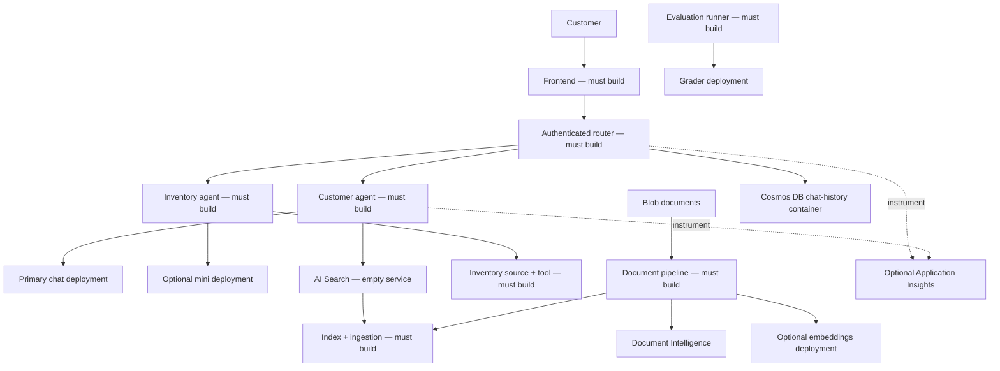

# बहु-एजेन्ट ग्राहक समर्थन — खुद्रा वास्तुकला ब्लूप्रिन्ट

**अध्याय ५: बहु-एजेन्ट AI समाधानहरू**

- [पाठ्यक्रम गृह](../README.md)
- [अध्याय ५](../docs/chapter-05-multi-agent/README.md)
- [पूर्व-आवश्यकता: AI एकीकरण](../docs/chapter-02-ai-development/microsoft-foundry-integration.md)
- [अर्को: क्षमता योजना](../docs/chapter-06-pre-deployment/capacity-planning.md)
- [ARM पूर्वाधार स्फोड](retail-multiagent-arm-template/README.md)

> **वास्तुकला मार्गदर्शिका, कार्यरत अनुप्रयोग होइन।** केवल खुद्रा कार्यान्वयन
> फाइलहरू हुन् `azuredeploy.json`, `azuredeploy.parameters.json`, र `deploy.sh` मा
> `retail-multiagent-arm-template/`। राउटर/फ्रन्टएन्ड कन्टेनरहरू हेलो-वर्ल्ड
> प्लेसेहोल्डरहरू हुन्। कुनै खुद्रा एजेन्ट, UI, इनजेस्तो पाइपलाइन, मूल्यांकनकर्ता, स्क्यानर, वा
> अनुप्रयोग परीक्षण सूट स्थानीय रूपमा अवस्थित छैन।

## अवलोकन

**लक्ष्य:** ग्राहक एजेन्ट र सूची
एजेन्ट सहित ग्राहक-सहयोग प्रणाली डिजाइन गर्नु, पूर्वाधारले के प्रदान गर्छ पत्ता लगाउनु, र हराइरहेका अनुप्रयोग
सम्झौता र प्रमाणीकरण योजना बनाउनु।

**दर्शक:** ती विकासकर्ताहरू जसले स्थानीय
[च्याट नमूना](../../../examples/azure-openai-chat) र [दुई-सेवा कन्टेनर नमूना](../../../examples/container-app/microservices)।
वास्तुकलाको अध्ययनको लागि २–३ घण्टा अनुमति दिनुहोस्। अनुप्रयोग निर्माण एक अलग
परियोजना हो: ८०–१२० विकास घण्टा अनुभवी विकासकर्ताहरूका लागि एक उदाहरणात्मक योजना अनुमान
हो, **डेलिभरी वाचा होइन**; उत्पादन कडा बनाउने, परीक्षण,
सुरक्षा समीक्षा, र अपरेशन्स थप काम आवश्यक पर्छ।

### सिकाइ परिणामहरू

- राउटिङ, ग्राउन्डिङ, उपकरण अनुमति, र संवाद स्वामित्व व्याख्या गर्नुहोस्।
- मोडेल परिचायकहरू, तैनाती नामहरू, API संस्करणहरू, र ARM संस्करणहरू भिन्न गर्नुहोस्।
- मिल्दोजुल्दो भेक्टर आयामहरूसँग कागजात सेवन र पुनःप्राप्ति डिजाइन गर्नुहोस्।
- प्रमाणित कार्यात्मक, मूल्याङ्कन, र असफलता-पुन: प्राप्ति आवश्यकताहरू परिभाषित गर्नुहोस्।
- वैकल्पिक वास्तुकला लक्ष्यहरूलाई वास्तवमा व्यवस्था गरिएका स्रोतहरूबाट अलग गर्नुहोस्।

## समाधान वास्तुकला



यो एक **लक्षित अनुप्रयोग वास्तुकला** हो, चलिरहेको एजेन्ट सेवाहरूको छवि होइन।
ARM स्क्याफोल्डले आधारभूत सेवाहरू र दुई प्लेसहोल्डर कन्टेनरहरू मात्र सिर्जना गर्छ।
फ्रन्ट डोर, रजिष्ट्रि, व्यवस्थापित पहिचान, भूमिका असाइनमेन्टहरू,
निजी अन्त बिन्दुहरू, फेलओभर, अनुप्रयोग उपकरणहरू, र सूचनाहरू समावेश छैनन्।

### जिम्मेवारीहरू र सम्झौताहरू

| कम्पोनेन्ट | आवश्यक व्यवहार | पूरा भनिए अघि प्रमाण |
|---|---|---|
| फ्रन्टएण्ड | प्रयोगकर्ताहरू प्रमाणीकरण गर्नुहोस्, च्याट रेंडर गर्नुहोस्, कागजातहरू सुरक्षित रूपमा अपलोड गर्नुहोस् | UI र अपलोड परीक्षणहरू, पहुँचयोग्य त्रुटिहरू |
| राउटर | अनुरोधहरू अधिकृत गर्नुहोस्, एजेन्ट चयन गर्नुहोस्, सिमित उपकरण कलहरू/समयसीमा | राउटिङ परीक्षणहरू, अधिकृत जाँचहरू, असफलता परीक्षणहरू |
| ग्राहक एजेन्ट | अनुमोदित स्रोतहरूमा नीति/उत्पादन उत्तरहरू ग्राउन्ड गर्नुहोस् | सही उद्धरणहरू, डेटा नभएको बेलामा परहेज गर्नुहोस् |
| इन्वेन्टरी उपकरण | दायरा गरिएको अनुमति सहित अधिकारिक स्टक पढ्नुहोस् | निर्धारण हुने स्टक परीक्षणहरू; कुनै निर्माण गरिएको उपलब्धता छैन |
| कागजात पाइपलाइन | निकालनुहोस्, टुक्रा पार्नुहोस्, एम्बेड गर्नुहोस्, अनुक्रमण गर्नुहोस्, अपडेट/मेटाउनुहोस् | अनुक्रमित केसहरू र पुन: प्रयास/डेड-लेटर व्यवहार |
| संवाद भण्डारण | प्रयोगकर्ताहरू अलग राख्नुहोस्, अवधारणालाई लागू गर्नुहोस् | क्रस-प्रयोगकर्ता अधिकृत र TTL परीक्षणहरू |
| मूल्याङ्कन धावक | नतिजाहरूलाई ग्राउन्ड ट्रुथ र मापनसँग तुलना गर्नुहोस् | कवरेज, असफलता गणना, पुन: उत्पादनयोग्य प्रतिवेदनहरू |

राउटरलाई रिसेप्सन डेस्क र उपकरणहरूलाई प्रतिबन्धित आन्तरिक प्रणालीहरूका रूपमा सोच्नुहोस्:
विशेषज्ञ चयन गर्नु भनेको प्रत्येक ग्राहकका रेकर्डहरू पहुँचको अधिकार होइन।
अनुप्रयोग कोड र डेटा सेवाहरूमा पहिचान र अनुमति लागू गर्नुहोस्, प्रॉम्प्टहरूमा होइन।

## पूर्वाधार बनाम अनुप्रयोग

प्रावधान गर्नु अघि [scaffold README](retail-multiagent-arm-template/README.md) पढ्नुहोस्।
यसले ठ्याक्कै स्रोतहरू, मोडहरू, लागतहरू, र सीमाहरू सूचीबद्ध गर्दछ।

| तार्किक प्रयोग | ARM डिप्लोइमेन्ट नाम | मोडेल / संस्करण | पूर्वनिर्धारित क्षेत्र |
|---|---|---|---|
| ग्राहक च्याट | `gpt-4.1-chat` | `gpt-4.1` / `2025-04-14` | `eastus2` |
| सूची | `gpt-4.1-mini-inventory` | `gpt-4.1-mini` / `2025-04-14` | `westus2`, वैकल्पिक |
| एम्बेडिङहरू | `text-embedding-ada-002` | `text-embedding-ada-002` / `2` | `francecentral`, वैकल्पिक |
| मूल्याङ्कन | `gpt-4.1-grader` | `gpt-4.1` / `2025-04-14` | पूर्वनिर्धारित रूपमा मुख्य क्षेत्र |

प्रत्येक क्षेत्रमा मोडेल/संस्करण/SKU उपलब्धता र कोटा जाँच्नुहोस्। च्याट/मिनी/ग्रेडरले
`GlobalStandard` प्रयोग गर्दछ; एम्बेडिङहरूले `Standard` प्रयोग गर्दछ। क्षमता-इकाई-देखि-TPM नक्साहरू
मोडेल-विशिष्ट छन्। सर्वव्यापी कोटा ग्यारेन्टीको रूपमा भिन्न क्षमता इकाइहरू थप्नुहोस् नगर्नुहोस्।

Azure OpenAI अनुरोधको `model` आर्गुमेन्ट भनेको **डिप्लोइमेन्ट नाम** हो, होइन
अवश्य पनि catalog मोडल को पहिचानकर्ता। Data-plane API संस्करण `2024-10-21`
मोडल संस्करण `2025-04-14` र ARM स्रोत `apiVersion` बाट भिन्न छ।
एक अनुपलब्ध मोडललाई सिर्फ data-plane API संस्करण परिवर्तन गरेर सुधार्न सकिँदैन।

`--no-multi-region` ले दोस्रो र embeddings खातालाई छोड्छ। एक प्रमुख च्याट र
स्वतन्त्र ग्रेडर खाता रहन्छ। अलग मोडल खाताले स्वचालित
failover प्रदान गर्दैन; त्यसका लागि एप्लिकेशन routing, उपयुक्त डिप्लोयमेन्टहरू, स्वास्थ्य जाँच,
पुन: प्रयास सीमाहरू, र डेटा-आवास समीक्षा आवश्यक छ।

## कार्यन्वयन रोडम्याप

### 1. एक परिक्षण गरिएको अन्तरक्रियाबाट शुरू गर्नुहोस्

ठूलो scaffold को प्रबन्ध गर्नु अघि, स्थानीय च्याट नमुनाको प्रयोग गरेर
inference कनेक्टिविटी स्थापना गर्नुहोस्। एक प्रतिनिधि ग्राहक प्रश्न, अनुमोदित
उत्तर स्रोत, अपेक्षित उद्धरण, र जब त्यो स्रोत हराइरहेको छ तब असफलता व्यवहार परिभाषित गर्नुहोस्।

### 2. Routing र उपकरण सिमाना परिभाषित गर्नुहोस्

आफ्नो आफ्नै router स्रोत, निर्भरता म्यानिफेस्ट, Dockerfile, र परीक्षणहरु सिर्जना गर्नुहोस्। एक
उदाहरण सम्झौता हुनसक्छ `POST /chat` सँग `{"message":"...","conversation_id":"..."}`।
**त्यो endpoint डिजाईन प्रस्ताव हो; यो ARM टेम्प्लेटद्वारा कार्यान्वयन गरिएको छैन।**

बडी प्रकार/सीमाहरू प्रमाणित गर्नुहोस्, प्रमाणीकरणबाट प्रयोगकर्ता पहिचान व्युत्पन्न गर्नुहोस्,
संवाद मालिकत्व लागू गर्नुहोस्, अनुरोध समयसीमाहरू लागू गर्नुहोस्, र अर्थपूर्ण त्रुटि कोड फर्काउनुहोस्।
HTTP असफलता वा खाली जवाफलाई सफल एजेन्ट नतिजाको रूपमा नलिनुहोस्।

### 3. ग्राउन्डिंग र इन्टेक कार्यान्वयन गर्नुहोस्

ARM टेम्प्लेटले खोज सूची सिर्जना गर्दैन। यो एक **तपाईंको आफ्नै सूची परिभाषामा अनुकूलन गर्न
लागि सन्दर्भ JSON अंश हो**, रेपोमा पहिले अटो गरिएको फाइल होइन:

```json
{
  "name": "retail-product-index",
  "fields": [
    {"name": "id", "type": "Edm.String", "key": true},
    {"name": "title", "type": "Edm.String", "searchable": true},
    {"name": "content", "type": "Edm.String", "searchable": true},
    {"name": "category", "type": "Edm.String", "filterable": true},
    {
      "name": "content_vector",
      "type": "Collection(Edm.Single)",
      "searchable": true,
      "dimensions": 1536,
      "vectorSearchProfile": "retail-profile"
    }
  ],
  "vectorSearch": {
    "algorithms": [{"name": "retail-hnsw", "kind": "hnsw"}],
    "profiles": [{"name": "retail-profile", "algorithm": "retail-hnsw"}]
  }
}
```

प्रोफाइलले भेक्टर फिल्डलाई यसको एल्गोरिथमसँग जोड्दछ। आयामहरू
वास्तविक embedding आउटपुटसँग मेल खानुपर्छ (यो `ada-002` डिप्लोयमेन्टको लागि 1536)। Python पुन: प्राप्तिका लागि,
आफ्नो भेक्टर क्वेरी प्रकार नभएको अपूरो शब्दकोशको सट्टा `azure.search.documents.models.VectorizedQuery` प्रयोग गर्नुहोस्:


```python
# Reference function only: supply an authenticated async SearchClient and an embedding.
from azure.search.documents.models import VectorizedQuery

async def retrieve(search_client, embedding):
    results = await search_client.search(
        search_text=None,
        vector_queries=[VectorizedQuery(
            vector=embedding,
            k_nearest_neighbors=5,
            fields="content_vector"
        )],
        select=["id", "title", "content"]
    )
    return [document async for document in results]
```

एउटा छुट्टै इनगेस्टसन कार्यान्वयन सिर्जना गर्नुहोस् जुन:

1. अपलोड पहुँचको अनुमति दिन्छ र सामग्रीको प्रकार र आकारको मान्यता गर्दछ।
2. प्रमाणित SDK कलहरू प्रयोग गरेर निजी ब्लबहरू पढ्छ। एउटा निजी ब्लब URL आफैंमा
   Document Intelligence इनपुट पढ्न सकिने ** होइन**; डाउनलोड गरिएका बाइटहरू
   `AnalyzeDocumentRequest(bytes_source=...)` सँग पठाउनुहोस् वा पहुँच आवश्यकताहरू समीक्षा गरेपछि उपयुक्त दायरा भएको,
   छोटो अवधिको SAS प्रयोग गर्नुहोस्।
3. पाठ निकाल्छ, त्यसलाई एम्बेडिङ सीमा भित्र फिट गर्न टुक्र्याउँछ, र एम्बेडिङहरू जनरेट गर्दछ।
4. स्थिर मान्य कागजात कुञ्जीहरू सिर्जना गर्दछ र मेल खाने भेक्टरहरूसँग टुक्राहरू अपलोड गर्दछ।
5. प्रति-कागजात अनुक्रमण परिणामहरू जाँच गर्दछ, पुन: प्रयासहरू ह्यान्डल गर्दछ, र पुरानो डाटा अपडेट/मेटाउँछ।

OData फिल्टरहरूमा मनमाफिक प्रयोगकर्ताको कुञ्जी/मानहरू समावेश नगर्नुहोस्। फिल्डहरूलाई अनुमति सूचीमा राख्नुहोस्,
मान मानौं प्रकारहरू प्रमाणित गर्नुहोस्, र स्ट्रिङ उद्धरणहरू एस्केप गर्नुहोस्। बूलियन र संख्यात्मक फिल्टरहरूलाई
टिपिएको literals चाहिन्छ, उद्धरणयुक्त स्ट्रिङहरू होइनन्।

### 4. वेब ग्राउन्डिङ

**Bing Search v7 अगस्त 11, 2025 मा सेवानिवृत्त भयो।** पुरानो `Microsoft.Bing/accounts`
स्रोत र `api.bing.microsoft.com/v7.0/search` उदाहरणहरू समर्थित
कार्यान्वयन मार्ग होइनन्। Microsoft Foundry मा हाल समर्थित ग्राउन्डिंग एकीकरण मूल्यांकन गर्नुहोस्
र यसको SDK, अनुमति, बिलिङ्, र उद्धरण आवश्यकताहरू;
यी मध्ये कुनै पनि यहाँ लागू गरिएको छैन। यो सेवानिवृत्त इन्डपोइन्टको लागि सिधा प्रतिस्थापन होइन।

### 5. टेलीमेट्री र मूल्यांकन थप्नुहोस्

Application Insights सिर्जना गर्दा कोडलाई उपकरण जडान हुँदैन। नयाँ अनुप्रयोग बनाउन समर्थित Azure Monitor
OpenTelemetry उपकरण प्रयोग गर्नुहोस्, सेवाहरू बीच ट्रेस सन्दर्भ प्रसारण गर्नुहोस्,
र ग्राहकको प्राँप्ट, कागजात, वा गोप्य विवरणहरू लग नगर्नुहोस्।
क्वेरी छोट्याउनुले **गोप्य बनाउँदैन**।

अनुरोध अवधि, रूटिङ/उपकरण असफलताहरू, पुनःप्राप्ति सान्दर्भिकता, उद्धरण
शुद्धता, टोकन प्रयोग, र परहेज मापन गर्नुहोस्। मूल्यांकन केसहरूका साथ ग्राउन्ड-ट्रुथ सूची/नीति तथ्यहरू
भण्डारण गर्नुहोस्: केवल प्रश्न र जवाफबाट एक ग्रेडरले विश्वसनीय तथ्यगत शुद्धता निर्धारण गर्न सक्दैन।


संरचित आउटपुट/स्कीमा प्रमाणीकरण, स्कोर-दायरा जाँचहरू, यातायात असफलता गणना,
र मानवीय समीक्षित केस कार्यान्वयन गर्नुहोस्। अपूर्ण/त्रुटि केसहरू अलग रिपोर्ट गर्नुहोस्; तिनीहरूलाई सफल ग्रेडमा परिवर्तन नगर्नुहोस्
वा मौन रूपमा शून्य गुणस्तर मोडेल प्रतिक्रियाका रूपमा समावेश नगरौं।


अनुरोध, हराएको परीक्षण रणनीति, वा खाली प्रतिक्रिया परीक्षणलाई **अस्पष्ट वा असफल** बनाउनुपर्छ, “100% सुरक्षित” स्कोर उत्पादन नगर्नुहोस्।
उत्पादन-तयारी दाबी अघि उपयुक्त औजार र मानवीय समीक्षा सहित अधिकृत परीक्षण गर्नुहोस्।

### 6. तपाईंको अनुप्रयोग परिनियोजन गर्नुहोस्

आफ्नै स्रोत निर्देशिका, म्यानिफेस्ट, परीक्षण, रजिस्ट्री, र छवि तान्ने

Bicep वा स्पष्ट समर्थित azd वातावरण म्यापिङमा रनटाइम वातावरण भेरिएबलहरू कन्फिगर गर्नुहोस्।

प्रत्येक अनुप्रयोगको सुन्ने पोर्टसँग मेल खानुहोस्। बिसेपमा रनटाइम वातावरण चरहरू कन्फिगर गर्नुहोस्
वा एक स्पष्ट समर्थित azd वातावरण म्यापिङ।

azd सेवा अन्तर्गत कुनै सामान्य `config` शब्दकोश छैन जसले स्वचालित रूपमा
runtime वातावरण चरहरू सिर्जना गर्छ। `azd env set` ले मात्र ती मानहरू स्पष्ट रूपमा उपभोग गर्ने स्रोतहरू परिवर्तन गर्छ।
यस स्क्याफोल्डमा कुनै क्यानरी, क्षेत्रहरूको सूची, वा सूक्ष्म ट्यूनिङ हुक लागू गरिएको छैन।


## व्यावहारिक डिजाइन अभ्यासहरू

यी **आर्किटेक्चर अभ्यासहरू** हुन्, कार्यान्वयन गर्न सकिने खुद्रा स्टार्टर कोडको दाबी होइनन्।

### अभ्यास १: सीमाना प्रमाणित गर्नुहोस्

**सुरूवाती बिन्दु:** `retail-multiagent-arm-template/` मा रहेका तीन फाइलहरू।
**लक्ष्य:** प्रावधान र एप्लिकेसन कार्यक्षमताबीच भेद गर्न।
`azuredeploy.json` खोल्नुहोस्, दुवै कन्टेनर इमेजहरू र `targetPort` सर्तहरू फेला पार्नुहोस्,
र त्यसपछि रिपोजिटरीबाट अनुपस्थित एप्लिकेसन कम्पोनेन्टहरूको सूची बनाउनुहोस्।

**सफलताको मापदण्ड / उत्तर:** दुवै इमेजहरू पोर्ट ८० मा सुन्ने hello-world प्लेसहोल्डरहरू हुन्;
एजेन्टहरू, च्याट UI, राउटर ह्यान्डलरहरू, इन्डेक्स/इनजेसन, मूल्याङ्कनकर्ता, र स्क्यानर
अनुपस्थित छन्। सफल प्लेसहोल्डर रूट अनुरोधले `/chat` प्रमाणित गर्दैन।
**सामान्य समस्या:** `retail-router` जस्ता स्रोत नामहरूलाई काम गर्ने कोडको रूपमा व्याख्या गर्नु।

### अभ्यास २: भेक्टर कन्फिगरेसन पछ्याउनुहोस्

**सुरूवाती बिन्दु:** माथिको इन्डेक्स JSON।
**लक्ष्य:** फिल्ड → प्रोफाइल → एल्गोरिदम सम्बन्ध बुझ्न।
जुन मानहरू फरक आउटपुट आयाम भएको एम्बेडिङ मोडेलमा स्विच गर्दा परिवर्तन हुनुपर्छ पत्ता लगाउनुहोस्,
त्यसपछि `retrieve` फङ्सन निरीक्षण गर्नुहोस्।

**सफलताको मापदण्ड / उत्तर:** फिल्ड `dimensions` वास्तविक भेक्टर लम्बाइमा परिवर्तन गर्नुहोस्;
`vectorSearchProfile` लाई घोषित प्रोफाइल र यसको एल्गोरिदमसँग मेल खाने राख्नुहोस्;
क्वेरी `fields` ले भेक्टर फिल्डको नाम लिनुपर्छ। एम्बेडिङ मोडेल परिवर्तन हुँदा
वर्तमान कागजात भेक्टरहरू पुनर्जेनरेट गर्नुहोस्।
**सामान्य समस्या:** मोडेल नाम मात्र परिवर्तन गर्दा असंगत भेक्टरहरू राख्नु।

### अभ्यास ३: असफलता परीक्षण परिभाषित गर्नुहोस्

**सुरूवाती बिन्दु:** जिम्मेवारी तालिका।
**लक्ष्य:** गलत सफलतालाई रोक्नु।
अनुपलब्ध सूची API, मिल्ने कागजात नभएको खोज इन्डेक्स, र HTTP 503 फर्काउने मूल्यांकन अनुरोधको
अपेक्षित व्यवहार लेख्नुहोस्।

**सफलताको मापदण्ड / उत्तर:** कुनै नकली सूची मानहरू छैनन्; सन्दर्भ हराउँदा स्पष्ट परहेज वा
उन्नति; मूल्यांकनले गुणस्तर वा सुरक्षा पास नभएर यातायात असफलता रिपोर्ट गर्छ। एप्लिकेसन सिर्जना गर्दा
कार्यान्वयन गर्न मिल्ने परीक्षणहरू थप्नुस्।
**सामान्य समस्या:** सबै अपवाद समातेर खाली उत्तरका साथ जारी राख्नु।

## लागतहरु, समस्या समाधान, र सफाइ

- पूर्वाधारमा खाली खोज इन्डेक्सहरू र प्लेसहोल्डर एपहरू भए पनि निरन्तर शुल्क लाग्छ। वर्तमान क्षेत्रीय मूल्यहरू प्रयोग गर्नुहोस्;
  “न्यूनतम” वा बहु-क्षेत्रीय मतलब निःशुल्क होइन।
- टोकन लागत मोडेल, क्यास गरिएको/नक्यास गरिएको इनपुट, आउटपुट, र डिप्लोयमेन्ट SKU मा निर्भर गर्छ।
  रुटिङले मात्र आर्थिक बचत गर्न सक्छ यदि मापन गरिएको कार्यभार र गुणस्तर परिणामहरूले यसलाई न्यायोचित पार्छ;
  निश्चित 60–80% बचतको ग्यारेण्टी छैन।
- प्रोभिजनिङ अघि मोडेल उपलब्धता र कोटा जाँच गर्नुहोस्; अनुमतिहरूमा भिन्नता गर्नुहोस्,
  परिनियोजन-नाम, क्षेत्र, मोडेल-संस्करण, र API-संस्करण त्रुटिहरू।
- हराएको `setup-data.sh`, मूल्याङ्कनकर्ता CLIहरू, वा `pytest tests/` आदेशहरू चलाउनु हुँदैन।
  तिनीहरूको कार्यान्वयन तपाईंको विकास ब्याकलोगको भाग हुन्।
- स्क्याफोल्ड ARM-मात्र हो: यसको अनुसरण गर्नुहोस्
  [प्रमाणीकरण र सफाई निर्देशनहरू](retail-multiagent-arm-template/README.md)।
  `azd down` ती स्रोतहरूको व्यवस्थापन गर्दैन।

## सम्बन्धित स्रोतहरू

- [कार्यरत स्थानीय च्याट नमूना](../../../examples/azure-openai-chat)
- [कार्यरत दुई-सेवा कन्टेनर नमूना](../../../examples/container-app/microservices)
- [AI खोज भेक्टर सूचकांकहरू](https://learn.microsoft.com/azure/search/vector-search-how-to-create-index)
- [कन्टेनर एप्स दस्तावेज](https://learn.microsoft.com/azure/container-apps/)
- [समस्या समाधान](../docs/chapter-07-troubleshooting/common-issues.md)
- [समस्या रिपोर्ट गर्नुहोस्](https://github.com/microsoft/AZD-for-beginners/issues)

---

<!-- CO-OP TRANSLATOR DISCLAIMER START -->
**अस्वीकरण**:
यो दस्तावेज़ AI अनुवाद सेवा [Co-op Translator](https://github.com/Azure/co-op-translator) प्रयोग गरेर अनुवाद गरिएको हो। हामी सही हुन प्रयास गर्छौं, तर कृपया जानकार हुनुस् कि स्वचालित अनुवादमा त्रुटिहरू वा अशुद्धताहरू हुन सक्छन्। मूल दस्तावेज़ यसको मूल भाषामा आधिकारिक स्रोत मानिनुपर्छ। महत्वपूर्ण जानकारीका लागि व्यावसायिक मानव अनुवाद सिफारिस गरिन्छ। यस अनुवादको प्रयोगबाट उत्पन्न कुनै पनि गलत बुझाइ वा त्रुटिको लागि हामी जिम्मेवार छैनौं।
<!-- CO-OP TRANSLATOR DISCLAIMER END -->