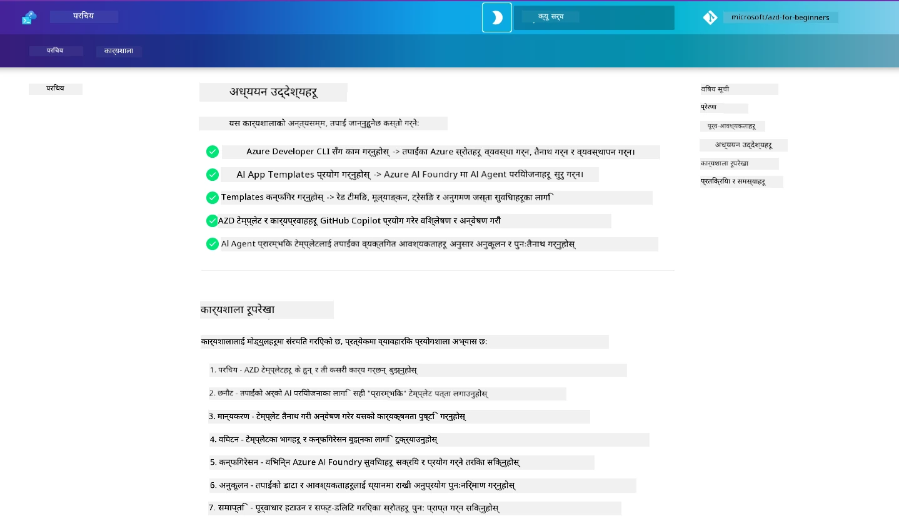

<div align="center">
  <div style="background: linear-gradient(135deg, #0078d4, #106ebe); border-radius: 10px; padding: 20px; margin: 20px 0; box-shadow: 0 4px 15px rgba(0, 120, 212, 0.3); border: 2px solid #005a9e;">
    <h2 style="color: white; margin: 0; font-size: 24px; text-shadow: 1px 1px 2px rgba(0,0,0,0.3);">
      🎯 AI विकासकर्ताहरूको लागि AZD कार्यशाला
    </h2>
    <p style="color: white; margin: 10px 0 0 0; font-size: 16px; text-shadow: 1px 1px 2px rgba(0,0,0,0.3);">
      <strong>Azure Developer CLI सँग AI अनुप्रयोगहरू निर्माण गर्नका लागि व्यावहारिक कार्यशाला।</strong><br>
      AZD टेम्प्लेटहरू र AI वितरण कार्यप्रवाहहरूमा दक्षता हासिल गर्न ७ वटा मोड्युलहरू पूरा गर्नुहोस्।
    </p>
    <div style="margin-top: 15px;">
      <span style="background: rgba(255,255,255,0.2); padding: 5px 10px; border-radius: 15px; color: white; font-size: 14px;">
        📅 स्रोत मार्गदर्शन समीक्षा गरिएको: नोभेम्बर २०२६
      </span>
    </div>
  </div>
</div>

# AI विकासकर्ताहरूको लागि AZD कार्यशाला

Azure Developer CLI (AZD) सिक्नका लागि व्यावहारिक कार्यशालामा स्वागत छ जसले AI अनुप्रयोग वितरणमा केन्द्रित छ। यो कार्यशालाले तपाईंलाई AZD टेम्प्लेटहरूको प्रयोगात्मक बुझाइ ३ चरणमा सिकाउँछ:

1. **खोज** - तपाईंका लागि उपयुक्त टेम्प्लेट पत्ता लगाउनुहोस्।
1. **डिप्लोयमेन्ट** - तैनाथ गर्नुहोस् र यो काम गर्छ कि भनी प्रमाणित गर्नुहोस्।
1. **अनुकूलन** - संशोधन गर्नुहोस् र तपाईंको अनुसार बनाउन दोहोर्‍याउनुहोस्!

यस कार्यशालाको दौरान, तपाईंले कोर विकासकर्ता उपकरण र कार्यप्रवाहहरू पनि सिक्नुहुनेछ, जसले तपाईंको संपूर्ण विकास यात्रा सहज बनाउँछ।

<br/>

## ब्राउजर-आधारित मार्गदर्शक

कार्यशाला पाठहरू मार्कडाउनमा छन्। तपाईंले सिधै GitHub मा तिनीहरू हेर्न सक्नुहुन्छ - वा तलको स्क्रिनशटमा देखाइएको जस्तै ब्राउजर-आधारित पूर्वावलोकन सुरु गर्न सक्नुहुन्छ।



यो विकल्प प्रयोग गर्नका लागि - रिपोजिटोरीलाई आफ्नो प्रोफाइलमा फोर्क गर्नुहोस्, र GitHub Codespaces सुरु गर्नुहोस्। एक पटक VS Code टर्मिनल सक्रिय भएपछि यो आदेश टाइप गर्नुहोस्:

यो ब्राउजर पूर्वावलोकन GitHub Codespaces, dev कन्टेनरहरूमा, वा Python र MkDocs स्थापना गरिएको स्थानीय क्लोन् मा काम गर्दछ।

```bash title="" linenums="0"
python -m pip install -r requirements-dev.txt
python -m mkdocs serve --config-file workshop/mkdocs.yml
```

यी आदेशहरू **कोर्स रिपोजिटोरी रुट** बाट चलाउनुहोस्, अलग रूपमा इनीशियलाइज गरिएको AI नमूना बाट होइन। पूर्वावलोकनलाई अगाडि राख्नुहोस् ताकि त्रुटिहरू देखिइरहोस्; बन्द गर्न Ctrl+C दबाउनुहोस्। साइट जाँच्न तर सेवा नगर्न चाहनुभयो भने `python -m mkdocs build --strict --config-file workshop/mkdocs.yml` चलाउनुहोस्।

केही सेकेण्डभित्र पप-अप संवाद बक्स देखिनेछ। `Open in browser` विकल्प चयन गर्नुहोस्। वेब-आधारित मार्गदर्शक नयाँ ब्राउजर ट्याबमा खुल्नेछ। यस पूर्वावलोकनका केही फाइदाहरू:

1. **बिल्ट-इन खोज** - छिटो कुञ्जीशब्द वा पाठहरू पत्ता लगाउनुहोस्।
1. **कपी आइकन** - कोडब्लकहरूमा हभर गर्दा यो विकल्प देखिन्छ।
1. **थीम टगल** - रातो र प्रकाशमय थीम बीच स्विच गर्नुहोस्।
1. **मदत प्राप्त गर्नुहोस्** - फूटरमा रहेको Discord आइकनमा क्लिक गरेर सहभागी हुनुस्!

<br/>

## कार्यशाला अवलोकन

**अवधि:** ३-४ घण्टा  
**स्तर:** शुरुवाती देखि मध्यम  
**प्रीरेक्विजिट्स:** Azure, AI अवधारणाहरू, VS Code र कमाण्ड-लाइन उपकरणहरूको परिचय।

यो एक व्यावहारिक कार्यशाला हो जहाँ तपाईंले गरेर सिक्नुहुनेछ। अभ्यासहरू पूरा गरेपछि, सुरक्षा र उत्पादकता उत्तम अभ्यासहरूमा सिकाइ जारी राख्न AZD For Beginners पाठ्यक्रम पुनरावलोकन गर्न सल्लाह दिइन्छ।

| समय| मोड्युल  | उद्देश्य |
|:---|:---|:---|
| १५ मिनेट | [परिचय](docs/instructions/0-Introduction.md) | चरण सेट गर्नुहोस्, लक्ष्यहरू बुझ्नुहोस् |
| ३० मिनेट | [AI टेम्प्लेट चयन](docs/instructions/1-Select-AI-Template.md) | विकल्पहरू अन्वेषण गर्नुहोस् र सुरु गर्नुहोस् | 
| ३० मिनेट | [AI टेम्प्लेट मान्यकरण](docs/instructions/2-Validate-AI-Template.md) | पूर्वनिर्धारित समाधान Azure मा तैनाथ गर्नुहोस् |
| ३० मिनेट | [AI टेम्प्लेट भाँच्नुहोस्](docs/instructions/3-Deconstruct-AI-Template.md) | संरचना र कन्फिगरेसन अन्वेषण गर्नुहोस् |
| ३० मिनेट | [AI टेम्प्लेट कन्फिगर गर्नुहोस्](docs/instructions/4-Configure-AI-Template.md) | उपलब्ध सुविधाहरू सक्रिय र प्रयास गर्नुहोस् |
| ३० मिनेट | [AI टेम्प्लेट अनुकूलन गर्नुहोस्](docs/instructions/5-Customize-AI-Template.md) | टेम्प्लेटलाई तपाईंको आवश्यकताहरूअनुसार मिलाउनुहोस् |
| ३० मिनेट | [पूर्वाधार हटाउनुहोस्](docs/instructions/6-Teardown-Infrastructure.md) | सफा गर्नुहोस् र स्रोतहरू रिलिज गर्नुहोस् |
| १५ मिनेट | [समापन र आगामी कदमहरू](docs/instructions/7-Wrap-up.md) | सिकाइ स्रोतहरू, कार्यशाला चुनौती |

<br/>

## तपाईंले के सिक्नुहुनेछ

AZD टेम्प्लेटलाई Microsoft Foundry मा अन्त्यदेखि अन्त्य विकासका विभिन्न क्षमता र उपकरणहरू अन्वेषण गर्नको लागि सिकाइ स्यान्डबक्सको रूपमा सोच्नुहोस्। यस कार्यशालाको अन्त्यसम्म, तपाईंले यस सन्दर्भमा विभिन्न उपकरण र अवधारणाहरूको सहज अनुभूति पाउनु हुनेछ।

| अवधारणा  | उद्देश्य |
|:---|:---|
| **Azure Developer CLI** | उपकरण आदेश र कार्यप्रवाहहरू बुझ्नुहोस्|
| **AZD टेम्प्लेटहरू**| प्रोजेक्ट संरचना र कन्फिगरेसन बुझ्नुहोस्|
| **Azure AI Agent**| Microsoft Foundry प्रोजेक्टको प्रावधान र तैनाथ गर्नुहोस्  |
| **Azure AI Search**| एजेन्टहरूसँग सन्दर्भ इन्जिनियरिङ सक्षम गर्नुहोस् |
| **अवलोकनयोग्यता**| ट्रेसिङ, अनुगमन र मूल्याङ्कनहरू अन्वेषण गर्नुहोस् |
| **रातो टिमिङ**| विरोधात्मक परीक्षण र निवारणहरू अन्वेषण गर्नुहोस् |

<br/>

## कार्यशाला संरचना

कार्यशाला तपाईंलाई टेम्प्लेट खोजाइ, तैनाथ, भाँच्न र अनुकूलन गर्ने यात्रामा लाने गरी संरचित गरिएको छ - आधिकारिक [AI एजेन्टहरू सँग सुरु गर्ने](https://github.com/Azure-Samples/get-started-with-ai-agents) सुरु टेम्प्लेटलाई आधार बनाउँदै।

### [मोड्युल १: AI टेम्प्लेट चयन](docs/instructions/1-Select-AI-Template.md) (३० मिनेट)

- AI टेम्प्लेटहरू के हुन्?
- म AI टेम्प्लेटहरू कहाँ फेला पार्न सक्छु?
- म कसरी AI एजेन्टहरू निर्माण गर्न सुरु गर्न सक्छु?
- **लैब**: Codespaces वा dev कन्टेनरमा क्विकस्टार्ट

### [मोड्युल २: AI टेम्प्लेट मान्यकरण](docs/instructions/2-Validate-AI-Template.md) (३० मिनेट)

- AI टेम्प्लेट संरचना के हो?
- AZD विकास कार्यप्रवाह के हो?
- AZD विकासमा म कसरी मद्दत पाउन सक्छु?
- **लैब**: AI एजेन्ट टेम्प्लेट तैनाथ र मान्यकरण गर्नुहोस्

### [मोड्युल ३: AI टेम्प्लेट भाँच्नुहोस्](docs/instructions/3-Deconstruct-AI-Template.md) (३० मिनेट)

- आफ्नो वातावरण `.azure/` मा अन्वेषण गर्नुहोस् 
- आफ्नो स्रोत सेटअप `infra/` मा हेर्नुहोस् 
- आफ्नो AZD कन्फिगरेसन `azure.yaml` मा अन्वेषण गर्नुहोस्
- **लैब**: वातावरण चरहरू संशोधन गर्नुहोस् र पुन: तैनाथ गर्नुहोस्

### [मोड्युल ४: AI टेम्प्लेट कन्फिगर गर्नुहोस्](docs/instructions/4-Configure-AI-Template.md) (३० मिनेट)
- अन्वेषण गर्नुहोस्: रिट्रीवल अगेमेन्टेड जेनेरेशन
- अन्वेषण गर्नुहोस्: एजेन्ट मूल्याङ्कन र रातो टिमिङ
- अन्वेषण गर्नुहोस्: ट्रेसि & अनुगमन
- **लैब**: AI एजेन्ट + अवलोकनयोग्यता अन्वेषण गर्नुहोस् 

### [मोड्युल ५: AI टेम्प्लेट अनुकूलन गर्नुहोस्](docs/instructions/5-Customize-AI-Template.md) (३० मिनेट)
- परिभाषित गर्नुहोस्: PRD सँग परिदृश्य आवश्यकताहरू
- कन्फिगर गर्नुहोस्: AZD का लागि वातावरण चरहरू
- कार्यान्वयन गर्नुहोस्: थप कार्यहरूका लागि जीवनचक्र हुकहरू
- **लैब**: मेरो परिदृश्यका लागि टेम्प्लेट अनुकूलन गर्नुहोस्

### [मोड्युल ६: पूर्वाधार हटाउनुहोस्](docs/instructions/6-Teardown-Infrastructure.md) (३० मिनेट)
- पुनरावलोकन: AZD टेम्प्लेटहरू के हुन्?
- पुनरावलोकन: किन Azure Developer CLI प्रयोग गर्ने?
- आगामी कदमहरू: अर्को टेम्प्लेट प्रयास गर्नुहोस्!
- **लैब**: पूर्वाधार डिप्रोभिजन र सफा गर्नुहोस्

<br/>

## कार्यशाला चुनौती

आफैलाई थप चुनौती दिन चाहनुहुन्छ? यहाँ केही प्रोजेक्ट सुझावहरू छन् - वा तपाईंका विचारहरू हामीसँग साझा गर्नुहोस्!!

| प्रोजेक्ट | विवरण |
|:---|:---|
|1. **एक जटिल AI टेम्प्लेट भाँच्नुहोस्** | हामीले व्याख्या गरेको कार्यप्रवाह र उपकरण प्रयोग गरेर अर्को AI समाधान टेम्प्लेट तैनाथ, मान्यकरण, र अनुकूलन गर्न प्रयास गर्नुहोस्। _तपाईंले के सिक्नुभयो?_|
|2. **तपाईंको परिदृश्य अनुसार अनुकूलन गर्नुहोस्**  | अर्को परिदृश्यका लागि PRD (उत्पादन आवश्यकताहरू कागजात) लेख्न प्रयास गर्नुहोस्। त्यसपछि Agent Model मा GitHub Copilot प्रयोग गरेर आफ्नो टेम्प्लेट रिपोमा अनुकूलन कार्यप्रवाह उत्पन्न गर्नुस्। _तपाईंले के सिक्नुभयो? यी सुझावहरूमा तपाईं कसरी सुधार गर्न सक्नुहुन्छ?_|
| | |

## प्रतिक्रिया छ?

1. यस रिपोमा मुद्दा पोस्ट गर्नुहोस् - सजिलैका लागि ट्याग गर्नुहोस् `Workshop`।
1. Microsoft Foundry Discord मा सहभागी हुनुहोस् - आफ्ना सहकर्मीहरूलाई जोड्नुस्!


| | | 
|:---|:---|
| **📚 कोर्स होम**| [AZD For Beginners](../README.md)|
| **📖 कागजातहरू** | [AI टेम्प्लेटहरूसँग सुरु गर्नुहोस्](https://learn.microsoft.com/en-us/azure/ai-foundry/how-to/develop/ai-template-get-started)|
| **🛠️AI टेम्प्लेटहरू** | [Microsoft Foundry टेम्प्लेटहरू](https://ai.azure.com/templates) |
|**🚀 आगामी कदमहरू** | [कार्यशाला सुरु गर्नुहोस्](#workshop-overview) |
| | |

<br/>

---

**नेभिगेसन:** [मुख्य कोर्स](../README.md) | [परिचय](docs/instructions/0-Introduction.md) | [मोड्युल १: टेम्प्लेट चयन](docs/instructions/1-Select-AI-Template.md)

**AZD सँग AI अनुप्रयोगहरू निर्माण गर्न तयार हुनुहुन्छ?**

[कार्यशाला सुरु गर्नुहोस्: परिचय →](docs/instructions/0-Introduction.md)

---

<!-- CO-OP TRANSLATOR DISCLAIMER START -->
**अस्वीकरण**:
यो दस्तावेज़ AI अनुवाद सेवा [Co-op Translator](https://github.com/Azure/co-op-translator) प्रयोग गरेर अनुवाद गरिएको हो। हामी सही हुन प्रयास गर्छौं, तर कृपया जानकार हुनुस् कि स्वचालित अनुवादमा त्रुटिहरू वा अशुद्धताहरू हुन सक्छन्। मूल दस्तावेज़ यसको मूल भाषामा आधिकारिक स्रोत मानिनुपर्छ। महत्वपूर्ण जानकारीका लागि व्यावसायिक मानव अनुवाद सिफारिस गरिन्छ। यस अनुवादको प्रयोगबाट उत्पन्न कुनै पनि गलत बुझाइ वा त्रुटिको लागि हामी जिम्मेवार छैनौं।
<!-- CO-OP TRANSLATOR DISCLAIMER END -->