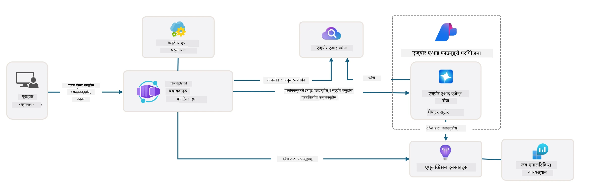

# 3. टेम्प्लेटलाई फुटाउने

!!! tip "यो मोड्युलको अन्त्यसम्म तपाईं सक्षम हुनुहुनेछ"

    - [ ] Use GitHub Copilot and optional MCP tools for Azure documentation and read-only exploration
    - [ ] Identify the template's application, infrastructure, configuration, and test entry points
    - [ ] Verify generated explanations against actual repository files
    - [ ] **Lab 3:** Trace one request and one configuration input through the project

---

## 1. GitHub Copilot सक्रिय गर्नुहोस्

VS Code मा सुरू गरिएको AI नमुना खोल्नुहोस् र [GitHub Copilot](https://code.visualstudio.com/docs/copilot/chat/chat-agent-mode) सक्षम गर्नुहोस्। एक योग्य योजना भएको खाताले साइन इन गर्नुहोस्; प्रयोग सीमाहरू फरक-फरक हुन्छन्। परिवर्तनहरूलाई अनुमति दिनुअघि Copilot लाई रिपोजिटोरी व्याख्या गर्न भन्नुहोस्।

### वैकल्पिक MCP सर्भरहरू

यी सेवाहरू अतिरिक्त उपकरणहरू प्रदान गर्न सक्छन्:

- [Azure MCP Server](https://learn.microsoft.com/azure/developer/azure-mcp-server/overview)
- [Microsoft Learn MCP Server](https://learn.microsoft.com/training/support/mcp)

VS Code मा, [MCP कन्फिगरेसन मार्गदर्शन](https://code.visualstudio.com/docs/copilot/chat/mcp-servers) समीक्षा गर्नुहोस् र आवश्यक परे `.vscode/mcp.json` सिर्जना गर्नुहोस्:

```json
{
  "servers": {
    "Azure MCP Server": {
      "type": "stdio",
      "command": "npx",
      "args": ["-y", "@azure/mcp@latest", "server", "start"]
    },
    "microsoft.docs.mcp": {
      "type": "http",
      "url": "https://learn.microsoft.com/api/mcp"
    }
  }
}
```

`npx` आदेशले समर्थन गरिएको Node.js/npm स्थापना आवश्यक पार्छ र कार्यान्वयन योग्य कोड डाउनलोड गर्छ। प्याकेज समीक्षा गर्नुहोस् र एक स्वीकृत संस्करण टिम सेटअपको लागि पिन गर्नुहोस्। VS Code को MCP नियन्त्रणहरू प्रयोग गरेर सर्भरहरू सुरू गर्नुहोस् र तिनीहरूको उपलब्ध उपकरणहरू निरीक्षण गर्नुहोस्; नामहरू संस्करणहरू बीच परिवर्तन हुन सक्छ।

**प्रमाणीकरण अलग छ।** AZD का लागि `azd auth login` प्रयोग गर्नुहोस्। यसको उपकरणहरूका लागि Azure MCP को कागजातहरूमा प्रमाणिकरण प्रक्रिया पालन गर्नुहोस्; AZD लगइन मात्रले MCP सत्र स्थापित गर्दैन। जब अभ्यास वा हुकले Azure CLI बोलाउँछ तब अलग्गै `az login` प्रयोग गर्नुहोस्।

पढ्न मात्र अनुमति दिने प्रॉम्प्टहरू प्रयास गर्नुहोस्:

1. “Microsoft Learn MCP प्रयोग गरी Azure Developer CLI कन्फिगरेसन कागजातहरू फेला पार्नुहोस्।”
2. “यो रिपोजिटोरीको `azure.yaml` व्याख्या गर्नुहोस्; प्रत्येक हुक कार्यान्वयन गर्ने फाइलहरू उल्लेख गर्नुहोस्।”
3. “उपलब्ध Azure MCP उपकरणहरू प्रयोग गर्दै, केही परिवर्तन नगरी मेरा डिप्लोइड स्रोतहरू सूचीबद्ध गर्नुहोस्।”

चयन गरिएको टेन्ट/सबस क्रिप्सन र प्रत्येक प्रस्तावित उपकरण कल जाँच गर्नुहोस्। वास्तुकलालाई अन्वेषण गर्न मात्र स्रोत सिर्जना, मेटाउने, वा पहुँच परिवर्तनहरू स्वीकृत नगर्नुहोस्।

## 2. वास्तुकला बुझ्नुहोस्

नमुनाले एक Python FastAPI ब्याकएन्ड र React/TypeScript फ्रन्टएन्ड होस्ट गर्दछ जुन Azure Container Apps मा छ। ब्याकएन्डले Microsoft Foundry प्रोजेक्टमा एजेण्टसँग संवाद गर्छ। पुनःप्राप्ति र अनुगमन सक्षम गरिएको टेम्प्लेट सुविधाहरू र सफल सेटअपमा निर्भर गर्छ; मात्र अनुप्रयोग डिप्लोइ गरेकोले ग्यारेन्टी हुँदैन।



यो आरेखलाई [हालको अपस्ट्रीम डिप्लोयमेन्ट गाइड](https://github.com/Azure-Samples/get-started-with-ai-agents/blob/main/docs/deployment.md) र तपाईका वास्तविक स्रोतहरूसँग तुलना गर्नुहोस्। कन्फिगर गरिएको मोडेल डिप्लोयमेन्ट, एजेन्ट उपकरणहरू, प्रबन्धित पहिचान, भूमिका तोकाइहरू, र वैकल्पिक AI Search/Application Insights स्रोतहरू जाँच गर्नुहोस्।

**अभ्यास:** Copilot लाई फ्रन्टएन्डबाट API हुँदै Foundry सम्मको च्याट अनुरोध ट्रेस गर्न भन्नुहोस्, फाइल र कार्य सन्दर्भहरूसहित। ती सन्दर्भहरू खोल्नुहोस् र व्याख्या प्रमाणित गर्नुहोस्। केवल आरेखमात्रबाट कार्यान्वित प्रमाणीकरण, राउटिङ, वा अनुमति ननिष्कर्षण गर्नुहोस्।

## 3. रिपोजिटोरी संरचना

तलका चयन गरिएका पथहरू नोभेम्बर ४, २०२६ मा नमुनासँग जाँच गरिएका छन्। तपाईंको सुरू गरिएको पुनरावृत्ति सत्यको स्रोत नै रहन्छ:

```text
get-started-with-ai-agents/
  azure.yaml
  docker-compose.yaml
  requirements-dev.txt
  .devcontainer/
  infra/
    main.bicep
    main.parameters.json
    api.bicep
    core/
  src/
    Dockerfile
    pyproject.toml
    requirements.txt
    api/
      main.py
      routes.py
      search_index_manager.py
    frontend/
      package.json
      src/
    files/
  scripts/
    validate_env_vars.sh
    validate_env_vars.ps1
    postdeploy.sh
    postdeploy.ps1
  tests/
    test_evaluation.py
    test_red_teaming.py
  docs/
    deployment.md
    deploy_customization.md
    ai_search.md
    observability.md
    local_development.md
    troubleshooting.md
```

### पूर्वाधार र कन्फिगरेसन

`infra/main.bicep` स्रोतहरू संयोजन गर्छ; `main.parameters.json` टेम्प्लेट इनपुटहरूलाई AZD वातावरण मानहरूसँग जोड्छ। `azure.yaml` अनुप्रयोग सेवा र जीवनचक्र हुकहरू चयन गर्छ। `USE_AZURE_AI_SEARCH_SERVICE` जस्तो इनपुटलाई यी फाइलहरूमा ट्रेस गर्नुहोस् र के वास्तवमा परिवर्तन हुन्छ फेला पार्नुहोस्।

### अनुप्रयोग र पहिचान

`src/api/` र `src/frontend/` सँगै पढ्नुहोस्। कहाँ एजेन्ट सिर्जना वा पुनःप्राप्त हुन्छ, निर्देशन/उपकरणहरू कहाँ कन्फिगर हुन्छन्, र हरेक Azure कलले कुन पहिचान प्रयोग गर्छ भनेर पहिचान गर्नुहोस्। `src/files/` अन्तर्गतका नमूना फाइलहरू प्रदर्शनी डाटा हुन्, उत्पादन क्याटलग वा अनुमति मोडेल होइनन्।

### परीक्षण र अनुगमन

हालको मूल्यांकन र रेड-टीमिङ प्रवेश बिन्दुहरू `tests/` मा छन्; पुराना `evals/` र `airedteaming/` फोल्डर सन्दर्भहरू यस नमुनाका लागि अब अप्रचलित छन्। क्लाउड परीक्षणहरू चलाउनु अघि `docs/observability.md` पढ्नुहोस् जुन पूर्वापेक्षाहरू र लागतहरू समेट्छ। यी Python परीक्षणहरू वैकल्पिक `azure.ai.evaluations` AZD विस्तारबाट अलग छन्।

## 4. तपाईंका पत्ता लगाइहरूको प्रमाणीकरण गर्नुहोस्

- एक नमूना प्रश्नको लागि API मार्ग, एजेन्ट अन्तरक्रिया, र पुनःप्राप्ति कोड पहिचान गर्नुहोस्।
- कुन पहिचानले Foundry पहुँच गर्न सक्छ र कुन कन्फिगरेसनले यसको अन्तबिन्दु चयन गर्छ व्याख्या गर्नुहोस्।
- वास्तविक प्री-अप र पोस्ट-डिप्लोय स्क्रिप्टहरू र तिनीहरूको त्रुटि-ह्यान्डलिङ व्यवहार पत्ता लगाउनुहोस्।
- तपाईंको डिप्लोयमेन्टमा अनुपस्थित कुनै निर्भरता वा वैकल्पिक सुविधाहरूको सूची बनाउनुहोस्।

जारी राख्नुहोस् [टेम्प्लेट कन्फिगर गर्नुहोस्](4-Configure-AI-Template.md)।

---

<!-- CO-OP TRANSLATOR DISCLAIMER START -->
**अस्वीकरण**:
यो दस्तावेज़ AI अनुवाद सेवा [Co-op Translator](https://github.com/Azure/co-op-translator) प्रयोग गरेर अनुवाद गरिएको हो। हामी सही हुन प्रयास गर्छौं, तर कृपया जानकार हुनुस् कि स्वचालित अनुवादमा त्रुटिहरू वा अशुद्धताहरू हुन सक्छन्। मूल दस्तावेज़ यसको मूल भाषामा आधिकारिक स्रोत मानिनुपर्छ। महत्वपूर्ण जानकारीका लागि व्यावसायिक मानव अनुवाद सिफारिस गरिन्छ। यस अनुवादको प्रयोगबाट उत्पन्न कुनै पनि गलत बुझाइ वा त्रुटिको लागि हामी जिम्मेवार छैनौं।
<!-- CO-OP TRANSLATOR DISCLAIMER END -->