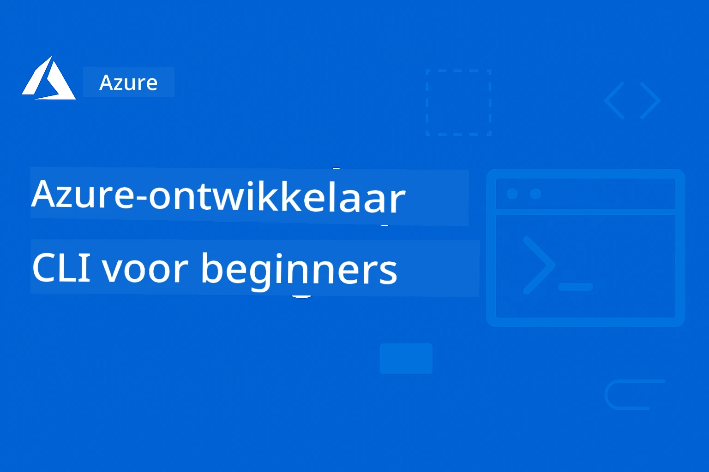

# AZD Voor Beginners: Een Gestructureerde Leerreis

 

[](https://github.com/microsoft/AZD-for-beginners)
[](https://GitHub.com/microsoft/azd-for-beginners/network/)
[](https://github.com/microsoft/AZD-for-beginners)

[](https://discord.com/invite/nkVh3dp)
[](https://discord.gg/nTYy5BXMWG)

---

### Geautomatiseerde Vertalingen (Altijd Actueel)

<!-- CO-OP TRANSLATOR LANGUAGES TABLE START -->
[Arabisch](../ar/README.md) | [Bengaals](../bn/README.md) | [Bulgaars](../bg/README.md) | [Birmaans (Myanmar)](../my/README.md) | [Chinees (Vereenvoudigd)](../zh-CN/README.md) | [Chinees (Traditioneel, Hong Kong)](../zh-HK/README.md) | [Chinees (Traditioneel, Macau)](../zh-MO/README.md) | [Chinees (Traditioneel, Taiwan)](../zh-TW/README.md) | [Kroatisch](../hr/README.md) | [Tsjechisch](../cs/README.md) | [Deens](../da/README.md) | [Nederlands](./README.md) | [Estisch](../et/README.md) | [Fins](../fi/README.md) | [Frans](../fr/README.md) | [Duits](../de/README.md) | [Grieks](../el/README.md) | [Hebreeuws](../he/README.md) | [Hindi](../hi/README.md) | [Hongaars](../hu/README.md) | [Indonesisch](../id/README.md) | [Italiaans](../it/README.md) | [Japans](../ja/README.md) | [Kannada](../kn/README.md) | [Khmer](../km/README.md) | [Koreaans](../ko/README.md) | [Litouws](../lt/README.md) | [Maleis](../ms/README.md) | [Malayalam](../ml/README.md) | [Marathi](../mr/README.md) | [Nepalees](../ne/README.md) | [Nigeriaans Pidgin](../pcm/README.md) | [Noors](../no/README.md) | [Perzisch (Farsi)](../fa/README.md) | [Pools](../pl/README.md) | [Portugees (Brazilië)](../pt-BR/README.md) | [Portugees (Portugal)](../pt-PT/README.md) | [Punjabi (Gurmukhi)](../pa/README.md) | [Roemeens](../ro/README.md) | [Russisch](../ru/README.md) | [Servisch (Cyrillisch)](../sr/README.md) | [Slowaaks](../sk/README.md) | [Sloveens](../sl/README.md) | [Spaans](../es/README.md) | [Swahili](../sw/README.md) | [Zweeds](../sv/README.md) | [Tagalog (Filipijns)](../tl/README.md) | [Tamil](../ta/README.md) | [Telugu](../te/README.md) | [Thai](../th/README.md) | [Turks](../tr/README.md) | [Oekraïens](../uk/README.md) | [Urdu](../ur/README.md) | [Vietnamees](../vi/README.md)

> **Liever lokaal klonen?**
>
> Deze repository bevat meer dan 50 taalvertalingen wat de downloadgrootte aanzienlijk verhoogt. Om te klonen zonder vertalingen, gebruik sparse checkout:
>
> **Bash / macOS / Linux:**
> ```bash
> git clone --filter=blob:none --sparse https://github.com/microsoft/AZD-for-beginners.git
> cd AZD-for-beginners
> git sparse-checkout set --no-cone '/*' '!translations' '!translated_images'
> ```
>
> **CMD (Windows):**
> ```cmd
> git clone --filter=blob:none --sparse https://github.com/microsoft/AZD-for-beginners.git
> cd AZD-for-beginners
> git sparse-checkout set --no-cone "/*" "!translations" "!translated_images"
> ```
>
> Dit geeft je alles wat je nodig hebt om de cursus te voltooien met een veel snellere download.
<!-- CO-OP TRANSLATOR LANGUAGES TABLE END -->

## 🆕 Wat is er Vandaag Nieuw in azd

> 📌 **Foundry GA update (2026-11-09):** Het **`microsoft.foundry` 1.0 pakket is algemeen beschikbaar**, aangekondigd op [5 november 2026](https://devblogs.microsoft.com/azure-sdk/microsoft-foundry-azure-developer-cli-ga/). Gebruik **`azd >= 1.37.0`** en installeer het met `azd ext install microsoft.foundry`. Volg de [hosted-agent walkthrough](docs/chapter-02-ai-development/microsoft-foundry-integration.md#hosted-agent-walkthrough-ga) voor setup, lokaal testen en deployment. Deze update is gebaseerd op gepubliceerde richtlijnen, niet op een live Azure deployment; pakket GA maakt niet elke optionele feature, extensie of SDK algemeen beschikbaar.

Azure Developer CLI ondersteunt veel type applicaties, waaronder webapps, API's, en AI-agenten, via ondersteunde hosts, templates en extensies.

Dit betekent het volgende voor jou:

- **Een GA pakket voor Foundry ontwikkeling.** `microsoft.foundry` installeert zeven kernextensies, inclusief agenten, projecten, en Agent Inspector. Agent code en deployment instellingen blijven samen in `azure.yaml`.
- **Test lokaal, en zet dan je code uit.** Gebruik `azd ai agent init --deploy-mode code`, `azd provision`, en `azd ai agent run` om lokale requests en responses te inspecteren. Gebruik dan `azd deploy` voor een remote build in Foundry, zonder lokale container build.
- **Meet kwaliteit apart.** Installeer **`azure.ai.evaluations`** voor `azd ai eval generate`, `init`, en `run start`; het is niet inbegrepen in het pakket. Bewaar beoordeelde datasets en rubrieken bij je code. Oudere projecten volgen de [evaluatie- en optimalisatie migratiehandleiding](docs/chapter-08-production/production-ai-practices.md#evaluation-migration-and-quality-checks).
- **Herbruik configuratie in CI/CD.** Na een succesvolle `azd up`, configureer een pipeline met `azd pipeline config`. Installeer het pakket op de runner en bewaar de gegenereerde authenticatie- en omgevingsinstellingen.
- **Vlottere dagelijkse basics.** Recente releases maakten `azd init` idempotent (veilig heruit te voeren), verzorgden dat `azd auth login` automatisch verouderde tokens wist, en voegden een vriendelijke `azd tool` first-run setup prompt toe.
- **De kernworkflow is niet veranderd.** Of je nu een todo app, een microservice, of een multi-agent AI oplossing uitrolt, de commando’s zijn hetzelfde.

> **Notitie voor Aspire gebruikers:** Microsoft verwijst nu naar het product simpelweg als **Aspire** (voorheen ".NET Aspire"). azd's Aspire ondersteuning is ongewijzigd—alleen de naam is bijgewerkt.

Als je azd eerder hebt gebruikt, is AI-ondersteuning een natuurlijke uitbreiding—niet een aparte tool of een geavanceerd spoor. Als je nieuw begint, leer je één workflow die voor alles werkt.

---

## 🚀 Wat is Azure Developer CLI (azd)?

**Azure Developer CLI (azd)** is een ontwikkelaarsvriendelijke command-line tool die het simpel maakt om applicaties naar Azure te deployen. In plaats van handmatig tientallen Azure resources te maken en verbinden, kun je volledige applicaties uitrollen met één commando.

### De Magie van `azd up`

```bash
# This single command does everything:
# ✅ Creates all Azure resources  
# ✅ Configures networking and security
# ✅ Builds your application code
# ✅ Deploys to Azure
# ✅ Gives you a working URL
azd up
```

De template levert de applicatie- en infrastructuurconfiguratie. Succesvolle deployment vereist nog steeds ondersteunde services/modellen, voldoende quota en permissies, correcte invoer, en verificatie van de gedeployde applicatie. `azd up` maakt een template niet automatisch veilig, compliant of productieklaar.

---

## ❓ Azure Developer CLI vs Azure CLI: Wat is het Verschil?

Dit is de meest gestelde vraag van beginners. Hier is het eenvoudige antwoord:

| Kenmerk | **Azure CLI (`az`)** | **Azure Developer CLI (`azd`)** |
|---------|---------------------|--------------------------------|
| **Doel** | Beheer van individuele Azure resources | Deploy complete applicaties |
| **Mentaliteit** | Infrastructuurgericht | Applicatiegericht |
| **Voorbeeld** | `az webapp create --name myapp...` | `azd up` |
| **Leercurve** | Moet Azure services kennen | Ken alleen je app |
| **Beste Voor** | DevOps, Infrastructuur | Ontwikkelaars, Prototyping |

### Eenvoudige Vergelijking

- **Azure CLI** is als alle gereedschappen hebben om een huis te bouwen - hamers, zagen, spijkers. Je kunt alles bouwen, maar je moet bouwkunde kennen.
- **Azure Developer CLI** is als het inhuren van een aannemer - je beschrijft wat je wilt, en zij regelen de bouw.

### Wanneer Welke te Gebruik

| Scenario | Gebruik Dit |
|----------|----------|
| "Ik wil snel mijn webapp uitrollen" | `azd up` |
| "Ik moet alleen een opslagaccount maken" | `az storage account create` |
| "Ik bouw een volledige AI-applicatie" | `azd init --template azure-search-openai-demo` |
| "Ik moet een specifieke Azure resource debuggen" | `az resource show` |
| "Ik wil deployen naar mijn geconfigureerde productieomgeving" | Controleer configuratie, toegang, kosten en operationele poorten voor `azd up --environment production` |

### Ze Werken Samen!

AZD en Azure CLI hebben aparte authenticatie en configuratie. Gebruik `azd auth login` voor AZD, en `az login` wanneer een hook of diagnostisch commando expliciet Azure CLI nodig heeft. Je kunt beide gebruiken:
```bash
# Deploy your app with AZD
azd up

# Then fine-tune specific resources with Azure CLI
az webapp config set --name myapp --always-on true
```

---

## 🌟 Vind Templates in Awesome AZD

Begin niet vanaf nul! **Awesome AZD** is de community verzameling van direct inzetbare templates:

| Resource | Beschrijving |
|----------|-------------|
| 🔗 [**Awesome AZD Gallery**](https://azure.github.io/awesome-azd/) | Blader door 200+ templates met één-klik deploy |
| 🔗 [**Dien een Template in**](https://github.com/Azure/awesome-azd/issues) | Draag je eigen template bij aan de community |
| 🔗 [**GitHub Repository**](https://github.com/Azure/awesome-azd) | Star en verken de broncode |

### Populaire AI Templates van Awesome AZD

Kies één template in zijn eigen lege map; onderstaande commando’s zijn alternatieven. De afsluitende `.` initialiseert die map.

```bash
# RAG Chat with Microsoft Foundry Models + AI Search
azd init --template azure-search-openai-demo .

# Quick AI Chat Application
azd init --template openai-chat-app-quickstart .

# AI Agents with Foundry Agents
azd init --template get-started-with-ai-agents .
```

---

## 🎯 Aan de Slag in 3 Stappen

Voordat je begint, zorg dat je machine klaar is voor de template die je wilt uitrollen:

**Windows:**
```powershell
.\validate-setup.ps1
```

**macOS / Linux:**
```bash
bash ./validate-setup.sh
```

Als een vereiste controle faalt, los dat dan eerst op en ga dan verder met de snelle start.

### Stap 1: Installeer AZD (2 minuten)

**Windows:**
```powershell
winget install microsoft.azd
```

**macOS:**
```bash
brew tap azure/azd && brew install azd
```

**Linux:**
```bash
curl -fsSL https://aka.ms/install-azd.sh | bash
```

### Stap 2: Authenticatie voor AZD

```bash
# Optional if you plan to use Azure CLI commands directly in this course
az login

# Required for AZD workflows
azd auth login
```

Als je niet zeker weet welke je nodig hebt, volg dan de volledige setup flow in [Installatie & Setup](docs/chapter-01-foundation/installation.md#authentication-setup).

### Stap 3: Deploy je Eerste App

```bash
# Initialize from a template
azd init --template todo-nodejs-mongo .

# Deploy to Azure (creates everything!)
azd up
```

**🎉 Dat is het!** Je app is nu live op Azure.

### Opruimen (Niet Vergeten!)

```bash
# Remove all resources when done experimenting
azd down --force --purge
```

---

## 📚 Hoe Gebruik je Deze Cursus

Deze cursus is ontworpen voor **progressief leren** - begin waar je je prettig voelt en werk jezelf omhoog:

| Jouw Ervaring | Begin Hier |
|-----------------|------------|
| **Helemaal nieuw met Azure** | [Hoofdstuk 1: Basis](#-chapter-1-foundation--quick-start) |
| **Ken Azure, nieuw met AZD** | [Hoofdstuk 1: Basis](#-chapter-1-foundation--quick-start) |
| **Wil AI-apps deployen** | [Hoofdstuk 2: AI-Eerst Ontwikkeling](#-chapter-2-ai-first-development-recommended-for-ai-developers) |
| **Wil praktijkervaring** | [🎓 Interactieve Workshop](workshop/README.md) - 3-4 uur begeleide lab |
| **Heeft productiepatronen nodig** | [Hoofdstuk 8: Productie & Enterprise](#-chapter-8-production--enterprise-patterns) |

### Snelle Setup

1. **Fork deze Repository**: [](https://GitHub.com/microsoft/azd-for-beginners/fork)
2. **Kloon hem**: `git clone https://github.com/YOUR-USERNAME/azd-for-beginners.git`
3. **Zoek Hulp**: [Azure Discord Community](https://discord.com/invite/ByRwuEEgH4)

> **Lieber lokaal klonen?**

> Deze repository bevat meer dan 50 taalvertalingen, wat de downloadgrootte aanzienlijk vergroot. Om te klonen zonder vertalingen, gebruik je sparse checkout:
> ```bash
> git clone --filter=blob:none --sparse https://github.com/microsoft/AZD-for-beginners.git
> cd AZD-for-beginners
> git sparse-checkout set --no-cone '/*' '!translations' '!translated_images'
> ```
> Dit geeft je alles wat je nodig hebt om de cursus te voltooien met een veel snellere download.


## Cursusoverzicht

Beheers Azure Developer CLI (azd) via gestructureerde hoofdstukken die ontworpen zijn voor progressief leren. **Speciale focus op AI-toepassingsimplementatie met Microsoft Foundry-integratie.**

### Waarom deze cursus essentieel is voor moderne ontwikkelaars

Ontwikkelaars die AI-workloads implementeren hebben vaak begeleiding nodig bij:
- Complexe AI-architecturen met meerdere services
- Best practices voor AI-implementatie in productie  
- Integratie en configuratie van Azure AI-diensten
- Kostenoptimalisatie voor AI-workloads
- Probleemoplossing bij AI-specifieke implementatieproblemen

### Leerdoelen

Door deze gestructureerde cursus te voltooien, zul je:
- **AZD Basics beheersen**: Kernconcepten, installatie en configuratie
- **AI-applicaties implementeren**: Gebruik AZD met Microsoft Foundry-diensten
- **Infrastructure as Code toepassen**: Beheer Azure-resources met Bicep-templates
- **Implementaties troubleshooten**: Los veelvoorkomende problemen op en debug fouten
- **Optimaliseren voor productie**: Beveiliging, schaalvergroting, monitoring en kostenbeheer
- **Multi-Agent oplossingen bouwen**: Implementeer complexe AI-architecturen

## Voordat je begint: Accounts, toegang en aannames

Voordat je aan Hoofdstuk 1 begint, zorg dat het volgende geregeld is. De installatiestappen later in deze handleiding gaan ervan uit dat deze basis al is geregeld.

- **Een Azure-abonnement**: Je kunt een bestaand abonnement van je werk of eigen account gebruiken, of een [gratis proefversie](https://aka.ms/azurefreetrial) aanmaken om te starten.
- **Toestemming om Azure-resources te creëren**: Voor de meeste oefeningen moet je minstens **Medewerker**-toegang hebben op het doelabonnement of resourcegroep. Sommige hoofdstukken nemen ook aan dat je resourcegroepen, beheerde identiteiten en RBAC-toewijzingen kunt maken.
- [**Een GitHub-account**](https://github.com): Dit is handig voor het forken van de repository, het bijhouden van je eigen wijzigingen en het gebruiken van GitHub Codespaces voor de workshop.
- **Runtime-vereisten voor templates**: Sommige templates hebben lokale tools nodig zoals Node.js, Python, Java of Docker. Voer de setup-validator uit voordat je begint zodat je ontbrekende tools vroegtijdig ontdekt.
- **Basiskennis van de terminal**: Je hoeft geen expert te zijn, maar je moet comfortabel zijn met het uitvoeren van commando's zoals `git clone`, `azd auth login` en `azd up`.

> **Werk je in een enterprise-abonnement?**
> Als je Azure-omgeving beheerd wordt door een beheerder, controleer dan van tevoren of je resources kunt implementeren in het abonnement of de resourcegroep die je wilt gebruiken. Zo niet, vraag dan om een sandbox-abonnement of Medewerker-toegang voordat je begint.

> **Nieuw in Azure?**
> Begin met je eigen Azure proefversie of pay-as-you-go-abonnement op https://aka.ms/azurefreetrial zodat je de oefeningen van begin tot eind kunt voltooien zonder te wachten op goedkeuringen op tenantniveau.

## 🗺️ Cursusoverzicht: Snelle navigatie per hoofdstuk

Elk hoofdstuk heeft een aparte README met leerdoelen, snelle starts en oefeningen:

| Hoofdstuk | Onderwerp | Lessen | Duur | Complexiteit |
|---------|-------|---------|----------|------------|
| **[Hoofdstuk 1: Basis](docs/chapter-01-foundation/README.md)** | Aan de slag | [AZD Basics](docs/chapter-01-foundation/azd-basics.md) &#124; [Installatie](docs/chapter-01-foundation/installation.md) &#124; [Eerste Project](docs/chapter-01-foundation/first-project.md) | 30-45 min | ⭐ |
| **[Hoofdstuk 2: AI-ontwikkeling](docs/chapter-02-ai-development/README.md)** | AI-First Apps | [Foundry-integratie](docs/chapter-02-ai-development/microsoft-foundry-integration.md) &#124; [AI-agenten](docs/chapter-02-ai-development/agents.md) &#124; [Modelimplementatie](docs/chapter-02-ai-development/ai-model-deployment.md) &#124; [Workshop](docs/chapter-02-ai-development/ai-workshop-lab.md) | 1-2 uur | ⭐⭐ |
| **[Hoofdstuk 3: Configuratie](docs/chapter-03-configuration/README.md)** | Authenticatie & Beveiliging | [Configuratie](docs/chapter-03-configuration/configuration.md) &#124; [Authenticatie & Beveiliging](docs/chapter-03-configuration/authsecurity.md) | 45-60 min | ⭐⭐ |
| **[Hoofdstuk 4: Infrastructuur](docs/chapter-04-infrastructure/README.md)** | IaC & Implementatie | [Implementatiehandleiding](docs/chapter-04-infrastructure/deployment-guide.md) &#124; [Provisioning](docs/chapter-04-infrastructure/provisioning.md) | 1-1,5 uur | ⭐⭐⭐ |
| **[Hoofdstuk 5: Multi-Agent](docs/chapter-05-multi-agent/README.md)** | AI Agent-oplossingen | [Retail Scenario](examples/retail-scenario.md) &#124; [Coördinatiepatronen](docs/chapter-06-pre-deployment/coordination-patterns.md) | 2-3 uur | ⭐⭐⭐⭐ |
| **[Hoofdstuk 6: Pre-implementatie](docs/chapter-06-pre-deployment/README.md)** | Planning & Validatie | [Preflight-controles](docs/chapter-06-pre-deployment/preflight-checks.md) &#124; [Capaciteitsplanning](docs/chapter-06-pre-deployment/capacity-planning.md) &#124; [SKU-selectie](docs/chapter-06-pre-deployment/sku-selection.md) &#124; [App Insights](docs/chapter-06-pre-deployment/application-insights.md) | 1 uur | ⭐⭐ |
| **[Hoofdstuk 7: Probleemoplossing](docs/chapter-07-troubleshooting/README.md)** | Debuggen & Repareren | [Veelvoorkomende problemen](docs/chapter-07-troubleshooting/common-issues.md) &#124; [Debugging](docs/chapter-07-troubleshooting/debugging.md) &#124; [AI-specifieke problemen](docs/chapter-07-troubleshooting/ai-troubleshooting.md) | 1-1,5 uur | ⭐⭐ |
| **[Hoofdstuk 8: Productie](docs/chapter-08-production/README.md)** | Enterprise-patronen | [Productiepraktijken](docs/chapter-08-production/production-ai-practices.md) | 2-3 uur | ⭐⭐⭐⭐ |
| **[🎓 Workshop](workshop/README.md)** | Praktische lab | [Introductie](workshop/docs/instructions/0-Introduction.md) &#124; [Selectie](workshop/docs/instructions/1-Select-AI-Template.md) &#124; [Validatie](workshop/docs/instructions/2-Validate-AI-Template.md) &#124; [Ontmanteling](workshop/docs/instructions/3-Deconstruct-AI-Template.md) &#124; [Configuratie](workshop/docs/instructions/4-Configure-AI-Template.md) &#124; [Aanpassing](workshop/docs/instructions/5-Customize-AI-Template.md) &#124; [Afbreken](workshop/docs/instructions/6-Teardown-Infrastructure.md) &#124; [Afronding](workshop/docs/instructions/7-Wrap-up.md) | 3-4 uur | ⭐⭐ |

**Totale cursusduur:** ~10-14 uur | **Vaardigheidsprogressie:** Beginneling → Productieklaar

---

## 📚 Leerhoofdstukken

*Selecteer jouw leerpad op basis van ervaringsniveau en doelen*

### 🚀 Hoofdstuk 1: Basis & Snelle Start
**Vereisten**: Azure-abonnement, basiskennis commandoregel  
**Duur**: 30-45 minuten  
**Complexiteit**: ⭐

#### Wat je leert
- Inzicht in Azure Developer CLI-grondbeginselen
- AZD installeren op je platform
- Je eerste succesvolle implementatie

#### Leermiddelen
- **🎯 Begin hier**: [Wat is Azure Developer CLI?](#-what-is-azure-developer-cli-azd)
- **📖 Theorie**: [AZD Basics](docs/chapter-01-foundation/azd-basics.md) - Kernconcepten en terminologie
- **⚙️ Setup**: [Installatie & Setup](docs/chapter-01-foundation/installation.md) - Platform-specifieke handleidingen
- **🛠️ Praktijk**: [Je eerste project](docs/chapter-01-foundation/first-project.md) - Stapsgewijze tutorial
- **📋 Snelle referentie**: [Command Cheat Sheet](resources/cheat-sheet.md)

#### Praktische oefeningen
```bash
# Quick installation check
azd version

# Deploy your first application
azd init --template todo-nodejs-mongo .
azd up
```

**💡 Resultaat hoofdstuk**: Succesvol een eenvoudige webapplicatie implementeren naar Azure met AZD

**✅ Succesvalidatie:**
```bash
# After completing Chapter 1, you should be able to:
azd version              # Shows installed version
azd init --template todo-nodejs-mongo  # Initializes project
azd up                  # Deploys to Azure
azd show                # Displays running app URL
# Application opens in browser and works
azd down --force --purge  # Cleans up resources
```

**📊 Tijdsinvestering:** 30-45 minuten  
**📈 Vaardigheidsniveau daarna:** Kan basisapplicaties zelfstandig implementeren

---

### 🤖 Hoofdstuk 2: AI-First Development (Aanbevolen voor AI-ontwikkelaars)
**Vereisten**: Hoofdstuk 1 voltooid  
**Duur**: 1-2 uur  
**Complexiteit**: ⭐⭐

#### Wat je leert
- Microsoft Foundry-integratie met AZD
- Implementeren van AI-gestuurde applicaties
- Begrijpen van AI-serviceconfiguraties

#### Leermiddelen
- **🎯 Begin hier**: [Microsoft Foundry-integratie](docs/chapter-02-ai-development/microsoft-foundry-integration.md)
- **🤖 AI-Agenten**: [AI Agenten Gids](docs/chapter-02-ai-development/agents.md) - Implementeer intelligente agenten met AZD
- **📖 Patronen**: [AI Modelimplementatie](docs/chapter-02-ai-development/ai-model-deployment.md) - Implementeren en beheren van AI-modellen
- **🛠️ Workshop**: [AI Workshop Lab](docs/chapter-02-ai-development/ai-workshop-lab.md) - Maak je AI-oplossingen AZD-klaar
- **🎥 Interactieve gids**: [Workshop-materialen](workshop/README.md) - Browser-gebaseerd leren met MkDocs * DevContainer-omgeving
- **📋 Templates**: [Microsoft Foundry-templates](#featured-microsoft-foundry-templates)
- **📝 Voorbeelden**: [AZD-implementatievoorbeelden](examples/README.md)

#### Praktische oefeningen
```bash
# Deploy your first AI application
azd init --template azure-search-openai-demo .
azd up

# Try additional AI templates
azd init --template openai-chat-app-quickstart .
azd init --template agent-openai-python-prompty .
```

**💡 Resultaat hoofdstuk**: Een AI-gestuurde chatapplicatie implementeren en configureren met RAG-mogelijkheden

**✅ Succesvalidatie:**
```bash
# After Chapter 2, you should be able to:
azd init --template azure-search-openai-demo .
azd up
# Test the AI chat interface
# Ask questions and get AI-powered responses with sources
# Verify search integration works
azd monitor  # Check Application Insights shows telemetry
azd down --force --purge
```

**📊 Tijdsinvestering:** 1-2 uur  
**📈 Vaardigheidsniveau daarna:** Kan AI-leerapplicaties implementeren en extra productieklaarheidseisen herkennen
**💰 Kostenbewustzijn:** Begrijp ontwikkelkosten van $80-150/maand, productiekosten van $300-3500/maand

#### 💰 Kostenoverwegingen voor AI-implementaties

**Ontwikkelomgeving (geschat $80-150/maand):**
- Microsoft Foundry-modellen (Pay-as-you-go): $0-50/maand (afhankelijk van token gebruik)
- AI Search (basisniveau): $75/maand
- Container Apps (consumptie): $0-20/maand
- Opslag (standaard): $1-5/maand

**Productieomgeving (geschat $300-3.500+/maand):**
- Microsoft Foundry-modellen (PTU voor consistente prestaties): $3.000+/maand OF Pay-as-you-go bij hoog volume
- AI Search (standaardniveau): $250/maand
- Container Apps (dedicated): $50-100/maand
- Application Insights: $5-50/maand
- Opslag (premium): $10-50/maand

**💡 Tips voor kostenoptimalisatie:**
- Controleer modelinference prijzen en account-specifieke credits; Azure OpenAI bevat geen universele gratis maandelijkse toelage van 50.000 tokens
- Voer `azd down` uit om resources te verwijderen als ze niet meer nodig zijn, na controle van de geselecteerde omgeving
- Begin met facturatie op verbruik, upgrade naar PTU alleen voor productie
- Gebruik `azd provision --preview` om de geplande infrastructuur te inspecteren, prijs vervolgens de resulterende resources met de Azure Prijscalculator
- Schakel auto-scaling in: betaal alleen voor daadwerkelijk gebruik

**Kostenmonitoring:**
```bash
# Inspect planned resources (this does not calculate prices)
azd provision --preview

# Monitor actual costs in Azure Portal
az consumption budget list --resource-group <your-rg>
```

---

### ⚙️ Hoofdstuk 3: Configuratie & Authenticatie
**Vereisten**: Hoofdstuk 1 voltooid  
**Duur**: 45-60 minuten  
**Complexiteit**: ⭐⭐

#### Wat je leert
- Omgevingsconfiguratie en beheer
- Authenticatie- en beveiligingsbest practices
- Naamgeving en organisatie van resources

#### Leermiddelen
- **📖 Configuratie**: [Configuratiehandleiding](docs/chapter-03-configuration/configuration.md) - Omgevingsopzet
- **🔐 Beveiliging**: [Authenticatiepatronen en managed identity](docs/chapter-03-configuration/authsecurity.md) - Authenticatiepatronen
- **📝 Voorbeelden**: [Database-app voorbeeld](examples/database-app/README.md) - AZD Database-voorbeelden

#### Praktische oefeningen
- Configureer meerdere omgevingen (dev, staging, prod)
- Stel managed identity authenticatie in
- Implementeer omgevingsspecifieke configuraties

**💡 Resultaat hoofdstuk**: Beheer meerdere omgevingen met correcte authenticatie en beveiliging

---

### 🏗️ Hoofdstuk 4: Infrastructure as Code & Implementatie
**Vereisten**: Hoofdstukken 1-3 voltooid  
**Duur**: 1-1,5 uur  
**Complexiteit**: ⭐⭐⭐

#### Wat je leert
- Geavanceerde implementatiepatronen
- Infrastructure as Code met Bicep
- Strategieën voor resourceprovisioning

#### Leermiddelen
- **📖 Implementatie**: [Implementatiehandleiding](docs/chapter-04-infrastructure/deployment-guide.md) - Volledige workflows
- **🏗️ Provisioning**: [Provisioning van resources](docs/chapter-04-infrastructure/provisioning.md) - Beheer van Azure-resources
- **📝 Voorbeelden**: [Container App Voorbeeld](../../examples/container-app) - Containerimplementaties

#### Praktische oefeningen
- Maak aangepaste Bicep-templates
- Implementeer multi-service applicaties
- Implementeer blue-green deployment-strategieën

**💡 Resultaat hoofdstuk**: Implementeer complexe multi-service applicaties met aangepaste infrastructuur-templates

---

### 🎯 Hoofdstuk 5: Multi-Agent AI Oplossingen (Gevorderd)
**Vereisten**: Hoofdstukken 1-2 voltooid  
**Duur**: 2-3 uur  
**Complexiteit**: ⭐⭐⭐⭐

#### Wat je leert
- Multi-agent architectuurpatronen
- Agentorkestratie en coördinatie
- Productieklare AI-implementaties

#### Leermiddelen
- **🤖 Uitgelicht Ontwerp**: [Retail Multi-Agent Oplossing](examples/retail-scenario.md) - Architectuur blauwdruk, geen complete applicatie
- **🛠️ ARM-sjablonen**: [ARM Template Package](../../examples/retail-multiagent-arm-template) - Infrastructuurraamwerk; bekijk vereisten en ontbrekende applicatiecomponenten
- **📖 Architectuur**: [Multi-agent coördinatiepatronen](docs/chapter-06-pre-deployment/coordination-patterns.md) - Patronen

#### Praktische Oefeningen
```bash
# Inspect the retail infrastructure scaffold before choosing to deploy it
cd examples/retail-multiagent-arm-template
cat README.md

# After an intentional deployment, inspect infrastructure state
az deployment group show --resource-group <rg-name> --name <deployment-name>
```

**💡 Hoofdstukresultaat**: Begrijp multi-agent ontwerp en identificeer de implementatie-, validatie- en operationele werkzaamheden die nodig zijn bovenop een infrastructuurraamwerk

---

### 🔍 Hoofdstuk 6: Validatie & Planning Voorafgaand aan Deployatie
**Vereisten**: Hoofdstuk 4 voltooid  
**Duur**: 1 uur  
**Complexiteit**: ⭐⭐

#### Wat Je Zal Leren
- Capaciteitsplanning en resource-validatie
- SKU-selectiestrategieën
- Pre-flight controles en automatisering

#### Leermaterialen
- **📊 Planning**: [Capaciteitsplanning](docs/chapter-06-pre-deployment/capacity-planning.md) - Resource-validatie
- **💰 Selectie**: [SKU-selectie](docs/chapter-06-pre-deployment/sku-selection.md) - Kosteneffectieve keuzes
- **✅ Validatie**: [Pre-flight controles](docs/chapter-06-pre-deployment/preflight-checks.md) - Geautomatiseerde scripts

#### Praktische Oefeningen
- Voer scripts voor capaciteitsvalidatie uit
- Optimaliseer SKU-selecties voor kostenbesparing
- Implementeer geautomatiseerde pre-deployatie controles

**💡 Hoofdstukresultaat**: Valideer en optimaliseer deployaties voorafgaand aan uitvoering

---

### 🚨 Hoofdstuk 7: Probleemoplossing & Debugging
**Vereisten**: Elk deployment-hoofdstuk voltooid  
**Duur**: 1-1,5 uur  
**Complexiteit**: ⭐⭐

#### Wat Je Zal Leren
- Systematische debugging benaderingen
- Veelvoorkomende problemen en oplossingen
- AI-specifieke probleemoplossing

#### Leermaterialen
- **🔧 Veelvoorkomende Problemen**: [Veelvoorkomende Problemen](docs/chapter-07-troubleshooting/common-issues.md) - FAQ en oplossingen
- **🕵️ Debugging**: [Debugging Gids](docs/chapter-07-troubleshooting/debugging.md) - Stapsgewijze strategieën
- **🤖 AI Problemen**: [AI-specifieke Probleemoplossing](docs/chapter-07-troubleshooting/ai-troubleshooting.md) - Problemen met AI-diensten

#### Praktische Oefeningen
- Diagnoseer deployatiefouten
- Los authenticatieproblemen op
- Debug AI service connectiviteit

**💡 Hoofdstukresultaat**: Diagnoseer en los zelfstandig veelvoorkomende deploymentproblemen op

---

### 🏢 Hoofdstuk 8: Productie & Enterprise Patronen
**Vereisten**: Hoofdstukken 1-4 voltooid  
**Duur**: 2-3 uur  
**Complexiteit**: ⭐⭐⭐⭐

#### Wat Je Zal Leren
- Productie deployment strategieën
- Enterprise beveiligingspatronen
- Monitoring en kostenoptimalisatie

#### Leermaterialen
- **🏭 Productie**: [Beste praktijken voor AI in productie](docs/chapter-08-production/production-ai-practices.md) - Enterprise patronen
- **📝 Voorbeelden**: [Microservices Voorbeeld](../../examples/microservices) - Complexe architecturen
- **📊 Monitoring**: [Application Insights integratie](docs/chapter-06-pre-deployment/application-insights.md) - Monitoring

#### Praktische Oefeningen
- Implementeer enterprise beveiligingspatronen
- Zet uitgebreide monitoring op
- Deployment naar productie met goede governance

**💡 Hoofdstukresultaat**: Deploy zakelijke-ready applicaties met volledige productiecapaciteiten

---

## 🎓 Workshop Overzicht: Praktische Leerervaring

> **⚠️ WORKSHOP STATUS: Actieve Ontwikkeling**  
> De workshop materialen worden momenteel ontwikkeld en verfijnd. Kernmodules zijn functioneel, maar sommige geavanceerde secties zijn incompleet. We werken actief aan de voltooiing van alle content. [Volg voortgang →](workshop/README.md)

### Interactieve Workshop Materialen
**Uitgebreide hands-on learning met browser-gebaseerde tools en begeleide oefeningen**

Onze workshop materialen bieden een gestructureerde, interactieve leerervaring die het hoofdstukgebaseerde curriculum hierboven aanvult. De workshop is ontworpen voor zowel zelfgestuurd leren als sessies onder leiding van een instructeur.

#### 🛠️ Workshop Kenmerken
- **Browser-gebaseerde Interface**: Volledige MkDocs aangedreven workshop met zoek-, kopieer- en themafuncties
- **GitHub Codespaces Integratie**: Een-klik ontwikkelomgeving setup
- **Gestructureerde Leerroute**: 8-module begeleide oefeningen (3-4 uur totaal)
- **Progressieve Methodiek**: Introductie → Selectie → Validatie → Demontage → Configuratie → Aanpassing → Afbreken → Afronding
- **Interactieve DevContainer Omgeving**: Vooraf geconfigureerde tools en dependencies

#### 📚 Workshop Module Structuur
De workshop volgt een **8-module progressieve methodiek** die je van ontdekking tot deployatie beheersing brengt:

| Module | Onderwerp | Wat Je Zal Doen | Duur |
|--------|----------|----------------|-------|
| **0. Introductie** | Workshop Overzicht | Begrijp leerdoelen, vereisten en workshop structuur | 15 min |
| **1. Selectie** | Template Ontdekking | Verken AZD-sjablonen en selecteer de juiste AI-template voor jouw scenario | 20 min |
| **2. Validatie** | Deploy & Verifieer | Deploy de template met `azd up` en valideer dat de infrastructuur werkt | 30 min |
| **3. Demontage** | Begrijp Structuur | Gebruik GitHub Copilot om template-architectuur, Bicep-bestanden en codeorganisatie te verkennen | 30 min |
| **4. Configuratie** | azure.yaml Diepgaande Verkenning | Beheers `azure.yaml` configuratie, lifecycle hooks en omgevingsvariabelen | 30 min |
| **5. Aanpassing** | Maak Het Van Jou | Activeer AI Search, tracing, evaluatie, en pas aan voor jouw scenario | 45 min |
| **6. Afbreken** | Opruimen | Voer veilig resource deprovisioning uit met `azd down --purge` | 15 min |
| **7. Afronding** | Volgende Stappen | Beoordeel prestaties, sleutelconcepten, en zet je leertraject voort | 15 min |

**Workshop Stroom:**
```
Introduction → Selection → Validation → Deconstruction → Configuration → Customization → Teardown → Wrap-up
     ↓            ↓           ↓              ↓               ↓              ↓            ↓           ↓
  Overview    Find the     Deploy &      Explore        Master         Customize     Clean up    Review &
             right        verify        code &        azure.yaml      for your      resources   next steps
             template                   structure                     scenario
```

#### 🚀 Aan de Slag met de Workshop
```bash
# Option 1: GitHub Codespaces (Recommended)
# Click "Code" → "Create codespace on main" in the repository

# Option 2: Local Development
git clone https://github.com/microsoft/azd-for-beginners.git
cd azd-for-beginners/workshop
# Follow the setup instructions in workshop/README.md
```

#### 🎯 Workshop Leerresultaten
Door de workshop te voltooien, zullen deelnemers:
- **Productie AI Applicaties Deployen**: Gebruik AZD met Microsoft Foundry services
- **Beheers Multi-Agent Architecturen**: Implementeer gecoördineerde AI-agent oplossingen
- **Implementeer Beveiligingsbest Practices**: Configureer authenticatie en toegangscontrole
- **Optimaliseer voor Schaal**: Ontwerp kosteneffectieve, performante deployments
- **Los Deploymentproblemen op**: Los veelvoorkomende problemen zelfstandig op

#### 📖 Workshop Bronnen
- **🎥 Interactieve Gids**: [Workshop Materialen](workshop/README.md) - Browser-gebaseerde leeromgeving
- **📋 Module-voor-Module Instructies**:
  - [0. Introductie](workshop/docs/instructions/0-Introduction.md) - Workshop overzicht en doelen
  - [1. Selectie](workshop/docs/instructions/1-Select-AI-Template.md) - Vind en selecteer AI sjablonen
  - [2. Validatie](workshop/docs/instructions/2-Validate-AI-Template.md) - Deploy en verifieer sjablonen
  - [3. Demontage](workshop/docs/instructions/3-Deconstruct-AI-Template.md) - Verken template architectuur
  - [4. Configuratie](workshop/docs/instructions/4-Configure-AI-Template.md) - Beheers azure.yaml
  - [5. Aanpassing](workshop/docs/instructions/5-Customize-AI-Template.md) - Pas aan voor jouw scenario
  - [6. Afbreken](workshop/docs/instructions/6-Teardown-Infrastructure.md) - Ruim resources op
  - [7. Afronding](workshop/docs/instructions/7-Wrap-up.md) - Beoordeling en volgende stappen
- **🛠️ AI Workshop Lab**: [AI Workshop Lab](docs/chapter-02-ai-development/ai-workshop-lab.md) - AI-gerichte oefeningen
- **💡 Snelle Start**: [Workshop Setup Gids](workshop/README.md#browser-based-guide) - Omgevingsconfiguratie

**Perfect voor**: Bedrijfsopleidingen, universitaire cursussen, zelfstudie, en developer bootcamps.

---

## 📖 Diepgaand: AZD Mogelijkheden

Naast de basis biedt AZD krachtige functies voor productiedeployaties:

- **Template-gebaseerde deployaties** - Gebruik vooraf gebouwde sjablonen voor veelvoorkomende applicatiepatronen
- **Infrastructure as Code** - Beheer Azure resources met Bicep of Terraform  
- **Geïntegreerde workflows** - Naadloos provisioneren, deployen en monitoren van applicaties
- **Ontwikkelaarvriendelijk** - Geoptimaliseerd voor ontwikkelaarproductiviteit en ervaring

### **AZD + Microsoft Foundry: Perfect voor AI Deployaties**

**Waarom AZD voor AI-oplossingen?** AZD adresseert de grootste uitdagingen van AI-ontwikkelaars:

- **AI-Klare Sjablonen** - Vooraf geconfigureerde sjablonen voor Microsoft Foundry-modellen, Azure AI-diensten, en ML workloads
- **Veilige AI Deployaties** - Ingebouwde beveiligingspatronen voor AI-diensten, API-sleutels, en modelendpoints  
- **Productie AI Patronen** - Beste praktijken voor schaalbare, kosteneffectieve AI applicatiedeployaties
- **End-to-End AI Workflows** - Van modelontwikkeling tot productiedeployatie met correcte monitoring
- **Kostenoptimalisatie** - Slimme resourceallocatie en schaalstrategieën voor AI workloads
- **Microsoft Foundry Integratie** - Naadloze koppeling met Microsoft Foundry model catalogus en endpoints

---

## 🎯 Sjablonen & Voorbeeldenbibliotheek

### Uitgelicht: Microsoft Foundry Sjablonen
**Begin hier als je AI applicaties gaat deployen!**

> **Opmerking:** Deze sjablonen demonstreren diverse AI patronen. Sommige zijn externe Azure Samples, andere zijn lokale implementaties.

| Sjabloon | Hoofdstuk | Complexiteit | Diensten | Type |
|---------|-----------|-------------|----------|------|
| [**Begin met AI chat**](https://github.com/Azure-Samples/get-started-with-ai-chat) | Hoofdstuk 2 | ⭐⭐ | AzureOpenAI + Azure AI Model Inference API + Azure AI Search + Azure Container Apps + Application Insights | Extern |
| [**Begin met AI-agenten**](https://github.com/Azure-Samples/get-started-with-ai-agents) | Hoofdstuk 2 | ⭐⭐ | Foundry Agents + AzureOpenAI + Azure AI Search + Azure Container Apps + Application Insights| Extern |
| [**Azure Search + OpenAI Demo**](https://github.com/Azure-Samples/azure-search-openai-demo) | Hoofdstuk 2 | ⭐⭐ | Azure OpenAI + Azure AI Search + Container Apps (standaard) + Storage | Extern |
| [**OpenAI Chat App Quickstart**](https://github.com/Azure-Samples/openai-chat-app-quickstart) | Hoofdstuk 2 | ⭐ | AzureOpenAI + Container Apps + Application Insights | Extern |
| [**Agent OpenAI Python Prompty**](https://github.com/Azure-Samples/agent-openai-python-prompty) | Hoofdstuk 5 | ⭐⭐⭐ | AzureOpenAI + Azure Functions + Prompty | Extern |
| [**Contoso Chat RAG**](https://github.com/Azure-Samples/contoso-chat) | Hoofdstuk 8 | ⭐⭐⭐⭐ | AzureOpenAI + AI Search + Cosmos DB + Container Apps | Extern |
| [**Retail Multi-Agent Oplossing**](examples/retail-scenario.md) | Hoofdstuk 5 | ⭐⭐⭐⭐ | Voorgestelde architectuur en infrastructuurraamwerk; applicatie-implementatie vereist | **Lokale blauwdruk** |

### Uitgelicht: Volledige Leerscenario's
**Productiebe-ready applicatiesjablonen gekoppeld aan leerscenario hoofdstukken**

| Sjabloon | Leerhoofdstuk | Complexiteit | Belangrijkste Lering |
|---------|--------------|-------------|--------------------|
| [**openai-chat-app-quickstart**](https://github.com/Azure-Samples/openai-chat-app-quickstart) | Hoofdstuk 2 | ⭐ | Basis AI deployment patronen |
| [**azure-search-openai-demo**](https://github.com/Azure-Samples/azure-search-openai-demo) | Hoofdstuk 2 | ⭐⭐ | RAG implementatie met Azure AI Search |
| [**get-started-with-ai-agents**](https://github.com/Azure-Samples/get-started-with-ai-agents) | Hoofdstuk 2 | ⭐⭐ | Agent-ondersteunde chat en scenario-specifieke evaluatietests |
| [**agent-openai-python-prompty**](https://github.com/Azure-Samples/agent-openai-python-prompty) | Hoofdstuk 5 | ⭐⭐⭐ | Agentframework en functie-aanroepen |
| [**contoso-chat**](https://github.com/Azure-Samples/contoso-chat) | Hoofdstuk 8 | ⭐⭐⭐ | Enterprise AI orchestratie |
| [**retail-multi-agent-solution**](examples/retail-scenario.md) | Hoofdstuk 5 | ⭐⭐⭐⭐ | Multi-agent architectuur met Customer en Inventory agents |

### Leren via Voorbeeldtype

> **📌 Lokale vs. Externe Voorbeelden:**  
> **Lokale Voorbeelden** (in deze repo) = Bekijk de README van het voorbeeld voor implementatiestatus en vereisten
> **Externe Voorbeelden** (Azure Samples) = Clone via gelinkte repositories

#### Lokale Voorbeelden (Klaar voor gebruik)
- [**Retail Multi-Agent Oplossing**](examples/retail-scenario.md) - Architectuur blauwdruk met ARM infrastructuurraamwerk
  - Voorgestelde Customer en Inventory agentrollen
  - Monitoring, evaluatie, en applicatiecode moeten geïmplementeerd en geverifieerd worden
  - Alleen provisioning van resources levert geen werkende retail applicatie

#### Lokale Voorbeelden - Container Applicaties (Hoofdstukken 2-5)
**Uitgebreide container deployment voorbeelden in deze repository:**
- [**Container App Voorbeelden**](examples/container-app/README.md) - Compleet gids voor containerized deployments
  - [Eenvoudige Flask API](../../examples/container-app/simple-flask-api) - Basis REST API met scale-to-zero
  - [Microservices Architectuur](../../examples/container-app/microservices) - Twee-service leersample; productie verharde extra werk
  - Quick Start, Productie, en geavanceerde deployment patronen
  - Monitoring, beveiliging, en kostenoptimalisatie begeleiding

#### Externe Voorbeelden - Eenvoudige Applicaties (Hoofdstukken 1-2)
**Clone deze Azure Samples repositories om te starten:**
- [Eenvoudige Web App - Node.js + MongoDB](https://github.com/Azure-Samples/todo-nodejs-mongo) - Basis deployment patronen
- [Statische Website - React SPA](https://github.com/Azure-Samples/todo-csharp-sql-swa-func) - Statische content deployment
- [Container App - Python Flask](https://github.com/Azure-Samples/container-apps-store-api-microservice) - REST API-implementatie

#### Externe Voorbeelden - Database-integratie (Hoofdstuk 3-4)  
- [Database App - C# + SQL](https://github.com/Azure-Samples/todo-csharp-sql) - Database verbindingspatronen
- [Functions + Cosmos DB](https://github.com/Azure-Samples/todo-python-mongo-swa-func) - Serverloze datastroom

#### Externe Voorbeelden - Geavanceerde Patronen (Hoofdstukken 4-8)
- [Java Microservices](https://github.com/Azure-Samples/java-microservices-aca-lab) - Multi-service architecturen
- [Container Apps Jobs](https://github.com/Azure-Samples/container-apps-jobs) - Achtergrondverwerking  
- [Enterprise ML Pipeline](https://github.com/Azure/mlops-v2) - MLOps referentiepatronen; geen plug-in AZD-template

### Externe Sjablooncollecties
- [**Officiële AZD Sjabloongalerij**](https://azure.github.io/awesome-azd/) - Gecureerde collectie van officiële en community-sjablonen
- [**Azure Developer CLI Sjablonen**](https://learn.microsoft.com/en-us/azure/developer/azure-developer-cli/azd-templates) - Microsoft Learn sjabloondocumentatie
- [**Voorbeeldenmap**](examples/README.md) - Lokale leer voorbeelden met gedetailleerde uitleg

---

## 📚 Leerbronnen & Referenties

### Snelle Referenties
- [**Command Cheat Sheet**](resources/cheat-sheet.md) - Essentiële azd-commando's gesorteerd per hoofdstuk
- [**Woordenlijst**](resources/glossary.md) - Azure en azd terminologie  
- [**FAQ**](resources/faq.md) - Veelgestelde vragen per leerhoofdstuk
- [**Studiegids**](resources/study-guide.md) - Uitgebreide oefenopdrachten

### Hands-on Workshops
- [**AI Workshop Lab**](docs/chapter-02-ai-development/ai-workshop-lab.md) - Maak je AI-oplossingen AZD-deployable (2-3 uur)
- [**Interactieve Workshop**](workshop/README.md) - 8-module begeleide oefeningen met MkDocs en GitHub Codespaces
  - Volgt: Introductie → Selectie → Validatie → Deconstructie → Configuratie → Aanpassing → Afbouw → Afronding

### Externe Leerbronnen
- [Azure Developer CLI Documentatie](https://learn.microsoft.com/en-us/azure/developer/azure-developer-cli/)
- [Azure Architecture Center](https://learn.microsoft.com/en-us/azure/architecture/)
- [Azure Prijscalculator](https://azure.microsoft.com/pricing/calculator/)
- [Azure Status](https://status.azure.com/)

### AI Agent Vaardigheden voor je Editor
- [**Microsoft Azure Vaardigheden op skills.sh**](https://skills.sh/microsoft/github-copilot-for-azure) - 37 open agent-vaardigheden voor Azure AI, Foundry, deployment, diagnostiek, kostenoptimalisatie en meer. Installeer ze in GitHub Copilot, Cursor, Claude Code, of elke ondersteunde agent:
  ```bash
  npx skills add microsoft/github-copilot-for-azure
  ```

---

## 🔧 Snelle Probleemoplossinggids

**Veelvoorkomende problemen voor beginners en onmiddellijke oplossingen:**

<details>
<summary><strong>❌ "azd: command not found"</strong></summary>

```bash
# Install AZD first
# Windows (PowerShell):
winget install microsoft.azd

# macOS:
brew tap azure/azd && brew install azd

# Linux:
curl -fsSL https://aka.ms/install-azd.sh | bash

# Verify installation
azd version
```
</details>

<details>
<summary><strong>❌ "No subscription found" of "Subscription not set"</strong></summary>

```bash
# List available subscriptions
az account list --output table

# Set default subscription
az account set --subscription "<subscription-id-or-name>"

# Set for AZD environment
azd env set AZURE_SUBSCRIPTION_ID "<subscription-id>"

# Verify
az account show
```
</details>

<details>
<summary><strong>❌ "InsufficientQuota" of "Quota exceeded"</strong></summary>

```bash
# Try different Azure region
azd env set AZURE_LOCATION "westus2"
azd up

# Or use smaller SKUs in development
# Edit infra/main.parameters.json:
{
  "sku": "B1"  // Instead of "P1V2"
}
```
</details>

<details>
<summary><strong>❌ "azd up" mislukt halverwege</strong></summary>

```bash
# Option 1: Inspect the error and retry after correcting its cause
azd show
azd up --debug

# Option 2: Just fix infrastructure
azd provision

# Option 3: Check detailed status
azd show

# Option 4: Check logs in Azure Monitor
azd monitor --logs
```
</details>

<details>
<summary><strong>❌ "Authenticatie mislukt" of "Token verlopen"</strong></summary>

```bash
# Re-authenticate for AZD
azd auth logout
azd auth login

# Optional: refresh Azure CLI too if you are running az commands
az logout
az login

# Verify authentication
az account show
```
</details>

<details>
<summary><strong>❌ "Resource bestaat al" of naamsconflicten</strong></summary>

```bash
# Inspect the conflicting resource before changing or deleting anything.
# For an isolated new deployment, create a separate environment:
azd env new dev-v2
azd up
```
</details>

<details>
<summary><strong>❌ Sjabloonimplementatie duurt te lang</strong></summary>

**Normale wachttijden:**
- Eenvoudige webapp: 5-10 minuten
- App met database: 10-15 minuten
- AI-toepassingen: 15-25 minuten (OpenAI-provisioning is traag)

```bash
# Check progress
azd show

# If stuck >30 minutes, check Azure Portal:
azd monitor --overview
# Look for failed deployments
```
</details>

<details>
<summary><strong>❌ "Toestemming geweigerd" of "Verboden"</strong></summary>

```bash
# Check your Azure role
az role assignment list --assignee $(az account show --query user.name -o tsv)

# You need at least "Contributor" role
# Ask your Azure admin to grant:
# - Contributor (for resources)
# - User Access Administrator (for role assignments)
```
</details>

<details>
<summary><strong>❌ Kan URL van gedeployde applicatie niet vinden</strong></summary>

```bash
# Show all service endpoints
azd show

# Or open Azure Portal
azd monitor

# Check specific service
azd env get-values
# Look for *_URL variables
```
</details>

### 📚 Volledige Probleemoplossingsbronnen

- **Gids voor Veelvoorkomende Problemen:** [Gedetailleerde Oplossingen](docs/chapter-07-troubleshooting/common-issues.md)
- **AI-specifieke Problemen:** [AI Probleemoplossing](docs/chapter-07-troubleshooting/ai-troubleshooting.md)
- **Debugging Gids:** [Stap-voor-stap Debugging](docs/chapter-07-troubleshooting/debugging.md)
- **Hulp Krijgen:** [Azure Discord](https://discord.gg/microsoft-azure) #azure-developer-cli

---

## 🎓 Cursus Voltooiing & Certificering

### Voortgang Bijhouden
Volg je leertraject door elk hoofdstuk:

- [ ] **Hoofdstuk 1**: Fundament & Snelle Start ✅
- [ ] **Hoofdstuk 2**: AI-Eerst Ontwikkeling ✅  
- [ ] **Hoofdstuk 3**: Configuratie & Authenticatie ✅
- [ ] **Hoofdstuk 4**: Infrastructure as Code & Implementatie ✅
- [ ] **Hoofdstuk 5**: Multi-Agent AI Oplossingen ✅
- [ ] **Hoofdstuk 6**: Pre-Deployment Validatie & Planning ✅
- [ ] **Hoofdstuk 7**: Probleemoplossing & Debugging ✅
- [ ] **Hoofdstuk 8**: Productie & Enterprise Patronen ✅

### Leercontrole
Na afronding van elk hoofdstuk verifieer je je kennis door:
1. **Praktische Oefening**: Voltooi de hands-on implementatie van het hoofdstuk
2. **Kennischeck**: Bekijk het FAQ-gedeelte voor je hoofdstuk
3. **Community Discussie**: Deel je ervaringen in Azure Discord
4. **Volgend Hoofdstuk**: Ga naar het volgende complexiteitsniveau

### Cursus Voltooien Voordelen
Na voltooiing van alle hoofdstukken heb je:
- **Productie-ervaring**: Realistische AI-applicaties geïmplementeerd in Azure
- **Professionele Vaardigheden**: Enterprise-waardige implementatiecapaciteiten  
- **Gemeenschapsherkenning**: Actief lid van de Azure ontwikkelaarscommunity
- **Carrière Vooruitgang**: Gevraagd AZD- en AI-implementatie-expertise

---

## 🤝 Community & Ondersteuning

### Krijg Hulp & Ondersteuning
- **Technische Problemen**: [Rapporteer bugs en vraag functies aan](https://github.com/microsoft/azd-for-beginners/issues)
- **Leer Vragen**: [Microsoft Azure Discord Community](https://discord.gg/microsoft-azure) en [](https://discord.gg/nTYy5BXMWG)
- **AI-specifieke Hulp**: Word lid van de [](https://discord.gg/nTYy5BXMWG)
- **Documentatie**: [Officiële Azure Developer CLI documentatie](https://learn.microsoft.com/en-us/azure/developer/azure-developer-cli/)

### Community Inzichten van Microsoft Foundry Discord

**Onderwerpen besproken door de community:**
- Multi-service implementaties, credentiebeheer en productierijpheid
- AI-specifieke sjablonen, probleemoplossingsgidsen en best practices

**Word lid van onze community om:**
- Deel je AZD + AI ervaringen en krijg hulp
- Toegang tot vroege previews van nieuwe AI-sjablonen
- Bijdragen aan AI-implementatie best practices
- Invloed uitoefenen op toekomstige AI + AZD feature-ontwikkeling

### Bijdragen aan de Cursus
We verwelkomen bijdrages! Lees onze [Bijdragegids](CONTRIBUTING.md) voor details over:
- **Inhoud Verbeteringen**: Verfijn bestaande hoofdstukken en voorbeelden
- **Nieuwe Voorbeelden**: Voeg reële scenario's en sjablonen toe  
- **Vertaling**: Help bij het onderhouden van meertalige ondersteuning
- **Bugrapporten**: Verbeter nauwkeurigheid en duidelijkheid
- **Community Normen**: Volg onze inclusieve community-richtlijnen

---

## 📄 Cursusinformatie

### Licentie
Dit project is gelicentieerd onder de MIT-licentie - zie het [LICENSE](../../LICENSE) bestand voor details.

### Gerelateerde Microsoft Leerbronnen

Ons team produceert andere uitgebreide leer cursussen:

<!-- CO-OP TRANSLATOR OTHER COURSES START -->
### LangChain
[](https://aka.ms/langchain4j-for-beginners)
[](https://aka.ms/langchainjs-for-beginners?WT.mc_id=m365-94501-dwahlin)
[](https://github.com/microsoft/langchain-for-beginners?WT.mc_id=m365-94501-dwahlin)
---

### Azure / Edge / MCP / Agents
[](https://github.com/microsoft/AZD-for-beginners?WT.mc_id=academic-105485-koreyst)
[](https://github.com/microsoft/edgeai-for-beginners?WT.mc_id=academic-105485-koreyst)
[](https://github.com/microsoft/mcp-for-beginners?WT.mc_id=academic-105485-koreyst)
[](https://github.com/microsoft/ai-agents-for-beginners?WT.mc_id=academic-105485-koreyst)

---
 
### Generatieve AI Serie
[](https://github.com/microsoft/generative-ai-for-beginners?WT.mc_id=academic-105485-koreyst)
[-9333EA?style=for-the-badge&labelColor=E5E7EB&color=9333EA)](https://github.com/microsoft/Generative-AI-for-beginners-dotnet?WT.mc_id=academic-105485-koreyst)
[-C084FC?style=for-the-badge&labelColor=E5E7EB&color=C084FC)](https://github.com/microsoft/generative-ai-for-beginners-java?WT.mc_id=academic-105485-koreyst)
[-E879F9?style=for-the-badge&labelColor=E5E7EB&color=E879F9)](https://github.com/microsoft/generative-ai-with-javascript?WT.mc_id=academic-105485-koreyst)

---
 
### Kernleren
[](https://aka.ms/ml-beginners?WT.mc_id=academic-105485-koreyst)
[](https://aka.ms/datascience-beginners?WT.mc_id=academic-105485-koreyst)
[](https://aka.ms/ai-beginners?WT.mc_id=academic-105485-koreyst)
[](https://github.com/microsoft/Security-101?WT.mc_id=academic-96948-sayoung)
[](https://aka.ms/webdev-beginners?WT.mc_id=academic-105485-koreyst)
[](https://aka.ms/iot-beginners?WT.mc_id=academic-105485-koreyst)
[](https://github.com/microsoft/xr-development-for-beginners?WT.mc_id=academic-105485-koreyst)

---
 
### Copilot Serie
[](https://aka.ms/GitHubCopilotAI?WT.mc_id=academic-105485-koreyst)
[](https://github.com/microsoft/mastering-github-copilot-for-dotnet-csharp-developers?WT.mc_id=academic-105485-koreyst)
[](https://github.com/microsoft/CopilotAdventures?WT.mc_id=academic-105485-koreyst)
<!-- CO-OP TRANSLATOR OTHER COURSES END -->

---

## 🗺️ Cursus Navigatie

**🚀 Klaar om te beginnen met leren?**

**Beginners**: Begin met [Hoofdstuk 1: Fundament & Snelle Start](#-chapter-1-foundation--quick-start)  
**AI Ontwikkelaars**: Spring naar [Hoofdstuk 2: AI-Eerst Ontwikkeling](#-chapter-2-ai-first-development-recommended-for-ai-developers)  
**Ervaren Ontwikkelaars**: Begin met [Hoofdstuk 3: Configuratie & Authenticatie](#️-chapter-3-configuration--authentication)

**Volgende Stappen**: [Begin Hoofdstuk 1 - AZD Basics](docs/chapter-01-foundation/azd-basics.md) →

---

<!-- CO-OP TRANSLATOR DISCLAIMER START -->
**Disclaimer**:
Dit document is vertaald met behulp van de AI vertaaldienst [Co-op Translator](https://github.com/Azure/co-op-translator). Hoewel we streven naar nauwkeurigheid, dient u er rekening mee te houden dat geautomatiseerde vertalingen fouten of onnauwkeurigheden kunnen bevatten. Het originele document in de oorspronkelijke taal moet worden beschouwd als de gezaghebbende bron. Voor kritieke informatie wordt professionele menselijke vertaling aanbevolen. Wij zijn niet aansprakelijk voor eventuele misverstanden of verkeerde interpretaties die voortvloeien uit het gebruik van deze vertaling.
<!-- CO-OP TRANSLATOR DISCLAIMER END -->