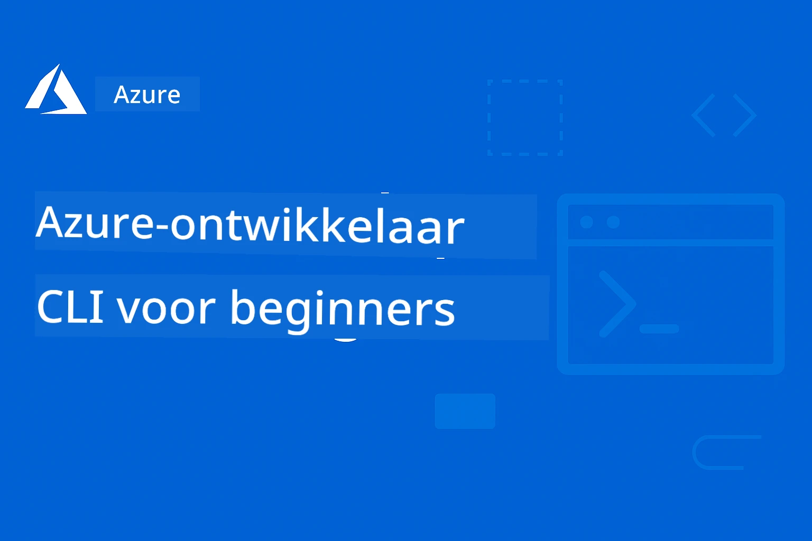

# AZD Voor Beginners: Een Gestructureerde Leerreis

 

[](https://github.com/microsoft/AZD-for-beginners)
[](https://GitHub.com/microsoft/azd-for-beginners/network/)
[](https://github.com/microsoft/AZD-for-beginners)

[](https://discord.com/invite/nkVh3dp)
[](https://discord.gg/nTYy5BXMWG)

---

### Automatische Vertalingen (Altijd Up-to-Date)

<!-- CO-OP TRANSLATOR LANGUAGES TABLE START -->
[Arabisch](../ar/README.md) | [Bengaals](../bn/README.md) | [Bulgaars](../bg/README.md) | [Birmaans (Myanmar)](../my/README.md) | [Chinees (Vereenvoudigd)](../zh-CN/README.md) | [Chinees (Traditioneel, Hongkong)](../zh-HK/README.md) | [Chinees (Traditioneel, Macau)](../zh-MO/README.md) | [Chinees (Traditioneel, Taiwan)](../zh-TW/README.md) | [Kroatisch](../hr/README.md) | [Tsjechisch](../cs/README.md) | [Deens](../da/README.md) | [Nederlands](./README.md) | [Ests](../et/README.md) | [Fins](../fi/README.md) | [Frans](../fr/README.md) | [Duits](../de/README.md) | [Grieks](../el/README.md) | [Hebreeuws](../he/README.md) | [Hindi](../hi/README.md) | [Hongaars](../hu/README.md) | [Indonesisch](../id/README.md) | [Italiaans](../it/README.md) | [Japans](../ja/README.md) | [Kannada](../kn/README.md) | [Khmer](../km/README.md) | [Koreaans](../ko/README.md) | [Litouws](../lt/README.md) | [Maleis](../ms/README.md) | [Malayalam](../ml/README.md) | [Manipuri (Meitei Mayek)](../mni/README.md) | [Marathi](../mr/README.md) | [Nepalees](../ne/README.md) | [Nigeriaans Pidgin](../pcm/README.md) | [Noors](../no/README.md) | [Perzisch (Farsi)](../fa/README.md) | [Pools](../pl/README.md) | [Portugees (Brazilië)](../pt-BR/README.md) | [Portugees (Portugal)](../pt-PT/README.md) | [Punjabi (Gurmukhi)](../pa/README.md) | [Roemeens](../ro/README.md) | [Russisch](../ru/README.md) | [Servisch (Cyrillisch)](../sr/README.md) | [Slowaaks](../sk/README.md) | [Sloveens](../sl/README.md) | [Spaans](../es/README.md) | [Swahili](../sw/README.md) | [Zweeds](../sv/README.md) | [Tagalog (Filipijns)](../tl/README.md) | [Tamil](../ta/README.md) | [Telugu](../te/README.md) | [Thais](../th/README.md) | [Turks](../tr/README.md) | [Oekraïens](../uk/README.md) | [Urdu](../ur/README.md) | [Vietnamees](../vi/README.md)

> **Liever lokaal klonen?**
>
> Deze repository bevat 50+ taalvertalingen die de downloadgrootte aanzienlijk vergroten. Om te klonen zonder vertalingen, gebruik sparse checkout:
>
> **Bash / macOS / Linux:**
> ```bash
> git clone --filter=blob:none --sparse https://github.com/microsoft/AZD-for-beginners.git
> cd AZD-for-beginners
> git sparse-checkout set --no-cone '/*' '!translations' '!translated_images'
> ```
>
> **CMD (Windows):**
> ```cmd
> git clone --filter=blob:none --sparse https://github.com/microsoft/AZD-for-beginners.git
> cd AZD-for-beginners
> git sparse-checkout set --no-cone "/*" "!translations" "!translated_images"
> ```
>
> Dit geeft je alles wat je nodig hebt om de cursus te voltooien met een veel snellere download.
<!-- CO-OP TRANSLATOR LANGUAGES TABLE END -->

## 🆕 Wat is er vandaag nieuw in azd

> 📌 **AI CLI release review (2026-11-04):** Richtlijnen zijn gecontroleerd aan de hand van gepubliceerde **`azd 1.37.2`**, **agents `1.0.0-beta.23`**, en **evaluations `1.0.0-beta.2`** documentatie/bron. Gebruik `azd >= 1.37.0` voor de gecombineerde workflow. Voer `azd version` en [werk de core CLI bij](https://learn.microsoft.com/azure/developer/azure-developer-cli/install-azd) vóór extensies. Zie [release wijzigingen en fixes](docs/chapter-08-production/production-ai-practices.md#recent-release-changes-and-fixes). Dit is geen live validatie van de hele cursus.

Azure Developer CLI ondersteunt veel toepassingssoorten, waaronder webapps, API’s en AI-agents, via ondersteunde hosts, sjablonen en extensies.

Dit betekent het volgende voor jou:

- **AI-agents zijn nu volwaardige azd workloads.** Je kunt AI-agent projecten initialiseren, implementeren en beheren met dezelfde bekende `azd init` → `azd up` workflow.
- **Een agent lifecycle over twee extensies.** Gebruik `azure.ai.agents` om agents te initialiseren, aan te roepen, te optimaliseren en af te bouwen. Installeer **`azure.ai.evaluations`** apart voor `azd ai eval init`, `generate`, en `run start`. Agents beta.22 verving de legacy evaluatieworkflow en wijzigde de optimalisatieconfiguratie; volg de [migratiehandleiding](docs/chapter-08-production/production-ai-practices.md#evaluation-migration-and-quality-checks).
- **Meer AI bouwstenen.** Nieuwe preview extensies — `azure.ai.skills` en `azure.ai.connections` — laten je herbruikbare agentvaardigheden en Foundry-verbindingen rechtstreeks met azd beheren.
- **Microsoft Foundry integratie** brengt modelimplementatie, agenthosting en AI-serviceconfiguratie direct in het azd sjabloonecosysteem.
- **Vlottere dagelijkse basiszaken.** Recente releases maakten `azd init` idempotent (veilige herhaling), zorgden dat `azd auth login` automatisch verlopen tokens opruimt en voegden een vriendelijke `azd tool` first-run setup prompt toe.
- **De kernworkflow is niet veranderd.** Of je nu een todo-app, microservice of multi-agent AI-oplossing uitrolt, de commando’s blijven hetzelfde.

> **Opmerking voor Aspire-gebruikers:** Microsoft noemt het product nu eenvoudigweg **Aspire** (voorheen ".NET Aspire"). Ondersteuning voor Aspire in azd blijft ongewijzigd – alleen de naam is bijgewerkt.

Als je azd eerder hebt gebruikt, is AI-ondersteuning een natuurlijke uitbreiding — geen afzonderlijk hulpmiddel of gevorderd traject. Als je nieuw begint, leer je één workflow die voor alles werkt.

---

## 🚀 Wat is Azure Developer CLI (azd)?

**Azure Developer CLI (azd)** is een ontwikkelaarsvriendelijke commandoregeltool die het eenvoudig maakt om applicaties naar Azure te implementeren. In plaats van handmatig tientallen Azure-resources te maken en te koppelen, kun je hele applicaties met één commando uitrollen.

### De magie van `azd up`

```bash
# This single command does everything:
# ✅ Creates all Azure resources  
# ✅ Configures networking and security
# ✅ Builds your application code
# ✅ Deploys to Azure
# ✅ Gives you a working URL
azd up
```

Het sjabloon levert de applicatie- en infrastructuurconfiguratie. Succesvolle implementatie vereist nog steeds ondersteunde services/modellen, voldoende quotum en rechten, correcte invoer en verificatie van de geïmplementeerde applicatie. `azd up` maakt een sjabloon niet automatisch veilig, conform of productieklaar.

---

## ❓ Azure Developer CLI versus Azure CLI: Wat is het verschil?

Dit is de meest gestelde vraag van beginners. Hier is het eenvoudige antwoord:

| Kenmerk | **Azure CLI (`az`)** | **Azure Developer CLI (`azd`)** |
|---------|---------------------|--------------------------------|
| **Doel** | Beheer individuele Azure-resources | Implementeer complete applicaties |
| **Mindset** | Infrastructuurgericht | Applicatiegericht |
| **Voorbeeld** | `az webapp create --name myapp...` | `azd up` |
| **Leercurve** | Moet Azure-services kennen | Alleen je app kennen |
| **Het beste voor** | DevOps, Infrastructuur | Ontwikkelaars, Prototyping |

### Simpele analogie

- **Azure CLI** is als het hebben van alle gereedschappen om een huis te bouwen – hamers, zagen, spijkers. Je kunt alles bouwen, maar moet wel kennis van bouw hebben.
- **Azure Developer CLI** is als het inhuren van een aannemer – jij beschrijft wat je wilt, en zij verzorgen de bouw.

### Wanneer gebruik je wat

| Scenario | Gebruik dit |
|----------|----------|
| "Ik wil snel mijn webapp uitrollen" | `azd up` |
| "Ik moet alleen een opslagaccount aanmaken" | `az storage account create` |
| "Ik bouw een volledige AI-applicatie" | `azd init --template azure-search-openai-demo` |
| "Ik moet een specifieke Azure-resource debuggen" | `az resource show` |
| "Ik wil naar mijn geconfigureerde productieomgeving implementeren" | Controleer configuratie, toegang, kosten en operationele poorten vóór `azd up --environment production` |

### Ze werken samen!

AZD en Azure CLI hebben aparte authenticatie en configuratie. Gebruik `azd auth login` voor AZD, en `az login` wanneer een hook of diagnostisch commando expliciet Azure CLI nodig heeft. Je kunt ze beide gebruiken:
```bash
# Deploy your app with AZD
azd up

# Then fine-tune specific resources with Azure CLI
az webapp config set --name myapp --always-on true
```

---

## 🌟 Vind sjablonen in Awesome AZD

Begin niet vanaf nul! **Awesome AZD** is de community-collectie van kant-en-klare uitrolsjablonen:

| Resource | Beschrijving |
|----------|-------------|
| 🔗 [**Awesome AZD Gallery**](https://azure.github.io/awesome-azd/) | Blader door 200+ sjablonen met één-klik uitrol |
| 🔗 [**Dien een Sjabloon In**](https://github.com/Azure/awesome-azd/issues) | Draag je eigen sjabloon bij aan de community |
| 🔗 [**GitHub Repository**](https://github.com/Azure/awesome-azd) | Star en verken de bron |

### Populaire AI-sjablonen uit Awesome AZD

Kies een sjabloon in zijn eigen lege map; de onderstaande commando’s zijn alternatieven. De afsluitende `.` initialiseert die map.

```bash
# RAG Chat with Microsoft Foundry Models + AI Search
azd init --template azure-search-openai-demo .

# Quick AI Chat Application
azd init --template openai-chat-app-quickstart .

# AI Agents with Foundry Agents
azd init --template get-started-with-ai-agents .
```

---

## 🎯 Aan de slag in 3 stappen

Zorg ervoor dat je machine klaar is voor het sjabloon dat je wilt uitrollen voordat je begint:

**Windows:**
```powershell
.\validate-setup.ps1
```

**macOS / Linux:**
```bash
bash ./validate-setup.sh
```

Als een van de vereiste controles faalt, los dat dan eerst op en ga daarna door met de quick start.

### Stap 1: Installeer AZD (2 minuten)

**Windows:**
```powershell
winget install microsoft.azd
```

**macOS:**
```bash
brew tap azure/azd && brew install azd
```

**Linux:**
```bash
curl -fsSL https://aka.ms/install-azd.sh | bash
```

### Stap 2: Verifieer Authenticatie voor AZD

```bash
# Optional if you plan to use Azure CLI commands directly in this course
az login

# Required for AZD workflows
azd auth login
```

Als je niet zeker weet welke je nodig hebt, volg dan de volledige setup-flow in [Installatie & Setup](docs/chapter-01-foundation/installation.md#authentication-setup).

### Stap 3: Implementeer je Eerste App

```bash
# Initialize from a template
azd init --template todo-nodejs-mongo .

# Deploy to Azure (creates everything!)
azd up
```

**🎉 Dat is alles!** Je app is nu live op Azure.

### Opruimen (Niet Vergeten!)

```bash
# Remove all resources when done experimenting
azd down --force --purge
```

---

## 📚 Hoe gebruik je deze cursus

Deze cursus is ontworpen voor **progressief leren** - begin waar je je comfortabel voelt en werk omhoog:

| Jouw Ervaring | Begin Hier |
|-----------------|------------|
| **Gloednieuw met Azure** | [Hoofdstuk 1: Basis](#-chapter-1-foundation--quick-start) |
| **Ken Azure, nieuw met AZD** | [Hoofdstuk 1: Basis](#-chapter-1-foundation--quick-start) |
| **Wil AI-apps implementeren** | [Hoofdstuk 2: AI-First Ontwikkeling](#-chapter-2-ai-first-development-recommended-for-ai-developers) |
| **Wil hands-on oefenen** | [🎓 Interactieve Workshop](workshop/README.md) - 3-4 uur begeleid lab |
| **Heb productiepatronen nodig** | [Hoofdstuk 8: Productie & Enterprise](#-chapter-8-production--enterprise-patterns) |

### Snelle Setup

1. **Fork deze repository**: [](https://GitHub.com/microsoft/azd-for-beginners/fork)
2. **Kloon hem**: `git clone https://github.com/YOUR-USERNAME/azd-for-beginners.git`
3. **Hulp krijgen**: [Azure Discord Community](https://discord.com/invite/ByRwuEEgH4)

> **Liever lokaal klonen?**

> Deze repository bevat 50+ taalvertalingen die de downloadgrootte aanzienlijk vergroten. Om te klonen zonder vertalingen, gebruik sparse checkout:
> ```bash
> git clone --filter=blob:none --sparse https://github.com/microsoft/AZD-for-beginners.git
> cd AZD-for-beginners
> git sparse-checkout set --no-cone '/*' '!translations' '!translated_images'
> ```
> Dit geeft je alles wat je nodig hebt om de cursus te voltooien met een veel snellere download.


## Overzicht van de cursus

Beheers Azure Developer CLI (azd) via gestructureerde hoofdstukken die ontworpen zijn voor progressief leren. **Speciale focus op AI-toepassingsimplementatie met Microsoft Foundry-integratie.**

### Waarom deze cursus essentieel is voor moderne ontwikkelaars

Ontwikkelaars die AI-workloads implementeren hebben vaak begeleiding nodig bij:
- Complexe AI-architecturen met meerdere services
- Best practices voor AI-implementatie in productie  
- Integratie en configuratie van Azure AI-services
- Kostenoptimalisatie voor AI-workloads
- Probleemoplossing bij AI-specifieke implementatieproblemen

### Leerdoelen

Door het voltooien van deze gestructureerde cursus zul je:
- **AZD Fundamentals beheersen**: Kernconcepten, installatie en configuratie
- **AI-toepassingen implementeren**: Gebruik AZD met Microsoft Foundry-services
- **Infrastructuur als Code implementeren**: Beheer Azure-resources met Bicep-templates
- **Implementaties oplossen**: Veelvoorkomende problemen oplossen en debuggen
- **Optimaliseren voor productie**: Beveiliging, schalen, monitoren en kostenbeheer
- **Multi-agent oplossingen bouwen**: Complexe AI-architecturen implementeren

## Voordat je begint: accounts, toegang en aannames

Voordat je start met hoofdstuk 1, zorg dat je het volgende hebt geregeld. De installatie-stappen in deze gids gaan ervan uit dat deze basis al geregeld is.

- **Een Azure-abonnement**: Je kunt een bestaand abonnement van werk of je eigen account gebruiken, of een [gratis proefperiode](https://aka.ms/azurefreetrial) aanmaken om te starten.
- **Machtiging om Azure-resources te creëren**: Voor de meeste oefeningen moet je ten minste **Contributor**-toegang hebben op het doelabonnement of de resourcegroep. Sommige hoofdstukken gaan ervan uit dat je ook resourcegroepen, beheerde identiteiten en RBAC-toewijzingen kunt aanmaken.
- [**Een GitHub-account**](https://github.com): Dit is handig om de repository te forken, eigen wijzigingen bij te houden en GitHub Codespaces te gebruiken voor de workshop.
- **Vereisten voor het template-runtime**: Sommige templates hebben lokale tools nodig zoals Node.js, Python, Java of Docker. Voer de setup-validator uit voordat je start zodat je ontbrekende tools vroegtijdig ontdekt.
- **Basiskennis van de terminal**: Je hoeft geen expert te zijn, maar je moet comfortabel zijn met het uitvoeren van commando’s zoals `git clone`, `azd auth login`, en `azd up`.

> **Werk je in een enterprise-abonnement?**
> Als je Azure-omgeving door een beheerder wordt beheerd, controleer dan van tevoren of je resources kunt implementeren in het abonnement of de resourcegroep die je wilt gebruiken. Zo niet, vraag dan om een sandbox-abonnement of Contributor-toegang voordat je begint.

> **Nieuw met Azure?**
> Begin met je eigen Azure-proefabonnement of pay-as-you-go-abonnement op https://aka.ms/azurefreetrial zodat je de oefeningen volledig kunt doorlopen zonder te wachten op tenant-niveau goedkeuringen.

## 🗺️ Cursuskaart: snelle navigatie per hoofdstuk

Elk hoofdstuk heeft een toegewijd README met leerdoelen, snelle starters en oefeningen:

| Hoofdstuk | Onderwerp | Lessen | Duur | Complexiteit |
|---------|-------|---------|----------|------------|
| **[Hoofdstuk 1: Basis](docs/chapter-01-foundation/README.md)** | Aan de slag | [AZD Basics](docs/chapter-01-foundation/azd-basics.md) &#124; [Installatie](docs/chapter-01-foundation/installation.md) &#124; [Eerste project](docs/chapter-01-foundation/first-project.md) | 30-45 min | ⭐ |
| **[Hoofdstuk 2: AI-ontwikkeling](docs/chapter-02-ai-development/README.md)** | AI-eerst apps | [Foundry-integratie](docs/chapter-02-ai-development/microsoft-foundry-integration.md) &#124; [AI Agents](docs/chapter-02-ai-development/agents.md) &#124; [Modelimplementatie](docs/chapter-02-ai-development/ai-model-deployment.md) &#124; [Workshop](docs/chapter-02-ai-development/ai-workshop-lab.md) | 1-2 uur | ⭐⭐ |
| **[Hoofdstuk 3: Configuratie](docs/chapter-03-configuration/README.md)** | Auth & beveiliging | [Configuratie](docs/chapter-03-configuration/configuration.md) &#124; [Auth & Security](docs/chapter-03-configuration/authsecurity.md) | 45-60 min | ⭐⭐ |
| **[Hoofdstuk 4: Infrastructuur](docs/chapter-04-infrastructure/README.md)** | IaC & implementatie | [Implementatiehandleiding](docs/chapter-04-infrastructure/deployment-guide.md) &#124; [Provisioning](docs/chapter-04-infrastructure/provisioning.md) | 1-1,5 uur | ⭐⭐⭐ |
| **[Hoofdstuk 5: Multi-Agent](docs/chapter-05-multi-agent/README.md)** | AI-agentoplossingen | [Retail-scenario](examples/retail-scenario.md) &#124; [Coördinatiepatronen](docs/chapter-06-pre-deployment/coordination-patterns.md) | 2-3 uur | ⭐⭐⭐⭐ |
| **[Hoofdstuk 6: Voor implementatie](docs/chapter-06-pre-deployment/README.md)** | Planning & Validatie | [Preflight-checks](docs/chapter-06-pre-deployment/preflight-checks.md) &#124; [Capaciteitsplanning](docs/chapter-06-pre-deployment/capacity-planning.md) &#124; [SKU-selectie](docs/chapter-06-pre-deployment/sku-selection.md) &#124; [App Insights](docs/chapter-06-pre-deployment/application-insights.md) | 1 uur | ⭐⭐ |
| **[Hoofdstuk 7: Probleemoplossing](docs/chapter-07-troubleshooting/README.md)** | Debuggen & oplossen | [Veelvoorkomende problemen](docs/chapter-07-troubleshooting/common-issues.md) &#124; [Debugging](docs/chapter-07-troubleshooting/debugging.md) &#124; [AI-problemen](docs/chapter-07-troubleshooting/ai-troubleshooting.md) | 1-1,5 uur | ⭐⭐ |
| **[Hoofdstuk 8: Productie](docs/chapter-08-production/README.md)** | Enterprise-patronen | [Productiepraktijken](docs/chapter-08-production/production-ai-practices.md) | 2-3 uur | ⭐⭐⭐⭐ |
| **[🎓 Workshop](workshop/README.md)** | Hands-on laboratorium | [Introductie](workshop/docs/instructions/0-Introduction.md) &#124; [Selectie](workshop/docs/instructions/1-Select-AI-Template.md) &#124; [Validatie](workshop/docs/instructions/2-Validate-AI-Template.md) &#124; [Ontmanteling](workshop/docs/instructions/3-Deconstruct-AI-Template.md) &#124; [Configuratie](workshop/docs/instructions/4-Configure-AI-Template.md) &#124; [Aanpassing](workshop/docs/instructions/5-Customize-AI-Template.md) &#124; [Afbouw](workshop/docs/instructions/6-Teardown-Infrastructure.md) &#124; [Afronding](workshop/docs/instructions/7-Wrap-up.md) | 3-4 uur | ⭐⭐ |

**Totale cursusduur:** ~10-14 uur | **Vaardigheidsprogressie:** Beginner → Productieklaar

---

## 📚 Leerhoofdstukken

*Selecteer je leerroute op basis van ervaringsniveau en doelen*

### 🚀 Hoofdstuk 1: Basis & snelstart
**Vereisten**: Azure-abonnement, basiskennis commandoregel  
**Duur**: 30-45 minuten  
**Complexiteit**: ⭐

#### Wat je leert
- Begrip van Azure Developer CLI basisprincipes
- Installatie van AZD op je platform
- Je eerste succesvolle implementatie

#### Leerbronnen
- **🎯 Begin hier**: [Wat is Azure Developer CLI?](#-what-is-azure-developer-cli-azd)
- **📖 Theorie**: [AZD Basics](docs/chapter-01-foundation/azd-basics.md) - Kernconcepten en terminologie
- **⚙️ Setup**: [Installatie & Setup](docs/chapter-01-foundation/installation.md) - Platform-specifieke gidsen
- **🛠️ Praktisch**: [Je eerste project](docs/chapter-01-foundation/first-project.md) - Stapsgewijze handleiding
- **📋 Snelreferentie**: [Command Cheat Sheet](resources/cheat-sheet.md)

#### Praktische oefeningen
```bash
# Quick installation check
azd version

# Deploy your first application
azd init --template todo-nodejs-mongo .
azd up
```

**💡 Resultaat hoofdstuk**: Een eenvoudige webapplicatie succesvol implementeren naar Azure met AZD

**✅ Succesvalidatie:**
```bash
# After completing Chapter 1, you should be able to:
azd version              # Shows installed version
azd init --template todo-nodejs-mongo  # Initializes project
azd up                  # Deploys to Azure
azd show                # Displays running app URL
# Application opens in browser and works
azd down --force --purge  # Cleans up resources
```

**📊 Tijdsinvestering:** 30-45 minuten  
**📈 Vaardigheidsniveau daarna:** Kan eenvoudige applicaties zelfstandig implementeren

---

### 🤖 Hoofdstuk 2: AI-eerst ontwikkeling (aanbevolen voor AI-ontwikkelaars)
**Vereisten**: Hoofdstuk 1 voltooid  
**Duur**: 1-2 uur  
**Complexiteit**: ⭐⭐

#### Wat je leert
- Microsoft Foundry-integratie met AZD
- Implementatie van AI-gestuurde applicaties
- Begrip van AI-serviceconfiguraties

#### Leerbronnen
- **🎯 Begin hier**: [Microsoft Foundry-integratie](docs/chapter-02-ai-development/microsoft-foundry-integration.md)
- **🤖 AI Agents**: [AI Agents-gids](docs/chapter-02-ai-development/agents.md) - Intelligente agents implementeren met AZD
- **📖 Patronen**: [AI Modelimplementatie](docs/chapter-02-ai-development/ai-model-deployment.md) - AI-modellen implementeren en beheren
- **🛠️ Workshop**: [AI Workshop-lab](docs/chapter-02-ai-development/ai-workshop-lab.md) - Maak je AI-oplossingen AZD-klaar
- **🎥 Interactieve gids**: [Workshop Materialen](workshop/README.md) - Browser-gebaseerd leren met MkDocs * DevContainer-omgeving
- **📋 Templates**: [Microsoft Foundry-templates](#featured-microsoft-foundry-templates)
- **📝 Voorbeelden**: [AZD-implementatievoorbeelden](examples/README.md)

#### Praktische oefeningen
```bash
# Deploy your first AI application
azd init --template azure-search-openai-demo .
azd up

# Try additional AI templates
azd init --template openai-chat-app-quickstart .
azd init --template agent-openai-python-prompty .
```

**💡 Resultaat hoofdstuk**: Implementeer en configureer een AI-gestuurde chatapplicatie met RAG-mogelijkheden

**✅ Succesvalidatie:**
```bash
# After Chapter 2, you should be able to:
azd init --template azure-search-openai-demo .
azd up
# Test the AI chat interface
# Ask questions and get AI-powered responses with sources
# Verify search integration works
azd monitor  # Check Application Insights shows telemetry
azd down --force --purge
```

**📊 Tijdsinvestering:** 1-2 uur  
**📈 Vaardigheidsniveau daarna:** Kan AI- leerapplicaties implementeren en aanvullende vereisten voor productieklaarheid identificeren
**💰 Kostenbewustzijn:** Begrijp ontwikkelkosten van $80-150/maand, productiekosten van $300-3500/maand

#### 💰 Kostenoverwegingen voor AI-implementaties

**Ontwikkelomgeving (geschat $80-150/maand):**
- Microsoft Foundry-modellen (Pay-as-you-go): $0-50/maand (afhankelijk van tokengebruik)
- AI Search (Basic-niveau): $75/maand
- Container Apps (Consumption): $0-20/maand
- Opslag (Standaard): $1-5/maand

**Productieomgeving (geschat $300-3.500+/maand):**
- Microsoft Foundry-modellen (PTU voor consistente prestaties): $3.000+/maand OF Pay-as-you-go met groot volume
- AI Search (Standaardniveau): $250/maand
- Container Apps (Toegewijd): $50-100/maand
- Application Insights: $5-50/maand
- Opslag (Premium): $10-50/maand

**💡 Tips voor kostenoptimalisatie:**
- Controleer modelinferenceprijzen en account-specifieke credits; Azure OpenAI bevat geen universele 50.000-token gratis maandelijkse tegoed
- Voer `azd down` uit om resources te verwijderen wanneer ze niet meer nodig zijn, na het bekijken van de geselecteerde omgeving
- Begin met verbruik-gebaseerde facturering, upgrade naar PTU alleen voor productie
- Gebruik `azd provision --preview` om geplande infrastructuur te inspecteren, en prijs vervolgens de resulterende resources met de Azure Pricing Calculator
- Schakel autoscaling in: betaal alleen voor werkelijk gebruik

**Kostenmonitoring:**
```bash
# Inspect planned resources (this does not calculate prices)
azd provision --preview

# Monitor actual costs in Azure Portal
az consumption budget list --resource-group <your-rg>
```

---

### ⚙️ Hoofdstuk 3: Configuratie & authenticatie
**Vereisten**: Hoofdstuk 1 voltooid  
**Duur**: 45-60 minuten  
**Complexiteit**: ⭐⭐

#### Wat je leert
- Omgevingsconfiguratie en beheer
- Authenticatie en beveiligingsbest practices
- Naamgeving en organisatie van resources

#### Leerbronnen
- **📖 Configuratie**: [Configuratiehandleiding](docs/chapter-03-configuration/configuration.md) - Omgevingsinstelling
- **🔐 Beveiliging**: [Authenticatiepatronen en beheerde identiteit](docs/chapter-03-configuration/authsecurity.md) - Authenticatiepatronen
- **📝 Voorbeelden**: [Database-app voorbeeld](examples/database-app/README.md) - AZD databasevoorbeelden

#### Praktische oefeningen
- Configureer meerdere omgevingen (dev, staging, prod)
- Richt beheerde identiteit-authenticatie in
- Implementeer omgeving-specifieke configuraties

**💡 Resultaat hoofdstuk**: Beheer meerdere omgevingen met correcte authenticatie en beveiliging

---

### 🏗️ Hoofdstuk 4: Infrastructure as Code & implementatie
**Vereisten**: Hoofdstukken 1-3 voltooid  
**Duur**: 1-1,5 uur  
**Complexiteit**: ⭐⭐⭐

#### Wat je leert
- Geavanceerde implementatiepatronen
- Infrastructure as Code met Bicep
- Resource-provisioningstrategieën

#### Leerbronnen
- **📖 Implementatie**: [Implementatiehandleiding](docs/chapter-04-infrastructure/deployment-guide.md) - Complete workflows
- **🏗️ Provisioning**: [Provisioning van resources](docs/chapter-04-infrastructure/provisioning.md) - Beheer van Azure-resources
- **📝 Voorbeelden**: [Container App voorbeeld](../../examples/container-app) - Containerized implementaties

#### Praktische oefeningen
- Maak aangepaste Bicep-templates
- Implementeer multi-service applicaties
- Implementeer blue-green deploymentstrategieën

**💡 Resultaat hoofdstuk**: Implementeer complexe multi-service applicaties met behulp van aangepaste infrastructuurtemplates

---

### 🎯 Hoofdstuk 5: Multi-Agent AI-oplossingen (gevorderd)
**Vereisten**: Hoofdstukken 1-2 voltooid  
**Duur**: 2-3 uur  
**Complexiteit**: ⭐⭐⭐⭐

#### Wat je leert
- Multi-agent architectuurpatronen
- Agent orchestration en coördinatie
- Productieklaar AI-implementaties

#### Leerbronnen
- **🤖 Uitgelichte ontwerp**: [Retail Multi-Agent Oplossing](examples/retail-scenario.md) - Architectuurschema, geen volledige applicatie
- **🛠️ ARM-sjablonen**: [ARM Template Package](../../examples/retail-multiagent-arm-template) - Infrastructuurskelet; controleer vereisten en ontbrekende applicatiecomponenten
- **📖 Architectuur**: [Multi-agent coördinatiepatronen](docs/chapter-06-pre-deployment/coordination-patterns.md) - Patronen

#### Praktische oefeningen
```bash
# Inspect the retail infrastructure scaffold before choosing to deploy it
cd examples/retail-multiagent-arm-template
cat README.md

# After an intentional deployment, inspect infrastructure state
az deployment group show --resource-group <rg-name> --name <deployment-name>
```

**💡 Hoofdstukresultaat**: Begrijp multi-agent ontwerp en identificeer het implementatie-, validatie- en operationele werk dat nodig is naast een infrastructuurskelet

---

### 🔍 Hoofdstuk 6: Validatie & Planning voor Pre-Deployment
**Vereisten**: Hoofdstuk 4 voltooid  
**Duur**: 1 uur  
**Complexiteit**: ⭐⭐

#### Wat je leert
- Capaciteitsplanning en resource-validatie
- Strategieën voor SKU-selectie
- Pre-flight controles en automatisering

#### Leerbronnen
- **📊 Planning**: [Capaciteitsplanning](docs/chapter-06-pre-deployment/capacity-planning.md) - Resource-validatie
- **💰 Selectie**: [SKU-selectie](docs/chapter-06-pre-deployment/sku-selection.md) - Kosteneffectieve keuzes
- **✅ Validatie**: [Pre-flight checks](docs/chapter-06-pre-deployment/preflight-checks.md) - Geautomatiseerde scripts

#### Praktische oefeningen
- Voer scripts voor capaciteitsvalidatie uit
- Optimaliseer SKU-selecties voor kosten
- Implementeer geautomatiseerde pre-deployment controles

**💡 Hoofdstukresultaat**: Valideer en optimaliseer deploys vóór uitvoering

---

### 🚨 Hoofdstuk 7: Problemen oplossen & Debugging
**Vereisten**: Elk deploymenthoofdstuk voltooid  
**Duur**: 1-1,5 uur  
**Complexiteit**: ⭐⭐

#### Wat je leert
- Systematische debuggingmethoden
- Veelvoorkomende problemen en oplossingen
- AI-specifieke probleemoplossing

#### Leerbronnen
- **🔧 Veelvoorkomende problemen**: [Veelvoorkomende problemen](docs/chapter-07-troubleshooting/common-issues.md) - FAQ en oplossingen
- **🕵️ Debugging**: [Debuggids](docs/chapter-07-troubleshooting/debugging.md) - Stapsgewijze strategieën
- **🤖 AI-problemen**: [AI-specifieke probleemoplossing](docs/chapter-07-troubleshooting/ai-troubleshooting.md) - AI-serviceproblemen

#### Praktische oefeningen
- Diagnoseer deploymentfouten
- Los authenticatieproblemen op
- Debug AI-serviceconnectiviteit

**💡 Hoofdstukresultaat**: Diagnoseer en los zelfstandig veelvoorkomende deploymentproblemen op

---

### 🏢 Hoofdstuk 8: Productie- & Enterprisepatronen
**Vereisten**: Hoofdstukken 1-4 voltooid  
**Duur**: 2-3 uur  
**Complexiteit**: ⭐⭐⭐⭐

#### Wat je leert
- Productie-deploymentstrategieën
- Beveiligingspatronen voor ondernemingen
- Monitoring en kostenoptimalisatie

#### Leerbronnen
- **🏭 Productie**: [Best Practices voor AI in Productie](docs/chapter-08-production/production-ai-practices.md) - Enterprisepatronen
- **📝 Voorbeelden**: [Microservices Voorbeeld](../../examples/microservices) - Complexe architecturen
- **📊 Monitoring**: [Integratie met Application Insights](docs/chapter-06-pre-deployment/application-insights.md) - Monitoring

#### Praktische oefeningen
- Implementeer beveiligingspatronen voor ondernemingen
- Stel uitgebreide monitoring in
- Deploy naar productie met juiste governance

**💡 Hoofdstukresultaat**: Zet bedrijfsklare applicaties in met volledige productiemogelijkheden

---

## 🎓 Workshop overzicht: Praktische leerervaring

> **⚠️ WORKSHOPSTATUS: Actieve Ontwikkeling**  
> De workshopmaterialen worden momenteel ontwikkeld en verfijnd. Kernmodules zijn functioneel, maar sommige geavanceerde secties zijn onvolledig. We werken actief aan het voltooien van alle inhoud. [Volg de voortgang →](workshop/README.md)

### Interactieve workshopmaterialen
**Uitgebreide praktische leerervaring met browsergebaseerde tools en begeleide oefeningen**

Onze workshopmaterialen bieden een gestructureerde, interactieve leerervaring die het hoofdstukgebaseerde curriculum hierboven aanvult. De workshop is ontworpen voor zowel zelfstudie als begeleide sessies.

#### 🛠️ Workshopkenmerken
- **Browsergebaseerde interface**: Volledige MkDocs-workshop met zoek-, kopieer- en themafuncties
- **GitHub Codespaces-integratie**: Met één klik ontwikkelomgeving opzetten
- **Gestructureerd leerpad**: 8-module begeleide oefeningen (3-4 uur totaal)
- **Progressieve methodiek**: Introductie → Selectie → Validatie → Ontleding → Configuratie → Aanpassing → Afbouw → Afronding
- **Interactieve DevContainer-omgeving**: Vooraf geconfigureerde tools en afhankelijkheden

#### 📚 Workshops modulair structuur
De workshop volgt een **8-module progressieve methodiek** die je van ontdekking tot beheersing van deployment brengt:

| Module | Onderwerp | Wat je doet | Duur |
|--------|----------|-------------|-------|
| **0. Introductie** | Workshopoverzicht | Begrijp leerdoelen, vereisten en workshopstructuur | 15 min |
| **1. Selectie** | Template ontdekking | Verken AZD-sjablonen en kies de juiste AI-sjabloon voor jouw scenario | 20 min |
| **2. Validatie** | Deploy & Verifiëren | Zet de template in met `azd up` en valideer infrastructuur | 30 min |
| **3. Ontleding** | Begrijp structuur | Gebruik GitHub Copilot om template-architectuur, Bicep-bestanden en code organisatie te verkennen | 30 min |
| **4. Configuratie** | azure.yaml deep dive | Beheers `azure.yaml` configuratie, lifecycle hooks en omgevingsvariabelen | 30 min |
| **5. Aanpassing** | Maak het eigen | Schakel AI Search, tracing, evaluatie in en pas aan voor jouw scenario | 45 min |
| **6. Afbouw** | Opruimen | Provisioneer resources veilig af met `azd down --purge` | 15 min |
| **7. Afronding** | Volgende stappen | Review prestaties, kernconcepten, en vervolg je leertraject | 15 min |

**Workshopverloop:**
```
Introduction → Selection → Validation → Deconstruction → Configuration → Customization → Teardown → Wrap-up
     ↓            ↓           ↓              ↓               ↓              ↓            ↓           ↓
  Overview    Find the     Deploy &      Explore        Master         Customize     Clean up    Review &
             right        verify        code &        azure.yaml      for your      resources   next steps
             template                   structure                     scenario
```

#### 🚀 Aan de slag met de workshop
```bash
# Option 1: GitHub Codespaces (Recommended)
# Click "Code" → "Create codespace on main" in the repository

# Option 2: Local Development
git clone https://github.com/microsoft/azd-for-beginners.git
cd azd-for-beginners/workshop
# Follow the setup instructions in workshop/README.md
```

#### 🎯 Leerresultaten van de workshop
Door het voltooien van de workshop zullen deelnemers:
- **Productie AI-applicaties implementeren**: Gebruik AZD met Microsoft Foundry-diensten
- **Multi-agent architecturen beheersen**: Implementeer gecoördineerde AI-agentoplossingen
- **Beveiligingsbest practices implementeren**: Configureer authenticatie en toegangscontrole
- **Optimaliseer voor schaalbaarheid**: Ontwerp kosteneffectieve, performante deployments
- **Deployments troubleshooten**: Los veelvoorkomende problemen zelfstandig op

#### 📖 Workshopbronnen
- **🎥 Interactieve gids**: [Workshopmaterialen](workshop/README.md) - Browsergebaseerde leeromgeving
- **📋 Module-voor-module instructies**:
  - [0. Introductie](workshop/docs/instructions/0-Introduction.md) - Workshopoverzicht en doelstellingen
  - [1. Selectie](workshop/docs/instructions/1-Select-AI-Template.md) - Vind en selecteer AI-sjablonen
  - [2. Validatie](workshop/docs/instructions/2-Validate-AI-Template.md) - Deploy en verifieer templates
  - [3. Ontleding](workshop/docs/instructions/3-Deconstruct-AI-Template.md) - Verken template-architectuur
  - [4. Configuratie](workshop/docs/instructions/4-Configure-AI-Template.md) - Beheers azure.yaml
  - [5. Aanpassing](workshop/docs/instructions/5-Customize-AI-Template.md) - Pas aan voor jouw scenario
  - [6. Afbouw](workshop/docs/instructions/6-Teardown-Infrastructure.md) - Ruim resources op
  - [7. Afronding](workshop/docs/instructions/7-Wrap-up.md) - Review en volgende stappen
- **🛠️ AI Workshop Lab**: [AI Workshop Lab](docs/chapter-02-ai-development/ai-workshop-lab.md) - AI-gerichte oefeningen
- **💡 Snelstart**: [Workshop Setup Guide](workshop/README.md#browser-based-guide) - Omgevingsconfiguratie

**Perfect voor**: Bedrijfstrainingen, universiteitscursussen, zelfstudie en ontwikkelaar bootcamps.

---

## 📖 Diepgaande verkenning: AZD-mogelijkheden

Naast de basis biedt AZD krachtige functies voor productiedeployments:

- **Template-gebaseerde deployments** - Gebruik vooraf gebouwde sjablonen voor veelvoorkomende applicatiepatronen
- **Infrastructure as Code** - Beheer Azure-resources met Bicep of Terraform  
- **Geïntegreerde workflows** - Naadloos provisioneren, deployen en monitoren van applicaties
- **Ontwikkelaarsvriendelijk** - Geoptimaliseerd voor productiviteit en ervaring van ontwikkelaars

### **AZD + Microsoft Foundry: Perfect voor AI-deployments**

**Waarom AZD voor AI-oplossingen?** AZD pakt de grootste uitdagingen voor AI-ontwikkelaars aan:

- **AI-ready sjablonen** - Vooraf geconfigureerde sjablonen voor Microsoft Foundry modellen, Azure AI-diensten en ML-workloads
- **Veilige AI-deployments** - Ingebouwde beveiligingspatronen voor AI-diensten, API-sleutels en model-endpoints  
- **Productie AI-patronen** - Best practices voor schaalbare, kosteneffectieve AI-applicatie-deployments
- **End-to-end AI-workflows** - Van modelontwikkeling tot productie-deployment met de juiste monitoring
- **Kostenoptimalisatie** - Slimme resourceallocatie- en schaalstrategieën voor AI-workloads
- **Microsoft Foundry-integratie** - Naadloze aansluiting op Microsoft Foundry modelcatalogus en endpoints

---

## 🎯 Sjablonen- & voorbeeldenbibliotheek

### Uitgelicht: Microsoft Foundry-sjablonen
**Begin hier als je AI-applicaties inzet!**

> **Opmerking:** Deze sjablonen demonstreren diverse AI-patronen. Sommige zijn externe Azure Samples, andere zijn lokale implementaties.

| Sjabloon | Hoofdstuk | Complexiteit | Diensten | Type |
|----------|----------|-------------|----------|------|
| [**Begin met AI-chat**](https://github.com/Azure-Samples/get-started-with-ai-chat) | Hoofdstuk 2 | ⭐⭐ | AzureOpenAI + Azure AI Model Inference API + Azure AI Search + Azure Container Apps + Application Insights | Extern |
| [**Begin met AI-agenten**](https://github.com/Azure-Samples/get-started-with-ai-agents) | Hoofdstuk 2 | ⭐⭐ | Foundry Agents + AzureOpenAI + Azure AI Search + Azure Container Apps + Application Insights | Extern |
| [**Azure Search + OpenAI Demo**](https://github.com/Azure-Samples/azure-search-openai-demo) | Hoofdstuk 2 | ⭐⭐ | Azure OpenAI + Azure AI Search + Container Apps (standaard) + Storage | Extern |
| [**OpenAI Chat App Quickstart**](https://github.com/Azure-Samples/openai-chat-app-quickstart) | Hoofdstuk 2 | ⭐ | AzureOpenAI + Container Apps + Application Insights | Extern |
| [**Agent OpenAI Python Prompty**](https://github.com/Azure-Samples/agent-openai-python-prompty) | Hoofdstuk 5 | ⭐⭐⭐ | AzureOpenAI + Azure Functions + Prompty | Extern |
| [**Contoso Chat RAG**](https://github.com/Azure-Samples/contoso-chat) | Hoofdstuk 8 | ⭐⭐⭐⭐ | AzureOpenAI + AI Search + Cosmos DB + Container Apps | Extern |
| [**Retail Multi-Agent Solution**](examples/retail-scenario.md) | Hoofdstuk 5 | ⭐⭐⭐⭐ | Voorgestelde architectuur en infrastructuur-skelet; implementatie van de applicatie vereist | **Lokaal sjabloon** |

### Uitgelicht: Complete leerscenario's
**Productieklaar app-sjablonen gekoppeld aan leerhoofdstukken**

| Sjabloon | Leerhoofdstuk | Complexiteit | Belangrijkste leerpunten |
|----------|---------------|-------------|-----------------------|
| [**openai-chat-app-quickstart**](https://github.com/Azure-Samples/openai-chat-app-quickstart) | Hoofdstuk 2 | ⭐ | Basis AI-deploypatronen |
| [**azure-search-openai-demo**](https://github.com/Azure-Samples/azure-search-openai-demo) | Hoofdstuk 2 | ⭐⭐ | RAG-implementatie met Azure AI Search |
| [**get-started-with-ai-agents**](https://github.com/Azure-Samples/get-started-with-ai-agents) | Hoofdstuk 2 | ⭐⭐ | Agent-ondersteunde chat en scenario-specifieke evaluatietests |
| [**agent-openai-python-prompty**](https://github.com/Azure-Samples/agent-openai-python-prompty) | Hoofdstuk 5 | ⭐⭐⭐ | Agentframework en function calls |
| [**contoso-chat**](https://github.com/Azure-Samples/contoso-chat) | Hoofdstuk 8 | ⭐⭐⭐ | Enterprise AI-orchestratie |
| [**retail-multi-agent-solution**](examples/retail-scenario.md) | Hoofdstuk 5 | ⭐⭐⭐⭐ | Multi-agent architectuur met Customer en Inventory agents |

### Leren per voorbeeldtype

> **📌 Lokale vs. externe voorbeelden:**  
> **Lokale voorbeelden** (in deze repository) = Bekijk de README van het voorbeeld voor implementatiestatus en vereisten
> **Externe voorbeelden** (Azure Samples) = Clone uit gekoppelde repositories

#### Lokale voorbeelden (klaar voor gebruik)
- [**Retail Multi-Agent Solution**](examples/retail-scenario.md) - Architectuursjabloon met ARM infrastructuur-skelet
  - Voorgestelde rollen voor Customer en Inventory agents
  - Monitoring, evaluatie en applicatiecode moeten geïmplementeerd en geverifieerd worden
  - Alleen resources provisioeneren levert geen werkende retailapplicatie op

#### Lokale voorbeelden - Containerapplicaties (hoofdstukken 2-5)
**Uitgebreide containerdeploymentvoorbeelden in deze repository:**
- [**Container App Voorbeelden**](examples/container-app/README.md) - Volledige gids voor containerdeployment
  - [Eenvoudige Flask API](../../examples/container-app/simple-flask-api) - Basis REST API met scale-to-zero
  - [Microservices architectuur](../../examples/container-app/microservices) - Twee-service leervoorbeeld; productiehardening is extra werk
  - Snelstart, productie en geavanceerde deploymentpatronen
  - Richtlijnen voor monitoring, beveiliging en kostenoptimalisatie

#### Externe voorbeelden - Eenvoudige applicaties (hoofdstukken 1-2)
**Clone deze Azure Samples repositories om te starten:**
- [Eenvoudige webapp - Node.js + MongoDB](https://github.com/Azure-Samples/todo-nodejs-mongo) - Basis deploymentpatronen
- [Statische website - React SPA](https://github.com/Azure-Samples/todo-csharp-sql-swa-func) - Deployment van statische content
- [Container App - Python Flask](https://github.com/Azure-Samples/container-apps-store-api-microservice) - REST API deployment

#### Externe voorbeelden - Database-integratie (hoofdstuk 3-4)  
- [Database-app - C# + SQL](https://github.com/Azure-Samples/todo-csharp-sql) - Databaseconnectiviteitspatronen
- [Functions + Cosmos DB](https://github.com/Azure-Samples/todo-python-mongo-swa-func) - Serverless datastromen

#### Externe Voorbeelden - Geavanceerde Patronen (Hoofdstukken 4-8)
- [Java Microservices](https://github.com/Azure-Samples/java-microservices-aca-lab) - Multi-service architecturen
- [Container Apps Jobs](https://github.com/Azure-Samples/container-apps-jobs) - Achtergrondverwerking  
- [Enterprise ML Pipeline](https://github.com/Azure/mlops-v2) - MLOps referentiepatronen; geen kant-en-klare AZD-template

### Externe Template Collecties
- [**Officiële AZD Template Gallery**](https://azure.github.io/awesome-azd/) - Gecurateerde verzameling officiële en community templates
- [**Azure Developer CLI Templates**](https://learn.microsoft.com/en-us/azure/developer/azure-developer-cli/azd-templates) - Microsoft Learn template documentatie
- [**Examples Directory**](examples/README.md) - Lokale leervoorbeelden met gedetailleerde uitleg

---

## 📚 Leerbronnen & Referenties

### Snelle Referenties
- [**Command Cheat Sheet**](resources/cheat-sheet.md) - Essentiële azd-commando's gerangschikt per hoofdstuk
- [**Glossary**](resources/glossary.md) - Azure en azd terminologie  
- [**FAQ**](resources/faq.md) - Veelgestelde vragen per leerhoofdstuk
- [**Study Guide**](resources/study-guide.md) - Uitgebreide oefenopdrachten

### Praktische Workshops
- [**AI Workshop Lab**](docs/chapter-02-ai-development/ai-workshop-lab.md) - Maak je AI-oplossingen AZD-implanteerbaar (2-3 uur)
- [**Interactive Workshop**](workshop/README.md) - 8-delige begeleide oefeningen met MkDocs en GitHub Codespaces
  - Volgt: Introductie → Selectie → Validatie → Deconstructie → Configuratie → Aanpassing → Afsluiting → Samenvatting

### Externe Leerbronnen
- [Azure Developer CLI Documentation](https://learn.microsoft.com/en-us/azure/developer/azure-developer-cli/)
- [Azure Architecture Center](https://learn.microsoft.com/en-us/azure/architecture/)
- [Azure Pricing Calculator](https://azure.microsoft.com/pricing/calculator/)
- [Azure Status](https://status.azure.com/)

### AI Agent Vaardigheden voor Je Editor
- [**Microsoft Azure Skills op skills.sh**](https://skills.sh/microsoft/github-copilot-for-azure) - 37 open agent skills voor Azure AI, Foundry, deployment, diagnostiek, kostenoptimalisatie, en meer. Installeer ze in GitHub Copilot, Cursor, Claude Code of elke ondersteunde agent:
  ```bash
  npx skills add microsoft/github-copilot-for-azure
  ```

---

## 🔧 Snelle Probleemoplossingsgids

**Veelvoorkomende problemen voor beginners en directe oplossingen:**

<details>
<summary><strong>❌ "azd: command not found"</strong></summary>

```bash
# Install AZD first
# Windows (PowerShell):
winget install microsoft.azd

# macOS:
brew tap azure/azd && brew install azd

# Linux:
curl -fsSL https://aka.ms/install-azd.sh | bash

# Verify installation
azd version
```
</details>

<details>
<summary><strong>❌ "No subscription found" of "Subscription not set"</strong></summary>

```bash
# List available subscriptions
az account list --output table

# Set default subscription
az account set --subscription "<subscription-id-or-name>"

# Set for AZD environment
azd env set AZURE_SUBSCRIPTION_ID "<subscription-id>"

# Verify
az account show
```
</details>

<details>
<summary><strong>❌ "InsufficientQuota" of "Quota exceeded"</strong></summary>

```bash
# Try different Azure region
azd env set AZURE_LOCATION "westus2"
azd up

# Or use smaller SKUs in development
# Edit infra/main.parameters.json:
{
  "sku": "B1"  // Instead of "P1V2"
}
```
</details>

<details>
<summary><strong>❌ "azd up" faalt halverwege</strong></summary>

```bash
# Option 1: Inspect the error and retry after correcting its cause
azd show
azd up --debug

# Option 2: Just fix infrastructure
azd provision

# Option 3: Check detailed status
azd show

# Option 4: Check logs in Azure Monitor
azd monitor --logs
```
</details>

<details>
<summary><strong>❌ "Authentication failed" of "Token expired"</strong></summary>

```bash
# Re-authenticate for AZD
azd auth logout
azd auth login

# Optional: refresh Azure CLI too if you are running az commands
az logout
az login

# Verify authentication
az account show
```
</details>

<details>
<summary><strong>❌ "Resource already exists" of naamconflicten</strong></summary>

```bash
# Inspect the conflicting resource before changing or deleting anything.
# For an isolated new deployment, create a separate environment:
azd env new dev-v2
azd up
```
</details>

<details>
<summary><strong>❌ Template-implementatie duurt te lang</strong></summary>

**Normale wachttijden:**
- Eenvoudige webapp: 5-10 minuten
- App met database: 10-15 minuten
- AI-toepassingen: 15-25 minuten (OpenAI provisioning is traag)

```bash
# Check progress
azd show

# If stuck >30 minutes, check Azure Portal:
azd monitor --overview
# Look for failed deployments
```
</details>

<details>
<summary><strong>❌ "Permission denied" of "Forbidden"</strong></summary>

```bash
# Check your Azure role
az role assignment list --assignee $(az account show --query user.name -o tsv)

# You need at least "Contributor" role
# Ask your Azure admin to grant:
# - Contributor (for resources)
# - User Access Administrator (for role assignments)
```
</details>

<details>
<summary><strong>❌ Kan URL van geïmplementeerde applicatie niet vinden</strong></summary>

```bash
# Show all service endpoints
azd show

# Or open Azure Portal
azd monitor

# Check specific service
azd env get-values
# Look for *_URL variables
```
</details>

### 📚 Volledige Probleemoplossingsbronnen

- **Gids voor veelvoorkomende problemen:** [Gedetailleerde oplossingen](docs/chapter-07-troubleshooting/common-issues.md)
- **AI-specifieke problemen:** [AI Probleemoplossing](docs/chapter-07-troubleshooting/ai-troubleshooting.md)
- **Debugging-gids:** [Stapsgewijze debugging](docs/chapter-07-troubleshooting/debugging.md)
- **Hulp krijgen:** [Azure Discord](https://discord.gg/microsoft-azure) #azure-developer-cli

---

## 🎓 Cursusvoltooiing & Certificering

### Voortgangsbewaking
Volg je leerprogressie per hoofdstuk:

- [ ] **Hoofdstuk 1**: Basis & Snelle Start ✅
- [ ] **Hoofdstuk 2**: AI-First Ontwikkeling ✅  
- [ ] **Hoofdstuk 3**: Configuratie & Authenticatie ✅
- [ ] **Hoofdstuk 4**: Infrastructure as Code & Implementatie ✅
- [ ] **Hoofdstuk 5**: Multi-Agent AI-oplossingen ✅
- [ ] **Hoofdstuk 6**: Pre-Deployment Validatie & Planning ✅
- [ ] **Hoofdstuk 7**: Probleemoplossing & Debugging ✅
- [ ] **Hoofdstuk 8**: Productie & Enterprise Patronen ✅

### Leercontrole
Na voltooiing van elk hoofdstuk, verifieer je kennis door:
1. **Praktijkopdracht**: Voltooi de hands-on implementatie van het hoofdstuk
2. **Kennischeck**: Bekijk de FAQ-sectie van je hoofdstuk
3. **Community Discussie**: Deel je ervaring in Azure Discord
4. **Volgend Hoofdstuk**: Ga naar het volgende complexiteitsniveau

### Voordelen van cursusvoltooiing
Na afronding van alle hoofdstukken heb je:
- **Productie-ervaring**: Reële AI-toepassingen naar Azure geïmplementeerd
- **Professionele Vaardigheden**: Capaciteiten voor enterprise-ready implementaties  
- **Community Erkenning**: Actief lid van de Azure ontwikkelaarscommunity
- **Carrièrebevordering**: Gewilde AZD- en AI-implementatie-expertise

---

## 🤝 Community & Ondersteuning

### Hulp & Ondersteuning Krijgen
- **Technische Problemen**: [Rapporteer bugs en vraag functies aan](https://github.com/microsoft/azd-for-beginners/issues)
- **Leer Vragen**: [Microsoft Azure Discord Community](https://discord.gg/microsoft-azure) en [](https://discord.gg/nTYy5BXMWG)
- **AI-Specifieke Hulp**: Doe mee aan de [](https://discord.gg/nTYy5BXMWG)
- **Documentatie**: [Officiële Azure Developer CLI documentatie](https://learn.microsoft.com/en-us/azure/developer/azure-developer-cli/)

### Community-inzichten van Microsoft Foundry Discord

**Onderwerpen besproken door de community:**
- Multi-service implementaties, credentialbeheer en productie gereedheid
- AI-specifieke templates, probleemoplossingsgidsen en best practices

**Word lid van onze community om:**
- Deel je AZD + AI ervaringen en krijg hulp
- Vroege previews van nieuwe AI-templates zien
- Bijdragen aan best practices voor AI-implementatie
- Invloed uitoefenen op toekomstige AI + AZD feature-ontwikkeling

### Bijdragen aan de Cursus
We verwelkomen bijdragen! Lees onze [Bijdragen Gids](CONTRIBUTING.md) voor details over:
- **Inhoud Verbeteringen**: Verbeter bestaande hoofdstukken en voorbeelden
- **Nieuwe Voorbeelden**: Voeg realistische scenario's en templates toe  
- **Vertaling**: Help met het onderhouden van meertalige ondersteuning
- **Bugrapporten**: Verhoog nauwkeurigheid en duidelijkheid
- **Community Standards**: Volg onze inclusieve gemeenschapsrichtlijnen

---

## 📄 Cursusinformatie

### Licentie
Dit project is gelicenseerd onder de MIT-licentie - zie het [LICENSE](../../LICENSE) bestand voor details.

### Gerelateerde Microsoft Leerbronnen

Ons team maakt andere uitgebreide leercursussen:

<!-- CO-OP TRANSLATOR OTHER COURSES START -->
### LangChain
[](https://aka.ms/langchain4j-for-beginners)
[](https://aka.ms/langchainjs-for-beginners?WT.mc_id=m365-94501-dwahlin)
[](https://github.com/microsoft/langchain-for-beginners?WT.mc_id=m365-94501-dwahlin)
---

### Azure / Edge / MCP / Agents
[](https://github.com/microsoft/AZD-for-beginners?WT.mc_id=academic-105485-koreyst)
[](https://github.com/microsoft/edgeai-for-beginners?WT.mc_id=academic-105485-koreyst)
[](https://github.com/microsoft/mcp-for-beginners?WT.mc_id=academic-105485-koreyst)
[](https://github.com/microsoft/ai-agents-for-beginners?WT.mc_id=academic-105485-koreyst)

---
 
### Generative AI Serie
[](https://github.com/microsoft/generative-ai-for-beginners?WT.mc_id=academic-105485-koreyst)
[-9333EA?style=for-the-badge&labelColor=E5E7EB&color=9333EA)](https://github.com/microsoft/Generative-AI-for-beginners-dotnet?WT.mc_id=academic-105485-koreyst)
[-C084FC?style=for-the-badge&labelColor=E5E7EB&color=C084FC)](https://github.com/microsoft/generative-ai-for-beginners-java?WT.mc_id=academic-105485-koreyst)
[-E879F9?style=for-the-badge&labelColor=E5E7EB&color=E879F9)](https://github.com/microsoft/generative-ai-with-javascript?WT.mc_id=academic-105485-koreyst)

---
 
### Kernleren
[](https://aka.ms/ml-beginners?WT.mc_id=academic-105485-koreyst)
[](https://aka.ms/datascience-beginners?WT.mc_id=academic-105485-koreyst)
[](https://aka.ms/ai-beginners?WT.mc_id=academic-105485-koreyst)
[](https://github.com/microsoft/Security-101?WT.mc_id=academic-96948-sayoung)
[](https://aka.ms/webdev-beginners?WT.mc_id=academic-105485-koreyst)
[](https://aka.ms/iot-beginners?WT.mc_id=academic-105485-koreyst)
[](https://github.com/microsoft/xr-development-for-beginners?WT.mc_id=academic-105485-koreyst)

---
 
### Copilot Serie
[](https://aka.ms/GitHubCopilotAI?WT.mc_id=academic-105485-koreyst)
[](https://github.com/microsoft/mastering-github-copilot-for-dotnet-csharp-developers?WT.mc_id=academic-105485-koreyst)
[](https://github.com/microsoft/CopilotAdventures?WT.mc_id=academic-105485-koreyst)
<!-- CO-OP TRANSLATOR OTHER COURSES END -->

---

## 🗺️ Cursus Navigatie

**🚀 Klaar om te starten met leren?**

**Beginners**: Begin met [Hoofdstuk 1: Basis & Snelle Start](#-chapter-1-foundation--quick-start)  
**AI Ontwikkelaars**: Spring naar [Hoofdstuk 2: AI-First Ontwikkeling](#-chapter-2-ai-first-development-recommended-for-ai-developers)  
**Ervaren Ontwikkelaars**: Begin met [Hoofdstuk 3: Configuratie & Authenticatie](#️-chapter-3-configuration--authentication)

**Volgende stappen**: [Begin Hoofdstuk 1 - AZD Basisprincipes](docs/chapter-01-foundation/azd-basics.md) →

---

<!-- CO-OP TRANSLATOR DISCLAIMER START -->
**Disclaimer**:
Dit document is vertaald met behulp van de AI vertaaldienst [Co-op Translator](https://github.com/Azure/co-op-translator). Hoewel we streven naar nauwkeurigheid, dient u er rekening mee te houden dat geautomatiseerde vertalingen fouten of onnauwkeurigheden kunnen bevatten. Het originele document in de oorspronkelijke taal moet worden beschouwd als de gezaghebbende bron. Voor kritieke informatie wordt professionele menselijke vertaling aanbevolen. Wij zijn niet aansprakelijk voor eventuele misverstanden of verkeerde interpretaties die voortvloeien uit het gebruik van deze vertaling.
<!-- CO-OP TRANSLATOR DISCLAIMER END -->