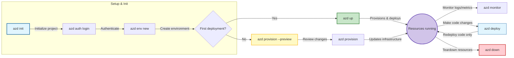
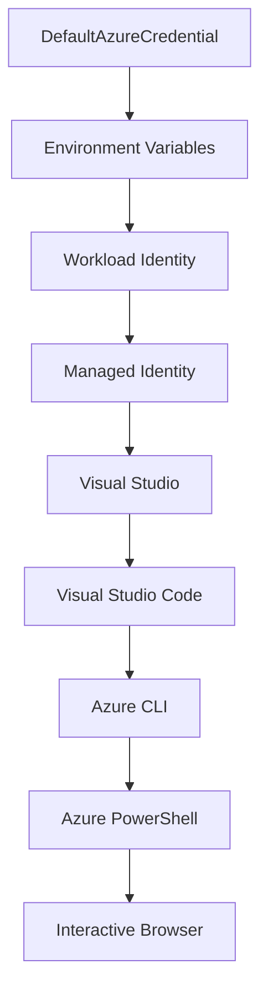

# AZD Basisprincipes - Kernconcepten en Fundamentals

**Hoofdstuk Navigatie:**
- **📚 Cursus Startpagina**: [AZD Voor Beginners](../../README.md)
- **📖 Huidig Hoofdstuk**: Hoofdstuk 1 - Fundament en Snelle Start
- **⬅️ Vorige**: [Cursus Overzicht](../../README.md#-chapter-1-foundation--quick-start)
- **➡️ Volgende**: [Installatie & Setup](installation.md)
- **🚀 Volgend Hoofdstuk**: [Hoofdstuk 2: AI-Eerst Ontwikkeling](../chapter-02-ai-development/microsoft-foundry-integration.md)

## Introductie

> Beoordeeld volgens `azd 1.37.2` (november 2026). Bash-commando's gebruiken geciteerde plaatsaanduiders die je moet vervangen. Template-werklijnen gebruiken `.` om de huidige map te initialiseren; zonder een mapargument maakt template-initialisatie een submap aan en verandert het je shell-werkmap niet. Geavanceerde snippets zijn illustratief, geen complete projecten.

Deze les introduceert je aan Azure Developer CLI (azd), een krachtig commandoregeltool dat jouw reis versnelt van lokale ontwikkeling naar Azure-implementatie. Je leert de fundamentele concepten, kernfuncties en begrijpt hoe azd het implementeren van cloud-native applicaties vereenvoudigt.

## Leerdoelen

Aan het einde van deze les zul je:
- Begrijpen wat Azure Developer CLI is en het primaire doel ervan
- De kernconcepten van templates, omgevingen en services leren
- Belangrijke functies verkennen, inclusief template-gedreven ontwikkeling en Infrastructure as Code
- Inzicht hebben in de azd projectstructuur en werklijn
- Klaar zijn om azd te installeren en configureren voor jouw ontwikkelomgeving

## Leerresultaten

Na het voltooien van deze les kun je:
- Uitleggen welke rol azd speelt in moderne cloudontwikkelingswerklijnen
- De componenten van een azd projectstructuur identificeren
- Beschrijven hoe templates, omgevingen en services samenwerken
- De voordelen van Infrastructure as Code met azd begrijpen
- Verschillende azd-commando's en hun doelen herkennen

## Wat is Azure Developer CLI (azd)?

Azure Developer CLI (azd) is een commandoregeltool ontworpen om jouw reis te versnellen van lokale ontwikkeling naar Azure-implementatie. Het vereenvoudigt het proces van bouwen, implementeren en beheren van cloud-native applicaties op Azure.

### Wat kun je implementeren met azd?

azd ondersteunt een breed scala aan workloads — en de lijst blijft groeien. Vandaag kun je azd gebruiken om te implementeren:

| Type workload | Voorbeelden | Zelfde werklijn? |
|---------------|------------|-------------------|
| **Traditionele applicaties** | Webapps, REST API's, statische sites | ✅ `azd up` |
| **Services en microservices** | Container Apps, Function Apps, multi-service achterkanten | ✅ `azd up` |
| **AI-aangedreven applicaties** | Chatapps met Microsoft Foundry-modellen, RAG-oplossingen met AI Search | ✅ `azd up` |
| **Intelligente agenten** | Foundry-gehoste agenten, multi-agent orkestraties | ✅ `azd up` |

Het belangrijkste inzicht is dat **de azd levenscyclus hetzelfde blijft ongeacht wat je implementeert**. Je initialiseert een project, voorziet infrastructuur, implementeert je code, monitort je app en ruimt op — of het nu een eenvoudige website is of een geavanceerde AI-agent.

Deze continuïteit is ontwerpgericht. azd behandelt AI-mogelijkheden als een ander soort service die jouw applicatie kan gebruiken, niet als iets fundamenteel anders. Een chatendpoint ondersteund door Microsoft Foundry-modellen is vanuit azd's perspectief gewoon een andere service om te configureren en implementeren.

### 🎯 Waarom AZD gebruiken? Een vergelijking uit de praktijk

Laten we het implementeren van een eenvoudige webapp met database vergelijken:

#### ❌ ZONDER AZD: Handmatige Azure-implementatie (30+ minuten)

**Illustratieve Bash-vergelijking, geen uitvoerbare applicatiestarter.** Dit gaat uit van bestaande applicatiecode, unieke resourcenaam, Azure CLI-authenticatie en vereiste CLI-uitbreidingen. Gebruik de template-oefening hieronder voor het ondersteunde end-to-end pad.

```bash
# Step 1: Create resource group
az group create --name myapp-rg --location eastus

# Step 2: Create App Service Plan
az appservice plan create --name myapp-plan \
  --resource-group myapp-rg \
  --sku B1 --is-linux

# Step 3: Create Web App
az webapp create --name myapp-web-unique123 \
  --resource-group myapp-rg \
  --plan myapp-plan \
  --runtime "NODE:22-lts"

# Step 4: Create Cosmos DB account (10-15 minutes)
az cosmosdb create --name myapp-cosmos-unique123 \
  --resource-group myapp-rg \
  --kind MongoDB

# Step 5: Create database
az cosmosdb mongodb database create \
  --account-name myapp-cosmos-unique123 \
  --resource-group myapp-rg \
  --name tododb

# Step 6: Create collection
az cosmosdb mongodb collection create \
  --account-name myapp-cosmos-unique123 \
  --resource-group myapp-rg \
  --database-name tododb \
  --name todos

# Step 7: Get connection string
CONN_STR=$(az cosmosdb keys list \
  --name myapp-cosmos-unique123 \
  --resource-group myapp-rg \
  --type connection-strings \
  --query "connectionStrings[0].connectionString" -o tsv)

# Step 8: Configure app settings
az webapp config appsettings set \
  --name myapp-web-unique123 \
  --resource-group myapp-rg \
  --settings MONGODB_URI="$CONN_STR"

# Step 9: Enable logging
az webapp log config --name myapp-web-unique123 \
  --resource-group myapp-rg \
  --application-logging filesystem \
  --detailed-error-messages true

# Step 10: Set up Application Insights
az monitor app-insights component create \
  --app myapp-insights \
  --location eastus \
  --resource-group myapp-rg

# Step 11: Link App Insights to Web App
INSTRUMENTATION_KEY=$(az monitor app-insights component show \
  --app myapp-insights \
  --resource-group myapp-rg \
  --query "instrumentationKey" -o tsv)

az webapp config appsettings set \
  --name myapp-web-unique123 \
  --resource-group myapp-rg \
  --settings APPINSIGHTS_INSTRUMENTATIONKEY="$INSTRUMENTATION_KEY"

# Step 12: Build application locally
npm install
npm run build

# Step 13: Create deployment package
zip -r app.zip . -x "*.git*" "node_modules/*"

# Step 14: Deploy application
az webapp deployment source config-zip \
  --resource-group myapp-rg \
  --name myapp-web-unique123 \
  --src app.zip

# Step 15: Wait and pray it works 🙏
# (No automated validation, manual testing required)
```

**Problemen:**
- ❌ 15+ commando's om te onthouden en in volgorde uit te voeren
- ❌ 30-45 minuten handmatig werk
- ❌ Gemakkelijk fouten maken (typos, verkeerde parameters)
- ❌ Referenties vereisen expliciete behandeling; debuglogs en shell-tracering kunnen deze blootstellen
- ❌ Geen geautomatiseerde rollback als iets faalt
- ❌ Moeilijk te repliceren voor teamleden
- ❌ Elke keer anders (niet reproduceerbaar)

#### ✅ MET AZD: Geautomatiseerde Implementatie (5 commando's, 10-15 minuten)

```bash
# Step 1: Initialize from template
azd init --template todo-nodejs-mongo .

# Step 2: Authenticate
azd auth login

# Step 3: Select the environment created during init
azd env select dev

# Step 4: Preview changes (optional but recommended)
azd provision --preview

# Step 5: Deploy everything
azd up

# ✨ Done! Everything is deployed, configured, and monitored
```

**Voordelen:**
- ✅ **5 commando's** vs. 15+ handmatige stappen
- ✅ **10-15 minuten** totale tijd (voornamelijk wachten op Azure)
- ✅ **Minder handmatige fouten** - consistente, template-gedreven werklijn
- ✅ **Veilige geheime verwerking** - veel templates gebruiken Azure-beheerde geheime opslag
- ✅ **Herhaalbare implementaties** - dezelfde werklijn elke keer
- ✅ **Herhaalbare infrastructuurdefinities** - afhankelijk van quota, regio-beschikbaarheid en templateversies
- ✅ **Klaar voor teams** - iedereen kan met dezelfde commando's implementeren
- ✅ **Infrastructure as Code** - versiebeheer van Bicep-templates
- ✅ **Template-gedefinieerde monitoring** - Application Insights wanneer opgenomen in de template

### Tijd en Betrouwbaarheid

De bovenstaande tijden zijn schattingen, geen benchmarks. azd reduceert de commando's die je moet coördineren, maar garandeert geen implementatieduur, elimineert geen fouten en biedt geen automatische rollback van applicatie/database. Houd werkende versies in source control en test herstelprocedures.

## Kernconcepten

### Templates
Templates zijn de basis van azd. Ze bevatten:
- **Applicatiecode** - Jouw broncode en afhankelijkheden
- **Infrastructuurdefinities** - Azure-resources gedefinieerd in Bicep of Terraform
- **Configuratiebestanden** - Instellingen en omgevingsvariabelen
- **Implementatiescripts** - Geautomatiseerde implementatiewerklijnen

### Omgevingen
Omgevingen vertegenwoordigen verschillende implementatiedoelen:
- **Ontwikkeling** - Voor testen en ontwikkeling
- **Staging** - Pre-productieomgeving
- **Productie** - Live productieomgeving

Elke omgeving onderhoudt zijn eigen:
- Omgevingsnaam en waarden; resource-isolatie hangt af van de infrastructuurtemplate
- Configuratie-instellingen
- Implementatiestatus

### Services
Services in `azure.yaml` beschrijven implementeerbare applicatiecomponenten:
- **Frontend** - Webapplicaties, SPA's
- **Backend** - API's, microservices

Databases en opslag worden normaal gesproken geprovisioneerd als infrastructuurresources, niet als bedachte servicehosts zoals `host: postgres`.

## Belangrijke Functies

### 1. Template-gedreven ontwikkeling
```bash
# Browse available templates
azd template list

# Initialize from a template
azd init --template "<template-name>" .
```

### 2. Infrastructure as Code
- **Bicep** - Azure's domeinspecifieke taal
- **Terraform** - Multi-cloud infrastructuurtool
- Bicep compileert naar ARM-templates; ruwe ARM JSON is geen aparte ingebouwde `infra.provider`.

### 3. Geïntegreerde werklijnen
```bash
# Complete deployment workflow
azd up            # Provision + Deploy this is hands off for first time setup

# 🧪 NEW: Preview infrastructure changes before deployment (SAFE)
azd provision --preview    # Simulate infrastructure deployment without making changes

azd provision     # Create Azure resources if you update the infrastructure use this
azd deploy        # Deploy application code or redeploy application code once update
azd down          # Clean up resources
```

#### 🛡️ Veilige infrastructuurplanning met preview
Het `azd provision --preview` commando is een game-changer voor veilige implementaties:
- **Dry-run analyse** - Toont wat wordt gemaakt, gewijzigd of verwijderd
- **Geen infrastructuur toepassing** - Bekijkt providerwijzigingen; inspecteer eerst projecthooks, want hooks kunnen commando's uitvoeren met bijwerkingen
- **Team samenwerking** - Deel preview-resultaten vóór implementatie
- **Kostenplanning input** - Bekijk voorgestelde SKU's, prijs ze dan met de Azure Pricing Calculator; preview berekent geen prijzen

```bash
# Example preview workflow
azd provision --preview           # See what will change
# Review the output, discuss with team
azd provision                     # Apply changes with confidence
```

### 📊 Visualisatie: AZD Ontwikkelingswerklijn



**Werklijnuitleg:**
1. **Init** - Begin met template of nieuw project
2. **Auth** - Authenticeer met Azure
3. **Omgeving** - Maak een geïsoleerde implementatieomgeving
4. **Preview** - 🆕 Bekijk infrastructuurwijzigingen altijd eerst (veilige praktijk)
5. **Provision** - Maak/bewerk Azure-resources
6. **Deploy** - Push je applicatiecode
7. **Monitor** - Observeer applicatieprestaties
8. **Iterate** - Maak wijzigingen en implementeer code opnieuw
9. **Cleanup** - Verwijder resources als je klaar bent

### 4. Omgevingsbeheer
```bash
# Create and manage environments
azd env new "<environment-name>"
azd env select "<environment-name>"
azd env list
```

### 5. Extensies en AI-commando's

azd gebruikt een extensiesysteem om functies toe te voegen buiten de kern-CLI. Dit is vooral nuttig voor AI-workloads:

```bash
# List available extensions
azd extension list

# Install the GA Foundry bundle (requires azd >= 1.37.0)
azd ext install microsoft.foundry

# Initialize an AI agent project interactively
azd ai agent init

# Test a deployed agent (shows latency and time-to-first-byte)
azd ai agent invoke

# Start the MCP server for AI-assisted development (Alpha)
azd mcp start
```

**De agent levenscyclus, van begin tot eind.** De GA `microsoft.foundry` bundel bevat `azure.ai.agents` en zes andere kernextensies. Installeer `azure.ai.evaluations` apart voor evaluatie. Gebruik `azd >= 1.37.0` voor deze werklijn. Je hebt niet alles direct op dag één nodig:

| Fase | Commando | Wat het doet |
|-------|---------|--------------|
| **Scaffold** | `azd ai agent init --template <path-to-azure.yaml>` | Gebruik een huidige agent projecttemplate |
| **Lokaal draaien** | `azd ai agent run`, daarna `azd ai agent invoke --local "Test prompt"` in een andere terminal | Inspecteer lokale activiteit in Agent Inspector; model-aanroepen gebruiken nog steeds Azure |
| **Deploy** | `azd deploy` | Voor code-gehoste agenten, upload broncode voor een remote Foundry build |
| **Test** | `azd ai agent invoke` | Roep de agent aan en bekijk responsetijden |
| **Meet** | `azd ai eval init`, `generate`, `run start` | Configureer, implementeer en voer evaluaties uit met de aparte extensie |
| **Verbeter** | `azd ai agent optimize --eval <evaluation-name> --optimize-model <optimizer-deployment>` | Hergebruik een compatibele evaluatie om de agent te optimaliseren |
| **Inspecteer** | `azd ai agent endpoint show` | Bekijk de live endpointconfiguratie |
| **Opruimen** | `azd ai agent delete` | Verwijder een gehoste agent en al zijn versies |

> Begin met de [GA hosted-agent walkthrough](../chapter-02-ai-development/microsoft-foundry-integration.md#hosted-agent-walkthrough-ga), die de vereisten, provisioning en veilige opruiming behandelt. Extensies worden verder uitgelegd in de [AZD AI CLI Commands](../chapter-08-production/production-ai-practices.md#azd-ai-cli-commands-and-extensions) referentie.

## 📁 Projectstructuur

Een typische azd projectstructuur:
```
my-app/
├── .azure/                  # Local environments and selected-environment config
│   ├── config.json
│   └── dev/.env
├── .devcontainer/          # Development container config
├── .github/workflows/      # GitHub Actions
├── .vscode/               # VS Code settings
├── infra/                 # Infrastructure code
│   ├── main.bicep        # Main infrastructure template
│   ├── main.parameters.json
│   └── modules/          # Reusable modules
├── src/                  # Application source code
│   ├── api/             # Backend services
│   └── web/             # Frontend application
├── azure.yaml           # azd project configuration
└── README.md
```

## 🔧 Configuratiebestanden

### azure.yaml
Het hoofdconfiguratiebestand van het project:
```yaml
name: my-awesome-app
metadata:
  template: my-template@1.0.0

services:
  web:
    project: ./src/web
    language: js
    host: appservice
  api:
    project: ./src/api
    language: js
    host: appservice

hooks:
  preprovision:
    shell: pwsh
    run: echo "Preparing to provision..."
```

### .azure/config.json
Project-lokale selectie van de standaardomgeving (illustratief; beheerd door azd):
```json
{
  "defaultEnvironment": "dev"
}
```

## 🎪 Veelvoorkomende workflows met praktijkoefeningen

> **💡 Leertip:** Volg deze oefeningen op volgorde om je AZD-vaardigheden geleidelijk op te bouwen.

### 🎯 Oefening 1: Initialiseert je eerste project

**Doel:** Maak een AZD-project en verken de structuur

**Stappen:**
```bash
# Use a proven template
mkdir azd-basics-practice
cd azd-basics-practice
# Choose "dev" for the environment name when prompted
azd init --template todo-nodejs-mongo .

# Explore the generated files
ls -la  # View all files including hidden ones

# Key files created:
# - azure.yaml (main config)
# - infra/ (infrastructure code)
# - src/ (application code)
```

**✅ Succes:** Je hebt azure.yaml en mappen infra/ en src/

---

### 🎯 Oefening 2: Implementeren naar Azure

**Doel:** Volledige end-to-end implementatie

**Stappen:**
```bash
# 1. Authenticate
azd auth login

# 2. Select the dev environment created in Exercise 1
azd env select dev
azd env set AZURE_LOCATION eastus

# 3. Preview changes (RECOMMENDED)
azd provision --preview

# 4. Deploy everything
azd up

# 5. Verify deployment
azd show    # View your app URL
```

**Verwachte tijd:** 10-15 minuten  
**✅ Succes:** Applicatie-URL opent in browser

---

### 🎯 Oefening 3: Meerdere omgevingen

**Doel:** Implementeer naar dev en staging

**Stappen:**
```bash
# Already have dev, create staging
azd env new staging
azd env set AZURE_LOCATION westus2
azd up

# Switch between them
azd env list
azd env select dev
```

**✅ Succes:** Twee aparte resourcegroepen in Azure Portal

**Opruimen:** Oefening 3 creëert een tweede factureerbare implementatie. Verwijder beide als je klaar bent:

```bash
azd down --environment dev
azd down --environment staging
```

---

### 🛡️ Vernietigende opruiming: `azd down --force --purge`

Wanneer je expres de Azure-resources van de geselecteerde omgeving wilt verwijderen:

```bash
azd down --force --purge
```

**Wat het doet:**
- `--force`: Geen bevestigingsprompts
- `--purge`: Verwijdert ook permanent ondersteunde soft-gedelete resources (bijv. Key Vaults), waar purge-bescherming dat toestaat. Verwijdert niet de lokale `.azure/` map.

**Gebruik wanneer:** klaar met een wegwerpomgeving. Behandel vernietigende opruiming niet als de eerste reactie op authenticatie-, quota- of configuratiefouten.

---

## 🎪 Originele Werklijnreferentie

### Een nieuw project starten
```bash
# Method 1: Use existing template
azd init --template todo-nodejs-mongo .

# Method 2: Start from scratch
azd init

# Method 3: Use current directory
azd init .
```

### Ontwikkelingscyclus
```bash
# Set up development environment
azd auth login
azd env new dev
azd env select dev

# Deploy everything
azd up

# Make changes and redeploy
azd deploy

# Clean up when done
azd down --force --purge # Deletes this environment's discovered Azure resources; review before forcing deletion.
```

## Begrijpen van `azd down --force --purge`
Het `azd down --force --purge` commando is een krachtige manier om jouw azd-omgeving en alle gerelateerde resources volledig af te breken. Hier is een overzicht van wat elke vlag doet:
```
--force
```
- Slaat bevestigingsprompts over.
- Handig voor automatisering of scripting waar handmatige invoer niet mogelijk is.
- Omzeilt geen permissies, purge-bescherming of verwijderingsfouten.

```
--purge
```
 Verwijdert permanent ondersteunde soft-gedelete Azure-resources zonder extra bevestiging. Purge-bescherming en permissies gelden nog steeds. Verwijdert **niet** lokale omgevingen of de `.azure/` map.


### Waarom beide gebruiken?
Gebruik beide alleen wanneer je van plan bent om de Azure-resources van de geselecteerde omgeving te verwijderen en herstelbare resources te purgen. Dit is vernietigende opruiming, geen algemene reparatie of lokale statusreset.

Het is vooral nuttig na handmatige resourceverwijderingen in de Azure-portal of bij het wisselen van templates, omgevingen of naamgevingsconventies voor resourcegroepen.


### Meerdere omgevingen beheren
```bash
# Create staging environment
azd env new staging
azd env select staging
azd up

# Switch back to dev
azd env select dev

# Compare environments
azd env list
```

## 🔐 Authenticatie en Referenties

Onderscheid deployment authenticatie (`azd auth login`) van applicatie SDK-authenticatie (`DefaultAzureCredential`). Ze zijn gescheiden. azd gebruikt standaard geen Azure CLI-referenties.

### Azure CLI-authenticatie (`az login`)

Voer `azd auth login` uit voor azd. De volgende Azure CLI-commando's zijn optioneel en authenticeren `az` commando's apart:

```bash
# Interactive login (opens browser)
az login

# Login with specific tenant
az login --tenant "<tenant-id>"

# Login with service principal
az login --service-principal -u "<app-id>" -p "<password>" --tenant "<tenant-id>"

# Check current login status
az account show

# List available subscriptions
az account list --output table

# Set default subscription
az account set --subscription "<subscription-id>"
```

### Authenticatieproces
1. **Interactieve login**: Opent je standaardbrowser voor authenticatie
2. **Apparaatcode-stroom**: Voor omgevingen zonder browsertoegang
3. **Service Principal**: Voor automatisering en CI/CD-scenario's
4. **Managed Identity**: Voor door Azure gehoste applicaties

### DefaultAzureCredential-keten

`DefaultAzureCredential` is een referentietype dat een vereenvoudigde authenticatie-ervaring biedt door automatisch meerdere referentiebronnen in een specifieke volgorde te proberen:

#### Application SDK Credential-keten

De exacte keten hangt af van de Azure Identity SDK-taal, versie, geïnstalleerde plugins en opties. Dit diagram is conceptueel, geen vaste azd-authenticatiesequentie; recente SDK's kunnen ook Azure Developer CLI-referenties bevatten.


#### 1. Omgevingsvariabelen
```bash
# Set environment variables for service principal
export AZURE_CLIENT_ID="<app-id>"
export AZURE_CLIENT_SECRET="<password>"
export AZURE_TENANT_ID="<tenant-id>"
```

#### 2. Workload Identity (Kubernetes/GitHub Actions)
Wordt automatisch gebruikt in:
- Azure Kubernetes Service (AKS) met Workload Identity
- GitHub Actions met OIDC-federatie
- Andere federatieve identiteitsscenario's

#### 3. Managed Identity
Voor Azure-resources zoals:
- Virtuele Machines
- App Service
- Azure Functions
- Container Instances

```bash
# Inspect a deployed Container App's configured identity (requires az login)
az containerapp show --name "<app-name>" --resource-group "<rg-name>" --query identity
```

#### 4. Integratie met ontwikkelaarstools
- **Visual Studio**: Gebruikt automatisch het ingelogde account
- **VS Code**: Ondersteuning hangt af van de SDK en de ondersteunde broker/plugin setup
- **Azure CLI**: Gebruikt `az login` referenties (meest gebruikelijk voor lokale ontwikkeling)

### AZD-authenticatieconfiguratie

```bash
# Method 1: Direct azd authentication (recommended)
azd auth login

# Method 2: Direct azd authentication
azd auth login --use-device-code  # For headless environments

# Method 3: Check authentication status
azd auth login --check-status

# Method 4: Logout and re-authenticate
azd auth logout
azd auth login
```

### Beste praktijken voor authenticatie

#### Voor lokale ontwikkeling
```bash
# 1. Log in to azd
azd auth login

# 2. Select the subscription for this initialized environment
azd env set AZURE_SUBSCRIPTION_ID "<subscription-id>"

# 3. Check azd sign-in details (read the status message)
azd auth login --check-status
```

#### Voor CI/CD-pijplijnen
```yaml
# Partial GitHub Actions steps: assumes checkout, azd installation,
# required AZURE_* environment values, and pipeline secret configuration.
- name: Deploy with azd
  run: |
    azd auth login --client-id ${{ secrets.AZURE_CLIENT_ID }} \
                    --client-secret ${{ secrets.AZURE_CLIENT_SECRET }} \
                    --tenant-id ${{ secrets.AZURE_TENANT_ID }}
    azd up --no-prompt
```

#### Voor productieomgevingen
- Gebruik **Managed Identity** bij uitvoering op Azure-resources
- Gebruik **Service Principal** voor automatiseringsscenario's
- Vermijd het opslaan van referenties in code of configuratiebestanden
- Gebruik **Azure Key Vault** voor gevoelige configuraties

### Veelvoorkomende authenticatieproblemen en oplossingen

#### Probleem: "Geen abonnement gevonden"
```bash
# Solution: Set default subscription
az account list --output table
az account set --subscription "<subscription-id>"
azd env set AZURE_SUBSCRIPTION_ID "<subscription-id>"
```

#### Probleem: "Onvoldoende machtigingen"
```bash
# Solution: Check and assign required roles
az role assignment list --assignee $(az account show --query user.name --output tsv)

# Common required roles:
# - Contributor (for resource management)
# - User Access Administrator (for role assignments)
```

#### Probleem: "Token verlopen"
```bash
# Solution: Re-authenticate
az logout
az login
azd auth logout
azd auth login
```

### Authenticatie in verschillende scenario's

#### Lokale ontwikkeling
```bash
# Personal development account
az login
azd auth login
```

#### Teamontwikkeling
```bash
# Use specific tenant for organization
az login --tenant contoso.onmicrosoft.com
azd auth login --tenant-id "<tenant-id>"
```

#### Multi-tenant scenario's
```bash
# Switch between tenants
az login --tenant tenant1.onmicrosoft.com
azd auth login --tenant-id "<tenant-1-id>"
# Select an environment configured with tenant 1's subscription
azd env select tenant1-dev
# Deploy to tenant 1
azd up

az login --tenant tenant2.onmicrosoft.com  
azd auth login --tenant-id "<tenant-2-id>"
azd env select tenant2-dev
# Deploy to tenant 2
azd up
```

### Beveiligingsoverwegingen

1. **Opslag van referenties**: Sla nooit referenties op in broncode
2. **Beperk scope**: Gebruik het least privilege-principe voor service principals
3. **Tokenrotatie**: Draai regelmatig service principal-secrets
4. **Audittrail**: Monitor authenticatie- en implementatieactiviteiten
5. **Netwerkbeveiliging**: Gebruik waar mogelijk private endpoints

### Problemen met authenticatie oplossen

```bash
# Debug authentication issues
azd auth login --check-status
az account show
az account get-access-token

# Common diagnostic commands
whoami                          # Current user context
az ad signed-in-user show      # Microsoft Entra ID user details
az group list                  # Test resource access
```

## Commando-ontdekking

### Ontdekking
```bash
azd template list              # Browse templates
azd template list --help       # Template discovery options
azd init --help               # Initialization options
```

### Projectbeheer
```bash
azd show                     # Project overview
azd env list                # Available environments and selected default
azd config show            # Configuration settings
```

### Monitoring
```bash
azd monitor                  # Open Azure portal monitoring
azd monitor --logs           # View application logs
azd monitor --live           # View live metrics
azd pipeline config          # Set up CI/CD
```

## Beste praktijken

### 1. Gebruik betekenisvolle namen
```bash
# Good
azd env new production-east
azd init --template todo-nodejs-mongo .

# Avoid
azd env new env1
azd init --template template1 .
```

### 2. Maak gebruik van sjablonen
- Begin met bestaande sjablonen
- Pas aan naar jouw behoeften
- Maak herbruikbare sjablonen voor jouw organisatie

### 3. Isolatie van omgevingen
- Gebruik aparte omgevingen voor dev/staging/prod
- Deploy nooit direct naar productie vanaf lokale machine
- Gebruik CI/CD-pijplijnen voor productie-implementaties

### 4. Configuratiebeheer
- Gebruik managed identity en Key Vault voor geheimen; gewone `azd env set` waarden zijn lokale platte tekst
- Houd configuratie onder versiebeheer
- Documenteer omgevingsspecifieke instellingen

## Leertraject

### Beginner (Week 1-2)
1. Installeer azd en authenticeer
2. Deploy een eenvoudige sjabloon
3. Begrijp projectstructuur
4. Leer basiscommando's (up, down, deploy)

### Intermediate (Week 3-4)
1. Pas sjablonen aan
2. Beheer meerdere omgevingen
3. Begrijp infrastructuurcode
4. Zet CI/CD-pijplijnen op

### Gevorderd (Week 5+)
1. Maak aangepaste sjablonen
2. Geavanceerde infrastructuurpatronen
3. Multi-regio implementaties
4. Enterprise-grade configuraties

## Volgende stappen

**📖 Ga door met Hoofdstuk 1 Leren:**
- [Installatie & Setup](installation.md) - Installeer en configureer azd
- [Je eerste project](first-project.md) - Voltooi hands-on tutorial
- [Configuratiehandleiding](../chapter-03-configuration/configuration.md) - Geavanceerde configuratie-opties

**🎯 Klaar voor het volgende hoofdstuk?**
- [Hoofdstuk 2: AI-First Development](../chapter-02-ai-development/microsoft-foundry-integration.md) - Begin met het bouwen van AI-applicaties

## Aanvullende bronnen

- [Overzicht Azure Developer CLI](https://learn.microsoft.com/en-us/azure/developer/azure-developer-cli/)
- [Sjabloongalerij](https://azure.github.io/awesome-azd/)
- [Community Voorbeelden](https://github.com/Azure-Samples)

---

## 🙋 Veelgestelde vragen

### Algemene vragen

**V: Wat is het verschil tussen AZD en Azure CLI?**

A: Azure CLI (`az`) is voor het beheren van individuele Azure-resources. AZD (`azd`) is voor het beheren van volledige applicaties:

```bash
# Azure CLI - Low-level resource management
az webapp create --name myapp --resource-group rg
az sql server create --name myserver --resource-group rg
# ...many more commands needed

# AZD - Application-level management
azd up  # Deploys entire app with all resources
```

**Denk er zo over:**
- `az` = Werken met losse Legosteentjes
- `azd` = Werken met complete Legosets

---

**V: Moet ik Bicep of Terraform kennen om AZD te gebruiken?**

A: Nee! Begin met sjablonen:
```bash
# Use existing template - no IaC knowledge needed
azd init --template todo-nodejs-mongo .
azd up
```

Je kunt later Bicep leren om infrastructuur aan te passen. Sjablonen bieden werkende voorbeelden om van te leren.

---

**V: Wat kost het om AZD-sjablonen te draaien?**

A: Kosten variëren per regio, SKU, uptime, databasemodus en modelgebruik. Een ontwikkelomgeving kan aanzienlijke maandelijkse kosten veroorzaken, zelfs wanneer deze inactief is; ga niet uit van een universeel bereik van $50-150:

```bash
# Preview resource changes (not prices)
azd provision --preview

# Always cleanup when not using
azd down --force --purge  # Removes all resources
```

**Pro tip:** Gebruik gratis niveaus waar mogelijk:
- App Service: F1 (Gratis) tier
- Azure OpenAI: geen algemene gegarandeerde maandelijkse gratis token-toewijzing; controleer prijs en huidig model
- Cosmos DB: in aanmerking komende provisioned-throughput accounts kunnen kiezen voor een gratis tier; serverless sjablonen komen niet automatisch in aanmerking

---

**V: Kan ik AZD gebruiken met bestaande Azure-resources?**

A: Ja, maar het is eenvoudiger om opnieuw te beginnen. AZD werkt het beste wanneer het de volledige levenscyclus beheert. Voor bestaande resources:

```bash
# Option 1: Import existing resources (advanced)
azd init
# Then modify infra/ to reference existing resources

# Option 2: Start fresh (recommended)
azd init --template "<verified-template-name>" .
azd up  # Creates new environment
```

---

**V: Hoe deel ik mijn project met teamleden?**

A: Commit het AZD-project naar Git (maar NIET de .azure map):

```bash
# Already in .gitignore by default
.azure/        # Contains secrets and environment data
*.env          # Environment variables

# Team members then:
git clone "<your-repo>"
# Change into the cloned repository before running the remaining commands.
azd auth login
azd env new "<their-name>-dev"
azd up
```

Iedereen krijgt identieke infrastructuur van dezelfde sjablonen.

---

### Problemen oplossen

**V: "azd up" faalde halverwege. Wat nu?**

A: Controleer de fout, herstel deze, en probeer opnieuw:

```bash
# Capture detailed diagnostics (redact sensitive values before sharing)
azd up --debug

# Common fixes:

# 1. If quota exceeded:
azd env set AZURE_LOCATION "westus2"  # Try different region

# 2. If resource name conflict:
azd down --force --purge  # Clean slate
azd up  # Retry

# 3. If auth expired:
az login
azd auth login
azd up
```

**Meest voorkomende probleem:** Verkeerd Azure-abonnement geselecteerd
```bash
az account list --output table
az account set --subscription "<correct-subscription>"
azd env set AZURE_SUBSCRIPTION_ID "<correct-subscription-id>"
```

---

**V: Hoe voer ik alleen codewijzigingen uit zonder reprovisioning?**

A: Gebruik `azd deploy` in plaats van `azd up`:

```bash
azd up          # First time: provision + deploy (slow)

# Make code changes...

azd deploy      # Subsequent times: deploy only (fast)
```

Snelheidsvergelijking:
- `azd up`: 10-15 minuten (infrastructurele provisie)
- `azd deploy`: 2-5 minuten (alleen code)

---

**V: Kan ik de infrastructuursjablonen aanpassen?**

A: Ja! Bewerk de Bicep-bestanden in `infra/`:

```bash
# After azd init
cd infra/
code main.bicep  # Edit in VS Code

# Preview changes
azd provision --preview

# Apply changes
azd provision
```

**Tip:** Begin klein - wijzig eerst SKU's:
```bicep
// infra/main.bicep
sku: {
  name: 'B1'  // Change to 'P1V2' for production
}
```

---

**V: Hoe verwijder ik alles wat AZD heeft aangemaakt?**

A: Eén commando verwijdert alle resources:

```bash
azd down --force --purge

# This deletes:
# - Azure resources/resource groups discovered for the selected environment
# - Supported soft-deleted resources, if purge protection allows
# Local .azure files remain; shared/external resources may remain too.
```

**Voer dit altijd uit wanneer:**
- Klaar met het testen van een sjabloon
- Overstappen naar een ander project
- Je opnieuw wilt beginnen

**Kostencontrole:** Bevestig verwijdering in Azure en controleer op behouden/gedeelde resources. Eerder gemaakte kosten blijven gelden.

---

**V: Wat als ik per ongeluk resources in Azure Portal heb verwijderd?**

A: AZD-status kan uit sync raken. Nieuwe start:

```bash
# 1. Delete remaining resources only if that is your intent
azd down --force --purge

# 2. Start fresh
azd up

# Alternative: Let AZD detect and fix
azd provision  # Will create missing resources
```

---

### Geavanceerde vragen

**V: Kan ik AZD gebruiken in CI/CD-pijplijnen?**

A: Ja! Voorbeeld GitHub Actions:

```yaml
# .github/workflows/deploy.yml
name: Deploy with AZD

on:
  push:
    branches: [main]

jobs:
  deploy:
    runs-on: ubuntu-latest
    steps:
      - uses: actions/checkout@v4
      
      - name: Install azd
        run: curl -fsSL https://aka.ms/install-azd.sh | bash
      
      - name: Azure Login
        run: |
          azd auth login \
            --client-id ${{ secrets.AZURE_CLIENT_ID }} \
            --client-secret ${{ secrets.AZURE_CLIENT_SECRET }} \
            --tenant-id ${{ secrets.AZURE_TENANT_ID }}
      
      - name: Deploy
        env:
          AZURE_ENV_NAME: dev
          AZURE_LOCATION: ${{ vars.AZURE_LOCATION }}
          AZURE_SUBSCRIPTION_ID: ${{ vars.AZURE_SUBSCRIPTION_ID }}
        run: azd up --no-prompt
```

---

**V: Hoe ga ik om met geheimen en gevoelige data?**

A: Gebruik Key Vault expliciet. `azd env set` schrijft gewone waarden naar het lokale omgevingsbestand; het maakt niet automatisch een vault aan, wijst geen rollen toe of injecteert geheimen in je applicatie.

```bash
# Interactive: create/select a Key Vault secret and save its reference
azd env set-secret DATABASE_PASSWORD
```

Je hebt de juiste vault-machtigingen nodig. Je infrastructuur/applicatie moet het geheim nog steeds koppelen aan de verbruiker en runtime-identity toegang verlenen. Print opgeloste geheime waarden niet in logs.

**Nooit committen:**
- `.azure/` map (bevat omgevingsdata)
- `.env` bestanden (lokale geheimen)
- Verbindingsreeksen

---

**V: Kan ik deployen naar meerdere regio's?**

A: Ja, maak een omgeving per regio aan:

```bash
# East US environment
azd env new prod-eastus
azd env set AZURE_LOCATION eastus
azd up

# West Europe environment
azd env new prod-westeurope
azd env set AZURE_LOCATION westeurope
azd up

# Each environment is independent
azd env list
```

Voor echte multi-regio apps, pas Bicep-sjablonen aan om gelijktijdig naar meerdere regio's te deployen.

---

**V: Waar kan ik hulp krijgen als ik vastloop?**

1. **AZD-documentatie:** https://learn.microsoft.com/azure/developer/azure-developer-cli/
2. **GitHub Issues:** https://github.com/Azure/azure-dev/issues
3. **Discord:** [Azure Discord](https://discord.gg/microsoft-azure) - #azure-developer-cli-kanaal
4. **Stack Overflow:** Tag `azure-developer-cli`
5. **Deze cursus:** [Probleemoplossingsgids](../chapter-07-troubleshooting/common-issues.md)

**Pro tip:** Voer uit vóór je vraag stelt:
```bash
azd show       # Shows current state
azd version    # Shows your version
```
Neem deze info mee in je vraag voor snellere hulp.

---

## 🎓 Wat nu?

Je begrijpt nu de basis van AZD. Kies je pad:

### 🎯 Voor beginners:
1. **Volgende:** [Installatie & Setup](installation.md) - Installeer AZD op je machine
2. **Vervolgens:** [Je eerste project](first-project.md) - Deploy je eerste app
3. **Oefening:** Voltooi alle 3 oefeningen in deze les

### 🚀 Voor AI-ontwikkelaars:
1. **Ga naar:** [Hoofdstuk 2: AI-First Development](../chapter-02-ai-development/microsoft-foundry-integration.md)
2. **Deploy:** Begin in een lege projectmap met `azd init --template get-started-with-ai-chat .`
3. **Leer:** Bouw terwijl je deployed

### 🏗️ Voor ervaren ontwikkelaars:
1. **Bekijk:** [Configuratiehandleiding](../chapter-03-configuration/configuration.md) - Geavanceerde instellingen
2. **Verken:** [Infrastructuur als Code](../chapter-04-infrastructure/provisioning.md) - Diepgaande Bicep
3. **Bouw:** Maak aangepaste sjablonen voor je stack

---

**Hoofdstuknavigatie:**
- **📚 Cursus Startpagina**: [AZD voor Beginners](../../README.md)
- **📖 Huidig Hoofdstuk**: Hoofdstuk 1 - Basis & Snelstart  
- **⬅️ Vorige**: [Cursus Overzicht](../../README.md#-chapter-1-foundation--quick-start)
- **➡️ Volgende**: [Installatie & Setup](installation.md)
- **🚀 Volgend Hoofdstuk**: [Hoofdstuk 2: AI-First Development](../chapter-02-ai-development/microsoft-foundry-integration.md)

---

<!-- CO-OP TRANSLATOR DISCLAIMER START -->
**Disclaimer**:
Dit document is vertaald met behulp van de AI vertaaldienst [Co-op Translator](https://github.com/Azure/co-op-translator). Hoewel we streven naar nauwkeurigheid, dient u er rekening mee te houden dat geautomatiseerde vertalingen fouten of onnauwkeurigheden kunnen bevatten. Het originele document in de oorspronkelijke taal moet worden beschouwd als de gezaghebbende bron. Voor kritieke informatie wordt professionele menselijke vertaling aanbevolen. Wij zijn niet aansprakelijk voor eventuele misverstanden of verkeerde interpretaties die voortvloeien uit het gebruik van deze vertaling.
<!-- CO-OP TRANSLATOR DISCLAIMER END -->