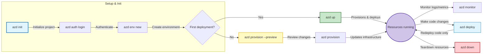
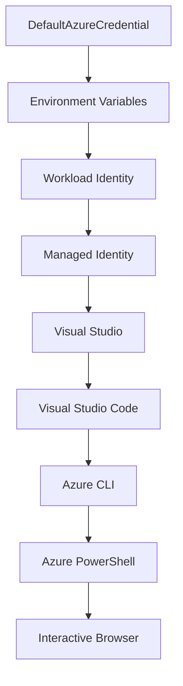

# AZD Basisprincipes - Kernconcepten en Fundamenten

**Hoofdstuk Navigatie:**
- **📚 Cursus Startpagina**: [AZD Voor Beginners](../../README.md)
- **📖 Huidig Hoofdstuk**: Hoofdstuk 1 - Fundament & Snelle Start
- **⬅️ Vorige**: [Cursusoverzicht](../../README.md#-chapter-1-foundation--quick-start)
- **➡️ Volgende**: [Installatie & Setup](installation.md)
- **🚀 Volgend Hoofdstuk**: [Hoofdstuk 2: AI-First Development](../chapter-02-ai-development/microsoft-foundry-integration.md)

## Introductie

> Gecontroleerd tegen `azd 1.37.2` (november 2026). Bash-commando's gebruiken geciteerde plaatsaanduiders die je moet vervangen. Sjabloon-workflows gebruiken `.` om de huidige map te initialiseren; zonder een mapargument maakt de sjablooninitialisatie een submap aan en verandert de werkmap van je shell niet. Geavanceerde snippets zijn illustratief, geen volledige projecten.

Deze les introduceert je aan Azure Developer CLI (azd), een krachtig commandoregelprogramma dat je reis van lokale ontwikkeling naar Azure-implementatie versnelt. Je leert de fundamentele concepten, kernfuncties en begrijpt hoe azd het implementeren van cloud-native applicaties vereenvoudigt.

## Leerdoelen

Aan het einde van deze les zul je:
- Begrijpen wat Azure Developer CLI is en wat de primaire doelstelling is
- De kernconcepten van sjablonen, omgevingen en services leren
- Belangrijke functies verkennen, inclusief sjabloongestuurde ontwikkeling en Infrastructure as Code
- De structuur en workflow van een azd-project begrijpen
- Klaar zijn om azd te installeren en configureren voor je ontwikkelomgeving

## Leerresultaten

Na het voltooien van deze les kun je:
- De rol van azd in moderne cloudontwikkelings-workflows uitleggen
- De componenten van een azd-projectstructuur identificeren
- Beschrijven hoe sjablonen, omgevingen en services samenwerken
- De voordelen van Infrastructure as Code met azd begrijpen
- Verschillende azd-commando's en hun doeleinden herkennen

## Wat is Azure Developer CLI (azd)?

Azure Developer CLI (azd) is een commandoregelprogramma ontworpen om je reis van lokale ontwikkeling naar Azure-implementatie te versnellen. Het vereenvoudigt het proces van het bouwen, implementeren en beheren van cloud-native applicaties op Azure.

### Wat kun je implementeren met azd?

azd ondersteunt een breed scala aan workloads—en de lijst blijft groeien. Vandaag kun je azd gebruiken voor het implementeren van:

| Workload Type | Voorbeelden | Zelfde Workflow? |
|---------------|------------|------------------|
| **Traditionele applicaties** | Web-apps, REST API's, statische sites | ✅ `azd up` |
| **Services en microservices** | Container Apps, Function Apps, multi-service backends | ✅ `azd up` |
| **AI-gestuurde applicaties** | Chat-apps met Microsoft Foundry-modellen, RAG-oplossingen met AI-Search | ✅ `azd up` |
| **Intelligente agenten** | Foundry-gehoste agenten, multi-agent orkestraties | ✅ `azd up` |

De belangrijkste constatering is dat **de levenscyclus van azd hetzelfde blijft ongeacht wat je implementeert**. Je initialiseert een project, voorziet in infrastructuur, implementeert je code, monitort je app en ruimt op—of het nu een eenvoudige website is of een geavanceerde AI-agent.

Deze continuïteit is ontworpen. azd behandelt AI-mogelijkheden als een andere soort service die je applicatie kan gebruiken, niet als iets fundamenteel anders. Een chatendpoint ondersteund door Microsoft Foundry-modellen is vanuit azd's perspectief gewoon een andere service om te configureren en implementeren.

### 🎯 Waarom AZD gebruiken? Een vergelijking uit de praktijk

Laten we het implementeren van een simpele webapp met database vergelijken:

#### ❌ ZONDER AZD: Handmatige Azure-implementatie (30+ minuten)

**Illustratieve Bash-vergelijking, geen uitvoerbare applicatiestarter.** Dit gaat uit van bestaande applicatiecode, unieke resource-namen, Azure CLI-authenticatie en eventuele vereiste CLI-extensies. Gebruik de onderstaande sjabloon-oefening voor het ondersteunde end-to-end pad.

```bash
# Step 1: Create resource group
az group create --name myapp-rg --location eastus

# Step 2: Create App Service Plan
az appservice plan create --name myapp-plan \
  --resource-group myapp-rg \
  --sku B1 --is-linux

# Step 3: Create Web App
az webapp create --name myapp-web-unique123 \
  --resource-group myapp-rg \
  --plan myapp-plan \
  --runtime "NODE:22-lts"

# Step 4: Create Cosmos DB account (10-15 minutes)
az cosmosdb create --name myapp-cosmos-unique123 \
  --resource-group myapp-rg \
  --kind MongoDB

# Step 5: Create database
az cosmosdb mongodb database create \
  --account-name myapp-cosmos-unique123 \
  --resource-group myapp-rg \
  --name tododb

# Step 6: Create collection
az cosmosdb mongodb collection create \
  --account-name myapp-cosmos-unique123 \
  --resource-group myapp-rg \
  --database-name tododb \
  --name todos

# Step 7: Get connection string
CONN_STR=$(az cosmosdb keys list \
  --name myapp-cosmos-unique123 \
  --resource-group myapp-rg \
  --type connection-strings \
  --query "connectionStrings[0].connectionString" -o tsv)

# Step 8: Configure app settings
az webapp config appsettings set \
  --name myapp-web-unique123 \
  --resource-group myapp-rg \
  --settings MONGODB_URI="$CONN_STR"

# Step 9: Enable logging
az webapp log config --name myapp-web-unique123 \
  --resource-group myapp-rg \
  --application-logging filesystem \
  --detailed-error-messages true

# Step 10: Set up Application Insights
az monitor app-insights component create \
  --app myapp-insights \
  --location eastus \
  --resource-group myapp-rg

# Step 11: Link App Insights to Web App
INSTRUMENTATION_KEY=$(az monitor app-insights component show \
  --app myapp-insights \
  --resource-group myapp-rg \
  --query "instrumentationKey" -o tsv)

az webapp config appsettings set \
  --name myapp-web-unique123 \
  --resource-group myapp-rg \
  --settings APPINSIGHTS_INSTRUMENTATIONKEY="$INSTRUMENTATION_KEY"

# Step 12: Build application locally
npm install
npm run build

# Step 13: Create deployment package
zip -r app.zip . -x "*.git*" "node_modules/*"

# Step 14: Deploy application
az webapp deployment source config-zip \
  --resource-group myapp-rg \
  --name myapp-web-unique123 \
  --src app.zip

# Step 15: Wait and pray it works 🙏
# (No automated validation, manual testing required)
```

**Problemen:**
- ❌ 15+ commando's die je moet onthouden en in volgorde uitvoeren
- ❌ 30-45 minuten handmatig werk
- ❌ Makkelijk om fouten te maken (typfouten, verkeerde parameters)
- ❌ Referenties vereisen expliciete afhandeling; debuglogs en shell-tracing kunnen ze blootstellen
- ❌ Geen automatische rollback bij fouten
- ❌ Moeilijk te repliceren voor teamleden
- ❌ Elke keer anders (niet reproduceerbaar)

#### ✅ MET AZD: Geautomatiseerde implementatie (5 commando's, 10-15 minuten)

```bash
# Step 1: Initialize from template
azd init --template todo-nodejs-mongo .

# Step 2: Authenticate
azd auth login

# Step 3: Select the environment created during init
azd env select dev

# Step 4: Preview changes (optional but recommended)
azd provision --preview

# Step 5: Deploy everything
azd up

# ✨ Done! Everything is deployed, configured, and monitored
```

**Voordelen:**
- ✅ **5 commando's** versus 15+ handmatige stappen
- ✅ **10-15 minuten** totale tijd (voornamelijk wachten op Azure)
- ✅ **Minder handmatige fouten** - consistente, sjabloongestuurde workflow
- ✅ **Veilige geheime afhandeling** - veel sjablonen gebruiken Azure-beheerde geheime opslag
- ✅ **Herhaalbare implementaties** - dezelfde workflow elke keer
- ✅ **Herhaalbare infrastructuurdefinities** - onderhevig aan quota, regio-beschikbaarheid en sjabloonversies
- ✅ **Team-klaar** - iedereen kan met dezelfde commando's implementeren
- ✅ **Infrastructure as Code** - versiebeheer voor Bicep-sjablonen
- ✅ **Sjabloon-gedefinieerde monitoring** - Application Insights wanneer opgenomen in het sjabloon

### Tijd en Betrouwbaarheid

De bovenstaande tijden zijn schattingen, geen benchmarks. azd vermindert het aantal commando's dat je moet coördineren, maar garandeert niet de implementatieduur, elimineert geen fouten, of biedt automatische rollback van applicatie/database. Houd werkende versies in versiebeheer en test herstelprocedures.

## Kernconcepten

### Sjablonen
Sjablonen zijn de basis van azd. Ze bevatten:
- **Applicatiecode** - Je broncode en afhankelijkheden
- **Infrastructuurdefinities** - Azure-resources gedefinieerd in Bicep of Terraform
- **Configuratiebestanden** - Instellingen en omgevingsvariabelen
- **Implementatiescripts** - Geautomatiseerde implementatieworkflows

### Omgevingen
Omgevingen vertegenwoordigen verschillende implementatiedoelen:
- **Ontwikkeling** - Voor testen en ontwikkeling
- **Staging** - Pre-productieomgeving
- **Productie** - Live productieomgeving

Elke omgeving onderhoudt zijn eigen:
- Omgevingsnaam en waarden; resource-isolatie hangt af van het infrastructuursjabloon
- Configuratie-instellingen
- Implementatiestatus

### Services
Services in `azure.yaml` beschrijven implementeerbare applicatiecomponenten:
- **Frontend** - Webapplicaties, SPAs
- **Backend** - API's, microservices

Databases en opslag worden normaal gesproken voorzien als infrastructuurresources, niet als bedachte servicehosts zoals `host: postgres`.

## Belangrijke Functies

### 1. Sjabloongestuurde Ontwikkeling
```bash
# Browse available templates
azd template list

# Initialize from a template
azd init --template "<template-name>" .
```

### 2. Infrastructure as Code
- **Bicep** - Azure's domeinspecifieke taal
- **Terraform** - Multi-cloud infrastructuurtool
- Bicep compileert naar ARM-sjablonen; ruwe ARM JSON is geen aparte ingebouwde `infra.provider`.

### 3. Geïntegreerde Workflows
```bash
# Complete deployment workflow
azd up            # Provision + Deploy this is hands off for first time setup

# 🧪 NEW: Preview infrastructure changes before deployment (SAFE)
azd provision --preview    # Simulate infrastructure deployment without making changes

azd provision     # Create Azure resources if you update the infrastructure use this
azd deploy        # Deploy application code or redeploy application code once update
azd down          # Clean up resources
```

#### 🛡️ Veilige Infrastructuurplanning met Preview
Het `azd provision --preview` commando is een doorbraak voor veilige implementaties:
- **Droogloopanalyse** - Toont wat wordt gemaakt, gewijzigd of verwijderd
- **Geen infrastructuurtoepassing** - Bekijkt providerwijzigingen; controleer eerst projecthooks, want hooks kunnen opdrachten met bijwerkingen uitvoeren
- **Samenwerking in team** - Deel preview-resultaten voor implementatie
- **Invoer voor kostenplanning** - Inspecteer voorgestelde SKU's, prijs deze dan met de Azure Pricing Calculator; preview berekent prijzen niet

```bash
# Example preview workflow
azd provision --preview           # See what will change
# Review the output, discuss with team
azd provision                     # Apply changes with confidence
```

### 📊 Visualisatie: AZD Ontwikkelworkflow



**Workflow-uitleg:**
1. **Init** - Begin met sjabloon of nieuw project
2. **Auth** - Authenticeren bij Azure
3. **Omgeving** - Maak een geïsoleerde implementatieomgeving
4. **Preview** - 🆕 Bekijk altijd eerst infrastructuurwijzigingen (veilige werkwijze)
5. **Provision** - Maak/bewerk Azure-resources
6. **Deploy** - Push je applicatiecode
7. **Monitor** - Observeer applicatieprestaties
8. **Iterate** - Breng wijzigingen aan en implementeer opnieuw
9. **Cleanup** - Verwijder resources als het klaar is

### 4. Omgevingsbeheer
```bash
# Create and manage environments
azd env new "<environment-name>"
azd env select "<environment-name>"
azd env list
```

### 5. Extensies en AI-commando's

azd gebruikt een extensiesysteem om functies toe te voegen buiten de kern CLI. Dit is vooral nuttig voor AI-workloads:

```bash
# List available extensions
azd extension list

# Install the Foundry agents extension
azd extension install azure.ai.agents

# Initialize an AI agent project interactively
azd ai agent init

# Test a deployed agent (shows latency and time-to-first-byte)
azd ai agent invoke

# Start the MCP server for AI-assisted development (Alpha)
azd mcp start
```

**De levenscyclus van de agent, end-to-end.** Gebruik `azure.ai.agents` voor agent-levenstijlopdrachten en installeer `azure.ai.evaluations` afzonderlijk voor evaluatie. Gebruik `azd >= 1.37.0` voor de gecombineerde workflow. Je hebt op dag één niet alles nodig:

| Fase | Commando | Wat het doet |
|-------|----------|--------------|
| **Scaffold** | `azd ai agent init --template <path-to-azure.yaml>` | Neem een huidig agent-projectsjabloon over |
| **Test** | `azd ai agent invoke` | Roep de agent aan en bekijk responstijden |
| **Meet** | `azd ai eval init`, `generate`, `run start` | Configureer, implementeer en voer evaluaties uit met de aparte extensie |
| **Verbeter** | `azd ai agent optimize --eval <evaluation-name> --optimize-model <optimizer-deployment>` | Hergebruik een compatibele evaluatie om de agent te optimaliseren |
| **Inspecteer** | `azd ai agent endpoint show` | Bekijk de live endpoint-configuratie |
| **Opruimen** | `azd ai agent delete` | Verwijder een gehoste agent en al zijn versies |

> Extensies worden uitgebreid behandeld in [Hoofdstuk 2: AI-First Development](../chapter-02-ai-development/agents.md) en de [AZD AI CLI Commando's](../chapter-08-production/production-ai-practices.md#azd-ai-cli-commands-and-extensions) referentie.

## 📁 Projectstructuur

Een typische azd-projectstructuur:
```
my-app/
├── .azure/                  # Local environments and selected-environment config
│   ├── config.json
│   └── dev/.env
├── .devcontainer/          # Development container config
├── .github/workflows/      # GitHub Actions
├── .vscode/               # VS Code settings
├── infra/                 # Infrastructure code
│   ├── main.bicep        # Main infrastructure template
│   ├── main.parameters.json
│   └── modules/          # Reusable modules
├── src/                  # Application source code
│   ├── api/             # Backend services
│   └── web/             # Frontend application
├── azure.yaml           # azd project configuration
└── README.md
```

## 🔧 Configuratiebestanden

### azure.yaml
Het hoofdbestand voor projectconfiguratie:
```yaml
name: my-awesome-app
metadata:
  template: my-template@1.0.0

services:
  web:
    project: ./src/web
    language: js
    host: appservice
  api:
    project: ./src/api
    language: js
    host: appservice

hooks:
  preprovision:
    shell: pwsh
    run: echo "Preparing to provision..."
```

### .azure/config.json
Project-lokale selectie van de standaardomgeving (illustratief; beheerd door azd):
```json
{
  "defaultEnvironment": "dev"
}
```

## 🎪 Veelvoorkomende Workflows met Praktische Oefeningen

> **💡 Leertip:** Volg deze oefeningen in volgorde om je AZD-vaardigheden geleidelijk op te bouwen.

### 🎯 Oefening 1: Initialiseer je Eerste Project

**Doel:** Maak een AZD-project aan en verken de structuur

**Stappen:**
```bash
# Use a proven template
mkdir azd-basics-practice
cd azd-basics-practice
# Choose "dev" for the environment name when prompted
azd init --template todo-nodejs-mongo .

# Explore the generated files
ls -la  # View all files including hidden ones

# Key files created:
# - azure.yaml (main config)
# - infra/ (infrastructure code)
# - src/ (application code)
```

**✅ Succes:** Je hebt azure.yaml, infra/, en src/ mappen

---

### 🎯 Oefening 2: Implementeren naar Azure

**Doel:** Volledige end-to-end implementatie

**Stappen:**
```bash
# 1. Authenticate
azd auth login

# 2. Select the dev environment created in Exercise 1
azd env select dev
azd env set AZURE_LOCATION eastus

# 3. Preview changes (RECOMMENDED)
azd provision --preview

# 4. Deploy everything
azd up

# 5. Verify deployment
azd show    # View your app URL
```

**Geschatte tijd:** 10-15 minuten  
**✅ Succes:** Applicatie-URL opent in browser

---

### 🎯 Oefening 3: Meerdere Omgevingen

**Doel:** Implementeren naar dev en staging

**Stappen:**
```bash
# Already have dev, create staging
azd env new staging
azd env set AZURE_LOCATION westus2
azd up

# Switch between them
azd env list
azd env select dev
```

**✅ Succes:** Twee aparte resource-groepen in Azure Portal

**Opruimen:** Oefening 3 creëert een tweede factureerbare implementatie. Verwijder beide als je klaar bent:

```bash
azd down --environment dev
azd down --environment staging
```

---

### 🛡️ Destructieve Opruiming: `azd down --force --purge`

Wanneer je bewust de Azure-resources van de geselecteerde omgeving wilt verwijderen:

```bash
azd down --force --purge
```

**Wat het doet:**
- `--force`: Geen bevestigingsprompts
- `--purge`: Verwijdert ook permanent ondersteunde soft-verwijderde resources (zoals Key Vaults), waar purge-bescherming dat toestaat. Verwijdert niet de lokale `.azure/` map.

**Gebruik wanneer:** klaar met een wegwerpomgeving. Gebruik destructieve opruiming niet als eerste reactie op een authenticatie-, quota- of configuratiefout.

---

## 🎪 Originele Workflow Referentie

### Een nieuw project starten
```bash
# Method 1: Use existing template
azd init --template todo-nodejs-mongo .

# Method 2: Start from scratch
azd init

# Method 3: Use current directory
azd init .
```

### Ontwikkelingscyclus
```bash
# Set up development environment
azd auth login
azd env new dev
azd env select dev

# Deploy everything
azd up

# Make changes and redeploy
azd deploy

# Clean up when done
azd down --force --purge # Deletes this environment's discovered Azure resources; review before forcing deletion.
```

## Begrip van `azd down --force --purge`
Het `azd down --force --purge` commando is een krachtige manier om je azd-omgeving en alle bijbehorende resources volledig af te breken. Hier is een overzicht van wat elke vlag doet:
```
--force
```
- Slaat bevestigingsprompts over.
- Handig voor automatisering of scripting waar handmatige invoer niet mogelijk is.
- Omzeilt geen permissies, purge-bescherming of deletiefouten.

```
--purge
```
Verwijdert permanent ondersteunde soft-verwijderde Azure-resources zonder extra bevestiging. Purge-bescherming en permissies blijven van kracht. Verwijdert **niet** lokale omgevingen of de `.azure/` map.


### Waarom beide gebruiken?
Gebruik beide alleen wanneer je de Azure-resources van de geselecteerde omgeving wilt verwijderen en herstelbare resources wilt purgeren. Dit is destructieve opruiming, geen algemene reparatie of lokale statusreset.

Het is vooral nuttig na handmatige resourceverwijderingen in de Azure-portal of bij het wisselen van sjablonen, omgevingen of resourcegroepnaamconventies.


### Beheer van meerdere omgevingen
```bash
# Create staging environment
azd env new staging
azd env select staging
azd up

# Switch back to dev
azd env select dev

# Compare environments
azd env list
```

## 🔐 Authenticatie en Referenties

Onderscheid implementatie-authenticatie (`azd auth login`) van applicatie-SDK-authenticatie (`DefaultAzureCredential`). Ze zijn gescheiden. azd gebruikt standaard geen Azure CLI-referenties.

### Azure CLI-authenticatie (`az login`)

Voer `azd auth login` uit voor azd. De volgende Azure CLI-commando's zijn optioneel en authenticeren `az`-commando's apart:

```bash
# Interactive login (opens browser)
az login

# Login with specific tenant
az login --tenant "<tenant-id>"

# Login with service principal
az login --service-principal -u "<app-id>" -p "<password>" --tenant "<tenant-id>"

# Check current login status
az account show

# List available subscriptions
az account list --output table

# Set default subscription
az account set --subscription "<subscription-id>"
```

### Authenticatiestroom
1. **Interactieve login**: Opent je standaardbrowser voor authenticatie
2. **Device Code Flow**: Voor omgevingen zonder browsertoegang
3. **Service Principal**: Voor automatisering en CI/CD-scenario's
4. **Managed Identity**: Voor door Azure gehoste applicaties

### DefaultAzureCredential-keten

`DefaultAzureCredential` is een referentietype dat een vereenvoudigde authenticatie-ervaring biedt door automatisch meerdere referentiebronnen in een specifieke volgorde te proberen:

#### Applicatie-SDK referentie-keten

De exacte keten is afhankelijk van de Azure Identity SDK-taal, versie, geïnstalleerde plugins en opties. Dit diagram is conceptueel, geen vaste azd-authenticatiesequentie; recente SDK's kunnen ook Azure Developer CLI-referenties bevatten.


#### 1. Omgevingsvariabelen
```bash
# Set environment variables for service principal
export AZURE_CLIENT_ID="<app-id>"
export AZURE_CLIENT_SECRET="<password>"
export AZURE_TENANT_ID="<tenant-id>"
```

#### 2. Workload Identity (Kubernetes/GitHub Actions)
Wordt automatisch gebruikt in:
- Azure Kubernetes Service (AKS) met Workload Identity
- GitHub Actions met OIDC-federatie
- Overige scenario's met federatieve identiteit

#### 3. Beheerde identiteit
Voor Azure-resources zoals:
- Virtuele machines
- App Service
- Azure Functions
- Container Instances

```bash
# Inspect a deployed Container App's configured identity (requires az login)
az containerapp show --name "<app-name>" --resource-group "<rg-name>" --query identity
```

#### 4. Integratie ontwikkeltools
- **Visual Studio**: Gebruikt automatisch het ingelogde account
- **VS Code**: Ondersteuning hangt af van de SDK en de ondersteunde broker/plugin setup
- **Azure CLI**: Gebruikt `az login`-referenties (meest gebruikelijk voor lokale ontwikkeling)

### AZD-authenticatie-instelling

```bash
# Method 1: Direct azd authentication (recommended)
azd auth login

# Method 2: Direct azd authentication
azd auth login --use-device-code  # For headless environments

# Method 3: Check authentication status
azd auth login --check-status

# Method 4: Logout and re-authenticate
azd auth logout
azd auth login
```

### Beste praktijken bij authenticatie

#### Voor lokale ontwikkeling
```bash
# 1. Log in to azd
azd auth login

# 2. Select the subscription for this initialized environment
azd env set AZURE_SUBSCRIPTION_ID "<subscription-id>"

# 3. Check azd sign-in details (read the status message)
azd auth login --check-status
```

#### Voor CI/CD-pijplijnen
```yaml
# Partial GitHub Actions steps: assumes checkout, azd installation,
# required AZURE_* environment values, and pipeline secret configuration.
- name: Deploy with azd
  run: |
    azd auth login --client-id ${{ secrets.AZURE_CLIENT_ID }} \
                    --client-secret ${{ secrets.AZURE_CLIENT_SECRET }} \
                    --tenant-id ${{ secrets.AZURE_TENANT_ID }}
    azd up --no-prompt
```

#### Voor productieomgevingen
- Gebruik **Beheerde identiteit** bij uitvoering op Azure-resources
- Gebruik **Service Principal** voor automatiseringsscenario's
- Vermijd het opslaan van referenties in code of configuratiebestanden
- Gebruik **Azure Key Vault** voor gevoelige configuratie

### Veelvoorkomende authenticatieproblemen en oplossingen

#### Probleem: "Geen abonnement gevonden"
```bash
# Solution: Set default subscription
az account list --output table
az account set --subscription "<subscription-id>"
azd env set AZURE_SUBSCRIPTION_ID "<subscription-id>"
```

#### Probleem: "Onvoldoende machtigingen"
```bash
# Solution: Check and assign required roles
az role assignment list --assignee $(az account show --query user.name --output tsv)

# Common required roles:
# - Contributor (for resource management)
# - User Access Administrator (for role assignments)
```

#### Probleem: "Token verlopen"
```bash
# Solution: Re-authenticate
az logout
az login
azd auth logout
azd auth login
```

### Authenticatie in verschillende scenario's

#### Lokale ontwikkeling
```bash
# Personal development account
az login
azd auth login
```

#### Teamontwikkeling
```bash
# Use specific tenant for organization
az login --tenant contoso.onmicrosoft.com
azd auth login --tenant-id "<tenant-id>"
```

#### Multi-tenant scenario's
```bash
# Switch between tenants
az login --tenant tenant1.onmicrosoft.com
azd auth login --tenant-id "<tenant-1-id>"
# Select an environment configured with tenant 1's subscription
azd env select tenant1-dev
# Deploy to tenant 1
azd up

az login --tenant tenant2.onmicrosoft.com  
azd auth login --tenant-id "<tenant-2-id>"
azd env select tenant2-dev
# Deploy to tenant 2
azd up
```

### Beveiligingsoverwegingen

1. **Opslag van referenties**: Sla nooit referenties op in broncode
2. **Beperk scope**: Gebruik het principe van de minste rechten voor service principals
3. **Rotatie van tokens**: Draai regelmatig service principal secrets
4. **Controlelog**: Monitor authenticatie- en implementatieactiviteiten
5. **Netwerkbeveiliging**: Gebruik privé-eindpunten waar mogelijk

### Problemen met authenticatie oplossen

```bash
# Debug authentication issues
azd auth login --check-status
az account show
az account get-access-token

# Common diagnostic commands
whoami                          # Current user context
az ad signed-in-user show      # Microsoft Entra ID user details
az group list                  # Test resource access
```

## Command Discovery

### Ontdekking
```bash
azd template list              # Browse templates
azd template list --help       # Template discovery options
azd init --help               # Initialization options
```

### Projectbeheer
```bash
azd show                     # Project overview
azd env list                # Available environments and selected default
azd config show            # Configuration settings
```

### Monitoring
```bash
azd monitor                  # Open Azure portal monitoring
azd monitor --logs           # View application logs
azd monitor --live           # View live metrics
azd pipeline config          # Set up CI/CD
```

## Beste praktijken

### 1. Gebruik betekenisvolle namen
```bash
# Good
azd env new production-east
azd init --template todo-nodejs-mongo .

# Avoid
azd env new env1
azd init --template template1 .
```

### 2. Gebruik sjablonen
- Begin met bestaande sjablonen
- Pas aan naar jouw behoeften
- Maak herbruikbare sjablonen voor jouw organisatie

### 3. Omgevingsisolatie
- Gebruik aparte omgevingen voor dev/staging/prod
- Zet nooit direct naar productie vanuit een lokale machine uit
- Gebruik CI/CD-pijplijnen voor productie-implementaties

### 4. Configuratiebeheer
- Gebruik beheerde identiteit en Key Vault voor geheimen; gewone `azd env set` waarden zijn lokaal in platte tekst
- Bewaar configuratie in versiebeheer
- Documenteer omgevingss specifieke instellingen

## Leertraject

### Beginner (week 1-2)
1. Installeer azd en authenticeer
2. Implementeer een eenvoudig sjabloon
3. Begrijp de projectstructuur
4. Leer basiscommando's (up, down, deploy)

### Gevorderd (week 3-4)
1. Pas sjablonen aan
2. Beheer meerdere omgevingen
3. Begrijp infrastructuurcode
4. Zet CI/CD-pijplijnen op

### Expert (week 5+)
1. Maak aangepaste sjablonen
2. Geavanceerde infrastructuurpatronen
3. Multi-regio implementaties
4. Enterprise-grade configuraties

## Volgende stappen

**📖 Ga door met hoofdstuk 1 leren:**
- [Installatie & Setup](installation.md) - Installeer en configureer azd
- [Je eerste project](first-project.md) - Voltooi interactieve tutorial
- [Configuratiegids](../chapter-03-configuration/configuration.md) - Geavanceerde configuratie-opties

**🎯 Klaar voor volgend hoofdstuk?**
- [Hoofdstuk 2: AI-gebaseerde ontwikkeling](../chapter-02-ai-development/microsoft-foundry-integration.md) - Begin met bouwen van AI-applicaties

## Aanvullende bronnen

- [Overzicht Azure Developer CLI](https://learn.microsoft.com/en-us/azure/developer/azure-developer-cli/)
- [Sjabloongalerij](https://azure.github.io/awesome-azd/)
- [Communityvoorbeelden](https://github.com/Azure-Samples)

---

## 🙋 Veelgestelde vragen

### Algemene vragen

**V: Wat is het verschil tussen AZD en Azure CLI?**

A: Azure CLI (`az`) is voor het beheren van afzonderlijke Azure-resources. AZD (`azd`) is voor het beheren van volledige applicaties:

```bash
# Azure CLI - Low-level resource management
az webapp create --name myapp --resource-group rg
az sql server create --name myserver --resource-group rg
# ...many more commands needed

# AZD - Application-level management
azd up  # Deploys entire app with all resources
```

**Zie het zo:**
- `az` = Werken met individuele Legoblokjes
- `azd` = Werken met complete Legosets

---

**V: Moet ik Bicep of Terraform kennen om AZD te gebruiken?**

A: Nee! Begin met sjablonen:
```bash
# Use existing template - no IaC knowledge needed
azd init --template todo-nodejs-mongo .
azd up
```

Je kunt later Bicep leren om infrastructuur aan te passen. Sjablonen bieden werkende voorbeelden om van te leren.

---

**V: Wat kost het om AZD-sjablonen te draaien?**

A: Kosten variëren per regio, SKU, uptime, databasemodus en modelgebruik. Een ontwikkelomgeving kan aanzienlijke maandelijkse kosten veroorzaken, ook als deze idle is; reken niet op een universele range van $50-150:

```bash
# Preview resource changes (not prices)
azd provision --preview

# Always cleanup when not using
azd down --force --purge  # Removes all resources
```

**Pro tip:** Gebruik waar mogelijk gratis niveaus:
- App Service: F1 (Gratis) niveau
- Azure OpenAI: geen algemeen gegarandeerde maandelijkse gratis tokenlimiet; controleer actuele model- en aanbodprijzen
- Cosmos DB: in aanmerking komende provisioned-throughput accounts kunnen kiezen voor gratis niveau; serverloze sjablonen kwalificeren niet automatisch

---

**V: Kan ik AZD gebruiken met bestaande Azure-resources?**

A: Ja, maar het is makkelijker om opnieuw te beginnen. AZD werkt het beste wanneer het de volledige levenscyclus beheert. Voor bestaande resources:

```bash
# Option 1: Import existing resources (advanced)
azd init
# Then modify infra/ to reference existing resources

# Option 2: Start fresh (recommended)
azd init --template "<verified-template-name>" .
azd up  # Creates new environment
```

---

**V: Hoe deel ik mijn project met teamgenoten?**

A: Zet het AZD-project in Git (maar NIET de .azure-map):

```bash
# Already in .gitignore by default
.azure/        # Contains secrets and environment data
*.env          # Environment variables

# Team members then:
git clone "<your-repo>"
# Change into the cloned repository before running the remaining commands.
azd auth login
azd env new "<their-name>-dev"
azd up
```

Iedereen krijgt identieke infrastructuur vanuit dezelfde sjablonen.

---

### Problemen oplossen vragen

**V: "azd up" faalde halverwege. Wat nu?**

A: Bekijk de fout, los die op, probeer opnieuw:

```bash
# Capture detailed diagnostics (redact sensitive values before sharing)
azd up --debug

# Common fixes:

# 1. If quota exceeded:
azd env set AZURE_LOCATION "westus2"  # Try different region

# 2. If resource name conflict:
azd down --force --purge  # Clean slate
azd up  # Retry

# 3. If auth expired:
az login
azd auth login
azd up
```

**Meest voorkomende fout:** Verkeerd Azure-abonnement geselecteerd
```bash
az account list --output table
az account set --subscription "<correct-subscription>"
azd env set AZURE_SUBSCRIPTION_ID "<correct-subscription-id>"
```

---

**V: Hoe implementeer ik alleen codewijzigingen zonder reprovisioning?**

A: Gebruik `azd deploy` in plaats van `azd up`:

```bash
azd up          # First time: provision + deploy (slow)

# Make code changes...

azd deploy      # Subsequent times: deploy only (fast)
```

Snelheidsvergelijking:
- `azd up`: 10-15 minuten (infrastructuur provisionen)
- `azd deploy`: 2-5 minuten (alleen code)

---

**V: Kan ik de infrastructuursjablonen aanpassen?**

A: Ja! Bewerk de Bicep-bestanden in `infra/`:

```bash
# After azd init
cd infra/
code main.bicep  # Edit in VS Code

# Preview changes
azd provision --preview

# Apply changes
azd provision
```

**Tip:** Begin klein - verander eerst SKUs:
```bicep
// infra/main.bicep
sku: {
  name: 'B1'  // Change to 'P1V2' for production
}
```

---

**V: Hoe verwijder ik alles wat AZD heeft aangemaakt?**

A: Eén commando verwijdert alle resources:

```bash
azd down --force --purge

# This deletes:
# - Azure resources/resource groups discovered for the selected environment
# - Supported soft-deleted resources, if purge protection allows
# Local .azure files remain; shared/external resources may remain too.
```

**Voer dit altijd uit wanneer:**
- Klaar met testen van een sjabloon
- Overschakelen naar een ander project
- Je opnieuw wilt beginnen

**Kostencontrole:** Bevestig verwijdering in Azure en controleer op behouden/gedeelde resources. Eerder gemaakte kosten blijven gelden.

---

**V: Wat als ik per ongeluk resources in de Azure Portal heb verwijderd?**

A: AZD-status kan niet meer synchroniseren. Gebruik een schone start:

```bash
# 1. Delete remaining resources only if that is your intent
azd down --force --purge

# 2. Start fresh
azd up

# Alternative: Let AZD detect and fix
azd provision  # Will create missing resources
```

---

### Gevorderde vragen

**V: Kan ik AZD in CI/CD-pijplijnen gebruiken?**

A: Ja! GitHub Actions voorbeeld:

```yaml
# .github/workflows/deploy.yml
name: Deploy with AZD

on:
  push:
    branches: [main]

jobs:
  deploy:
    runs-on: ubuntu-latest
    steps:
      - uses: actions/checkout@v4
      
      - name: Install azd
        run: curl -fsSL https://aka.ms/install-azd.sh | bash
      
      - name: Azure Login
        run: |
          azd auth login \
            --client-id ${{ secrets.AZURE_CLIENT_ID }} \
            --client-secret ${{ secrets.AZURE_CLIENT_SECRET }} \
            --tenant-id ${{ secrets.AZURE_TENANT_ID }}
      
      - name: Deploy
        env:
          AZURE_ENV_NAME: dev
          AZURE_LOCATION: ${{ vars.AZURE_LOCATION }}
          AZURE_SUBSCRIPTION_ID: ${{ vars.AZURE_SUBSCRIPTION_ID }}
        run: azd up --no-prompt
```

---

**V: Hoe ga ik om met geheimen en gevoelige gegevens?**

A: Gebruik expliciet Key Vault. `azd env set` schrijft gewone waarden naar het lokale omgevingsbestand; het maakt niet automatisch een kluis aan, wijst geen rollen toe of injecteert geheimen in je applicatie.

```bash
# Interactive: create/select a Key Vault secret and save its reference
azd env set-secret DATABASE_PASSWORD
```

Je hebt passende machtigingen voor de kluis nodig. Je infrastructuur/applicatie moet het geheim nog koppelen aan de consument en de runtime identiteit toegang verlenen. Druk geen opgeloste geheimwaarden af in logs.

**Nooit committen:**
- `.azure/` map (bevat omgevingsgegevens)
- `.env` bestanden (lokale geheimen)
- Verbindingsstrings

---

**V: Kan ik naar meerdere regio's implementeren?**

A: Ja, maak per regio een omgeving aan:

```bash
# East US environment
azd env new prod-eastus
azd env set AZURE_LOCATION eastus
azd up

# West Europe environment
azd env new prod-westeurope
azd env set AZURE_LOCATION westeurope
azd up

# Each environment is independent
azd env list
```

Voor echte multi-regio apps, pas Bicep-sjablonen aan om tegelijk naar meerdere regio's te implementeren.

---

**V: Waar kan ik hulp krijgen als ik vastloop?**

1. **AZD-documentatie:** https://learn.microsoft.com/azure/developer/azure-developer-cli/
2. **GitHub Issues:** https://github.com/Azure/azure-dev/issues
3. **Discord:** [Azure Discord](https://discord.gg/microsoft-azure) - #azure-developer-cli kanaal
4. **Stack Overflow:** Tag `azure-developer-cli`
5. **Deze cursus:** [Handleiding voor probleemoplossing](../chapter-07-troubleshooting/common-issues.md)

**Pro tip:** Voer dit uit voordat je vraagt:
```bash
azd show       # Shows current state
azd version    # Shows your version
```
Voeg deze info toe aan je vraag voor snellere hulp.

---

## 🎓 Wat nu?

Je begrijpt nu de AZD-grondbeginselen. Kies je pad:

### 🎯 Voor beginners:
1. **Volgende:** [Installatie & Setup](installation.md) - Installeer AZD op je machine
2. **Daarna:** [Je eerste project](first-project.md) - Implementeer je eerste app
3. **Oefen:** Maak alle 3 oefeningen in deze les

### 🚀 Voor AI-ontwikkelaars:
1. **Ga naar:** [Hoofdstuk 2: AI-gebaseerde ontwikkeling](../chapter-02-ai-development/microsoft-foundry-integration.md)
2. **Implementeer:** Start in een lege projectmap met `azd init --template get-started-with-ai-chat .`
3. **Leer:** Bouw terwijl je implementeert

### 🏗️ Voor ervaren ontwikkelaars:
1. **Bekijk:** [Configuratiegids](../chapter-03-configuration/configuration.md) - Geavanceerde instellingen
2. **Verken:** [Infrastructuur als Code](../chapter-04-infrastructure/provisioning.md) - Diepgaande Bicep
3. **Bouw:** Maak aangepaste sjablonen voor je stack

---

**Hoofdstuknavigatie:**
- **📚 Cursus Start**: [AZD Voor Beginners](../../README.md)
- **📖 Huidig hoofdstuk**: Hoofdstuk 1 - Basis & Snelle start  
- **⬅️ Vorig**: [Cursusoverzicht](../../README.md#-chapter-1-foundation--quick-start)
- **➡️ Volgend**: [Installatie & Setup](installation.md)
- **🚀 Volgend hoofdstuk**: [Hoofdstuk 2: AI-gebaseerde ontwikkeling](../chapter-02-ai-development/microsoft-foundry-integration.md)

---

<!-- CO-OP TRANSLATOR DISCLAIMER START -->
**Disclaimer**:
Dit document is vertaald met behulp van de AI vertaaldienst [Co-op Translator](https://github.com/Azure/co-op-translator). Hoewel we streven naar nauwkeurigheid, dient u er rekening mee te houden dat geautomatiseerde vertalingen fouten of onnauwkeurigheden kunnen bevatten. Het originele document in de oorspronkelijke taal moet worden beschouwd als de gezaghebbende bron. Voor kritieke informatie wordt professionele menselijke vertaling aanbevolen. Wij zijn niet aansprakelijk voor eventuele misverstanden of verkeerde interpretaties die voortvloeien uit het gebruik van deze vertaling.
<!-- CO-OP TRANSLATOR DISCLAIMER END -->