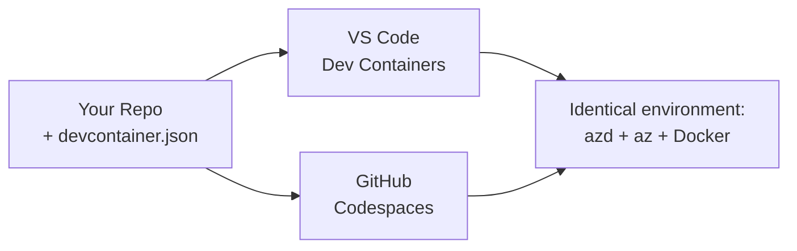

# Dev Containers & GitHub Codespaces voor azd

**Hoofdstuknavigatie:**
- **📚 Cursus Home**: [AZD Voor Beginners](../../README.md)
- **📖 Huidig Hoofdstuk**: Hoofdstuk 1 - Basis & Snelle Start
- **⬅️ Vorige**: [Bring Your Own App](bring-your-own-app.md)
- **🚀 Volgend Hoofdstuk**: [Hoofdstuk 2: AI-First Ontwikkeling](../chapter-02-ai-development/README.md)

> Doel van commando- en configuratiebeoordeling: `azd 1.37.2` (november 2026). Container builds en Azure-implementaties zijn niet uitgevoerd als onderdeel van deze beoordeling.

## Introductie

Het installeren van azd, de juiste taalruntime, Docker en de Azure CLI op elke machine is een klus — en het is de belangrijkste reden dat een tutorial die "werkt op mijn machine" faalt bij iemand anders. Een **dev container** lost dit op door je hele toolchain in een bestand te beschrijven. Iedereen die het project opent in VS Code of GitHub Codespaces krijgt exact dezelfde omgeving, met azd al geïnstalleerd. Deze les laat je zien hoe je er een toevoegt.

## Leerdoelen

Aan het einde van deze les zul je:
- Begrijpen wat een dev container is en waarom het helpt met azd
- Een minimale `.devcontainer/devcontainer.json` aan een project toevoegen
- azd, de Azure CLI en Docker via Dev Container *features* opnemen
- Het project openen in GitHub Codespaces of VS Code

## Leerresultaten

Na het voltooien van deze les kun je:
- Een `devcontainer.json` voor een azd-project schrijven
- azd en Azure-tools toevoegen zonder handmatige installaties
- `azd up` uitvoeren vanuit een container of Codespace

---

## Wat is een Dev Container?

Een dev container is een Docker-gebaseerde ontwikkelomgeving die wordt gedefinieerd door een `.devcontainer/devcontainer.json` bestand in je repository. Wanneer je het project opent:

- **VS Code** (met de Dev Containers-extensie) bouwt de container en koppelt eraan.
- **GitHub Codespaces** bouwt dezelfde container in de cloud en biedt je een browsergebaseerde editor.

Hoe dan ook, elke bijdrager krijgt identieke tools — geen "heb je azd geïnstalleerd?" problemen.



---

## Stap 1: Maak het devcontainer-bestand aan

Maak `.devcontainer/devcontainer.json` aan in de root van je project:

```json
{
  "name": "azd-project",
  "image": "mcr.microsoft.com/devcontainers/base:bookworm",
  "features": {
    "ghcr.io/devcontainers/features/azure-cli:1": {},
    "ghcr.io/azure/azure-dev/azd:0": { "version": "1.37.2" },
    "ghcr.io/devcontainers/features/docker-in-docker:2": {},
    "ghcr.io/devcontainers/features/node:1": {}
  },
  "customizations": {
    "vscode": {
      "extensions": [
        "ms-azuretools.azure-dev",
        "ms-azuretools.vscode-bicep"
      ]
    }
  },
  "forwardPorts": [3000],
  "postCreateCommand": "azd version"
}
```

Wat elk onderdeel doet:

| Sleutel | Doel |
|-----|---------|
| `image` | Het basisbesturingssysteem voor de container |
| `features` | Vooraf gebouwde installateurs — hier: Azure CLI, **azd**, Docker en Node.js |
| `customizations.vscode.extensions` | Installeert automatisch de azd en Bicep VS Code extensies |
| `forwardPorts` | Maakt de poort van je app toegankelijk in je browser |
| `postCreateCommand` | Wordt één keer uitgevoerd nadat de container is gebouwd (hier een saniteitscontrole) |

> De feature-versie (`azd:0`) en de geïnstalleerde CLI-versie zijn verschillend. Stel de `version` optie van de feature in op `"1.37.2"` om de CLI vast te zetten; gebruik geen CLI-versie als feature tag.

---

## Stap 2: Pas de feature aan op de taal van je app

Vervang de `node` feature door wat jouw app gebruikt:

```jsonc
// Python project
"ghcr.io/devcontainers/features/python:1": {},

// .NET project
"ghcr.io/devcontainers/features/dotnet:2": {},

// Java project
"ghcr.io/devcontainers/features/java:1": {},

// Go project
"ghcr.io/devcontainers/features/go:1": {}
```

Houd `docker-in-docker` als je afbeeldingen lokaal bouwt. Een geconfigureerde remote ACR build (`docker.remoteBuild: true`) is een alternatief; het hosttype alleen vereist niet altijd lokale Docker.

---

## Stap 3: Open het

**In VS Code:**
1. Installeer de **Dev Containers** extensie.
2. Open de projectmap.
3. Klik op **Heropenen in Container** wanneer daarom gevraagd wordt (of voer *Dev Containers: Reopen in Container* uit).

**In GitHub Codespaces:**
1. Push de repo naar GitHub.
2. Klik op **Code → Codespaces → Create codespace on main**.
3. Wacht tot de container is gebouwd—azd is klaar in de terminal.

---

## Stap 4: Implementeer vanuit de container

De container heeft azd vooraf geïnstalleerd, dus de normale workflow werkt gewoon:

```bash
azd auth login --use-device-code   # device code is handy inside Codespaces
azd up
```

> **Waarom `--use-device-code`?** In een remote container of Codespace is er geen lokale browser om naar door te sturen, dus device-code login is het betrouwbare pad. Je plakt een code in een browsertab om aanmelding te voltooien.

---

## Veelvoorkomende valkuilen

| Valkuil | Oplossing |
|---------|---------|
| `azd up` kan geen afbeelding bouwen | Voeg de `docker-in-docker` feature toe |
| Browser-login hangt in Codespaces | Gebruik `azd auth login --use-device-code` |
| Tools verschillen tussen teamleden | Zet de CLI vast via de `version` optie van de azd feature en zet taaltimes vast |
| App is niet bereikbaar in browser | Voeg de poort toe aan `forwardPorts` |

---

## Samenvatting

- Een dev container maakt je azd toolchain reproduceerbaar voor iedereen.
- Voeg azd, de Azure CLI en Docker toe via Dev Container *features*.
- Pas de taalfeature aan op je app en houd `docker-in-docker` voor containerhosts.
- Gebruik device-code login bij gebruik in Codespaces.

---

## 🔗 Navigatie

| Richting | Bron |
|-----------|-----------|
| **Vorige** | [Bring Your Own App](bring-your-own-app.md) |
| **Hoofdstuk Home** | [Hoofdstuk 1: Basis & Snelle Start](README.md) |
| **Volgend Hoofdstuk** | [Hoofdstuk 2: AI-First Ontwikkeling](../chapter-02-ai-development/README.md) |

## 📖 Gerelateerde bronnen

- [Installatie & Setup](installation.md)
- [Command Cheat Sheet](../../resources/cheat-sheet.md)
- [Officiële Dev Containers-specificatie](https://containers.dev/)
- [azd Dev Container feature](https://github.com/Azure/azure-dev/tree/main/ext/devcontainer)

---

<!-- CO-OP TRANSLATOR DISCLAIMER START -->
**Disclaimer**:
Dit document is vertaald met behulp van de AI vertaaldienst [Co-op Translator](https://github.com/Azure/co-op-translator). Hoewel we streven naar nauwkeurigheid, dient u er rekening mee te houden dat geautomatiseerde vertalingen fouten of onnauwkeurigheden kunnen bevatten. Het originele document in de oorspronkelijke taal moet worden beschouwd als de gezaghebbende bron. Voor kritieke informatie wordt professionele menselijke vertaling aanbevolen. Wij zijn niet aansprakelijk voor eventuele misverstanden of verkeerde interpretaties die voortvloeien uit het gebruik van deze vertaling.
<!-- CO-OP TRANSLATOR DISCLAIMER END -->