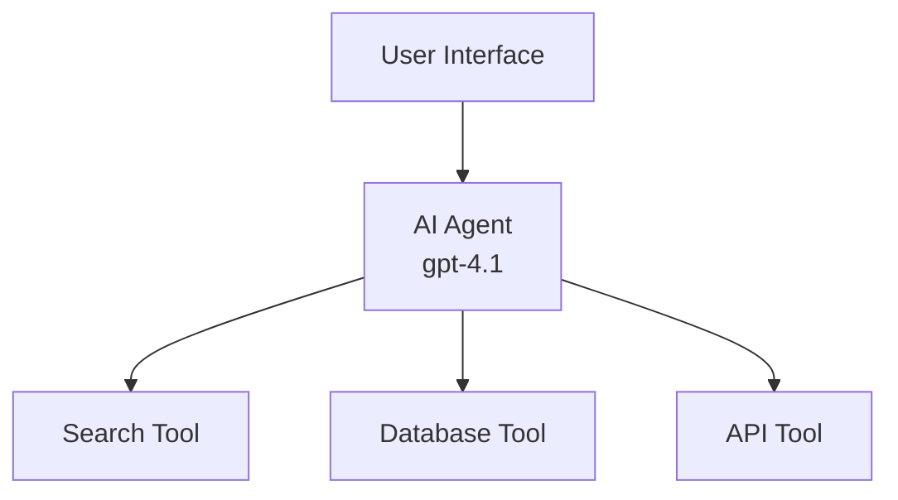
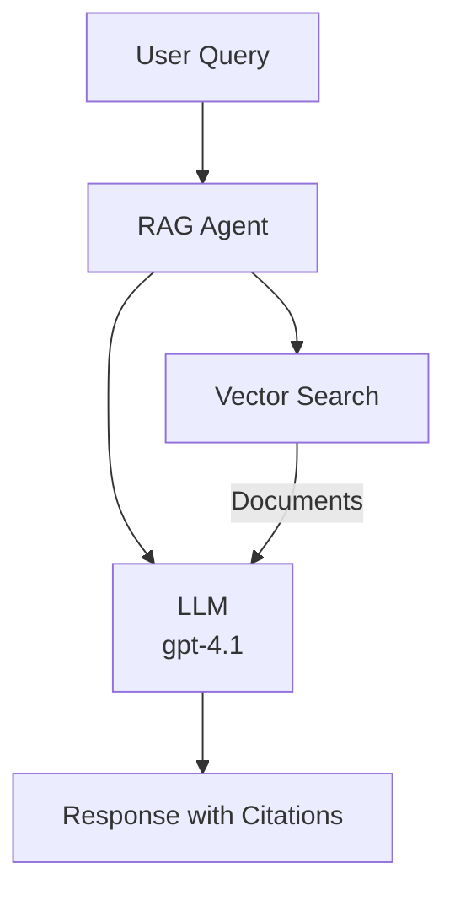
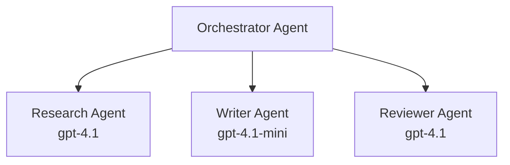

# AI-agenten met Azure Developer CLI

**Hoofdstuknavigatie:**
- **📚 Cursus Home**: [AZD Voor Beginners](../../README.md)
- **📖 Huidig Hoofdstuk**: Hoofdstuk 2 - AI-Eerst Ontwikkeling
- **⬅️ Vorige**: [Microsoft Foundry Integratie](microsoft-foundry-integration.md)
- **➡️ Volgende**: [AI Model Implementatie](ai-model-deployment.md)
- **🚀 Geavanceerd**: [Multi-Agenten Oplossingen](../../examples/retail-scenario.md)

---

## Introductie

AI-agenten zijn autonome programma's die hun omgeving kunnen waarnemen, beslissingen nemen en acties uitvoeren om specifieke doelen te bereiken. In tegenstelling tot eenvoudige chatbots die op prompts reageren, kunnen agenten:

- **Tools gebruiken** - APIs aanroepen, databases doorzoeken, code uitvoeren
- **Plannen en redeneren** - Complexe taken opsplitsen in stappen
- **Leren van context** - Geheugen behouden en gedrag aanpassen
- **Samenwerken** - Werken met andere agenten (multi-agent systemen)

Deze gids laat zien hoe je AI-agenten implementeert naar Azure met Azure Developer CLI (azd).

Het gebruiken van gesprekscontext is geen modeltraining: persistent geheugen, toegangscontrole en retentie moeten door de applicatie worden geïmplementeerd/geconfigureerd.

> **Release review (04-11-2026):** CLI-voorbeelden zijn gecontroleerd tegen de documentatie/bronnen van `azd` `1.37.2`, `azure.ai.agents` `1.0.0-beta.23`, en `azure.ai.evaluations` `1.0.0-beta.2`, niet tegen een live Azure-implementatie. Gebruik `azd >= 1.37.0` voor de gecombineerde workflow. Zie [recente wijzigingen en fixes](../chapter-08-production/production-ai-practices.md#recent-release-changes-and-fixes) voordat je oudere projecten bijwerkt.

## Leerdoelen

Na het voltooien van deze gids zal je:
- Begrijpen wat AI-agenten zijn en hoe ze verschillen van chatbots
- Vooraf gebouwde AI-agent sjablonen implementeren met AZD
- Foundry-agenten configureren voor aangepaste agenten
- Basis agentpatronen implementeren (toolgebruik, RAG, multi-agent)
- Geïmplementeerde agenten monitoren en debuggen

## Leeruitkomsten

Na voltooiing kun je:
- AI-agent applicaties met één commando naar Azure implementeren
- Agent tools en mogelijkheden configureren
- Retrieval-augmented generation (RAG) met agenten implementeren
- Multi-agent architecturen ontwerpen voor complexe workflows
- Veelvoorkomende problemen met agent-implementaties oplossen

---

## 🤖 Wat Maakt Een Agent Anders Dan Een Chatbot?

| Kenmerk | Chatbot | AI Agent |
|---------|---------|----------|
| **Gedrag** | Reageert op prompts | Neemt autonome acties |
| **Tools** | Kan retrieval of tools gebruiken | Meestal tools in een doelgerichte lus |
| **Geheugen** | Afhankelijk van de applicatie | Persistent geheugen alleen bij expliciete implementatie |
| **Planning** | Enkelvoudige respons | Meerdere redeneringsstappen |
| **Samenwerking** | Enkelvoudige entiteit | Kan samenwerken met andere agenten |

### Simpele Analogie

- **Chatbot** = Een behulpzaam persoon die vragen beantwoordt aan een informatiedesk
- **AI Agent** = Een persoonlijke assistent die kan bellen, afspraken plannen en taken voor je afhandelen

---

## 🚀 Snel Starten: Implementeer Je Eerste Agent

Kies één optie in een **nieuwe lege werkmap**. De achtervoegsel `.` initialiseert daar; zonder expliciete bestemming kan de huidige AZD een submap met template-naam aanmaken en verandert het je shell-map niet. Houd aparte sjablonen/omgevingen in aparte mappen.

De onderstaande tijd-/kostencategorieën zijn illustratief, geen gevalideerde offertes. Controleer voor elke sample actuele vereisten, prijzen, modelquota en optionele diensten vóór implementatie.

### Optie 1: Foundry Agents Sjabloon (Aanbevolen)

```bash
# Initialize the AI agents template
azd init --template get-started-with-ai-agents .

# Deploy to Azure
azd up
```

**Wat er wordt geïmplementeerd:** De infrastructuur van de sample en geselecteerde opties bepalen het model, tools, hosting en monitoring resources. Lees de README en `infra/` voordat je provisiont; ga er niet vanuit dat elk agent-sjabloon Search of een webinterface bevat.

**Tijd:** ~15-20 minuten
**Kosten:** ~$100-150/maand (ontwikkeling)

### Optie 2: Creatieve Schrijfagenten met Prompty

```bash
# Initialize the Prompty-based agent template
azd init --template https://github.com/Azure-Samples/contoso-creative-writer .

# Deploy to Azure
azd up
```

**Wat er wordt geïmplementeerd:** Een FastAPI/Prompty multi-agent schrijf-sample met Azure OpenAI, Bing Grounding en Azure AI Search. De voormalige `agent-openai-python-prompty` repository verwijst hierheen; het is geen minimaal Azure Functions weer-agent sjabloon. Volg de actuele README voor hosting, modelquota en Bing Grounding vereisten.

**Tijd:** ~10-15 minuten
**Kosten:** ~$50-100/maand (ontwikkeling)

### Optie 3: RAG Chat Agent

```bash
# Initialize RAG chat template
azd init --template azure-search-openai-demo .

# Deploy to Azure
azd up
```

**Wat er wordt geïmplementeerd:**
- ✅ Microsoft Foundry Modellen
- ✅ Azure AI Search met sample data
- ✅ Documentverwerkingspipeline
- ✅ Chatinterface met citaten

**Tijd:** ~15-25 minuten
**Kosten:** ~$80-150/maand (ontwikkeling)

### Optie 4: AZD AI Agent Init (Project Sjabloon Voorbeeld)

Gebruik `azd ai agent init` interactief, of neem een huidig `azure.yaml` agent project over met `--template`/`-t`. De oude `--manifest`/`-m` optie is een verouderde alias, geen converter voor legacy manifesten.

```bash
# Install the AI agents extension
azd extension install azure.ai.agents

# Optional: verify the installed preview version
azd extension show azure.ai.agents

# Initialize from a current agent project template (supply your template path)
azd ai agent init --template ./templates/support-agent/azure.yaml

# Deploy to Azure
azd up

# Test the deployed agent (shows latency + time-to-first-byte)
azd ai agent invoke
```

**Wanneer gebruik je `azd ai agent init` versus `azd init --template`:**

| Aanpak | Geschikt Voor | Hoe Het Werkt |
|----------|----------|------|
| `azd init --template` | Beginnen met een werkende sample-app | Klonen van een volledige template repo met code + infra |
| `azd ai agent init --template` | Overnemen van een huidig Foundry agent project | Gebruikt een `azure.yaml` projectdocument en definities |

> **Tip:** Gebruik `azd init --template` voor het leren (Opties 1-3 hierboven). Gebruik `azd ai agent init` voor de Foundry agent workflow. Wil je een directe agent-definitie toevoegen aan een bestaand project, bekijk dan [initialisatie en migratie gids](../chapter-08-production/production-ai-practices.md#initializing-agent-projects-with-azd-ai-agent-init).

Na `azd up` gebruik je `azd ai agent invoke` om te testen, de aparte `azure.ai.evaluations` extensie (`azd ai eval init`, `generate`, en `run start`) om kwaliteit te meten, en `azd ai agent optimize` om te verbeteren met de nieuwe evaluatieconfiguratie. Agents beta.22 verving de legacy evaluatieworkflow en veranderde het optimalisatie `--config` formaat. Zie [evaluatie migratie](../chapter-08-production/production-ai-practices.md#evaluation-migration-and-quality-checks) en [optimalisatie migratie](../chapter-08-production/production-ai-practices.md#optimization-configuration-migration) voordat je oude voorbeelden hergebruikt.

---

## 🏗️ Agent Architectuurpatronen

### Patroon 1: Enkele Agent met Tools

Het eenvoudigste agentpatroon - één agent die meerdere tools kan gebruiken.



**Geschikt voor:**
- Klantenservice bots
- Onderzoeksassistenten
- Data analyse agenten

**Gerelateerde applicatie sample:** `azure-search-openai-demo` toont RAG, geen generieke willekeurige-tool agentlus.

### Patroon 2: RAG Agent (Retrieval-Augmented Generation)

Een agent die relevante documenten opzoekt voordat hij responsen genereert.



**Geschikt voor:**
- Enterprise kennisbanken
- Document Vraag & Antwoord systemen
- Compliance en juridische research

**AZD Sjabloon:** `azure-search-openai-demo`

### Patroon 3: Multi-Agent Systeem

Meerdere gespecialiseerde agenten die samenwerken aan complexe taken.



**Geschikt voor:**
- Complexe contentgeneratie
- Meerdere workflow stappen
- Taken met verschillende expertisegebieden

**Meer leren:** [Multi-Agent Coördinatiepatronen](../chapter-06-pre-deployment/coordination-patterns.md)

---

## ⚙️ Tools voor Agent Configureren

Agenten worden krachtig als zij tools kunnen gebruiken. Zo configureer je veelgebruikte tools:

### Toolconfiguratie in Foundry Agents

Dit **klassiek Agent Service SDK fragment** richt zich op `azure-ai-projects==1.0.0` en `azure-ai-agents==1.1.0` met `azure-identity`. Het is niet de nieuwere versioned-agent/Responses API die sommige huidige Foundry sjablonen gebruiken, noch de `azure.ai.agents` AZD extensie (een ander pakket). Meng deze API-generaties niet. Stel `PROJECT_ENDPOINT` in op een klassiek Foundry project endpoint en `MODEL_DEPLOYMENT_NAME` op een bestaande ondersteunde model-implementatie; authenticatie met `az login` lokaal en geef vereiste projectrechten.

```python
# agent_config.py
import os
from azure.ai.projects import AIProjectClient
from azure.ai.agents.models import FunctionTool
from azure.identity import DefaultAzureCredential

def search_knowledge_base(query: str) -> str:
    """Search the demonstration knowledge base.

    :param query: Search text.
    :return: Matching demonstration information.
    """
    # Local fixture only, not a production search implementation.
    return "Demo policy: returns are accepted within 30 days."

project_client = AIProjectClient(
    endpoint=os.environ["PROJECT_ENDPOINT"],
    credential=DefaultAzureCredential(),
)
search_tool = FunctionTool(functions={search_knowledge_base})
project_client.agents.enable_auto_function_calls(search_tool)
agent = project_client.agents.create_agent(
    model=os.environ["MODEL_DEPLOYMENT_NAME"],
    name="Support Agent",
    instructions="Use search_knowledge_base for policy questions. Label results as demo data.",
    tools=search_tool.definitions,
)
```

Het registreren van een funktieschema voert geen Python uit op de service. In deze SDK draait `enable_auto_function_calls` plus `agents.runs.create_and_process(...)` geregistreerde callbacks in je clientproces. Zie de [uitgebrachte SDK voorbeeld](https://github.com/Azure/azure-sdk-for-python/blob/azure-ai-agents_1.1.0/sdk/ai/azure-ai-agents/samples/agents_tools/sample_agents_auto_function_call.py). Sluit de client en verwijder demonstratie-agenten/threads na gebruik.

### Omgevingsconfiguratie

De volgende namen zijn **illustratieve custom-template invoer**, geen ingebouwde AZD-schakelaars. Verwerk elke waarde eerst via `infra/main.parameters.json`, infrastructuur en applicatiecode. Alleen `azd env set` verandert niet de tools of instructies van een agent.

```bash
# Set up agent-specific environment variables
azd env set AZURE_OPENAI_MODEL "gpt-4.1"
azd env set AGENT_INSTRUCTIONS "You are a helpful assistant..."
azd env set ENABLE_CODE_INTERPRETER "true"
azd env set ENABLE_FILE_SEARCH "true"

# Apply wired infrastructure and application changes
azd up
```

---

## 📊 Agenten Monitoren

### Integratie met Application Insights

Als je geselecteerde sjabloon Application Insights provisioneert en instrumentatie configureert:

```bash
# Open monitoring dashboard
azd monitor --overview

# Open the Application Insights logs view (not a streaming log tail)
azd monitor --logs

# View live metrics
azd monitor --live
```

### Belangrijke Metrics om te Volgen

| Metric | Beschrijving | Doel |
|--------|-------------|------|
| Responsvertraging | Tijd om respons te genereren | < 5 seconden |
| Tokengebruik | Tokens per aanvraag | Monitor voor kosten |
| Succespercentage Tools | % geslaagde tooluitvoeringen | > 95% |
| Foutpercentage | Mislukte agent-aanvragen | < 1% |
| Gebruikerstevredenheid | Feedbackscores | > 4,0/5,0 |

### Aangepaste Logging voor Agenten

```python
import os
from azure.monitor.opentelemetry import configure_azure_monitor
from opentelemetry import trace

# Configure Azure Monitor with OpenTelemetry
configure_azure_monitor(
    connection_string=os.environ["APPLICATIONINSIGHTS_CONNECTION_STRING"]
)

tracer = trace.get_tracer(__name__)

def log_agent_interaction(user_query, agent_response, tools_used, latency_ms):
    with tracer.start_as_current_span("agent_interaction") as span:
        span.set_attributes({
            "query_length": len(user_query),  # Do not log raw prompts or personal data
            "response_length": len(agent_response),
            "tools_used": tools_used,
            "latency_ms": latency_ms
        })
```

> **Opmerking:** Installeer het benodigde pakket: `pip install azure-monitor-opentelemetry`. Deze brengt de OpenTelemetry afhankelijkheden mee; de import namespace is geen vereiste om een pakket genaamd `opentelemetry` te installeren.

---

## 💰 Kostenoverwegingen

### Geschatte Maandelijkse Kosten per Patroon

Dit zijn illustratieve planningsranges, geen offertes of uitgavelimieten. Regio, modeltokens, Search/compute SKUs, tool sessies, opslag en verkeer kunnen hoger uitpakken. Bekijk de kosteninstructies van de sample en Azure prijzen vóór `azd up`.

| Patroon | Ontwikkomgeving | Productie |
|---------|-----------------|------------|
| Enkele Agent | $50-100 | $200-500 |
| RAG Agent | $80-150 | $300-800 |
| Multi-Agent (2-3 agenten) | $150-300 | $500-1,500 |
| Enterprise Multi-Agent | $300-500 | $1,500-5,000+ |

### Tips voor Kostenoptimalisatie

1. **Gebruik gpt-4.1-mini voor eenvoudige taken** (alleen als je sjabloon deze input gebruikt)
   ```bash
   azd env set AZURE_OPENAI_MODEL "gpt-4.1-mini"
   ```

2. **Implementeer scoped caching voor veilige, herhaalde queries.** Neem tenant-/gebruikersautorisatie, modelimplementatie, instructies en retrieval-versie op in de cache key; stel een vervaldatum in. Deel geen privé gespreksantwoorden via een systeemwijd alleen-lezen query cache. Het SDK agent object heeft geen generieke `agent.run()` methode.

3. **Stel tokenlimieten per run in**
   ```python
   # Set max_completion_tokens when running the agent, not during creation
   run = project_client.agents.runs.create_and_process(
       thread_id=thread.id,
       agent_id=agent.id,
       max_completion_tokens=1000  # Budget across the run; may finish as incomplete
   )
   ```

4. **Schaal Container Apps die hiervoor in aanmerking komen naar nul wanneer niet in gebruik**
   ```bash
   # Custom-template input: must map to template.scale.minReplicas
   azd env set MIN_REPLICAS "0"
   ```
   Pas de infrastructuurwijziging toe met `azd provision` of `azd up`. Schalen naar nul heeft een geschikte trigger nodig en stopt Search, opslag of model/tool kosten niet.

---

## 🔧 Probleemoplossing Agenten

### Veelvoorkomende Problemen en Oplossingen

<details>
<summary><strong>❌ Agent reageert niet op tool-aanroepen</strong></summary>

```bash
# Inspect the application deployment (not the agent's registered tools)
azd show

# Verify OpenAI deployment
az cognitiveservices account deployment list \
  --name $AZURE_OPENAI_NAME \
  --resource-group $RG_NAME

# Check agent logs
azd monitor --logs
```

**Veelvoorkomende oorzaken:**
- Tool functie handtekening komt niet overeen
- Vereiste rechten ontbreken
- API endpoint niet toegankelijk
</details>

<details>
<summary><strong>❌ Hoge latency in agentrespons</strong></summary>

```bash
# Check Application Insights for bottlenecks
azd monitor --live

# Consider using a faster model
azd env set AZURE_OPENAI_MODEL "gpt-4.1-mini"
azd up
```

**Optimalisatietips:**
- Gebruik streaming responses
- Implementeer response caching
- Verklein context window grootte
</details>

<details>
<summary><strong>❌ Agent geeft verkeerde of verzonnen informatie</strong></summary>

```python
# Improve with better system prompts
instructions = """
You are a helpful assistant. IMPORTANT:
- Only answer based on provided context
- If you don't know, say "I don't know"
- Always cite your sources
- Never make up information
"""

# Use these instructions in the agent definition.
# For classic file search, first upload/index documents in a vector store,
# then use FileSearchTool(vector_store_ids=[...]) and pass both its
# .definitions and .resources when creating the agent.
```
Instructies en retrieval verminderen risico; geen van beide garandeert feitelijke antwoorden. Evalueer gefundeerde en out-of-scope vragen tegen bekende antwoorden.
</details>

<details>
<summary><strong>❌ Tokenlimiet overschreden fouten</strong></summary>

```python
# Implement context window management
def truncate_context(messages, max_tokens=8000, model="gpt-4.1"):
    """Approximate content-only budget for objects with .content strings."""
    import tiktoken
    encoding = tiktoken.encoding_for_model(model)
    total_tokens = 0
    truncated = []
    
    for msg in reversed(messages):
        msg_tokens = len(encoding.encode(msg.content))
        if total_tokens + msg_tokens > max_tokens:
            break
        truncated.insert(0, msg)
        total_tokens += msg_tokens
    
    return truncated
```
Deze helper sluit rol/tool schemas uit, systeeminstructies, afbeeldingtokens en protocol overhead. Reserveer ruimte hiervoor en voor de completion; splitst tool-call/result paar niet en verwijder vereiste systeeminstructies niet. Installeer `tiktoken` apart. Het is geen algemene context-window validator.
</details>

---

## 🎓 Hands-on Oefeningen

### Oefening 1: Implementeer een Basis Agent (20 minuten)

**Doel:** Implementeer je eerste AI-agent met AZD

```bash
# Step 1: Initialize template
azd init --template get-started-with-ai-agents .

# Step 2: Login to Azure
azd auth login
# If you work across tenants, add --tenant-id <tenant-id>

# Step 3: Deploy
azd up

# Step 4: Test the agent
# Expected output after deployment:
#   Deployment Complete!
#   Endpoint: https://<app-name>.<region>.azurecontainerapps.io
# Open the URL shown in the output and try asking a question

# Step 5: View monitoring
azd monitor --overview

# Step 6: Clean up
azd down --force --purge
```

**Succescriteria:**
- [ ] Agent reageert op vragen
- [ ] Kan de monitoring dashboard bereiken via `azd monitor`
- [ ] Resources succesvol opgeruimd

### Oefening 2: Voeg een Aangepaste Tool toe (30 minuten)

**Doel:** Breid een agent uit met een aangepaste tool

**Startpunt:** Gebruik de klassieke SDK client van [Toolconfiguratie](#tool-configuration-in-foundry-agents), niet een willekeurig sjabloon met een andere SDK-generatie.

1. Voeg deze deterministische fixture toe aan `agent_config.py`:
   ```python
   def get_weather(location: str) -> str:
       """Return demonstration weather, not live conditions.

       :param location: City name.
       :return: A clearly labelled fixture.
       """
       print(f"TOOL_CALLED: {location}")
       return f"Demo weather in {location}: Sunny, 72°F (fixture, not live)"
   ```
2. Vervang het blok voor registratie en creatie van de zoektool door:
   ```python
   weather_tool = FunctionTool(functions={get_weather})
   project_client.agents.enable_auto_function_calls(weather_tool)
   agent = project_client.agents.create_agent(
       model=os.environ["MODEL_DEPLOYMENT_NAME"],
       name="Weather Agent",
       instructions="Call get_weather for weather questions; explain that it returns demo data.",
       tools=weather_tool.definitions,
   )
   thread = project_client.agents.threads.create()
   try:
       project_client.agents.messages.create(
           thread_id=thread.id, role="user", content="Use get_weather for Seattle."
       )
       run = project_client.agents.runs.create_and_process(
           thread_id=thread.id, agent_id=agent.id
       )
       if run.status != "completed":
           raise RuntimeError(f"Run status: {run.status}; error: {run.last_error}")
       for message in project_client.agents.messages.list(thread_id=thread.id):
           for text in message.text_messages:
               print(text.text.value)
   finally:
       project_client.agents.threads.delete(thread.id)
       project_client.agents.delete_agent(agent.id)
       project_client.close()
   ```
3. Voer lokaal uit (dit roept het bestaande Azure-project aan en brengt modelkosten met zich mee):
   ```bash
   python agent_config.py
   # Expected: TOOL_CALLED: Seattle, then a completed answer labelled demo data.
   ```

**Succescriteria:**
- [ ] Agent herkent weergerelateerde vragen
- [ ] Tool wordt correct aangeroepen
- [ ] Antwoord bevat weerinformatie

### Oefening 3: Bouw een RAG Agent (45 minuten)

**Doel:** Maak een agent die vragen beantwoordt vanuit je documenten

```bash
# Step 1: Deploy RAG template
azd init --template azure-search-openai-demo .
azd up

# Step 2: Upload your documents
# For the sample's local ingestion path, place supported files in data/.
# Run from the sample root after following its Python environment setup:
./scripts/prepdocs.sh
# Windows PowerShell equivalent: .\\scripts\\prepdocs.ps1

# Step 3: Test with domain-specific questions
# Open the web app URL from the azd up output
# Ask questions about your uploaded documents
# Responses should include citation references like [doc.pdf]
```

**Succescriteria:**
- [ ] Agent beantwoordt vanuit geüploade documenten
- [ ] Antwoorden bevatten citaties
- [ ] Testvragen buiten scope worden afgehandeld zonder ongefundeerde beweringen (geen garantie voor elke toekomstige vraag)

Als `USE_CLOUD_INGESTION=true` wordt gebruikt, gebruik dan in plaats daarvan de voorbeeldworkflow voor cloudingesting/upload; de lokale wrapper slaat opzettelijk ingestion over. Na het testen, voer `azd down` uit in de RAG-omgeving en bekijk de te verwijderen resources.

---

## 📚 Volgende Stappen

Nu je AI-agents begrijpt, verken deze geavanceerde onderwerpen:

| Onderwerp | Beschrijving | Link |
|-------|-------------|------|
| **Multi-Agent Systemen** | Bouw systemen met meerdere samenwerkende agents | [Retail Multi-Agent Voorbeeld](../../examples/retail-scenario.md) |
| **Coördinatiepatronen** | Leer orkestratie- en communicatiepatronen | [Coördinatiepatronen](../chapter-06-pre-deployment/coordination-patterns.md) |
| **Productie-implementatie** | Enterprise-gereed agent-implementatie | [Productie AI Praktijken](../chapter-08-production/production-ai-practices.md) |
| **Agent Evaluatie** | Test en evalueer agentprestaties | [AI Probleemoplossing](../chapter-07-troubleshooting/ai-troubleshooting.md) |
| **AI Workshop Lab** | Praktijk: Maak je AI-oplossing AZD-klaar | [AI Workshop Lab](ai-workshop-lab.md) |

---

## 📖 Aanvullende Bronnen

### Officiële Documentatie
- [Microsoft Foundry Agent Service](https://learn.microsoft.com/azure/ai-services/agents/)
- [Microsoft Foundry Agent Service Quickstart](https://learn.microsoft.com/azure/ai-services/agents/quickstart)
- [Semantic Kernel Agent Framework](https://learn.microsoft.com/semantic-kernel/)

### AZD-sjablonen voor Agents
- [Begin met AI Agents](https://github.com/Azure-Samples/get-started-with-ai-agents)
- [Creatieve Schrijvers Agents met Prompty](https://github.com/Azure-Samples/contoso-creative-writer)
- [Azure Search OpenAI Demo](https://github.com/Azure-Samples/azure-search-openai-demo)

### Communitybronnen
- [Geweldige AZD - Agent Sjablonen](https://azure.github.io/awesome-azd/?tags=ai-agents)
- [Azure AI Discord](https://discord.gg/microsoft-azure)
- [Microsoft Foundry Discord](https://discord.gg/nTYy5BXMWG)

### Agent Skills voor je Editor
- [**Microsoft Azure Agent Skills**](https://skills.sh/microsoft/github-copilot-for-azure) - Installeer herbruikbare AI agent vaardigheden voor Azure-ontwikkeling in GitHub Copilot, Cursor, of elke ondersteunde agent. Bevat vaardigheden voor [Azure AI](https://skills.sh/microsoft/github-copilot-for-azure/azure-ai), [Microsoft Foundry](https://skills.sh/microsoft/github-copilot-for-azure/microsoft-foundry), [implementatie](https://skills.sh/microsoft/github-copilot-for-azure/azure-deploy), en [diagnostiek](https://skills.sh/microsoft/github-copilot-for-azure/azure-diagnostics):
  ```bash
  npx skills add microsoft/github-copilot-for-azure
  ```

---

**Navigatie**
- **Vorige Les**: [Microsoft Foundry Integratie](microsoft-foundry-integration.md)
- **Volgende Les**: [AI Model Implementatie](ai-model-deployment.md)

---

<!-- CO-OP TRANSLATOR DISCLAIMER START -->
**Disclaimer**:
Dit document is vertaald met behulp van de AI vertaaldienst [Co-op Translator](https://github.com/Azure/co-op-translator). Hoewel we streven naar nauwkeurigheid, dient u er rekening mee te houden dat geautomatiseerde vertalingen fouten of onnauwkeurigheden kunnen bevatten. Het originele document in de oorspronkelijke taal moet worden beschouwd als de gezaghebbende bron. Voor kritieke informatie wordt professionele menselijke vertaling aanbevolen. Wij zijn niet aansprakelijk voor eventuele misverstanden of verkeerde interpretaties die voortvloeien uit het gebruik van deze vertaling.
<!-- CO-OP TRANSLATOR DISCLAIMER END -->