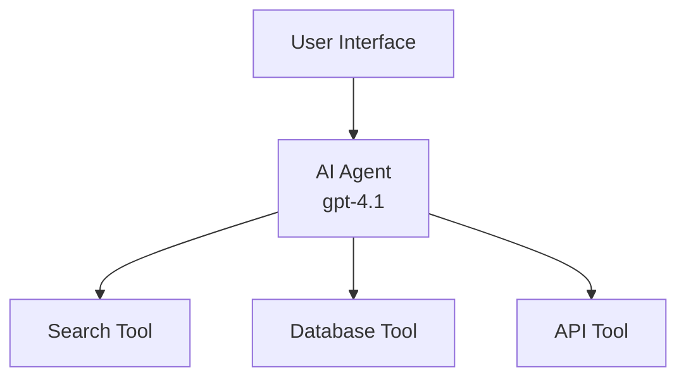
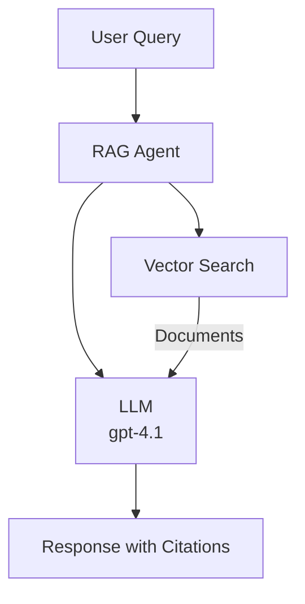
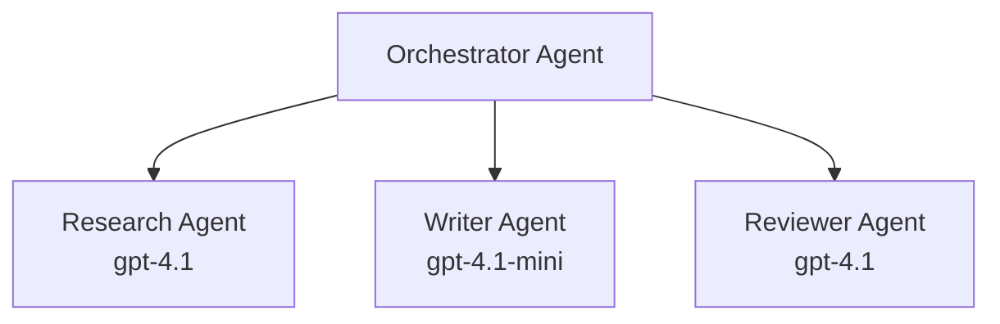

# AI-agenten met Azure Developer CLI

**Hoofdstuknavigatie:**
- **📚 Cursus Home**: [AZD Voor Beginners](../../README.md)
- **📖 Huidig Hoofdstuk**: Hoofdstuk 2 - AI-First Ontwikkeling
- **⬅️ Vorige**: [Microsoft Foundry Integratie](microsoft-foundry-integration.md)
- **➡️ Volgende**: [AI Model Implementatie](ai-model-deployment.md)
- **🚀 Gevorderd**: [Multi-Agent Oplossingen](../../examples/retail-scenario.md)

---

## Introductie

AI-agenten zijn autonome programma's die hun omgeving kunnen waarnemen, beslissingen kunnen nemen en acties kunnen uitvoeren om specifieke doelstellingen te bereiken. In tegenstelling tot eenvoudige chatbots die reageren op prompts, kunnen agenten:

- **Tools gebruiken** - APIs aanroepen, databases doorzoeken, code uitvoeren
- **Plannen en redeneren** - Complexe taken opdelen in stappen
- **Leren van context** - Geheugen behouden en gedrag aanpassen
- **Samenwerken** - Werken met andere agenten (multi-agent systemen)

Deze handleiding laat zien hoe je AI-agenten implementeert in Azure met Azure Developer CLI (azd).

Gebruik van conversatiecontext is geen modeltraining: persistent geheugen, toegangscontrole en retentie moeten door de applicatie worden geïmplementeerd/geconfigureerd.

> **Foundry GA-update (2026-11-09):** Installeer het algemeen beschikbare `microsoft.foundry` 1.0 pakket met `azd >= 1.37.0`. Evaluaties worden apart geïnstalleerd; optionele preview-functies en het klassieke SDK-fragment hieronder worden niet gepromoot naar GA via de pakketaankondiging. Deze richtlijn is gebaseerd op de [GA aankondiging](https://devblogs.microsoft.com/azure-sdk/microsoft-foundry-azure-developer-cli-ga/) en documentatie, niet een live Azure-implementatie.

## Leerdoelen

Door deze handleiding te volgen, zul je:
- Begrijpen wat AI-agenten zijn en hoe ze verschillen van chatbots
- Vooraf gebouwde AI-agent sjablonen implementeren met AZD
- Foundry Agenten configureren voor aangepaste agenten
- Basis agent-patronen implementeren (toolgebruik, RAG, multi-agent)
- Gedeponeerde agenten monitoren en debuggen

## Leerresultaten

Na voltooiing zul je in staat zijn om:
- AI-agent applicaties naar Azure te implementeren met één commando
- Agent-tools en mogelijkheden te configureren
- Retrieval-augmented generation (RAG) met agenten te implementeren
- Multi-agent architecturen te ontwerpen voor complexe workflows
- Veelvoorkomende implementatieproblemen voor agenten op te lossen

---

## 🤖 Wat Maakt een Agent Anders dan een Chatbot?

| Kenmerk | Chatbot | AI Agent |
|---------|---------|----------|
| **Gedrag** | Reageert op prompts | Neemt autonome acties |
| **Tools** | Kan retrieval of tools gebruiken | Gebruikt meestal tools in een doelgerichte cyclus |
| **Geheugen** | Afhankelijk van applicatie | Persistent geheugen alleen als expliciet geïmplementeerd |
| **Planning** | Enkelvoudige reactie | Meerstaps redeneren |
| **Samenwerking** | Enkele entiteit | Kan met andere agenten samenwerken |

### Eenvoudige Analogie

- **Chatbot** = Een behulpzaam persoon die vragen beantwoordt bij een informatiebalie
- **AI Agent** = Een persoonlijke assistent die kan bellen, afspraken maken en taken voor je afronden

---

## 🚀 Snel Starten: Implementeer je Eerste Agent

Kies één optie in een **nieuwe lege werkmap**. De trailing `.` initialiseert daar; zonder expliciete bestemming kan de huidige AZD een submap met de template-naam aanmaken en verandert de shell map niet. Houd aparte templates/omgevingen in aparte mappen.

De onderstaande tijd-/kostencategorieën zijn illustratief, geen gevalideerde offertes. Controleer per voorbeeld de actuele vereisten, prijzen, modelquota en optionele services voor implementatie.

### Optie 1: Foundry Agents Template (Aanbevolen)

```bash
# Initialize the AI agents template
azd init --template get-started-with-ai-agents .

# Deploy to Azure
azd up
```

**Wat wordt geïmplementeerd:** De infrastructuur en geselecteerde opties van het voorbeeld bepalen het model, de tools, hosting en monitoringresources. Bekijk de README en `infra/` voor provisioning; ga er niet van uit dat elk agent-template Search of een webinterface bevat.

**Tijd:** ~15-20 minuten
**Kost:** ~$100-150/maand (ontwikkeling)

### Optie 2: Creatief Schrijven Agents met Prompty

```bash
# Initialize the Prompty-based agent template
azd init --template https://github.com/Azure-Samples/contoso-creative-writer .

# Deploy to Azure
azd up
```

**Wat wordt geïmplementeerd:** Een FastAPI/Prompty multi-agent schrijfsample met Azure OpenAI, Bing Grounding en Azure AI Search. Het voormalige `agent-openai-python-prompty` repository verwijst hierheen; het is geen minimale Azure Functions weather-agent template. Volg de huidige README voor hosting, modelquota en Bing Grounding vereisten.

**Tijd:** ~10-15 minuten
**Kost:** ~$50-100/maand (ontwikkeling)

### Optie 3: RAG Chat Agent

```bash
# Initialize RAG chat template
azd init --template azure-search-openai-demo .

# Deploy to Azure
azd up
```

**Wat wordt geïmplementeerd:**
- ✅ Microsoft Foundry Modellen
- ✅ Azure AI Search met voorbeelddata
- ✅ Documentverwerkingspipeline
- ✅ Chatinterface met citaties

**Tijd:** ~15-25 minuten
**Kost:** ~$80-150/maand (ontwikkeling)

### Optie 4: Gehoste Agent met de GA Foundry Bundle

Gebruik de [complete hosted-agent walkthrough](microsoft-foundry-integration.md#hosted-agent-walkthrough-ga) voor het basisvoorbeeld Python Agent Framework Responses API. Dit deployment-traject vereist Python 3.13+, actuele uv, Foundry-permissies en regionale modelquota. Verifieer lokale SDK-aanroepen apart bij gebruik van Azure CLI-referenties.

```bash
azd auth login
azd ext install microsoft.foundry
```

Initialiseer het voorbeeld in de lege map:

```text
azd ai agent init --template https://github.com/microsoft-foundry/foundry-samples/blob/main/samples/python/hosted-agents/agent-framework/responses/01-basic/azure.yaml --deploy-mode code --src .
```

Kies een nieuw of bestaand project, bekijk `azure.yaml`, en voer `azd provision` uit. Gebruik `azd ai agent run` om Agent Inspector te openen en, vanuit een andere terminal in die map, `azd ai agent invoke --local "Explain how this agent is hosted."`. Na lokale verificatie, gebruik `azd deploy` en `azd ai agent invoke "Explain how this agent is hosted."` om de geïmplementeerde response te vergelijken. Foundry bouwt de geüploade bron op afstand; lokaal container bouwen is niet vereist.

**Wanneer gebruik je `azd ai agent init` versus `azd init --template`:**

| Benadering | Geschikt Voor | Hoe Het Werkt |
|----------|----------|------|
| `azd init --template` | Starten vanuit een werkende voorbeeldapp | Cloneert een compleet template repository met code + infra |
| `azd ai agent init --template` | Overnemen van een huidig Foundry agent project | Gebruikt een `azure.yaml` projectdocument en de definities |

> **Tip:** Opties 1-3 starten vanuit volledige applicatiesjablonen; Optie 4 leert de GA hosted-agent workflow. Geen van beide initialisatiecommando's migreert automatisch legacy agent-manifesten. Voor directe agent-definitie aan een bestaand project, zie [initialisatie- en migratierichtlijnen](../chapter-08-production/production-ai-practices.md#initializing-agent-projects-with-azd-ai-agent-init).

Installeer `azure.ai.evaluations` apart om testdata/rubrieken te genereren en te bekijken, configureren een evaluatie en voer deze uit met `azd ai eval`. Optimalisatie kan een compatibele evaluatie hergebruiken; bekijk kandidaten voordat je expliciet één implementeert. Volg de [evaluatie workflow](../chapter-08-production/production-ai-practices.md#evaluation-migration-and-quality-checks) en [optimalisatie migratie](../chapter-08-production/production-ai-practices.md#optimization-configuration-migration) voor hergebruik van oudere voorbeelden. Voor opruiming blijven de resources bij hergebruik van een Foundry project na `azd down` bestaan; bij nieuw creatie wordt de resourcegroep verwijderd. Zie de [walkthrough opruimrichtlijnen](microsoft-foundry-integration.md#7-clean-up-deliberately).

---

## 🏗️ Agent Architectuur Patronen

### Patroon 1: Enkele Agent met Tools

Het eenvoudigste agent-patroon - één agent die meerdere tools kan gebruiken.



**Geschikt voor:**
- Klantenservice bots
- Onderzoeksassistenten
- Data-analyse agenten

**Gerelateerd applicatievoorbeeld:** `azure-search-openai-demo` demonstreert RAG, niet een generieke willekeurige-tool agentcyclus.

### Patroon 2: RAG Agent (Retrieval-Augmented Generation)

Een agent die relevante documenten ophaalt voordat hij antwoorden genereert.



**Geschikt voor:**
- Enterprise kennisbanken
- Document Q&A systemen
- Compliance en juridisch onderzoek

**AZD Template:** `azure-search-openai-demo`

### Patroon 3: Multi-Agent Systeem

Meerdere gespecialiseerde agenten die samenwerken aan complexe taken.



**Geschikt voor:**
- Complexe contentgeneratie
- Meerstaps workflows
- Taken die verschillende expertise vereisen

**Meer leren:** [Multi-Agent Coordinatiepatronen](../chapter-06-pre-deployment/coordination-patterns.md)

---

## ⚙️ Agent Tools Configureren

Agenten worden krachtig als ze tools kunnen gebruiken. Zo configureer je veelgebruikte tools:

### Toolconfiguratie in Foundry Agents

Dit **klassieke Agent Service SDK-fragment** richt zich op `azure-ai-projects==1.0.0` en `azure-ai-agents==1.1.0` met `azure-identity`. Het is niet de nieuwere versioned-agent/Responses API die in sommige actuele Foundry templates wordt gebruikt, noch de `azure.ai.agents` AZD-extensie (een ander pakket). Meng deze API-generaties niet. Stel `PROJECT_ENDPOINT` in op een klassiek Foundry project endpoint en `MODEL_DEPLOYMENT_NAME` op een bestaande ondersteunde modelimplementatie; authenticatie op lokale SDK gebeurt met `az login` en verleen de benodigde projectrechten.

```python
# agent_config.py
import os
from azure.ai.projects import AIProjectClient
from azure.ai.agents.models import FunctionTool
from azure.identity import DefaultAzureCredential

def search_knowledge_base(query: str) -> str:
    """Search the demonstration knowledge base.

    :param query: Search text.
    :return: Matching demonstration information.
    """
    # Local fixture only, not a production search implementation.
    return "Demo policy: returns are accepted within 30 days."

project_client = AIProjectClient(
    endpoint=os.environ["PROJECT_ENDPOINT"],
    credential=DefaultAzureCredential(),
)
search_tool = FunctionTool(functions={search_knowledge_base})
project_client.agents.enable_auto_function_calls(search_tool)
agent = project_client.agents.create_agent(
    model=os.environ["MODEL_DEPLOYMENT_NAME"],
    name="Support Agent",
    instructions="Use search_knowledge_base for policy questions. Label results as demo data.",
    tools=search_tool.definitions,
)
```

Het registreren van een functie-schema voert geen Python uit op de service. In deze SDK voert `enable_auto_function_calls` plus `agents.runs.create_and_process(...)` geregistreerde callbacks uit in je clientproces. Zie het [uitgebrachte SDK-voorbeeld](https://github.com/Azure/azure-sdk-for-python/blob/azure-ai-agents_1.1.0/sdk/ai/azure-ai-agents/samples/agents_tools/sample_agents_auto_function_call.py). Sluit de client en verwijder demonstratieagenten/threads na gebruik.

### Omgevingsconfiguratie

De volgende namen zijn **illustratieve custom-template inputs**, geen ingebouwde AZD-schakelaars. Voer elke waarde eerst door `infra/main.parameters.json`, infrastructuur en applicatiecode. Alleen `azd env set` verandert niet de tools of instructies van een agent.

```bash
# Set up agent-specific environment variables
azd env set AZURE_OPENAI_MODEL "gpt-4.1"
azd env set AGENT_INSTRUCTIONS "You are a helpful assistant..."
azd env set ENABLE_CODE_INTERPRETER "true"
azd env set ENABLE_FILE_SEARCH "true"

# Apply wired infrastructure and application changes
azd up
```

---

## 📊 Agent Monitoring

### Integratie met Application Insights

Als je geselecteerde template Application Insights implementeert en instrumentatie configureert:

```bash
# Open monitoring dashboard
azd monitor --overview

# Open the Application Insights logs view (not a streaming log tail)
azd monitor --logs

# View live metrics
azd monitor --live
```

### Belangrijke statistieken om te volgen

| Statistiek | Beschrijving | Doel |
|--------|-------------|--------|
| Respons-latentie | Tijd om antwoord te genereren | < 5 seconden |
| Tokengebruik | Tokens per verzoek | Monitor voor kosten |
| Succespercentage tool-aanroepen | % succesvolle uitvoering tools | > 95% |
| Foutpercentage | Mislukte agent-verzoeken | < 1% |
| Gebruikerstevredenheid | Feedbackscores | > 4.0/5.0 |

### Aangepaste Logging voor Agenten

```python
import os
from azure.monitor.opentelemetry import configure_azure_monitor
from opentelemetry import trace

# Configure Azure Monitor with OpenTelemetry
configure_azure_monitor(
    connection_string=os.environ["APPLICATIONINSIGHTS_CONNECTION_STRING"]
)

tracer = trace.get_tracer(__name__)

def log_agent_interaction(user_query, agent_response, tools_used, latency_ms):
    with tracer.start_as_current_span("agent_interaction") as span:
        span.set_attributes({
            "query_length": len(user_query),  # Do not log raw prompts or personal data
            "response_length": len(agent_response),
            "tools_used": tools_used,
            "latency_ms": latency_ms
        })
```

> **Opmerking:** Installeer het vereiste pakket: `pip install azure-monitor-opentelemetry`. Het brengt OpenTelemetry afhankelijkheden mee; de importnamespace is geen vereiste om een pakket genaamd `opentelemetry` te installeren.

---

## 💰 Kostenoverwegingen

### Geschatte maandelijkse kosten per patroon

Dit zijn illustratieve planningsbereiken, geen offertes of uitgavelimieten. Regio, modeltokens, Search/compute SKUs, tool-sessies, opslag en verkeer kunnen deze overschrijden. Controleer de kostengids en Azure-prijzen van het voorbeeld voor `azd up`.

| Patroon | Ontwikkelomgeving | Productie |
|---------|-----------------|------------|
| Enkele Agent | $50-100 | $200-500 |
| RAG Agent | $80-150 | $300-800 |
| Multi-Agent (2-3 agenten) | $150-300 | $500-1,500 |
| Enterprise Multi-Agent | $300-500 | $1,500-5,000+ |

### Tips voor kostenoptimalisatie

1. **Gebruik gpt-4.1-mini voor eenvoudige taken** (alleen als je template dit invoer gebruikt)
   ```bash
   azd env set AZURE_OPENAI_MODEL "gpt-4.1-mini"
   ```

2. **Implementeer scoped caching voor veilige, herhaalde queries.** Neem tenant-/gebruikersautorisatie, modelimplementatie, instructies en retrievalversie op in de cache key; stel een vervaltijd in. Deel geen privégespreksantwoorden via een proces-brede query-only cache. Het SDK agent object heeft geen generieke `agent.run()` methode.

3. **Stel tokenlimieten per run in**
   ```python
   # Set max_completion_tokens when running the agent, not during creation
   run = project_client.agents.runs.create_and_process(
       thread_id=thread.id,
       agent_id=agent.id,
       max_completion_tokens=1000  # Budget across the run; may finish as incomplete
   )
   ```

4. **Schaal geschikte Container Apps naar nul als ze niet gebruikt worden**
   ```bash
   # Custom-template input: must map to template.scale.minReplicas
   azd env set MIN_REPLICAS "0"
   ```
   Voer de infrastructuurwijziging uit met `azd provision` of `azd up`. Schalen naar nul vereist een geschikte trigger en stopt Search, opslag of model/tool kosten niet.

---

## 🔧 Problemen Oplossen met Agenten

### Veelvoorkomende problemen en oplossingen

<details>
<summary><strong>❌ Agent reageert niet op tool-aanroepen</strong></summary>

```bash
# Inspect the application deployment (not the agent's registered tools)
azd show

# Verify OpenAI deployment
az cognitiveservices account deployment list \
  --name $AZURE_OPENAI_NAME \
  --resource-group $RG_NAME

# Check agent logs
azd monitor --logs
```

**Veelvoorkomende oorzaken:**
- Niet-overeenkomende tool functiesignatuur
- Ontbrekende vereiste permissies
- API endpoint niet toegankelijk
</details>

<details>
<summary><strong>❌ Hoge latentie in agentantwoorden</strong></summary>

```bash
# Check Application Insights for bottlenecks
azd monitor --live

# Consider using a faster model
azd env set AZURE_OPENAI_MODEL "gpt-4.1-mini"
azd up
```

**Optimalisatietips:**
- Gebruik streaming-responses
- Implementeer response caching
- Verminder de contextvenstergrootte
</details>

<details>
<summary><strong>❌ Agent geeft onjuiste of gefantaseerde informatie</strong></summary>

```python
# Improve with better system prompts
instructions = """
You are a helpful assistant. IMPORTANT:
- Only answer based on provided context
- If you don't know, say "I don't know"
- Always cite your sources
- Never make up information
"""

# Use these instructions in the agent definition.
# For classic file search, first upload/index documents in a vector store,
# then use FileSearchTool(vector_store_ids=[...]) and pass both its
# .definitions and .resources when creating the agent.
```
Instructies en retrieval verminderen risico; geen van beide garandeert feitelijke antwoorden. Evalueer gegronde en out-of-scope vragen tegen bekende antwoorden.
</details>

<details>
<summary><strong>❌ Foutmeldingen tokenlimiet overschreden</strong></summary>

```python
# Implement context window management
def truncate_context(messages, max_tokens=8000, model="gpt-4.1"):
    """Approximate content-only budget for objects with .content strings."""
    import tiktoken
    encoding = tiktoken.encoding_for_model(model)
    total_tokens = 0
    truncated = []
    
    for msg in reversed(messages):
        msg_tokens = len(encoding.encode(msg.content))
        if total_tokens + msg_tokens > max_tokens:
            break
        truncated.insert(0, msg)
        total_tokens += msg_tokens
    
    return truncated
```
Deze helper sluit rol-/tool-schema's, systeeminstructies, beeldtokens en protocol-overhead uit. Reserveer ruimte voor deze en de completion; splits tool-aanroep/resultaat paren niet en verwijder vereiste systeeminstructies niet. Installeer `tiktoken` apart. Het is geen algemene contextvenster-validator.
</details>

---

## 🎓 Praktische Oefeningen

### Oefening 1: Implementeer een Basis Agent (20 minuten)

**Doel:** Implementeer je eerste AI-agent met AZD

```bash
# Step 1: Initialize template
azd init --template get-started-with-ai-agents .

# Step 2: Login to Azure
azd auth login
# If you work across tenants, add --tenant-id <tenant-id>

# Step 3: Deploy
azd up

# Step 4: Test the agent
# Expected output after deployment:
#   Deployment Complete!
#   Endpoint: https://<app-name>.<region>.azurecontainerapps.io
# Open the URL shown in the output and try asking a question

# Step 5: View monitoring
azd monitor --overview

# Step 6: Review the listed resources and confirm cleanup
azd down
```

**Succescriteria:**
- [ ] Agent reageert op vragen
- [ ] Kan toegang krijgen tot het monitoringdashboard via `azd monitor`
- [ ] Resources zijn succesvol opgeruimd

### Oefening 2: Voeg een aangepaste tool toe (30 minuten)

**Doel:** Breid een agent uit met een aangepaste tool

**Startpunt:** Gebruik de klassieke SDK-client van [Tool Configuration](#tool-configuration-in-foundry-agents), niet een willekeurige template met een andere SDK-generatie.

1. Voeg deze deterministische fixture toe aan `agent_config.py`:
   ```python
   def get_weather(location: str) -> str:
       """Return demonstration weather, not live conditions.

       :param location: City name.
       :return: A clearly labelled fixture.
       """
       print(f"TOOL_CALLED: {location}")
       return f"Demo weather in {location}: Sunny, 72°F (fixture, not live)"
   ```
2. Vervang het registratie- en creatieblok van search-tool door:
   ```python
   weather_tool = FunctionTool(functions={get_weather})
   project_client.agents.enable_auto_function_calls(weather_tool)
   agent = project_client.agents.create_agent(
       model=os.environ["MODEL_DEPLOYMENT_NAME"],
       name="Weather Agent",
       instructions="Call get_weather for weather questions; explain that it returns demo data.",
       tools=weather_tool.definitions,
   )
   thread = project_client.agents.threads.create()
   try:
       project_client.agents.messages.create(
           thread_id=thread.id, role="user", content="Use get_weather for Seattle."
       )
       run = project_client.agents.runs.create_and_process(
           thread_id=thread.id, agent_id=agent.id
       )
       if run.status != "completed":
           raise RuntimeError(f"Run status: {run.status}; error: {run.last_error}")
       for message in project_client.agents.messages.list(thread_id=thread.id):
           for text in message.text_messages:
               print(text.text.value)
   finally:
       project_client.agents.threads.delete(thread.id)
       project_client.agents.delete_agent(agent.id)
       project_client.close()
   ```
3. Draai lokaal (dit roept het bestaande Azure-project aan en veroorzaakt modelkosten):
   ```bash
   python agent_config.py
   # Expected: TOOL_CALLED: Seattle, then a completed answer labelled demo data.
   ```

**Succescriteria:**
- [ ] Agent herkent weergerelateerde vragen
- [ ] Tool wordt correct aangeroepen
- [ ] Antwoord bevat weersinformatie

### Oefening 3: Bouw een RAG-agent (45 minuten)

**Doel:** Maak een agent die vragen beantwoordt vanuit je documenten

```bash
# Step 1: Deploy RAG template
azd init --template azure-search-openai-demo .
azd up

# Step 2: Upload your documents
# For the sample's local ingestion path, place supported files in data/.
# Run from the sample root after following its Python environment setup:
./scripts/prepdocs.sh
# Windows PowerShell equivalent: .\\scripts\\prepdocs.ps1

# Step 3: Test with domain-specific questions
# Open the web app URL from the azd up output
# Ask questions about your uploaded documents
# Responses should include citation references like [doc.pdf]
```

**Succescriteria:**
- [ ] Agent antwoordt vanuit geüploade documenten
- [ ] Antwoorden bevatten citaties
- [ ] Vragen buiten scope worden afgehandeld zonder niet-ondersteunde beweringen (geen garantie voor elke toekomstige vraag)

Als `USE_CLOUD_INGESTION=true`, gebruik dan de cloud-ingsetal-/uploadworkflow van het voorbeeld; de lokale wrapper slaat bewust de ingestie over. Na het testen, voer `azd down` uit in de RAG-omgeving en bekijk de te verwijderen resources.

---

## 📚 Volgende stappen

Nu je AI-agenten begrijpt, verken deze geavanceerde onderwerpen:

| Onderwerp | Beschrijving | Link |
|-------|-------------|------|
| **Multi-agent systemen** | Bouw systemen met meerdere samenwerkende agenten | [Retail Multi-Agent Example](../../examples/retail-scenario.md) |
| **Coördinatiepatronen** | Leer orkestratie- en communicatiepatronen | [Coordination Patterns](../chapter-06-pre-deployment/coordination-patterns.md) |
| **Productie-implementatie** | Agent-implementatie klaar voor de onderneming | [Production AI Practices](../chapter-08-production/production-ai-practices.md) |
| **Agent-evaluatie** | Test en evalueer agentprestaties | [AI Troubleshooting](../chapter-07-troubleshooting/ai-troubleshooting.md) |
| **AI Workshop Lab** | Praktijk: Maak je AI-oplossing AZD-klaar | [AI Workshop Lab](ai-workshop-lab.md) |

---

## 📖 Aanvullende bronnen

### Officiële documentatie
- [Microsoft Foundry Agent Service](https://learn.microsoft.com/azure/ai-services/agents/)
- [Microsoft Foundry Agent Service Quickstart](https://learn.microsoft.com/azure/ai-services/agents/quickstart)
- [Semantic Kernel Agent Framework](https://learn.microsoft.com/semantic-kernel/)

### AZD-templates voor agenten
- [Aan de slag met AI-agenten](https://github.com/Azure-Samples/get-started-with-ai-agents)
- [Creatieve schrijfagenten met Prompty](https://github.com/Azure-Samples/contoso-creative-writer)
- [Azure Search OpenAI Demo](https://github.com/Azure-Samples/azure-search-openai-demo)

### Communitybronnen
- [Awesome AZD - Agent Templates](https://azure.github.io/awesome-azd/?tags=ai-agents)
- [Azure AI Discord](https://discord.gg/microsoft-azure)
- [Microsoft Foundry Discord](https://discord.gg/nTYy5BXMWG)

### Agentvaardigheden voor je editor
- [**Microsoft Azure Agent Skills**](https://skills.sh/microsoft/github-copilot-for-azure) - Installeer herbruikbare AI-agentvaardigheden voor Azure-ontwikkeling in GitHub Copilot, Cursor, of elke ondersteunde agent. Bevat vaardigheden voor [Azure AI](https://skills.sh/microsoft/github-copilot-for-azure/azure-ai), [Microsoft Foundry](https://skills.sh/microsoft/github-copilot-for-azure/microsoft-foundry), [implementatie](https://skills.sh/microsoft/github-copilot-for-azure/azure-deploy), en [diagnostiek](https://skills.sh/microsoft/github-copilot-for-azure/azure-diagnostics):
  ```bash
  npx skills add microsoft/github-copilot-for-azure
  ```

---

**Navigatie**
- **Vorige les**: [Microsoft Foundry Integration](microsoft-foundry-integration.md)
- **Volgende les**: [AI Model Deployment](ai-model-deployment.md)

---

<!-- CO-OP TRANSLATOR DISCLAIMER START -->
**Disclaimer**:
Dit document is vertaald met behulp van de AI vertaaldienst [Co-op Translator](https://github.com/Azure/co-op-translator). Hoewel we streven naar nauwkeurigheid, dient u er rekening mee te houden dat geautomatiseerde vertalingen fouten of onnauwkeurigheden kunnen bevatten. Het originele document in de oorspronkelijke taal moet worden beschouwd als de gezaghebbende bron. Voor kritieke informatie wordt professionele menselijke vertaling aanbevolen. Wij zijn niet aansprakelijk voor eventuele misverstanden of verkeerde interpretaties die voortvloeien uit het gebruik van deze vertaling.
<!-- CO-OP TRANSLATOR DISCLAIMER END -->