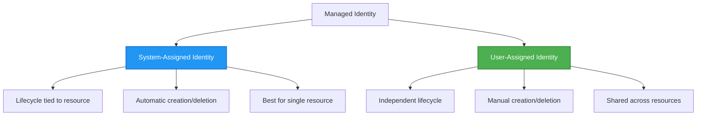

# Authenticatiepatronen en Beheerde Identiteit

⏱️ **Geschatte Tijd**: 45-60 minuten lezen; reken extra tijd om oefeningen te integreren | 💰 **Kostimpact**: Identity/RBAC zijn gratis; gedeployde compute, opslag en Key Vault zijn factureerbaar | ⭐ **Complexiteit**: Gemiddeld

> Beoordeeld tegen `azd 1.37.2` (november 2026). Deze les bevat **illustratieve integratiefragmenten, geen complete downloadbare `secure-app`-template**. Maak de genoemde bestanden aan, zorg voor bijpassende infrastructuur en vervang tijdelijke aanduidingen voor deployment. Er zijn geen Azure-resources geprovisioneerd tijdens de beoordeling.

**📚 Leerpad:**
- ← Vorige: [Configuratiebeheer](configuration.md) - Beheren van omgevingsvariabelen en geheimen
- 🎯 **Je bent hier**: Authenticatie & Beveiliging (Beheerde Identiteit, Key Vault, veilige patronen)
- → Volgende: [Infrastructure as Code](../chapter-04-infrastructure/README.md) - Resources provisioneren en deployen
- 🏠 [Cursus Startpagina](../../README.md)

---

## Wat je zult leren

Door deze les te voltooien, zul je:
- Azure authenticatiepatronen begrijpen (sleutels, verbindingsreeksen, beheerde identiteit)
- **Beheerde Identiteit** implementeren voor wachtwoordloze authenticatie
- Geheimen beveiligen met **Azure Key Vault** integratie
- **Rolgebaseerde toegangscontrole (RBAC)** configureren voor AZD-deployments
- Beveiligingsbest practices toepassen in Container Apps en Azure services
- Migreren van sleutelgebaseerde naar identiteit-gebaseerde authenticatie

## Waarom Beheerde Identiteit belangrijk is

### Het Probleem: Traditionele Authenticatie

**Voor Beheerde Identiteit:**
```javascript
// ❌ SECURITY RISK: Hardcoded secrets in code
const connectionString = "Server=mydb.database.windows.net;User=admin;Password=P@ssw0rd123";
const storageKey = "xK7mN9pQ2wR5tY8uI0oP3aS6dF1gH4jK...";
const cosmosKey = "C2x7B9n4M1p8Q5w3E6r0T2y5U8i1O4p7...";
```

**Problemen:**
- 🔴 **Blootgestelde geheimen** in code, configuratiebestanden, omgevingsvariabelen
- 🔴 **Wisseling van referenties** vereist codewijzigingen en heruitrol
- 🔴 **Auditproblemen** - wie had waar en wanneer toegang?
- 🔴 **Verspreiding** - geheimen verspreid over meerdere systemen
- 🔴 **Compliance risico's** - faalt beveiligingsaudits

### De Oplossing: Beheerde Identiteit

**Na Beheerde Identiteit:**
```javascript
// ✅ SECURE: No secrets in code
const credential = new DefaultAzureCredential();
const client = new BlobServiceClient(
  "https://mystorageaccount.blob.core.windows.net",
  credential  // Azure automatically handles authentication
);
```

**Voordelen:**
- ✅ **Geen geheimen** in code of configuratie
- ✅ **Automatische rotatie** - Azure regelt dit
- ✅ **Volledige audit trail** in Microsoft Entra ID logs
- ✅ **Gecentraliseerde beveiliging** - beheer via Azure Portal
- ✅ **Compliance gereed** - voldoet aan beveiligingsnormen

**Analogie**: Traditionele authenticatie is als het dragen van meerdere fysieke sleutels voor verschillende deuren. Beheerde Identiteit is als een beveiligingspas die automatisch toegang verleent op basis van wie je bent—geen sleutels die verloren raken, gekopieerd of geroteerd hoeven te worden.

---

## Architectuur Overzicht

### Authenticatieflow met Beheerde Identiteit

```mermaid
sequenceDiagram
    participant App as Your Application<br/>(Container App)
    participant MI as Managed Identity<br/>(Microsoft Entra ID)
    participant KV as Key Vault
    participant Storage as Azure Storage
    participant DB as Azure SQL
    
    App->>MI: Request access token<br/>(automatic)
    MI->>MI: Verify identity<br/>(no password needed)
    MI-->>App: Return token for requested audience<br/>(lifetime varies)
    
    App->>KV: Get secret<br/>(using token)
    KV->>KV: Check RBAC permissions
    KV-->>App: Return secret value
    
    App->>Storage: Upload blob<br/>(using token)
    Storage->>Storage: Check RBAC permissions
    Storage-->>App: Success
    
    App->>DB: Query data<br/>(using token)
    DB->>DB: Check SQL permissions
    DB-->>App: Return results
    
    Note over App,DB: Request a separate token for each service audience;<br/>SDK credentials handle caching and renewal
```

### Types Beheerde Identiteiten



| Kenmerk | Systeem-toegewezen | Gebruiker-toegewezen |
|---------|----------------|---------------|
| **Levenscyclus** | Verbonden aan resource | Onafhankelijk |
| **Creatie** | Automatisch met resource | Handmatig aanmaken |
| **Verwijdering** | Verwijderd met resource | Blijft na verwijderen resource |
| **Delen** | Eén resource alleen | Meerdere resources |
| **Toepassing** | Simpele scenario’s | Complexe multi-resource scenario’s |
| **Template-keuze** | Gedefinieerd in infrastructuur | Gedefinieerd in infrastructuur |

---

## Vereisten

### Vereiste Hulpmiddelen

Je zou deze al geïnstalleerd moeten hebben vanuit eerdere lessen:

```bash
# Verify Azure Developer CLI
azd version
# ✅ Expected: azd version 1.0.0 or higher

# Verify Azure CLI
az --version
# ✅ Expected: azure-cli 2.50.0 or higher
```

### Azure Vereisten

- Actief Azure abonnement
- Machtigingen om:
  - Beheerde identiteiten aan te maken
  - RBAC-rollen toe te wijzen
  - Key Vault resources te creëren
  - Container Apps te deployen

### Kennisvereisten

Je zou afgerond moeten hebben:
- [Installatiehandleiding](../chapter-01-foundation/installation.md) - AZD setup
- [AZD Basisprincipes](../chapter-01-foundation/azd-basics.md) - Kernconcepten
- [Configuratiebeheer](configuration.md) - Omgevingsvariabelen

---

## Les 1: Authenticatiepatronen Begrijpen

### Patroon 1: Verbindingsreeksen (Legacy - Vermijd)

**Hoe het werkt:**
```bash
# Connection string contains credentials
STORAGE_CONNECTION_STRING="DefaultEndpointsProtocol=https;AccountName=myaccount;AccountKey=xK7mN9pQ2wR5..."
COSMOS_CONNECTION_STRING="AccountEndpoint=https://myaccount.documents.azure.com:443/;AccountKey=C2x7..."
SQL_CONNECTION_STRING="Server=myserver.database.windows.net;User=admin;Password=P@ssw0rd..."
```

**Problemen:**
- ❌ Geheimen zichtbaar in omgevingsvariabelen
- ❌ Gelogd in deploysystemen
- ❌ Moeilijk te roteren
- ❌ Geen audit trail van toegang

**Wanneer gebruiken:** Wanneer de doeldienst sleutel-gebaseerde authenticatie vereist. Gebruik identiteit waar ondersteund; anders bewaar sleutels veilig en roteer ze, ook in productie.

---

### Patroon 2: Key Vault Referenties (Beter)

**Hoe het werkt:**
**Gedeeltelijke Bicep-fragmenten:** vereiste vault-velden, Container App identiteit, en de `configuration.secrets` invoer zijn weggelaten. `secretRef` benoemt een Container App geheim; dit is **zelf geen** Key Vault-URI. Om Key Vault te gebruiken, definieer dat benoemde geheim met `keyVaultUrl` en een geautoriseerde `identity`.

```bicep
// Store secret in Key Vault
resource keyVault 'Microsoft.KeyVault/vaults@2023-02-01' = {
  name: 'mykv'
  properties: {
    enableRbacAuthorization: true
  }
}

// Reference in Container App
env: [
  {
    name: 'STORAGE_KEY'
    secretRef: 'storage-key'  // References Key Vault
  }
]
```

**Voordelen:**
- ✅ Geheimen veilig opgeslagen in Key Vault
- ✅ Gecentraliseerd geheimbeheer
- ✅ Rotatie zonder codewijzigingen

**Beperkingen:**
- ⚠️ Nog steeds gebruik van sleutels/wachtwoorden
- ⚠️ Toegang tot Key Vault moet beheerd worden

**Wanneer gebruiken:** Overstapstap van verbindingsreeksen naar beheerde identiteit.

---

### Patroon 3: Beheerde Identiteit (Best Practice)

**Hoe het werkt:**
**Gedeeltelijke Bicep:** voeg het identiteitblok samen in een complete Container App en lever `storageAccount` en de roldefinitie aan. Een roltoewijzing vereist ook een deterministische `name`.

```bicep
// Enable managed identity
resource containerApp 'Microsoft.App/containerApps@2023-05-01' = {
  name: 'myapp'
  identity: {
    type: 'SystemAssigned'  // Automatically creates identity
  }
}

// Grant permissions
resource roleAssignment 'Microsoft.Authorization/roleAssignments@2022-04-01' = {
  name: guid(storageAccount.id, containerApp.id, storageBlobDataContributorRole)
  scope: storageAccount
  properties: {
    roleDefinitionId: storageBlobDataContributorRole
    principalId: containerApp.identity.principalId
    principalType: 'ServicePrincipal'
  }
}
```

**Applicatiecode:**
```javascript
// No secrets needed!
const { DefaultAzureCredential } = require('@azure/identity');
const { BlobServiceClient } = require('@azure/storage-blob');

const credential = new DefaultAzureCredential();
const blobServiceClient = new BlobServiceClient(
  'https://mystorageaccount.blob.core.windows.net',
  credential
);
```

**Voordelen:**
- ✅ Geen geheimen in code/configuratie
- ✅ Automatische wisseling van referenties
- ✅ Volledige audit trail
- ✅ RBAC-gebaseerde machtigingen
- ✅ Compliance gereed

**Wanneer gebruiken:** Voorkeur voor Azure-gehoste applicaties die toegang nodig hebben tot services die Microsoft Entra authenticatie ondersteunen.

---

### Patroon 4: Service Principals (CI/CD & Automatisering)

Beheerde identiteit is de gouden standaard *voor resources binnen Azure*. Maar hoe zit het met dingen buiten **Azure**—zoals een CI/CD-pijplijn op een build-agent, of een script op je laptop dat je interactieve login niet kan gebruiken? Daarvoor is een **service principal**: een niet-menselijke identiteit met eigen referenties waar een geautomatiseerd proces mee kan inloggen.

**Hoe het werkt:**

Maak een service principal aan binnen een resourcegroep (minimale rechten):

```bash
az ad sp create-for-rbac \
  --name "myapp-cicd" \
  --role contributor \
  --scopes "/subscriptions/<sub-id>/resourceGroups/<rg-name>"
```

Dit print een client-ID, client secret en tenant-ID. azd kan hiernaast non-interactief inloggen:

```bash
azd auth login \
  --client-id "<appId>" \
  --client-secret "<password>" \
  --tenant-id "<tenant>"
```

**Geef de voorkeur aan federated credentials (OIDC) boven geheimen.** In plaats van een langlevend client secret, configureer een federated credential zodat de pijplijn een kortlevend token uitwisselt—geen geheim om te lekken of roteren:

```bash
azd auth login \
  --client-id "<appId>" \
  --federated-credential-provider "github" \
  --tenant-id "<tenant>"
```

> `azd pipeline config` stelt dit automatisch voor je in. Zie de CI/CD walkthroughs in [Hoofdstuk 8](../chapter-08-production/production-ai-practices.md).

**Voordelen:**
- ✅ Werkt buiten Azure (build-agents, on-premise, andere clouds)
- ✅ Kan gescoord worden op één resourcegroep met één rol
- ✅ Federated (OIDC) variant gebruikt geen opgeslagen geheim

**Nadelen:**
- ⚠️ Geheim-gebaseerde variant vereist zorgvuldige opslag en rotatie
- ⚠️ Een gelekt geheim geeft SP volledige rechten—houd scopes klein

**Wanneer gebruiken:** CI/CD pipelines en automatisering die geen beheerde identiteit kunnen gebruiken. Gebruik altijd de **gefedereerde/OIDC** variant boven een client secret, en gebruik beheerde identiteit waar mogelijk binnen Azure.

**Referenties veilig opslaan:**
- Nooit geheimen commiten—gebruik de geheime opslag van je pipeline (GitHub Actions secrets, Azure DevOps variabele groepen / Key Vault).
- Scope de SP naar de kleinste rol en resourcegroep die het nodig heeft.
- Stel een vervaldatum in en roteer, of elimineer het geheim geheel met OIDC.

---

## Les 2: Beheerde Identiteit implementeren met AZD

### Stapsgewijze Implementatie

De volgende fragmenten laten zien hoe je beheerde identiteit integreert in een Container App project. Ze zijn **geen kant-en-klaar startpunt**: de Storage-module, volledige beheerde omgeving/registry infrastructuur, Dockerfile en parameterbestand zijn hier niet allemaal geleverd. Begin met een werkend Container Apps-template en voeg deze patronen toe, met behoud van de registry-configuratie en servicetags.

### Projectstructuur

```
secure-app/
├── azure.yaml                 # AZD configuration
├── infra/
│   ├── main.bicep            # Main infrastructure
│   ├── core/
│   │   ├── identity.bicep    # Managed identity setup
│   │   ├── keyvault.bicep    # Key Vault configuration
│   │   └── storage.bicep     # Storage with RBAC
│   └── app/
│       └── container-app.bicep
└── src/
    ├── app.js                # Application code
    ├── package.json
    └── Dockerfile
```

### 1. Configureer AZD (azure.yaml)

```yaml
name: secure-app
metadata:
  template: secure-app@1.0.0

services:
  api:
    project: ./src
    language: js
    host: containerapp

# Managed identity must be enabled in the infrastructure, not by this YAML.
```

### 2. Infrastructuur: Schakel Beheerde Identiteit in

**Bestand: `infra/main.bicep`**

```bicep
targetScope = 'subscription'

param environmentName string
param location string = 'eastus'
param containerAppsEnvironmentId string
param containerImage string

var tags = { 'azd-env-name': environmentName }

// Resource group
resource rg 'Microsoft.Resources/resourceGroups@2021-04-01' = {
  name: 'rg-${environmentName}'
  location: location
  tags: tags
}

// Storage Account
module storage './core/storage.bicep' = {
  name: 'storage'
  scope: rg
  params: {
    name: 'st${uniqueString(rg.id)}'
    location: location
    tags: tags
  }
}

// Key Vault
module keyVault './core/keyvault.bicep' = {
  name: 'keyvault'
  scope: rg
  params: {
    name: 'kv-${uniqueString(rg.id)}'
    location: location
    tags: tags
  }
}

// Container App with Managed Identity
module containerApp './app/container-app.bicep' = {
  name: 'container-app'
  scope: rg
  params: {
    name: 'ca-${environmentName}'
    location: location
    tags: tags
    storageAccountName: storage.outputs.name
    keyVaultName: keyVault.outputs.name
    containerAppsEnvironmentId: containerAppsEnvironmentId
    containerImage: containerImage
  }
}

// Grant Container App access to Storage
module storageRoleAssignment './core/role-assignment.bicep' = {
  name: 'storage-role'
  scope: rg
  params: {
    principalId: containerApp.outputs.identityPrincipalId
    roleDefinitionId: 'ba92f5b4-2d11-453d-a403-e96b0029c9fe'  // Storage Blob Data Contributor
    targetResourceType: 'storage'
    targetResourceName: storage.outputs.name
  }
}

// Grant Container App access to Key Vault
module kvRoleAssignment './core/role-assignment.bicep' = {
  name: 'kv-role'
  scope: rg
  params: {
    principalId: containerApp.outputs.identityPrincipalId
    roleDefinitionId: '4633458b-17de-408a-b874-0445c86b69e6'  // Key Vault Secrets User
    targetResourceType: 'keyvault'
    targetResourceName: keyVault.outputs.name
  }
}

// Outputs
output AZURE_STORAGE_ACCOUNT_NAME string = storage.outputs.name
output AZURE_KEY_VAULT_NAME string = keyVault.outputs.name
output APP_URL string = containerApp.outputs.url
```

### 3. Container App met Systeem-Toegewezen Identiteit

**Bestand: `infra/app/container-app.bicep`**

```bicep
param name string
param location string
param tags object = {}
param storageAccountName string
param keyVaultName string
param containerAppsEnvironmentId string
param containerImage string

resource containerApp 'Microsoft.App/containerApps@2023-05-01' = {
  name: name
  location: location
  tags: union(tags, { 'azd-service-name': 'api' })
  identity: {
    type: 'SystemAssigned'  // 🔑 Enable managed identity
  }
  properties: {
    managedEnvironmentId: containerAppsEnvironmentId
    configuration: {
      ingress: {
        external: true
        targetPort: 3000
      }
    }
    template: {
      containers: [
        {
          name: 'api'
          image: containerImage // Must exist; configure registry credentials for private images
          resources: {
            cpu: json('0.5')
            memory: '1Gi'
          }
          env: [
            {
              name: 'AZURE_STORAGE_ACCOUNT_NAME'
              value: storageAccountName
            }
            {
              name: 'AZURE_KEY_VAULT_NAME'
              value: keyVaultName
            }
            // 🔑 No secrets - managed identity handles authentication!
          ]
        }
      ]
    }
  }
}

// Output the identity for RBAC assignments
output identityPrincipalId string = containerApp.identity.principalId
output id string = containerApp.id
output url string = 'https://${containerApp.properties.configuration.ingress.fqdn}'
```

### 4. RBAC Roltoewijzingsmodule

**Bestand: `infra/core/role-assignment.bicep`**

```bicep
param principalId string
param roleDefinitionId string  // Azure built-in role ID
@allowed(['storage', 'keyvault'])
param targetResourceType string
param targetResourceName string

// Typed existing resources give Bicep a valid resource scope, not a string ID.
resource storageTarget 'Microsoft.Storage/storageAccounts@2023-01-01' existing = {
  name: targetResourceName
}
resource vaultTarget 'Microsoft.KeyVault/vaults@2023-02-01' existing = {
  name: targetResourceName
}

resource storageAssignment 'Microsoft.Authorization/roleAssignments@2022-04-01' = if (targetResourceType == 'storage') {
  name: guid(storageTarget.id, principalId, roleDefinitionId)
  scope: storageTarget
  properties: {
    roleDefinitionId: subscriptionResourceId('Microsoft.Authorization/roleDefinitions', roleDefinitionId)
    principalId: principalId
    principalType: 'ServicePrincipal'
  }
}

resource vaultAssignment 'Microsoft.Authorization/roleAssignments@2022-04-01' = if (targetResourceType == 'keyvault') {
  name: guid(vaultTarget.id, principalId, roleDefinitionId)
  scope: vaultTarget
  properties: {
    roleDefinitionId: subscriptionResourceId('Microsoft.Authorization/roleDefinitions', roleDefinitionId)
    principalId: principalId
    principalType: 'ServicePrincipal'
  }
}

// This module assigns at the target resource scope, not the whole resource group.
```

### 5. Applicatiecode met Beheerde Identiteit

**Bestand: `src/app.js`**

```javascript
const express = require('express');
const { DefaultAzureCredential } = require('@azure/identity');
const { BlobServiceClient } = require('@azure/storage-blob');
const { SecretClient } = require('@azure/keyvault-secrets');

const app = express();
const PORT = process.env.PORT || 3000;

// 🔑 Initialize credential (works automatically with managed identity)
const credential = new DefaultAzureCredential();

// Azure Storage setup
const storageAccountName = process.env.AZURE_STORAGE_ACCOUNT_NAME;
const blobServiceClient = new BlobServiceClient(
  `https://${storageAccountName}.blob.core.windows.net`,
  credential  // No keys needed!
);

// Key Vault setup
const keyVaultName = process.env.AZURE_KEY_VAULT_NAME;
const secretClient = new SecretClient(
  `https://${keyVaultName}.vault.azure.net`,
  credential  // No keys needed!
);

// Health check
app.get('/health', (req, res) => {
  res.json({ status: 'healthy', authentication: 'managed-identity' });
});

// Upload file to blob storage
app.post('/upload', async (req, res) => {
  try {
    const containerClient = blobServiceClient.getContainerClient('uploads');
    await containerClient.createIfNotExists();
    
    const blobName = `file-${Date.now()}.txt`;
    const blockBlobClient = containerClient.getBlockBlobClient(blobName);
    
    const content = 'Hello from managed identity!';
    await blockBlobClient.upload(content, Buffer.byteLength(content));
    
    res.json({
      success: true,
      blobName: blobName,
      message: 'File uploaded using managed identity!'
    });
  } catch (error) {
    console.error('Upload error:', error);
    res.status(500).json({ error: error.message });
  }
});

// Get secret from Key Vault
app.get('/secret/:name', async (req, res) => {
  try {
    const secretName = req.params.name;
    const secret = await secretClient.getSecret(secretName);
    
    res.json({
      name: secretName,
      retrieved: secret.value !== undefined, // Never return the secret value to callers
      message: 'Secret retrieved using managed identity!'
    });
  } catch (error) {
    console.error('Secret error:', error);
    res.status(500).json({ error: error.message });
  }
});

// List blob containers (demonstrates read access)
app.get('/containers', async (req, res) => {
  try {
    const containers = [];
    for await (const container of blobServiceClient.listContainers()) {
      containers.push(container.name);
    }
    
    res.json({
      containers: containers,
      count: containers.length,
      message: 'Containers listed using managed identity!'
    });
  } catch (error) {
    console.error('List error:', error);
    res.status(500).json({ error: error.message });
  }
});

app.listen(PORT, () => {
  console.log(`Secure API listening on port ${PORT}`);
  console.log('Authentication: Managed Identity (passwordless)');
});
```

**Bestand: `src/package.json`**

```json
{
  "name": "secure-app",
  "version": "1.0.0",
  "dependencies": {
    "express": "^4.18.2",
    "@azure/identity": "^4.0.0",
    "@azure/storage-blob": "^12.17.0",
    "@azure/keyvault-secrets": "^4.7.0"
  },
  "scripts": {
    "start": "node app.js"
  }
}
```

### 6. Deploy en Test

Voer deze opdrachten alleen uit **na** het afronden van de ontbrekende infrastructuur, Dockerfile en bijpassende `main.parameters.json` in je eigen project. Authenticateer azd met `azd auth login`; log apart in met `az login` voor de Azure CLI-controles later. De getoonde endpoints zijn demonstraties en vereisen passende toegangscontroles voor openbaar gebruik.

```bash
# Initialize AZD environment
azd init

# Deploy infrastructure and application
azd up

# Get the app URL
APP_URL=$(azd env get-value APP_URL)

# Test health check
curl $APP_URL/health
```

**✅ Verwachte output:**
```json
{
  "status": "healthy",
  "authentication": "managed-identity"
}
```

**Test blob upload:**
```bash
curl -X POST $APP_URL/upload
```

**✅ Verwachte output:**
```json
{
  "success": true,
  "blobName": "file-1700404800000.txt",
  "message": "File uploaded using managed identity!"
}
```

**Test containerlijst:**
```bash
curl $APP_URL/containers
```

**✅ Verwachte output:**
```json
{
  "containers": ["uploads"],
  "count": 1,
  "message": "Containers listed using managed identity!"
}
```

---

## Veelvoorkomende Azure RBAC-rollen

### Ingebouwde Rol-ID's voor Beheerde Identiteit

| Service | Rolaam | Rol-ID | Machtigingen |
|---------|-----------|---------|-------------|
| **Storage** | Storage Blob Data Reader | `2a2b9908-6ea1-4ae2-8e65-a410df84e7d1` | Blob- en container lezen |
| **Storage** | Storage Blob Data Contributor | `ba92f5b4-2d11-453d-a403-e96b0029c9fe` | Blob lezen, schrijven, verwijderen |
| **Storage** | Storage Queue Data Contributor | `974c5e8b-45b9-4653-ba55-5f855dd0fb88` | Queue/berichten lezen, schrijven, verwijderen |
| **Key Vault** | Key Vault Secrets User | `4633458b-17de-408a-b874-0445c86b69e6` | Geheimen lezen |
| **Key Vault** | Key Vault Secrets Officer | `b86a8fe4-44ce-4948-aee5-eccb2c155cd7` | Geheimen lezen, schrijven, verwijderen |
| **Cosmos DB** | Cosmos DB Build-in Data Reader | `00000000-0000-0000-0000-000000000001` | Cosmos DB data lezen |
| **Cosmos DB** | Cosmos DB Build-in Data Contributor | `00000000-0000-0000-0000-000000000002` | Cosmos DB data lezen, schrijven |
| **SQL Database** | SQL DB Contributor | `9b7fa17d-e63e-47b0-bb0a-15c516ac86ec` | Database resources beheren; geen toegang tot SQL data |
| **Service Bus** | Azure Service Bus Data Owner | `090c5cfd-751d-490a-894a-3ce6f1109419` | Bericht verzenden, ontvangen, beheren |

### Hoe rol-ID's te vinden

Cosmos DB voor NoSQL’s twee IDs hierboven zijn **native Cosmos data-plane roldefinities**, geen Azure RBAC abonnement rol-ID's. Wijs ze toe met `az cosmosdb sql role assignment create` (of `Microsoft.DocumentDB/databaseAccounts/sqlRoleAssignments`), niet `az role assignment create`. SQL data toegang vereist een Entra databasegebruiker en SQL-machtigingen.

```bash
# List all built-in roles
az role definition list --query "[].{Name:roleName, ID:name}" --output table

# Search for specific role
az role definition list --query "[?contains(roleName, 'Storage Blob')].{Name:roleName, ID:name}" --output table

# Get role details
az role definition list --name "Storage Blob Data Contributor"
```

---

## Praktische Oefeningen

**Integratievereisten voor alle drie oefeningen:** een werkend Container App-template in je eigen project, bijpassende Bicep-resources, Azure CLI/azd aanmelding en bevoegdheid om benodigde rollen toe te wijzen. Dit zijn begeleide aanpassingen, geen standalone lokale starters; vervang de voorbeeldresourcenaam door je eigen gedeployde namen.

### Oefening 1: Beheerde Identiteit inschakelen voor Bestaande App ⭐⭐ (Middelmatig)

**Doel**: Beheerde identiteit toevoegen aan een bestaande Container App deployment

**Scenario**: Je hebt een Container App die verbindingsreeksen gebruikt. Zet die om naar beheerde identiteit.

**Beginpunt**: Container App met deze configuratie:

```bicep
// ❌ Current: Using connection string
env: [
  {
    name: 'STORAGE_CONNECTION_STRING'
    secretRef: 'storage-connection'
  }
]
```

**Stappen**:

1. **Beheerde identiteit inschakelen in Bicep:**

```bicep
resource containerApp 'Microsoft.App/containerApps@2023-05-01' = {
  name: 'myapp'
  identity: {
    type: 'SystemAssigned'  // Add this
  }
  // ... rest of configuration
}
```

2. **Toegang Storage toewijzen:**

```bicep
// Get storage account reference
resource storageAccount 'Microsoft.Storage/storageAccounts@2023-01-01' existing = {
  name: storageAccountName
}

// Assign role
resource roleAssignment 'Microsoft.Authorization/roleAssignments@2022-04-01' = {
  name: guid(containerApp.id, 'ba92f5b4-2d11-453d-a403-e96b0029c9fe', storageAccount.id)
  scope: storageAccount
  properties: {
    roleDefinitionId: subscriptionResourceId('Microsoft.Authorization/roleDefinitions', 'ba92f5b4-2d11-453d-a403-e96b0029c9fe')
    principalId: containerApp.identity.principalId
    principalType: 'ServicePrincipal'
  }
}
```

3. **Applicatiecode bijwerken:**

**Voorheen (verbindingsreeks):**
```javascript
const { BlobServiceClient } = require('@azure/storage-blob');

const blobServiceClient = BlobServiceClient.fromConnectionString(
  process.env.STORAGE_CONNECTION_STRING
);
```

**Hierna (beheerde identiteit):**
```javascript
const { DefaultAzureCredential } = require('@azure/identity');
const { BlobServiceClient } = require('@azure/storage-blob');

const credential = new DefaultAzureCredential();
const blobServiceClient = new BlobServiceClient(
  `https://${process.env.STORAGE_ACCOUNT_NAME}.blob.core.windows.net`,
  credential
);
```

4. **Omgevingsvariabelen bijwerken:**

```bicep
env: [
  {
    name: 'STORAGE_ACCOUNT_NAME'
    value: storageAccountName  // Just the name, no secrets!
  }
  // Remove STORAGE_CONNECTION_STRING
]
```

5. **Deploy en test:**

```bash
# Redeploy
azd up

# Test that it still works
APP_URL=$(azd show --output json | jq -er '.services.api.ingressUrl')
curl --fail -X POST "$APP_URL/upload"
```

**✅ Succescriteria:**
- ✅ Applicatie wordt zonder fouten gedeployed
- ✅ Storage-bewerkingen werken (upload, lijst, download)
- ✅ Geen verbindingsreeksen in omgevingsvariabelen
- ✅ Identiteit zichtbaar in Azure Portal onder "Identiteit"-tabblad

**Verificatie:**

```bash
# Check managed identity is enabled
az containerapp show \
  --name myapp \
  --resource-group rg-myapp \
  --query "identity.type"
# ✅ Expected: "SystemAssigned"

# Check role assignment
az role assignment list \
  --assignee $(az containerapp show --name myapp --resource-group rg-myapp --query "identity.principalId" -o tsv) \
  --scope /subscriptions/{sub-id}/resourceGroups/rg-myapp/providers/Microsoft.Storage/storageAccounts/mystorageaccount
# ✅ Expected: Shows "Storage Blob Data Contributor" role
```

**Tijd**: 20-30 minuten

---

### Oefening 2: Multi-Service Toegang met Gebruiker-Toegewezen Identiteit ⭐⭐⭐ (Geavanceerd)

**Doel**: Maak een gebruiker-toegewezen identiteit die gedeeld wordt door meerdere Container Apps

**Scenario**: Je hebt 3 microservices die allemaal toegang nodig hebben tot dezelfde Storage-account en Key Vault.

**Stappen**:

1. **Maak gebruiker-toegewezen identiteit aan:**

**Bestand: `infra/core/identity.bicep`**

```bicep
param name string
param location string
param tags object = {}

resource userAssignedIdentity 'Microsoft.ManagedIdentity/userAssignedIdentities@2023-01-31' = {
  name: name
  location: location
  tags: tags
}

output id string = userAssignedIdentity.id
output principalId string = userAssignedIdentity.properties.principalId
output clientId string = userAssignedIdentity.properties.clientId
```

2. **Ken rollen toe aan gebruiker-toegewezen identiteit:**

```bicep
// In main.bicep
module userIdentity './core/identity.bicep' = {
  name: 'user-identity'
  scope: rg
  params: {
    name: 'id-${environmentName}'
    location: location
    tags: tags
  }
}

// Grant Storage access
resource storageRoleAssignment 'Microsoft.Authorization/roleAssignments@2022-04-01' = {
  name: guid(storageAccount.id, environmentName, 'storage-contributor')
  scope: storageAccount
  properties: {
    roleDefinitionId: subscriptionResourceId('Microsoft.Authorization/roleDefinitions', 'ba92f5b4-2d11-453d-a403-e96b0029c9fe')
    principalId: userIdentity.outputs.principalId
    principalType: 'ServicePrincipal'
  }
}

// Grant Key Vault access
resource kvRoleAssignment 'Microsoft.Authorization/roleAssignments@2022-04-01' = {
  name: guid(keyVault.id, environmentName, 'kv-secrets-user')
  scope: keyVault
  properties: {
    roleDefinitionId: subscriptionResourceId('Microsoft.Authorization/roleDefinitions', '4633458b-17de-408a-b874-0445c86b69e6')
    principalId: userIdentity.outputs.principalId
    principalType: 'ServicePrincipal'
  }
}
```

3. **Wijs identiteit toe aan meerdere Container Apps:**

```bicep
resource apiGateway 'Microsoft.App/containerApps@2023-05-01' = {
  name: 'api-gateway'
  identity: {
    type: 'UserAssigned'
    userAssignedIdentities: {
      '${userIdentity.outputs.id}': {}
    }
  }
  // ... rest of config
}

resource productService 'Microsoft.App/containerApps@2023-05-01' = {
  name: 'product-service'
  identity: {
    type: 'UserAssigned'
    userAssignedIdentities: {
      '${userIdentity.outputs.id}': {}
    }
  }
  // ... rest of config
}

resource orderService 'Microsoft.App/containerApps@2023-05-01' = {
  name: 'order-service'
  identity: {
    type: 'UserAssigned'
    userAssignedIdentities: {
      '${userIdentity.outputs.id}': {}
    }
  }
  // ... rest of config
}
```

4. **Applicatiecode (alle services gebruiken hetzelfde patroon):**

```javascript
const { ManagedIdentityCredential } = require('@azure/identity');
const { BlobServiceClient } = require('@azure/storage-blob');

// For user-assigned identity, specify the client ID
const credential = new ManagedIdentityCredential(
  process.env.AZURE_CLIENT_ID  // User-assigned identity client ID
);

// Alternative (choose ONE credential declaration):
// const { DefaultAzureCredential } = require('@azure/identity');
// const credential = new DefaultAzureCredential({
//   managedIdentityClientId: process.env.AZURE_CLIENT_ID
// });

const blobServiceClient = new BlobServiceClient(
  `https://${process.env.STORAGE_ACCOUNT_NAME}.blob.core.windows.net`,
  credential
);
```

Stel de runtime `AZURE_CLIENT_ID` van elke Container App in op `userIdentity.outputs.clientId` en `STORAGE_ACCOUNT_NAME` op jouw opslagnaam in Bicep. Alleen de identiteit toewijzen of `azd env set` uitvoeren configureert deze runtime waarden niet.

5. **Implementeer en verifieer:**

```bash
azd up

# Test all services can access storage
# Replace with the actual ingress URLs reported for your three services
curl --fail -X POST "$API_GATEWAY_URL/upload"
curl --fail -X POST "$PRODUCT_SERVICE_URL/upload"
curl --fail -X POST "$ORDER_SERVICE_URL/upload"
```

**✅ Succescriteria:**
- ✅ Eén identiteit gedeeld over 3 services
- ✅ Alle services hebben toegang tot Storage en Key Vault
- ✅ Identiteit blijft bestaan als je één service verwijdert
- ✅ Gecentraliseerd permissiebeheer

**Voordelen van User-Assigned Identity:**
- Één enkele identiteit om te beheren
- Consistente permissies over services heen
- Blijft bestaan na verwijderen van service
- Beter voor complexe architecturen

**Tijd**: 30-40 minuten

---

### Oefening 3: Implementeer Key Vault Secret Rotatie ⭐⭐⭐ (Geavanceerd)

**Doel**: Sla API-sleutels van derden op in Key Vault en krijg toegang tot deze met managed identity

**Scenario**: Je app moet een externe API oproepen (OpenAI, Stripe, SendGrid) die API-sleutels vereist.

**Stappen**:

1. **Maak Key Vault met RBAC aan:**

**Bestand: `infra/core/keyvault.bicep`**

```bicep
param name string
param location string
param tags object = {}

resource keyVault 'Microsoft.KeyVault/vaults@2023-02-01' = {
  name: name
  location: location
  tags: tags
  properties: {
    enableRbacAuthorization: true  // Use RBAC instead of access policies
    sku: {
      family: 'A'
      name: 'standard'
    }
    tenantId: subscription().tenantId
    enableSoftDelete: true
    softDeleteRetentionInDays: 90
  }
}

// Allow Container App to read secrets
output id string = keyVault.id
output name string = keyVault.name
output uri string = keyVault.properties.vaultUri
```

2. **Sla geheimen op in Key Vault:**

```bash
# Get Key Vault name
KV_NAME=$(azd env get-value AZURE_KEY_VAULT_NAME)

# Store third-party API keys
az keyvault secret set \
  --vault-name $KV_NAME \
  --name "OpenAI-ApiKey" \
  --value "sk-proj-xxxxxxxxxxxxx"

az keyvault secret set \
  --vault-name $KV_NAME \
  --name "Stripe-ApiKey" \
  --value "sk_live_xxxxxxxxxxxxx"

az keyvault secret set \
  --vault-name $KV_NAME \
  --name "SendGrid-ApiKey" \
  --value "SG.xxxxxxxxxxxxx"
```

3. **Applicatiecode om geheimen op te halen:**

**Bestand: `src/config.js`**

```javascript
const { DefaultAzureCredential } = require('@azure/identity');
const { SecretClient } = require('@azure/keyvault-secrets');

class Config {
  constructor() {
    this.credential = new DefaultAzureCredential();
    this.secretClient = new SecretClient(
      `https://${process.env.AZURE_KEY_VAULT_NAME}.vault.azure.net`,
      this.credential
    );
    this.cache = {};
  }

  async getSecret(secretName) {
    // Check cache first
    if (this.cache[secretName]) {
      return this.cache[secretName];
    }

    try {
      const secret = await this.secretClient.getSecret(secretName);
      this.cache[secretName] = secret.value;
      console.log(`✅ Retrieved secret: ${secretName}`);
      return secret.value;
    } catch (error) {
      console.error(`❌ Failed to get secret ${secretName}:`, error.message);
      throw error;
    }
  }

  async getOpenAIKey() {
    return this.getSecret('OpenAI-ApiKey');
  }

  async getStripeKey() {
    return this.getSecret('Stripe-ApiKey');
  }

  async getSendGridKey() {
    return this.getSecret('SendGrid-ApiKey');
  }
}

module.exports = new Config();
```

4. **Gebruik geheimen in de applicatie:**

**Bestand: `src/app.js`**

Dit **vervangende applicatiefragment** vereist `npm install openai`, een echte derde partij sleutel, een toegankelijke model en de infrastructuur uit je werkend project. Het roept OpenAI direct aan, niet een Azure OpenAI deployment. Plaatsvervanger-sleutels hieronder autoriseren geen verzoek.

```javascript
const express = require('express');
const config = require('./config');
const { OpenAI } = require('openai');

const app = express();

// Initialize OpenAI with key from Key Vault
let openaiClient;

async function initializeServices() {
  const openaiKey = await config.getOpenAIKey();
  openaiClient = new OpenAI({ apiKey: openaiKey });
  console.log('✅ Services initialized with secrets from Key Vault');
}

app.post('/chat', async (req, res) => {
  try {
    const completion = await openaiClient.chat.completions.create({
      model: 'gpt-4.1',
      messages: [{ role: 'user', content: 'Hello!' }]
    });
    
    res.json({
      response: completion.choices[0].message.content,
      authentication: 'Key from Key Vault via Managed Identity'
    });
  } catch (error) {
    res.status(500).json({ error: error.message });
  }
});

// Start listening only after initialization succeeds.
initializeServices().then(() => {
  app.listen(3000, () => console.log('Key Vault demo running'));
}).catch(error => {
  console.error('Initialization failed:', error.message);
  process.exitCode = 1;
});
```

5. **Implementeer en test:**

```bash
azd up

# Test that API keys work
curl -X POST https://myapp.azurecontainerapps.io/chat \
  -H "Content-Type: application/json" \
  -d '{"message":"Hello AI"}'
```

**✅ Succescriteria:**
- ✅ Geen API-sleutels in code of omgevingsvariabelen
- ✅ Applicatie haalt sleutels op uit Key Vault
- ✅ Derde partij API's werken correct
- ✅ Kan sleutels roteren zonder codewijzigingen

**Roteer een geheim:**

```bash
# Update secret in Key Vault
az keyvault secret set \
  --vault-name $KV_NAME \
  --name "OpenAI-ApiKey" \
  --value "sk-proj-NEW_KEY_HERE"

# Find the active revision name, then restart it to clear the in-process cache
az containerapp revision list --name myapp --resource-group rg-myapp --output table
az containerapp revision restart \
  --name myapp \
  --resource-group rg-myapp \
  --revision "<active-revision-name>"
```

**Tijd**: 25-35 minuten

---

## Kenniscontrolepunt

### 1. Authenticatiepatronen ✓

Test je begrip:

- [ ] **V1**: Wat zijn de drie belangrijkste authenticatiepatronen? 
  - **A**: Connection strings (verouderd), Key Vault-referenties (overgang), Managed Identity (beste)

- [ ] **V2**: Waarom is managed identity beter dan connection strings?
  - **A**: Geen geheimen in code, automatische rotatie, volledige audit trail, RBAC-permissies

- [ ] **V3**: Wanneer gebruik je user-assigned identity in plaats van system-assigned?
  - **A**: Wanneer je identiteit deelt over meerdere middelen of wanneer de levenscyclus van identiteit losstaat van de resource-levenscyclus

**Hands-on verificatie:**
```bash
# Check what type of identity your app uses
az containerapp show \
  --name myapp \
  --resource-group rg-myapp \
  --query "identity.type"

# List all role assignments for the identity
az role assignment list \
  --assignee $(az containerapp show --name myapp --resource-group rg-myapp --query "identity.principalId" -o tsv)
```

---

### 2. RBAC en Permissions ✓

Test je begrip:

- [ ] **V1**: Wat is de rol-ID voor "Storage Blob Data Contributor"?
  - **A**: `ba92f5b4-2d11-453d-a403-e96b0029c9fe`

- [ ] **V2**: Welke permissies levert "Key Vault Secrets User"?
  - **A**: Alleen-lezen toegang tot geheimen (kan niet maken, bijwerken of verwijderen)

- [ ] **V3**: Hoe geef je een Container App toegang tot Azure SQL?
  - **A**: Configureer Microsoft Entra authenticatie, maak de identiteit aan als databasegebruiker en verleen de benodigde SQL-permissies. "SQL DB Contributor" beheert alleen Azure-middelen; het autoriseert geen queries.

**Hands-on verificatie:**
```bash
# Find specific role
az role definition list --name "Storage Blob Data Contributor"

# Check what roles are assigned to your identity
PRINCIPAL_ID=$(az containerapp show --name myapp --resource-group rg-myapp --query "identity.principalId" -o tsv)
az role assignment list --assignee $PRINCIPAL_ID --output table
```

---

### 3. Key Vault Integratie ✓

Test je begrip:

- [ ] **V1**: Hoe schakel je RBAC in voor Key Vault in plaats van toegangspolicies?
  - **A**: Stel `enableRbacAuthorization: true` in in Bicep

- [ ] **V2**: Welke Azure SDK-bibliotheek behandelt managed identity authenticatie?
  - **A**: `@azure/identity` met `DefaultAzureCredential` klasse

- [ ] **V3**: Hoe lang blijven Key Vault geheimen in cache?
  - **A**: Afhankelijk van de applicatie; implementeer je eigen cachestrategie

**Hands-on verificatie:**
```bash
# Test Key Vault access
az keyvault secret show \
  --vault-name $KV_NAME \
  --name "OpenAI-ApiKey" \
  --query "{name:name,enabled:attributes.enabled}"

# Check RBAC is enabled
az keyvault show \
  --name $KV_NAME \
  --query "properties.enableRbacAuthorization"
# ✅ Expected: true
```

---

## Beste Beveiligingspraktijken

### ✅ WEL DOEN:

1. **Gebruik altijd managed identity in productie**
   ```bicep
   identity: {
     type: 'SystemAssigned'
   }
   ```

2. **Gebruik RBAC-rollen met minimaal privilege**
   - Gebruik "Reader"-rollen waar mogelijk
   - Vermijd "Owner" of "Contributor" tenzij noodzakelijk

3. **Sla sleutels van derden op in Key Vault**
   ```javascript
   const apiKey = await secretClient.getSecret('ThirdPartyApiKey');
   ```

4. **Schakel audit logging in** (gedeeltelijk resourcefragment; voeg samen met je vault en workspace declaraties)
   ```bicep
   resource vaultDiagnostics 'Microsoft.Insights/diagnosticSettings@2021-05-01-preview' = {
     name: 'vault-audit'
     scope: keyVault
     properties: {
       workspaceId: logAnalytics.id
       logs: [{ category: 'AuditEvent', enabled: true }]
     }
   }
   ```

5. **Gebruik verschillende identiteiten voor dev/staging/prod**
   ```bash
   azd env new dev
   azd env new staging
   azd env new prod
   ```

6. **Roteer geheimen regelmatig**
   - Stel vervaldatums in op Key Vault geheimen
   - Automatiseer rotatie met Azure Functions

### ❌ NIET DOEN:

1. **Nooit geheimen hardcoden**
   ```javascript
   // ❌ BAD
   const apiKey = "sk-proj-xxxxxxxxxxxxx";
   ```

2. **Gebruik geen connection strings in productie**
   ```javascript
   // ❌ BAD
   BlobServiceClient.fromConnectionString(process.env.STORAGE_CONNECTION_STRING)
   ```

3. **Verleen geen overmatige permissies**
   ```bicep
   // ❌ BAD - too much access
   roleDefinitionId: subscriptionResourceId('Microsoft.Authorization/roleDefinitions', '8e3af657-a8ff-443c-a75c-2fe8c4bcb635')
   
   // ✅ GOOD - least privilege
   roleDefinitionId: subscriptionResourceId('Microsoft.Authorization/roleDefinitions', '2a2b9908-6ea1-4ae2-8e65-a410df84e7d1')
   ```

4. **Registreer geen geheimen**
   ```javascript
   // ❌ BAD
   console.log('API Key:', apiKey);
   
   // ✅ GOOD
   console.log('API Key retrieved successfully');
   ```

5. **Deel geen productie-identiteiten over omgevingen**
   ```bicep
   // ❌ BAD - same identity for dev and prod
   // ✅ GOOD - separate identities per environment
   ```

---

## Probleemoplossingsgids

### Probleem: "Unauthorized" bij toegang tot Azure Storage

**Symptomen:**
```
Error: Unauthorized (403)
AuthorizationPermissionMismatch: This request is not authorized to perform this operation
```

**Diagnose:**

```bash
# Check if managed identity is enabled
az containerapp show \
  --name myapp \
  --resource-group rg-myapp \
  --query "identity.type"
# ✅ Expected: "SystemAssigned" or "UserAssigned"

# Check role assignments
PRINCIPAL_ID=$(az containerapp show --name myapp --resource-group rg-myapp --query "identity.principalId" -o tsv)
az role assignment list --assignee $PRINCIPAL_ID

# Expected: Should see "Storage Blob Data Contributor" or similar role
```

**Oplossingen:**

1. **Ken juiste RBAC-rol toe:**
```bash
STORAGE_ID=$(az storage account show --name mystorageaccount --resource-group rg-myapp --query "id" -o tsv)
az role assignment create \
  --assignee $PRINCIPAL_ID \
  --role "Storage Blob Data Contributor" \
  --scope $STORAGE_ID
```

2. **Wacht op propagatie (kan 5-10 minuten duren):**
```bash
# Check role assignment status
az role assignment list --assignee $PRINCIPAL_ID --scope $STORAGE_ID
```

3. **Verifieer dat applicatiecode de juiste referentie gebruikt:**
```javascript
// Make sure you're using DefaultAzureCredential
const credential = new DefaultAzureCredential();
```

---

### Probleem: Toegang tot Key Vault geweigerd

**Symptomen:**
```
Error: Forbidden (403)
The user, group or application does not have secrets get permission
```

**Diagnose:**

```bash
# Check Key Vault RBAC is enabled
az keyvault show \
  --name $KV_NAME \
  --query "properties.enableRbacAuthorization"
# ✅ Expected: true

# Check role assignments
az role assignment list \
  --assignee $PRINCIPAL_ID \
  --scope /subscriptions/{sub-id}/resourceGroups/rg-myapp/providers/Microsoft.KeyVault/vaults/$KV_NAME
```

**Oplossingen:**

1. **Schakel RBAC in op Key Vault:**
```bash
az keyvault update \
  --name $KV_NAME \
  --enable-rbac-authorization true
```

2. **Ken Key Vault Secrets User-rol toe:**
```bash
KV_ID=$(az keyvault show --name $KV_NAME --query "id" -o tsv)
az role assignment create \
  --assignee $PRINCIPAL_ID \
  --role "Key Vault Secrets User" \
  --scope $KV_ID
```

---

### Probleem: DefaultAzureCredential werkt niet lokaal

**Symptomen:**
```
Error: DefaultAzureCredential failed to retrieve a token
CredentialUnavailableError: No credential available
```

**Diagnose:**

```bash
# Check if you're logged in
az account show

# Check Azure CLI authentication
az ad signed-in-user show
```

**Oplossingen:**

1. **Log in bij Azure CLI:**
```bash
az login
```

2. **Stel Azure-abonnement in:**
```bash
az account set --subscription "Your Subscription Name"
```

3. **Gebruik voor lokale ontwikkeling omgevingsvariabelen:**
```bash
export AZURE_TENANT_ID="your-tenant-id"
export AZURE_CLIENT_ID="your-client-id"
export AZURE_CLIENT_SECRET="your-client-secret"
```

4. **Of gebruik lokaal een andere referentie:**
```javascript
const { DefaultAzureCredential, AzureCliCredential } = require('@azure/identity');

// Use AzureCliCredential for local dev
const credential = process.env.NODE_ENV === 'production' 
  ? new DefaultAzureCredential()
  : new AzureCliCredential();
```

---

### Probleem: Roltoewijzing duurt te lang om te propageren

**Symptomen:**
- Rol succesvol toegewezen
- Toch 403-fouten
- Intermitterende toegang (soms werkt het, soms niet)

**Uitleg:**
Azure RBAC-wijzigingen kunnen 5-10 minuten duren om wereldwijd te propagateren.

**Oplossing:**

```bash
# Wait and retry
echo "Waiting for RBAC propagation..."
sleep 300  # Wait 5 minutes

# Test access
curl --fail -X POST "$APP_URL/upload"

# If still failing, restart the app
az containerapp revision restart \
  --name myapp \
  --resource-group rg-myapp \
  --revision "<active-revision-name>"
```

---

## Kostenoverwegingen

### Kosten Managed Identity

| Resource | Kosten |
|----------|---------|
| **Managed Identity** | 🆓 **GRATIS** - Geen kosten |
| **RBAC-roltoewijzingen** | 🆓 **GRATIS** - Geen kosten |
| **Microsoft Entra ID Token-aanvragen** | 🆓 **GRATIS** - Inbegrepen |
| **Key Vault-bewerkingen** | $0,03 per 10.000 bewerkingen |
| **Key Vault geheugensopslag** | Check actuele prijzen; ga niet uit van maandelijkse opslagkosten per geheim |

**Managed identity bespaart geld door:**
- ✅ Elimineren van Key Vault-bewerkingen voor service-tot-service authenticatie
- ✅ Verminderen van beveiligingsincidenten (geen gelekte referenties)
- ✅ Verminderen van operationele overhead (geen handmatige rotatie)

Het aantal applicatieverzoeken is niet gelijk aan het aantal Key Vault-bewerkingen: caching- en rotatiepatronen bepalen de kosten voor geheimen-lezen. Identity verwijdert geen kosten voor compute/opslag. Controleer [Key Vault prijzen](https://azure.microsoft.com/pricing/details/key-vault/) en de Azure Prijscalculator voor jouw regio in plaats van maandelijkse besparingen af te leiden van alleen het aantal verzoeken.

---

## Leer Meer

### Officiële Documentatie
- [Azure Managed Identity](https://learn.microsoft.com/entra/identity/managed-identities-azure-resources/overview)
- [Azure RBAC](https://learn.microsoft.com/azure/role-based-access-control/overview)
- [Azure Key Vault](https://learn.microsoft.com/azure/key-vault/general/overview)
- [DefaultAzureCredential](https://learn.microsoft.com/dotnet/api/azure.identity.defaultazurecredential)

### SDK Documentatie
- [@azure/identity (Node.js)](https://www.npmjs.com/package/@azure/identity)
- [Azure.Identity (C#)](https://www.nuget.org/packages/Azure.Identity/)
- [azure-identity (Python)](https://pypi.org/project/azure-identity/)

### Volgende Stappen in Deze Cursus
- ← Vorige: [Configuratiebeheer](configuration.md)
- → Volgende: [Infrastructuur als Code](../chapter-04-infrastructure/README.md)
- 🏠 [Cursus Home](../../README.md)

### Gerelateerde Voorbeelden
- [Microsoft Foundry Models Chat Voorbeeld](../../../../examples/azure-openai-chat) - Gebruikt managed identity voor Microsoft Foundry Models
- [Microservices Voorbeeld](../../../../examples/microservices) - Multi-service authenticatiepatronen

---

## Samenvatting

**Je hebt geleerd:**
- ✅ Drie authenticatiepatronen (connection strings, Key Vault, managed identity)
- ✅ Hoe managed identity in te schakelen en te configureren in AZD
- ✅ RBAC roltoewijzingen voor Azure services
- ✅ Key Vault integratie voor geheimen van derden
- ✅ User-assigned versus system-assigned identiteiten
- ✅ Beveiligingsbest practices en probleemoplossing

**Belangrijkste punten:**
1. **Gebruik altijd managed identity in productie** - Geen geheimen, automatische rotatie
2. **Gebruik RBAC-rollen met minimaal privilege** - Verleen alleen noodzakelijke permissies
3. **Sla sleutels van derden op in Key Vault** - Gecentraliseerd geheimbeheer
4. **Gebruik aparte identiteiten per omgeving** - Isolatie voor dev, staging, prod
5. **Schakel audit logging in** - Volg wie wat heeft geraadpleegd

**Volgende stappen:**
1. Voltooi de praktische oefeningen hierboven
2. Migreer een bestaande app van connection strings naar managed identity
3. Herzie de beginnende implementatiestroom: [Eerste Project](../chapter-01-foundation/first-project.md)

---

<!-- CO-OP TRANSLATOR DISCLAIMER START -->
**Disclaimer**:
Dit document is vertaald met behulp van de AI vertaaldienst [Co-op Translator](https://github.com/Azure/co-op-translator). Hoewel we streven naar nauwkeurigheid, dient u er rekening mee te houden dat geautomatiseerde vertalingen fouten of onnauwkeurigheden kunnen bevatten. Het originele document in de oorspronkelijke taal moet worden beschouwd als de gezaghebbende bron. Voor kritieke informatie wordt professionele menselijke vertaling aanbevolen. Wij zijn niet aansprakelijk voor eventuele misverstanden of verkeerde interpretaties die voortvloeien uit het gebruik van deze vertaling.
<!-- CO-OP TRANSLATOR DISCLAIMER END -->