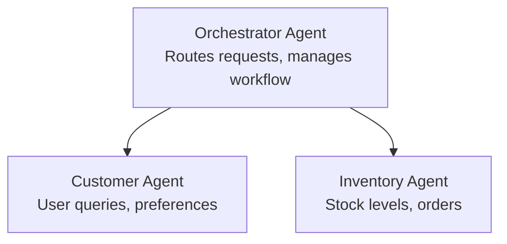

# Hoofdstuk 5: Multi-Agent AI Oplossingen

**📚 Cursus**: [AZD Voor Beginners](../../README.md) | **⏱️ Duur**: 2-3 uur | **⭐ Complexiteit**: Geavanceerd

---

## Overzicht

Dit hoofdstuk behandelt geavanceerde multi-agent architectuurpatronen, agentorchestratie en productieklare AI-implementaties voor complexe scenario's.

> Commandogeleiding beoordeeld aan de hand van de vrijgegeven `azd 1.37.2` referentie. Cloud-implementaties zijn niet uitgevoerd.

## Leerdoelen

Door dit hoofdstuk te voltooien, zult u:
- Multi-agent architectuurpatronen begrijpen
- Gecoördineerde AI-agenten systemen implementeren
- Agent-naar-agent communicatie implementeren
- Productieklare multi-agent oplossingen bouwen

---

## 📚 Lessen

| # | Les | Beschrijving | Tijd |
|---|--------|-------------|------|
| 1 | [Multi-Agent Basisprincipes](multi-agent-basics.md) | Hands-on: implementeer een werkende multi-agent app met `azd up` | 45 min |
| 2 | [Coördinatiepatronen](../chapter-06-pre-deployment/coordination-patterns.md) | Agentorchestratiestrategieën (gaat door in Hoofdstuk 6) | 30 min |
| 3 | [ARM Template Implementatie](../../examples/retail-multiagent-arm-template/README.md) | Voorbeeld van een één-klik implementatie | 30 min |

> **Begin met Les 1.** Dit is de enige volledig hands-on, implementeerbare les in dit hoofdstuk. Les 2 staat in Hoofdstuk 6 (wordt gedeeld met pre-implementatieplanning), en de [Retail Multi-Agent Oplossing](../../examples/retail-scenario.md) is een architectuur blauwdruk—een ontwerpreferentie, geen één-commando sjabloon.

---

## 🚀 Snel Starten

```bash
# Option 1: Deploy the multi-agent template used in Lesson 1
azd init --template Azure-Samples/contoso-creative-writer .
azd up

# Option 2: Initialize a Foundry agent interactively (requires azure.ai.agents)
azd extension install azure.ai.agents
azd ai agent init
azd up
```

> **Welke aanpak?** Gebruik `azd init --template` om te beginnen met een werkend voorbeeld. Gebruik `azd ai agent init` interactief, of `azd ai agent init --template <path-to-azure.yaml>` om een huidig agentproject over te nemen. Zie de [AZD AI CLI referentie](../chapter-08-production/production-ai-practices.md#azd-ai-cli-commands-and-extensions) voor versievereisten en evaluatiemigratie.

Voer deze alternatieven uit in afzonderlijke lege mappen. Agents extensie `1.0.0-beta.23` vereist `azd >= 1.37.0`; de interactieve flow genereert niet de aangepaste Service Bus-pijplijn in de coördinatieles.

---

## 🤖 Multi-Agent Architectuur



---

## 🎯 Uitgelichte Oplossing: Retail Multi-Agent

De [Retail Multi-Agent Oplossing](../../examples/retail-scenario.md) demonstreert:

- **Klantagent**: Behandelt gebruikersinteracties en voorkeuren
- **Voorraadagent**: Beheert voorraad en orderverwerking
- **Orchestrator**: Coördineert tussen agenten
- **Gedeeld Geheugen**: Contextbeheer over agenten heen

### Gebruikte Diensten

| Dienst | Doel |
|---------|---------|
| Microsoft Foundry Modellen | Taalbegrip |
| Azure AI Search | Productcatalogus |
| Cosmos DB | Agent status en geheugen |
| Container Apps | Hosting van agenten |
| Application Insights | Monitoring |

---

## 🔗 Navigatie

| Richting | Hoofdstuk |
|-----------|---------|
| **Vorige** | [Hoofdstuk 4: Infrastructuur](../chapter-04-infrastructure/README.md) |
| **Volgende** | [Hoofdstuk 6: Pre-Implementatie](../chapter-06-pre-deployment/README.md) |

---

## 📖 Gerelateerde Bronnen

- [AI Agenten Gids](../chapter-02-ai-development/agents.md)
- [Productie AI Praktijken](../chapter-08-production/production-ai-practices.md)
- [AI Probleemoplossing](../chapter-07-troubleshooting/ai-troubleshooting.md)

---

<!-- CO-OP TRANSLATOR DISCLAIMER START -->
**Disclaimer**:
Dit document is vertaald met behulp van de AI vertaaldienst [Co-op Translator](https://github.com/Azure/co-op-translator). Hoewel we streven naar nauwkeurigheid, dient u er rekening mee te houden dat geautomatiseerde vertalingen fouten of onnauwkeurigheden kunnen bevatten. Het originele document in de oorspronkelijke taal moet worden beschouwd als de gezaghebbende bron. Voor kritieke informatie wordt professionele menselijke vertaling aanbevolen. Wij zijn niet aansprakelijk voor eventuele misverstanden of verkeerde interpretaties die voortvloeien uit het gebruik van deze vertaling.
<!-- CO-OP TRANSLATOR DISCLAIMER END -->