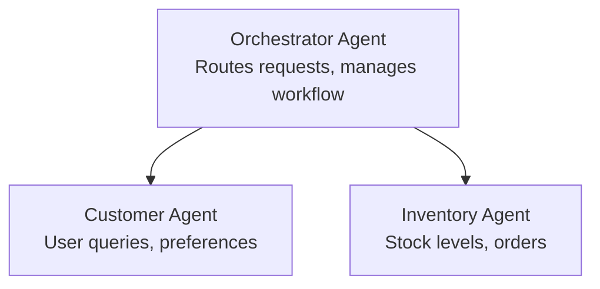

# Hoofdstuk 5: Multi-Agent AI Oplossingen

**📚 Cursus**: [AZD Voor Beginners](../../README.md) | **⏱️ Duur**: 2-3 uur | **⭐ Complexiteit**: Geavanceerd

---

## Overzicht

Dit hoofdstuk behandelt geavanceerde multi-agent architectuurpatronen, agentorchestratie en productie-klare AI-implementaties voor complexe scenario’s.

> Commandorichtlijnen beoordeeld aan de hand van de vrijgegeven `azd 1.37.2` referentie. Cloud-implementaties zijn niet uitgevoerd.

## Leerdoelen

Door dit hoofdstuk af te ronden, zal je:
- Multi-agent architectuurpatronen begrijpen
- Gecoördineerde AI-agent systemen implementeren
- Agent-naar-agent communicatie implementeren
- Productie-klare multi-agent oplossingen bouwen

---

## 📚 Lessen

| # | Les | Beschrijving | Tijd |
|---|--------|-------------|------|
| 1 | [Multi-Agent Basisprincipes](multi-agent-basics.md) | Praktijk: implementeer een werkende multi-agent app met `azd up` | 45 min |
| 2 | [Coördinatiepatronen](../chapter-06-pre-deployment/coordination-patterns.md) | Agentorchestratie strategieën (gaat door in Hoofdstuk 6) | 30 min |
| 3 | [ARM Sjabloon Implementatie](../../examples/retail-multiagent-arm-template/README.md) | Voorbeeld met één-klik implementatie | 30 min |

> **Begin met Les 1.** Dit is de enige volledig hands-on, implementeerbare les in dit hoofdstuk. Les 2 staat in Hoofdstuk 6 (gedeeld met planning voor implementatie), en de [Retail Multi-Agent Oplossing](../../examples/retail-scenario.md) is een architectuur blauwdruk — een ontwerpreferentie, geen één-commando sjabloon.

---

## 🚀 Snelstart

```bash
# Option 1: Deploy the multi-agent template used in Lesson 1
azd init --template Azure-Samples/contoso-creative-writer .
azd up

# Option 2: Initialize a Foundry agent interactively with the GA bundle
azd ext install microsoft.foundry
azd ai agent init
azd up
```

> **Welke aanpak?** Gebruik `azd init --template` om te starten met een werkend voorbeeld. Gebruik `azd ai agent init` interactief, of `azd ai agent init --template <path-to-azure.yaml>` om een huidig agentproject over te nemen. Zie de [AZD AI CLI referentie](../chapter-08-production/production-ai-practices.md#azd-ai-cli-commands-and-extensions) voor versievereisten en evaluatiemigratie.

Voer deze opties uit in aparte lege mappen. De GA Foundry workflow vereist `azd >= 1.37.0`; de interactieve flow genereert de aangepaste Service Bus-pijplijn in de coördinatieles niet. Voor lokale tests, code-implementatie en opruiming van nieuwe versus hergebruikte projecten, volg de [hosted-agent walkthrough](../chapter-02-ai-development/microsoft-foundry-integration.md#hosted-agent-walkthrough-ga).

---

## 🤖 Multi-Agent Architectuur



---

## 🎯 Uitgelichte Oplossing: Retail Multi-Agent

De [Retail Multi-Agent Oplossing](../../examples/retail-scenario.md) demonstreert:

- **Klantagent**: Behandelt gebruikersinteracties en voorkeuren
- **Voorraadagent**: Beheert voorraad en orderverwerking
- **Orchestrator**: Coördineert tussen agenten
- **Gedeeld Geheugen**: Contextbeheer tussen agenten

### Gebruikte Services

| Service | Doel |
|---------|---------|
| Microsoft Foundry Modellen | Taalbegrip |
| Azure AI Search | Productcatalogus |
| Cosmos DB | Agentstatus en geheugen |
| Container Apps | Agenthosting |
| Application Insights | Monitoring |

---

## 🔗 Navigatie

| Richting | Hoofdstuk |
|-----------|---------|
| **Vorige** | [Hoofdstuk 4: Infrastructuur](../chapter-04-infrastructure/README.md) |
| **Volgende** | [Hoofdstuk 6: Pre-implementatie](../chapter-06-pre-deployment/README.md) |

---

## 📖 Gerelateerde Bronnen

- [AI Agenten Gids](../chapter-02-ai-development/agents.md)
- [Productie AI Praktijken](../chapter-08-production/production-ai-practices.md)
- [AI Probleemoplossing](../chapter-07-troubleshooting/ai-troubleshooting.md)

---

<!-- CO-OP TRANSLATOR DISCLAIMER START -->
**Disclaimer**:
Dit document is vertaald met behulp van de AI vertaaldienst [Co-op Translator](https://github.com/Azure/co-op-translator). Hoewel we streven naar nauwkeurigheid, dient u er rekening mee te houden dat geautomatiseerde vertalingen fouten of onnauwkeurigheden kunnen bevatten. Het originele document in de oorspronkelijke taal moet worden beschouwd als de gezaghebbende bron. Voor kritieke informatie wordt professionele menselijke vertaling aanbevolen. Wij zijn niet aansprakelijk voor eventuele misverstanden of verkeerde interpretaties die voortvloeien uit het gebruik van deze vertaling.
<!-- CO-OP TRANSLATOR DISCLAIMER END -->