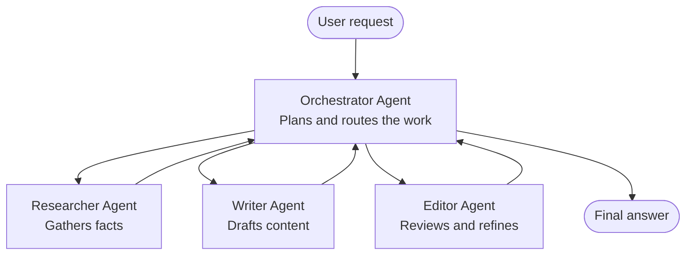

# Multi-Agent Basis - Zet Je Eerste Gecoördineerde AI Systeem In Productie

**Hoofdstuk Navigatie:**
- **📚 Cursus Home**: [AZD Voor Beginners](../../README.md)
- **📖 Huidig Hoofdstuk**: Hoofdstuk 5 - Multi-Agent AI Oplossingen
- **⬅️ Vorige**: [Hoofdstuk 4: Infrastructuur](../chapter-04-infrastructure/README.md)
- **➡️ Volgende**: [Coördinatiepatronen](../chapter-06-pre-deployment/coordination-patterns.md)

> Commandorichtlijnen nagekeken tegen de vrijgegeven `azd 1.37.2` referentie. Cloud implementaties zijn niet uitgevoerd.

## Introductie

In de eerdere hoofdstukken heb je een enkele applicatie ingezet—en in Hoofdstuk 2 heb je een enkele AI-agent ingezet. Deze les zet de volgende stap: het inzetten van een **multi-agent systeem**, waarbij meerdere gespecialiseerde agenten samenwerken om een probleem op te lossen dat geen enkele agent goed alleen kan afhandelen.

Het goede nieuws voor beginners: **je hebt geen nieuwe commando’s nodig.** Een multi-agent oplossing is nog steeds een azd project. Je zult `azd init`, `azd up`, testen en `azd down`—precies de workflow die je al kent. Wat verandert is de *vorm* van de app van binnen.

## Leerdoelen

Aan het einde van deze les zul je:
- Begrijpen wat "multi-agent" betekent en wanneer het de extra complexiteit waard is
- De gebruikelijke rollen in een multi-agent systeem herkennen (orchestrator + specialisten)
- Een echte, werkende multi-agent template inzetten met `azd up`
- De Azure resources begrijpen die een multi-agent app ondersteunen
- Weten hoe je de oplossing veilig kunt verifiëren, aanpassen en afbreken

## Leerresultaten

Na het voltooien van deze les ben je in staat om:
- Het verschil uit te leggen tussen een enkele agent en een multi-agent systeem
- Te kiezen tussen een enkele agent met tools en een echt multi-agent ontwerp
- Een multi-agent template end-to-end te implementeren en testen met azd
- Te identificeren waar elke agent draait en hoe zij communiceren
- Alle resources op te ruimen om doorlopende kosten te vermijden

---

## Wat is een Multi-Agent Systeem?

Een enkele AI-agent is één model met een set instructies en (optioneel) een aantal tools. Dat werkt goed voor gerichte taken. Maar naarmate een taak groeit—onderzoeken, dan schrijven, dan redigeren, dan fact-checking—maakt alles in één prompt stoppen de agent trager, minder betrouwbaar en moeilijker te debuggen.

Een **multi-agent systeem** verdeelt het werk in specialisten die elk één taak goed uitvoeren, gecoördineerd door een orchestrator:



### De twee rollen die je altijd zult zien

| Rol | Taak | Voorbeeld |
|------|-----|---------|
| **Orchestrator** | Beslist *wat er als volgende gebeurt* en verdeelt werk tussen agenten | "Eerst onderzoek, dan schrijven, dan redigeren" |
| **Specialist** | Voert één gerichte taak uit en levert een resultaat | Een "onderzoeker" die alleen feiten verzamelt |

### Heb je echt meerdere agenten nodig?

Begin eenvoudig. Kies voor multi-agent **alleen** als één van deze waar is:

- ✅ De taak heeft **onderscheidende fasen** die baat hebben bij verschillende instructies (onderzoek vs. schrijven vs. review)
- ✅ Je wilt dat specialisten **parallel** werken om tijd te besparen
- ✅ Verschillende stappen vereisen **verschillende tools of databronnen**
- ✅ Je hebt elke stap **onafhankelijk testbaar en debugbaar** nodig

Als jouw taak een enkele vraag-en-antwoord is of een eenvoudige tool-call, is een **enkele agent met tools** (Hoofdstuk 2) eenvoudiger, goedkoper en makkelijker te bedienen.

> **Beginners tip:** "Meer agenten" is niet "beter." Elke agent voegt latentie, kosten en iets nieuws om te monitoren toe. Voeg agenten alleen toe wanneer het probleem duidelijk in delen splitst.

---

## Twee Manieren om Multi-Agent op Azure te Bouwen

| Aanpak | Wat het is | Beste voor |
|----------|-----------|----------|
| **Enkele agent + tools** | Eén Foundry agent die functies/tools aanroept | Eenvoudige workflows, beginnen |
| **Meerdere gecoördineerde agenten** | Meerdere agenten met een orchestrator | Onderscheidende fasen, parallel werk, specialisatie |

Deze les richt zich op de tweede aanpak met een **kant-en-klare template**, zodat je een echt multi-agent systeem in werking ziet voordat je zelf bouwt.

---

## Praktijk: Zet een Werkende Multi-Agent App in Productie

We gaan **Contoso Creative Writer** inzetten, een officiële Azure sample die onderzoeks-, product-, schrijvende en redigeeragenten coördineert om een artikel te produceren. Controleer vóór het doorlopen de [vereisten en kosten van de sample](https://github.com/Azure-Samples/contoso-creative-writer#azure-account-requirements): het heeft modelquota, Azure AI Search, Bing Grounding toegang, Python, Docker en Bash-compatibele hooks nodig. Beschikbaarheid van model en regio hangt af van je abonnement; inzet is niet gegarandeerd door een regio te kiezen.

### Stap 1: Initialiseer de template

```bash
# Create a working folder
mkdir creative-writer && cd creative-writer

# Initialize from the official multi-agent template
azd init --template Azure-Samples/contoso-creative-writer .
```

> Blader op elk moment door meer multi-agent templates in de [Awesome AZD AI gallery](https://azure.github.io/awesome-azd/?tags=ai). Andere beginnervriendelijke opties zijn `get-started-with-ai-agents` en `azure-ai-travel-agents`.

### Stap 2: Authenticatie

```bash
# Required for azd workflows
azd auth login

# Also required by this sample's Azure CLI hooks
az login
```

### Stap 3: Controleer de omgeving

```bash
# init normally creates/selects an environment; confirm it before proceeding
azd env list
# Only if you need an additional environment:
# azd env new dev
```

### Stap 4: Voorvertoning, dan inzetten

```bash
# See what will be created before spending anything (recommended)
azd provision --preview

# Provision infrastructure and deploy all agents in one step
azd up
```

`azd up` vraagt om ontbrekende abonnement- en regio-instellingen en voorziet daarna resources en zet de applicatie in. De voorvertoning reserveert geen quota of garandeert succes; template hooks kunnen mogelijk nog lopen tijdens een provisioning preview, inspecteer deze eerst. Om te verlengen hoe lang azd wacht op elke **service-implementatie** (niet modelvoorziening):

```bash
azd deploy --timeout 1800
```

Een timeout stopt het wachten van azd; het annuleert de implementatie in Azure niet. Inspecteer de resource status voor je het opnieuw probeert.

> **Let op kosten en capaciteit:** Multi-agent apps zetten AI-modellen in die quota verbruiken en kosten veroorzaken. Als `azd up` faalt op modelquota, zie [AI Troubleshooting](../chapter-07-troubleshooting/ai-troubleshooting.md) voor regio- en quotahulpmiddelen, en Hoofdstuk 6 [Capaciteitsplanning](../chapter-06-pre-deployment/capacity-planning.md).

---

## Begrijpen wat je hebt ingezet

Een typisch multi-agent app als deze voorziet een set Azure-resources die rechtstreeks corresponderen met de verantwoordelijkheden in het diagram hierboven:

| Resource | Waarom het er is |
|----------|----------------|
| **Microsoft Foundry / Modellen** | Host de taalmodellen die elke agent gebruikt |
| **Azure AI Search** | Geeft de onderzoeksagent gegronde data om te doorzoeken |
| **Container Apps** (of App Service) | Host de orchestrator en agent-code |
| **Cosmos DB** (in sommige samples) | Slaat gedeelde status/geheugen op die tussen agenten wordt doorgegeven |
| **Application Insights** | Volgt verzoeken *over* agents heen zodat je de flow kunt debuggen |

### Hoe agenten met elkaar praten

In de meeste azd multi-agent samples draait de **orchestrator in je applicatiecode** (bijvoorbeeld met een framework zoals Semantic Kernel of het Microsoft Agent Framework). De orchestrator roept elke specialist agent om de beurt aan, geeft de resultaten door en stelt het eindantwoord samen. De agenten delen context via:

- **Functie/tool-aanroepen** — de orchestrator roept een specialist aan en krijgt een resultaat terug
- **Gedeeld geheugen** — een database (vaak Cosmos DB) houdt status die beide agenten kunnen lezen
- **Berichten/gebeurtenissen** — voor lossere koppeling communiceren agenten via een wachtrij of Service Bus

> **Waarom dit belangrijk is voor debuggen:** omdat elke stap gescheiden is, toont Application Insights je *welke* agent traag was of faalde. Dat is een belangrijke reden om werk te splitsen over agents in de eerste plaats.

---

## Verifieer de Implementatie

Bevestig dat het systeem daadwerkelijk werkt voordat je verder gaat:

```bash
# Show the deployed endpoints
azd show

# Open the app's monitoring dashboard
azd monitor

# Open Application Insights Logs (not a terminal log stream)
azd monitor --logs
```

Open dan de app-URL van `azd show` en vraag om een kort artikel. Gebruik de debug-weergave van de sample om de agent workflow te inspecteren. Application Insights transaction search kan de individuele stappen laten zien als de sample ze instrumenteert en correleert; azd voegt agent spans niet automatisch toe.

**Succescriteria:**
- ✅ `azd show` toont een bereikbare endpoint
- ✅ Een verzoek produceert een resultaat dat duidelijk meerdere fases doorloopt
- ✅ De debug-weergave toont meerdere agent stappen; als tracing aan staat, controleer dan de corresponderende telemetrie na ingestie

---

## Aanpassen: Voeg een Agent toe of Pas Aan

Omdat elke agent gewoon instructies plus tools is, is aanpassen toegankelijk:

1. **Vind de agentdefinities** in de template (vaak een `prompts/`, `agents/`, of `*.prompty` set bestanden).
2. **Stel de instructies van een agent bij** — bijvoorbeeld, vertel de editor agent om een specifieke toon of woordenaantal af te dwingen.
3. **Implementeer alleen de code opnieuw** (infrastructuur blijft hetzelfde):

   ```bash
   azd deploy
   ```

Om verder te gaan met je *eigen* Foundry agent project, gebruik de interactieve initialisatie van de agent-extensie:

```bash
azd extension install azure.ai.agents
azd ai agent init
azd up
azd ai agent invoke      # test, with response timing
```

Zie [Hoofdstuk 2: Agenten](../chapter-02-ai-development/agents.md) en de [AZD AI CLI referentie](../chapter-08-production/production-ai-practices.md#azd-ai-cli-commands-and-extensions) voor de volledige levenscyclus: agent `invoke`, de aparte evaluatie extensie’s `azd ai eval` workflow, agent `optimize`, en agent `delete`.

---

## Opruimen

Multi-agent apps draaien meerdere factureerbare services. Breek alles af als je klaar bent:

```bash
# Review the resources and confirm deletion interactively
azd down
```

Verwijderen is destructief. Voor een disposable lab slaat `azd down --force --purge` verwijdering over en ondersteunde soft-delete purge-bevestigingen over; wissen is onomkeerbaar waar ondersteund en kan worden geblokkeerd door purge bescherming. Soft deletion is een herstel-/naamhergebruik-kwestie, niet op zichzelf bewijs van doorlopende kosten. Controleer op achtergebleven resources en facturering na opruimen.

---

## Een Opmerking over Productie Multi-Agent Systemen

De [Retail Multi-Agent Solution](../../examples/retail-scenario.md) in deze repo is een **architectuur blauwdruk**, geen één-commando template—het documenteert hoe een productie retail systeem *zou* worden gebouwd (en stelt expliciet dat een volledige bouw aanzienlijke inspanning kost). Gebruik het als ontwerpreferentie *nadat* je hier een werkende sample hebt ingezet. Voor productieaandachtspunten (veerkracht, kosten, monitoring, governance) ga verder naar [Hoofdstuk 8: Productie AI Praktijken](../chapter-08-production/production-ai-practices.md).

---

## Samenvatting

- Een multi-agent systeem verdeelt werk over specialisten die gecoördineerd worden door een orchestrator.
- Gebruik het alleen als de taak onderscheidende fases, parallel werk, of verschillende tools per stap heeft—anders geef de voorkeur aan een enkele agent.
- De azd workflow blijft hetzelfde: `azd init` → `azd up` → test → `azd down`.
- Een echte template zoals `contoso-creative-writer` laat je vandaag een werkende multi-agent app zien en aanpassen.
- Application Insights tracing over agenten heen is een van de grootste praktische voordelen van het multi-agent ontwerp.

---

## 🔗 Navigatie

| Richting | Les |
|-----------|--------|
| **Vorige** | [Hoofdstuk 4: Infrastructuur](../chapter-04-infrastructure/README.md) |
| **Volgende** | [Coördinatiepatronen](../chapter-06-pre-deployment/coordination-patterns.md) |

## 📖 Gerelateerde Bronnen

- [AI Agents Gids](../chapter-02-ai-development/agents.md)
- [Coördinatiepatronen](../chapter-06-pre-deployment/coordination-patterns.md)
- [Productie AI Praktijken](../chapter-08-production/production-ai-practices.md)
- [AI Probleemoplossing](../chapter-07-troubleshooting/ai-troubleshooting.md)

---

<!-- CO-OP TRANSLATOR DISCLAIMER START -->
**Disclaimer**:
Dit document is vertaald met behulp van de AI vertaaldienst [Co-op Translator](https://github.com/Azure/co-op-translator). Hoewel we streven naar nauwkeurigheid, dient u er rekening mee te houden dat geautomatiseerde vertalingen fouten of onnauwkeurigheden kunnen bevatten. Het originele document in de oorspronkelijke taal moet worden beschouwd als de gezaghebbende bron. Voor kritieke informatie wordt professionele menselijke vertaling aanbevolen. Wij zijn niet aansprakelijk voor eventuele misverstanden of verkeerde interpretaties die voortvloeien uit het gebruik van deze vertaling.
<!-- CO-OP TRANSLATOR DISCLAIMER END -->