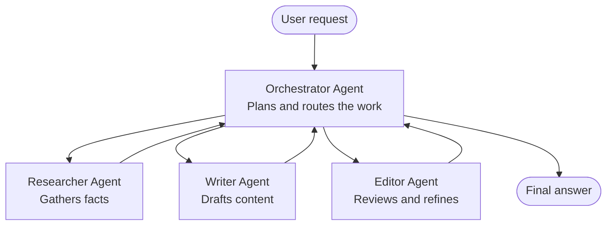

# Basisprincipes Multi-Agent - Zet je Eerste Gecoördineerde AI-systeem in Productie

**Hoofdstuk Navigatie:**
- **📚 Cursusstartpagina**: [AZD Voor Beginners](../../README.md)
- **📖 Huidig Hoofdstuk**: Hoofdstuk 5 - Multi-Agent AI Oplossingen
- **⬅️ Vorige**: [Hoofdstuk 4: Infrastructuur](../chapter-04-infrastructure/README.md)
- **➡️ Volgende**: [Samenwerkingspatronen](../chapter-06-pre-deployment/coordination-patterns.md)

> Commandoruimte gecontroleerd aan de hand van de vrijgegeven `azd 1.37.2` referentie. Cloud-implementaties zijn niet uitgevoerd.

## Introductie

In de eerdere hoofdstukken heb je een enkele applicatie ingezet—en in Hoofdstuk 2 zette je een enkele AI-agent in. Deze les neemt de volgende stap: het inzetten van een **multi-agent systeem**, waarbij meerdere gespecialiseerde agenten samenwerken om een probleem op te lossen dat geen enkele agent alleen goed aan zou kunnen.

Het goede nieuws voor beginners: **je hebt geen nieuwe commando’s nodig.** Een multi-agent oplossing is nog steeds een azd-project. Je zult `azd init`, `azd up`, testen en `azd down`—precies de workflow die je al kent. Wat verandert is de *vorm* van de app van binnen.

## Leerdoelen

Aan het einde van deze les zul je:
- Begrijpen wat "multi-agent" betekent en wanneer het de extra complexiteit waard is
- De veelvoorkomende rollen in een multi-agent systeem herkennen (orkestrator + specialisten)
- Een echte, werkende multi-agent template inzetten met `azd up`
- De Azure-resources begrijpen die een multi-agent app ondersteunen
- Weten hoe je de oplossing veilig verifieert, aanpast en afbreekt

## Leerresultaten

Na het voltooien van deze les kun je:
- Het verschil uitleggen tussen een enkele agent en een multi-agent systeem
- Kiezen tussen een enkele agent met tools en een echt multi-agent ontwerp
- Een multi-agent template end-to-end inzetten en testen met azd
- Identificeren waar elke agent draait en hoe ze communiceren
- Alle resources opruimen om doorlopende kosten te voorkomen

---

## Wat is een Multi-Agent Systeem?

Een enkele AI-agent is één model met een set instructies en (optioneel) enkele tools. Dat werkt goed voor gerichte taken. Maar naarmate een taak groter wordt—onderzoek, dan schrijven, dan redigeren, dan feitencontrole—maakt alles in één prompt stoppen de agent trager, minder betrouwbaar en moeilijker te debuggen.

Een **multi-agent systeem** verdeelt het werk over specialisten die elk één taak goed uitvoeren, gecoördineerd door een orkestrator:



### De twee rollen die je altijd ziet

| Rol | Taak | Voorbeeld |
|------|-----|---------|
| **Orkestrator** | Bepaalt *wat er daarna gebeurt* en verdeelt werk tussen agenten | "Eerst onderzoek, dan schrijven, dan redigeren" |
| **Specialist** | Voert één gerichte taak uit en levert een resultaat op | Een "onderzoeker" die alleen feiten verzamelt |

### Heb je echt meerdere agenten nodig?

Begin eenvoudig. Richt je op multi-agent **alleen** als een van deze waar is:

- ✅ De taak heeft **onderscheidbare fasen** die baat hebben bij verschillende instructies (onderzoek vs. schrijven vs. beoordelen)
- ✅ Je wilt dat specialisten **parallel** werken om tijd te besparen
- ✅ Verschillende stappen hebben **verschillende tools of gegevensbronnen** nodig
- ✅ Je hebt elke stap nodig om **onafhankelijk testbaar en debugbaar** te zijn

Als je taak een enkele vraag-en-antwoord is of een eenvoudige tool-aanroep, is een **enkele agent met tools** (Hoofdstuk 2) eenvoudiger, goedkoper en makkelijker te beheren.

> **Tip voor beginners:** "Meer agenten" is niet "beter." Elke agent voegt latentie, kosten en een nieuw monitoringsitem toe. Voeg agenten alleen toe als het probleem duidelijk in delen opsplitst.

---

## Twee Manieren om Multi-Agent op Azure te Bouwen

| Benadering | Wat het is | Geschikt voor |
|----------|-----------|----------|
| **Enkele agent + tools** | Eén Foundry-agent die functies/tools aanroept | Simpele workflows, kennismaking |
| **Meerdere gecoördineerde agenten** | Meerdere agenten met een orkestrator | Onderscheidbare fasen, parallel werk, specialisatie |

Deze les richt zich op de tweede benadering met een **kant-en-klare template**, zodat je een echt multi-agent systeem in actie kunt zien voordat je je eigen bouwt.

---

## Praktijk: Zet een Werkende Multi-Agent App in

We zetten **Contoso Creative Writer** in, een officiële Azure-sample die onderzoeks-, product-, schrijf- en redacteuragenten coördineert om een artikel te produceren. Controleer voor je begint de [voorwaarden en kosten van de sample](https://github.com/Azure-Samples/contoso-creative-writer#azure-account-requirements): het vereist modelquota, Azure AI Search, Bing Grounding-toegang, Python, Docker en Bash-compatibele hooks. Model- en regiobeschikbaarheid hangen af van je abonnement; implementatie is niet gegarandeerd door regio-keuze.

### Stap 1: Initialiseer de template

```bash
# Create a working folder
mkdir creative-writer && cd creative-writer

# Initialize from the official multi-agent template
azd init --template Azure-Samples/contoso-creative-writer .
```

> Blader altijd naar meer multi-agent templates in de [Awesome AZD AI gallery](https://azure.github.io/awesome-azd/?tags=ai). Andere beginnersvriendelijke opties zijn `get-started-with-ai-agents` en `azure-ai-travel-agents`.

### Stap 2: Authenticeren

```bash
# Required for azd workflows
azd auth login

# Also required by this sample's Azure CLI hooks
az login
```

### Stap 3: Controleer de omgeving

```bash
# init normally creates/selects an environment; confirm it before proceeding
azd env list
# Only if you need an additional environment:
# azd env new dev
```

### Stap 4: Bekijken en dan inzetten

```bash
# See what will be created before spending anything (recommended)
azd provision --preview

# Provision infrastructure and deploy all agents in one step
azd up
```

`azd up` vraagt om ontbrekende abonnement- en regio-instellingen, voorziet daarna resources en zet de applicatie in. De preview reserveert geen quota of garandeert succes; template hooks kunnen nog tijdens een provisioning preview draaien, dus inspecteer ze eerst. Om te verlengen hoe lang azd wacht op elke **service-implementatie** (niet modelprovisioning):

```bash
azd deploy --timeout 1800
```

Een time-out stopt azd met wachten; het annuleert de implementatie in Azure niet. Controleer de status van de resource voordat je het opnieuw probeert.

> **Let op kosten en capaciteit:** Multi-agent apps zetten AI-modellen in die quota verbruiken en kosten veroorzaken. Als `azd up` faalt op modelquota, zie [AI Troubleshooting](../chapter-07-troubleshooting/ai-troubleshooting.md) voor regio- en quotaherstellingen, en Hoofdstuk 6 [Capaciteitsplanning](../chapter-06-pre-deployment/capacity-planning.md).

---

## Begrijpen Wat Je Ingezet Hebt

Een typische multi-agent app zoals deze voorziet een set Azure-resources die direct corresponderen met de verantwoordelijkheden in het bovenstaande diagram:

| Resource | Waarom het er is |
|----------|----------------|
| **Microsoft Foundry / Modellen** | Host de taalmodellen die elke agent gebruikt |
| **Azure AI Search** | Geeft de onderzoeker-agent gefundeerde data om in te zoeken |
| **Container Apps** (of App Service) | Host de orkestrator en agent-code |
| **Cosmos DB** (in sommige samples) | Slaat gedeelde status/geheugen op die tussen agenten wordt doorgegeven |
| **Application Insights** | Volgt verzoeken *over* agenten zodat je het proces kunt debuggen |

### Hoe de agenten met elkaar praten

In de meeste azd multi-agent samples draait de **orkestrator in je applicatiecode** (bijvoorbeeld met een framework als Semantic Kernel of het Microsoft Agent Framework). De orkestrator roept elke specialist-agent op in volgorde, geeft de resultaten door en stelt het eindantwoord samen. De agenten delen context via:

- **Functie/tool-aanroepen** — de orkestrator roept een specialist aan en krijgt een resultaat terug
- **Gedeeld geheugen** — een database (vaak Cosmos DB) houdt status bij die beide agenten kunnen lezen
- **Berichten/evenementen** — voor lossere koppeling communiceren agenten via een queue of Service Bus

> **Waarom dit belangrijk is voor debugging:** omdat elke stap apart is, toont Application Insights *welke* agent traag was of faalde. Dat is een belangrijke reden om werk op te splitsen over agenten.

---

## Verifieer de Implementatie

Bevestig dat het systeem echt werkt voordat je verdergaat:

```bash
# Show the deployed endpoints
azd show

# Open the app's monitoring dashboard
azd monitor

# Open Application Insights Logs (not a terminal log stream)
azd monitor --logs
```

Open dan de app-URL van `azd show` en vraag een kort artikel aan. Gebruik de debugweergave van de sample om de agent-workflow te inspecteren. Application Insights transacties kunnen de individuele stappen tonen als de sample ze instrumentaliseert en correleert; azd voegt niet automatisch agent-spans toe.

**Succescriteria:**
- ✅ `azd show` toont een bereikbaar eindpunt
- ✅ Een verzoek produceert een resultaat dat duidelijk meerdere fasen doorloopt
- ✅ De debugweergave toont meerdere agentstappen; bij ingeschakelde tracing verifieer je de bijbehorende telemetry na inname

---

## Aanpassen: Voeg een Agent toe of Pas aan

Omdat elke agent alleen instructies plus tools is, is aanpassen goed te doen:

1. **Vind de agentdefinities** in de template (vaak een `prompts/`, `agents/`, of `*.prompty` set bestanden).
2. **Stel de instructies van een agent bij** — bijvoorbeeld, zeg tegen de redacteur-agent een specifieke toon of woordenaantal af te dwingen.
3. **Zet alleen de code opnieuw in** (infrastructuur blijft hetzelfde):

   ```bash
   azd deploy
   ```

Voor verdergaan met je *eigen* Foundry-agentproject, gebruik het GA-bundel met AZD 1.37.0+ in een aparte lege map:

```bash
azd ext install microsoft.foundry
azd ai agent init
azd up
azd ai agent invoke      # test, with response timing
```

Zie de [GA hosted-agent walkthrough](../chapter-02-ai-development/microsoft-foundry-integration.md#hosted-agent-walkthrough-ga) voor Agent Inspector lokale tests, remote code deployment en opruimbeheer. De [AZD AI CLI reference](../chapter-08-production/production-ai-practices.md#azd-ai-cli-commands-and-extensions) behandelt ook de afzonderlijke evaluaties-extensie, optimalisatie en agentverwijdering.

---

## Opruimen

Multi-agent apps draaien meerdere factureerbare services. Breek alles af als je klaar bent:

```bash
# Review the resources and confirm deletion interactively
azd down
```

Verwijderen is destructief. Voor een wegwerplab slaat `azd down --force --purge` verwijdering en ondersteunde soft-delete bevestigingen over; purging is onomkeerbaar waar ondersteund en kan geblokkeerd worden door purge-bescherming. Soft deletion betreft herstel/hergebruik van namen, en is niet per se bewijs van doorlopende kosten. Controleer na opruimen op achtergebleven resources en facturatie.

Als je ook een hosted agent hebt geïnitialiseerd tegen een bestaand Foundry-project, laat `azd down` die agent en andere resources op hun plek. Verwijder alleen ongewenste resources die je zelf bezit apart. Voor een nieuw Foundry-project dat is aangemaakt door zijn AZD-omgeving verwijdert `azd down` de resourcegroep en alles erin.

---

## Een Opmerking over Productie Multi-Agent Systemen

De [Retail Multi-Agent Solution](../../examples/retail-scenario.md) in deze repo is een **architectuursjabloon**, geen one-command template—het documenteert hoe een productie-retailsysteem *zouden* worden opgebouwd (en geeft aan dat een volledige bouw een grote inspanning vereist). Gebruik het als ontwerpregel *nadat* je een werkende sample hier hebt ingezet. Voor productieaandachtspunten (veerkracht, kosten, monitoring, governance), ga door naar [Hoofdstuk 8: Productie AI-praktijken](../chapter-08-production/production-ai-practices.md).

---

## Samenvatting

- Een multi-agent systeem verdeelt werk over specialisten gecoördineerd door een orkestrator.
- Gebruik het alleen als de taak onderscheiden fasen, parallel werken of verschillende tools per stap heeft—anders geef de voorkeur aan een enkele agent.
- De azd-workflow blijft hetzelfde: `azd init` → `azd up` → testen → `azd down`.
- Een echte template zoals `contoso-creative-writer` laat je vandaag al een werkende multi-agent app zien en aanpassen.
- Application Insights tracing over agenten heen is een van de grootste praktische voordelen van het multi-agent ontwerp.

---

## 🔗 Navigatie

| Richting | Les |
|-----------|--------|
| **Vorige** | [Hoofdstuk 4: Infrastructuur](../chapter-04-infrastructure/README.md) |
| **Volgende** | [Samenwerkingspatronen](../chapter-06-pre-deployment/coordination-patterns.md) |

## 📖 Gerelateerde Bronnen

- [AI Agents Gids](../chapter-02-ai-development/agents.md)
- [Samenwerkingspatronen](../chapter-06-pre-deployment/coordination-patterns.md)
- [Productie AI Praktijken](../chapter-08-production/production-ai-practices.md)
- [AI Problemen Oplossen](../chapter-07-troubleshooting/ai-troubleshooting.md)

---

<!-- CO-OP TRANSLATOR DISCLAIMER START -->
**Disclaimer**:
Dit document is vertaald met behulp van de AI vertaaldienst [Co-op Translator](https://github.com/Azure/co-op-translator). Hoewel we streven naar nauwkeurigheid, dient u er rekening mee te houden dat geautomatiseerde vertalingen fouten of onnauwkeurigheden kunnen bevatten. Het originele document in de oorspronkelijke taal moet worden beschouwd als de gezaghebbende bron. Voor kritieke informatie wordt professionele menselijke vertaling aanbevolen. Wij zijn niet aansprakelijk voor eventuele misverstanden of verkeerde interpretaties die voortvloeien uit het gebruik van deze vertaling.
<!-- CO-OP TRANSLATOR DISCLAIMER END -->