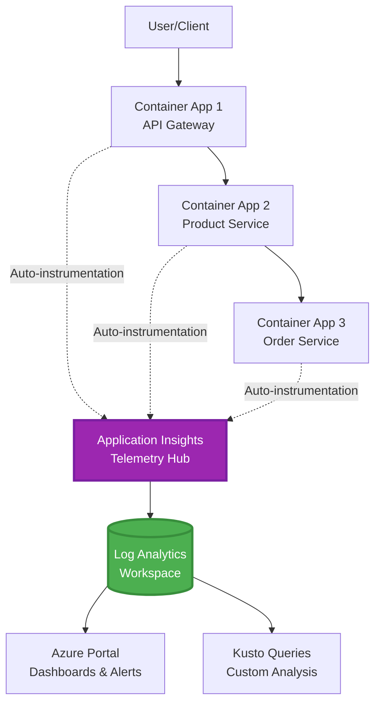
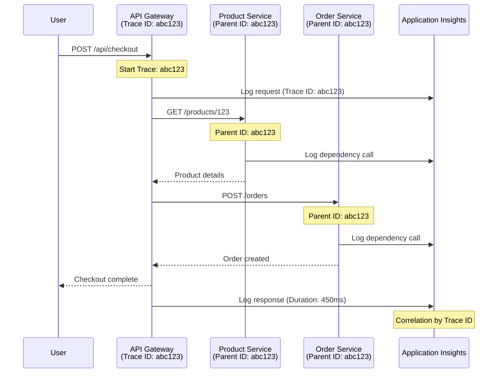

# Application Insights-integratie met AZD

⏱️ **Geschatte tijd**: 40-50 minuten | 💰 **Kostenimpact**: ~$5-15/maand | ⭐ **Complexiteit**: Gemiddeld

**📚 Leerpad:**
- ← Vorige: [Preflight Checks](preflight-checks.md) - Validatie vóór implementatie
- 🎯 **Je bent hier**: Application Insights-integratie (Monitoring, telemetrie, debugging)
- → Volgende: [Deploygids](../chapter-04-infrastructure/deployment-guide.md) - Implementeren naar Azure
- 🏠 [Course Home](../../README.md)

---

## Wat je zult leren

Na het voltooien van deze les:
- Declareer **Application Insights** in AZD-infrastructuur en configureer SDK-instrumentatie
- Configureer **gedistribueerde tracing** voor microservices
- Implementeer **aangepaste telemetrie** (metrics, events, dependencies)
- Stel **live metrics** in voor realtime monitoring
- Maak **alerts en dashboards** vanuit AZD-implementaties
- Debug productieproblemen met **telemetriequeries**
- Optimaliseer **kosten en sampling**-strategieën
- Monitor **AI/LLM-toepassingen** (tokens, latentie, kosten)

## Waarom Application Insights met AZD belangrijk is

### De Uitdaging: Productie-Observeerbaarheid

**Zonder Application Insights:**
```
❌ No visibility into production behavior
❌ Manual log aggregation across services
❌ Reactive debugging (wait for customer complaints)
❌ No performance metrics
❌ Cannot trace requests across services
❌ Unknown failure rates and bottlenecks
```

**Met Application Insights + AZD:**
```
✅ Automatic telemetry collection
✅ Centralized logs from all services
✅ Proactive issue detection
✅ End-to-end request tracing
✅ Performance metrics and insights
✅ Real-time dashboards
✅ AZD provisions the monitoring declared in your templates
```

**Analogie**: Application Insights is als een "black box" vluchtrecorder + cockpitdashboard voor je applicatie. Je ziet alles wat realtime gebeurt en kunt elk incident opnieuw bekijken.

---

## Architectuuroverzicht

### Application Insights in AZD-architectuur



### Wat wordt automatisch gemonitord

Ondersteunde auto-instrumentatie legt verzoeken/afhankelijkheden vast voor geïnstrumenteerde bibliotheken. Aangepaste events en metrics vereisen applicatiecode; beschikbaarheidstesten moeten apart worden geconfigureerd. Het verzamelt niet elke regel hieronder alleen omdat de resource bestaat.

| Telemetrie Type | Wat het vastlegt | Gebruikssituatie |
|----------------|------------------|----------|
| **Requests** | HTTP-verzoeken, statuscodes, duur | API-prestatiemonitoring |
| **Dependencies** | Externe oproepen (DB, API’s, opslag) | Bottlenecks identificeren |
| **Exceptions** | Ongehandelde fouten met stacktraces | Fouten debuggen |
| **Custom Events** | Zakelijke events (inschrijving, aankoop) | Analyse en trechters |
| **Metrics** | Prestatiecounters, aangepaste metrics | Capaciteitsplanning |
| **Traces** | Logberichten met ernst | Debuggen en audit |
| **Availability** | Uptime- en responstijdtesten | SLA-monitoring |

---

## Vereisten

### Benodigde Tools

```bash
# Verify Azure Developer CLI
azd version
# Command reference baseline: azd 1.37.2

# Verify Azure CLI
az --version
# ✅ Expected: azure-cli 2.50.0 or higher
```

### Azure Vereisten

- Actief Azure-abonnement
- Machtigingen om aan te maken:
  - Application Insights-resources
  - Log Analytics-werkruimten
  - Container Apps
  - Resourcegroepen

### Kennisvereisten

Je moet hebben voltooid:
- [AZD Basics](../chapter-01-foundation/azd-basics.md) - Kernconcepten van AZD
- [Configuratie](../chapter-03-configuration/configuration.md) - Omgevingsinstellingen
- [Eerste Project](../chapter-01-foundation/first-project.md) - Basisimplementatie

---

## Les 1: Automatische Application Insights met AZD

### Hoe AZD Application Insights voorziet

AZD voorziet Application Insights **alleen als de infrastructuur van het project dit declareert**. `azure.yaml` alleen creëert geen monitoring of instrueert applicatiecode.

> **Voorbeeldscope:** Deze les bevat integratiefragmenten, geen compleet `monitored-app`-project in deze repository. Lever een hoofdtemplate en parameter-koppeling, een Container Apps-omgeving, registry/image- en identiteitsconfiguratie, Dockerfile en servicetags voor implementatie. Latere lessen tonen alternatieve/uitbreidingsfragmenten, niet bestanden die ongewijzigd samen kunnen worden geplakt. Begin met een werkend [microservices voorbeeld](../../../../examples/microservices) als je een uitvoerbare basis wilt.

### Projectstructuur

```
monitored-app/
├── azure.yaml                     # AZD configuration
├── infra/
│   ├── main.bicep                # Main infrastructure
│   ├── core/
│   │   └── monitoring.bicep      # Application Insights + Log Analytics
│   └── app/
│       └── api.bicep             # Container App with monitoring
└── src/
    ├── app.py                    # Application with telemetry
    ├── requirements.txt
    └── Dockerfile
```

---

### Stap 1: Configureer AZD (azure.yaml)

**Bestand: `azure.yaml`**

```yaml
name: monitored-app
metadata:
  template: monitored-app@1.0.0

services:
  api:
    project: ./src
    language: python
    host: containerapp

# Monitoring must be declared in infra/ and enabled in application code.
```

Dit declareert de implementeerbare service. De volgende Bicep- en SDK-configuraties leveren monitoring; azd voegt deze niet impliciet toe.

---

### Stap 2: Monitoring-infrastructuur (Bicep)

**Bestand: `infra/core/monitoring.bicep`**

```bicep
param logAnalyticsName string
param applicationInsightsName string
param location string = resourceGroup().location
param tags object = {}

// Log Analytics Workspace (required for Application Insights)
resource logAnalytics 'Microsoft.OperationalInsights/workspaces@2022-10-01' = {
  name: logAnalyticsName
  location: location
  tags: tags
  properties: {
    sku: {
      name: 'PerGB2018'  // Pay-as-you-go pricing
    }
    retentionInDays: 30  // Keep logs for 30 days
    features: {
      enableLogAccessUsingOnlyResourcePermissions: true
    }
  }
}

// Application Insights
resource applicationInsights 'Microsoft.Insights/components@2020-02-02' = {
  name: applicationInsightsName
  location: location
  tags: tags
  kind: 'web'
  properties: {
    Application_Type: 'web'
    WorkspaceResourceId: logAnalytics.id
    IngestionMode: 'LogAnalytics'
    publicNetworkAccessForIngestion: 'Enabled'
    publicNetworkAccessForQuery: 'Enabled'
  }
}

// Outputs for Container Apps
output logAnalyticsWorkspaceId string = logAnalytics.id
output logAnalyticsWorkspaceName string = logAnalytics.name
output applicationInsightsConnectionString string = applicationInsights.properties.ConnectionString
output applicationInsightsInstrumentationKey string = applicationInsights.properties.InstrumentationKey
output applicationInsightsName string = applicationInsights.name
output applicationInsightsId string = applicationInsights.id
```

---

### Stap 3: Verbind Container App met Application Insights

**Bestand: `infra/app/api.bicep`**

```bicep
param name string
param location string
param tags object = {}
param containerAppsEnvironmentId string
param containerImage string
param applicationInsightsConnectionString string

resource containerApp 'Microsoft.App/containerApps@2023-05-01' = {
  name: name
  location: location
  tags: tags
  properties: {
    managedEnvironmentId: containerAppsEnvironmentId
    configuration: {
      ingress: {
        external: true
        targetPort: 8000
      }
      secrets: [
        {
          name: 'appinsights-connection-string'
          value: applicationInsightsConnectionString
        }
      ]
    }
    template: {
      containers: [
        {
          name: 'api'
          image: containerImage // Supply an accessible image and registry authentication
          resources: {
            cpu: json('0.5')
            memory: '1Gi'
          }
          env: [
            {
              name: 'APPLICATIONINSIGHTS_CONNECTION_STRING'
              secretRef: 'appinsights-connection-string'
            }
            {
              name: 'APPLICATIONINSIGHTS_ENABLED'
              value: 'true'
            }
          ]
        }
      ]
    }
  }
}

output uri string = 'https://${containerApp.properties.configuration.ingress.fqdn}'
```

---

### Stap 4: Applicatiecode met Telemetrie

**Bestand: `src/app.py`**

```python
from flask import Flask, request, jsonify
from azure.monitor.opentelemetry import configure_azure_monitor
import logging
import os

app = Flask(__name__)

# Get Application Insights connection string
connection_string = os.environ.get('APPLICATIONINSIGHTS_CONNECTION_STRING')

if connection_string:
    # Azure Monitor OpenTelemetry instruments supported libraries, including Flask.
    configure_azure_monitor(
        connection_string=connection_string,
        logger_name=__name__,
        enable_live_metrics=True
    )
    logger = logging.getLogger(__name__)
    logger.setLevel(logging.INFO)
    
    print("✅ Application Insights enabled")
else:
    logger = logging.getLogger(__name__)
    logger.setLevel(logging.INFO)
    print("⚠️ Application Insights not configured")

@app.route('/health')
def health():
    logger.info('Health check endpoint called')
    return jsonify({'status': 'healthy', 'monitoring': 'enabled' if connection_string else 'disabled'})

@app.route('/api/products')
def get_products():
    logger.info('Fetching products')
    
    # In-memory fixture: this is not a database dependency call.
    products = [
        {'id': 1, 'name': 'Laptop', 'price': 999.99},
        {'id': 2, 'name': 'Mouse', 'price': 29.99},
        {'id': 3, 'name': 'Keyboard', 'price': 79.99}
    ]
    
    logger.info(f'Returned {len(products)} products')
    return jsonify(products)

@app.route('/api/error-test')
def error_test():
    """Test error tracking"""
    logger.error('Testing error tracking')
    try:
        raise ValueError('This is a test exception')
    except Exception as e:
        logger.exception('Exception occurred in error-test endpoint')
        return jsonify({'error': str(e)}), 500

@app.route('/api/slow')
def slow_endpoint():
    """Test performance tracking"""
    import time
    logger.info('Slow endpoint called')
    time.sleep(3)  # Simulate slow operation
    logger.warning('Endpoint took 3 seconds to respond')
    return jsonify({'message': 'Slow operation completed'})

if __name__ == '__main__':
    app.run(host='0.0.0.0', port=8000)
```

**Bestand: `src/requirements.txt`**

```txt
Flask
azure-monitor-opentelemetry
gunicorn
requests
openai
```

Los deze afhankelijkheden op in je project, test ze samen en sluit de resulterende versies af. Nieuwe projecten moeten Azure Monitor OpenTelemetry gebruiken, niet de uitgefaseerde OpenCensus Python-exporteurs.

---

### Stap 5: Implementeer en verifieer

```bash
# Deploy only after completing and wiring the infrastructure fragments above
azd up

# Get app URL
APP_URL=$(azd env get-value API_URL) # Requires this output in main.bicep

# Generate telemetry
curl $APP_URL/health
curl $APP_URL/api/products
curl $APP_URL/api/error-test
curl $APP_URL/api/slow
```

**✅ Verwachte output:**
```json
{
  "status": "healthy",
  "monitoring": "enabled"
}
```

---

### Stap 6: Bekijk Telemetrie in Azure Portal

```bash
# Get Application Insights details
azd env get-values | grep APPLICATIONINSIGHTS

# Open in Azure Portal
az monitor app-insights component show \
  --app $(azd env get-values | grep APPLICATIONINSIGHTS_NAME | cut -d '=' -f2 | tr -d '"') \
  --resource-group $(azd env get-values | grep AZURE_RESOURCE_GROUP | cut -d '=' -f2 | tr -d '"') \
  --query "appId" -o tsv
```

**Navigeer naar Azure Portal → Application Insights → Transaction Search**

Je zou moeten zien:
- ✅ HTTP-verzoeken met statuscodes
- ✅ Verzoekduur (3+ seconden voor `/api/slow`)
- ✅ Details van uitzonderingen van `/api/error-test`
- ✅ Aangepaste logberichten

---

## Les 2: Aangepaste telemetrie en evenementen

### Volg zakelijke evenementen

Laten we aangepaste telemetrie toevoegen voor bedrijfskritische evenementen.

**Bestand: `src/telemetry.py`**

```python
from contextlib import contextmanager
from azure.monitor.opentelemetry import configure_azure_monitor
from opentelemetry import metrics, trace
from opentelemetry.trace import SpanKind
import logging
import os

class TelemetryClient:
    """Custom telemetry client for Application Insights"""
    
    def __init__(self, connection_string=None):
        self.connection_string = connection_string or os.environ.get('APPLICATIONINSIGHTS_CONNECTION_STRING')
        
        # Configure once per process. If app.py already calls this, keep only
        # one configure_azure_monitor call and use logger_name='telemetry'.
        if self.connection_string:
            configure_azure_monitor(
                connection_string=self.connection_string,
                logger_name=__name__,
                enable_live_metrics=True
            )
        self.logger = logging.getLogger(__name__)
        self.logger.setLevel(logging.INFO)
        self.tracer = trace.get_tracer(__name__)
        self.meter = metrics.get_meter(__name__)
        self.instruments = {}
    
    def track_event(self, event_name: str, properties: dict = None):
        """Track custom business event"""
        properties = properties or {}
        self.logger.info(
            f"CustomEvent: {event_name}",
            extra={
                # OTel log attributes become customDimensions in App Insights.
                    'event_name': event_name,
                    **properties
            }
        )
    
    def track_metric(self, metric_name: str, value: float, properties: dict = None):
        """Track custom metric"""
        properties = properties or {}
        if metric_name not in self.instruments:
            self.instruments[metric_name] = self.meter.create_histogram(metric_name)
        self.instruments[metric_name].record(value, attributes=properties)
    
    @contextmanager
    def track_dependency(self, name: str):
        """Time the real operation inside a client span; exceptions mark failure."""
        with self.tracer.start_as_current_span(name, kind=SpanKind.CLIENT) as span:
            yield span

# Global telemetry client
telemetry = TelemetryClient()
```

### Update applicatie met aangepaste evenementen

**Bestand: `src/app.py` (uitgebreid)**

Voeg deze routes toe aan de bestaande Flask-applicatie; behoud de eerdere health/test-routes. Het onderstaande verkorte blok toont een aparte app ter verduidelijking. Telemetrie-initialisatie zit nu in `telemetry.py` — initialiseer exporters niet twee keer.

```python
from flask import Flask, request, jsonify
from telemetry import telemetry
import time
import random
import os

app = Flask(__name__)

@app.route('/api/purchase', methods=['POST'])
def purchase():
    """Track purchase event with custom telemetry"""
    data = request.get_json(silent=True) or {}
    product_id = data.get('product_id')
    quantity = data.get('quantity', 1)
    price = data.get('price', 0)
    if not isinstance(quantity, int) or quantity < 1 or \
       not isinstance(price, (int, float)) or price < 0:
        return jsonify({'error': 'quantity and price must be non-negative numbers; quantity >= 1'}), 400
    
    # Track business event
    telemetry.track_event('Purchase', {
        'product_id': product_id,
        'quantity': quantity,
        'total_amount': price * quantity,
        'user_id': request.headers.get('X-User-Id', 'anonymous')
    })
    
    # Track revenue metric
    telemetry.track_metric('Revenue', price * quantity, {
        'product_id': product_id,
        'currency': 'USD'
    })
    
    return jsonify({
        'order_id': f'ORD-{random.randint(1000, 9999)}',
        'status': 'confirmed',
        'total': price * quantity
    })

@app.route('/api/search')
def search():
    """Track search queries"""
    query = request.args.get('q', '')
    
    start_time = time.time()
    
    # Simulate search (would be real database query)
    results = [{'id': 1, 'name': f'Result for {query}'}]
    
    duration = (time.time() - start_time) * 1000  # Convert to ms
    
    # Track search event
    telemetry.track_event('Search', {
        'query': query,
        'results_count': len(results),
        'duration_ms': duration
    })
    
    # Track search performance metric
    telemetry.track_metric('SearchDuration', duration, {
        'query_length': len(query)
    })
    
    return jsonify({'results': results, 'count': len(results)})

@app.route('/api/external-call')
def external_call():
    """Track external API dependency"""
    import requests
    
    try:
        # Set an actual test endpoint; api.example.com is not a working API.
        with telemetry.track_dependency('ExternalAPI'):
            response = requests.get(os.environ['EXTERNAL_API_URL'], timeout=5)
            response.raise_for_status()
            result = response.json()
    except Exception as e:
        return jsonify({'error': 'External dependency failed'}), 502
    
    return jsonify(result)

if __name__ == '__main__':
    app.run(host='0.0.0.0', port=8000)
```

### Test aangepaste telemetrie

```bash
# Track purchase event
curl -X POST $APP_URL/api/purchase \
  -H "Content-Type: application/json" \
  -H "X-User-Id: user123" \
  -d '{"product_id": 1, "quantity": 2, "price": 29.99}'

# Track search event
curl "$APP_URL/api/search?q=laptop"

# Track external dependency
curl $APP_URL/api/external-call
```

**Bekijk in Azure Portal:**

Navigeer naar Application Insights → Logs, voer vervolgens uit:

```kusto
// View purchase events
traces
| where customDimensions.event_name == "Purchase"
| project 
    timestamp,
    product_id = tostring(customDimensions.product_id),
    total_amount = todouble(customDimensions.total_amount),
    user_id = tostring(customDimensions.user_id)
| order by timestamp desc

// Revenue recorded in Purchase events (not a billing ledger)
traces
| where customDimensions.event_name == "Purchase"
| summarize TotalRevenue = sum(todouble(customDimensions.total_amount)) by bin(timestamp, 1h)
| render timechart

// View search performance
traces
| where customDimensions.event_name == "Search"
| summarize 
    AvgDuration = avg(todouble(customDimensions.duration_ms)),
    SearchCount = count()
  by bin(timestamp, 5m)
| render timechart
```

---

## Les 3: Gedistribueerde tracing voor microservices

### Schakel cross-service tracing in

Met compatibele instrumentatie en W3C trace-contextpropagatie correleert Application Insights verzoeken tussen services. Het delen van een connectiestring alleen creëert geen parent-child spans. Het volgende architectuurfragment verwijst naar modules die je moet implementeren.

**Bestand: `infra/main.bicep`**

```bicep
targetScope = 'subscription'

param environmentName string
param location string = 'eastus'

var tags = { 'azd-env-name': environmentName }

resource rg 'Microsoft.Resources/resourceGroups@2021-04-01' = {
  name: 'rg-${environmentName}'
  location: location
  tags: tags
}

// Monitoring (shared by all services)
module monitoring './core/monitoring.bicep' = {
  name: 'monitoring'
  scope: rg
  params: {
    logAnalyticsName: 'log-${environmentName}'
    applicationInsightsName: 'appi-${environmentName}'
    location: location
    tags: tags
  }
}

// API Gateway
module apiGateway './app/api-gateway.bicep' = {
  name: 'api-gateway'
  scope: rg
  params: {
    name: 'ca-gateway-${environmentName}'
    location: location
    tags: union(tags, { 'azd-service-name': 'gateway' })
    applicationInsightsConnectionString: monitoring.outputs.applicationInsightsConnectionString
  }
}

// Product Service
module productService './app/product-service.bicep' = {
  name: 'product-service'
  scope: rg
  params: {
    name: 'ca-products-${environmentName}'
    location: location
    tags: union(tags, { 'azd-service-name': 'products' })
    applicationInsightsConnectionString: monitoring.outputs.applicationInsightsConnectionString
  }
}

// Order Service
module orderService './app/order-service.bicep' = {
  name: 'order-service'
  scope: rg
  params: {
    name: 'ca-orders-${environmentName}'
    location: location
    tags: union(tags, { 'azd-service-name': 'orders' })
    applicationInsightsConnectionString: monitoring.outputs.applicationInsightsConnectionString
  }
}

output APPLICATIONINSIGHTS_CONNECTION_STRING string = monitoring.outputs.applicationInsightsConnectionString
output GATEWAY_URL string = apiGateway.outputs.uri
```

### Bekijk end-to-end transactie



**Query end-to-end trace:**

```kusto
// Find complete request flow
let traceId = "abc123...";  // Copy operation_Id from a request in Application Insights
dependencies
| union requests
| where operation_Id == traceId
| project 
    timestamp,
    type = itemType,
    name,
    duration,
    success,
    cloud_RoleName
| order by timestamp asc
```

---

## Les 4: Live Metrics en real-time monitoring

### Schakel live metrics stream in

Live Metrics biedt bijna realtime telemetrie wanneer ondersteund en ingeschakeld door de SDK. Het is geen latency SLA. De Python OpenTelemetry-configuratie hierboven kiest voor `enable_live_metrics=True`.

**Toegang tot Live Metrics:**

```bash
# Get Application Insights resource
APPI_NAME=$(azd env get-values | grep APPLICATIONINSIGHTS_NAME | cut -d '=' -f2 | tr -d '"')

# Get resource group
RG_NAME=$(azd env get-values | grep AZURE_RESOURCE_GROUP | cut -d '=' -f2 | tr -d '"')

echo "Navigate to: Azure Portal → Resource Groups → $RG_NAME → $APPI_NAME → Live Metrics"
```

**Wat je realtime ziet:**
- ✅ Binnenkomende verzoekfrequentie (requests/sec)
- ✅ Uitgaande afhankelijkheid oproepen
- ✅ Aantal uitzonderingen
- ✅ CPU- en geheugengebruik
- ✅ Actief aantal servers
- ✅ Voorbeeld telemetrie

### Genereer load voor testen

```bash
# Generate load to see live metrics
for i in {1..100}; do
  curl --silent --max-time 10 "$APP_URL/api/products"
  curl --silent --max-time 10 "$APP_URL/api/search?q=test$i"
done

# Watch live metrics in Azure Portal
# You should see request rate spike
```

---

## Praktische oefeningen

### Oefening 1: Stel alerts in ⭐⭐ (Gemiddeld)

**Doel**: Maak alerts voor hoge foutpercentages en trage reacties.

**Stappen:**

1. **Maak alert voor foutpercentage:**

```bash
# Get Application Insights resource ID
APPI_ID=$(az monitor app-insights component show \
  --app $APPI_NAME \
  --resource-group $RG_NAME \
  --query "id" -o tsv)

# Create metric alert for failed requests
az monitor metrics alert create \
  --name "High-Error-Rate" \
  --resource-group $RG_NAME \
  --scopes $APPI_ID \
  --condition "count requests/failed > 10" \
  --window-size 5m \
  --evaluation-frequency 1m \
  --description "Alert when failed request count exceeds 10 per 5 minutes"
```

2. **Maak alert voor trage reacties:**

```bash
az monitor metrics alert create \
  --name "Slow-Responses" \
  --resource-group $RG_NAME \
  --scopes $APPI_ID \
  --condition "avg requests/duration > 3000" \
  --window-size 5m \
  --evaluation-frequency 1m \
  --description "Alert when average response time exceeds 3 seconds"
```

3. **Maak alert via Bicep (voorkeur voor AZD):**

**Bestand: `infra/core/alerts.bicep`**

```bicep
param applicationInsightsId string
param actionGroupId string = ''
param location string = resourceGroup().location

// High error rate alert
resource errorRateAlert 'Microsoft.Insights/metricAlerts@2018-03-01' = {
  name: 'high-error-rate'
  location: 'global'
  properties: {
    description: 'Alert when error rate exceeds threshold'
    severity: 2
    enabled: true
    scopes: [
      applicationInsightsId
    ]
    evaluationFrequency: 'PT1M'
    windowSize: 'PT5M'
    criteria: {
      'odata.type': 'Microsoft.Azure.Monitor.SingleResourceMultipleMetricCriteria'
      allOf: [
        {
          name: 'Error rate'
          metricName: 'requests/failed'
          operator: 'GreaterThan'
          threshold: 10
          timeAggregation: 'Count'
        }
      ]
    }
    actions: actionGroupId != '' ? [
      {
        actionGroupId: actionGroupId
      }
    ] : []
  }
}

// Slow response alert
resource slowResponseAlert 'Microsoft.Insights/metricAlerts@2018-03-01' = {
  name: 'slow-responses'
  location: 'global'
  properties: {
    description: 'Alert when response time is too high'
    severity: 3
    enabled: true
    scopes: [
      applicationInsightsId
    ]
    evaluationFrequency: 'PT1M'
    windowSize: 'PT5M'
    criteria: {
      'odata.type': 'Microsoft.Azure.Monitor.SingleResourceMultipleMetricCriteria'
      allOf: [
        {
          name: 'Response duration'
          metricName: 'requests/duration'
          operator: 'GreaterThan'
          threshold: 3000
          timeAggregation: 'Average'
        }
      ]
    }
  }
}

output errorAlertId string = errorRateAlert.id
output slowResponseAlertId string = slowResponseAlert.id
```

4. **Test alerts:**

```bash
# Generate errors
for i in {1..20}; do
  curl $APP_URL/api/error-test
done

# Generate slow responses
for i in {1..10}; do
  curl $APP_URL/api/slow
done

# Check rule configuration (not fired/resolved alert-instance history)
az monitor metrics alert list \
  --resource-group $RG_NAME \
  --query "[].{Name:name, Enabled:enabled}" \
  --output table
```

**✅ Succescriteria:**
- ✅ Alerts succesvol gemaakt
- ✅ Alerts worden geactiveerd bij overschrijding drempels
- ✅ Alertgeschiedenis zichtbaar in Azure Portal
- ✅ Geïntegreerd met AZD-implementatie

**Tijd**: 20-25 minuten

---

### Oefening 2: Maak aangepast dashboard ⭐⭐ (Gemiddeld)

**Doel**: Bouw een dashboard met belangrijke applicatiemetrics.

**Stappen:**

1. **Maak dashboard via Azure Portal:**

Navigeer naar: Azure Portal → Dashboards → Nieuw Dashboard

2. **Voeg tegels toe voor belangrijke metrics:**

- Aantal verzoeken (laatste 24 uur)
- Gemiddelde responstijd
- Foutpercentage
- Top 5 traagste operaties
- Geografische verdeling van gebruikers

3. **Maak dashboard via Bicep:**

**Bestand: `infra/core/dashboard.bicep`**

```bicep
param dashboardName string
param applicationInsightsId string
param location string = resourceGroup().location

resource dashboard 'Microsoft.Portal/dashboards@2020-09-01-preview' = {
  name: dashboardName
  location: location
  properties: {
    lenses: [
      {
        order: 0
        parts: [
          // Request count
          {
            position: {
              x: 0
              y: 0
              rowSpan: 4
              colSpan: 6
            }
            metadata: {
              type: 'Extension/Microsoft_OperationsManagementSuite_Workspace/PartType/LogsDashboardPart'
              inputs: [
                {
                  name: 'resourceId'
                  value: applicationInsightsId
                }
                {
                  name: 'query'
                  value: '''
                    requests
                    | summarize RequestCount = count() by bin(timestamp, 1h)
                    | render timechart
                  '''
                }
              ]
            }
          }
          // Error rate
          {
            position: {
              x: 6
              y: 0
              rowSpan: 4
              colSpan: 6
            }
            metadata: {
              type: 'Extension/Microsoft_OperationsManagementSuite_Workspace/PartType/LogsDashboardPart'
              inputs: [
                {
                  name: 'resourceId'
                  value: applicationInsightsId
                }
                {
                  name: 'query'
                  value: '''
                    requests
                    | summarize 
                        Total = count(),
                        Failed = countif(success == false)
                    | extend ErrorRate = (Failed * 100.0) / Total
                    | project ErrorRate
                  '''
                }
              ]
            }
          }
        ]
      }
    ]
  }
}

output dashboardId string = dashboard.id
```

4. **Implementeer dashboard:**

```bicep
// Add to a subscription-scoped main.bicep with rg and monitoring declared
module dashboard './core/dashboard.bicep' = {
  name: 'dashboard'
  scope: rg
  params: {
    dashboardName: 'dashboard-${environmentName}'
    applicationInsightsId: monitoring.outputs.applicationInsightsId
    location: location
  }
}
```

```bash
# Deploy
azd up
```

**✅ Succescriteria:**
- ✅ Dashboard toont belangrijke metrics
- ✅ Kan worden vastgepind op Azure Portal home
- ✅ Wordt realtime bijgewerkt
- ✅ Implementeerbaar via AZD

**Tijd**: 25-30 minuten

---

### Oefening 3: Monitor AI/LLM-toepassing ⭐⭐⭐ (Geavanceerd)

**Doel**: Volg Microsoft Foundry Models-gebruik (tokens, kosten, latentie).

**Stappen:**

1. **Maak AI-monitoring wrapper:**

**Bestand: `src/ai_telemetry.py`**

```python
from telemetry import telemetry
from openai import AzureOpenAI
import time

class MonitoredAzureOpenAI:
    """Microsoft Foundry Models client with automatic telemetry"""
    
    def __init__(self, api_key, endpoint, input_usd_per_million,
                 output_usd_per_million, api_version="2024-10-21"):
        self.client = AzureOpenAI(
            api_key=api_key,
            api_version=api_version,
            azure_endpoint=endpoint
        )
        self.input_rate = input_usd_per_million
        self.output_rate = output_usd_per_million
    
    def chat_completion(self, model: str, messages: list, **kwargs):
        """Track chat completion with telemetry"""
        start_time = time.time()
        
        try:
            # Call Microsoft Foundry Models
            response = self.client.chat.completions.create(
                model=model,
                messages=messages,
                **kwargs
            )
            
            duration = (time.time() - start_time) * 1000  # ms
            
            # Extract usage
            usage = response.usage
            prompt_tokens = usage.prompt_tokens
            completion_tokens = usage.completion_tokens
            total_tokens = usage.total_tokens
            
            # Approximation: supply actual deployment/region/contract rates.
            # Cached input, batch, provisioned and other charges need separate accounting.
            prompt_cost = (prompt_tokens / 1_000_000) * self.input_rate
            completion_cost = (completion_tokens / 1_000_000) * self.output_rate
            total_cost = prompt_cost + completion_cost
            
            # Track custom event
            telemetry.track_event('OpenAI_Request', {
                'model': model,
                'prompt_tokens': prompt_tokens,
                'completion_tokens': completion_tokens,
                'total_tokens': total_tokens,
                'duration_ms': duration,
                'cost_usd': total_cost,
                'success': True
            })
            
            # Track metrics
            telemetry.track_metric('OpenAI_Tokens', total_tokens, {
                'model': model,
                'type': 'total'
            })
            
            telemetry.track_metric('OpenAI_Cost', total_cost, {
                'model': model,
                'currency': 'USD'
            })
            
            telemetry.track_metric('OpenAI_Duration', duration, {
                'model': model
            })
            
            return response
            
        except Exception as e:
            duration = (time.time() - start_time) * 1000
            
            telemetry.track_event('OpenAI_Request', {
                'model': model,
                'duration_ms': duration,
                'success': False,
                'error': str(e)
            })
            
            raise
```

2. **Gebruik gemonitorde client:**

```python
from flask import Flask, request, jsonify
from ai_telemetry import MonitoredAzureOpenAI
import os

app = Flask(__name__)

# Initialize monitored OpenAI client
openai_client = MonitoredAzureOpenAI(
    api_key=os.environ['AZURE_OPENAI_API_KEY'],
    endpoint=os.environ['AZURE_OPENAI_ENDPOINT'],
    input_usd_per_million=float(os.environ['INPUT_USD_PER_MILLION']),
    output_usd_per_million=float(os.environ['OUTPUT_USD_PER_MILLION'])
)

@app.route('/api/chat', methods=['POST'])
def chat():
    data = request.json
    user_message = data.get('message')
    
    # Call with automatic monitoring
    response = openai_client.chat_completion(
        model=os.environ['AZURE_OPENAI_DEPLOYMENT'], # Deployment name, not catalog ID
        messages=[
            {'role': 'user', 'content': user_message}
        ]
    )
    
    return jsonify({
        'response': response.choices[0].message.content,
        'tokens': response.usage.total_tokens
    })
```

3. **Query AI-metrics:**

```kusto
// Total AI spend over time
traces
| where customDimensions.event_name == "OpenAI_Request"
| where tobool(customDimensions.success) == true
| summarize TotalCost = sum(todouble(customDimensions.cost_usd)) by bin(timestamp, 1h)
| render timechart

// Token usage by model
traces
| where customDimensions.event_name == "OpenAI_Request"
| summarize 
    TotalTokens = sum(toint(customDimensions.total_tokens)),
    RequestCount = count()
  by Model = tostring(customDimensions.model)

// Average latency
traces
| where customDimensions.event_name == "OpenAI_Request"
| summarize AvgDuration = avg(todouble(customDimensions.duration_ms))
| project AvgDurationSeconds = AvgDuration / 1000

// Cost per request
traces
| where customDimensions.event_name == "OpenAI_Request"
| extend Cost = todouble(customDimensions.cost_usd)
| summarize 
    TotalCost = sum(Cost),
    RequestCount = count(),
    AvgCostPerRequest = avg(Cost)
```

**✅ Succescriteria:**
- ✅ Elke OpenAI-aanroep automatisch gevolgd
- ✅ Tokengebruik en kosten zichtbaar
- ✅ Latentie gemonitord
- ✅ Budgetalerts instelbaar

**Tijd**: 35-45 minuten

---

## Kostenoptimalisatie

### Samplingstrategieën

Beheer kosten door telemetrie te sampelen:

```python
import os

# Configure before the one configure_azure_monitor() call in your process.
os.environ["OTEL_TRACES_SAMPLER"] = "microsoft.fixed_percentage"
os.environ["OTEL_TRACES_SAMPLER_ARG"] = "0.1" # 10% trace sampling
```

Trace sampling reduceert niet elke telemetriecategorie met 90%. Metrics en onafhankelijk uitgegeven logs hebben eigen volumeregeling nodig. Kies het tarief op basis van observeerbaarheidsbehoeften, niet als algemene productieverbod.

Stel SDK-sampling expliciet in; de `SamplingPercentage`-eigenschap van de component is geen vervanging voor het configureren van de Python OpenTelemetry sampler.

### Gegevensbewaring

```bicep
resource logAnalytics 'Microsoft.OperationalInsights/workspaces@2022-10-01' = {
  name: logAnalyticsName
  properties: {
    retentionInDays: 30  // Minimum (cheapest)
    // Options: 30, 31, 60, 90, 120, 180, 270, 365, 550, 730
  }
}
```

### Maandelijkse kosteninschattingen

| Gegevensvolume | Bewaring | Maandelijkse kosten |
|-------------|-----------|--------------|
| 1 GB/maand | 30 dagen | ~$2-5 |
| 5 GB/maand | 30 dagen | ~$10-15 |
| 10 GB/maand | 90 dagen | ~$25-40 |
| 50 GB/maand | 90 dagen | ~$100-150 |

Deze cijfers zijn illustratief, geen offertes. Verifieer ingestie-, bewaar-, alert- en testprijzen in je regio en overeenkomst; gratis limieten worden gedeeld/gescopeerd volgens Azure Monitor-prijzen, niet gegarandeerd per Application Insights-resource.

---

## Kennischeckpoint

### 1. Basisintegratie ✓

Test je begrip:

- [ ] **V1**: Hoe voorziet AZD Application Insights?
  - **A**: Het implementeert de monitoringsresources expliciet gedeclareerd door de Bicep/Terraform-templates van het project.

- [ ] **V2**: Welke omgevingsvariabele activeert Application Insights?
  - **A**: `APPLICATIONINSIGHTS_CONNECTION_STRING`

- [ ] **V3**: Wat zijn de drie hoofdtypes telemetrie?
  - **A**: Requests (HTTP-oproepen), Dependencies (externe oproepen), Exceptions (fouten)

**Hands-On Verificatie:**
```bash
# Check if Application Insights is configured
azd env get-values | grep APPLICATIONINSIGHTS

# Verify telemetry is flowing
az monitor app-insights metrics show \
  --app $APPI_NAME \
  --resource-group $RG_NAME \
  --metric "requests/count"
```

---

### 2. Aangepaste telemetrie ✓

Test je begrip:

- [ ] **V1**: Hoe volg je aangepaste bedrijfsevenementen?
  - **A**: Deze les’ wrapper schrijft gestructureerde OTel-logs met `event_name` attributen, doorzoekbaar in `traces`; dit zijn niet automatisch `customEvents`.

- [ ] **V2**: Wat is het verschil tussen events en metrics?
  - **A**: Events zijn discrete gebeurtenissen, metrics zijn numerieke metingen

- [ ] **V3**: Hoe correleer je telemetrie tussen services?
  - **A**: Application Insights gebruikt automatisch `operation_Id` voor correlatie

**Hands-On Verificatie:**
```kusto
// Verify custom events
traces
| where customDimensions.event_name != ""
| summarize count() by tostring(customDimensions.event_name)
```

---

### 3. Productiemonitoring ✓

Test je begrip:

- [ ] **V1**: Wat is sampling en waarom gebruiken?
  - **A**: Sampling verlaagt datavolume (en kosten) door slechts een percentage van telemetrie te verzamelen

- [ ] **V2**: Hoe stel je alerts in?
  - **A**: Gebruik metriekalerts in Bicep of Azure Portal gebaseerd op Application Insights-metrics

- [ ] **V3**: Wat is het verschil tussen Log Analytics en Application Insights?
  - **A**: Application Insights slaat data op in Log Analytics-werkruimte; App Insights biedt applicatiespecifieke weergaven

**Hands-On Verificatie:**
```bash
# Check the sampler configured for the running application, not only the ARM component.
az containerapp show --name "$APP_NAME" --resource-group "$RG_NAME" \
  --query "properties.template.containers[].env[?starts_with(name, 'OTEL_TRACES_SAMPLER')]"
```

---

## Best Practices

### ✅ DOEN:

1. **Gebruik correlatie-ID's**
   ```python
   logger.info('Processing order', extra={
           'order_id': order_id,
           'user_id': user_id
   })
   ```

2. **Stel alerts in voor kritieke metrics**
   ```bicep
   // Error rate, slow responses, availability
   ```

3. **Gebruik gestructureerde logging**
   ```python
   # ✅ GOOD: Structured
   logger.info('User signup', extra={'user_id': 'pseudonymous-id'})
   
   # ❌ BAD: Unstructured
   logger.info(f'User 123 signed up')
   ```

4. **Monitor afhankelijkheden**
   ```python
   # Automatically track database calls, HTTP requests, etc.
   ```

5. **Gebruik Live Metrics tijdens implementaties**

### ❌ NIET DOEN:

1. **Log geen gevoelige gegevens**
   ```python
   # ❌ BAD
   logger.info(f'Login: {username}:{password}')
   
   # ✅ GOOD
   logger.info('Login attempt', extra={'result': 'failed'})
   ```

2. **Kies geen sampling zonder het volume en de diagnostische behoeften te meten**
   ```python
   # ❌ Expensive
   # 100% traces may be appropriate for a small workload or investigation.
   
   # ✅ Cost-effective
   # A lower trace rate reduces visibility; validate coverage before enabling.
   ```

3. **Negeer dead letter queues niet**

4. **Vergeet niet om limieten voor gegevensretentie in te stellen**

---

## Problemen oplossen

### Probleem: Geen telemetry zichtbaar

**Diagnose:**
```bash
# Check connection string is set
azd env get-values | grep APPLICATIONINSIGHTS

# Check application logs via Azure Monitor
azd monitor --logs

# Or use Azure CLI for Container Apps:
az containerapp logs show --name $APP_NAME --resource-group $RG_NAME --tail 50
```

**Oplossing:**
```bash
# Verify connection string in Container App
az containerapp show \
  --name $APP_NAME \
  --resource-group $RG_NAME \
  --query "properties.template.containers[0].env" \
  | grep -i applicationinsights
```

---

### Probleem: Hoge kosten

**Diagnose:**
```bash
# Query ingestion volume in the linked Log Analytics workspace.
# WORKSPACE_ID is the workspace customer ID (GUID), not its ARM resource ID.
az monitor log-analytics query --workspace "$WORKSPACE_ID" \
  --analytics-query "Usage | where TimeGenerated > ago(30d) | where IsBillable == true | summarize IngestedMB=sum(Quantity) by DataType"
```

**Oplossing:**
- Verlaag de sampling rate
- Verminder de retentieperiode
- Verwijder gedetailleerde logging

---

## Meer informatie

### Officiële documentatie
- [Application Insights Overzicht](https://learn.microsoft.com/azure/azure-monitor/app/app-insights-overview)
- [Azure Monitor OpenTelemetry setup](https://learn.microsoft.com/azure/azure-monitor/app/opentelemetry-enable?tabs=python)
- [Kusto Query Language](https://learn.microsoft.com/azure/data-explorer/kusto/query/)
- [AZD Monitoring](https://learn.microsoft.com/azure/developer/azure-developer-cli/monitor-your-app)

### Volgende stappen in deze cursus
- ← Vorige: [Preflight Checks](preflight-checks.md)
- → Volgende: [Deployment Guide](../chapter-04-infrastructure/deployment-guide.md)
- 🏠 [Cursus Startpagina](../../README.md)

### Gerelateerde voorbeelden
- [Microsoft Foundry Models Voorbeeld](../../../../examples/azure-openai-chat) - AI telemetry
- [Microservices Voorbeeld](../../../../examples/microservices) - Gedistribueerde tracing

---

## Samenvatting

**Je hebt geleerd:**
- ✅ Automatische Application Insights provisioning met AZD
- ✅ Aangepaste telemetry (events, metrics, dependencies)
- ✅ Gedistribueerde tracing over microservices
- ✅ Live metrics en realtime monitoring
- ✅ Alerts en dashboards
- ✅ AI/LLM applicatie monitoring
- ✅ Kostenoptimalisatiestrategieën

**Belangrijke punten:**
1. **Declareer monitoring expliciet** - AZD zet je templates uit; SDK instrumentatie stuurt telemetry
2. **Gebruik gestructureerde logging** - Maakt query’s makkelijker
3. **Volg zakelijke events** - Niet alleen technische metrics
4. **Monitor AI-kosten** - Volg tokens en uitgaven
5. **Stel alerts in** - Wees proactief, niet reactief
6. **Optimaliseer kosten** - Gebruik sampling en retentie limieten

**Volgende stappen:**
1. Voltooi de praktische oefeningen
2. Voeg Application Insights toe aan je AZD-projecten
3. Maak aangepaste dashboards voor je team
4. Leer [Deployment Guide](../chapter-04-infrastructure/deployment-guide.md)

---

<!-- CO-OP TRANSLATOR DISCLAIMER START -->
**Disclaimer**:
Dit document is vertaald met behulp van de AI vertaaldienst [Co-op Translator](https://github.com/Azure/co-op-translator). Hoewel we streven naar nauwkeurigheid, dient u er rekening mee te houden dat geautomatiseerde vertalingen fouten of onnauwkeurigheden kunnen bevatten. Het originele document in de oorspronkelijke taal moet worden beschouwd als de gezaghebbende bron. Voor kritieke informatie wordt professionele menselijke vertaling aanbevolen. Wij zijn niet aansprakelijk voor eventuele misverstanden of verkeerde interpretaties die voortvloeien uit het gebruik van deze vertaling.
<!-- CO-OP TRANSLATOR DISCLAIMER END -->