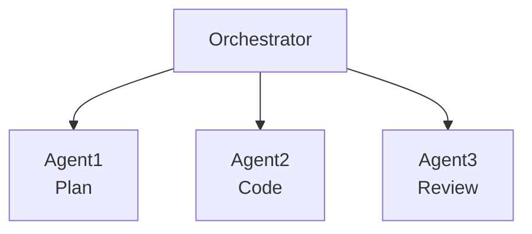
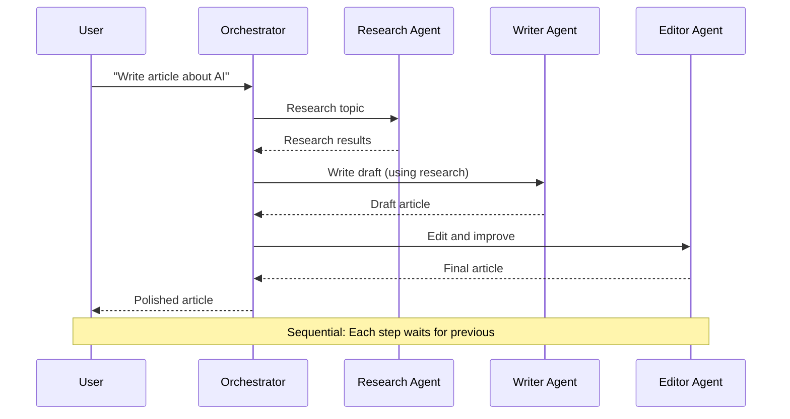
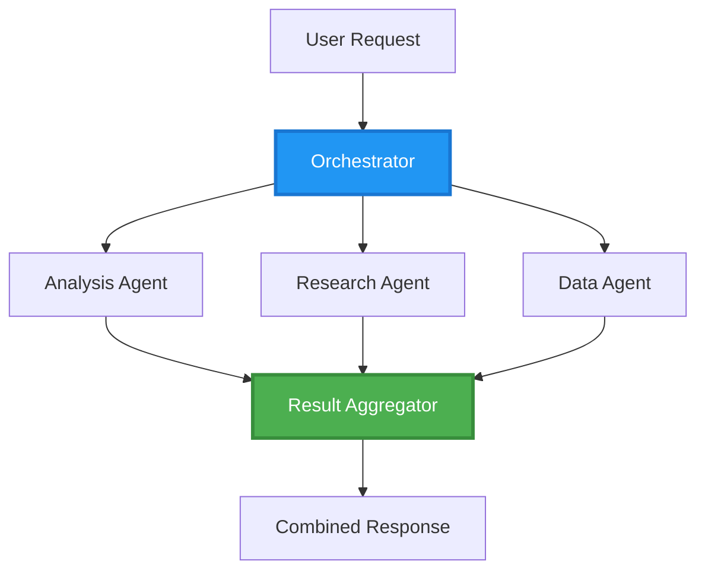
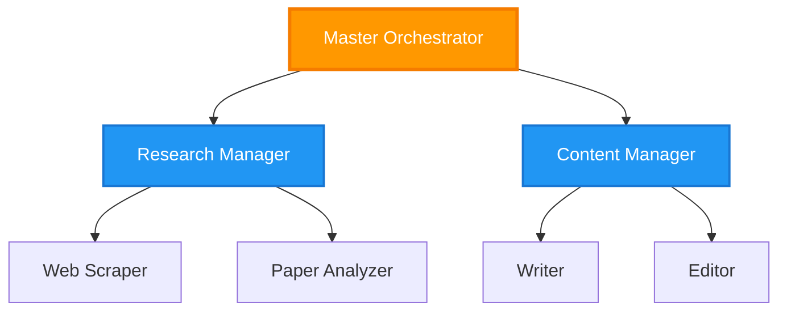
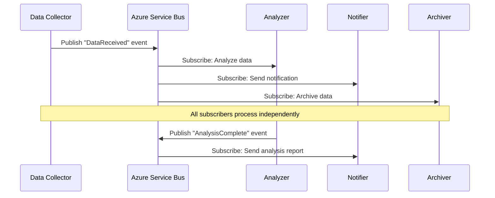
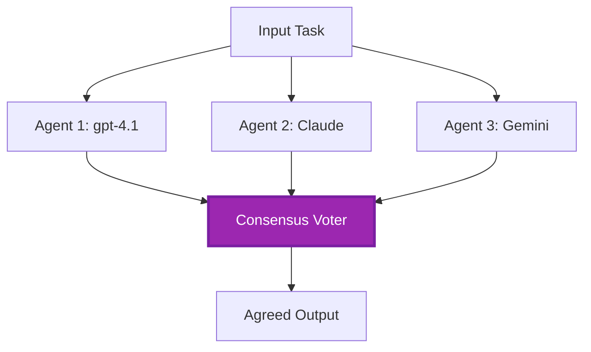
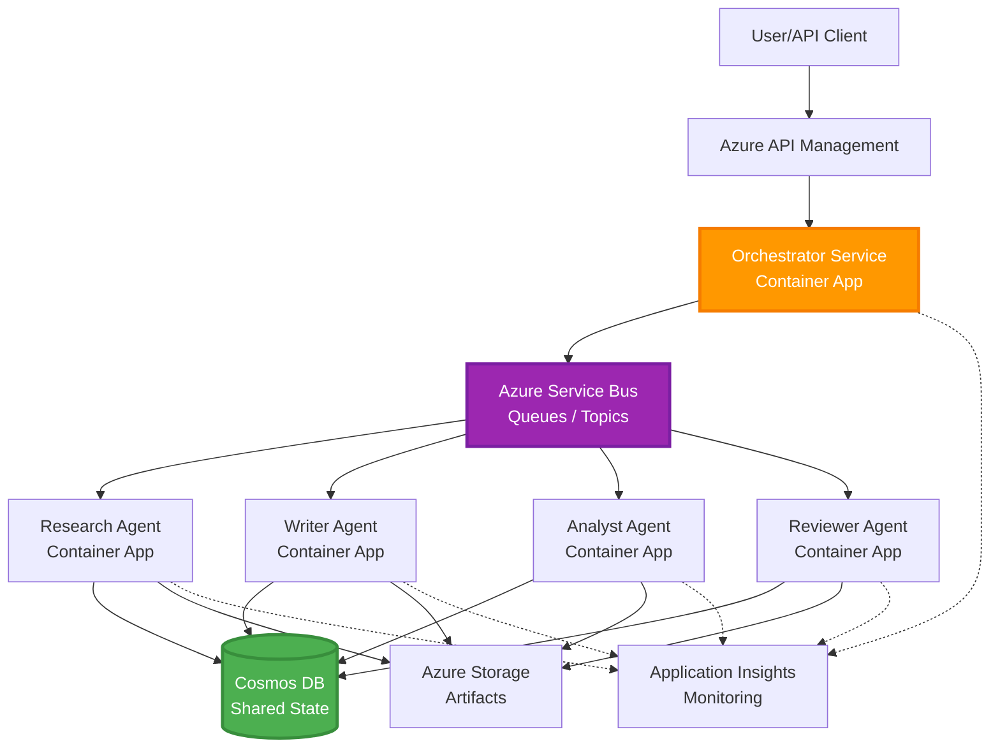

# Patronen voor Multi-Agent Coördinatie

⏱️ **Geschatte Tijd**: 60-75 minuten lezen; enkele uren om te implementeren | 💰 **Geschatte Kosten**: afhankelijk van werklast | ⭐ **Complexiteit**: Gevorderd

**📚 Leertraject:**
- ← Vorige: [Capacity Planning](capacity-planning.md) - Strategieën voor resource sizing en schaalvergroting
- 🎯 **Je Bent Hier**: Patronen voor Multi-Agent Coördinatie (Orkestratie, communicatie, staatbeheer)
- → Volgende: [SKU Selectie](sku-selection.md) - Het kiezen van de juiste Azure-diensten
- 🏠 [Cursus Startpagina](../../README.md)

---

## Wat Je Zal Leren

Door deze les te voltooien, zal je:
- Begrijpen van **multi-agent architectuur** patronen en wanneer ze te gebruiken
- Implementeren van **orkestratiepatronen** (gecentraliseerd, gedecentraliseerd, hiërarchisch)
- Ontwerpen van **agent communicatie** strategieën (synchroon, asynchroon, event-gedreven)
- Beheren van **gedeelde staat** over verspreide agenten
- Implementeren van **multi-agent systemen** op Azure met AZD
- Toepassen van **coördinatiepatronen** voor AI-scenario's in de praktijk
- Monitoren en debuggen van gedistribueerde agentsystemen

## Waarom Multi-Agent Coördinatie Belangrijk Is

### De Evolutie: Van Enkele Agent naar Multi-Agent

**Enkele Agent (Eenvoudig):**
```
User → Agent → Response
```
- ✅ Gemakkelijk te begrijpen en implementeren
- ✅ Snel voor eenvoudige taken
- ❌ Beperkt door capaciteiten van één model
- ❌ Kan complexe taken niet parallel uitvoeren
- ❌ Geen specialisatie

**Multi-Agent Systeem (Gevorderd):**

- ✅ Gespecialiseerde agenten voor specifieke taken
- ✅ Parallelle uitvoer voor snelheid
- ✅ Modulair en onderhoudbaar
- ✅ Beter voor complexe werkstromen
- ⚠️ Vereist coördinatielogica

**Analogie**: Een enkele agent is als één persoon die alle taken uitvoert. Multi-agent is als een team waar elk lid gespecialiseerde vaardigheden heeft (onderzoeker, programmeur, beoordelaar, schrijver) die samenwerken.

---

## Kern Coördinatiepatronen

### Patroon 1: Sequentiële Coördinatie (Chain of Responsibility)

**Wanneer te gebruiken**: Taken moeten in een specifieke volgorde worden voltooid, elke agent bouwt voort op de output van de vorige.



**Voordelen:**
- ✅ Duidelijke datastroom
- ✅ Gemakkelijk te debuggen
- ✅ Voorspelbare uitvoeringsvolgorde

**Beperkingen:**
- ❌ Trager (geen parallelisme)
- ❌ Eén falen blokkeert de hele keten
- ❌ Kan geen onderling afhankelijke taken afhandelen

**Voorbeeldtoepassingen:**
- Content creatie pipeline (onderzoek → schrijven → bewerken → publiceren)
- Code generatie (plannen → implementeren → testen → uitrollen)
- Rapportage generatie (dataverzameling → analyse → visualisatie → samenvatting)

---

### Patroon 2: Parallelle Coördinatie (Fan-Out/Fan-In)

**Wanneer te gebruiken**: Onafhankelijke taken kunnen gelijktijdig worden uitgevoerd, resultaten worden aan het einde gecombineerd.



**Voordelen:**
- ✅ Snel (parallelle uitvoering)
- ✅ Fouttolerant (gedeeltelijke resultaten zijn acceptabel)
- ✅ Schaalbaar horizontaal

**Beperkingen:**
- ⚠️ Resultaten kunnen buiten volgorde aankomen
- ⚠️ Vereist aggregatielogica
- ⚠️ Complex staatbeheer

**Voorbeeldtoepassingen:**
- Multi-source dataverzameling (APIs + databases + web scraping)
- Concurrentieanalyse (meerdere modellen genereren oplossingen, beste wordt gekozen)
- Vertalingsdiensten (gelijktijdig vertalen naar meerdere talen)

---

### Patroon 3: Hiërarchische Coördinatie (Manager-Worker)

**Wanneer te gebruiken**: Complexe werkstromen met sub-taken, delegatie is nodig.



**Voordelen:**
- ✅ Handelt complexe werkstromen af
- ✅ Modulair en onderhoudbaar
- ✅ Duidelijke verantwoordelijkheidsgrenzen

**Beperkingen:**
- ⚠️ Complexere architectuur
- ⚠️ Hogere latency (meerdere coördinatielagen)
- ⚠️ Vereist geavanceerde orkestratie

**Voorbeeldtoepassingen:**
- Enterprise documentverwerking (classificeren → routeren → verwerken → archiveren)
- Multi-stage datapijplijnen (inladen → schoonmaken → transformeren → analyseren → rapporteren)
- Complexe automatiseringswerkstromen (planning → resource allocatie → uitvoering → monitoring)

---

### Patroon 4: Event-gedreven Coördinatie (Publish-Subscribe)

**Wanneer te gebruiken**: Agenten moeten op gebeurtenissen reageren, losse koppeling gewenst.



**Voordelen:**
- ✅ Losse koppeling tussen agenten
- ✅ Gemakkelijk nieuwe agenten toe te voegen (gewoon abonneren)
- ✅ Asynchrone verwerking
- ✅ Veerkrachtig (berichtenpersistentie)

**Beperkingen:**
- ⚠️ Uiteindelijk consistente gegevens
- ⚠️ Complexe debugging
- ⚠️ Problemen met berichtvolgorde

**Voorbeeldtoepassingen:**
- Real-time monitoringsystemen (meldingen, dashboards, logs)
- Multikanaal notificaties (e-mail, sms, push, Slack)
- Dataverwerkingspijplijnen (meerdere consumenten van dezelfde data)

---

### Patroon 5: Consensus-gebaseerde Coördinatie (Stemmen/Quorum)

**Wanneer te gebruiken**: Instemming nodig van meerdere agenten voordat door te gaan.



**Voordelen:**
- ✅ Hogere nauwkeurigheid (meerdere meningen)
- ✅ Fouttolerant (minderheidsfouten acceptabel)
- ✅ Kwaliteitsborging ingebouwd

**Beperkingen:**
- ❌ Duur (meerdere model-aanroepen)
- ❌ Trager (wachten op alle agenten)
- ⚠️ Benodigde conflictoplossing

**Voorbeeldtoepassingen:**
- Content moderatie (meerdere modellen beoordelen content)
- Code review (meerdere linters/analyzers)
- Medische diagnose (meerdere AI-modellen, deskundige validatie)

---

## Architectuuroverzicht

### Compleet Multi-Agent Systeem op Azure



**Belangrijke Componenten:**

| Component | Doel | Azure Dienst |
|-----------|---------|---------------|
| **API Gateway** | Ingangspunt, rate limiting, authenticatie | API Management |
| **Orkestrator** | Coördineert agent werkstromen | Container Apps |
| **Berichtenwachtrij** | Asynchrone communicatie | Service Bus / Event Hubs |
| **Agenten** | Gespecialiseerde AI-werkers | Container Apps / Functions |
| **Statusopslag** | Gedeelde staat, taaktracking | Cosmos DB |
| **Artifact Opslag** | Documenten, resultaten, logs | Blob Storage |
| **Monitoring** | Gedistribueerde tracing, logs | Application Insights |

Service Bus-wachtrijen/topics en Event Hubs zijn verschillende diensten met verschillende leverings-/consumptiemodellen; Event Hubs is geen drop-in vervanging voor de Service Bus worker code hieronder. Parallelisme, gepersisteerde berichten en modelstemmen garanderen op zich geen fouttolerantie of hogere nauwkeurigheid.

---

## Vereisten

### Vereiste Tools

```bash
# Verify Azure Developer CLI
azd version
# Command reference baseline: azd 1.37.2

# Verify Azure CLI
az --version
# ✅ Expected: azure-cli 2.50.0 or higher

# Verify Docker (for local testing)
docker --version
# ✅ Expected: Docker version 20.10 or higher
```

### Azure Vereisten

- Actief Azure-abonnement
- Machtigingen om te creëren:
  - Container Apps
  - Service Bus namespaces
  - Cosmos DB-accounts
  - Storage accounts
  - Application Insights

### Kennisvereisten

Je zou afgerond moeten hebben:
- [Configuratiebeheer](../chapter-03-configuration/configuration.md)
- [Authenticatie & Beveiliging](../chapter-03-configuration/authsecurity.md)
- [Microservices Voorbeeld](../../../../examples/microservices)

---

## Implementatiehandleiding

> **Ontwerpfragmenten, geen inzetbare lab:** De projectstructuur en `File:` labels hieronder beschrijven bestanden om in je eigen project te creëren; deze repository bevat geen volledige `multi-agent-system` applicatie. Ontbrekende stukken zijn onder andere main/parameter templates, Container Apps omgeving/registry, Dockerfiles en dependency locks, Cosmos database/container setup, modelimplementaties, identiteit/rolconfiguratie, schaalregels, en parallelle workers/wachtrijen. Verwacht niet dat `azd init` deze bestanden genereert of `azd up` de codefragmenten ongewijzigd implementeert. Voor een uitvoerbaar startpunt, voltooi [Multi-Agent Basics](../chapter-05-multi-agent/multi-agent-basics.md).

**Runtime veronderstellingen:** Python 3.10+, `azure-servicebus`, `azure-cosmos`, `openai`, Flask, en (voor monitoring) `azure-monitor-opentelemetry`; zet `shared` op het Python import pad in elke service image. De Cosmos `agent-state/tasks` container moet al bestaan met partitiesleutel `/id`. Sleutel-gebaseerde connecties vereenvoudigen deze fragmenten, zijn geen productieadvies: geef de voorkeur aan managed identities met gescopeerde Service Bus/Cosmos/OpenAI data-vlak rollen. Maak sleutels niet publiek in outputs of logs.

Service Bus levering is **minstens één keer**. Bewaar idempotentie per taak **en stap**, gebruik optimistische gelijktijdigheid (ETags) voor lezen/wijzigen/schrijven van staat, en vernieuw berichtenlocks tijdens langdurige verwerking. De eenvoudige state manager hieronder is alleen sequentieel en implementeert deze productiegaranties niet.

### Projectstructuur

```
multi-agent-system/
├── azure.yaml                    # AZD configuration
├── infra/
│   ├── main.bicep               # Main infrastructure
│   ├── core/
│   │   ├── servicebus.bicep     # Message queue
│   │   ├── cosmos.bicep         # State store
│   │   ├── storage.bicep        # Artifact storage
│   │   └── monitoring.bicep     # Application Insights
│   └── app/
│       ├── orchestrator.bicep   # Orchestrator service
│       └── agent.bicep          # Agent template
└── src/
    ├── orchestrator/            # Orchestration logic
    │   ├── app.py
    │   ├── workflows.py
    │   └── Dockerfile
    ├── agents/
    │   ├── research/            # Research agent
    │   ├── writer/              # Writer agent
    │   ├── analyst/             # Analyst agent
    │   └── reviewer/            # Reviewer agent
    └── shared/
        ├── state_manager.py     # Shared state logic
        └── message_handler.py   # Message handling
```

---

## Les 1: Sequentieel Coördinatiepatroon

### Implementatie: Content Creatiepipeline

Laten we een sequentiële pipeline ontwerpen: Onderzoek → Schrijven → Bewerken. Publicatie valt buiten dit voorbeeld.

### 1. AZD Configuratie

**Bestand: `azure.yaml`**

```yaml
name: content-pipeline
metadata:
  template: multi-agent-sequential@1.0.0

services:
  orchestrator:
    project: ./src/orchestrator
    language: python
    host: containerapp
  
  research-agent:
    project: ./src/agents/research
    language: python
    host: containerapp
  
  writer-agent:
    project: ./src/agents/writer
    language: python
    host: containerapp
  
  editor-agent:
    project: ./src/agents/editor
    language: python
    host: containerapp
```

### 2. Infrastructuur: Service Bus voor Coördinatie

**Bestand: `infra/core/servicebus.bicep`**

```bicep
param name string
param location string
param tags object = {}

resource serviceBusNamespace 'Microsoft.ServiceBus/namespaces@2022-10-01-preview' = {
  name: name
  location: location
  tags: tags
  sku: {
    name: 'Standard'
    tier: 'Standard'
  }
  properties: {
    minimumTlsVersion: '1.2'
  }
}

// Queue for orchestrator → research agent
resource researchQueue 'Microsoft.ServiceBus/namespaces/queues@2022-10-01-preview' = {
  parent: serviceBusNamespace
  name: 'research-tasks'
  properties: {
    maxDeliveryCount: 3
    lockDuration: 'PT5M'
    deadLetteringOnMessageExpiration: true
  }
}

// Queue for research agent → writer agent
resource writerQueue 'Microsoft.ServiceBus/namespaces/queues@2022-10-01-preview' = {
  parent: serviceBusNamespace
  name: 'writer-tasks'
  properties: {
    maxDeliveryCount: 3
    lockDuration: 'PT5M'
  }
}

// Queue for writer agent → editor agent
resource editorQueue 'Microsoft.ServiceBus/namespaces/queues@2022-10-01-preview' = {
  parent: serviceBusNamespace
  name: 'editor-tasks'
  properties: {
    maxDeliveryCount: 3
    lockDuration: 'PT5M'
  }
}

output namespace string = serviceBusNamespace.name
// Do not output RootManageSharedAccessKey. Resolve scoped credentials
// securely or use managed identity in the application and scale rules.
```

### 3. Shared State Manager

**Bestand: `src/shared/state_manager.py`**

```python
from azure.cosmos import CosmosClient, PartitionKey
from datetime import datetime, timezone
import os

class StateManager:
    """Manages shared state across agents using Cosmos DB"""
    
    def __init__(self):
        endpoint = os.environ['COSMOS_ENDPOINT']
        key = os.environ['COSMOS_KEY']
        
        self.client = CosmosClient(endpoint, key)
        self.database = self.client.get_database_client('agent-state')
        self.container = self.database.get_container_client('tasks')
    
    def create_task(self, task_id: str, task_type: str, input_data: dict):
        """Create a new task"""
        task = {
            'id': task_id,
            'type': task_type,
            'status': 'pending',
            'input': input_data,
            'created_at': datetime.now(timezone.utc).isoformat(),
            'steps': []
        }
        self.container.create_item(task)
        return task
    
    def update_task_step(self, task_id: str, step_name: str, result: dict):
        """Update task with completed step"""
        task = self.container.read_item(task_id, partition_key=task_id)
        
        task['steps'].append({
            'name': step_name,
            'completed_at': datetime.now(timezone.utc).isoformat(),
            'result': result
        })
        
        self.container.replace_item(task_id, task)
        return task
    
    def complete_task(self, task_id: str, final_result: dict):
        """Mark task as complete"""
        task = self.container.read_item(task_id, partition_key=task_id)
        task['status'] = 'completed'
        task['result'] = final_result
        task['completed_at'] = datetime.now(timezone.utc).isoformat()
        self.container.replace_item(task_id, task)
        return task
    
    def get_task(self, task_id: str):
        """Retrieve task state"""
        return self.container.read_item(task_id, partition_key=task_id)
```

### 4. Orkestrator Service

**Bestand: `src/orchestrator/app.py`**

```python
from flask import Flask, request, jsonify
from azure.servicebus import ServiceBusClient, ServiceBusMessage
import json
import uuid
import os
from shared.state_manager import StateManager

app = Flask(__name__)
state_manager = StateManager()

# Service Bus connection
servicebus_connection_str = os.environ['SERVICEBUS_CONNECTION_STRING']
servicebus_client = ServiceBusClient.from_connection_string(servicebus_connection_str)

@app.route('/health', methods=['GET'])
def health():
    return jsonify({'status': 'healthy', 'service': 'orchestrator'})

@app.route('/create-content', methods=['POST'])
def create_content():
    """
    Sequential workflow: Research → Write → Edit (returns a draft; no publishing)
    """
    data = request.get_json(silent=True) or {}
    topic = data.get('topic')
    
    if not topic:
        return jsonify({'error': 'Topic required'}), 400
    
    # Create task in state store
    task_id = str(uuid.uuid4())
    task = state_manager.create_task(
        task_id=task_id,
        task_type='content_creation',
        input_data={'topic': topic}
    )
    
    # Send message to research agent (first step)
    sender = servicebus_client.get_queue_sender('research-tasks')
    message = ServiceBusMessage(
        body=json.dumps({
            'task_id': task_id,
            'topic': topic,
            'next_queue': 'writer-tasks'  # Where to send results
        }),
        content_type='application/json'
    )
    
    with sender:
        sender.send_messages(message)
    
    return jsonify({
        'task_id': task_id,
        'status': 'started',
        'workflow': 'sequential',
        'steps': ['research', 'write', 'edit'],
        'message': 'Content creation pipeline initiated'
    }), 202

@app.route('/task/<task_id>', methods=['GET'])
def get_task_status(task_id):
    """Check task status"""
    try:
        task = state_manager.get_task(task_id)
        return jsonify(task)
    except Exception as e:
        return jsonify({'error': str(e)}), 404

if __name__ == '__main__':
    app.run(host='0.0.0.0', port=8080)
```

### 5. Onderzoeksagent

**Bestand: `src/agents/research/app.py`**

```python
from azure.servicebus import ServiceBusClient, ServiceBusMessage
from openai import AzureOpenAI
import json
import os
import time
from shared.state_manager import StateManager

# Initialize clients
state_manager = StateManager()
servicebus_client = ServiceBusClient.from_connection_string(
    os.environ['SERVICEBUS_CONNECTION_STRING']
)

openai_client = AzureOpenAI(
    api_key=os.environ['AZURE_OPENAI_API_KEY'],
    api_version="2024-10-21",
    azure_endpoint=os.environ['AZURE_OPENAI_ENDPOINT']
)

def process_research_task(message_data):
    """Process research request and pass to writer"""
    task_id = message_data['task_id']
    topic = message_data['topic']
    next_queue = message_data['next_queue']
    
    print(f"🔬 Researching: {topic}")
    
    # Call Microsoft Foundry Models for research
    response = openai_client.chat.completions.create(
        model=os.environ['AZURE_OPENAI_DEPLOYMENT'],
        messages=[
            {"role": "system", "content": "You are a research assistant. Provide comprehensive research on the given topic."},
            {"role": "user", "content": f"Research this topic thoroughly: {topic}"}
        ],
        max_tokens=1500
    )
    
    research_results = response.choices[0].message.content
    
    # Update state
    state_manager.update_task_step(
        task_id=task_id,
        step_name='research',
        result={'research': research_results}
    )
    
    # Send to next agent (writer)
    sender = servicebus_client.get_queue_sender(next_queue)
    message = ServiceBusMessage(
        body=json.dumps({
            'task_id': task_id,
            'topic': topic,
            'research': research_results,
            'next_queue': 'editor-tasks'
        }),
        content_type='application/json'
    )
    
    with sender:
        sender.send_messages(message)
    
    print(f"✅ Research complete for task {task_id}")

def main():
    """Listen to research queue"""
    receiver = servicebus_client.get_queue_receiver('research-tasks')
    
    print("🔬 Research Agent started, listening for tasks...")
    
    with receiver:
        while True:
            messages = receiver.receive_messages(max_wait_time=5)
            for message in messages:
                try:
                    message_data = json.loads(str(message))
                    process_research_task(message_data)
                    receiver.complete_message(message)
                except Exception as e:
                    print(f"❌ Error processing message: {e}")
                    receiver.abandon_message(message)

if __name__ == '__main__':
    main()
```

### 6. Schrijversagent

**Bestand: `src/agents/writer/app.py`**

```python
from azure.servicebus import ServiceBusClient, ServiceBusMessage
from openai import AzureOpenAI
import json
import os
from shared.state_manager import StateManager

state_manager = StateManager()
servicebus_client = ServiceBusClient.from_connection_string(
    os.environ['SERVICEBUS_CONNECTION_STRING']
)

openai_client = AzureOpenAI(
    api_key=os.environ['AZURE_OPENAI_API_KEY'],
    api_version="2024-10-21",
    azure_endpoint=os.environ['AZURE_OPENAI_ENDPOINT']
)

def process_writing_task(message_data):
    """Write article based on research"""
    task_id = message_data['task_id']
    topic = message_data['topic']
    research = message_data['research']
    next_queue = message_data['next_queue']
    
    print(f"✍️ Writing article: {topic}")
    
    # Call Microsoft Foundry Models to write article
    response = openai_client.chat.completions.create(
        model=os.environ['AZURE_OPENAI_DEPLOYMENT'],
        messages=[
            {"role": "system", "content": "You are a professional writer. Write engaging, well-structured articles."},
            {"role": "user", "content": f"Based on this research:\n\n{research}\n\nWrite a comprehensive article about: {topic}"}
        ],
        max_tokens=2000
    )
    
    article_draft = response.choices[0].message.content
    
    # Update state
    state_manager.update_task_step(
        task_id=task_id,
        step_name='writing',
        result={'draft': article_draft}
    )
    
    # Send to editor
    sender = servicebus_client.get_queue_sender(next_queue)
    message = ServiceBusMessage(
        body=json.dumps({
            'task_id': task_id,
            'topic': topic,
            'draft': article_draft
        }),
        content_type='application/json'
    )
    
    with sender:
        sender.send_messages(message)
    
    print(f"✅ Article draft complete for task {task_id}")

def main():
    """Listen to writer queue"""
    receiver = servicebus_client.get_queue_receiver('writer-tasks')
    
    print("✍️ Writer Agent started, listening for tasks...")
    
    with receiver:
        while True:
            messages = receiver.receive_messages(max_wait_time=5)
            for message in messages:
                try:
                    message_data = json.loads(str(message))
                    process_writing_task(message_data)
                    receiver.complete_message(message)
                except Exception as e:
                    print(f"❌ Error: {e}")
                    receiver.abandon_message(message)

if __name__ == '__main__':
    main()
```

### 7. Redacteursagent

**Bestand: `src/agents/editor/app.py`**

```python
from azure.servicebus import ServiceBusClient
from openai import AzureOpenAI
import json
import os
from shared.state_manager import StateManager

state_manager = StateManager()
servicebus_client = ServiceBusClient.from_connection_string(
    os.environ['SERVICEBUS_CONNECTION_STRING']
)

openai_client = AzureOpenAI(
    api_key=os.environ['AZURE_OPENAI_API_KEY'],
    api_version="2024-10-21",
    azure_endpoint=os.environ['AZURE_OPENAI_ENDPOINT']
)

def process_editing_task(message_data):
    """Edit and finalize article"""
    task_id = message_data['task_id']
    topic = message_data['topic']
    draft = message_data['draft']
    
    print(f"📝 Editing article: {topic}")
    
    # Call Microsoft Foundry Models to edit
    response = openai_client.chat.completions.create(
        model=os.environ['AZURE_OPENAI_DEPLOYMENT'],
        messages=[
            {"role": "system", "content": "You are an expert editor. Improve grammar, clarity, and structure."},
            {"role": "user", "content": f"Edit and improve this article:\n\n{draft}"}
        ],
        max_tokens=2000
    )
    
    final_article = response.choices[0].message.content
    
    # Mark task as complete
    state_manager.complete_task(
        task_id=task_id,
        final_result={
            'topic': topic,
            'final_article': final_article,
            'word_count': len(final_article.split())
        }
    )
    
    print(f"✅ Article finalized for task {task_id}")

def main():
    """Listen to editor queue"""
    receiver = servicebus_client.get_queue_receiver('editor-tasks')
    
    print("📝 Editor Agent started, listening for tasks...")
    
    with receiver:
        while True:
            messages = receiver.receive_messages(max_wait_time=5)
            for message in messages:
                try:
                    message_data = json.loads(str(message))
                    process_editing_task(message_data)
                    receiver.complete_message(message)
                except Exception as e:
                    print(f"❌ Error: {e}")
                    receiver.abandon_message(message)

if __name__ == '__main__':
    main()
```

### 8. Uitrollen en Testen

Deze opdrachten zijn **alleen van toepassing nadat je de ontbrekende projectbestanden hebt geïmplementeerd**. Interactieve Foundry agent initialisatie is een aparte workflow; dit genereert niet dit Service Bus ontwerp.

```bash
# In your completed custom project
azd up

# Alternative in a SEPARATE empty folder (agents beta.23 requires azd >= 1.37)
azd extension install azure.ai.agents
azd ai agent init
azd up
```

> Zie [AZD AI CLI Commands](../chapter-08-production/production-ai-practices.md#azd-ai-cli-commands-and-extensions) voor alle `azd ai` vlaggen en opties.

```bash
# Get orchestrator URL
ORCHESTRATOR_URL=$(azd env get-values | grep ORCHESTRATOR_URL | cut -d '=' -f2 | tr -d '"')

# Create content
curl -X POST $ORCHESTRATOR_URL/create-content \
  -H "Content-Type: application/json" \
  -d '{"topic": "The Future of AI in Healthcare"}'
```

**✅ Verwachte output:**
```json
{
  "task_id": "a1b2c3d4-e5f6-7890-abcd-ef1234567890",
  "status": "started",
  "workflow": "sequential",
  "steps": ["research", "write", "edit"],
  "message": "Content creation pipeline initiated"
}
```

**Controleer taakvoortgang:**
```bash
TASK_ID="a1b2c3d4-e5f6-7890-abcd-ef1234567890"
curl $ORCHESTRATOR_URL/task/$TASK_ID
```

**✅ Verwachte output (voltooid):**
```json
{
  "id": "a1b2c3d4-e5f6-7890-abcd-ef1234567890",
  "type": "content_creation",
  "status": "completed",
  "steps": [
    {
      "name": "research",
      "completed_at": "2025-11-19T10:30:00Z",
      "result": {"research": "..."}
    },
    {
      "name": "writing",
      "completed_at": "2025-11-19T10:32:00Z",
      "result": {"draft": "..."}
    }
  ],
  "result": {
    "topic": "The Future of AI in Healthcare",
    "final_article": "...",
    "word_count": 1500
  }
}
```

---

## Les 2: Parallel Coördinatiepatroon

### Implementatie: Multi-Source Onderzoeksaggregator

Laten we een parallel systeem bouwen dat gelijktijdig informatie uit meerdere bronnen verzamelt.

### Parallelle Orkestrator

**Bestand: `src/orchestrator/parallel_workflow.py`**

```python
from flask import Flask, request, jsonify
from azure.servicebus import ServiceBusClient, ServiceBusMessage
import json
import uuid
import os
from shared.state_manager import StateManager

app = Flask(__name__)
state_manager = StateManager()

servicebus_client = ServiceBusClient.from_connection_string(
    os.environ['SERVICEBUS_CONNECTION_STRING']
)

@app.route('/research-parallel', methods=['POST'])
def research_parallel():
    """
    Parallel workflow: Multiple agents work simultaneously
    """
    data = request.json
    query = data.get('query')
    
    task_id = str(uuid.uuid4())
    task = state_manager.create_task(
        task_id=task_id,
        task_type='parallel_research',
        input_data={
            'query': query,
            'agents': ['web', 'academic', 'news', 'social']
        }
    )
    
    # Fan-out: publish sequentially; workers may process concurrently.
    agents = [
        ('web-research-queue', 'web'),
        ('academic-research-queue', 'academic'),
        ('news-research-queue', 'news'),
        ('social-research-queue', 'social')
    ]
    
    for queue_name, agent_type in agents:
        sender = servicebus_client.get_queue_sender(queue_name)
        message = ServiceBusMessage(
            body=json.dumps({
                'task_id': task_id,
                'query': query,
                'agent_type': agent_type,
                'result_queue': 'aggregation-queue'
            }),
            content_type='application/json'
        )
        
        with sender:
            sender.send_messages(message)
    
    return jsonify({
        'task_id': task_id,
        'status': 'started',
        'workflow': 'parallel',
        'agents_dispatched': 4,
        'message': 'Parallel research initiated'
    }), 202

if __name__ == '__main__':
    app.run(host='0.0.0.0', port=8080)
```

### Aggregatielogica

**Bestand: `src/agents/aggregator/app.py`**

```python
from azure.servicebus import ServiceBusClient
import json
import os
from collections import defaultdict
from shared.state_manager import StateManager

state_manager = StateManager()
servicebus_client = ServiceBusClient.from_connection_string(
    os.environ['SERVICEBUS_CONNECTION_STRING']
)

# Single-process demo only: not durable or shared across replicas.
# Production: use durable unique (task_id, agent_type) result records.
task_results = defaultdict(dict)
expected_agents = 4  # web, academic, news, social

def process_result(message_data):
    """Aggregate results from parallel agents"""
    task_id = message_data['task_id']
    agent_type = message_data['agent_type']
    result = message_data['result']
    
    # Store result
    task_results[task_id][agent_type] = {
        'agent': agent_type,
        'data': result
    }
    
    print(f"📊 Received result from {agent_type} agent ({len(task_results[task_id])}/{expected_agents})")
    
    # Check if all agents completed (fan-in)
    if len(task_results[task_id]) == expected_agents:
        print(f"✅ All agents completed for task {task_id}. Aggregating...")
        
        # Combine results
        aggregated = {
            'query': message_data['query'],
            'sources': list(task_results[task_id].values()),
            'summary': generate_summary(list(task_results[task_id].values()))
        }
        
        # Mark complete
        state_manager.complete_task(task_id, aggregated)
        
        # Clean up
        del task_results[task_id]
        
        print(f"✅ Aggregation complete for task {task_id}")

def generate_summary(results):
    """Generate summary from all sources"""
    summaries = [r['data'].get('summary', '') for r in results]
    return '\n\n'.join(summaries)

def main():
    """Listen to aggregation queue"""
    receiver = servicebus_client.get_queue_receiver('aggregation-queue')
    
    print("📊 Aggregator started, listening for results...")
    
    with receiver:
        while True:
            messages = receiver.receive_messages(max_wait_time=5)
            for message in messages:
                try:
                    message_data = json.loads(str(message))
                    process_result(message_data)
                    receiver.complete_message(message)
                except Exception as e:
                    print(f"❌ Error: {e}")
                    receiver.abandon_message(message)

if __name__ == '__main__':
    main()
```

**Voordelen van Parallel Patroon:**
- ⚡ **Mogelijk lagere latency** (beperkt door de langzaamste werker plus coördinatie overhead)
- 🔄 **Kan gedeeltelijke resultaten ondersteunen** met expliciete deadlines en faalbeleid (niet geïmplementeerd door de basisaggregator)
- 📈 **Schaalbaar** (voeg gemakkelijk meer agenten toe)

---

## Praktische Oefeningen

### Oefening 1: Timeout Afhandeling Toevoegen ⭐⭐ (Middenniveau)

**Doel**: Implementeer timeoutlogica zodat de aggregator niet voor altijd wacht op trage agenten.

**Startpunt:** Voer deze lokale deadline simulatie uit voordat je deze integreert in een wachtrijworker. Een timeout die alleen wordt gecontroleerd wanneer een ander bericht arriveert, vuurt nooit af als de missende werker niets stuurt.

**Stappen**:

1. **Voeg timeout tracking toe aan aggregator:**

```python
import asyncio

async def simulated_agent(name, delay):
    await asyncio.sleep(delay)
    return {'agent': name, 'result': 'done'}

async def main():
    tasks = [asyncio.create_task(simulated_agent(name, delay))
             for name, delay in [('web', 0.1), ('academic', 0.2),
                                 ('news', 0.3), ('social', 3)]]
    done, pending = await asyncio.wait(tasks, timeout=1)
    results = [task.result() for task in done]
    for task in pending:
        task.cancel()
    await asyncio.gather(*pending, return_exceptions=True)
    print({'completed_agents': len(results), 'timed_out': bool(pending)})
    assert len(results) == 3 and pending

asyncio.run(main())
```

2. **Verwachte output:**

```text
{'completed_agents': 3, 'timed_out': True}
```

3. **Wachtrijsysteem integratie (ontwerptaak):** Bewaar de dispatch deadline en verwachte agenten bij het aanmaken van de taak, voer periodieke deadline sweep uit onafhankelijk van binnenkomende resultaten, finaliseer atomair gedeeltelijke resultaten en negeer late/dubbele berichten voor gefinaliseerde taken. Een lokale timeout annuleert geen externe werkers.

Alleen voor je geïmplementeerde project:

```bash
azd deploy aggregator

# Submit task
curl -X POST $ORCHESTRATOR_URL/research-parallel \
  -H "Content-Type: application/json" \
  -d '{"query": "AI safety research"}'

# Check results after 30 seconds
curl $ORCHESTRATOR_URL/task/$TASK_ID
```

**✅ Succescriteria:**
- ✅ De lokale test beëindigt na de één-seconde deadline zelfs als een agent onvolledig is
- ✅ Respons geeft gedeeltelijke resultaten aan (`"timed_out": true`)
- ✅ Beschikbare resultaten worden geretourneerd (3 van 4 agenten)

**Tijd**: 20-25 minuten

---

### Oefening 2: Retrylogica Implementeer ⭐⭐⭐ (Gevorderd)

**Doel**: Probeer automatisch mislukte agenttaken opnieuw voordat je opgeeft.

**Stappen**:

1. **Gebruik Service Bus leveringsaantallen in plaats van herinvoeren van aangepaste retry-tellers:**

```python
import json
import time
# Integration fragment: use a live peek-lock ServiceBusReceiver.
# Set queue maxDeliveryCount to 4 for one attempt + up to three retries.
```

2. **Voeg retry-handler toe aan agenten:**

```python
def process_with_retry(message, receiver, process_func):
    """Process message with automatic retry on failure"""
    try:
        message_data = json.loads(str(message))
        
        # Process the message
        process_func(message_data)
        
        # Success - complete
        receiver.complete_message(message)
        
    except Exception as e:
        if message.delivery_count < 4:
            # Bounded exponential delay: 5s, 10s, 20s.
            # Renew the lock if processing + waiting can exceed its duration.
            time.sleep(5 * 2 ** (message.delivery_count - 1))
            receiver.abandon_message(message)
        else:
            # Max retries exceeded - move to dead letter queue
            print(f"❌ Max attempts exceeded for message {message.message_id}")
            receiver.dead_letter_message(
                message,
                reason="MaxRetriesExceeded",
                error_description=str(e)
            )
```

3. **Monitor dead letter queue:**

```python
def monitor_dead_letters():
    """Check dead letter queue for failed messages"""
    receiver = servicebus_client.get_queue_receiver(
        'research-tasks',
        sub_queue='deadletter'
    )
    
    with receiver:
        messages = receiver.receive_messages(max_wait_time=5)
        for message in messages:
            print(f"☠️ Dead letter: {message.message_id}")
            print(f"Reason: {message.dead_letter_reason}")
            print(f"Description: {message.dead_letter_error_description}")
```

**✅ Succescriteria:**
- ✅ Mislukte taken worden automatisch opnieuw geprobeerd (tot 3 keer)
- ✅ Exponentiële backoff tussen retries (5s, 10s, 20s), met vernieuwing van berichtlock waar nodig
- ✅ Na maximale retries gaan berichten naar dead letter queue
- ✅ Dead letter berichten kunnen worden geïnspecteerd; replay vereist aparte idempotente herstelworkflow

**Tijd**: 30-40 minuten

---

### Oefening 3: Circuit Breaker Implementeren ⭐⭐⭐ (Gevorderd)

**Doel**: Voorkom kettingfalen door verzoeken aan falende agenten te stoppen.

**Stappen**:

1. **Maak circuit breaker klasse:**

```python
from enum import Enum
from datetime import datetime, timedelta, timezone

class CircuitState(Enum):
    CLOSED = "closed"      # Normal operation
    OPEN = "open"          # Failing, reject requests
    HALF_OPEN = "half_open"  # Testing if recovered

class CircuitBreaker:
    def __init__(self, failure_threshold=5, timeout_seconds=60):
        self.failure_threshold = failure_threshold
        self.timeout_seconds = timeout_seconds
        self.failure_count = 0
        self.last_failure_time = None
        self.state = CircuitState.CLOSED
    
    def call(self, func):
        """Execute function with circuit breaker protection"""
        if self.state == CircuitState.OPEN:
            # Check if timeout expired
            if datetime.now(timezone.utc) - self.last_failure_time > timedelta(seconds=self.timeout_seconds):
                self.state = CircuitState.HALF_OPEN
                print("🔄 Circuit breaker: HALF_OPEN (testing)")
            else:
                raise Exception(f"Circuit breaker OPEN for agent. Try again in {self.timeout_seconds}s")
        
        try:
            result = func()
            
            # Success
            self.failure_count = 0 # Count consecutive failures only
            if self.state == CircuitState.HALF_OPEN:
                self.state = CircuitState.CLOSED
                self.failure_count = 0
                print("✅ Circuit breaker: CLOSED (recovered)")
            
            return result
            
        except Exception as e:
            self.failure_count += 1
            self.last_failure_time = datetime.now(timezone.utc)
            
            if self.failure_count >= self.failure_threshold:
                self.state = CircuitState.OPEN
                print(f"🔴 Circuit breaker: OPEN (too many failures)")
            
            raise
```

2. **Pas toe op agent-aanroepen:**

```python
# In orchestrator
agent_circuits = {
    'web': CircuitBreaker(failure_threshold=5, timeout_seconds=60),
    'academic': CircuitBreaker(failure_threshold=5, timeout_seconds=60),
    'news': CircuitBreaker(failure_threshold=5, timeout_seconds=60),
    'social': CircuitBreaker(failure_threshold=5, timeout_seconds=60)
}

def send_to_agent(agent_type, message_data):
    """Send with circuit breaker protection"""
    circuit = agent_circuits[agent_type]
    
    try:
        circuit.call(lambda: send_message(agent_type, message_data))
    except Exception as e:
        print(f"⚠️ Skipping {agent_type} agent: {e}")
        # Continue with other agents
```

Deze schakeling beschermt de **zendoperatie**, niet de voltooiing door de externe werker: het succesvol in de wachtrij plaatsen van een bericht zegt niets over of een agent actief is. `send_message` is de verzendfunctie van jouw applicatie. Voer bij uitvoering van schakelingen waargenomen taakfouten/time-outs in een duurzame coördinator in. Deze in-memory klasse is een demonstratie in één thread, geen gedistribueerde circuit breaker.

3. **Test de circuit breaker lokaal:**

```python
# Run after the class definition; no Azure changes required.
circuit = CircuitBreaker(failure_threshold=5, timeout_seconds=0)
def fail():
    raise RuntimeError("simulated failure")
for _ in range(5):
    try:
        circuit.call(fail)
    except RuntimeError:
        pass
assert circuit.state == CircuitState.OPEN
assert circuit.call(lambda: "recovered") == "recovered"
assert circuit.state == CircuitState.CLOSED
print("Circuit breaker recovery verified")
```

**✅ Succescriteria:**
- ✅ Na 5 fouten opent de circuit (weigert verzoeken)
- ✅ Na 60 seconden gaat de circuit half-open (test herstel)
- ✅ Andere agents blijven normaal werken
- ✅ Circuit sluit automatisch als agent herstelt

**Tijd**: 40-50 minuten

---

## Monitoring en Debugging

### Gedistribueerde Tracing met Application Insights

**Bestand: `src/shared/tracing.py`**

```python
from azure.monitor.opentelemetry import configure_azure_monitor
from opentelemetry import trace
from opentelemetry.trace import SpanKind
import logging
import os

connection_string = os.environ.get('APPLICATIONINSIGHTS_CONNECTION_STRING')

# Configure once per process. Message send/receive trace-context propagation
# and agent attributes on exceptions need explicit instrumentation.
if connection_string:
    configure_azure_monitor(connection_string=connection_string, logger_name=__name__)
tracer = trace.get_tracer(__name__)

# Configure logging
logger = logging.getLogger(__name__)
logger.setLevel(logging.INFO)

def trace_agent_call(agent_name, task_id, operation_name, operation):
    """Trace agent operations"""
    with tracer.start_as_current_span(f'agent.{agent_name}.{operation_name}', kind=SpanKind.CLIENT) as span:
        span.set_attribute('agent', agent_name)
        span.set_attribute('task_id', task_id)
        span.set_attribute('operation', operation_name)
        
        try:
            result = operation()
            span.set_attribute('status', 'success')
            logger.info('Agent operation completed', extra={
                'agent': agent_name, 'task_id': task_id, 'operation': operation_name
            })
            return result
        except Exception as e:
            span.set_attribute('status', 'error')
            logger.exception('Agent operation failed', extra={
                'agent': agent_name, 'task_id': task_id, 'operation': operation_name
            })
            raise
```

### Application Insights Query's

**Volg multi-agent workflows:**

```kusto
// Trace complete workflow for a task
traces
| where customDimensions.task_id == "a1b2c3d4-..."
| project timestamp, message, customDimensions.agent, customDimensions.operation
| order by timestamp asc
```

**Agent prestatievergelijking:**

```kusto
// Compare agent execution times
dependencies
| where name contains "agent"
| summarize 
    avg_duration = avg(duration),
    p95_duration = percentile(duration, 95),
    count = count()
  by agent = tostring(customDimensions.agent)
| order by avg_duration desc
```

**Foutenanalyse:**

```kusto
// Find which agents fail most
exceptions
| where customDimensions.agent != ""
| summarize 
    failure_count = count(),
    unique_errors = dcount(outerMessage)
  by agent = tostring(customDimensions.agent)
| order by failure_count desc
```

---

## Kostenanalyse

### Kosten Multi-Agent Systeem (maandelijkse schattingen)

Alleen illustratieve planningscijfers, geen offertes: het totaal hieronder is **$240-565/maand**. Verifieer actuele regionale tarieven, actieve/inactieve replica-uren, input/output token-mix, opslag en telemetrie. Serverless heeft geen minimum voor voorspellende doorvoer maar brengt nog steeds kosten in rekening voor verzoeken en opslag.

| Component | Configuratie | Kosten |
|-----------|--------------|------|
| **Orchestrator** | 1 Container App (1 vCPU, 2GB) | $30-50 |
| **4 Agents** | 4 Container Apps (0.5 vCPU, 1GB elk) | $60-120 |
| **Service Bus** | Standaardlaag, 10M berichten | $10-20 |
| **Cosmos DB** | Serverless, 5GB opslag, 1M RUs | $25-50 |
| **Blob Storage** | 10GB opslag, 100K operaties | $5-10 |
| **Application Insights** | 5GB ingestie | $10-15 |
| **Microsoft Foundry Models** | gpt-4.1, 10M tokens | $100-300 |
| **Totaal** | | **$240-565/maand** |

### Kostenoptimalisatiestrategieën

1. **Gebruik serverless waar mogelijk:**
   ```bicep
   // Cosmos DB serverless (no minimum cost)
   properties: {
     databaseAccountOfferType: 'Standard'
     capabilities: [{ name: 'EnableServerless' }]
   }
   ```

2. **Schaal agents naar nul als ze inactief zijn:**
   ```bicep
   scale: {
     minReplicas: 0  // Requires a Service Bus/KEDA scale rule to wake workers
     maxReplicas: 10
   }
   ```

3. **Gebruik batching voor Service Bus:**
   ```python
   # Send messages in batches (cheaper)
   sender.send_messages([message1, message2, message3])
   ```

4. **Cache veelgebruikte resultaten:**
   ```python
   # Use Azure Cache for Redis
   if cache.exists(query_hash):
       return cache.get(query_hash)
   ```

---

## Best Practices

### ✅ DOEN:

1. **Gebruik idempotente operaties**
   ```python
   # Pseudocode: implement a durable, atomic per-step deduplication claim.
   def process_task(task_id):
       raise NotImplementedError("Claim (task_id, step) atomically, execute, persist outcome")
   ```

2. **Implementeer uitgebreide logging**
   ```python
   logger.info(f"Agent: {agent_name}, Task: {task_id}, Action: {action}")
   ```

3. **Gebruik correlatie-ID's**
   ```python
   # Pass task_id through entire workflow
   message_data = {
       'task_id': task_id,  # Correlation ID
       'timestamp': datetime.utcnow().isoformat()
   }
   ```

4. **Stel TTL (time-to-live) in voor berichten**
   ```bicep
   properties: {
     defaultMessageTimeToLive: 'PT1H'  // 1 hour max
   }
   ```

5. **Monitor dead letter queues**
   ```python
   # Regular monitoring of failed messages
   monitor_dead_letters()
   ```

### ❌ NIET DOEN:

1. **Creëer geen cirkelvormige afhankelijkheden**
   ```python
   # ❌ BAD: Agent A → Agent B → Agent A (infinite loop)
   # ✅ GOOD: Define clear directed acyclic graph (DAG)
   ```

2. **Blokkeer de threads van agents niet**
   ```python
   # ❌ BAD: Synchronous wait
   while not task_complete:
       time.sleep(1)
   
   # ✅ GOOD: Use message queue callbacks
   ```

3. **Negeer geen gedeeltelijke fouten**
   ```python
   # ❌ BAD: Fail entire workflow if one agent fails
   # ✅ GOOD: Return partial results with error indicators
   ```

4. **Gebruik geen oneindige herhalingen**
   ```python
   # ❌ BAD: retry forever
   # ✅ GOOD: max_retries = 3, then dead letter
   ```

---

## Probleemoplossingsgids

### Probleem: Berichten blijven hangen in de wachtrij

**Symptomen:**
- Berichten hopen zich op in de wachtrij
- Agents verwerken niet
- Taakstatus blijft "in afwachting"

**Diagnose:**
```bash
# Check queue depth
az servicebus queue show \
  --resource-group "$RG_NAME" \
  --namespace-name mybus \
  --name research-tasks \
  --query "countDetails"

# Check agent logs using Azure CLI
az containerapp logs show --name research-agent --resource-group $RG_NAME --tail 50
```

**Oplossingen:**

1. **Verhoog het aantal agentreplica's:**
   ```bash
   az containerapp update \
     --resource-group "$RG_NAME" \
     --name research-agent \
     --min-replicas 3 \
     --max-replicas 10
   ```

2. **Controleer de dead letter queue:**
   ```bash
   az servicebus queue show \
     --resource-group "$RG_NAME" \
     --namespace-name mybus \
     --name research-tasks \
     --query "countDetails.deadLetterMessageCount"
   ```

---

### Probleem: Taak time-out/verloopt nooit

**Symptomen:**
- Taakstatus blijft "in uitvoering"
- Sommige agents voltooien, anderen niet
- Geen foutmeldingen

**Diagnose:**
```bash
# Check task state
curl $ORCHESTRATOR_URL/task/$TASK_ID

# Check Application Insights
# Run query: traces | where customDimensions.task_id == "..."
```

**Oplossingen:**

1. **Implementeer timeout in aggregator (Oefening 1)**

2. **Controleer op agentfouten met Azure Monitor:**
   ```bash
   # View logs via azd monitor
   azd monitor --logs
   
   # Or use Azure CLI to check specific container app logs
   az containerapp logs show --name <agent-name> --resource-group $RG_NAME --follow | grep "ERROR\|FAIL"
   ```

3. **Verifieer dat alle agents draaien:**
   ```bash
   az containerapp list \
     --resource-group rg-agents \
     --query "[].{name:name, status:properties.runningStatus}"
   ```

---

## Meer Informatie

### Officiële Documentatie
- [Azure Service Bus](https://learn.microsoft.com/azure/service-bus-messaging/service-bus-messaging-overview)
- [Cosmos DB](https://learn.microsoft.com/azure/cosmos-db/introduction)
- [Container Apps DAPR](https://learn.microsoft.com/azure/container-apps/dapr-overview)
- [AI Agent Orchestration Patterns](https://learn.microsoft.com/azure/architecture/ai-ml/guide/ai-agent-design-patterns)

### Volgende stappen in deze cursus
- ← Vorige: [Capaciteitsplanning](capacity-planning.md)
- → Volgende: [SKU-selectie](sku-selection.md)
- 🏠 [Cursus Home](../../README.md)

### Gerelateerde voorbeelden
- [Microservices Voorbeeld](../../../../examples/microservices) - Patronen voor servicecommunicatie
- [Microsoft Foundry Models Voorbeeld](../../../../examples/azure-openai-chat) - AI-integratie

---

## Samenvatting

**Je hebt geleerd:**
- ✅ Vijf coördinatiepatronen (sequentieel, parallel, hiërarchisch, gebeurtenisgestuurd, consensus)
- ✅ Multi-agent architectuur op Azure (Service Bus, Cosmos DB, Container Apps)
- ✅ Staatbeheer over gedistribueerde agents
- ✅ Timeoutafhandeling, herhalingen en circuit breakers
- ✅ Monitoring en debugging van gedistribueerde systemen
- ✅ Kostenoptimalisatiestrategieën

**Belangrijke punten:**
1. **Kies het juiste patroon** - Sequentieel voor geordende workflows, parallel voor snelheid, gebeurtenisgestuurd voor flexibiliteit
2. **Beheer staat zorgvuldig** - Gebruik Cosmos DB of een vergelijkbare oplossing voor gedeelde staat
3. **Ga op een elegante manier om met fouten** - Timeouts, herhalingen, circuit breakers, dead letter queues
4. **Monitor alles** - Gedistribueerde tracing is essentieel voor debugging
5. **Optimaliseer kosten** - Schaal naar nul, gebruik serverless, implementeer caching

**Volgende stappen:**
1. Voltooi de praktische oefeningen
2. Bouw een multi-agent systeem voor jouw gebruiksscenario
3. Bestudeer [SKU-selectie](sku-selection.md) om prestaties en kosten te optimaliseren

---

<!-- CO-OP TRANSLATOR DISCLAIMER START -->
**Disclaimer**:
Dit document is vertaald met behulp van de AI vertaaldienst [Co-op Translator](https://github.com/Azure/co-op-translator). Hoewel we streven naar nauwkeurigheid, dient u er rekening mee te houden dat geautomatiseerde vertalingen fouten of onnauwkeurigheden kunnen bevatten. Het originele document in de oorspronkelijke taal moet worden beschouwd als de gezaghebbende bron. Voor kritieke informatie wordt professionele menselijke vertaling aanbevolen. Wij zijn niet aansprakelijk voor eventuele misverstanden of verkeerde interpretaties die voortvloeien uit het gebruik van deze vertaling.
<!-- CO-OP TRANSLATOR DISCLAIMER END -->