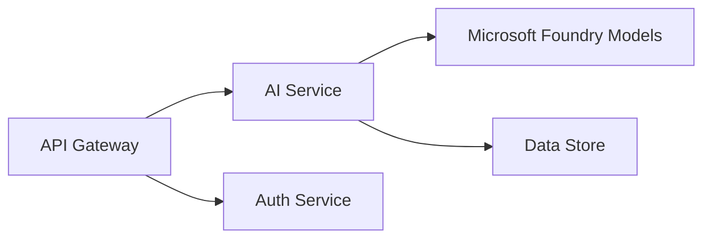
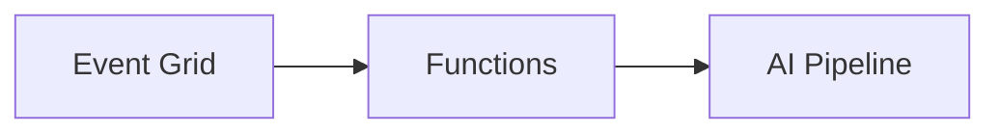

# Hoofdstuk 8: Productie- & Enterprise-patronen

**📚 Cursus**: [AZD Voor Beginners](../../README.md) | **⏱️ Duur**: 2-3 uur | **⭐ Complexiteit**: Geavanceerd

---

## Overzicht

Dit hoofdstuk behandelt enterprise-klare uitrolpatronen, beveiligingsversteviging, monitoring en kostenoptimalisatie voor productie AI-werklasten.

Dit is een architectuurreferentie, geen volledige deploybare productie-template. Voorbeelden laten integratiedetails weg die u zelf in uw eigen applicatie moet aanleveren en testen; het lezen van de checklist certificeert geen productieklaarheid.

> **Release review (2026-11-04):** AI CLI-handleiding is gecontroleerd aan de hand van de documentatie/bron van `azd 1.37.2`, agents `1.0.0-beta.23` en evaluaties `1.0.0-beta.2`. Zie [releasewijzigingen en fixes](production-ai-practices.md#recent-release-changes-and-fixes) voor compatibiliteitseisen en migratiedetails; dit is geen validatie van een live uitrol.

## Leerdoelen

Door dit hoofdstuk te voltooien, zult u:
- Meerdimensionale veerkrachtige applicaties uitrollen
- Enterprise beveiligingspatronen implementeren
- Omvattende monitoring configureren
- Kosten op schaal optimaliseren
- CI/CD-pijplijnen opzetten met AZD

---

## 📚 Lessen

| # | Les | Beschrijving | Tijd |
|---|--------|-------------|------|
| 1 | [Productie AI-praktijken](production-ai-practices.md) | Enterprise uitrolpatronen | 90 min |

---

## 🚀 Productie Checklist

- [ ] Meerdere regio's ingezet voor veerkracht
- [ ] Beheerde identiteit voor authenticatie (geen sleutels)
- [ ] Application Insights voor monitoring
- [ ] Kostenbudgetten en waarschuwingen geconfigureerd
- [ ] Beveiligingsscanning ingeschakeld
- [ ] Integratie van CI/CD-pijplijn
- [ ] Rampenherstelplan

---

## 🏗️ Architectuurpatronen

### Patroon 1: Microservices AI



### Patroon 2: Event-Driven AI



---

## 🔐 Beveiligingsbest practices

```bicep
// Illustrative properties from different resources, NOT a standalone Bicep file.
// Attach identity to the application host:
identity: {
  type: 'SystemAssigned'
}

// AI account properties (also require private endpoints, DNS and app connectivity):
properties: {
  publicNetworkAccess: 'Disabled'
  networkAcls: {
    defaultAction: 'Deny'
  }
}
```

---

## 💰 Kostenoptimalisatie

| Strategie | Belangrijkste beperking |
|----------|---------|
| Scale to zero (Container Apps) | Vereist een geschikte trigger; andere diensten veroorzaken nog steeds kosten |
| Gebruik consumptietarieven voor dev | Vergelijk geselecteerde serviceprijzen en werklast |
| Geplande scaling | Schaal via ondersteunde infrastructuur/automatisering |
| Reserveringen/voorzien capaciteit | Alleen als ondersteund; verplichtingen kunnen idle kosten verhogen |

Gebruik het [complete budget resource patroon](production-ai-practices.md#2-cost-monitoring-and-budgets) met een geldige startdatum, factureringsscope, ontvangers en rechten. Een budget verzendt meldingen; het beperkt de uitgaven niet. Besparingen zijn afhankelijk van gemeten gebruik en zijn geen gegarandeerde percentages.

---

## 📊 Monitoring Setup

```bash
# Open the Application Insights logs view (requires configured monitoring)
azd monitor --logs

# Check Application Insights
azd monitor --overview

# View metrics
az monitor metrics list --resource <resource-id>
```

---

## 🔗 Navigatie

| Richting | Hoofdstuk |
|-----------|---------|
| **Vorige** | [Hoofdstuk 7: Problemen oplossen](../chapter-07-troubleshooting/README.md) |
| **Cursus voltooid** | [Cursus Home](../../README.md) |

---

## 📖 Gerelateerde bronnen

- [AI Agents Gids](../chapter-02-ai-development/agents.md)
- [Application Insights](../chapter-06-pre-deployment/application-insights.md)
- [Multi-Agent Oplossingen](../chapter-05-multi-agent/README.md)
- [Microservices Voorbeeld](../../examples/microservices/README.md)

---

<!-- CO-OP TRANSLATOR DISCLAIMER START -->
**Disclaimer**:
Dit document is vertaald met behulp van de AI vertaaldienst [Co-op Translator](https://github.com/Azure/co-op-translator). Hoewel we streven naar nauwkeurigheid, dient u er rekening mee te houden dat geautomatiseerde vertalingen fouten of onnauwkeurigheden kunnen bevatten. Het originele document in de oorspronkelijke taal moet worden beschouwd als de gezaghebbende bron. Voor kritieke informatie wordt professionele menselijke vertaling aanbevolen. Wij zijn niet aansprakelijk voor eventuele misverstanden of verkeerde interpretaties die voortvloeien uit het gebruik van deze vertaling.
<!-- CO-OP TRANSLATOR DISCLAIMER END -->