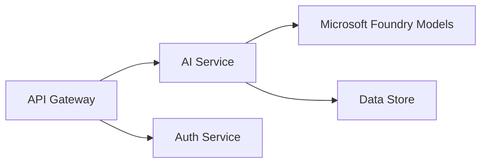
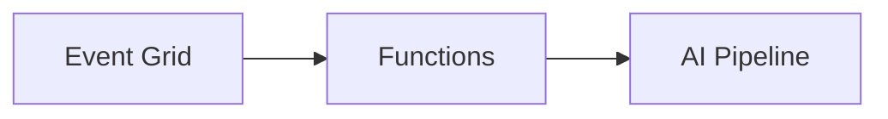

# Hoofdstuk 8: Productie- & Enterprise Patronen

**📚 Cursus**: [AZD Voor Beginners](../../README.md) | **⏱️ Duur**: 2-3 uur | **⭐ Complexiteit**: Geavanceerd

---

## Overzicht

Dit hoofdstuk behandelt enterprise-klare implementatiepatronen, beveiligingsversterking, monitoring en kostenoptimalisatie voor productie-AI workloads.

Dit is een architectuurrichtlijn, geen compleet implementeerbare productietemplate. Voorbeelden laten integratiedetails weg die u zelf moet aanleveren en testen in uw eigen toepassing; het doorlopen van de checklist betekent geen productieklaar certificaat.

> **Foundry GA update (2026-11-09):** Gebruik `azd >= 1.37.0` en het algemeen beschikbare `microsoft.foundry` 1.0 pakket voor de Foundry workflow; evaluaties worden apart geïnstalleerd. Zie [release scope en migratie](production-ai-practices.md#recent-release-changes-and-fixes) en het [geauthenticeerde pipeline voorbeeld](production-ai-practices.md#cicd-pipeline-configuration). Dit is een documentatiereview, geen live implementatievalidatie of algemene GA-status voor optionele previewfuncties.

## Leerdoelen

Na het doorlopen van dit hoofdstuk kun je:
- Multi-regio veerkrachtige toepassingen implementeren
- Enterprise beveiligingspatronen toepassen
- Uitgebreide monitoring configureren
- Kosten op schaal optimaliseren
- CI/CD pipelines opzetten met AZD

---

## 📚 Lessen

| # | Les | Beschrijving | Tijd |
|---|--------|-------------|------|
| 1 | [Productie AI Praktijken](production-ai-practices.md) | Enterprise implementatiepatronen | 90 min |

---

## 🚀 Productie Checklist

- [ ] Multi-regio implementatie voor veerkracht
- [ ] Beheerde identiteit voor authenticatie (geen sleutels)
- [ ] Application Insights voor monitoring
- [ ] Kostenbudgetten en waarschuwingen geconfigureerd
- [ ] Beveiligingsscans ingeschakeld
- [ ] CI/CD pipeline integratie
- [ ] Rampenherstelplan

---

## 🏗️ Architectuurpatronen

### Patroon 1: Microservices AI



### Patroon 2: Event-Driven AI



---

## 🔐 Beveiligingspraktijken

```bicep
// Illustrative properties from different resources, NOT a standalone Bicep file.
// Attach identity to the application host:
identity: {
  type: 'SystemAssigned'
}

// AI account properties (also require private endpoints, DNS and app connectivity):
properties: {
  publicNetworkAccess: 'Disabled'
  networkAcls: {
    defaultAction: 'Deny'
  }
}
```

---

## 💰 Kostenoptimalisatie

| Strategie | Belangrijkste beperking |
|----------|---------|
| Schalen naar nul (Container Apps) | Vereist een geschikte trigger; andere services veroorzaken nog steeds kosten |
| Gebruik consumptietarieven voor dev | Vergelijk prijzing van geselecteerde service en werklast |
| Geplande schaalvergroting | Schaal via ondersteunde infrastructuur/automatisering |
| Reservaties/vooraf gereserveerde capaciteit | Alleen wanneer ondersteund; verplichtingen kunnen inactieve kosten verhogen |

Gebruik het [volledige budgetresourcepatroon](production-ai-practices.md#2-cost-monitoring-and-budgets) met een geldige startdatum, factureringsscope, ontvangers en machtigingen. Een budget verstuurt waarschuwingen; het beperkt de uitgaven niet. Besparingen hangen af van gemeten gebruik en zijn geen gegarandeerde percentages.

---

## 📊 Monitoringconfiguratie

```bash
# Open the Application Insights logs view (requires configured monitoring)
azd monitor --logs

# Check Application Insights
azd monitor --overview

# View metrics
az monitor metrics list --resource <resource-id>
```

---

## 🔗 Navigatie

| Richting | Hoofdstuk |
|-----------|---------|
| **Vorige** | [Hoofdstuk 7: Probleemoplossing](../chapter-07-troubleshooting/README.md) |
| **Cursus voltooid** | [Cursus Startpagina](../../README.md) |

---

## 📖 Gerelateerde bronnen

- [AI Agents Gids](../chapter-02-ai-development/agents.md)
- [Application Insights](../chapter-06-pre-deployment/application-insights.md)
- [Multi-Agent Oplossingen](../chapter-05-multi-agent/README.md)
- [Microservices Voorbeeld](../../examples/microservices/README.md)

---

<!-- CO-OP TRANSLATOR DISCLAIMER START -->
**Disclaimer**:
Dit document is vertaald met behulp van de AI vertaaldienst [Co-op Translator](https://github.com/Azure/co-op-translator). Hoewel we streven naar nauwkeurigheid, dient u er rekening mee te houden dat geautomatiseerde vertalingen fouten of onnauwkeurigheden kunnen bevatten. Het originele document in de oorspronkelijke taal moet worden beschouwd als de gezaghebbende bron. Voor kritieke informatie wordt professionele menselijke vertaling aanbevolen. Wij zijn niet aansprakelijk voor eventuele misverstanden of verkeerde interpretaties die voortvloeien uit het gebruik van deze vertaling.
<!-- CO-OP TRANSLATOR DISCLAIMER END -->