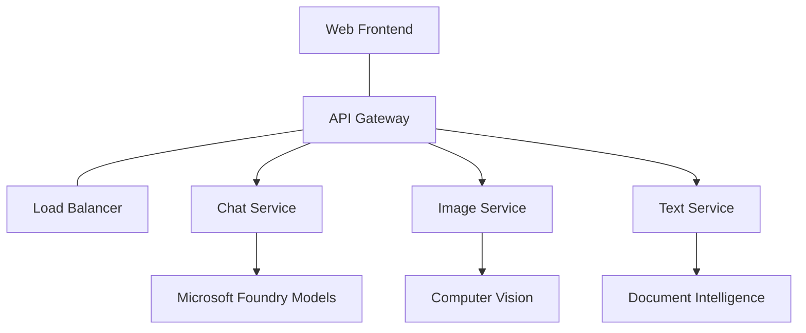

# Best Practices voor Productie AI Workloads met AZD

**Hoofdstuk Navigatie:**
- **📚 Cursus Start**: [AZD Voor Beginners](../../README.md)
- **📖 Huidig Hoofdstuk**: Hoofdstuk 8 - Productie & Enterprise Patronen
- **⬅️ Vorig Hoofdstuk**: [Hoofdstuk 7: Probleemoplossing](../chapter-07-troubleshooting/debugging.md)
- **⬅️ Ook Gerelateerd**: [AI Workshop Lab](../chapter-02-ai-development/ai-workshop-lab.md)
- **🎯 Cursus Voltooid**: [AZD Voor Beginners](../../README.md)

## Overzicht

Deze gids legt productie AI ontwerp patronen uit met behulp van Azure Developer CLI (AZD). Het is een ontwerpgids, geen inzetbare applicatie of productcertificering.

**Voorbeeld grenzen:** Tenzij expliciet beschreven als compleet, veronderstellen Bicep-fragmenten parameters en geraadpleegde bronnen uit een omvattende template. Ze laten host afbeeldingen/plannen, identiteiten, roltoewijzingen, DNS, outputs en andere vereiste integraties weg. YAML servicepaden en hook/test scripts zijn illustratieve bestanden om in **je eigen applicatie** te maken; ze worden niet geleverd door deze cursus. Gebruik een werkende AZD voorbeeld als basis, compileer de volledige infrastructuur en test deze in een geïsoleerde omgeving voor productie.

## Belangrijkste Uitdagingen Aangepakt

Veelvoorkomende zorgen voor productie zijn multi-service implementaties, identiteit en geheimbeheer, opschalen, kostenbewaking, en monitoring. Er wordt hier geen gemeten prevalentie geclaimd.

## Architectuurpatronen voor Productie AI

### Patroon 1: Microservices AI Architectuur

**Wanneer te gebruiken**: Complexe AI-applicaties met meerdere mogelijkheden



**AZD Implementatie**:

```yaml
# azure.yaml
name: enterprise-ai-platform
services:
  web:
    project: ./web
    host: staticwebapp
  api-gateway:
    project: ./api-gateway
    host: containerapp
  chat-service:
    project: ./services/chat
    host: containerapp
  vision-service:
    project: ./services/vision
    host: containerapp
  text-service:
    project: ./services/text
    host: containerapp
```

### Patroon 2: Event-Driven AI Verwerking

**Wanneer te gebruiken**: Batchverwerking, documentanalyse, async workflows

```bicep
// Event Hub for AI processing pipeline
resource eventHub 'Microsoft.EventHub/namespaces@2024-01-01' = {
  name: eventHubNamespaceName
  location: location
  sku: {
    name: 'Standard'
    tier: 'Standard'
    capacity: 1
  }
}

// Service Bus for reliable message processing
resource serviceBus 'Microsoft.ServiceBus/namespaces@2024-01-01' = {
  name: serviceBusNamespaceName
  location: location
  sku: {
    name: 'Premium'
    tier: 'Premium'
    capacity: 1
  }
}

// Function App for processing
resource functionApp 'Microsoft.Web/sites@2023-01-01' = {
  name: functionAppName
  location: location
  kind: 'functionapp,linux'
  properties: {
    siteConfig: {
      appSettings: [
        {
          name: 'FUNCTIONS_EXTENSION_VERSION'
          value: '~4'
        }
        {
          name: 'AZURE_OPENAI_ENDPOINT'
          value: '@Microsoft.KeyVault(VaultName=${keyVault.name};SecretName=openai-endpoint)'
        }
      ]
    }
  }
}
```

Dit maakt namespace-fragmenten aan, geen hubs, wachtrijen, abonnementen of Function triggers. Een uitvoerbare Function heeft ook een hostingplan, runtime/opslag configuratie, een gekoppelde identiteit, RBAC en netwerktoegang nodig. De Key Vault referentie heeft toestemming nodig om het geheim te lezen; een endpoint URL zelf is geen referentie.

## Nadenken over AI Agent Gezondheid

Wanneer een traditionele webapp breekt, zijn de symptomen bekend: een pagina laadt niet, een API retourneert een fout, of een implementatie mislukt. AI-gestuurde applicaties kunnen op al die manieren breken—maar ook subtieler gedrag vertonen dat geen voor de hand liggende foutmeldingen oplevert.

Deze sectie helpt je een mentaal model op te bouwen voor het monitoren van AI workloads zodat je weet waar je moet kijken als er iets mis lijkt.

### Hoe Agent Gezondheid Verschilt van Traditionele App Gezondheid

Traditionele apps kunnen ook subtiele correctheidsfouten hebben. Een AI-agent voegt niet-deterministische responskwaliteit toe aan de gebruikelijke beschikbaarheids- en correctheidszorgen. Denk aan agent gezondheid in twee lagen:

| Laag | Waarop letten | Waar kijken |
|------|--------------|-------------|
| **Infrastructuur gezondheid** | Draait de service? Zijn resources toegewezen? Zijn endpoints bereikbaar? | `azd monitor`, Azure Portal resource gezondheid, container/app logs |
| **Gedragsgezondheid** | Reageert de agent accuraat? Zijn de reacties tijdig? Wordt het model correct aangeroepen? | Application Insights traces, model oproep latency metrics, responskwaliteit logs |

Infrastructuur gezondheid is vertrouwd—het is dezelfde voor elke azd app. Gedragsgezondheid is de nieuwe laag die AI workloads introduceren.

### Waar te kijken als AI Apps zich niet gedragen zoals verwacht

Als je AI-applicatie niet de verwachte resultaten oplevert, is hier een conceptuele checklist:

1. **Begin met de basis.** Draait de app? Kan hij zijn afhankelijkheden bereiken? Controleer `azd monitor` en resource gezondheid net als bij elke app.
2. **Controleer de modelverbinding.** Roept je applicatie het AI-model succesvol aan? Mislukte of verlopen modeloproepen zijn de meest voorkomende oorzaak van AI app problemen en verschijnen in je applicatielogs.
3. **Inspecteer input en gronding veilig.** Verkeerde antwoorden kunnen voortkomen uit ophalen, instructies, modelbeperkingen, of tooluitvoering. Gebruik toegang-gecontroleerde, geredigeerde diagnostische data; zet geen ongerichte prompt/respons logging aan in productie.
4. **Beoordeel respons latency.** AI model oproepen zijn trager dan typische API oproepen. Voelt je app traag aan, controleer dan of de modelresponsetijden zijn gestegen—dit kan wijzen op throttling, capaciteitslimieten, of regio-congestie.
5. **Let op kostensignalen.** Onverwachte pieken in token gebruik of API oproepen kunnen wijzen op een lus, verkeerd geconfigureerde prompt, of overmatige herhalingen.

Je hoeft niet meteen expert te zijn in observability tooling. De kernboodschap is dat AI applicaties een extra laag gedrag hebben om te monitoren, en azd's ingebouwde monitoring (`azd monitor`) geeft een startpunt voor het onderzoeken van beide lagen.

---

## Beveiligingsbest Practices

### 1. Zero-Trust Beveiligingsmodel

**Implementatiestrategie**:
- Geen communicatie tussen services zonder authenticatie
- Alle API oproepen gebruiken managed identities
- Netwerkisolatie met private endpoints
- Toegang op basis van het minst noodzakelijke privilege

```bicep
// Managed Identity for each service
resource chatServiceIdentity 'Microsoft.ManagedIdentity/userAssignedIdentities@2023-01-31' = {
  name: 'chat-service-identity'
  location: location
}

// Role assignments with minimal permissions
resource openAIUserRole 'Microsoft.Authorization/roleAssignments@2022-04-01' = {
  scope: openAIAccount
  name: guid(openAIAccount.id, chatServiceIdentity.id, '5e0bd9bd-7b93-4f28-af87-19fc36ad61bd')
  properties: {
    roleDefinitionId: subscriptionResourceId('Microsoft.Authorization/roleDefinitions', '5e0bd9bd-7b93-4f28-af87-19fc36ad61bd')
    principalId: chatServiceIdentity.properties.principalId
    principalType: 'ServicePrincipal'
  }
}
```

### 2. Veilig Geheimbeheer

**Key Vault Integratiepatroon**:

```bicep
// Key Vault with proper access policies
resource keyVault 'Microsoft.KeyVault/vaults@2023-02-01' = {
  name: keyVaultName
  location: location
  properties: {
    tenantId: tenant().tenantId
    sku: {
      family: 'A'
      name: 'standard' // Premium is needed for HSM-backed keys, not ordinary secrets
    }
    enableRbacAuthorization: true  // Use RBAC instead of access policies
    enablePurgeProtection: true    // Prevent accidental deletion
    enableSoftDelete: true
    softDeleteRetentionInDays: 90
  }
}

// Optional legacy key-auth alternative; omit when using Entra ID.
resource openAIKeySecret 'Microsoft.KeyVault/vaults/secrets@2023-02-01' = {
  parent: keyVault
  name: 'openai-api-key'
  properties: {
    value: openAIAccount.listKeys().key1
    attributes: {
      enabled: true
    }
  }
}
```

Ken de runtime identiteit `Key Vault Secrets User` toe op het juiste scope en koppel deze aan de host; `enableRbacAuthorization` alleen verleent geen toegang. Verkies OpenAI managed identity authenticatie met `disableLocalAuth: true`. Het optionele sleutelgeheim heeft alleen zin voor een bewust sleutel-ingeschakeld account, en de provisioning principal moet ook toestemming hebben om geheimen te schrijven.

### 3. Netwerkbeveiliging

**Private Endpoint Configuratie**:

```bicep
// Virtual Network for AI services
resource virtualNetwork 'Microsoft.Network/virtualNetworks@2023-04-01' = {
  name: vnetName
  location: location
  properties: {
    addressSpace: {
      addressPrefixes: ['10.0.0.0/16']
    }
    subnets: [
      {
        name: 'ai-services-subnet'
        properties: {
          addressPrefix: '10.0.1.0/24'
          privateEndpointNetworkPolicies: 'Disabled'
        }
      }
      {
        name: 'app-services-subnet'
        properties: {
          addressPrefix: '10.0.2.0/24'
          delegations: [
            {
              name: 'Microsoft.Web/serverFarms'
              properties: {
                serviceName: 'Microsoft.Web/serverFarms'
              }
            }
          ]
        }
      }
    ]
  }
}

// Private endpoints for all AI services
resource openAIPrivateEndpoint 'Microsoft.Network/privateEndpoints@2023-04-01' = {
  name: '${openAIAccountName}-pe'
  location: location
  properties: {
    subnet: {
      id: virtualNetwork.properties.subnets[0].id
    }
    privateLinkServiceConnections: [
      {
        name: 'openai-connection'
        properties: {
          privateLinkServiceId: openAIAccount.id
          groupIds: ['account']
        }
      }
    ]
  }
}
```

Private endpoints vereisen ook private DNS zone groepen/VNet links en applicatie VNet integratie. Ze blokkeren niet automatisch publieke toegang: schakel na verificatie van private connectiviteit en implementatietoegang expliciet het publieke netwerktoegang voor het AI-account uit.

## Prestaties en Opschalen

### 1. Auto-Scaling Strategieën

**Container Apps Auto-scaling**:

```bicep
resource containerApp 'Microsoft.App/containerApps@2023-05-01' = {
  name: containerAppName
  location: location
  properties: {
    configuration: {
      ingress: {
        external: true
        targetPort: 8000
        transport: 'http'
      }
    }
    template: {
      scale: {
        minReplicas: 2  // Always have 2 instances minimum
        maxReplicas: 50 // Scale up to 50 for high load
        rules: [
          {
            name: 'http-scaling'
            http: {
              metadata: {
                concurrentRequests: '20'  // Scale when >20 concurrent requests
              }
            }
          }
          {
            name: 'cpu-scaling'
            custom: {
              type: 'cpu'
              metadata: {
                type: 'Utilization'
                value: '70'  // Scale when CPU >70%
              }
            }
          }
        ]
      }
    }
  }
}
```

### 2. Caching Strategieën

**Redis Cache voor AI Responsen**:

```bicep
// Legacy Azure Cache for Redis example (not recommended for new deployments)
resource redisCache 'Microsoft.Cache/redis@2023-04-01' = {
  name: redisCacheName
  location: location
  properties: {
    sku: {
      name: 'Premium'
      family: 'P'
      capacity: 1
    }
    enableNonSslPort: false
    minimumTlsVersion: '1.2'
    redisConfiguration: {
      'maxmemory-policy': 'allkeys-lru'
    }
    // Sharding distributes data; replication/failover provides availability.
    shardCount: 2
  }
}

// Cache configuration in application
var cacheConnectionString = '${redisCache.properties.hostName}:6380,password=${redisCache.listKeys().primaryKey},ssl=True,abortConnect=False'
```

Azure Cache voor Redis Basic/Standard/Premium bevindt zich op een [uitfaseringstraject](https://learn.microsoft.com/azure/azure-cache-for-redis/retirement-faq). Gebruik Azure Managed Redis voor nieuwe ontwerpen en zijn gedocumenteerde SKU, identiteit, en TLS-configuratie, in plaats van deze legacy resource in een nieuw productie systeem te kopiëren. De connection-string regel is een niet-functionele placeholder, geen referentie. Partitioneer cache sleutels op autorisatie, model/instructies, en ophaalversie, met een verloop; een gedeelde query-only cache kan data van een andere gebruiker blootgeven.

### 3. Load Balancing en Verkeersbeheer

**Application Gateway met WAF**:

```bicep
// Application Gateway with Web Application Firewall
resource applicationGateway 'Microsoft.Network/applicationGateways@2023-04-01' = {
  name: appGatewayName
  location: location
  properties: {
    sku: {
      name: 'WAF_v2'
      tier: 'WAF_v2'
      capacity: 2
    }
    webApplicationFirewallConfiguration: {
      enabled: true
      firewallMode: 'Prevention'
      ruleSetType: 'OWASP'
      ruleSetVersion: '3.2'
    }
    // Backend pools for AI services
    backendAddressPools: [
      {
        name: 'ai-services-pool'
        properties: {
          backendAddresses: [
            {
              fqdn: '${containerApp.properties.configuration.ingress.fqdn}'
            }
          ]
        }
      }
    ]
  }
}
```

Dit is een gedeeltelijke gateway resource: een echte implementatie heeft ook gateway subnet/IP configuratie, frontend IP's en poorten, TLS-ontvangers/certificaten, backend HTTP instellingen/probes, routeringsregels en prioriteiten, en een gereviewd WAF beleid nodig. TLS hostnaam/SNI en authenticatie moeten overeenkomen met de Container App backend.

## 💰 Kostenoptimalisatie

### 1. Resource Juiste Grootte

**Omgevingsspecifieke Configuraties**:

Deze namen zijn **illustratieve custom-template inputs**, geen automatische AZD instellingen. Vertaal elk naar `infra/main.parameters.json`/Bicep en host configuraties eerst. Bijvoorbeeld, het RAG voorbeeld gebruikt `AZURE_SEARCH_SERVICE_SKU` en `AZURE_OPENAI_CHATGPT_DEPLOYMENT_CAPACITY`, niet de algemene namen hieronder. Geef Container Apps geheugen in een ondersteunde eenheid zoals `1Gi` in de daadwerkelijke resource. Pas infrastructuurwijzigingen toe met `azd up` of `azd provision`; `azd deploy` alleen past geen Bicep-wijzigingen toe.

```bash
# Development environment
azd env new development
azd env set AZURE_OPENAI_SKU "S0"
azd env set AZURE_OPENAI_CAPACITY 10
azd env set AZURE_SEARCH_SKU "basic"
azd env set CONTAINER_CPU 0.5
azd env set CONTAINER_MEMORY 1.0

# Production environment  
azd env new production
azd env set AZURE_OPENAI_SKU "S0"
azd env set AZURE_OPENAI_CAPACITY 100
azd env set AZURE_SEARCH_SKU "standard"
azd env set CONTAINER_CPU 2.0
azd env set CONTAINER_MEMORY 4.0
```

### 2. Kostenbewaking en Budgetten

```bicep
// Supply the first day of the current UTC month, e.g. 2026-11-01T00:00:00Z.
param budgetStartDate string

// Cost management and budgets
resource budget 'Microsoft.Consumption/budgets@2024-08-01' = {
  name: 'ai-workload-budget'
  properties: {
    timePeriod: {
      startDate: budgetStartDate
    }
    timeGrain: 'Monthly'
    amount: 2000  // In the billing currency, not necessarily USD
    category: 'Cost'
    notifications: {
      warning: {
        enabled: true
        operator: 'GreaterThan'
        threshold: 80
        contactEmails: [
          'finance@company.com'
          'engineering@company.com'
        ]
        contactRoles: [
          'Owner'
          'Contributor'
        ]
      }
      critical: {
        enabled: true
        operator: 'GreaterThan'
        threshold: 95
        contactEmails: [
          'cto@company.com'
        ]
      }
    }
  }
}
```

Vervang de voorbeeldontvangers en controleer scope/rechten. Budgetwaarschuwingen gebruiken vertraagde factureringsdata en dwingen geen uitgavelimiet af.

### 3. Token Gebruik Optimalisatie

**OpenAI Kostenbeheer**:

Dit is slechts een karakter-gebaseerde heuristiek voor een UI preview, **geen** validator van model token-limieten. Productiecode moet een tokenizer gebruiken passend bij het geïmplementeerde model en rekening houden met systeeminstructies, tool schema's, historie en output budget. Weiger een te groot gebruikersbericht in plaats van het stilletjes af te kappen.

```typescript
// Application-level token optimization
class TokenOptimizer {
  private readonly maxTokens = 4000;
  private readonly reserveTokens = 500;
  
  optimizePrompt(userInput: string, context: string): string {
    const availableTokens = this.maxTokens - this.reserveTokens;
    if (this.estimateTokens(userInput) + 8 >= availableTokens) {
      throw new Error("User input exceeds the illustrative prompt budget");
    }
    const estimatedTokens = this.estimateTokens(userInput + context) + 8;
    
    if (estimatedTokens > availableTokens) {
      // Truncate context, not user input
      context = this.truncateContext(context, Math.max(0, availableTokens - this.estimateTokens(userInput) - 8));
    }
    
    return `${context}\n\nUser: ${userInput}`;
  }
  
  private estimateTokens(text: string): number {
    // Rough estimation: 1 token ≈ 4 characters
    return Math.ceil(text.length / 4);
  }

  private truncateContext(text: string, estimatedBudget: number): string {
    return text.slice(0, Math.max(0, estimatedBudget) * 4);
  }
}
```

## Monitoring en Observability

### 1. Uitgebreide Application Insights

```bicep
// Application Insights with advanced features
resource applicationInsights 'Microsoft.Insights/components@2020-02-02' = {
  name: applicationInsightsName
  location: location
  kind: 'web'
  properties: {
    Application_Type: 'web'
    WorkspaceResourceId: logAnalyticsWorkspace.id
    SamplingPercentage: 100  // Ingestion setting; review cost and SDK sampling separately
    DisableIpMasking: false  // Retain IP masking
  }
}

// Custom metrics for AI operations
resource aiMetricAlerts 'Microsoft.Insights/metricAlerts@2018-03-01' = {
  name: 'ai-high-error-rate'
  location: 'global'
  properties: {
    description: 'Alert when failed request count exceeds 10 in five minutes'
    severity: 2
    enabled: true
    scopes: [
      applicationInsights.id
    ]
    evaluationFrequency: 'PT1M'
    windowSize: 'PT5M'
    criteria: {
      'odata.type': 'Microsoft.Azure.Monitor.SingleResourceMultipleMetricCriteria'
      allOf: [
        {
          name: 'high-error-rate'
          metricName: 'requests/failed'
          operator: 'GreaterThan'
          threshold: 10
          timeAggregation: 'Count'
        }
      ]
    }
  }
}
```

### 2. AI-Specifieke Monitoring

**Aangepaste Dashboards voor AI Metrics**:

```json
{
  "dashboard": {
    "name": "AI Application Monitoring",
    "tiles": [
      {
        "name": "OpenAI Request Volume",
        "query": "dependencies | where target contains 'openai' | summarize count() by bin(timestamp, 5m)"
      },
      {
        "name": "AI Response Latency",
        "query": "dependencies | where target contains 'openai' | summarize avg(duration) by bin(timestamp, 5m)"
      },
      {
        "name": "Token Usage",
        "query": "customMetrics | where name == 'openai_tokens_used' | summarize sum(value) by bin(timestamp, 1h)"
      },
      {
        "name": "Cost per Hour",
        "query": "customMetrics | where name == 'openai_cost' | summarize sum(value) by bin(timestamp, 1h)"
      }
    ]
  }
}
```

Deze JSON is een applicatie-gedefinieerde schets, geen importeerbare Azure portal dashboardschema. De token/kosten queries vereisen dat jouw app exact die custom metrics uitzendt; ze worden niet door AZD aangemaakt. Pas afhankelijkheidsfilters aan voor jouw daadwerkelijke model endpoint/span namen.

### 3. Health Checks en Uptime Monitoring

```bicep
// Application Insights availability tests
resource availabilityTest 'Microsoft.Insights/webtests@2022-06-15' = {
  name: 'ai-app-availability-test'
  location: location
  tags: {
    'hidden-link:${applicationInsights.id}': 'Resource'
  }
  properties: {
    SyntheticMonitorId: 'ai-app-availability-test'
    Name: 'AI Application Availability Test'
    Description: 'Tests AI application endpoints'
    Enabled: true
    Frequency: 300  // 5 minutes
    Timeout: 120    // 2 minutes
    Kind: 'standard'
    Locations: [
      {
        Id: 'us-east-2-azr'
      }
      {
        Id: 'us-west-2-azr'
      }
    ]
    Request: {
      RequestUrl: 'https://${webApp.properties.defaultHostName}/health'
      HttpVerb: 'GET'
      FollowRedirects: true
      ParseDependentRequests: false
    }
    ValidationRules: {
      ExpectedHttpStatusCode: 200
      SSLCheck: true
      SSLCertRemainingLifetimeCheck: 7
    }
  }
}
```

## Disaster Recovery en Hoge Beschikbaarheid

De voorafgaande test gaat uit van een bestaande App Service `webApp` en Application Insights resource. Standaard beschikbaarheidstests zijn betaalbaar en vereisen een bereikbaar endpoint; enkel-private apps hebben een passend privé monitoring ontwerp nodig. URL ping tests zijn verouderd; gebruik [standaard beschikbaarheidstests](https://learn.microsoft.com/azure/azure-monitor/app/availability).

### 1. Multi-Regio Implementatie

```yaml
# azure.yaml - Multi-region configuration
name: ai-app-multiregion
services:
  api-primary:
    project: ./api
    host: containerapp
    env:
      AZURE_REGION: eastus
  api-secondary:
    project: ./api
    host: containerapp
    env:
      AZURE_REGION: westus2
```

```bicep
// Separate App Service topology, not the Container Apps declarations above
resource trafficManager 'Microsoft.Network/trafficManagerProfiles@2022-04-01' = {
  name: trafficManagerProfileName
  location: 'global'
  properties: {
    profileStatus: 'Enabled'
    trafficRoutingMethod: 'Priority'
    dnsConfig: {
      relativeName: trafficManagerProfileName
      ttl: 30
    }
    monitorConfig: {
      protocol: 'HTTPS'
      port: 443
      path: '/health'
      intervalInSeconds: 30
      toleratedNumberOfFailures: 3
      timeoutInSeconds: 10
    }
    endpoints: [
      {
        name: 'primary-endpoint'
        type: 'Microsoft.Network/trafficManagerProfiles/azureEndpoints'
        properties: {
          targetResourceId: primaryAppService.id
          endpointStatus: 'Enabled'
          priority: 1
        }
      }
      {
        name: 'secondary-endpoint'
        type: 'Microsoft.Network/trafficManagerProfiles/azureEndpoints'
        properties: {
          targetResourceId: secondaryAppService.id
          endpointStatus: 'Enabled'
          priority: 2
        }
      }
    ]
  }
}
```

Omgevingsvariabelen kiezen geen resource locaties. IaC moet aparte regionale hosts provisionen en elke service koppelen met `resourceName` of `azd-service-name` tags. Het Traffic Manager voorbeeld is een **aparte App Service topologie** (`primaryAppService`/`secondaryAppService`), geen routering voor de Container Apps declaraties. Container Apps vereist een passend geconfigureerd extern endpoint/front door, TLS/custom-domain routering, en health probes.

### 2. Data Backup en Herstel

```bicep
// Backup configuration for critical data
resource backupVault 'Microsoft.DataProtection/backupVaults@2023-05-01' = {
  name: backupVaultName
  location: location
  identity: {
    type: 'SystemAssigned'
  }
  properties: {
    storageSettings: [
      {
        datastoreType: 'VaultStore'
        type: 'LocallyRedundant'
      }
    ]
  }
}

```

De vault alleen back-upt niets. Configureer een **workload-specifiek ondersteund beleid en back-up instantie**, bronrechten, retentie en hersteltests met behulp van [Azure Backup ondersteuningsmatrixen](https://learn.microsoft.com/azure/backup/backup-support-matrix). Er is geen generiek Azure Backup beleid voor gehoste Azure OpenAI model deployments. Houd infrastructuur/model implementatie-definities in source control; bescherm geüploade documenten, applicatiegegevens, en fine-tuning artefacten met de ondersteunde back-up/export functies van elke backing service. Definieer en test RPO/RTO expliciet.

## DevOps en CI/CD Integratie

### 1. GitHub Actions Workflow

```yaml
# .github/workflows/deploy-ai-app.yml
name: Deploy AI Application

on:
  push:
    branches: [main]
  pull_request:
    branches: [main]

jobs:
  test:
    runs-on: ubuntu-latest
    steps:
      - uses: actions/checkout@v4
      
      - name: Setup Python
        uses: actions/setup-python@v4
        with:
          python-version: '3.11'
          
      - name: Install dependencies
        run: |
          pip install -r requirements.txt
          pip install pytest
          
      - name: Run tests
        run: pytest tests/
        
      - name: AI Safety Tests
        run: |
          python scripts/test_ai_safety.py
          python scripts/validate_prompts.py

```

Dit is het **enkel testgedeelte** van een workflow en gaat ervan uit dat je `requirements.txt`, `tests/`, en de twee safety scripts hebt gemaakt. Voeg de geauthenticeerde OIDC provisioning/deployment taken toe uit [CI/CD Pipeline Configuratie](#cicd-pipeline-configuration), met `needs: test`, een vertrouwde push/manual trigger, en beveiligde GitHub omgevingen. Plaats geen onbetrouwbare pull-request code met cloud-referenties. Een verse runner heeft geen geselecteerde lokale AZD omgeving; lever de environment/subscription/location inputs aan en gebruik `azd auth login`, niet alleen `azure/login`.

### 2. Infrastructuur Validatie

```bash
# scripts/validate_infrastructure.sh
#!/bin/bash
set -euo pipefail

echo "Validating AI infrastructure deployment..."

# Requires Azure CLI login and the resource group selected explicitly.
: "${AZURE_RESOURCE_GROUP:?Set AZURE_RESOURCE_GROUP}"
: "${AZURE_OPENAI_NAME:?Set AZURE_OPENAI_NAME}"
: "${AZURE_OPENAI_CHAT_DEPLOYMENT:?Set the actual deployment name}"

# A successful empty list is not proof that resources exist.
types=("Microsoft.CognitiveServices/accounts" "Microsoft.Search/searchServices"
       "Microsoft.Storage/storageAccounts" "Microsoft.KeyVault/vaults")
for resource_type in "${types[@]}"; do
    count=$(az resource list --resource-group "$AZURE_RESOURCE_GROUP" \
        --resource-type "$resource_type" --query "length(@)" -o tsv)
    if [[ "$count" -lt 1 ]]; then
        echo "ERROR: No $resource_type found in $AZURE_RESOURCE_GROUP"
        exit 1
    fi
done

# Validate OpenAI model deployments
echo "Validating OpenAI model deployments..."
state=$(az cognitiveservices account deployment show \
  --name "$AZURE_OPENAI_NAME" --resource-group "$AZURE_RESOURCE_GROUP" \
  --deployment-name "$AZURE_OPENAI_CHAT_DEPLOYMENT" \
  --query "properties.provisioningState" -o tsv)
if [[ "$state" != "Succeeded" ]]; then
    echo "ERROR: Required model deployment is not provisioned successfully"
    exit 1
fi

echo "Infrastructure validation completed successfully!"
```

Verwacht: een nul exit en het voltooimelding alleen als alle verwachte types bestaan en de benoemde modelimplementatie is toegewezen. Dit controleert inventaris/provisioning status, **niet** resource gezondheid, exacte topologie, RBAC, netwerk bereikbaarheid of modelgedrag. Pas de verwachte types aan op jouw architectuur, en voer daarna een aparte geauthenticeerde applicatie gereedheidstest uit.

## Productieklaar Checklist

### Beveiliging ✅
- [ ] Alle services gebruiken managed identities
- [ ] Geheimen opgeslagen in Key Vault
- [ ] Private endpoints geconfigureerd
- [ ] Netwerkbeveiligingsgroepen geïmplementeerd
- [ ] RBAC met het minst noodzakelijke privilege
- [ ] WAF ingeschakeld op publieke endpoints

### Prestatie ✅
- [ ] Auto-scaling geconfigureerd
- [ ] Caching geïmplementeerd
- [ ] Load balancing ingesteld
- [ ] CDN voor statische content
- [ ] Database verbindingspools
- [ ] Token gebruik optimalisatie

### Monitoring ✅
- [ ] Application Insights geconfigureerd
- [ ] Aangepaste metrics gedefinieerd
- [ ] Waarschuwingsregels ingesteld
- [ ] Dashboard gemaakt
- [ ] Health checks geïmplementeerd
- [ ] Log bewaarbeleid

### Betrouwbaarheid ✅
- [ ] Multi-regio implementatie
- [ ] Backup en herstel plan
- [ ] Circuit breakers geïmplementeerd
- [ ] Retry policies geconfigureerd
- [ ] Vlotte degradatie
- [ ] Health check endpoints

### Kostenbeheer ✅
- [ ] Budgetwaarschuwingen geconfigureerd
- [ ] Resource juiste grootte
- [ ] Ontwikkel/test kortingen toegepast
- [ ] Gereserveerde instanties aangeschaft
- [ ] Kostenmonitoring dashboard
- [ ] Regelmatige kostenreviews

### Compliance ✅
- [ ] Data locatievereisten nageleefd
- [ ] Audit logging ingeschakeld
- [ ] Compliance beleid toegepast
- [ ] Beveiligingsbaselines geïmplementeerd
- [ ] Regelmatige beveiligingsbeoordelingen
- [ ] Incident response plan

## Prestatie Benchmark

### Illustratieve Productie Doelen

Dit zijn voorbeeld SLO's om afspraken te maken en load-testen, geen gemeten benchmarks of garanties. Respons latency hangt af van model/output lengte; maandelijkse tokenuitgaven hangen af van traffic en prijzen, niet alleen token aantal.

| Metric | Doel | Monitoring |
|--------|--------|------------|
| **Responstijd** | < 2 seconden | Application Insights |
| **Beschikbaarheid** | 99,9% | Uptime monitoring |
| **Foutpercentage** | < 0,1% | Applicatielogs |
| **Model Uitgaven** | < $500/maand (voorbeeld budget) | Kostenbeheer |
| **Gelijktijdige gebruikers** | 1000+ | Load testen |
| **Hersteltijd** | < 1 uur | Rampenhersteltesten |

### Load Testing

Hieronder volgt een interfaceschets voor een load-testscript **dat u moet implementeren**; deze repository levert `scripts/load_test.py` niet. Definieer verzoekpayloads, authenticatie, representatieve workloads, percentiel latentie/foutasserties en een bestedingslimiet in uw gekozen load-testtool voordat u deze uitvoert:

```bash
# Load testing script for AI applications
python scripts/load_test.py \
  --endpoint https://your-ai-app.azurewebsites.net \
  --concurrent-users 100 \
  --duration 300 \
  --ramp-up 60
```

## 🤝 Beste praktijken van de gemeenschap

Gebaseerd op feedback van de Microsoft Foundry Discord-gemeenschap:

### Belangrijkste aanbevelingen van de gemeenschap:

1. **Begin klein, schaal geleidelijk op**: Begin met basis-SKU's en schaal op aan de hand van het daadwerkelijke gebruik
2. **Monitor alles**: Stel vanaf dag één uitgebreide monitoring in
3. **Automatiseer beveiliging**: Gebruik infrastructuur als code voor consistente beveiliging
4. **Test grondig**: Neem AI-specifieke tests op in uw pipeline
5. **Plan voor kosten**: Houd tokengebruik in de gaten en stel vroeg budgetwaarschuwingen in

### Veelvoorkomende valkuilen om te vermijden:

- ❌ API-sleutels hardcoderen in code
- ❌ Geen juiste monitoring instellen
- ❌ Kostenoptimalisatie negeren
- ❌ Faalscenario's niet testen
- ❌ Implementeren zonder health checks

## AZD AI CLI-commando's en uitbreidingen

AZD bevat een groeiende set AI-specifieke commando's en extensies die productie- AI-werkstromen stroomlijnen. Deze tools overbruggen de kloof tussen lokale ontwikkeling en productie-implementatie van AI-werkbelastingen.

> **Release review (2026-11-04):** De CLI-richtlijnen hieronder zijn gecontroleerd tegen de gepubliceerde releases van `azd` **1.37.2**, `azure.ai.agents` **1.0.0-beta.23**, en `azure.ai.evaluations` **1.0.0-beta.2**. Agents beta.23 vereist `azd >= 1.37.0`; evaluations beta.2 vereist `azd >= 1.33.0`. Gebruik minimaal 1.37.0 voor de gecombineerde workflow. Dit is een documentatie-/bronreview, geen live Azure-implementatievalidatie.

### AZD-extensies voor AI

AZD gebruikt een extensiesysteem om AI-specifieke mogelijkheden toe te voegen. Installeer en beheer extensies met:

```bash
# List all available extensions (including AI)
azd extension list

# Inspect installed extension details
azd version
azd extension show azure.ai.agents

# Install the Foundry agents extension
azd extension install azure.ai.agents

# Install the separate Foundry evaluations extension
azd extension install azure.ai.evaluations

# Install the fine-tuning extension
azd extension install azure.ai.finetune

# Install the custom models extension
azd extension install azure.ai.models

# Upgrade all installed extensions
azd extension upgrade --all
```

**Beschikbare AI-extensies:**

| Extensie | Doel | Status |
|-----------|---------|--------|
| `azure.ai.agents` | Foundry Agent Service beheer | Preview |
| `azure.ai.evaluations` | Evaluatiedatasets, beoordelaars, evalgroepen en runs | Preview |
| `azure.ai.skills` | Herbruikbare agentvaardigheden | Preview |
| `azure.ai.connections` | Foundry-verbindingen (gegevensbronnen, tools) | Preview |
| `azure.ai.finetune` | Foundry model fine-tuning | Preview |
| `azure.ai.models` | Foundry aangepaste modellen | Preview |
| `azure.coding-agent` | Configuratie van coding agent | Beschikbaar |

> Voer `azd extension list --installed` en `azd extension show azure.ai.evaluations` uit om geïnstalleerde versies te inspecteren. Upgrade eerst de core CLI met de [installatie-/update-instructies](https://learn.microsoft.com/azure/developer/azure-developer-cli/install-azd) (voor een Windows winget-installatie: `winget upgrade Microsoft.Azd`), voer vervolgens `azd extension upgrade --all` uit. Er is geen core `azd upgrade` commando. Bekijk breaking changes voordat u productie-automatisering upgrade; ga er niet van uit dat een extensie-upgrade oude commando- of configuratieformaten behoudt.

### Recente releasewijzigingen en fixes

| Release | Wat verandert er voor deze cursus |
|---------|------------------------------|
| `azd 1.37.0` | Voegt stabiele deployment-preview APIs toe en repareert extensiebewerkingen die ongerelateerde `azure.yaml` instellingen overschrijven. |
| `azd 1.37.1` | Verhelpt Ctrl+C-propagatie over extensies en onderscheidt annulering/time-outs van generieke fouten. |
| `azd 1.37.2` | Verbetert provisioning-validatie: kritieke waarschuwingen standaard op **Nee**, falen zonder bevestiging bij onbeheerde runs, en annulering slaat post-provision hooks over. Lost ook onopgeloste omgevingswaarden in Deployment Stacks deny lijsten op wanneer die alfa-functie is ingeschakeld. |
| Agents `beta.22` | Migreert evaluatie naar `azd ai eval`, wijzigt optimalisatie naar de GA v1 API, vereist meervoudige `toolboxes`, en scheidt managed-harness, voice en langlopende preview opt-ins. Verhelpt omgevingsspecifieke modelselectie en toolbox-authenticatie. |
| Agents `beta.23` | Stelt `init --harness` bloot; verhelpt A2A 0.3 antwoordoutput, ongeldige prompt-agent-paden/modules over infrastructuurniveaus, activatietime-outdiagnostiek, en behouden ontwikkelaar-RBAC-waarschuwingen. |
| Evaluations `beta.2` | Vereist camelCase evaluatieconfiguratie, voegt statische/gesimuleerde conversatie-autorisatie en expliciete lokale-bestandbronnen toe, en verhelpt datasetidentiteit/-versiebehandeling, quality-gate tellingen en mislukte-run-diagnostiek. |

Een actueringstijdoverschrijding van een agent bewijst **niet** de implementatiefout: inspecteer de beproefde versie en de status ervan voordat u een nieuwe poging doet. Ontwikkelaar-RBAC-waarschuwingen kunnen blijven bestaan, zelfs als provisioning slaagt; los het ontbrekende toegangsprobleem op voordat u deze als die ontwikkelaar aanroept.

Bronnen: [AZD releases](https://github.com/Azure/azure-dev/releases), [agents beta.23 release](https://github.com/Azure/azure-dev/releases/tag/azd-ext-azure-ai-agents_1.0.0-beta.23), [agents beta.22 migratie](https://github.com/Azure/azure-dev/releases/tag/azd-ext-azure-ai-agents_1.0.0-beta.22), en [evaluations beta.2 release](https://github.com/Azure/azure-dev/releases/tag/azd-ext-azure-ai-evaluations_1.0.0-beta.2).

**Wat zijn de nieuwere `skills` en `connections` extensies?**

Twee preview-extensies verschenen naast de agent-tools en zijn het waard om te begrijpen, zelfs als beginner:

- **`azure.ai.skills`** — Een **vaardigheid** is een herbruikbare capaciteit (een verpakte tool of gedrag) die u aan een of meerdere agents kunt koppelen in plaats van deze elke keer opnieuw te implementeren. Zie het als een gedeelde bouwsteen: definieer een “zoek in de docs” of “zoek een bestelling op” vaardigheid één keer, en hergebruik deze over agents. Dit houdt multi-agent systemen (Hoofdstuk 5) consistent en voorkomt copy-paste.
- **`azure.ai.connections`** — Een **verbinding** is een beheerde koppeling van uw Foundry-project naar een externe bron die uw agents nodig hebben — een gegevensbron (zoals Azure AI Search), een toolendpoint of een andere service. Verbindingen centraliseren *waar* en *hoe* agents data benaderen, zodat referenties en eindpunten op één beheerde plek bestaan in plaats van door de code verspreid.

U heeft deze niet nodig om uw eerste agents te implementeren — blijf bij `azure.ai.agents` tijdens de leerfase. Pak `skills` als u merkt dat u dezelfde tool dupliceert over agents, en `connections` als meerdere agents dezelfde gegevensbron delen.

### Initialiseren van agentprojecten met `azd ai agent init`

Het `azd ai agent init` commando scaffoldt een Microsoft Foundry agentproject. Gebruik een actuele `azure.yaml` projecttemplate, geen impliciet legacy agentmanifest:

```bash
# Initialize a new agent project from a local project template
azd ai agent init --template ./templates/support-agent/azure.yaml

# Initialize and target a specific Foundry project
azd ai agent init --template ./templates/support-agent/azure.yaml --project-id <foundry-project-id>

# Adopt the template into a different directory
azd ai agent init --template ./templates/support-agent/azure.yaml --src ./agents/my-agent
```

**Belangrijke vlaggen:**

| Vlag | Beschrijving |
|------|-------------|
| `-t, --template` | Pad of ondersteunde GitHub-URI naar een `azure.yaml` projectdocument |
| `-p, --project-id` | Bestaande Microsoft Foundry Project-ID voor uw azd-omgeving |
| `-s, --src` | Bronmap voor gegenereerde agents, of doelmap bij adoptie van een project |
| `--kind` | Initialiseer een `hosted`, `prompt` of preview `prompt-voice` agent |
| `--harness` | Optionele uitvoeringsharness voor `--kind prompt`; vereist de preview opt-in |
| `-e, --environment` | De azd-omgeving om te gebruiken |

`--manifest`/`-m` is een verouderde alias voor `--template`/`-t`; het hernoemen van de vlag zet een oud manifest niet om in een actueel projectdocument. `--host containerapp` is geen actuele agent-init-vlag. Voor een gewone Container Apps-app, gebruik `azd init --template` met een template die `host: containerapp` declareert.

Voor een bestaand project met precies één `azure.ai.project` service, voegt `azd ai agent add support-agent --file ./agents/support-agent.yaml` een directe agentdefinitie toe of werkt deze bij zonder provisionen of implementeren. Runtime-commando's weigeren legacy impliciete `agent.yaml`/AgentManifest en geneste service-`config:` definities; migreer ze naar een actuele `azure.ai.agent` service. Wanneer init een `cd` als volgende stap print, voer die dan uit voordat u `azd up` doet: init verandert uw shell-directory niet.

**Productietip**: Gebruik `--project-id` om direct verbinding te maken met een bestaand Foundry-project, zodat uw agentcode en cloudresources vanaf het begin gekoppeld blijven.

#### Optionele preview-functies

Managed harness, voice, en langlopende aanroepen zijn standaard uitgeschakeld. Stel alleen de schakelaar in voor de functie die u nodig hebt in de **shell/CI-procesomgeving**, niet met `azd env set`:

| Functie | Procesomgevingsvariabele |
|---------|------------------------------|
| Managed harness (`init --kind prompt --harness ...`) | `AZD_ALPHA_ENABLE_AGENTS_MANAGED_HARNESS=true` |
| Stem (`init --kind prompt-voice`) | `AZD_ALPHA_ENABLE_AGENTS_VOICE=true` |
| Langlopende aanroep | `AZD_ALPHA_ENABLE_AGENTS_LONG_RUNNING=true` |

Gebruik bijvoorbeeld `export AZD_ALPHA_ENABLE_AGENTS_MANAGED_HARNESS=true` in Bash of `$env:AZD_ALPHA_ENABLE_AGENTS_MANAGED_HARNESS = "true"` in PowerShell voordat u het relevante commando uitvoert. Eén schakelaar zet de andere niet aan. Zie de [gereleasete agents README](https://github.com/Azure/azure-dev/blob/azd-ext-azure-ai-agents_1.0.0-beta.23/cli/azd/extensions/azure.ai.agents/README.md) voor alle preview-schakelaars en beperkingen.

### Beheer van de agentlevenscyclus

Gebruik `azure.ai.agents` om agents te testen, inspecteren, optimaliseren en buiten gebruik te stellen, en de aparte `azure.ai.evaluations` extensie om kwaliteit te meten:

```bash
# Invoke a deployed agent and view server response timing
# (total latency and time to first byte)
azd ai agent invoke

# Show the live endpoint configuration before changing it
azd ai agent endpoint show

# Download the deployed source of a code-based hosted agent
# (with SHA-256 verification)
azd ai agent code download

# Delete a hosted agent and all of its versions
# (--force terminates active sessions)
azd ai agent delete --force
```

**Levenscyclus in één oogopslag:**

| Fase | Commando | Productiegebruik |
|-------|---------|----------------|
| Test | `azd ai agent invoke` | Valideer reacties en meet latentie vóór release |
| Inspecteer | `azd ai agent endpoint show` | Bekijk endpoint-auth/config; zie breaking changes vroegtijdig |
| Meet | `azd ai eval init`, `generate`, `run start` | Definieer, implementeer en voer herhaalbare evaluaties uit |
| Verbeter | `azd ai agent optimize --eval <evaluation-name> --optimize-model <optimizer-deployment>` | Hergebruik een compatibele evaluatie om de agent te optimaliseren |
| Herstel | `azd ai agent code download` | Haal de exact geïmplementeerde bron op voor audit/rollback |
| Uit dienst | `azd ai agent delete --force` | Demonteer een agent en haar versies netjes |

> Dit zijn preview-commando's die kunnen veranderen tussen extensiereleases. Voer `azd ai agent --help` uit om de exacte subcommando's in uw geïnstalleerde versie te zien.

`endpoint show` ondersteunt hosted, prompt en voice agents, maar endpointupdates zijn alleen voor hosted; workflow-agents worden niet ondersteund. Code downloaden en het voorbeeld van hosted-agent buiten gebruik stellen hierboven zijn geen generieke acties voor elk type agent.

#### Evaluatiemigratie en kwaliteitscontroles

Vanaf agents **1.0.0-beta.22 (2026-10-23)** bieden legacy `azd ai agent eval` commando's migratierichtlijnen in plaats van de vroegere evaluatieworkflow. Kopieer geen oude `eval generate --dataset ...` voorbeelden: evaluatie leeft nu onder **`azd ai eval`**.

In een geïnitialiseerd agentproject, authenticeren met `azd auth login`, bevestig de geselecteerde omgeving/Foundry-project, en installeer `azure.ai.evaluations`. Een judge-model-implementatie is nodig voor modelgebaseerde scoring; generatie en conversatiesimulatie kunnen hun eigen modelselecties vereisen en extra kosten veroorzaken.

```bash
# Scaffold evals/ and wire an azure.ai.eval service into azure.yaml
azd ai eval init

# Optionally synthesize a rubric and dataset from the agent
azd ai eval generate

# Review generated files, then register datasets, evaluators, and eval groups
azd up

# Start an evaluation and wait for its results
azd ai eval run start --wait

# Inspect runs and available test-case output
azd ai eval run list
azd ai eval run show <run-id>
azd ai eval run output list <run-id>
```

Volg de interactieve keuzes en geprinte volgende stappen in plaats van aan te nemen dat gegenereerde assets al geregistreerd zijn. Evaluatieconfiguratie woont normaal in `evals/azure.eval.yaml`, gerefereerd door de `azure.ai.eval` service in `azure.yaml`. Sleutels zijn **camelCase** (`evaluationLevel`, `maxSamples`, `initializationParameters`, `dataMapping`); oude snake_case configuratiesleutels worden geweigerd. Paden in een gerefereerde configuratie lossen relatief ten opzichte van dat bestand op, niet de repository-root.

Kies voor conversatie-evaluaties **statisch** om voltooide transcripties te scoren zonder een agent aan te roepen, of **simulatie** om conversaties te genereren vanuit scenariozaadjes. Simulatie heeft een agentdoel, een simulator-model en een aparte judge-modelselectie nodig. Voor onbeheerde commando's levert u de inputs zoals gemeld door `azd ai eval init --help` en `azd ai eval generate --help` aan; ga er niet van uit dat het generatiemodel ook de judge of simulator is.

Voor CI configureer een expliciet kwaliteitsbeleid met `azd ai eval run start --help` (`--fail-on`) en behandel een niet-nul host-exit als falen. Een voltooide run betekent niet automatisch een kwaliteitsdoorloop. Bekijk mislukte/gefoutceerde rijen en diagnostiek; ontbrekende of inconsistente resultaatentellingen zijn geen bewijs van succes. Geregistreerde datasets behouden hun service-identiteit/-versie; `--max-samples` kan geen subset van een geregistreerde dataset maken. Publiceer een kleinere dataset bewust, of gebruik een ondersteunde lokale-bestandbron.

```bash
# Example CI policy: at least 90% of all test cases must pass
azd ai eval run start --wait --fail-on "pass-rate=0.9"
```

De doorlooppoort gebruikt geslaagde testgevallen gedeeld door het totaal aantal testgevallen; mislukte, gevraagde, overgeslagen en anders niet-geslaagde rijen tellen mee als niet geslaagd. Combineer geen poort met `--no-wait`, die retourneert voordat een oordeel beschikbaar is.

#### Migratie van optimalisatieconfiguratie

Optimalisatie gebruikt nu de GA v1 API. Om een compatibele **beurt-niveau, dataset-ondersteunde** evaluatie uit de nieuwe workflow te hergebruiken:

```bash
# Replace placeholders with the evaluation name and optimizer model deployment
azd ai agent optimize --eval-config ./evals/azure.eval.yaml --eval <evaluation-name> --optimize-model <optimizer-deployment>
```

`--eval` selecteert een evaluatie; `--eval-config` selecteert het configuratiebestand (inclusief op bestand gebaseerde definities). `--config` neemt in plaats daarvan een **standalone optimalisatie-API-verzoek** in YAML of JSON aan. Geef geen oude agent `eval.yaml` of de nieuwe `azure.eval.yaml` door aan `--config`, en combineer `--config` niet met `--eval`/`--eval-config`. Evaluaties op basis van conversaties, traceback of simulaties zijn niet uitwisselbaar met de dataset-ondersteunde optimalisatie-snelkoppeling; gebruik het ondersteunde optimalisatieverzoekformaat voor die scenario's. Beoordeel kandidaten voordat je ze toepast of implementeert.

Zie de [evaluatiesreferentie voor de beoordeelde release](https://github.com/Azure/azure-dev/blob/azd-ext-azure-ai-evaluations_1.0.0-beta.2/cli/azd/extensions/azure.ai.evaluations/README.md) en [optimalisatiecommando-bron voor de beoordeelde release](https://github.com/Azure/azure-dev/blob/azd-ext-azure-ai-agents_1.0.0-beta.23/cli/azd/extensions/azure.ai.agents/internal/cmd/optimize.go) voor exacte opties.

#### Alleen-lezen Hosted-Agent Implementatievoorbeeld

Voor een bestaande Foundry-gebonden omgeving met een verenigde `azure.ai.agent`-dienst van `kind: hosted`, vergelijk ondersteunde configuraties voordat je deze implementeert:

```bash
azd deploy <service-name> --preview --no-prompt
```

Dit voorbeeld implementeert de agent niet. Het is geen volledige infrastructuur-/beveiligingsvergelijking: prompt-/spraak-/workflow-agents, legacy configuratielay-outs en enkele gehoste instellingen vallen buiten het bereik. Een `unknown` resultaat is geen goedkeuring om te implementeren. Er is geen standalone `azd ai agent deploy`- of agent `--dry-run`-commando; gebruik de kern-implementatieworkflow.

### Model Context Protocol (MCP) met `azd mcp`

AZD bevat ingebouwde MCP-serverondersteuning (Alpha), waarmee AI-agents en tools met je Azure-bronnen kunnen communiceren via een gestandaardiseerd protocol:

```bash
# Start the MCP server for your project
azd mcp start

# Review current Copilot consent rules for tool execution
azd copilot consent list
```

De MCP-server stelt de context van je azd-project bloot — omgevingen, diensten en Azure-bronnen — aan AI-aangedreven ontwikkeltools. Dit maakt het mogelijk om:

- **AI-ondersteunde implementatie**: Laat codeeragents je projectstatus opvragen en implementaties activeren
- **Bronontdekking**: AI-tools kunnen ontdekken welke Azure-bronnen je project gebruikt
- **Omgevingsbeheer**: Agents kunnen schakelen tussen dev/staging/productie-omgevingen

### Infrastructuurgeneratie met `azd infra generate`

Voor productie-AI-werkbelastingen kun je Infrastructure as Code genereren en aanpassen in plaats van te vertrouwen op automatische provisioning:

```bash
# Generate supported infrastructure for this project type
azd infra generate
```

Ondersteuning hangt af van het project/host en geïnstalleerde providers; dit is geen algemene reverse-engineering opdracht voor willekeurige Azure-bronnen of een belofte om zowel Bicep als Terraform te genereren. Voer `azd infra generate --help` uit en controleer het gegenereerde formaat. Waar ondersteund, stelt het schrijven van IaC naar schijf je in staat om:
- De infrastructuur te beoordelen en auditen voordat je deze implementeert
- Aangepaste beveiligingsregels toe te voegen (netwerkregels, private endpoints)
- Te integreren met bestaande IaC beoordelingsprocessen
- Versiebeheer van infrastructuurwijzigingen afzonderlijk van applicatiecode toe te passen

### Lifecycle Hooks voor productie

AZD-hooks laten je aangepaste logica injecteren in elke fase van de implementatie-lifecycle — cruciaal voor productie-AI-werkstromen:

```yaml
# azure.yaml - Production hooks example
name: ai-production-app
hooks:
  preprovision:
    shell: sh
    run: scripts/validate-quotas.sh    # Check AI model quota before provisioning
  postprovision:
    shell: sh
    run: scripts/verify-networking.sh  # Verify IaC-provisioned private connectivity
  predeploy:
    shell: sh
    run: scripts/run-ai-safety-tests.sh  # Run prompt safety checks
  postdeploy:
    shell: sh
    run: scripts/smoke-test.sh           # Verify agent responses post-deploy
services:
  agent-api:
    project: ./src/agent
    host: containerapp
    hooks:
      predeploy:
        shell: sh
        run: scripts/validate-model-access.sh  # Per-service hook
```

```bash
# Run a specific hook manually during development
azd hooks run predeploy
```

**Aanbevolen productiehooks voor AI-werkbelastingen:**

| Hook | Gebruiksscenario |
|------|----------|
| `preprovision` | Controleer abonnementquota voor AI-modelcapaciteit |
| `postprovision` | Verifieer private connectiviteit en benodigde resource-uitvoer |
| `predeploy` | Voer AI-veiligheidstests uit, valideer prompttemplates |
| `postdeploy` | Voer rooktests uit op agentresponsen, verifieer modelconnectiviteit |

### CI/CD-pijplijnconfiguratie

Gebruik `azd pipeline config` om je project te verbinden met GitHub Actions of Azure Pipelines met veilige Azure-authenticatie:

```bash
# Configure CI/CD pipeline (interactive)
azd pipeline config

# Configure with a specific provider
azd pipeline config --provider github
```

Dit commando:
- Maakt of configureert een pijplijnauthenticiteit; controleer de gegenereerde rolomvang/rechten in plaats van aan te nemen dat het het minste privilege heeft
- Configureert federatieve referenties (geen opgeslagen geheimen)
- Genereert of werkt je pijplijndefinitiebestand bij
- Stelt vereiste omgevingsvariabelen in in je CI/CD-systeem

#### Stap voor stap: je eerste GitHub Actions-pijplijn

Hier is de volledige doorloop van een werkend azd-project tot geautomatiseerde implementaties bij iedere push.

**1. Zorg dat je project op GitHub staat**

```bash
git init
git add .
git commit -m "Initial azd project"
gh repo create my-ai-app --private --source=. --push
```

**2. Voer pijplijnconfiguratie uit**

```bash
azd pipeline config --provider github
```

azd zal interactief:
- Vragen welke Azure-abonnement en omgeving getarget moeten worden
- Een Entra **app-registratie + service-principal** voor de pijplijn aanmaken
- **Federatieve referenties (OIDC)** instellen—zodat GitHub authenticatie uitvoert naar Azure met kortdurende tokens en **geen geheimen worden opgeslagen**
- Vereiste **variabelen** naar je GitHub-repo pushen (`AZURE_CLIENT_ID`, `AZURE_TENANT_ID`, `AZURE_SUBSCRIPTION_ID`, `AZURE_ENV_NAME`, `AZURE_LOCATION`)

**3. Begrijp de gegenereerde workflow**

Voor een ondersteund sjabloon configureer/beoordeel `.github/workflows/azure-dev.yml`. De belangrijkste onderdelen zien er zo uit (het sjabloon moet de toolchain en omgevingsparameters van de app leveren):

```yaml
# .github/workflows/azure-dev.yml
on:
  push:
    branches: [ main ]
  workflow_dispatch:        # lets you run it manually too

permissions:
  id-token: write           # required for OIDC federated login
  contents: read

jobs:
  build:
    runs-on: ubuntu-latest
    env:
      AZURE_CLIENT_ID: ${{ vars.AZURE_CLIENT_ID }}
      AZURE_TENANT_ID: ${{ vars.AZURE_TENANT_ID }}
      AZURE_SUBSCRIPTION_ID: ${{ vars.AZURE_SUBSCRIPTION_ID }}
      AZURE_ENV_NAME: ${{ vars.AZURE_ENV_NAME }}
      AZURE_LOCATION: ${{ vars.AZURE_LOCATION }}
    steps:
      - uses: actions/checkout@v4
      - name: Install azd
        uses: Azure/setup-azd@v2
      - name: Log in with OIDC
        run: azd auth login --client-id "$AZURE_CLIENT_ID" --federated-credential-provider "github" --tenant-id "$AZURE_TENANT_ID"
      - name: Provision infrastructure
        run: azd provision --no-prompt
      - name: Deploy application
        run: azd deploy --no-prompt
```

**4. Verifieer of het werkt**

```bash
# Push a change to trigger the pipeline
git commit -am "Trigger pipeline" --allow-empty
git push
```

Open het tabblad **Actions** in je GitHub-repo en zie de workflow automatisch uitvoeren `azd provision` en `azd deploy`.

> **Waarom federatieve referenties belangrijk zijn:** oudere pijplijnen bewaarden een clientgeheim in GitHub. OIDC federatieve referenties verwijderen dat geheim volledig—GitHub vraagt bij runtime om een kortdurend token, wat zowel veiliger is als niets is om te roteren of te lekken. Dit is de standaardopzet die `azd pipeline config` configureert.

> **Geheimen versus variabelen:** niet-gevoelige identificaties (`AZURE_CLIENT_ID`, enz.) gaan in repo **variabelen**. Als je app echt een geheim nodig heeft tijdens buildtijd, voeg het dan toe als een GitHub **secret** en verwijs ernaar met `${{ secrets.NAME }}`—maar geef de voorkeur aan Key Vault + beheerde identiteit tijdens runtime (zie [Hoofdstuk 3](../chapter-03-configuration/authsecurity.md)).

**Productieworkflow met pijplijnconfiguratie:**

```bash
# 1. Set up production environment
azd env new production
azd env set AZURE_OPENAI_CAPACITY 100

# 2. Configure the pipeline
azd pipeline config --provider github

# 3. Review the generated trigger, provisioning/deployment steps, and approvals
```

#### Stap voor stap: Azure DevOps Pipelines

Heb je liever Azure DevOps dan GitHub Actions? azd ondersteunt dit natively met de `azdo` provider. De flow is vrijwel identiek — azd genereert het pijplijnbestand, maakt een serviceverbinding aan en zorgt voor authenticatie.

**1. Zorg dat je een Azure DevOps-project hebt**

Je hebt een organisatie en een project nodig bij `https://dev.azure.com/<your-org>`. Genereer een Personal Access Token (PAT) met **Build (Lezen & uitvoeren)**, **Code (Lezen & schrijven)** en **Service Connections (Lezen, opvragen & beheren)** rechten — azd zal erom vragen.

**2. Configureer de pijplijn**

```bash
azd pipeline config --provider azdo
```

azd zal:
- Vragen naar je Azure DevOps-organisatie en project
- Een **serviceverbinding** naar Azure creëren (of hergebruiken) via een service-principal
- **Workload identiteit federatie (OIDC)** configureren zodat geen clientgeheim wordt opgeslagen
- Een pijplijndefinitie instellen (vaak `.azdo/pipelines/azure-dev.yml`) uit het projectpijplijnsjabloon

**3. Beoordeel de gegenereerde pijplijn**

Gebruik de gegenereerde projectpijplijn, inclusief de **Azure-serviceverbinding en AZD-authenticatiestappen**. De officiële [Azure Pipelines-setupgids](https://learn.microsoft.com/azure/developer/azure-developer-cli/pipeline-azure-pipelines) toont het onderstaande installatiefregement; dit is **alleen installatie**, geen uitvoerbare geauthenticeerde implementatieworkflow:

```yaml
# .azdo/pipelines/azure-dev.yml (installer fragment only)
trigger:
  - main

pool:
  vmImage: ubuntu-latest

steps:
  - task: setup-azd@0
    displayName: Install azd
```

Installeer de AZD Azure DevOps-extensie als die taak niet beschikbaar is in je organisatie. Kopieer geen kale `azd provision`/`azd deploy` shell-stappen zonder authenticatie: het hebben van een geconfigureerde serviceverbinding logt niet automatisch elk proces in AZD. Volg de OIDC-login van het gegenereerde sjabloon en de geautoriseerde taakcontext en lever de geselecteerde omgeving/abonnement/locatie aan.

**4. Waar de variabelen vandaan komen**

azd slaat de omgevingswaarden (`AZURE_ENV_NAME`, `AZURE_LOCATION`, `AZURE_SUBSCRIPTION_ID`) op als een **variabelengroep** in Azure DevOps zodat de pijplijn deze kan lezen. Je kunt ze bekijken en bewerken onder **Pipelines → Library**.

> **Zelfde OIDC-voordeel als GitHub:** de `azdo` provider configureert ook standaard workload identiteit federatie, zodat er geen clientgeheim is opgeslagen in de serviceverbinding — Azure DevOps wisselt bij runtime een kortdurend token uit. Geef `--auth-type client-credentials` alleen door als je organisatie OIDC nog niet kan gebruiken.

**5. Voer het uit**

```bash
git commit -am "Add Azure DevOps pipeline" --allow-empty
git push
```

Open **Pipelines** in Azure DevOps om te zien hoe `azd provision` en `azd deploy` worden uitgevoerd.

### Componenten toevoegen met `azd add`

Voeg stapsgewijs Azure-diensten toe aan een bestaand project:

```bash
# Add a new service component interactively
azd add
```

Dit is vooral handig voor het uitbreiden van productie-AI-toepassingen — bijvoorbeeld het toevoegen van een vectorzoekdienst, een nieuw agent-eindpunt of een monitoringcomponent aan een bestaande implementatie.

## Aanvullende bronnen

- **Azure Well-Architected Framework**: [AI workload gids](https://learn.microsoft.com/azure/well-architected/ai/)
- **Microsoft Foundry Documentatie**: [Officiële docs](https://learn.microsoft.com/azure/ai-studio/)
- **Community-sjablonen**: [Azure Samples](https://github.com/Azure-Samples)
- **Discord-community**: [#Azure-kanaal](https://discord.gg/microsoft-azure)
- **Agent Skills for Azure**: [microsoft/github-copilot-for-azure op skills.sh](https://skills.sh/microsoft/github-copilot-for-azure) - Herbruikbare agentvaardigheden voor Azure AI, Foundry, implementatie, kostenoptimalisatie en diagnostiek. Installeer in je editor:
  ```bash
  npx skills add microsoft/github-copilot-for-azure
  ```

---

**Hoofdstuknavigatie:**
- **📚 Cursus thuisbasis**: [AZD Voor Beginners](../../README.md)
- **📖 Huidig hoofdstuk**: Hoofdstuk 8 - Productie & Enterprise Patronen
- **⬅️ Vorig hoofdstuk**: [Hoofdstuk 7: Problemen oplossen](../chapter-07-troubleshooting/debugging.md)
- **⬅️ Ook gerelateerd**: [AI Workshop Lab](../chapter-02-ai-development/ai-workshop-lab.md)
- **🎯 Cursus afgerond**: [AZD Voor Beginners](../../README.md)

**Onthoud**: Productie-AI-werkbelastingen vereisen zorgvuldige planning, bewaking en voortdurende optimalisatie. Begin met deze patronen en pas ze aan op je specifieke eisen.

---

<!-- CO-OP TRANSLATOR DISCLAIMER START -->
**Disclaimer**:
Dit document is vertaald met behulp van de AI vertaaldienst [Co-op Translator](https://github.com/Azure/co-op-translator). Hoewel we streven naar nauwkeurigheid, dient u er rekening mee te houden dat geautomatiseerde vertalingen fouten of onnauwkeurigheden kunnen bevatten. Het originele document in de oorspronkelijke taal moet worden beschouwd als de gezaghebbende bron. Voor kritieke informatie wordt professionele menselijke vertaling aanbevolen. Wij zijn niet aansprakelijk voor eventuele misverstanden of verkeerde interpretaties die voortvloeien uit het gebruik van deze vertaling.
<!-- CO-OP TRANSLATOR DISCLAIMER END -->