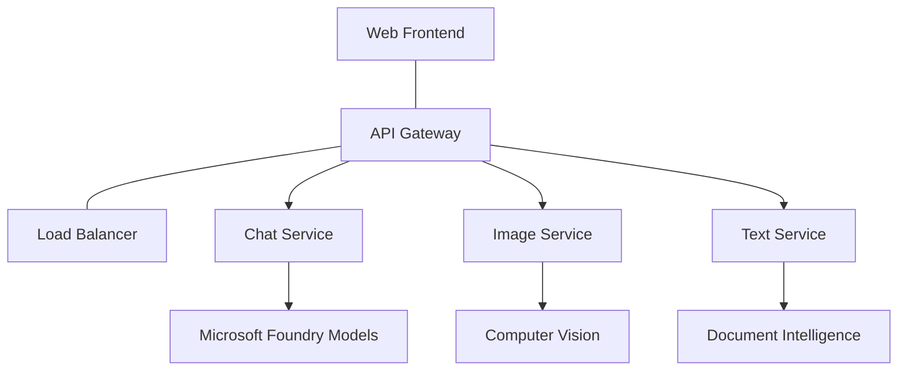

# Best Practices voor Productie AI Workloads met AZD

**Hoofdstuk Navigatie:**
- **📚 Cursus Startpagina**: [AZD Voor Beginners](../../README.md)
- **📖 Huidig Hoofdstuk**: Hoofdstuk 8 - Productie- en Enterprisepatronen
- **⬅️ Vorig Hoofdstuk**: [Hoofdstuk 7: Probleemoplossing](../chapter-07-troubleshooting/debugging.md)
- **⬅️ Ook Gerelateerd**: [AI Workshop Lab](../chapter-02-ai-development/ai-workshop-lab.md)
- **🎯 Cursus Voltooid**: [AZD Voor Beginners](../../README.md)

## Overzicht

Deze gids legt productie AI-ontwerppatronen uit met behulp van Azure Developer CLI (AZD). Het is een ontwerpreferentie, geen inzetbare applicatie of productiecertificering.

**Voorbeeldgrenzen:** Tenzij expliciet als volledig beschreven, gaan Bicep-fragmenten uit van parameters en verwezen resources vanuit een omvattende template. Ze laten host-afbeeldingen/plannen, identiteiten, roltoewijzingen, DNS, outputs en andere vereiste integratie weg. YAML-servicepaden en hook/testscripts zijn illustratieve bestanden om in **je eigen applicatie** te maken; ze worden niet geleverd door deze cursus. Gebruik een werkend AZD-voorbeeld als basis, compileer de volledige infrastructuur en test deze in een geïsoleerde omgeving voordat je in productie gaat.

## Belangrijke Uitdagingen Aangepakt

Veelvoorkomende productieaandachtspunten omvatten multi-service uitrol, identiteit- en geheimebeheer, schaalbaarheid, kostenbeheersing en toezicht. Er wordt hier geen gemeten prevalentie geclaimd.

## Architectuurpatronen voor Productie AI

### Patroon 1: Microservices AI Architectuur

**Wanneer te gebruiken**: Complexe AI-toepassingen met meerdere mogelijkheden



**AZD Implementatie**:

```yaml
# azure.yaml
name: enterprise-ai-platform
services:
  web:
    project: ./web
    host: staticwebapp
  api-gateway:
    project: ./api-gateway
    host: containerapp
  chat-service:
    project: ./services/chat
    host: containerapp
  vision-service:
    project: ./services/vision
    host: containerapp
  text-service:
    project: ./services/text
    host: containerapp
```

### Patroon 2: Event-Driven AI Verwerking

**Wanneer te gebruiken**: Batchverwerking, documentanalyse, asynchrone workflows

```bicep
// Event Hub for AI processing pipeline
resource eventHub 'Microsoft.EventHub/namespaces@2024-01-01' = {
  name: eventHubNamespaceName
  location: location
  sku: {
    name: 'Standard'
    tier: 'Standard'
    capacity: 1
  }
}

// Service Bus for reliable message processing
resource serviceBus 'Microsoft.ServiceBus/namespaces@2024-01-01' = {
  name: serviceBusNamespaceName
  location: location
  sku: {
    name: 'Premium'
    tier: 'Premium'
    capacity: 1
  }
}

// Function App for processing
resource functionApp 'Microsoft.Web/sites@2023-01-01' = {
  name: functionAppName
  location: location
  kind: 'functionapp,linux'
  properties: {
    siteConfig: {
      appSettings: [
        {
          name: 'FUNCTIONS_EXTENSION_VERSION'
          value: '~4'
        }
        {
          name: 'AZURE_OPENAI_ENDPOINT'
          value: '@Microsoft.KeyVault(VaultName=${keyVault.name};SecretName=openai-endpoint)'
        }
      ]
    }
  }
}
```

Dit creëert namespace-fragmenten, geen hubs, wachtrijen, abonnementen of Function triggers. Een uitvoerbare Function heeft ook een hostingplan, runtime/opslagconfiguratie, een gekoppelde identiteit, RBAC en netwerktoegang nodig. De Key Vault-referentie heeft permissie nodig om het geheim te lezen; een endpoint-URL zelf is geen referentie.

## Denken over AI Agent Gezondheid

Wanneer een traditionele webapplicatie faalt, zijn de symptomen bekend: een pagina laadt niet, een API geeft een foutmelding, of een uitrol mislukt. Door AI aangedreven applicaties kunnen op al deze manieren falen — maar ze kunnen zich ook subtieler misdragen zonder duidelijke foutmeldingen.

Deze sectie helpt je een mentaal model te bouwen voor het monitoren van AI workloads zodat je weet waar je moet kijken als dingen niet lijken te kloppen.

### Hoe Agent Gezondheid Verschilt van Traditionele App Gezondheid

Traditionele apps kunnen ook subtiele correctheidsfouten hebben. Een AI-agent voegt niet-deterministische antwoordkwaliteit toe aan de gebruikelijke beschikbaarheids- en correctheidszorgen. Zie agentgezondheid als twee lagen:

| Laag | Waarop Te Letten | Waar Te Kijken |
|-------|--------------|---------------|
| **Infrastructuurgezondheid** | Draait de service? Zijn resources toegewezen? Zijn endpoints bereikbaar? | `azd monitor`, Azure Portal resource gezondheid, container/app logs |
| **Gedrag Gezondheid** | Reageert de agent accuraat? Zijn reacties tijdig? Wordt het model correct aangeroepen? | Application Insights traces, model oproep latency metrieken, response-kwaliteitslogs |

Infrastructuurgezondheid is bekend — het is hetzelfde voor elke azd-app. Gedrag gezondheid is de nieuwe laag die AI workloads toevoegen.

### Waar Te Kijken Als AI Apps Zich Niet Gedragen Zoals Verwacht

Als je AI-applicatie niet de verwachte resultaten produceert, is hier een conceptuele checklist:

1. **Begin met de basis.** Draait de app? Kan het zijn afhankelijkheden bereiken? Controleer `azd monitor` en resource gezondheid zoals je bij elke app zou doen.
2. **Controleer de modelverbinding.** Roept je applicatie succesvol het AI-model aan? Mislukte of time-out modeloproepen zijn de meest voorkomende oorzaak van AI-app problemen en verschijnen in je applicatielogs.
3. **Inspecteer input en onderbouwing veilig.** Foute antwoorden kunnen voortkomen uit ophalen, instructies, modelbeperkingen of tooluitvoering. Gebruik toegang-gecontroleerde, geredigeerde diagnostische data; schakel geen ongerichte prompt/response logging in productie in.
4. **Controleer reactietijd.** AI-model oproepen zijn trager dan typische API calls. Als je app traag aanvoelt, controleer dan of de modelrespons tijden zijn gestegen — dit kan throttling, capaciteitslimieten of regio-brede congestie aangeven.
5. **Let op kostensignalen.** Onverwachte pieken in token gebruik of API oproepen kunnen wijzen op een lus, een verkeerd geconfigureerde prompt of overmatige herhalingen.

Je hoeft niet meteen expert te zijn in observability tools. De belangrijkste les is dat AI-applicaties een extra gedraglaag hebben om te monitoren, en azd’s ingebouwde monitoring (`azd monitor`) geeft je een startpunt om beide lagen te onderzoeken.

---

## Security Best Practices

### 1. Zero-Trust Beveiligingsmodel

**Implementatiestrategie**:
- Geen service-naar-service communicatie zonder authenticatie
- Alle API oproepen gebruiken beheerde identiteiten
- Netwerkisolatie met private endpoints
- Least privilege toegangscontrole

```bicep
// Managed Identity for each service
resource chatServiceIdentity 'Microsoft.ManagedIdentity/userAssignedIdentities@2023-01-31' = {
  name: 'chat-service-identity'
  location: location
}

// Role assignments with minimal permissions
resource openAIUserRole 'Microsoft.Authorization/roleAssignments@2022-04-01' = {
  scope: openAIAccount
  name: guid(openAIAccount.id, chatServiceIdentity.id, '5e0bd9bd-7b93-4f28-af87-19fc36ad61bd')
  properties: {
    roleDefinitionId: subscriptionResourceId('Microsoft.Authorization/roleDefinitions', '5e0bd9bd-7b93-4f28-af87-19fc36ad61bd')
    principalId: chatServiceIdentity.properties.principalId
    principalType: 'ServicePrincipal'
  }
}
```

### 2. Beveiligd Geheimbeheer

**Key Vault Integratiepatroon**:

```bicep
// Key Vault with proper access policies
resource keyVault 'Microsoft.KeyVault/vaults@2023-02-01' = {
  name: keyVaultName
  location: location
  properties: {
    tenantId: tenant().tenantId
    sku: {
      family: 'A'
      name: 'standard' // Premium is needed for HSM-backed keys, not ordinary secrets
    }
    enableRbacAuthorization: true  // Use RBAC instead of access policies
    enablePurgeProtection: true    // Prevent accidental deletion
    enableSoftDelete: true
    softDeleteRetentionInDays: 90
  }
}

// Optional legacy key-auth alternative; omit when using Entra ID.
resource openAIKeySecret 'Microsoft.KeyVault/vaults/secrets@2023-02-01' = {
  parent: keyVault
  name: 'openai-api-key'
  properties: {
    value: openAIAccount.listKeys().key1
    attributes: {
      enabled: true
    }
  }
}
```

Wijs de runtime-identiteit `Key Vault Secrets User` toe op het juiste scope-niveau en koppel deze aan de host; `enableRbacAuthorization` op zichzelf geeft geen toegang. Geef de voorkeur aan OpenAI beheerde identiteit-authenticatie met `disableLocalAuth: true`. Het optionele sleutelgeheim heeft alleen zin voor een bewust sleutel ingeschakeld account, en de provisioningprincipal heeft ook toestemming nodig om geheimen te schrijven.

### 3. Netwerkbeveiliging

**Private Endpoint Configuratie**:

```bicep
// Virtual Network for AI services
resource virtualNetwork 'Microsoft.Network/virtualNetworks@2023-04-01' = {
  name: vnetName
  location: location
  properties: {
    addressSpace: {
      addressPrefixes: ['10.0.0.0/16']
    }
    subnets: [
      {
        name: 'ai-services-subnet'
        properties: {
          addressPrefix: '10.0.1.0/24'
          privateEndpointNetworkPolicies: 'Disabled'
        }
      }
      {
        name: 'app-services-subnet'
        properties: {
          addressPrefix: '10.0.2.0/24'
          delegations: [
            {
              name: 'Microsoft.Web/serverFarms'
              properties: {
                serviceName: 'Microsoft.Web/serverFarms'
              }
            }
          ]
        }
      }
    ]
  }
}

// Private endpoints for all AI services
resource openAIPrivateEndpoint 'Microsoft.Network/privateEndpoints@2023-04-01' = {
  name: '${openAIAccountName}-pe'
  location: location
  properties: {
    subnet: {
      id: virtualNetwork.properties.subnets[0].id
    }
    privateLinkServiceConnections: [
      {
        name: 'openai-connection'
        properties: {
          privateLinkServiceId: openAIAccount.id
          groupIds: ['account']
        }
      }
    ]
  }
}
```

Private endpoints vereisen ook private DNS zone groepen/VNet-links en applicatie VNet-integratie. Ze blokkeren niet automatisch publieke toegang: schakel de publieke netwerkaan toegang voor het AI-account expliciet uit nadat je private connectiviteit en uitroltoegang hebt gevalideerd.

## Prestaties en Schalen

### 1. Auto-Scaling Strategieën

**Container Apps Auto-scaling**:

```bicep
resource containerApp 'Microsoft.App/containerApps@2023-05-01' = {
  name: containerAppName
  location: location
  properties: {
    configuration: {
      ingress: {
        external: true
        targetPort: 8000
        transport: 'http'
      }
    }
    template: {
      scale: {
        minReplicas: 2  // Always have 2 instances minimum
        maxReplicas: 50 // Scale up to 50 for high load
        rules: [
          {
            name: 'http-scaling'
            http: {
              metadata: {
                concurrentRequests: '20'  // Scale when >20 concurrent requests
              }
            }
          }
          {
            name: 'cpu-scaling'
            custom: {
              type: 'cpu'
              metadata: {
                type: 'Utilization'
                value: '70'  // Scale when CPU >70%
              }
            }
          }
        ]
      }
    }
  }
}
```

### 2. Caching Strategieën

**Redis Cache voor AI Antwoorden**:

```bicep
// Legacy Azure Cache for Redis example (not recommended for new deployments)
resource redisCache 'Microsoft.Cache/redis@2023-04-01' = {
  name: redisCacheName
  location: location
  properties: {
    sku: {
      name: 'Premium'
      family: 'P'
      capacity: 1
    }
    enableNonSslPort: false
    minimumTlsVersion: '1.2'
    redisConfiguration: {
      'maxmemory-policy': 'allkeys-lru'
    }
    // Sharding distributes data; replication/failover provides availability.
    shardCount: 2
  }
}

// Cache configuration in application
var cacheConnectionString = '${redisCache.properties.hostName}:6380,password=${redisCache.listKeys().primaryKey},ssl=True,abortConnect=False'
```

Azure Cache for Redis Basic/Standard/Premium bevindt zich op een [uitfaseringstraject](https://learn.microsoft.com/azure/azure-cache-for-redis/retirement-faq). Gebruik Azure Managed Redis voor nieuwe ontwerpen en de gedocumenteerde SKU, identiteit en TLS-configuratie, in plaats van deze legacy resource te kopiëren in een nieuw productiesysteem. De connection-string regel is een niet-functionele placeholder, geen referentie. Partitioneer cache-sleutels op autorisatie, model/instructies en versie van ophalen, met vervaldatum; een gedeelde alleen-query cache kan data van een andere gebruiker blootleggen.

### 3. Load Balancing en Verkeersbeheer

**Application Gateway met WAF**:

```bicep
// Application Gateway with Web Application Firewall
resource applicationGateway 'Microsoft.Network/applicationGateways@2023-04-01' = {
  name: appGatewayName
  location: location
  properties: {
    sku: {
      name: 'WAF_v2'
      tier: 'WAF_v2'
      capacity: 2
    }
    webApplicationFirewallConfiguration: {
      enabled: true
      firewallMode: 'Prevention'
      ruleSetType: 'OWASP'
      ruleSetVersion: '3.2'
    }
    // Backend pools for AI services
    backendAddressPools: [
      {
        name: 'ai-services-pool'
        properties: {
          backendAddresses: [
            {
              fqdn: '${containerApp.properties.configuration.ingress.fqdn}'
            }
          ]
        }
      }
    ]
  }
}
```

Dit is een gedeeltelijke gateway-resource: een daadwerkelijke uitrol heeft ook gateway subnet/IP-configuratie, frontend IP’s en poorten, TLS-listeners/certificaten, backend HTTP instellingen/probes, routeringsregels en prioriteiten, en een herzien WAF-beleid nodig. TLS-hostnaam/SNI en authenticatie moeten overeenkomen met de backend van de Container App.

## 💰 Kostenoptimalisatie

### 1. Juiste Grootte voor Resources

**Omgevingsspecifieke Configuraties**:

Deze namen zijn **illustratieve custom-template inputs**, geen automatische AZD-instellingen. Koppel elk eerst aan `infra/main.parameters.json`/Bicep en hostconfiguratie. Bijvoorbeeld, het RAG-voorbeeld gebruikt `AZURE_SEARCH_SERVICE_SKU` en `AZURE_OPENAI_CHATGPT_DEPLOYMENT_CAPACITY`, niet de generieke namen hieronder. Geef Container Apps geheugen een ondersteunde eenheid zoals `1Gi` in de daadwerkelijke resource. Pas infrastructuurwijzigingen toe met `azd up` of `azd provision`; `azd deploy` alleen past geen Bicep-wijzigingen toe.

```bash
# Development environment
azd env new development
azd env set AZURE_OPENAI_SKU "S0"
azd env set AZURE_OPENAI_CAPACITY 10
azd env set AZURE_SEARCH_SKU "basic"
azd env set CONTAINER_CPU 0.5
azd env set CONTAINER_MEMORY 1.0

# Production environment  
azd env new production
azd env set AZURE_OPENAI_SKU "S0"
azd env set AZURE_OPENAI_CAPACITY 100
azd env set AZURE_SEARCH_SKU "standard"
azd env set CONTAINER_CPU 2.0
azd env set CONTAINER_MEMORY 4.0
```

### 2. Kostenmonitoring en Budgetten

```bicep
// Supply the first day of the current UTC month, e.g. 2026-11-01T00:00:00Z.
param budgetStartDate string

// Cost management and budgets
resource budget 'Microsoft.Consumption/budgets@2024-08-01' = {
  name: 'ai-workload-budget'
  properties: {
    timePeriod: {
      startDate: budgetStartDate
    }
    timeGrain: 'Monthly'
    amount: 2000  // In the billing currency, not necessarily USD
    category: 'Cost'
    notifications: {
      warning: {
        enabled: true
        operator: 'GreaterThan'
        threshold: 80
        contactEmails: [
          'finance@company.com'
          'engineering@company.com'
        ]
        contactRoles: [
          'Owner'
          'Contributor'
        ]
      }
      critical: {
        enabled: true
        operator: 'GreaterThan'
        threshold: 95
        contactEmails: [
          'cto@company.com'
        ]
      }
    }
  }
}
```

Vervang de voorbeeldontvangers en controleer scope/permities. Budgetwaarschuwingen gebruiken vertraagde factureringsgegevens en handhaven geen uitgavelimiet.

### 3. Token Gebruik Optimalisatie

**OpenAI Kostenbeheer**:

Dit is slechts een karaktergebaseerde heuristiek voor een UI-preview, **geen** validatie van model tokenlimiet. Productiecode moet een tokenizer gebruiken die passend is voor het uitgerolde model en rekening houden met systeeminstructies, toolschema’s, geschiedenis en outputbudget. Wijs een te groot gebruikersbericht af in plaats van het stilletjes af te kappen.

```typescript
// Application-level token optimization
class TokenOptimizer {
  private readonly maxTokens = 4000;
  private readonly reserveTokens = 500;
  
  optimizePrompt(userInput: string, context: string): string {
    const availableTokens = this.maxTokens - this.reserveTokens;
    if (this.estimateTokens(userInput) + 8 >= availableTokens) {
      throw new Error("User input exceeds the illustrative prompt budget");
    }
    const estimatedTokens = this.estimateTokens(userInput + context) + 8;
    
    if (estimatedTokens > availableTokens) {
      // Truncate context, not user input
      context = this.truncateContext(context, Math.max(0, availableTokens - this.estimateTokens(userInput) - 8));
    }
    
    return `${context}\n\nUser: ${userInput}`;
  }
  
  private estimateTokens(text: string): number {
    // Rough estimation: 1 token ≈ 4 characters
    return Math.ceil(text.length / 4);
  }

  private truncateContext(text: string, estimatedBudget: number): string {
    return text.slice(0, Math.max(0, estimatedBudget) * 4);
  }
}
```

## Monitoring en Observeerbaarheid

### 1. Uitgebreide Application Insights

```bicep
// Application Insights with advanced features
resource applicationInsights 'Microsoft.Insights/components@2020-02-02' = {
  name: applicationInsightsName
  location: location
  kind: 'web'
  properties: {
    Application_Type: 'web'
    WorkspaceResourceId: logAnalyticsWorkspace.id
    SamplingPercentage: 100  // Ingestion setting; review cost and SDK sampling separately
    DisableIpMasking: false  // Retain IP masking
  }
}

// Custom metrics for AI operations
resource aiMetricAlerts 'Microsoft.Insights/metricAlerts@2018-03-01' = {
  name: 'ai-high-error-rate'
  location: 'global'
  properties: {
    description: 'Alert when failed request count exceeds 10 in five minutes'
    severity: 2
    enabled: true
    scopes: [
      applicationInsights.id
    ]
    evaluationFrequency: 'PT1M'
    windowSize: 'PT5M'
    criteria: {
      'odata.type': 'Microsoft.Azure.Monitor.SingleResourceMultipleMetricCriteria'
      allOf: [
        {
          name: 'high-error-rate'
          metricName: 'requests/failed'
          operator: 'GreaterThan'
          threshold: 10
          timeAggregation: 'Count'
        }
      ]
    }
  }
}
```

### 2. AI-Specifieke Monitoring

**Aangepaste Dashboards voor AI Metrieken**:

```json
{
  "dashboard": {
    "name": "AI Application Monitoring",
    "tiles": [
      {
        "name": "OpenAI Request Volume",
        "query": "dependencies | where target contains 'openai' | summarize count() by bin(timestamp, 5m)"
      },
      {
        "name": "AI Response Latency",
        "query": "dependencies | where target contains 'openai' | summarize avg(duration) by bin(timestamp, 5m)"
      },
      {
        "name": "Token Usage",
        "query": "customMetrics | where name == 'openai_tokens_used' | summarize sum(value) by bin(timestamp, 1h)"
      },
      {
        "name": "Cost per Hour",
        "query": "customMetrics | where name == 'openai_cost' | summarize sum(value) by bin(timestamp, 1h)"
      }
    ]
  }
}
```

Deze JSON is een toepassingsgedefinieerde schets, geen importeerbaar Azure portal dashboardschema. De token/kosten queries vereisen dat je app die exacte aangepaste metrieken uitzendt; ze worden niet aangemaakt door AZD. Pas afhankelijkheidsfilters aan je daadwerkelijke model endpoint/span namen aan.

### 3. Gezondheidscontroles en Uptime Monitoring

```bicep
// Application Insights availability tests
resource availabilityTest 'Microsoft.Insights/webtests@2022-06-15' = {
  name: 'ai-app-availability-test'
  location: location
  tags: {
    'hidden-link:${applicationInsights.id}': 'Resource'
  }
  properties: {
    SyntheticMonitorId: 'ai-app-availability-test'
    Name: 'AI Application Availability Test'
    Description: 'Tests AI application endpoints'
    Enabled: true
    Frequency: 300  // 5 minutes
    Timeout: 120    // 2 minutes
    Kind: 'standard'
    Locations: [
      {
        Id: 'us-east-2-azr'
      }
      {
        Id: 'us-west-2-azr'
      }
    ]
    Request: {
      RequestUrl: 'https://${webApp.properties.defaultHostName}/health'
      HttpVerb: 'GET'
      FollowRedirects: true
      ParseDependentRequests: false
    }
    ValidationRules: {
      ExpectedHttpStatusCode: 200
      SSLCheck: true
      SSLCertRemainingLifetimeCheck: 7
    }
  }
}
```

## Disaster Recovery en Hoge Beschikbaarheid

De voorgaande test gaat uit van een bestaande App Service `webApp` en Application Insights resource. Standaard beschikbaarheidstests zijn factureerbaar en vereisen een bereikbaar endpoint; alleen private apps hebben een passend ontwerp voor private monitoring nodig. URL ping-tests zijn verouderd; gebruik [standaard beschikbaarheidstests](https://learn.microsoft.com/azure/azure-monitor/app/availability).

### 1. Multi-Regio Uitrol

```yaml
# azure.yaml - Multi-region configuration
name: ai-app-multiregion
services:
  api-primary:
    project: ./api
    host: containerapp
    env:
      AZURE_REGION: eastus
  api-secondary:
    project: ./api
    host: containerapp
    env:
      AZURE_REGION: westus2
```

```bicep
// Separate App Service topology, not the Container Apps declarations above
resource trafficManager 'Microsoft.Network/trafficManagerProfiles@2022-04-01' = {
  name: trafficManagerProfileName
  location: 'global'
  properties: {
    profileStatus: 'Enabled'
    trafficRoutingMethod: 'Priority'
    dnsConfig: {
      relativeName: trafficManagerProfileName
      ttl: 30
    }
    monitorConfig: {
      protocol: 'HTTPS'
      port: 443
      path: '/health'
      intervalInSeconds: 30
      toleratedNumberOfFailures: 3
      timeoutInSeconds: 10
    }
    endpoints: [
      {
        name: 'primary-endpoint'
        type: 'Microsoft.Network/trafficManagerProfiles/azureEndpoints'
        properties: {
          targetResourceId: primaryAppService.id
          endpointStatus: 'Enabled'
          priority: 1
        }
      }
      {
        name: 'secondary-endpoint'
        type: 'Microsoft.Network/trafficManagerProfiles/azureEndpoints'
        properties: {
          targetResourceId: secondaryAppService.id
          endpointStatus: 'Enabled'
          priority: 2
        }
      }
    ]
  }
}
```

Omgevingsvariabelen kiezen geen resource locaties. IaC moet verschillende regionale hosts provisioneren en elke dienst koppelen met `resourceName` of `azd-service-name` tags. Het Traffic Manager voorbeeld is een **aparte App Service topologie** (`primaryAppService`/`secondaryAppService`), geen routering voor de Container Apps declaraties. Container Apps vereist een passend geconfigureerde externe endpoint/front door, TLS/custom-domain routering en gezondheidsprobes.

### 2. Data Backup en Herstel

```bicep
// Backup configuration for critical data
resource backupVault 'Microsoft.DataProtection/backupVaults@2023-05-01' = {
  name: backupVaultName
  location: location
  identity: {
    type: 'SystemAssigned'
  }
  properties: {
    storageSettings: [
      {
        datastoreType: 'VaultStore'
        type: 'LocallyRedundant'
      }
    ]
  }
}

```

De vault alleen maakt geen back-up. Configureer een **workload-specifiek ondersteund beleid en backup-instance**, bronpermissies, retentie en hersteltests met behulp van [Azure Backup ondersteuningsmatrices](https://learn.microsoft.com/azure/backup/backup-support-matrix). Er is geen generiek Azure Backup-beleid voor gehoste Azure OpenAI modeluitrol. Bewaar infrastructuur-/modeldeploy definitie in bronbeheer; bescherm geüploade documenten, applicatiegegevens en fine-tuning artefacten met de ondersteunde backup/exportfunctionaliteit van elke back-end service. Definieer en test RPO/RTO expliciet.

## DevOps en CI/CD Integratie

### 1. GitHub Actions Workflow

```yaml
# .github/workflows/deploy-ai-app.yml
name: Deploy AI Application

on:
  push:
    branches: [main]
  pull_request:
    branches: [main]

jobs:
  test:
    runs-on: ubuntu-latest
    steps:
      - uses: actions/checkout@v4
      
      - name: Setup Python
        uses: actions/setup-python@v4
        with:
          python-version: '3.11'
          
      - name: Install dependencies
        run: |
          pip install -r requirements.txt
          pip install pytest
          
      - name: Run tests
        run: pytest tests/
        
      - name: AI Safety Tests
        run: |
          python scripts/test_ai_safety.py
          python scripts/validate_prompts.py

```

Dit is het **alleen-test** deel van een workflow en gaat ervan uit dat je `requirements.txt`, `tests/`, en de twee safety scripts hebt gemaakt. Voeg de geauthenticeerde OIDC provisioning/deployment jobs toe uit [CI/CD Pipeline Configuratie](#cicd-pipeline-configuration), met `needs: test`, een vertrouwde push/handmatige trigger, en beschermde GitHub-omgevingen. Rol geen onbetrouwbare pull-requestcode uit met cloudreferenties. Een verse runner heeft geen geselecteerde lokale AZD-omgeving; lever de omgeving/subscriptie/locatie inputs en gebruik `azd auth login`, niet alleen `azure/login`.

### 2. Infrastructuur Validatie

```bash
# scripts/validate_infrastructure.sh
#!/bin/bash
set -euo pipefail

echo "Validating AI infrastructure deployment..."

# Requires Azure CLI login and the resource group selected explicitly.
: "${AZURE_RESOURCE_GROUP:?Set AZURE_RESOURCE_GROUP}"
: "${AZURE_OPENAI_NAME:?Set AZURE_OPENAI_NAME}"
: "${AZURE_OPENAI_CHAT_DEPLOYMENT:?Set the actual deployment name}"

# A successful empty list is not proof that resources exist.
types=("Microsoft.CognitiveServices/accounts" "Microsoft.Search/searchServices"
       "Microsoft.Storage/storageAccounts" "Microsoft.KeyVault/vaults")
for resource_type in "${types[@]}"; do
    count=$(az resource list --resource-group "$AZURE_RESOURCE_GROUP" \
        --resource-type "$resource_type" --query "length(@)" -o tsv)
    if [[ "$count" -lt 1 ]]; then
        echo "ERROR: No $resource_type found in $AZURE_RESOURCE_GROUP"
        exit 1
    fi
done

# Validate OpenAI model deployments
echo "Validating OpenAI model deployments..."
state=$(az cognitiveservices account deployment show \
  --name "$AZURE_OPENAI_NAME" --resource-group "$AZURE_RESOURCE_GROUP" \
  --deployment-name "$AZURE_OPENAI_CHAT_DEPLOYMENT" \
  --query "properties.provisioningState" -o tsv)
if [[ "$state" != "Succeeded" ]]; then
    echo "ERROR: Required model deployment is not provisioned successfully"
    exit 1
fi

echo "Infrastructure validation completed successfully!"
```

Verwacht: een exitcode nul en alleen het voltooiingsbericht als alle verwachte types bestaan en de genoemde modeluitrol is provisioned. Dit controleert inventaris/provisioning status, **niet** resource gezondheid, exacte topologie, RBAC, netwerk bereikbaarheid of modelgedrag. Pas de verwachte types aan je architectuur aan, en voer daarna een aparte geauthenticeerde applicatie gereedheidstest uit.

## Productiegereedheidschecklist

### Beveiliging ✅
- [ ] Alle services gebruiken beheerde identiteiten
- [ ] Geheimen opgeslagen in Key Vault
- [ ] Private endpoints geconfigureerd
- [ ] Netwerkbeveiligingsgroepen geïmplementeerd
- [ ] RBAC met least privilege
- [ ] WAF ingeschakeld op publieke endpoints

### Prestaties ✅
- [ ] Auto-scaling geconfigureerd
- [ ] Caching geïmplementeerd
- [ ] Load balancing ingesteld
- [ ] CDN voor statische content
- [ ] Database verbinding pooling
- [ ] Token gebruik optimalisatie

### Monitoring ✅
- [ ] Application Insights geconfigureerd
- [ ] Aangepaste metrieken gedefinieerd
- [ ] Alertregels ingesteld
- [ ] Dashboard aangemaakt
- [ ] Gezondheidscontroles geïmplementeerd
- [ ] Logretentiebeleid

### Betrouwbaarheid ✅
- [ ] Multi-regio uitrol
- [ ] Backup- en herstelplan
- [ ] Circuit breakers geïmplementeerd
- [ ] Retry policies geconfigureerd
- [ ] Gracieuze degradatie
- [ ] Gezondheidscheck endpoints

### Kostenbeheer ✅
- [ ] Budget-waarschuwingen geconfigureerd
- [ ] Juiste grootte van resources
- [ ] Dev/test kortingen toegepast
- [ ] Gereserveerde instanties aangekocht
- [ ] Kostenbewaking dashboard
- [ ] Regelmatige kostenreviews

### Compliance ✅
- [ ] Data-locatievereisten nageleefd
- [ ] Auditlogging ingeschakeld
- [ ] Compliance-beleid toegepast
- [ ] Beveiligingsbasislijnen geïmplementeerd
- [ ] Regelmatige beveiligingsbeoordelingen
- [ ] Incident response plan

## Prestatiebenchmarks

### Illustratieve Productiedoelstellingen

Dit zijn voorbeeld-SLO’s om te onderhandelen en load-testen, geen gemeten benchmarks of garanties. Respons-latentie hangt af van model- en outputlengte; maandelijkse tokenuitgaven hangen af van verkeer en prijzen, niet alleen van tokenaantal.

| Metriek | Doel | Monitoring |
|--------|--------|------------|
| **Reactietijd** | < 2 seconden | Application Insights |
| **Beschikbaarheid** | 99,9% | Uptime monitoring |
| **Foutpercentage** | < 0,1% | Applicatielogs |
| **Modeluitgaven** | < $500/maand (voorbeeldbudget) | Kostenbeheer |
| **Gelijktijdige gebruikers** | 1000+ | Load testing |
| **Hersteltijd** | < 1 uur | Hersteltests bij rampen |

### Loadtesten

Het volgende is een interface-schets voor een load-testscript **dat u moet implementeren**; deze repository levert `scripts/load_test.py` niet. Definieer requestpayloads, authenticatie, representatieve workloads, percentile-latentie/foutasserties en een budgetlimiet in uw gekozen load-testtool voordat u deze uitvoert:

```bash
# Load testing script for AI applications
python scripts/load_test.py \
  --endpoint https://your-ai-app.azurewebsites.net \
  --concurrent-users 100 \
  --duration 300 \
  --ramp-up 60
```

## 🤝 Gemeenschapsbest practices

Gebaseerd op feedback van de Microsoft Foundry Discord-gemeenschap:

### Topaanbevelingen van de gemeenschap:

1. **Begin klein, schaal geleidelijk op**: Begin met basis-SKU's en schaal op basis van daadwerkelijk gebruik
2. **Monitor alles**: Zet vanaf dag één uitgebreide monitoring op
3. **Automatiseer beveiliging**: Gebruik infrastructuur als code voor consistente beveiliging
4. **Test grondig**: Neem AI-specifieke tests op in uw pipeline
5. **Plan voor kosten**: Monitor tokengebruik en stel vroeg budgetwaarschuwingen in

### Veelvoorkomende valkuilen om te vermijden:

- ❌ Hardcoded API-sleutels in code
- ❌ Ontbrekende correcte monitoringinstellingen
- ❌ Kostenoptimalisatie negeren
- ❌ Niet testen van faalscenario's
- ❌ Implementeren zonder health checks

## AZD AI CLI-commando's en extensies

AZD bevat een groeiende set AI-specifieke commando's en extensies die productieworkflows voor AI stroomlijnen. Deze tools overbruggen de kloof tussen lokale ontwikkeling en productie-implementatie voor AI-workloads.

> **Foundry GA update (2026-11-09):** De `microsoft.foundry` bundel bereikte **1.0 / algemene beschikbaarheid** op [5 november 2026](https://devblogs.microsoft.com/azure-sdk/microsoft-foundry-azure-developer-cli-ga/). Gebruik **`azd >= 1.37.0`** voor deze workflow. De eerdere `azd 1.37.2`, agents beta.23 en evaluations beta.2 review staan hieronder als migratiegeschiedenis, niet als huidige bundelversie. Dit is een documentatie-/bronreview, geen live implementatievalidatie of claim dat elke optionele extensie, API of preview-functie GA is.

### AZD-extensies voor AI

AZD gebruikt een extensiesysteem om AI-specifieke mogelijkheden toe te voegen. Installeer en beheer extensies met:

```bash
# List all available extensions (including AI)
azd extension list

# Inspect installed versions
azd version
azd ext list --installed

# Install the GA Foundry bundle
azd ext install microsoft.foundry

# Install the separate Foundry evaluations extension
azd extension install azure.ai.evaluations

# Install the fine-tuning extension
azd extension install azure.ai.finetune

# Install the custom models extension
azd extension install azure.ai.models

# Upgrade the Foundry bundle
azd ext upgrade microsoft.foundry
```

**Beschikbare AI-extensies:**

| Extensie | Doel | Status |
|-----------|---------|--------|
| `microsoft.foundry` | Meta-pakket dat de onderstaande zeven kernextensies installeert; geen eigen opdrachtgroep | GA bundel 1.0 |
| `azure.ai.agents` | `azd ai agent`: agentinstelling, lokale uitvoering en operaties | Inbegrepen; onafhankelijk geversioneerd |
| `azure.ai.connections` | `azd ai connection`: projectverbindingen | Inbegrepen; onafhankelijk geversioneerd |
| `azure.ai.inspector` | `azd ai inspector`: lokale Agent Inspector UI | Inbegrepen; onafhankelijk geversioneerd |
| `azure.ai.projects` | `azd ai project`: projectmiddelen en modelimplementaties | Inbegrepen; onafhankelijk geversioneerd |
| `azure.ai.routines` | `azd ai routine`: schema's en triggers | Inbegrepen; onafhankelijk geversioneerd |
| `azure.ai.skills` | `azd ai skill`: herbruikbare gedragsrichtlijnen | Inbegrepen; onafhankelijk geversioneerd |
| `azure.ai.toolboxes` | `azd ai toolbox`: geversioneerde toolverzamelingen | Inbegrepen; onafhankelijk geversioneerd |
| `azure.ai.evaluations` | Evaluatiedatasets, evaluators, evaluatiegroepen en runs | Aparte installatie/releases |
| `azure.ai.dataset` | Datasetregistratie en versiebeheer | Aparte installatie/releases |
| `azure.ai.finetune` | Foundry model fine-tuning | Aparte installatie/releases |
| `azure.ai.models` | Foundry aangepaste modellen | Aparte installatie/releases |

Het afzonderlijk installeren van `azure.ai.agents` blijft ondersteund en installeert afhankelijkheden; de bundel is de standaard van de cursus voor de GA-workflow. Bundel-GA is geen algemene releasediteitsgarantie voor optionele functies van de onderdelen. Zie [extensieverpakking en verificatie](https://learn.microsoft.com/azure/foundry/agents/how-to/install-cli-foundry-extensions) en inspecteer hulp voor geïnstalleerde commando's alvorens te gebruiken.

> Upgrade eerst de kern-CLI met `azd update` of de juiste [installatie/update-methode](https://learn.microsoft.com/azure/developer/azure-developer-cli/install-azd), en voer daarna `azd ext upgrade microsoft.foundry` uit. Werk afzonderlijk geïnstalleerde evaluaties indien nodig bij met `azd ext upgrade azure.ai.evaluations`. Er is geen kern-`azd upgrade` commando. Registreer en beheer onafhankelijk geversioneerde extensies in productieautomatisering; een upgrade migreert oude configuraties niet automatisch.

### Recente releasewijzigingen en fixes

| Release | Wat verandert er voor deze cursus |
|---------|------------------------------|
| `microsoft.foundry` 1.0 GA (2026-11-05) | Standaard naar de zeven-extensie bundel, behoud agent-/implementatie-instellingen in `azure.yaml`, lokaal testen met Agent Inspector, en upload code voor een remote Foundry build. Installeer evaluaties apart en installeer vereiste extensies opnieuw op CI-runners. |
| `azd 1.37.0` | Voegt stabiele deployment-preview APIs toe en repareert extensiebewerkingen die niet-gerelateerde `azure.yaml` instellingen herschreven. |
| `azd 1.37.1` | Lost Ctrl+C-propagatie over extensies op en onderscheidt annulering/time-outs van generieke fouten. |
| `azd 1.37.2` | Verbetert validatie van provisioning: kritische waarschuwingen standaard op **Nee**, mislukken zonder bevestiging bij onbewaakte runs, en annulering slaat post-provision hooks over. Repareert ook niet-opgeloste omgevingswaarden in Deployment Stacks deny-lijsten wanneer die alfa-feature aanstaat. |
| Agents `beta.22` | Migreert evaluatie naar `azd ai eval`, verandert optimalisatie naar de GA v1 API, vereist meervoudige `toolboxes`, en splitst managed-harness, voice en long-running preview opt-ins. Repareert omgevingsspecifieke modelselectie en toolbox-authenticatie. |
| Agents `beta.23` | Blaast `init --harness` open; repareert A2A 0.3 antwoordoutput, invalid prompt-agent paden/modules over infrastructuurniveaus, activatietime-out diagnoses, en bewaarde developer RBAC-waarschuwingen. |
| Evaluations `beta.2` | Vereist camelCase evaluatieconfiguratie, voegt statisch/gesimuleerd gespreksbeheer en expliciete lokale-bestandbronnen toe, repareert dataset-identiteit-/versiebeheer, quality-gate-tellingen en diagnose van mislukte runs. |

Een agent-activatietime-out bewijst **niet** dat de implementatie is mislukt: inspecteer de geprobeerd versie en zijn staat voordat u opnieuw probeert. Developer RBAC-waarschuwingen kunnen blijven bestaan zelfs als provisioning slaagt; los de ontbrekende toegang op voordat u deze ontwikkelaar oproept.

De beta-rijen hierboven beschrijven eerdere fixes en migratiegrenzen, niet de vereiste om nieuwe projecten aan die versies te koppelen.

Bronnen: [Foundry GA aankondiging](https://devblogs.microsoft.com/azure-sdk/microsoft-foundry-azure-developer-cli-ga/), [AZD-releases](https://github.com/Azure/azure-dev/releases), [agents beta.23 release](https://github.com/Azure/azure-dev/releases/tag/azd-ext-azure-ai-agents_1.0.0-beta.23), [agents beta.22 migratie](https://github.com/Azure/azure-dev/releases/tag/azd-ext-azure-ai-agents_1.0.0-beta.22), en [evaluations beta.2 release](https://github.com/Azure/azure-dev/releases/tag/azd-ext-azure-ai-evaluations_1.0.0-beta.2).

**Wat zijn de gebundelde `skills` en `connections` extensies?**

Deze worden geïnstalleerd met de kernbundel maar dienen verschillende doelen:

- **`azure.ai.skills`** — Een **skill** verpakt herbruikbare gedragsrichtlijnen voor agents. Deel beoordeelde instructies over agents in plaats van ze te kopiëren. Een skill implementeert zelf geen tool of verleent toegang tot data; gebruik toolboxes en applicatiecode voor uitvoering van tools.
- **`azure.ai.connections`** — Een **connection** is een beheerde koppeling van uw Foundry-project naar een externe bron die uw agents nodig hebben — een databron (zoals Azure AI Search), een toolendpoint of een andere dienst. Verbindingen centraliseren *waar* en *hoe* agents toegang tot data krijgen, zodat credentials en endpoints op één gecontroleerde plek leven in plaats van gespreid door code.

U hoeft niet elke gebundelde mogelijkheid te configureren om uw eerste agent te implementeren. Gebruik skills wanneer agents gedragsrichtlijnen delen en connections wanneer zij externe bronnen delen.

### Initialiseren van agentprojecten met `azd ai agent init`

Het commando `azd ai agent init` scaffoldt een Microsoft Foundry agentproject. Voor een uitvoerbaar code-implementatievoorbeeld met Python 3.13+ en huidige uv, volg de [GA hosted-agent walkthrough](../chapter-02-ai-development/microsoft-foundry-integration.md#hosted-agent-walkthrough-ga). De onderstaande commando’s illustreren het adopteren van **uw eigen** huidige `azure.yaml` projecttemplate; de genoemde lokale template wordt niet geleverd door deze cursus:

```bash
# Initialize a new agent project from a local project template
azd ai agent init --template ./templates/support-agent/azure.yaml

# Initialize and target a specific Foundry project
azd ai agent init --template ./templates/support-agent/azure.yaml --project-id <foundry-project-id>

# Adopt the template into a different directory
azd ai agent init --template ./templates/support-agent/azure.yaml --src ./agents/my-agent
```

**Belangrijke vlaggen:**

| Vlag | Beschrijving |
|------|-------------|
| `-t, --template` | Pad of ondersteunde GitHub URI naar een `azure.yaml` projectdocument |
| `-p, --project-id` | Bestaande Microsoft Foundry Project-ID voor uw azd-omgeving |
| `-s, --src` | Bronmap voor gegenereerde agents, of doelmap bij adoptie van een project |
| `--deploy-mode code` | Upload bron voor een remote Foundry build in plaats van lokaal container bouwen |
| `--model-deployment` | Hergebruik een bestaande benoemde modelimplementatie tijdens initialisatie |
| `--kind` | Initialiseer een `hosted`, `prompt`, of preview `prompt-voice` agent |
| `--harness` | Optioneel uitvoeringsharnas voor `--kind prompt`; vereist preview opt-in |
| `-e, --environment` | De te gebruiken azd-omgeving |

`--manifest`/`-m` is een verouderde alias voor `--template`/`-t`; het hernoemen van de vlag zet een oud manifest niet om in een actueel projectdocument. `--host containerapp` is geen huidige agent-init vlag. Voor een gewone Container Apps-applicatie gebruikt u `azd init --template` met een template die `host: containerapp` verklaart.

Voor een bestaand project met precies één `azure.ai.project` service voegt `azd ai agent add support-agent --file ./agents/support-agent.yaml` een directe agentdefinitie toe of werkt die bij zonder provisioning of uitrol. Runtime-commando's weigeren legacy impliciete `agent.yaml`/AgentManifest en geneste service `config:` definities; migreer deze naar een actuele `azure.ai.agent` service. Wanneer init een `cd` next step print, voert u die uit voordat u `azd up` draait: init wijzigt uw shellmap niet.

**Productietip**: Gebruik `--project-id` om direct te verbinden met een bestaand Foundry-project, en houd uw agentcode en cloudresources vanaf het begin gekoppeld.

#### Optionele previewfuncties

Managed harness, voice en long-running invoked worden standaard onafhankelijk uitgeschakeld. Zet alleen de schakelaar voor de functie die u nodig hebt in de **shell-/CI-procesomgeving**, niet met `azd env set`:

| Functie | Proces-omgevingsvariabele |
|---------|------------------------------|
| Managed harness (`init --kind prompt --harness ...`) | `AZD_ALPHA_ENABLE_AGENTS_MANAGED_HARNESS=true` |
| Voice (`init --kind prompt-voice`) | `AZD_ALPHA_ENABLE_AGENTS_VOICE=true` |
| Long-running invocation | `AZD_ALPHA_ENABLE_AGENTS_LONG_RUNNING=true` |

Gebruik bijvoorbeeld `export AZD_ALPHA_ENABLE_AGENTS_MANAGED_HARNESS=true` in Bash of `$env:AZD_ALPHA_ENABLE_AGENTS_MANAGED_HARNESS = "true"` in PowerShell vóór het uitvoeren van het relevante commando. Eén schakelaar schakelt de anderen niet in. Zie de [gereleasete agents README](https://github.com/Azure/azure-dev/blob/azd-ext-azure-ai-agents_1.0.0-beta.23/cli/azd/extensions/azure.ai.agents/README.md) voor alle preview-schakelaars en beperkingen.

### Het beheer van de agentlevenscyclus

De bundel-`azure.ai.agents` extensie ondersteunt lokale tests en uitrol-agentoperaties. Installeer `azure.ai.evaluations` apart om kwaliteit te meten:

```bash
# Start the local agent and Agent Inspector (leave running)
azd ai agent run

# From a second terminal in the project directory
azd ai agent invoke --local "Explain how this agent is deployed."

# Invoke a deployed agent and view server response timing
# (total latency and time to first byte)
azd ai agent invoke

# Show the live endpoint configuration before changing it
azd ai agent endpoint show

# Download the deployed source of a code-based hosted agent
# (with SHA-256 verification)
azd ai agent code download

# Delete a hosted agent and all of its versions
# (--force terminates active sessions)
azd ai agent delete --force
```

**Levenscyclus in vogelvlucht:**

| Fase | Commando | Productiegebruik |
|-------|---------|----------------|
| Lokale test | `azd ai agent run`, vervolgens `azd ai agent invoke --local "Test prompt"` | Inspecteer requests en responses vóór implementatie; Azure modelaanroepen brengen nog steeds kosten met zich mee |
| Uitrollen | `azd deploy` | In codemodus, bouw de geüploade bron remote in Foundry |
| Test | `azd ai agent invoke` | Valideer antwoorden en meet latentie vóór release |
| Diagnosticeer | `azd ai agent doctor`, `azd ai agent monitor --follow` | Controleer setup/rechten en stream agentlogs |
| Inspecteer | `azd ai agent endpoint show` | Review endpoint auth/config; herken vroegtijdig brekende wijzigingen |
| Meet | `azd ai eval init`, `generate`, `run start` | Definieer, implementeer en voer herhaalbare evaluaties uit |
| Verbeter | `azd ai agent optimize --eval <evaluation-name> --optimize-model <optimizer-deployment>` | Hergebruik een compatibele evaluatie om de agent te optimaliseren |
| Herstel | `azd ai agent code download` | Haal de exact geïmplementeerde bron op voor audit/rollback |
| Uit dienst nemen | `azd ai agent delete --force` | Demonteer een agent en zijn versies netjes |

> Voer `azd ai agent --help` uit om de commando's in uw geïnstalleerde versie te inspecteren. De bundel is GA; onafhankelijk beheerde previewfuncties zijn nog steeds opt-in. Onderscheid bij opruiming agentverwijdering van projectverwijdering: `azd down` verwijdert een nieuw gemaakt project-resourcesgroep, maar laat middelen van hergebruikte projecten staan. Volg de [opruimrichtlijnen](../chapter-02-ai-development/microsoft-foundry-integration.md#7-clean-up-deliberately).

`endpoint show` ondersteunt hosted, prompt en voice agents, maar endpointupdates zijn alleen voor hosted; workflow-agents worden niet ondersteund. Code-download en het pensioenvoorbeeld van hosted agents hierboven zijn geen algemene operaties voor elk agenttype.

#### Evaluatiemigratie en kwaliteitscontroles

Vanaf agents **1.0.0-beta.22 (2026-10-23)** bieden legacy `azd ai agent eval` commando's migratierichtlijnen in plaats van de vroegere evaluatieworkflow. Kopieer geen oude `eval generate --dataset ...` voorbeelden: evaluatie leeft nu onder **`azd ai eval`**.

In een geïnitialiseerd agentproject, autenticeer met `azd auth login`, bevestig het geselecteerde environment/Foundry-project en installeer `azure.ai.evaluations`. Een judge model implementatie is nodig voor modelgebaseerde scoring; generatie en conversatiesimulatie kunnen hun eigen modelselecties vereisen en extra kosten met zich meebrengen.

```bash
# Generate a draft rubric and dataset from the deployed agent
azd ai eval generate

# After reviewing the assets, configure a named evaluation
azd ai eval init --name quality

# Review generated files, then register datasets, evaluators, and eval groups
azd up

# Start an evaluation and wait for its results
azd ai eval run start --eval quality --wait

# Inspect runs and available test-case output
azd ai eval run list
azd ai eval run show <run-id>
azd ai eval run output list <run-id>
```

Voor het voorbeeld van de GA-aankondiging selecteer je **Dataset and evaluator** en **Turn** tijdens generatie, en selecteer vervolgens die beoordeelde assets en een judge model tijdens initialisatie. Volg de afgedrukte volgende stappen in plaats van aan te nemen dat gegenereerde assets al zijn geregistreerd. Je kunt ook initialiseren tegen een bestaande beoordeelde dataset/rubric zonder nieuwe gegevens te genereren. Evaluatieconfiguratie bevindt zich normaal gesproken in `evals/azure.eval.yaml`, waarnaar verwezen wordt door de `azure.ai.eval` service in `azure.yaml`. Sleutels zijn **camelCase** (`evaluationLevel`, `maxSamples`, `initializationParameters`, `dataMapping`); oude snake_case configuratiesleutels worden geweigerd. Paden binnen een gerefereerde configuratie worden relatief ten opzichte van dat bestand opgelost, niet van de root van de repository.

Voor conversatie-evaluaties kies je **static** om voltooide transcripties te scoren zonder een agent aan te roepen, of **simulation** om gesprekken te genereren vanuit scenario seeds. Simulatie heeft een agent target, een simulator-model en een aparte judge-model selectie nodig. Voor onbeheerde commando's lever je de inputs zoals vermeld door `azd ai eval init --help` en `azd ai eval generate --help` aan; ga er niet vanuit dat het generatiemodel ook de judge of simulator is.

Voor CI configureer je een expliciet kwaliteitsbeleid met `azd ai eval run start --help` (`--fail-on`) en beschouw een niet-nul host exit als falen. Een voltooide run is niet automatisch een kwaliteitsdoorlaat. Bekijk mislukte/gefailleerde rijen en diagnostiek; ontbrekende of inconsistente resultaat aantallen zijn geen bewijs van succes. Geregistreerde datasets behouden hun service-identiteit/-versie; `--max-samples` kan geen subset van een geregistreerde dataset maken. Publiceer een kleinere dataset bewust, of gebruik een ondersteunde lokale-bestandsbron.

```bash
# Example CI policy: at least 90% of all test cases must pass
azd ai eval run start --eval quality --wait --no-prompt --fail-on "pass-rate=0.9"
```

De doorstroomdrempel gebruikt geslaagde testcases gedeeld door totale testcases; mislukte, geërroeerde, overgeslagen en anderszins niet-geslaagde rijen tellen mee als falen. Combineer geen drempel met `--no-wait`, wat terugkeert voordat een oordeel beschikbaar is.

#### Migratie van optimalisatieconfiguratie

Optimalisatie gebruikt nu de GA v1 API. Om een compatibele **turn-level, dataset-ondersteunde** evaluatie vanuit de nieuwe workflow te hergebruiken:

```bash
# Replace placeholders with the evaluation name and optimizer model deployment
azd ai agent optimize --eval-config ./evals/azure.eval.yaml --eval <evaluation-name> --optimize-model <optimizer-deployment>
```

`--eval` selecteert een evaluatie; `--eval-config` selecteert het configuratiebestand (inclusief bestand-ondersteunde definities). `--config` neemt in plaats daarvan een **standalone optimalisatie API-verzoek** in YAML of JSON op. Geef geen oude agent `eval.yaml` of de nieuwe `azure.eval.yaml` aan `--config` door, en combineer `--config` niet met `--eval`/`--eval-config`. Conversatie-, trace-backed of simulatie-evaluaties zijn niet uitwisselbaar met de dataset-ondersteunde optimalisatiesnelkoppeling; gebruik voor die scenario's het ondersteunde optimalisatie-aanvraagformaat. Beoordeel kandidaten zorgvuldig voor implementatie of inzet.

Zie de [evaluatiesreferentie voor de beoordeelde release](https://github.com/Azure/azure-dev/blob/azd-ext-azure-ai-evaluations_1.0.0-beta.2/cli/azd/extensions/azure.ai.evaluations/README.md) en [optimalisatie commandobron voor de beoordeelde release](https://github.com/Azure/azure-dev/blob/azd-ext-azure-ai-agents_1.0.0-beta.23/cli/azd/extensions/azure.ai.agents/internal/cmd/optimize.go) voor exacte opties.

#### Read-Only Hosted-Agent Deployment Preview

Voor een bestaand Foundry-gebonden environment met een verenigde `azure.ai.agent`-service van `kind: hosted`, vergelijk ondersteunde configuratie vóór inzet:

```bash
azd deploy <service-name> --preview --no-prompt
```

Deze preview zet de agent niet in. Het is geen volledige infrastructuur-/beveiligingsvergelijking: prompt/voice/workflow agents, legacy configuratielay-outs en sommige hosted instellingen vallen buiten dit overzicht. Een `unknown` resultaat is geen goedkeuring om te deployen. Er is geen standalone `azd ai agent deploy` of agent `--dry-run` commando; gebruik de kern-implementatieworkflow.

### Model Context Protocol (MCP) met `azd mcp`

AZD bevat ingebouwde MCP-serverondersteuning (Alpha), waarmee AI-agents en tools via een gestandaardiseerd protocol met je Azure-resources kunnen communiceren:

```bash
# Start the MCP server for your project
azd mcp start

# Review current Copilot consent rules for tool execution
azd copilot consent list
```

De MCP-server stelt je azd projectcontext beschikbaar—omgevingen, services en Azure-resources—aan AI-gestuurde ontwikkeltools. Dit maakt mogelijk:

- **AI-ondersteunde implementatie**: Laat codeeragents je projectstatus opvragen en implementaties starten
- **Resource ontdekking**: AI-tools kunnen ontdekken welke Azure-resources je project gebruikt
- **Omgevingsbeheer**: Agents kunnen schakelen tussen dev/staging/production omgevingen

### Infrastructuurgeneratie met `azd infra generate`

Voor AI-productieworkloads kun je Infrastructure as Code genereren en aanpassen in plaats van te vertrouwen op automatische provisioning:

```bash
# Generate supported infrastructure for this project type
azd infra generate
```

Ondersteuning hangt af van het project/host en geïnstalleerde providers; dit is geen algemene reverse-engineering opdracht voor willekeurige Azure-resources of een belofte om zowel Bicep als Terraform te genereren. Voer `azd infra generate --help` uit en inspecteer het gegenereerde formaat. Waar ondersteund, kun je met het schrijven van IaC naar schijf:
- De infrastructuur beoordelen en auditen vóór implementatie
- Aangepaste beveiligingsbeleid toevoegen (netwerkregels, private endpoints)
- Integreren met bestaande IaC-beoordelingsprocessen
- Infrastructuurwijzigingen apart van applicatiecode in versiebeheer zetten

### Production Lifecycle Hooks

AZD-hooks laten je aangepaste logica injecteren in elke fase van de implementatiecyclus—kritisch voor AI-productieworkflows:

```yaml
# azure.yaml - Production hooks example
name: ai-production-app
hooks:
  preprovision:
    shell: sh
    run: scripts/validate-quotas.sh    # Check AI model quota before provisioning
  postprovision:
    shell: sh
    run: scripts/verify-networking.sh  # Verify IaC-provisioned private connectivity
  predeploy:
    shell: sh
    run: scripts/run-ai-safety-tests.sh  # Run prompt safety checks
  postdeploy:
    shell: sh
    run: scripts/smoke-test.sh           # Verify agent responses post-deploy
services:
  agent-api:
    project: ./src/agent
    host: containerapp
    hooks:
      predeploy:
        shell: sh
        run: scripts/validate-model-access.sh  # Per-service hook
```

```bash
# Run a specific hook manually during development
azd hooks run predeploy
```

**Aanbevolen production hooks voor AI-workloads:**

| Hook | Gebruikscasus |
|------|----------|
| `preprovision` | Controleer abonnementquota voor AI-model capaciteit |
| `postprovision` | Verifieer private connectiviteit en vereiste resource outputs |
| `predeploy` | Voer AI veiligheidstests uit, valideer prompt-sjablonen |
| `postdeploy` | Voer rooktesten uit op agent-reacties, controleer modelconnectiviteit |

### CI/CD Pipeline Configuratie

Valideer het project eerst lokaal en voltooi een succesvolle `azd up`. Gebruik dan `azd pipeline config` om verbinding te maken met GitHub Actions of Azure Pipelines met veilige Azure-authenticatie:

```bash
# Configure CI/CD pipeline (interactive)
azd pipeline config

# Configure with a specific provider
azd pipeline config --provider github
```

Dit commando:
- Maakt of configureert een pipeline identiteit; beoordeel het gegenereerde roepscope/permissions in plaats van uit te gaan van minimale toestemming
- Configureert federated credentials (geen opgeslagen secrets)
- Genereert of werkt je pipeline definitiebestand bij
- Stelt vereiste omgevingsvariabelen in in je CI/CD-systeem

#### Stap-voor-stap: je eerste GitHub Actions pipeline

Hier is de volledige walkthrough van een werkend azd-project tot geautomatiseerde deploys bij elke push.

**1. Zorg dat je project op GitHub staat**

```bash
git init
git add .
git commit -m "Initial azd project"
gh repo create my-ai-app --private --source=. --push
```

**2. Voer pipeline config uit**

```bash
azd pipeline config --provider github
```

azd zal, interactief:
- Vragen welke Azure-abonnement en omgeving je wilt targeten
- Een Entra **app-registratie + service principal** maken voor de pipeline
- Federated credentials (OIDC) instellen—zodat GitHub authenticatie uitvoert met tijdelijke tokens en **geen secrets worden opgeslagen**
- Vereiste **variabelen** pushen naar je GitHub repo (`AZURE_CLIENT_ID`, `AZURE_TENANT_ID`, `AZURE_SUBSCRIPTION_ID`, `AZURE_ENV_NAME`, `AZURE_LOCATION`)

**3. Begrijp de gegenereerde workflow**

Voor een ondersteund sjabloon configureer/beoordeel `.github/workflows/azure-dev.yml`. Het volgende Foundry voorbeeld behoudt checkout, OIDC-aanmelding en target environment-instellingen en installeert het GA-bundel plus evaluaties op de runner. Voeg de toolchain en infrastructure-provider vereisten van je app toe; voor Terraform behoud zijn gegenereerde setup, remote-state en authenticatiestappen. Kies en pin een beoordeelde AZD-versie op of boven 1.37.0; dit fragment gebruikt het minimum uit de aankondiging.

```yaml
# .github/workflows/azure-dev.yml
on:
  push:
    branches: [ main ]
  workflow_dispatch:        # lets you run it manually too

permissions:
  id-token: write           # required for OIDC federated login
  contents: read

concurrency:
  group: foundry-production-deployment
  cancel-in-progress: false

jobs:
  build:
    runs-on: ubuntu-latest
    env:
      AZURE_CLIENT_ID: ${{ vars.AZURE_CLIENT_ID }}
      AZURE_TENANT_ID: ${{ vars.AZURE_TENANT_ID }}
      AZURE_SUBSCRIPTION_ID: ${{ vars.AZURE_SUBSCRIPTION_ID }}
      AZURE_ENV_NAME: ${{ vars.AZURE_ENV_NAME }}
      AZURE_LOCATION: ${{ vars.AZURE_LOCATION }}
    steps:
      - uses: actions/checkout@v4
      - name: Install azd
        uses: Azure/setup-azd@v2
        with:
          version: 1.37.0
      - name: Install Foundry extensions
        run: azd ext install microsoft.foundry azure.ai.evaluations
      - name: Log in with OIDC
        run: azd auth login --client-id "$AZURE_CLIENT_ID" --federated-credential-provider "github" --tenant-id "$AZURE_TENANT_ID"
      - name: Provision infrastructure
        run: azd provision --no-prompt
      - name: Deploy application
        run: azd deploy --no-prompt
      - name: Evaluate deployed agent
        run: azd ai eval run start --eval quality --wait --no-prompt --fail-on "pass-rate=0.9"
```

De evaluatiestap vereist een gecommitteerde `evals/azure.eval.yaml`, diens servicereferentie in `azure.yaml`, beoordeelde niet-geheime testassets en pipeline-toegang tot gerefereerde datasets, evaluators en modeldeploys. Configureer de `quality` evaluatie vóór het inschakelen van deze stap; laat zowel de stap als de installatie van evaluaties weg als je project het niet gebruikt. Een voltooide run alleen is geen kwaliteitspoort: dit voorbeeld vereist minstens 90% geslaagde gevallen.

Gebruik een aparte AZD-omgeving en passende goedkeuringen voor elke fase. De concurrency group serialiseert alleen deze workflow, niet andere tools of repositories die dezelfde agent bijwerken. Verleen vereiste resource- en Foundry-permissies aan de pipeline identiteit en bewaar noodzakelijke runtime-gegevens in secrets, niet in gecommitteerde configuratie. Zie de [complete Foundry CI/CD gids](https://learn.microsoft.com/azure/foundry/agents/how-to/set-up-ci-cd-cli) voor provider-specifieke vereisten.

**4. Verifieer dat het werkt**

```bash
# Push a change to trigger the pipeline
git commit -am "Trigger pipeline" --allow-empty
git push
```

Open het **Actions** tabblad in je GitHub repo en bekijk de workflow die automatisch `azd provision` en `azd deploy` draait.

> **Waarom federated credentials belangrijk zijn:** oudere pipelines bewaarden een client secret in GitHub. OIDC federated credentials verwijderen dat geheim volledig—GitHub vraagt tijdens runtime een tijdelijk token aan, wat zowel veiliger is als niets om te draaien of te lekken. Dit is de standaard die `azd pipeline config` instelt.

> **Secrets vs. variabelen:** niet-gevoelige identifiers (`AZURE_CLIENT_ID`, enz.) gaan in repo **variabelen**. Als je app echt een geheim nodig heeft tijdens build, voeg het toe als een GitHub **secret** en verwijs ernaar met `${{ secrets.NAME }}`—maar geef voorkeur aan Key Vault + managed identity tijdens runtime (zie [Hoofdstuk 3](../chapter-03-configuration/authsecurity.md)).

**Productieworkflow met pipeline config:**

```bash
# 1. Set up production environment
azd env new production
azd env set AZURE_OPENAI_CAPACITY 100

# 2. Configure the pipeline
azd pipeline config --provider github

# 3. Review the generated trigger, provisioning/deployment steps, and approvals
```

#### Stap-voor-stap: Azure DevOps Pipelines

Geef je de voorkeur aan Azure DevOps boven GitHub Actions? azd ondersteunt het native met de `azdo`-provider. De flow is bijna identiek—azd genereert het pipelinebestand, maakt een serviceverbinding en regelt authenticatie.

**1. Zorg dat je een Azure DevOps-project hebt**

Je hebt een organisatie en project nodig bij `https://dev.azure.com/<your-org>`. Genereer een Personal Access Token (PAT) met **Build (Read & execute)**, **Code (Read & write)**, en **Service Connections (Read, query & manage)** scopes—azd vraagt hierom.

**2. Configureer de pipeline**

```bash
azd pipeline config --provider azdo
```

azd zal:
- Vragen naar je Azure DevOps organisatie en project
- Een **serviceverbinding** naar Azure maken (of hergebruiken) met een service principal
- Workload identity federation (OIDC) configureren zodat geen client secret wordt opgeslagen
- Een pipeline definitie configureren (meestal `.azdo/pipelines/azure-dev.yml`) van de pipeline sjabloon van het project

**3. Beoordeel de gegenereerde pipeline**

Gebruik de gegenereerde pipeline van het project, inclusief de **Azure serviceverbinding en AZD authenticatiestappen**. De officiële [Azure Pipelines setupgids](https://learn.microsoft.com/azure/developer/azure-developer-cli/pipeline-azure-pipelines) toont het onderstaande installerfragment; dit is **alleen installatie**, geen uitvoerbare geauthenticeerde implementatieworkflow:

```yaml
# .azdo/pipelines/azure-dev.yml (installer fragment only)
trigger:
  - main

pool:
  vmImage: ubuntu-latest

steps:
  - task: setup-azd@0
    displayName: Install azd
```

Installeer de AZD Azure DevOps-extensie als die taak niet beschikbaar is in je organisatie. Voor Foundry-jobs, verifieer AZD 1.37.0+ en installeer `microsoft.foundry` op de runner, plus `azure.ai.evaluations` wanneer evaluaties nodig zijn. Kopieer geen kale `azd provision`/`azd deploy` shellstappen zonder authenticatie: het configureren van een serviceverbinding logt niet automatisch elk proces in bij AZD. Volg de OIDC-login van het gegenereerde sjabloon en geautoriseerde taakcontext, en geef de geselecteerde omgeving/abonnement/locatie op.

**4. Waar komen de variabelen vandaan**

azd slaat de omgevingswaarden (`AZURE_ENV_NAME`, `AZURE_LOCATION`, `AZURE_SUBSCRIPTION_ID`) op als een **variable group** in Azure DevOps zodat de pipeline ze kan lezen. Je kunt ze bekijken en bewerken onder **Pipelines → Library**.

> **Zelfde OIDC-voordeel als GitHub:** de `azdo` provider configureert ook workload identity federation standaard, dus er is geen client secret opgeslagen in de serviceverbinding—Azure DevOps wisselt een tijdelijk token uit tijdens runtime. Geef `--auth-type client-credentials` alleen door als je organisatie OIDC nog niet kan gebruiken.

**5. Voer het uit**

```bash
git commit -am "Add Azure DevOps pipeline" --allow-empty
git push
```

Open **Pipelines** in Azure DevOps om te zien hoe `azd provision` en `azd deploy` draaien.

### Componenten toevoegen met `azd add`

Voeg incrementeel Azure-services toe aan een bestaand project:

```bash
# Add a new service component interactively
azd add
```

Dit is vooral nuttig om productieve AI-applicaties uit te breiden—bijvoorbeeld het toevoegen van een vectorzoeksdienst, een nieuw agentendpoint, of een monitoringcomponent aan een bestaande implementatie.

## Aanvullende bronnen

- **Azure Well-Architected Framework**: [AI workload richtlijnen](https://learn.microsoft.com/azure/well-architected/ai/)
- **Microsoft Foundry Documentatie**: [Officiële docs](https://learn.microsoft.com/azure/ai-studio/)
- **Community Templates**: [Azure Samples](https://github.com/Azure-Samples)
- **Discord Community**: [#Azure kanaal](https://discord.gg/microsoft-azure)
- **Agent Skills voor Azure**: [microsoft/github-copilot-for-azure op skills.sh](https://skills.sh/microsoft/github-copilot-for-azure) - Herbruikbare agentvaardigheden voor Azure AI, Foundry, implementatie, kostenoptimalisatie en diagnostiek. Installeer in je editor:
  ```bash
  npx skills add microsoft/github-copilot-for-azure
  ```

---

**Hoofdstuknavigatie:**
- **📚 Cursus Home**: [AZD Voor Beginners](../../README.md)
- **📖 Huidig Hoofdstuk**: Hoofdstuk 8 - Productie- & Enterprise-patronen
- **⬅️ Vorig Hoofdstuk**: [Hoofdstuk 7: Problemen oplossen](../chapter-07-troubleshooting/debugging.md)
- **⬅️ Ook Gerelateerd**: [AI Workshop Lab](../chapter-02-ai-development/ai-workshop-lab.md)
- **🎯 Cursus Voltooid**: [AZD Voor Beginners](../../README.md)

**Onthoud**: Productie AI workloads vereisen zorgvuldige planning, monitoring en voortdurende optimalisatie. Begin met deze patronen en pas ze aan je specifieke behoeften aan.

---

<!-- CO-OP TRANSLATOR DISCLAIMER START -->
**Disclaimer**:
Dit document is vertaald met behulp van de AI vertaaldienst [Co-op Translator](https://github.com/Azure/co-op-translator). Hoewel we streven naar nauwkeurigheid, dient u er rekening mee te houden dat geautomatiseerde vertalingen fouten of onnauwkeurigheden kunnen bevatten. Het originele document in de oorspronkelijke taal moet worden beschouwd als de gezaghebbende bron. Voor kritieke informatie wordt professionele menselijke vertaling aanbevolen. Wij zijn niet aansprakelijk voor eventuele misverstanden of verkeerde interpretaties die voortvloeien uit het gebruik van deze vertaling.
<!-- CO-OP TRANSLATOR DISCLAIMER END -->