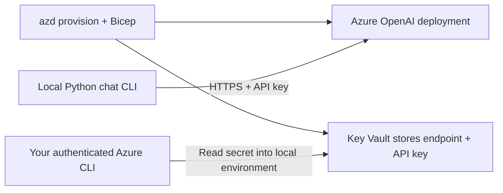

# Azure OpenAI Chat — Lokale CLI en AZD-infrastructuur

**Niveau:** Gemiddeld · **Tijd:** 35–60 minuten inclusief setup

Deze voorbeeldprovisieert een **Azure OpenAI-resource en Key Vault**, en start vervolgens een
interactieve Python chat CLI **op jouw machine**. Er wordt geen webapplicatie
of Container App gehost. Het standaardmodel is `gpt-4.1`, versie `2025-04-14`, met
`GlobalStandard` deployment capaciteit 20. Controleer de huidige beschikbaarheid en quota in
jouw gekozen regio voor het provisionen; model lifecycle data kunnen wijzigen.

## Leerdoelen

- Modellinfrastructuur provisionen met Bicep en azd.
- Een API-sleutel ophalen uit Key Vault zonder deze in de deployment outputs te plaatsen.
- Chat Completions verzoeken sturen en het gesprekshistorie bijhouden.
- Token tellingen interpreteren en de beperkingen van kostenramingen.



Er is geen managed-identity runtime integratie, multi-region failover, custom
rate limiter, streaming-modus, of gehoste compute in dit voorbeeld. De OpenAI SDK
voert maximaal twee herhaalde pogingen uit voor herhaalbare fouten; de CLI geeft resterende fouten weer.

## Vereisten

- Een actuele stabiele [azd](https://learn.microsoft.com/azure/developer/azure-developer-cli/install-azd)
  (uitgebrachte versie tijdens review: 1.37.2).
- [Azure CLI](https://learn.microsoft.com/cli/azure/install-azure-cli).
- Python **3.10+** (3.11 aanbevolen) en een virtuele omgeving.
- Een Azure-abonnement met toestemming om Cognitive Services en Key Vault
  resources te maken, modellen te deployen, en de geheimen van de vault te lezen.
- Regionale beschikbaarheid en `GlobalStandard` quota voor `gpt-4.1`. Toegangsvereisten
  zijn afhankelijk van het abonnement en functie; er is geen gegarandeerde goedkeuringsperiode.

```bash
azd version
az version
python --version
azd auth login
az login
```

Dit zijn afzonderlijke authenticatiesessies. Selecteer hetzelfde abonnement in beide
tools voordat je de onderstaande opdrachten uitvoert.

## Snelstart (Bash)

Voer uit vanaf de root van de repository:

```bash
cd examples/azure-openai-chat
azd env new myopenai
azd provision
```

Kies een ondersteunde regio. Provisioneren maakt een resourcegroep, OpenAI-account,
modeldeployment, Key Vault, en de `openai-endpoint`/`openai-api-key` geheimen aan.
Er zijn **geen services om te deployen** in `azure.yaml`.

Laad de niet-geheime outputs en haal het geheim op in je huidige shell:

```bash
export AZURE_OPENAI_ENDPOINT="$(azd env get-value AZURE_OPENAI_ENDPOINT)"
export AZURE_OPENAI_MODEL="$(azd env get-value AZURE_OPENAI_MODEL)"
KV_NAME="$(azd env get-value AZURE_KEY_VAULT_NAME)"
export AZURE_OPENAI_API_KEY="$(az keyvault secret show \
  --vault-name "$KV_NAME" --name openai-api-key --query value --output tsv)"

python -m venv .venv
source .venv/bin/activate
python -m pip install -r src/requirements.txt
python src/chat.py
```

Activeer in PowerShell met `.\.venv\Scripts\Activate.ps1` en wijs omgevings-
variabelen toe met `$env:AZURE_OPENAI_ENDPOINT = azd env get-value AZURE_OPENAI_ENDPOINT`
(en hetzelfde geldt voor het model). Haal de API-sleutel op met
`$env:AZURE_OPENAI_API_KEY = az keyvault secret show --vault-name $KV_NAME --name openai-api-key --query value -o tsv`.
Stel eerst `$KV_NAME = azd env get-value AZURE_KEY_VAULT_NAME` in.

Druk de API-sleutel niet af, commit deze niet, en plak deze niet in issue-rapporten. De CLI leest proces-
omgevingsvariabelen; het haalt **niet** Key Vault-geheimen op of laadt `.env`-bestanden.
`config.py` valideert het eindpunt, tokenlimiet en temperatuur tijdens het opstarten.

Verwachte uitvoer (inhoud en gebruik variëren):

```text
Azure OpenAI Chat Application
Model: gpt-4.1
...
You: Say hello in one sentence.
Assistant: Hello! How can I help you today?
[Tokens: ... | Cost: $...]
```

Commando’s: `stats` toont totalen, `clear` wist de gespreksgeschiedenis, en
`quit`/`exit` beëindigen de sessie. Er zijn geen `--stream`, `--show-tokens`, `tokens`,
of `cost` commando’s.

## Verifieer de implementatie

Nadat de shell-variabelen hierboven zijn geladen:

```bash
curl --fail-with-body \
  "${AZURE_OPENAI_ENDPOINT%/}/openai/deployments/${AZURE_OPENAI_MODEL}/chat/completions?api-version=2024-10-21" \
  -H "Content-Type: application/json" \
  -H "api-key: $AZURE_OPENAI_API_KEY" \
  -d '{"messages":[{"role":"user","content":"Say hello!"}],"max_tokens":50}'

az keyvault secret list --vault-name "$KV_NAME" --query "[].name" -o table
```

Succes: de API retourneert HTTP 200 met `choices[0].message.content` en `usage`;
de kluis toont `openai-api-key` en `openai-endpoint`. Een succesvolle ARM-implementatie
verifieert inferentie op zichzelf niet.

## Bestanden en configuratie

```text
azure.yaml                         # Infrastructure-only AZD project
infra/main.bicep                   # Subscription deployment
infra/main.parameters.json         # Environment, location, principal ID
infra/resources/openai.bicep       # Account + model
infra/resources/keyvault.bicep     # Vault + deploying user's secret access policy
infra/resources/secrets.bicep      # Writes secrets, no key output
src/chat.py                        # Interactive CLI
src/config.py                      # Environment validation
src/requirements.txt               # Python packages
```

Om het geprovisioneerde model/versie/capaciteit te wijzigen, bewerk de standaardwaarden in
`infra/main.bicep` en voer `azd provision` uit. Het instellen van `AZURE_OPENAI_MODEL` in je
shell selecteert alleen een **bestaande implementatienaam**; het implementeert geen ander model.

| Runtime-variabele | Standaard / bron |
|---|---|
| `AZURE_OPENAI_ENDPOINT` | Vereist; azd niet-geheime uitvoer |
| `AZURE_OPENAI_API_KEY` | Vereist; ophalen uit Key Vault |
| `AZURE_OPENAI_MODEL` | `gpt-4.1`; Azure implementatienaam |
| `AZURE_OPENAI_MAX_TOKENS` | 800 (validatiebereik 1–4096) |
| `AZURE_OPENAI_TEMPERATURE` | 0.7 (bereik 0–2) |
| `AZURE_OPENAI_INPUT_PRICE_PER_1K` | 0,002 USD; illustratief tarief voor ongecachte invoer |
| `AZURE_OPENAI_OUTPUT_PRICE_PER_1K` | 0,008 USD; illustratief tarief voor uitvoer |

## Kosten en beveiligingsbeperkingen

De kostenweergave is een **schatting**, geen Azure-facturering. Het vermenigvuldigt API-token-
gebruik met de geconfigureerde tarieven en houdt geen rekening met kortingen voor gecachte invoer,
regionale/SKU-verschillen, belastingen, prijswijzigingen of mislukte/opnieuw uitgevoerde oproepen.
Overschrijf **beide tarieven** bij gebruik van een ander model of SKU en verifieer actuele
[Azure OpenAI-prijzen](https://azure.microsoft.com/pricing/details/cognitive-services/openai-service/).

Ter illustratie kosten 100 verzoeken met elk 500 ongecachede input- en 200 outputtokens
tegen de standaardtarieven `100 × (500/1000 × .002 + 200/1000 × .008) = $0.26`.
Key Vault-bewerkingen/opslag brengen aparte kosten met zich mee. Er is geen vaste $50/maand
vergoeding voor deze lokale CLI en geen gehoste compute in de template.

De kluis gebruikt een toegangsbeleid voor de implementerende principal; het is geen RBAC- of
managed-identity-applicatievoorbeeld. Openbare eindpunten en API-sleutelverificatie
worden gebruikt voor onderwijsdoeleinden. Beperk permissies en voeg geschikte identiteit-/netwerk-
controles toe voordat je het aanpast voor productie.

## Praktische oefeningen

### 1. Verifieer context en reset deze

**Start:** de CLI is gestart. **Doel:** observeer geschiedenis.
Zeg “Onthoud het woord cedar,” en vraag dan “Welk woord vroeg ik je te onthouden?”
Voer `stats` uit; twee succesvolle beurten moeten als twee uitgewisselde berichten tellen.
Voer `clear` en `stats` uit; uitgewisselde berichten zouden nul moeten zijn (tokens in de totalen blijven staan).
De exacte bewoording van het model is niet deterministisch.

### 2. Wijzig de responslimiet

**Start:** sluit de CLI af, behoud dezelfde shell.
Voer `export AZURE_OPENAI_MAX_TOKENS=100` uit, start `python src/chat.py` opnieuw, en vraag om
een korte uitleg over azd. Controleer of de banner 100 toont.
Herstel met `unset AZURE_OPENAI_MAX_TOKENS`. Een kleinere responslimiet vermindert niet
reeds verzonden geschiedenis-tokens.

### Veel voorkomende problemen

- **Ontbrekende omgevingsvariabelen:** provisioning exporteert geen shell-waarden;
  herhaal de exportstappen. Een nieuwe terminal heeft ze opnieuw nodig.
- **403 bij lezen Key Vault:** controleer Azure CLI-abonnement/inloggen en de principal
  in het toegangsbeleid van de kluis. Beleidswijzigingen kunnen tijd nodig hebben om te propageren.
- **404 bij inferentie:** controleer de implementatienaam, endpoint en implementatiestatus.
- **429 bij inferentie:** wacht tot limieten worden gereset; controleer regionale modelquota.
  De CLI verwijdert mislukte beurten uit de geschiedenis, zodat opnieuw proberen ze niet dupliceert.
- **Contextlengte:** het voorbeeld knipt geen lange gesprekken; gebruik `clear`.
- **Model niet beschikbaar/afgevoerd:** raadpleeg actuele modelbeschikbaarheid en werk
  model/versie/SKU gelijktijdig bij; API-versie en modelversie zijn verschillende instellingen.

## Opruimen en volgende stappen

```bash
azd down
unset AZURE_OPENAI_API_KEY
```

De bewaartermijn voor soft-delete in Key Vault is zeven dagen; wissen vereist aparte permissies.
Er is geen toegewijde testsuite; voer geen niet-bestaand `pytest tests/` commando uit.
Voeg gemockte API-tests toe voordat je de code uitbreidt.

[Containervoorbeelden](../../../../examples/container-app) · [Retail architectuur blauwdruk](../retail-scenario.md) ·
[Cursus startpagina](../../README.md) · [Rapporteer een probleem](https://github.com/microsoft/AZD-for-beginners/issues)

---

<!-- CO-OP TRANSLATOR DISCLAIMER START -->
**Disclaimer**:
Dit document is vertaald met behulp van de AI vertaaldienst [Co-op Translator](https://github.com/Azure/co-op-translator). Hoewel we streven naar nauwkeurigheid, dient u er rekening mee te houden dat geautomatiseerde vertalingen fouten of onnauwkeurigheden kunnen bevatten. Het originele document in de oorspronkelijke taal moet worden beschouwd als de gezaghebbende bron. Voor kritieke informatie wordt professionele menselijke vertaling aanbevolen. Wij zijn niet aansprakelijk voor eventuele misverstanden of verkeerde interpretaties die voortvloeien uit het gebruik van deze vertaling.
<!-- CO-OP TRANSLATOR DISCLAIMER END -->