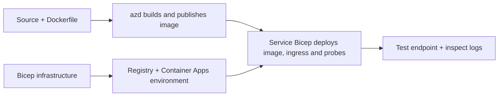

# Container App-implementatievoorbeelden met AZD

Deze map bevat twee leervoorbeelden met broncode, Dockerfiles,
Bicep-infrastructuur en `azure.yaml`. Geen van beide is productieklaar.

## Kies een voorbeeld

| Voorbeeld | Wat is geïmplementeerd | Vereiste |
|---|---|---|
| [Simple Flask API](../../../../examples/container-app/simple-flask-api) | Enkele Python CRUD-API, items in het geheugen, health probes, HTTP-schaalvergroting | Basiskennis CLI en HTTP |
| [Two-service microservices](../../../../examples/container-app/microservices) | Node.js gateway, interne read-only Python productservice, telemetrie en schaalvergroting | Voltooi eerst het single-service voorbeeld |

Reserveer 30–60 minuten inclusief installatie en verificatie. Azure-provisioningtijden variëren.

## Vereisten

- [Azure Developer CLI](https://learn.microsoft.com/azure/developer/azure-developer-cli/install-azd)
- [Azure CLI](https://learn.microsoft.com/cli/azure/install-azure-cli) voor verificatieopdrachten
- Docker met een draaiende daemon voor het bouwen van deze containerafbeeldingen
- Een Azure-abonnement met rechten om resources aan te maken en voldoende regionale quota
- Bash voor de shellvoorbeelden, of gelijkwaardige PowerShell-commando's

```bash
azd version
az version
docker info
azd auth login
az login
```

De twee tools hebben afzonderlijke sessies voor aanmelding. Gebruik een actuele, stabiele azd; de huidige
gepubliceerde versie op het moment van beoordeling is 1.37.2. Oudere minimumversies zijn geen
compatibiliteitsgarantie.

## Snel aan de slag

Vanuit de root van de repository:

```bash
cd examples/container-app/simple-flask-api
azd env new flask-demo
azd up
API_URL=$(azd env get-value API_ENDPOINT)
curl --fail-with-body "${API_URL}/health"
```

Verwacht: HTTP 200 met `"status": "healthy"`. Volg de README van het voorbeeld om een item te creëren,
lezen, bijwerken en verwijderen, en om logs te inspecteren.



De initiële provisioning gebruikt een publieke hello-world-afbeelding op poort 80. Service-specifieke
Bicep-parameterbestanden laten `azd deploy` deze vervangen door de gebouwde applicatieafbeelding
en de juiste app-poort/probes (8000 voor Flask/product, 8080 voor de gateway).
Bewaar deze bestanden met hun `azure.yaml` `module` instellingen.

## Configuratie: wat verandert wat

`azure.yaml` selecteert bronmappen, talen, hosts en implementatiemodules.
Container CPU/geheugen, ingress, probes, replica-aantallen en schaalregels worden gedefinieerd
in **Bicep**, niet in willekeurige `resources`, `scale` of `regions` service-eigenschappen.

`azd env set SOME_VALUE ...` slaat een waarde lokaal op. Het verandert een gedeployed
resource alleen wanneer een parameter, omgevingsmapping of hook expliciet die
waarde gebruikt. Deze voorbeelden gebruiken geen `MAX_REPLICAS`, `SCALE_TO_ZERO_TIMEOUT`,
`CONTAINER_APP_REPLICA_TYPE` of aangepaste canary-instellingen via azd-omgevingwaarden.
Bewerk de relevante Bicep en voer `azd up` uit om opnieuw te provisionen en implementeren.

Plaats de applicatiebron niet onder `infra/`. `project` moet verwijzen naar de bron
map met de Dockerfile en afhankelijkheidsmanifest.

## Monitoring en kosten

- `azd monitor --logs` opent een portaalweergave; het is geen terminal-logstream.
  Gebruik `az containerapp logs show --follow` met de daadwerkelijke resource-naam.
- De eenvoudige API schrijft stdout-logs die verzameld worden via Container Apps/Log Analytics.
  De geleverde Application Insights-resource is niet automatisch geïnstrumenteerd.
- De microservicesgateway gebruikt het Node.js Application Insights SDK; de Python
  service exporteert applicatielogsporen. Volledige Python request/dependency tracing
  is niet geconfigureerd.
- Scale-to-zero kan computekosten verminderen, maar registry en log ingestion/opslag
  kunnen nog steeds kosten veroorzaken. De microservices-standaarden houden replicas actief.
  Schat je regio en gebruik in de
  [Azure pricing calculator](https://azure.microsoft.com/pricing/calculator/).

## Geavanceerde patronen — niet inbegrepen implementaties

Dit zijn ontwerpwijzen, geen extra lokale projecten of copy-and-run codefragmenten:

- **Persistente data en authenticatie:** vervang in-memory opslag en voeg
  Microsoft Entra ID authenticatie/autorisatie toe voor productie.
- **Blue-green/canary:** gebruik Container Apps multiple-revision modus, revision
  labels, verkeersgewichten, gezondheidsverificatie en rollback-procedures.
  Er is geen `deploymentStrategy: canary` azd-configuratie in deze voorbeelden.
  Zie [revision management](https://learn.microsoft.com/azure/container-apps/revisions).
- **Multi-regio:** maak aparte omgevingen en apps in Bicep en ontwerp
  globale routering en dataconsistentie. Een service `regions` lijst is geen azd
  implementatiemechanisme.
- **Queue workers:** voeg workerbron, afhankelijkheden, queue-resources, een beheerde
  identiteit met dataplane-rollen en een geauthenticeerde schaalregel toe. Kopieer
  geen leeg `src/worker` pad en verwacht een uitvoerbaar project.
- **Dapr:** provisioneer componenten, configureer de sidecar, installeer het overeenkomende SDK,
  en implementeer state/pub-sub foutenafhandeling.
- **Secrets:** gebruik beheerde identiteit en roltoewijzingen waar mogelijk. Alleen
  het aanmaken van een Key Vault geeft applicaties geen toegang of laadt secrets.

## Opruimen

Vanuit de voorbeeldmap:

```bash
azd down
```

Controleer verwijderingsprompts en bevestig dat de toegewijde resourcegroep wordt verwijderd.
Gebruik deze voorbeelden niet als productie-baseline zonder aanvullende ontwerpen en tests.

[Voorbeeldenindex](../README.md) · [Cursus startpagina](../../README.md) ·
[Container Apps documentatie](https://learn.microsoft.com/azure/container-apps/) ·
[Meld een probleem](https://github.com/microsoft/AZD-for-beginners/issues)

---

<!-- CO-OP TRANSLATOR DISCLAIMER START -->
**Disclaimer**:
Dit document is vertaald met behulp van de AI vertaaldienst [Co-op Translator](https://github.com/Azure/co-op-translator). Hoewel we streven naar nauwkeurigheid, dient u er rekening mee te houden dat geautomatiseerde vertalingen fouten of onnauwkeurigheden kunnen bevatten. Het originele document in de oorspronkelijke taal moet worden beschouwd als de gezaghebbende bron. Voor kritieke informatie wordt professionele menselijke vertaling aanbevolen. Wij zijn niet aansprakelijk voor eventuele misverstanden of verkeerde interpretaties die voortvloeien uit het gebruik van deze vertaling.
<!-- CO-OP TRANSLATOR DISCLAIMER END -->