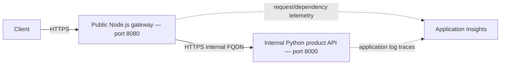

# Twee-Service Microservices — Azure Container Apps

**Niveau:** Gemiddeld · **Tijd:** 45–60 minuten inclusief setup

Deze leersample implementeert een **Node.js API Gateway** en een **read-only Python
Product Service**. Broncode, Dockerfiles, Bicep en azd-configuratie zijn inbegrepen.
Het is geen productieklaar systeem.

## Wat je gaat leren

- Twee services onafhankelijk uitrollen.
- Gebruik een interne backend FQDN via HTTPS.
- Verifieer success-, niet-gevonden- en niet-beschikbare-service reacties.
- Begrijp telemetrie en onafhankelijke schaalbegrenzingen.



De productcatalogus bevat vijf vaste producten in het geheugen. Er zijn **geen POST,
PUT of DELETE handlers**, database, Service Bus, order-/gebruikers-/notificatiedienst,
C#, of Go code. Dit zijn ideeën voor toekomstige ontwikkeling, geen meegeleverde functies.
De gateway authenticeren geen gebruikers; interne ingress vervangt geen
applicatie-autorisatie.

## Vereisten

Voltooi eerst de [single Flask API](../../../../../examples/container-app/simple-flask-api).
Installeer een actuele stabiele azd (uitgave bij beoordeling: 1.37.2), Azure CLI,
en Docker met draaiende daemon. Je hebt een Azure-abonnement, permissies voor
resource creatie en Container Apps regionale quota nodig.

```bash
azd version
az version
docker info
azd auth login
az login
```

Gebruik hetzelfde abonnement in beide CLI-tools. De volgende commando's gebruiken Bash.

## Uitrollen en verifiëren

Vanaf de root van de repository:

```bash
cd examples/container-app/microservices
azd env new microservices-demo
azd up
GATEWAY_URL=$(azd env get-value API_GATEWAY_URL)
RG_NAME=$(azd env get-value AZURE_RESOURCE_GROUP)
GATEWAY_NAME=$(azd env get-value API_GATEWAY_NAME)
PRODUCT_NAME=$(azd env get-value PRODUCT_SERVICE_NAME)

curl --fail-with-body "${GATEWAY_URL}/health"
curl --fail-with-body "${GATEWAY_URL}/api/products"
curl --fail-with-body "${GATEWAY_URL}/api/products/1"
curl -i "${GATEWAY_URL}/api/products/999"
```

**Succes:** health 200; lijst 200 met **vijf** producten; product 1 is een Laptop
met prijs 999,99 en voorraad 50; onbekend product geeft 404.
Beschrijvingen zijn opgenomen in reacties; tijdstempels variëren.

Initiële provisioning gebruikt openbare hello-world images op poort 80 zodat het niet probeert
afbeeldingen van een lege registry te trekken. Service-specifieke Bicep-modules
en parameterbestanden vervangen deze door gebouwde images en app-poorten/probes tijdens
`azd deploy`. De hoofparameters behouden gepubliceerde image-namen voor latere provisioning.

## Services en netwerken

| Service | Blootgestelde eindpunten | Standaard resources |
|---|---|---|
| Gateway | GET `/`, `/health`, `/api/products`, `/api/products/:id` | 1 vCPU, 2 GiB, 2–20 replicas |
| Product | GET `/`, `/health`, `/products`, `/products/<id>` | 0.5 vCPU, 1 GiB, 1–10 replicas |

Product ingress heeft `external: false` en `allowInsecure: false`. Bicep injecteert
`PRODUCT_SERVICE_URL=https://<actual-internal-fqdn>` in de gateway. HTTP zou
redirecten; HTTPS komt overeen met de geconfigureerde ingress. Een korte DNS-naam moet overeenkomen met de
**werkelijke Container App-naam**, niet de logische service sleutel `product-service`.
Probeer de interne URL niet rechtstreeks vanaf je laptop te bereiken.

De gateway heeft een time-out van vijf seconden voor productaanroepen. Ontbrekende product-ID's
resulteren in 404; transport/falen van backend geeft 503. Gateway
`/health` controleert alleen de gateway, niet de backend beschikbaarheid.

## Bestanden en configuratie

```text
azure.yaml
infra/main.bicep
infra/main.parameters.json
infra/abbreviations.json
infra/core/container-apps-environment.bicep
infra/core/monitor.bicep
infra/app/api-gateway.bicep
infra/app/api-gateway.parameters.json
infra/app/product-service.bicep
infra/app/product-service.parameters.json
src/api-gateway/{app.js,package.json,Dockerfile}
src/product-service/{main.py,requirements.txt,Dockerfile}
```

Schalen, CPU/geheugen, poorten en probes worden ingesteld in `infra/app/*.bicep`. Pas die
bestanden aan en voer `azd up` uit om infrastructuur toe te passen en opnieuw uit te rollen. Er is geen
`GATEWAY_MAX_REPLICAS` omgevingsvariabele parameter in deze sample.

Voor code-only wijzigingen:

```bash
azd deploy product-service
azd deploy api-gateway
```

De Node image gebruikt Node 22; de Python image gebruikt Python 3.11. Beide binden aan
`0.0.0.0`. Ingress/probes gebruiken respectievelijk poort 8080 (gateway) en 8000 (product).

## Lokale ontwikkeling met Docker

Voer uit vanuit deze voorbeeldmap. Gebruik een door gebruiker gedefinieerd netwerk, **niet `localhost`
om van de ene container naar de andere te bereiken**:

```bash
docker network create azd-microservices-demo
docker build -t local-product ./src/product-service
docker build -t local-gateway ./src/api-gateway
docker run -d --name azd-product --network azd-microservices-demo local-product
docker run -d --name azd-gateway --network azd-microservices-demo \
  -p 8080:8080 -e PRODUCT_SERVICE_URL=http://azd-product:8000 local-gateway
curl --fail-with-body http://localhost:8080/api/products
```

Verwacht: vijf producten. HTTP wordt alleen gebruikt voor dit lokale Docker-netwerk.

```bash
docker stop azd-product azd-gateway
docker rm azd-product azd-gateway
docker network rm azd-microservices-demo
```

## Monitoring

```bash
az containerapp logs show --name "$GATEWAY_NAME" --resource-group "$RG_NAME" --follow
# In a separate terminal:
az containerapp logs show --name "$PRODUCT_NAME" --resource-group "$RG_NAME" --tail 100
```

`azd monitor --logs` opent een portaalweergave; het streamt geen terminallogs.
De Node SDK verzamelt gateway-aanvragen/afhankelijkheden. Python's `AzureLogHandler`
exporteert **logsporen**, geen automatische Flask-aanvragen, SQL-afhankelijkheden of volledige
gedistribueerde sporen. OpenCensus is een legacy SDK; gebruik Azure Monitor OpenTelemetry
bij het uitbreiden van deze sample.

In Application Insights Logs, genereer aanvragen en inspecteer:

```kusto
requests
| where timestamp > ago(1h)
| where name contains "products"
| summarize RequestCount=count(), AvgDuration=avg(duration) by bin(timestamp, 5m)
```

Voor Python applicatie-berichten:

```kusto
traces
| where timestamp > ago(1h)
| where message contains "products"
| project timestamp, message, severityLevel
```

Houd rekening met vertraging bij verwerking en sampling; verwacht geen exact aantal aanvragen of een
gegarandeerde latentie. Er zijn geen aangepaste waarschuwingen of dashboards geconfigureerd.

## Praktische oefeningen

### Oefening 1: Pas de catalogus aan

**Startpunt:** `src/product-service/main.py`.
**Doel:** verifieer onafhankelijke service-uitrol.
Verander de voorraad van Laptop van 50 naar 49 in de vaste `products` lijst, voer
`azd deploy product-service` uit, en vraag `${GATEWAY_URL}/api/products/1` aan.

**Succescriteria/oplossing:** HTTP 200 met `"stock":49`. Herstel naar 50 en rol opnieuw uit.
**Veelvoorkomend probleem:** de gateway aanpassen in plaats van de service die de catalogus beheert.
Dit verandert brongegevens, niet een persistente voorraaddatabase.

### Oefening 2: Controleer replica configuratie

**Startpunt:** `infra/app/product-service.bicep`.
**Doel:** observeer infrastructuurverandering zonder te raden over autoscaling.
Verander `minReplicas: 1` naar `minReplicas: 2`, voer `azd up` uit, en dan:

```bash
az containerapp show --name "$PRODUCT_NAME" --resource-group "$RG_NAME" \
  --query properties.template.scale -o json
```

**Succescriteria:** geconfigureerd minimum is 2 en maximum blijft 10.
Herstel minimum naar 1 en voer `azd up` uit.
**Veelvoorkomend probleem:** `azd deploy` alleen past geen wijzigingen toe op niet-gerelateerde gedeelde
infrastructuur. Zet `maxReplicas` niet op nul als fout-simulatie.
Dit verifieert configuratie, geen load-test of gegarandeerd instantaan replica-aantal.

### Oefening 3: Test lokaal afhandelen van niet-beschikbare service

**Startpunt:** beide lokale Docker containers hierboven draaien.
**Doel:** onderscheid backend-fout van ontbrekend product.
Stop alleen de product container:

```bash
docker stop azd-product
curl -i http://localhost:8080/api/products
docker start azd-product
curl --fail-with-body http://localhost:8080/api/products
```

**Succescriteria:** tijdens stop retourneert gateway 503 met
`"error":"Product service unavailable"`; na herstart geeft de lijst 200.
Probeer opnieuw na een korte opstartvertraging indien nodig.
**Veelvoorkomend probleem:** de gateway stoppen test een andere fout (geen HTTP antwoord).

## Kosten en productiekloof

Standaard minimum replicas houden compute draaiend. Registry en monitoring brengen ook
kosten met zich mee. Er is geen gevalideerd vast tarief van $50/maand totaal: schat regionale CPU/geheugen,
replica-uren, aanvragen, registry en logretentie in de
[Azure-prijscalculator](https://azure.microsoft.com/pricing/calculator/).
Verwijder leerresources direct.

Productiewerk omvat authenticatie/autorisatie, gescopeerde beheerde identiteiten,
persistente data, input-/responsevalidatie, ondersteunde observability-instrumentatie,
load-/fouttesten, CI/CD, waarschuwingen en herstelprocedures. Het toevoegen van een order
dienst, queue of database is een aparte implementatietaak, geen afgeronde
oefening of functie die hier al beschikbaar is.

## Probleemoplossing en opruimen

- **Image niet gevonden bij eerste provisioning:** bootstrap zou de publieke image moeten gebruiken;
  controleer de standaardwaarden van de hoofdimage parameter en deployment module mappings.
- **503 producten:** controleer productlogs, image-revisie, en geïnjecteerde interne HTTPS-URL.
- **404 onverwacht pad:** product API is alleen-lezen; controleer de route, niet een niet-bestaande CRUD-handler.
- **Geen telemetrie:** inspecteer runtime connection strings zonder ze bloot te stellen en
  houd rekening met vertragingsvertraging. Python-aanvraagtabel wordt niet gevuld door de log-handler.

Vanuit deze samplemap:

```bash
azd down
```

Controleer de verwijderingsprompt en verifieer dat de speciale resourcegroep is verwijderd.

[Vorige: Flask API](../../../../../examples/container-app/simple-flask-api) · [Volgende: Database app](../../../../../examples/database-app) ·
[AI ontwikkeling](../../../docs/chapter-02-ai-development/README.md) ·
[Cursus startpagina](../../../README.md) · [Rapporteer een probleem](https://github.com/microsoft/AZD-for-beginners/issues)

---

<!-- CO-OP TRANSLATOR DISCLAIMER START -->
**Disclaimer**:
Dit document is vertaald met behulp van de AI vertaaldienst [Co-op Translator](https://github.com/Azure/co-op-translator). Hoewel we streven naar nauwkeurigheid, dient u er rekening mee te houden dat geautomatiseerde vertalingen fouten of onnauwkeurigheden kunnen bevatten. Het originele document in de oorspronkelijke taal moet worden beschouwd als de gezaghebbende bron. Voor kritieke informatie wordt professionele menselijke vertaling aanbevolen. Wij zijn niet aansprakelijk voor eventuele misverstanden of verkeerde interpretaties die voortvloeien uit het gebruik van deze vertaling.
<!-- CO-OP TRANSLATOR DISCLAIMER END -->