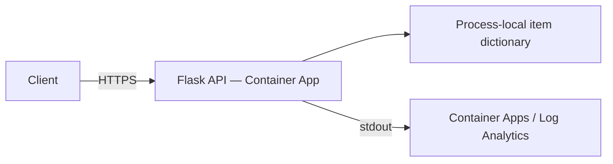

# Eenvoudige Flask API — Azure Container Apps

**Niveau:** Beginner · **Tijd:** 30–45 minuten inclusief setup

Zet een Python Flask CRUD API uit met Azure Developer CLI (azd). Broncode, Dockerfile,
Bicep en uitrolparameters zijn inbegrepen. Dit is een **leersample**, geen
productieklare API.

## Wat je gaat leren

- Bouw en publiceer een container via azd.
- Configureer ingress en liveness/readiness probes.
- Verifieer CRUD-responsen en inspecteer applicatielogs.
- Begrijp waarom in-memory data ongeschikt is voor duurzame applicaties.



**Belangrijk:** items worden in één proces gehouden. Standaard is **één Gunicorn worker,
0–1 replicas**, met opzet om inconsistente data over workers/replica’s te voorkomen.
Items gaan verloren bij herstart, revisiewijziging, of scale-to-zero. Meer replicas
vraagt om gedeelde persistente opslag. De API heeft geen authenticatie of autorisatie.

## Vereisten

- [Huidige stabiele azd](https://learn.microsoft.com/azure/developer/azure-developer-cli/install-azd)
  (uitgebrachte versie ten tijde van review: 1.37.2).
- [Azure CLI](https://learn.microsoft.com/cli/azure/install-azure-cli) voor verificatie.
- Docker met draaiende daemon; vereist voor de standaard lokale image-build.
- Azure-abonnement, rechten voor resource-creatie en regionaal quotum Container Apps.
- Bash voor onderstaande commando’s (of gelijkwaardige PowerShell).
- Python 3.11 voor optionele lokale ontwikkeling.

```bash
azd version
az version
docker info
azd auth login
az login
```

De CLI tools hebben aparte login-sessies. Gebruik hetzelfde abonnement in beide.

## Snelstart

Vanuit de root van de repository:

```bash
cd examples/container-app/simple-flask-api
azd env new flask-demo
azd up
API_URL=$(azd env get-value API_ENDPOINT)
RG_NAME=$(azd env get-value AZURE_RESOURCE_GROUP)
API_NAME=$(azd env get-value API_NAME)
curl --fail-with-body "${API_URL}/health"
```

Verwacht: HTTP 200 en JSON met `"status":"healthy"`,
`"service":"simple-flask-api"`, en een huidige UTC-tijdstempel.
Provisioning en image-build duurt meestal enkele minuten; tijd kan variëren.

Aanvangsprovisioning gebruikt een publieke hello-world image die luistert op poort 80.
`azure.yaml` selecteert `infra/app/api.bicep` en de bijbehorende parameterbestand voor
service-uitrol, hiermee wordt de image, ingress en probes op poort 8000 gezet.
Verwijder die uitrolparameters niet.

## Verifieer CRUD

Voer de volgende commando’s achtereenvolgens uit terwijl dezelfde replica actief blijft:

```bash
# Create: HTTP 201; note the returned id (1 for a fresh process).
curl -i -X POST "${API_URL}/api/items" \
  -H "Content-Type: application/json" \
  -d '{"name":"Test Item","description":"My first item"}'

# Read list: HTTP 200, total 1 in a fresh process.
curl --fail-with-body "${API_URL}/api/items"

# Replace 1 if your create response returned another id.
curl --fail-with-body "${API_URL}/api/items/1"
curl -i -X PUT "${API_URL}/api/items/1" \
  -H "Content-Type: application/json" -d '{"name":"Updated Item"}'
curl -i -X DELETE "${API_URL}/api/items/1"
curl -i "${API_URL}/api/items/1"
```

Succes: POST 201, leest/PUT 200, DELETE 204 zonder body, dan ontbrekend item 404.
Foutieve/niet-object JSON of een lege naam geeft 400 terug.
Als een item tussen requests verdwijnt, controleer op herstart of scale-to-zero;
dit is een opzet voor een in-memory beperking, geen persistentie.

| Endpoint | Methoden |
|---|---|
| `/` | GET — service-informatie |
| `/health` | GET — liveness/readiness |
| `/api/items` | GET, POST |
| `/api/items/{id}` | GET, PUT, DELETE |

## Logs en configuratie

```bash
az containerapp logs show --name "$API_NAME" --resource-group "$RG_NAME" --follow
```

Verwacht: Gunicorn startup, toegangslogs van verzoeken, en applicatieberichten.
`azd monitor --logs` opent een portalweergave; het streamt niet naar de terminal.
Application Insights is ingericht maar **niet geïnstrumenteerd door deze Flask code**;
gebruik Container Apps/Log Analytics voor stdout logs.

Bewerk `infra/app/api.bicep` voor CPU/geheugen, replica limits of schaalregels, en voer dan
`azd up` uit. Standaard zijn 0,5 vCPU, 1 GiB, minimaal 0 / maximaal 1 replica, en een
HTTP-drempel van 50 gelijktijdige aanvragen. Scale-to-zero kan koude-start vertraging toevoegen.

Willekeurige `azd env set MAX_REPLICAS`, `API_KEY`, `LOG_LEVEL` of
`SCALE_TO_ZERO_TIMEOUT` waarden zijn **niet aangesloten op deze template of app**.
Een waarde instellen maakt deze niet automatisch tot runtime-omgevingsvariabele.
De image bindt expliciet poort 8000; werk Dockerfile, Bicep ingress en probes
samen bij als de poort verandert.

## Bestanden

```text
azure.yaml
infra/main.bicep
infra/main.parameters.json
infra/app/container-apps.bicep       # Environment, registry, monitoring
infra/app/api.bicep                  # App, ingress, probes, scale settings
infra/app/api.parameters.json        # Image and resource values for azd deploy
src/app.py
src/Dockerfile
src/requirements.txt
```

## Lokale ontwikkeling

Vanuit deze voorbeeldmap:

```bash
python -m venv .venv
source .venv/bin/activate  # PowerShell: .\.venv\Scripts\Activate.ps1
python -m pip install -r src/requirements.txt
python src/app.py
```

Test in een ander terminalvenster `http://localhost:8000/health` en de CRUD endpoints.
Of bouw en draai de daadwerkelijke image:

```bash
docker build -t flask-api:local ./src
docker run --rm -p 8000:8000 flask-api:local
```

Voor alleen codewijzigingen na de eerste uitrol, voer `azd deploy api` uit.
Voor Bicep-wijzigingen, voer `azd up` uit om opnieuw te provisioneren en uit te rollen.

## Praktische oefeningen

### 1. Valideer afwijzing van invoer

**Startpunt:** uitgerolde API, `API_URL` hierboven.
**Doel:** controleer dat de API ongeldige JSON-vormen en ontbrekende namen weigert.

```bash
curl -i -X POST "${API_URL}/api/items" \
  -H "Content-Type: application/json" -d '[]'
curl -i -X POST "${API_URL}/api/items" \
  -H "Content-Type: application/json" -d '{"name":""}'
```

**Succescriteria / oplossing:** beide geven 400 terug met een JSON-fout, niet 500.
**Veelvoorkomend probleem:** het weglaten van de JSON content-type header.

### 2. Voeg een read-only versie endpoint toe

**Startpunt:** `src/app.py`. **Doel:** breid uit en rol de API opnieuw uit.
Voeg dit toe vóór het `if __name__ == '__main__':` blok:

```python
@app.route('/version', methods=['GET'])
def version():
    return jsonify({'version': '1.0.0'})
```

Voer `azd deploy api` uit, daarna `curl --fail-with-body "${API_URL}/version"`.
**Succescriteria:** HTTP 200 en `{"version":"1.0.0"}`.
**Veelvoorkomend probleem:** de route na de blokkerende `app.run()` call plaatsen wanneer
getest met `python src/app.py`.

### Kenniscontrole

Waarom is één worker onvoldoende voor duurzame data? Omdat zelfs één proces zijn
woordenboek verliest bij herstart. Een productieversie heeft persistente gedeelde opslag,
authenticatie, autorisatie, migraties, tests, en operationele monitoring nodig.

## Kosten en probleemoplossing

Dit is geen gegarandeerde gratis uitrol: het Basic register en logopslag/-inname
kunnen kosten veroorzaken, zelfs als app compute op nul staat. Gebruik de
[prijscalculator](https://azure.microsoft.com/pricing/calculator/) voor jouw regio.

- **Docker build mislukt:** controleer `docker info`, netwerktoegang, en afhankelijkheden.
- **Ongezonde app:** bekijk console-/systemlogs en verifieer image-poort, ingress,
  en probes zijn consistent. Een placeholder mag niet geprobed worden op de Flask-poort.
- **403/permissions:** controleer abonnement en permissies voor resource-creatie.
- **Items verdwijnen:** in-memory state reset bij herstart/scale-to-zero; voeg een database toe
  voor duurzame functionaliteit.

## Opruimen en volgende stappen

```bash
azd down
```

Bekijk de verwijderingsprompt en verifieer dat de speciale resourcegroep is verwijderd.
Gebruik geen destructieve opruiming op een resourcegroep met niet-gerelateerde data.

[Volgende: Database-app](../../../../../examples/database-app) · [Microservices](../../../../../examples/container-app/microservices) ·
[Container overzicht](../README.md) · [Cursus startpagina](../../../README.md) ·
[Meld een probleem](https://github.com/microsoft/AZD-for-beginners/issues)

---

<!-- CO-OP TRANSLATOR DISCLAIMER START -->
**Disclaimer**:
Dit document is vertaald met behulp van de AI vertaaldienst [Co-op Translator](https://github.com/Azure/co-op-translator). Hoewel we streven naar nauwkeurigheid, dient u er rekening mee te houden dat geautomatiseerde vertalingen fouten of onnauwkeurigheden kunnen bevatten. Het originele document in de oorspronkelijke taal moet worden beschouwd als de gezaghebbende bron. Voor kritieke informatie wordt professionele menselijke vertaling aanbevolen. Wij zijn niet aansprakelijk voor eventuele misverstanden of verkeerde interpretaties die voortvloeien uit het gebruik van deze vertaling.
<!-- CO-OP TRANSLATOR DISCLAIMER END -->