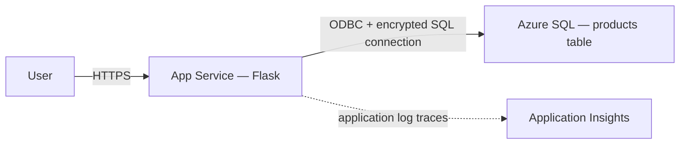

# Flask en Azure SQL op App Service

**Niveau:** Gevorderd · **Tijd:** 30–60 minuten inclusief vereisten

Dit voorbeeld zet een Python Flask read API uit naar **Linux App Service** en een Basic
Azure SQL-database. Broncode, Bicep en azd-configuratie zijn inbegrepen. Het is een
leerapplicatie, geen productieklare databasearchitectuur.

## Wat je leert

- Bied App Service-, SQL- en monitoringresources aan met Bicep.
- Configureer versleutelde SQL-connectiviteit zonder inloggegevens te committeren.
- Initialiseer een schema voordat Gunicorn-workers starten.
- Verifieer ingevoerde data, niet-gevonden reacties en databasegezondheid.



Resources: toegewijde resourcegroep, B1 Linux App Service-plan, Python 3.11 Web
App, SQL-server en Basic 2-GB database, Application Insights en Log Analytics.
De Web App gebruikt **bron/ZIP-uitrol en Oryx dependency-installatie**;
`azd deploy` bouwt of zet de optionele Dockerfile niet uit.

## Vereisten

- Huidige stabiele [azd](https://learn.microsoft.com/azure/developer/azure-developer-cli/install-azd)
  (uitgebrachte versie bij beoordeling: 1.37.2).
- [Azure CLI](https://learn.microsoft.com/cli/azure/install-azure-cli) voor verificatie.
- Azure-abonnement, machtigingen om de vermelde resources te maken, en regionale quotum.
- Python **3.11** voor lokale ontwikkeling; de gecommitteerde `pyodbc==5.0.1` kan vereisen
  native bouwtools op nieuwere Python-versies.
- Microsoft ODBC Driver 18 (of 17) voor SQL Server op lokale machines. `pip install
  pyodbc` installeert de systeemdriver niet. Zie
  [ODBC-installatie](https://learn.microsoft.com/sql/connect/odbc/download-odbc-driver-for-sql-server).
- Alleen Docker bij het lokaal testen van de optionele container.

```bash
azd version
az version
azd auth login
az login
```

Gebruik hetzelfde abonnement in beide tools. De onderstaande commando’s gebruiken Bash.

## Uitrollen

Vanuit de repository-root:

```bash
cd examples/database-app
azd env new sql-demo
azd provision
azd deploy
WEB_URL=$(azd env get-value WEB_APP_URI)
WEB_NAME=$(azd env get-value WEB_APP_NAME)
RG_NAME=$(azd env get-value AZURE_RESOURCE_GROUP)
```

Kies een ondersteunde regio. `sqlAdminLogin` staat standaard op `sqladmin`; de vereiste
`sqlAdminPassword` is een beveiligde parameter. Geef een sterk wachtwoord op wanneer hierom wordt gevraagd.
Houd uitrolinloggegevens buiten Git en foutrapporten. De huidige verbindingsreeks-
interpolatie verwacht een wachtwoord zonder verbindingsreeks-afscheiders zoals
`;`; pas ontsnapping aan voordat u dergelijke waarden gebruikt.

Bicep stelt een opstartcommando in dat `init_database()` uitvoert **voor**dat Gunicorn
workers starten. Dit is nodig omdat het importeren van `app:app` de
Python `if __name__ == '__main__'`-blok niet uitvoert. Bij een verse database maakt de initialisatie
`products` aan en voegt vijf rijen toe. Het is een eenvoudige leszaad, geen
gelijktijdig migratiekader; gebruik correcte migraties voordat u instances opschaalt.

De app selecteert geïnstalleerde Microsoft ODBC Driver 18, daarna 17, als de verbindings-
reeks niet expliciet een driver noemt. Als geen van beide bestaat, mislukt de startup met
een bruikbare installatiefout. Verifieer driverbeschikbaarheid in uw geselecteerde
App Service-runtime in plaats van ervan uit te gaan.

## Verifiëren

```bash
curl --fail-with-body "${WEB_URL}/"
curl --fail-with-body "${WEB_URL}/health"
curl --fail-with-body "${WEB_URL}/products"
curl --fail-with-body "${WEB_URL}/products/1"
curl -i "${WEB_URL}/products/999"
```

Verwacht:

- `/` retourneert eindpuntinformatie.
- `/health` retourneert 200 met `{"status":"healthy","database":"connected"}`.
- `/products` retourneert vijf ingevoerde producten in een verse database.
- `/products/1` retourneert Laptop met prijs 1299.99.
- Een niet-bestaand product retourneert 404 met `{"error":"Product not found"}`.

De API is alleen-lezen. Er is geen POST/PUT/DELETE-route of browser-UI.
Verbinding met de database mislukt en retourneert 503 van `/health`; het is geen succes.

## Bestanden en configuratie

```text
azure.yaml                         # Python App Service source deployment
infra/main.bicep
infra/main.parameters.json
infra/abbreviations.json
infra/resources/sql-server.bicep
infra/resources/sql-database.bicep
infra/resources/app-service-plan.bicep
infra/resources/web-app.bicep       # Settings + initialization/startup command
infra/resources/app-insights.bicep
src/web/app.py
src/web/requirements.txt
src/web/Dockerfile                 # Optional local container, not the azd target
.env.sample
```

`SQL_CONNECTION_STRING` wordt als beveiligde Bicep-parameter doorgegeven aan de Web App-module
en opgeslagen in App Service-instellingen, niet in uitroloutputs.
`APPLICATIONINSIGHTS_CONNECTION_STRING` configureert logexport.
`SCM_DO_BUILD_DURING_DEPLOYMENT=true` activeert server-side dependency-installatie.
Het instellen van willekeurige `azd env`-waarden wijzigt niet automatisch app-instellingen.

De SQL-firewall's `0.0.0.0` regel staat verbindingen toe van **Azure-services,
inclusief abonnementen van andere klanten**, onderhevig aan SQL-authenticatie. Het is
niet beperkt tot deze app of abonnement. Openbaar netwerktoegang van SQL is ingeschakeld.
Gebruik gescopeerde netwerken en een niet-admin app-identiteit vóór productie.

## Lokale ontwikkeling

Gebruik Python 3.11 en een geïnstalleerde Microsoft SQL ODBC-driver:

```bash
python -m venv .venv
source .venv/bin/activate  # PowerShell: .\.venv\Scripts\Activate.ps1
python -m pip install -r src/web/requirements.txt
export SQL_CONNECTION_STRING='Server=tcp:YOUR_SERVER.database.windows.net,1433;Database=YOUR_DATABASE;UID=YOUR_USER;PWD=YOUR_PASSWORD;Encrypt=yes;TrustServerCertificate=no;Connection Timeout=30;'
python src/web/app.py
```

Vervang plaatsaanduidingen veilig. Een gekopieerd `.env` bestand wordt **niet automatisch geladen**
door deze applicatie. Exporteer variabelen liever in uw huidige shell.
Voor Azure SQL vanaf een laptop, sta tijdelijk alleen uw eigen publieke IP toe:

```bash
SQL_SERVER=$(azd env get-value SQL_SERVER_NAME)
MY_IP=YOUR_PUBLIC_IP
az sql server firewall-rule create -g "$RG_NAME" -s "$SQL_SERVER" \
  -n AllowMyLearningIP --start-ip-address "$MY_IP" --end-ip-address "$MY_IP"
```

Verwijder de regel na testen:

```bash
az sql server firewall-rule delete -g "$RG_NAME" -s "$SQL_SERVER" -n AllowMyLearningIP
```

Optionele containertest vanuit deze voorbeeldmap:

```bash
docker build -t sql-flask:local src/web
docker run --rm -p 8000:8000 -e SQL_CONNECTION_STRING sql-flask:local
```

Deze image installeert Driver 18 via de Debian 12-pakketbron passend bij de
Bookworm-baseline, initialiseert eenmaal de database en start dan Gunicorn.

## Monitoring en probleemoplossing

Schakel App Service-bestandssysteemlogs in/tail deze bij het diagnosticeren van opstarten:

```bash
az webapp log config --name "$WEB_NAME" --resource-group "$RG_NAME" \
  --application-logging filesystem --level information
az webapp log tail --name "$WEB_NAME" --resource-group "$RG_NAME"
```

Deze code exporteert applicatie **logsporen** via een legacy OpenCensus-handler.
Het configureert geen automatische Flask request/dependency tracing, Live Metrics,
SQL-auditing, diagnostische instellingen of waarschuwingen. Die vereisen aparte setup.
Voor nieuwe instrumentatie verdient Azure Monitor OpenTelemetry de voorkeur.

In Application Insights Logs, na het maken van API-verzoeken:

```kusto
traces
| where timestamp > ago(1h)
| where message contains "products" or message contains "Health check"
| project timestamp, message, severityLevel
```

Houd rekening met een vertragingsperiode. Activiteit in request-tabel of Live Metrics is
geen voltooiingscriterium voor deze alleen-logs instrumentatie.

- **Ontbrekende driver:** controleer `pyodbc.drivers()` in de runtime en installeer een
  ondersteunde Microsoft ODBC-driver. Alleen een Python-pakket is onvoldoende.
- **Verbindingsfout:** controleer SQL-instellingen, inloggegevens, firewall en geselecteerd
  abonnement. Schakel versleuteling niet uit om een fout te omzeilen.
- **Ontbrekende productentabel:** bevestig dat het Bicep-opstartcommando is uitgerold;
  alleen starten van `gunicorn app:app` slaat initialisatie over.
- **Pakket-bouwfout:** gebruik Python 3.11 of zorg voor native bouwvereisten.
- **Prijs nul:** nul is een geldige decimale prijs; het moet worden geserialiseerd als 0.0,
  niet als `null`.

## Praktische oefeningen

### Oefening 1: Verifieer gedrag bij ontbrekend product

**Startpunt:** uitgerolde API en `WEB_URL` hierboven.
**Doel:** onderscheid een ontbrekende rij van een kapotte database.
Vraag `/health` en `/products/999` op met de bovenstaande commando's.
**Succescriteria / antwoord:** health 200, niet-bestaand product 404 (niet 500 of 503).
**Veelvoorkomend probleem:** aannemen dat een niet-gevonden reactie bewijst dat de SQL-verbinding kapot is.

### Oefening 2: Wijzig een ingevoerde waarde

**Startpunt:** Azure SQL Query Editor, verbonden met de voorbeeld-database.
**Doel:** aantonen dat API-data in SQL wordt opgeslagen in plaats van in processgeheugen.

```sql
UPDATE products SET price = 0 WHERE id = 1;
SELECT id, name, price FROM products WHERE id = 1;
```

Vraag `${WEB_URL}/products/1` op. **Succescriteria:** prijs is `0.0`, niet `null`.
Zet de waarde terug:

```sql
UPDATE products SET price = 1299.99 WHERE id = 1;
```

**Veelvoorkomend probleem:** het bewerken van de Python seed-lijst werkt rijen die al in SQL staan niet bij.
Voer schema- of data-oefeningen niet uit tegen een productiedatabase.

### Oefening 3: Voeg een count-eindpunt alleen-lezen toe

**Startpunt:** `src/web/app.py`.
**Doel:** breid de API uit met een parameterloze aggregatiequery.
Voeg dit toe vóór het `if __name__ == '__main__':` blok:

```python
@app.route('/product-count')
def product_count():
    from contextlib import closing
    with closing(get_db_connection()) as conn, closing(conn.cursor()) as cursor:
        cursor.execute("SELECT COUNT(*) FROM products")
        return jsonify({'count': cursor.fetchone()[0]})
```

Voer `azd deploy web` uit, vraag dan `${WEB_URL}/product-count` op.
**Succescriteria:** 200 met `{"count":5}` op de onaangetaste ingevoerde database.
**Veelvoorkomend probleem:** route wijzigen maar vergeten opnieuw uit te rollen.
Voor productie: voeg foutafhandeling/tests toe; deze korte oefening richt zich op de query.

## Kosten, productietekorten en opruiming

B1 App Service en Basic database worden in rekening gebracht zolang ze zijn geprovisioneerd.
Het stoppen van de Web App stopt **niet** de facturering van het App Service-plan. Logs en opslag kunnen extra kosten veroorzaken.
Gebruik de [Azure prijs calculator](https://azure.microsoft.com/pricing/calculator/)
voor actuele regionale prijzen. Schakelen naar F1 vereist ook het uitschakelen van `alwaysOn`;
het is geen kant-en-klare vervanging van één regel. SQL serverless is niet automatisch gratis.

Productiewerk omvat een app-identiteit met minste rechten (geen SQL-admin),
authenticatie/authorisatie, privé-netwerken, veilige migraties, review van verbinding-
pooling/-levenscyclus, telemetrie, auditing, waarschuwingen, tests en herstelprocedures.
Redis-caching en extra tabellen zijn ontwikkelingsideeën, geen geïmplementeerde oefeningen.

Vanuit deze voorbeeldmap:

```bash
azd down
```

Bekijk de verwijderprompt en controleer of de toegewijde resourcegroep is verwijderd.
Verwijder geen groepen met ongeassocieerde gegevens.

[Container voorbeelden](../../../../examples/container-app) ·
[AI-ontwikkeling](../../docs/chapter-02-ai-development/README.md) ·
[Cursus startpagina](../../README.md) · [Meld een probleem](https://github.com/microsoft/AZD-for-beginners/issues)

---

<!-- CO-OP TRANSLATOR DISCLAIMER START -->
**Disclaimer**:
Dit document is vertaald met behulp van de AI vertaaldienst [Co-op Translator](https://github.com/Azure/co-op-translator). Hoewel we streven naar nauwkeurigheid, dient u er rekening mee te houden dat geautomatiseerde vertalingen fouten of onnauwkeurigheden kunnen bevatten. Het originele document in de oorspronkelijke taal moet worden beschouwd als de gezaghebbende bron. Voor kritieke informatie wordt professionele menselijke vertaling aanbevolen. Wij zijn niet aansprakelijk voor eventuele misverstanden of verkeerde interpretaties die voortvloeien uit het gebruik van deze vertaling.
<!-- CO-OP TRANSLATOR DISCLAIMER END -->