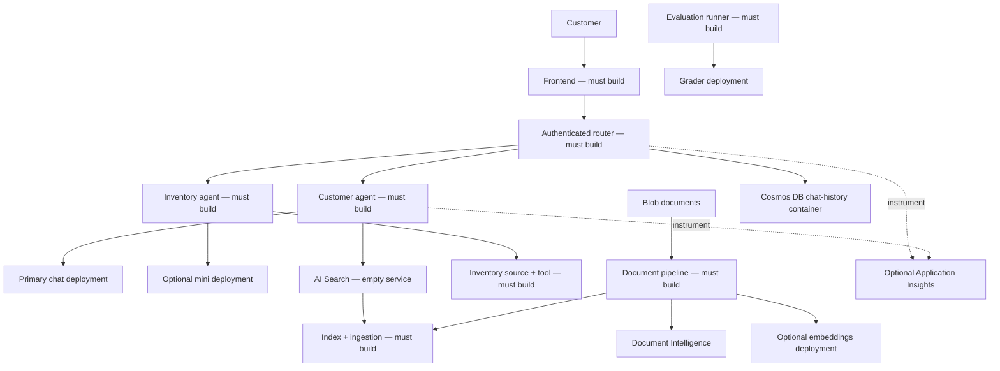

# Multi-Agent Klantenondersteuning — Retail Architectuur Blauwdruk

**Hoofdstuk 5: Multi-Agent AI Oplossingen**

- [Cursus startpagina](../README.md)
- [Hoofdstuk 5](../docs/chapter-05-multi-agent/README.md)
- [Vereiste: AI-integratie](../docs/chapter-02-ai-development/microsoft-foundry-integration.md)
- [Volgende: Capaciteitsplanning](../docs/chapter-06-pre-deployment/capacity-planning.md)
- [ARM infrastructuur scaffold](retail-multiagent-arm-template/README.md)

> **Architectuurgids, geen werkende applicatie.** De enige retail-implementatie
> bestanden zijn `azuredeploy.json`, `azuredeploy.parameters.json` en `deploy.sh` in
> `retail-multiagent-arm-template/`. Router/frontend containers zijn hello-world
> tijdelijke aanduidingen. Er bestaat lokaal geen retail agent, UI, verwerking pipeline,
> evaluator, scanner of applicatie test suite.

## Overzicht

**Doel:** ontwerp een klantenondersteuningssysteem met een klantenagent en een voorraad
agent, identificeer wat de infrastructuur levert, en plan de ontbrekende applicatie
contracten en verificatie.

**Doelgroep:** ontwikkelaars die de lokale
[chatvoorbeeld](../../../examples/azure-openai-chat) en [twee-service container voorbeeld](../../../examples/container-app/microservices) hebben voltooid.
Reken op 2–3 uur voor architectuurstudie. Het bouwen van de applicatie is een apart
project: 80–120 ontwikkeluren is een illustratieve planningsschatting voor
ervaren ontwikkelaars, **geen leveringsbelofte**; productieverbetering, tests,
beveiligingsbeoordeling en operations vergen extra werk.

### Leerresultaten

- Verklaar routering, grounding, tool-machtigingen en eigendom van conversaties.
- Onderscheid modelidentificaties, implementatienamen, API-versies en ARM-versies.
- Ontwerp documentinzameling en -opvraging met overeenkomende vectordimensies.
- Definieer verifieerbare functionele, evaluatie- en foutherstelvereisten.
- Scheid optionele architectuurdoelen van daadwerkelijk geleverde resources.

## Oplossingsarchitectuur



Dit is een **doelapplicatie-architectuur**, geen diagram van draaiende agent-diensten.
De ARM scaffold maakt alleen de onderliggende diensten en twee tijdelijke containers aan.
Front Door, register, beheerde identiteiten, roltoewijzingen,
private endpoints, failover, applicatie-instrumentatie en waarschuwingen zijn niet inbegrepen.

### Verantwoordelijkheden en contracten

| Component | Vereist gedrag | Bewijs voordat het als voltooid wordt beschouwd |
|---|---|---|
| Frontend | Authenticateer gebruikers, render chat, upload documenten veilig | UI- en uploadtests, toegankelijke fouten |
| Router | Autoriseer aanvragen, kies agent, gebonden tool-aanroepen/time-outs | Routeringstests, autorisatiecontroles, falende tests |
| Klantenagent | Onderbouw beleids-/productantwoorden in goedgekeurde bronnen | Correcte citaties, onthouding bij ontbrekende data |
| Voorraadtool | Lees gezaghebbende voorraad met gescopeerde rechten | Deterministische voorraadtests; geen bedachte beschikbaarheid |
| Document-pijplijn | Extraheer, chunk, embed, indexeer, update/verwijder | Geïndexeerde fixtures en retry/dead-letter gedrag |
| Conversatieopslag | Isoleer gebruikers, handhaaf retentie | Cross-user autorisatie- en TTL-tests |
| Evaluatieloper | Vergelijk outputs met grondwaarheid en rubric | Dekking, foutentelling, reproduceerbare rapporten |

Zie de router als een receptiedesk en tools als beperkte interne systemen:
het kiezen van een specialist geeft geen toegang tot alle klantgegevens.
Handhaaf identiteit en permissies in applicatiecode en dataservices, niet in prompts.

## Infrastructuur versus Applicatie

Lees de [scaffold README](retail-multiagent-arm-template/README.md) vóór
provisioning. Het bevat exacte resources, modi, kosten en beperkingen.

| Logisch gebruik | ARM implementatienaam | Model / versie | Standaard regio |
|---|---|---|---|
| Klantenchat | `gpt-4.1-chat` | `gpt-4.1` / `2025-04-14` | `eastus2` |
| Voorraad | `gpt-4.1-mini-inventory` | `gpt-4.1-mini` / `2025-04-14` | `westus2`, optioneel |
| Embeddings | `text-embedding-ada-002` | `text-embedding-ada-002` / `2` | `francecentral`, optioneel |
| Evaluatie | `gpt-4.1-grader` | `gpt-4.1` / `2025-04-14` | Primair regio standaard |

Controleer model/versie/SKU beschikbaarheid en quotum in **elke regio**. Chat/mini/grader
gebruikt `GlobalStandard`; embeddings gebruiken `Standard`. Capaciteitseenheid-naar-TPM mappings zijn
modelspecifiek. Voeg geen verschillende capaciteitseenheden samen als universeel quotum.

De `model`-parameter van een Azure OpenAI-aanvraag is de **implementatienaam**, niet
per se de catalogus modelidentificatie. Data-plane API versie `2024-10-21`
is verschillend van modelversie `2025-04-14` en de ARM resource `apiVersion`.
Je kunt een niet-beschikbaar model niet herstellen door alleen de data-plane API versie te veranderen.

`--no-multi-region` slaat secundaire en embeddings-accounts over. Een primaire chat en
een onafhankelijke grader account blijven bestaan. Gescheiden modelaccounts bieden geen automatische
failover; dat vereist applicatieroutering, compatibele implementaties, health checks,
retrylimieten en gegevensresidentiebeoordeling.

## Implementatieroadmap

### 1. Begin met één geteste interactie

Gebruik voor de provisioning van het grote scaffold eerst de lokale chatvoorbeeld om
connectiviteit te testen. Definieer één representatieve klantvraag, de goedgekeurde
antwoordbron, verwachte citatie en faalgedrag wanneer die bron ontbreekt.

### 2. Definieer routering en toolgrenzen

Maak je eigen routerbron, afhankelijkheidsmanifest, Dockerfile en tests. Een
illustratief contract zou `POST /chat` met `{"message":"...","conversation_id":"..."}` kunnen zijn.
**Dat endpoint is een ontwerpsuggestie; het wordt niet geïmplementeerd door de ARM template.**

Valideer body types/limieten, herleid gebruikersidentiteit uit authenticatie, handhaaf
eigenaarschap van conversaties, pas time-outs toe en retourneer zinvolle foutcodes.
Behandel HTTP-fouten of lege antwoorden niet als succesvolle agentresultaten.

### 3. Implementeer grounding en inzameling

De ARM template maakt geen zoekindex aan. Dit is een **referentie JSON
fragment om aan te passen in je eigen indexdefinitie**, geen bestand dat al in de repo staat:

```json
{
  "name": "retail-product-index",
  "fields": [
    {"name": "id", "type": "Edm.String", "key": true},
    {"name": "title", "type": "Edm.String", "searchable": true},
    {"name": "content", "type": "Edm.String", "searchable": true},
    {"name": "category", "type": "Edm.String", "filterable": true},
    {
      "name": "content_vector",
      "type": "Collection(Edm.Single)",
      "searchable": true,
      "dimensions": 1536,
      "vectorSearchProfile": "retail-profile"
    }
  ],
  "vectorSearch": {
    "algorithms": [{"name": "retail-hnsw", "kind": "hnsw"}],
    "profiles": [{"name": "retail-profile", "algorithm": "retail-hnsw"}]
  }
}
```

Het profiel koppelt het vectorveld aan zijn algoritme. Dimensies moeten overeenkomen met de
daadwerkelijke embedding-output (1536 voor deze `ada-002` implementatie). Voor Python retrieval,
gebruik `azure.search.documents.models.VectorizedQuery` in plaats van een onvolledige
dictionary zonder zijn vector query-type:

```python
# Reference function only: supply an authenticated async SearchClient and an embedding.
from azure.search.documents.models import VectorizedQuery

async def retrieve(search_client, embedding):
    results = await search_client.search(
        search_text=None,
        vector_queries=[VectorizedQuery(
            vector=embedding,
            k_nearest_neighbors=5,
            fields="content_vector"
        )],
        select=["id", "title", "content"]
    )
    return [document async for document in results]
```

Maak een aparte inzamelingsimplementatie die:

1. Uploadtoegang autoriseert en contenttype en grootte valideert.
2. Privé blobs leest met geauthenticeerde SDK-aanroepen. Een privé blob-URL op zich is
   **geen** leesbare Document Intelligence input; stuur gedownloade bytes mee met
   `AnalyzeDocumentRequest(bytes_source=...)` of gebruik een passend gescopeerde,
   kortdurende SAS na beoordeling van toegangsvereisten.
3. Tekst extraheert, opdeelt in stukken passend binnen embeddinglimieten, en embeddings genereert.
4. Stabiele geldige documentkeys maakt en chunks met bijpassende vectors uploadt.
5. Indexatieresultaten per document controleert, retries afhandelt, en verouderde data bijwerkt/verwijdert.

Interpoleer geen willekeurige gebruikerssleutels/waarden in OData-filters. Gebruik een whitelist van velden,
valideer waardetypen en escapen aanhalingstekens in strings. Booleaanse en numerieke filters hebben
getypeerde literals nodig, geen gequote strings.

### 4. Web grounding

**Bing Search v7 is met pensioen gegaan op 11 augustus 2025.** De oude `Microsoft.Bing/accounts`
resource en `api.bing.microsoft.com/v7.0/search` voorbeelden zijn geen ondersteunde
implementatiepad. Evalueer een momenteel ondersteunde grounding integratie in
Microsoft Foundry en zijn SDK, permissies, facturering en citatievereisten;
geen implementatie hiervan is hier opgenomen. Het is geen drop-in vervanger voor het gepensioneerde endpoint.

### 5. Voeg telemetrie en evaluatie toe

Het maken van Application Insights instrumenteert de code niet automatisch. Gebruik ondersteunde Azure Monitor
OpenTelemetry-instrumentatie bij het bouwen van een nieuwe applicatie, draag trace
context over tussen diensten, en vermijd het loggen van klantprompts, documenten of geheimen.
Het inkorten van een query anonimiseert deze **niet**.

Meet verzoekduur, routering/tool-fouten, relevantie van ophalen, correctheid van citaten,
tokengebruik en onthouding. Sla grondwaarheidsvoorraad-/beleidsfeiten op
naast evaluatiegevallen: een grader kan feitelijke juistheid niet betrouwbaar bepalen
alleen aan de hand van een vraag en een antwoord.

Een grader-implementatie is geen evaluatieloper. Implementeer een versieerde rubric,
gestructureerde output/schema validatie, scorebereikcontroles, transportfoutentellingen,
en door mensen beoordeelde cases. Rapporteer onvolledige/foutgevallen apart; converteer
deze niet in succesvolle beoordelingen of neem ze stilzwijgend op als respons van nul-kwaliteit.

Evenzo zijn een paar trefwoordcontroles geen beveiligingscertificering. Een mislukte HTTP
aanvraag, ontbrekende teststrategie of leeg antwoord moet een test **onbeslist of
mislukt** maken, niet een “100% veilig” score opleveren. Voer geautoriseerd testen uit met geschikte
tooling en menselijke beoordeling voordat je enig productierijpheidsclaim doet.

### 6. Implementeer je applicatie

Maak je eigen bronmappen, manifesten, tests, register en image-pull
permissies. Vervang tijdelijke aanduidingen door gebouwde images en werk ingress/probes bij om
bij elke app de luisterpoort te laten overeenkomen. Configureer runtime-omgevingsvariabelen in Bicep
of een expliciete ondersteunde azd-omgevingsmapping.

Er is geen generiek `config` woordenboek onder een azd-service dat automatisch
runtime-omgevingsvariabelen aanmaakt. `azd env set` verandert alleen resources die
expliciet die waarden gebruiken. Er is geen canary, regio's lijst of fine-tuning hook
geïmplementeerd in dit scaffold.

## Praktische ontwerpoefeningen

Dit zijn **architectuuropdrachten**, geen claims van uitvoerbare retailstartercode.

### Oefening 1: Verifieer de grens

**Startpunt:** de drie bestanden in `retail-multiagent-arm-template/`.
**Doel:** onderscheid maken tussen provisioning en applicatiefunctie.
Open `azuredeploy.json`, vind zowel container images als `targetPort` waarden,
en lijst vervolgens de applicatiecomponenten die ontbreken in de repository.

**Succescriteria / antwoord:** beide images zijn hello-world tijdelijke aanduidingen die luisteren
op poort 80; agenten, chat UI, router handlers, indexering/inzameling, evaluator en scanner
ontbreken. Een succesvolle placeholder root-aanvraag valideert `/chat` niet.
**Veel voorkomende fout:** resource-namen zoals `retail-router` interpreteren als werkende code.

### Oefening 2: Traceer de vectorconfiguratie

**Startpunt:** index JSON hierboven.
**Doel:** begrijp de veld → profiel → algoritme relatie.
Identificeer welke waarden gewijzigd moeten worden bij het overschakelen naar een embedding-model met een
andere outputdimensie, en inspecteer vervolgens de `retrieve` functie.

**Succescriteria / antwoord:** wijzig veld `dimensions` naar de daadwerkelijke vectorlengte;
houd `vectorSearchProfile` in lijn met een gedeclareerd profiel en algoritme;
query `fields` moet het vectorveld benoemen. Genereer bestaande documentvectors opnieuw
wanneer het embedding-model verandert.
**Veel voorkomende fout:** alleen de modelnaam wijzigen terwijl incompatibele vectors worden behouden.

### Oefening 3: Definieer een faaltest

**Startpunt:** verantwoordelijkhedentabel.
**Doel:** vals succes voorkomen.
Schrijf verwacht gedrag voor een niet-beschikbare voorraad-API, een zoekindex zonder
overeenkomende documenten, en een evaluatieaanvraag die HTTP 503 teruggeeft.

**Succescriteria / antwoord:** geen verzonnen voorraadwaarden; expliciete onthouding of
escalatie wanneer context ontbreekt; evaluatie rapporteert een transportfout in plaats van
een kwaliteits- of beveiligingspass. Voeg uitvoerbare tests toe bij het bouwen van de applicatie.
**Veel voorkomende fout:** elke uitzondering opvangen en doorgaan met een leeg antwoord.

## Kosten, probleemoplossing en opruiming

- Infrastructuur kent doorlopende kosten, ook met lege zoekindexen en tijdelijke
  apps. Gebruik actuele regionale prijzen; noch “minimaal” noch multi-regio is gratis.
- Tokenkosten zijn afhankelijk van model, gecachte/niet-gecachete input, output en implementatie-SKU.
  Routering bespaart alleen geld als gemeten werklast en kwaliteitsresultaten dit rechtvaardigen;
  een vaste 60–80% besparing is niet gegarandeerd.
- Controleer modelbeschikbaarheid en quotum vóór provisioning; onderscheid permissie,
  implementatienaam, regio, modelversie en API-versiefouten.
- Voer geen ontbrekende `setup-data.sh`, evaluator CLI's of `pytest tests/` commando's uit.
  De implementaties daarvan maken deel uit van je ontwikkelachterstand.
- De scaffold is alleen ARM: volg de
  [verificatie- en opruimingsinstructies](retail-multiagent-arm-template/README.md).
  `azd down` beheert deze resources niet.

## Gerelateerde bronnen

- [Werkend lokaal chatvoorbeeld](../../../examples/azure-openai-chat)
- [Werkend twee-service container voorbeeld](../../../examples/container-app/microservices)
- [AI Search vectorindexen](https://learn.microsoft.com/azure/search/vector-search-how-to-create-index)
- [Container Apps documentatie](https://learn.microsoft.com/azure/container-apps/)
- [Probleemoplossing](../docs/chapter-07-troubleshooting/common-issues.md)
- [Meld een probleem](https://github.com/microsoft/AZD-for-beginners/issues)

---

<!-- CO-OP TRANSLATOR DISCLAIMER START -->
**Disclaimer**:
Dit document is vertaald met behulp van de AI vertaaldienst [Co-op Translator](https://github.com/Azure/co-op-translator). Hoewel we streven naar nauwkeurigheid, dient u er rekening mee te houden dat geautomatiseerde vertalingen fouten of onnauwkeurigheden kunnen bevatten. Het originele document in de oorspronkelijke taal moet worden beschouwd als de gezaghebbende bron. Voor kritieke informatie wordt professionele menselijke vertaling aanbevolen. Wij zijn niet aansprakelijk voor eventuele misverstanden of verkeerde interpretaties die voortvloeien uit het gebruik van deze vertaling.
<!-- CO-OP TRANSLATOR DISCLAIMER END -->