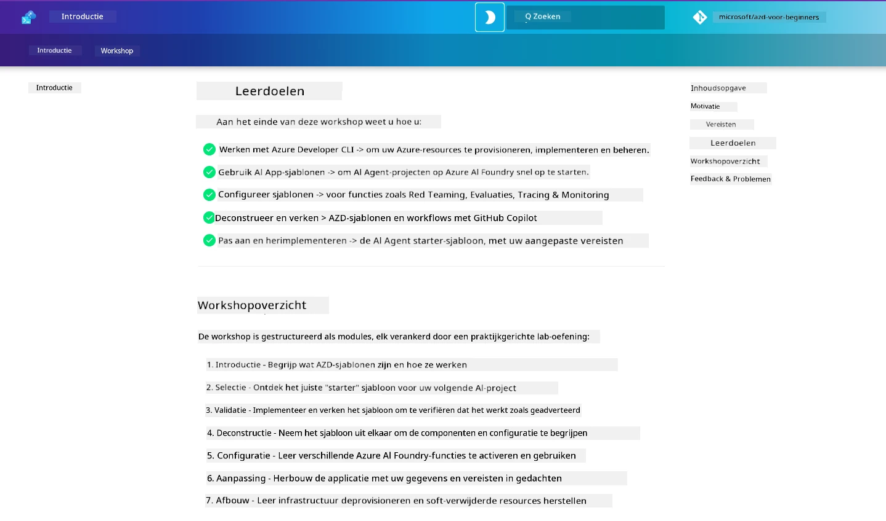

<div align="center">
  <div style="background: linear-gradient(135deg, #0078d4, #106ebe); border-radius: 10px; padding: 20px; margin: 20px 0; box-shadow: 0 4px 15px rgba(0, 120, 212, 0.3); border: 2px solid #005a9e;">
    <h2 style="color: white; margin: 0; font-size: 24px; text-shadow: 1px 1px 2px rgba(0,0,0,0.3);">
      🎯 AZD voor AI-ontwikkelaars Workshop
    </h2>
    <p style="color: white; margin: 10px 0 0 0; font-size: 16px; text-shadow: 1px 1px 2px rgba(0,0,0,0.3);">
      <strong>Een praktische workshop voor het bouwen van AI-toepassingen met Azure Developer CLI.</strong><br>
      Voltooi 7 modules om AZD-sjablonen en AI-implementatie-workflows onder de knie te krijgen.
    </p>
    <div style="margin-top: 15px;">
      <span style="background: rgba(255,255,255,0.2); padding: 5px 10px; border-radius: 15px; color: white; font-size: 14px;">
        📅 Bronverwijzing beoordeeld: november 2026
      </span>
    </div>
  </div>
</div>

# AZD voor AI-ontwikkelaars Workshop

Welkom bij de praktische workshop voor het leren van Azure Developer CLI (AZD) met een focus op het implementeren van AI-toepassingen. Deze workshop helpt je een praktische kennis van AZD-sjablonen te krijgen in 3 stappen:

1. **Ontdekking** - vind het sjabloon dat bij jou past.
1. **Implementatie** - implementeer en controleer dat het werkt
1. **Aanpassing** - wijzig en verbeter om het van jou te maken!

Tijdens deze workshop maak je ook kennis met kernontwikkeltools en workflows, om je te helpen je end-to-end ontwikkelingsproces te stroomlijnen.

<br/>

## Browser-gebaseerde gids

De workshoplessen zijn in Markdown. Je kunt ze direct in GitHub doorlopen - of een browser-gebaseerde preview starten zoals weergegeven in de onderstaande screenshot.



Om deze optie te gebruiken - fork de repository naar je profiel, en start GitHub Codespaces. Zodra de VS Code-terminal actief is, typ je deze opdracht:

Deze browser-preview werkt in GitHub Codespaces, ontwikkelcontainers of een lokale kloon met Python en MkDocs geïnstalleerd.

```bash title="" linenums="0"
python -m pip install -r requirements-dev.txt
python -m mkdocs serve --config-file workshop/mkdocs.yml
```

Voer deze opdrachten uit vanuit de **hoofdmap van de cursusrepository**, niet vanuit de afzonderlijk geïnitieerde AI-sample. Houd de preview op de voorgrond zodat fouten zichtbaar blijven; stop hem met Ctrl+C. Om de site te controleren zonder hem te serveren, voer je `python -m mkdocs build --strict --config-file workshop/mkdocs.yml` uit.

Binnen een paar seconden zie je een pop-upvenster. Kies de optie om `Open in browser`. De webgebaseerde gids opent nu in een nieuw browsertabblad. Enkele voordelen van deze preview:

1. **Ingebouwde zoekfunctie** - vind snel zoekwoorden of lessen.
1. **Kopieericoon** - beweeg met de muis over codeblokken om deze optie te zien
1. **Thema-omschakeling** - wissel tussen donkere en lichte thema's
1. **Hulp krijgen** - klik op het Discord-pictogram in de footer om mee te doen!

<br/>

## Workshop Overzicht

**Duur:** 3-4 uur  
**Niveau:** Beginner tot Gevorderd  
**Vereisten:** Vertrouwdheid met Azure, AI-concepten, VS Code & commandoregeltools.

Dit is een praktische workshop waarbij je leert door te doen. Zodra je de oefeningen hebt voltooid, raden we aan de AZD voor Beginners-curriculum door te nemen om je leertraject voort te zetten richting best practices in beveiliging en productiviteit.

| Tijd| Module  | Doel |
|:---|:---|:---|
| 15 min | [Introductie](docs/instructions/0-Introduction.md) | Zet de basis, begrijp de doelen |
| 30 min | [Selecteer AI-sjabloon](docs/instructions/1-Select-AI-Template.md) | Verken opties en kies een starter | 
| 30 min | [Valideer AI-sjabloon](docs/instructions/2-Validate-AI-Template.md) | Implementeer standaardoplossing in Azure |
| 30 min | [Analyseer AI-sjabloon](docs/instructions/3-Deconstruct-AI-Template.md) | Verken structuur en configuratie |
| 30 min | [Configureer AI-sjabloon](docs/instructions/4-Configure-AI-Template.md) | Activeer en probeer beschikbare functies |
| 30 min | [Pas AI-sjabloon aan](docs/instructions/5-Customize-AI-Template.md) | Pas het sjabloon aan jouw behoeften aan |
| 30 min | [Afbreken Infrastructuur](docs/instructions/6-Teardown-Infrastructure.md) | Opruimen en vrijgeven van resources |
| 15 min | [Afronding & Volgende stappen](docs/instructions/7-Wrap-up.md) | Leerbronnen, workshopuitdaging |

<br/>

## Wat je zult leren

Zie het AZD-sjabloon als een oefenomgeving om verschillende mogelijkheden en tools te verkennen voor end-to-end ontwikkeling op Microsoft Foundry. Aan het einde van deze workshop zou je een intuitief begrip moeten hebben van verschillende tools en concepten in deze context.

| Concept  | Doel |
|:---|:---|
| **Azure Developer CLI** | Begrijp tool-opdrachten en workflows|
| **AZD-sjablonen**| Begrijp projectstructuur en configuratie|
| **Azure AI-agent**| Provisioneren & implementeren van Microsoft Foundry-project  |
| **Azure AI Search**| Context-engineering mogelijk maken met agents |
| **Observability**| Verken tracing, monitoring en evaluaties |
| **Red Teaming**| Verken tegenstrijdige tests en mitigaties |

<br/>

## Workshopstructuur

De workshop is zo opgebouwd dat je meeneemt op een reis van sjabloonontdekking, naar implementatie, analyse en aanpassing - met het officiële [Starten met AI Agents](https://github.com/Azure-Samples/get-started-with-ai-agents) startersjabloon als basis.

### [Module 1: Selecteer AI-sjabloon](docs/instructions/1-Select-AI-Template.md) (30 min)

- Wat zijn AI-sjablonen?
- Waar kan ik AI-sjablonen vinden?
- Hoe kan ik beginnen met het bouwen van AI-agents?
- **Praktijk**: Quickstart in Codespaces of een ontwikkelcontainer

### [Module 2: Valideer AI-sjabloon](docs/instructions/2-Validate-AI-Template.md) (30 min)

- Wat is de AI-sjabloonarchitectuur?
- Wat is de AZD ontwikkelworkflow?
- Hoe kan ik hulp krijgen bij AZD-ontwikkeling?
- **Praktijk**: Implementeer & valideer AI Agents-sjabloon

### [Module 3: Analyseer AI-sjabloon](docs/instructions/3-Deconstruct-AI-Template.md) (30 min)

- Verken je omgeving in `.azure/` 
- Verken je resource-setup in `infra/` 
- Verken je AZD-configuratie in `azure.yaml`s
- **Praktijk**: Pas omgevingsvariabelen aan & implementeer opnieuw

### [Module 4: Configureer AI-sjabloon](docs/instructions/4-Configure-AI-Template.md) (30 min)
- Verken: Retrieval Augmented Generation
- Verken: Agent Evaluatie & Red Teaming
- Verken: Tracing & Monitoring
- **Praktijk**: Verken AI-agent + Observability 

### [Module 5: Pas AI-sjabloon aan](docs/instructions/5-Customize-AI-Template.md) (30 min)
- Definieer: PRD met scenariovereisten
- Configureer: Omgevingsvariabelen voor AZD
- Implementeer: Lifecycle Hooks voor extra taken
- **Praktijk**: Pas sjabloon aan voor mijn scenario

### [Module 6: Afbreken infrastructuur](docs/instructions/6-Teardown-Infrastructure.md) (30 min)
- Samenvatting: Wat zijn AZD-sjablonen?
- Samenvatting: Waarom Azure Developer CLI gebruiken?
- Volgende stappen: Probeer een ander sjabloon!
- **Praktijk**: Deprovisioneer infrastructuur & ruim op

<br/>

## Workshopuitdaging

Wil je jezelf uitdagen om meer te doen? Hier zijn enkele projectvoorstellen - of deel je ideeën met ons!!

| Project | Beschrijving |
|:---|:---|
|1. **Analyseer een complex AI-sjabloon** | Gebruik de workflow en tools die we hebben beschreven en kijk of je een andere AI-oplossing kunt implementeren, valideren en aanpassen. _Wat heb je geleerd?_|
|2. **Pas aan met jouw scenario**  | Probeer een PRD (productvereisten-document) te schrijven voor een ander scenario. Gebruik vervolgens GitHub Copilot in je sjablonerepository in Agent Model - en vraag het een aanpassingsworkflow voor je te genereren. _Wat heb je geleerd? Hoe zou je deze suggesties kunnen verbeteren?_|
| | |

## Feedback?

1. Plaats een issue in deze repo - tag het met `Workshop` voor het gemak.
1. Word lid van de Microsoft Foundry Discord - verbind met je collega's!


| | | 
|:---|:---|
| **📚 Cursus thuis**| [AZD voor Beginners](../README.md)|
| **📖 Documentatie** | [Begin met AI-sjablonen](https://learn.microsoft.com/en-us/azure/ai-foundry/how-to/develop/ai-template-get-started)|
| **🛠️AI-sjablonen** | [Microsoft Foundry-sjablonen](https://ai.azure.com/templates) |
|**🚀 Volgende stappen** | [Start Workshop](#workshop-overview) |
| | |

<br/>

---

**Navigatie:** [Hoofdcursus](../README.md) | [Introductie](docs/instructions/0-Introduction.md) | [Module 1: Selecteer sjabloon](docs/instructions/1-Select-AI-Template.md)

**Klaar om AI-toepassingen te bouwen met AZD?**

[Start Workshop: Introductie →](docs/instructions/0-Introduction.md)

---

<!-- CO-OP TRANSLATOR DISCLAIMER START -->
**Disclaimer**:
Dit document is vertaald met behulp van de AI vertaaldienst [Co-op Translator](https://github.com/Azure/co-op-translator). Hoewel we streven naar nauwkeurigheid, dient u er rekening mee te houden dat geautomatiseerde vertalingen fouten of onnauwkeurigheden kunnen bevatten. Het originele document in de oorspronkelijke taal moet worden beschouwd als de gezaghebbende bron. Voor kritieke informatie wordt professionele menselijke vertaling aanbevolen. Wij zijn niet aansprakelijk voor eventuele misverstanden of verkeerde interpretaties die voortvloeien uit het gebruik van deze vertaling.
<!-- CO-OP TRANSLATOR DISCLAIMER END -->