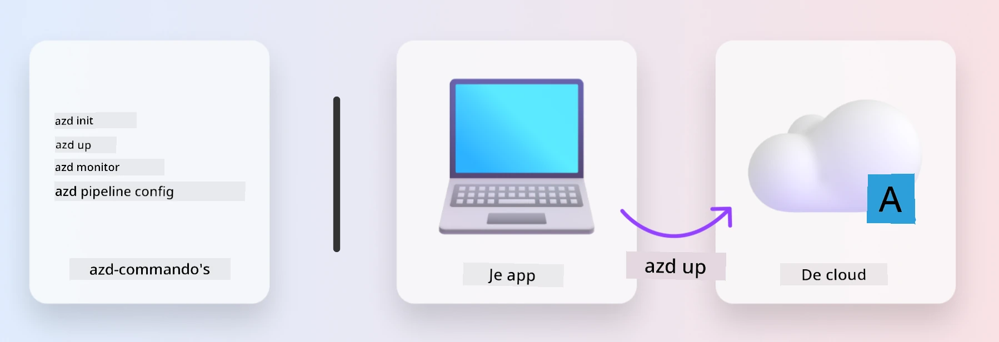
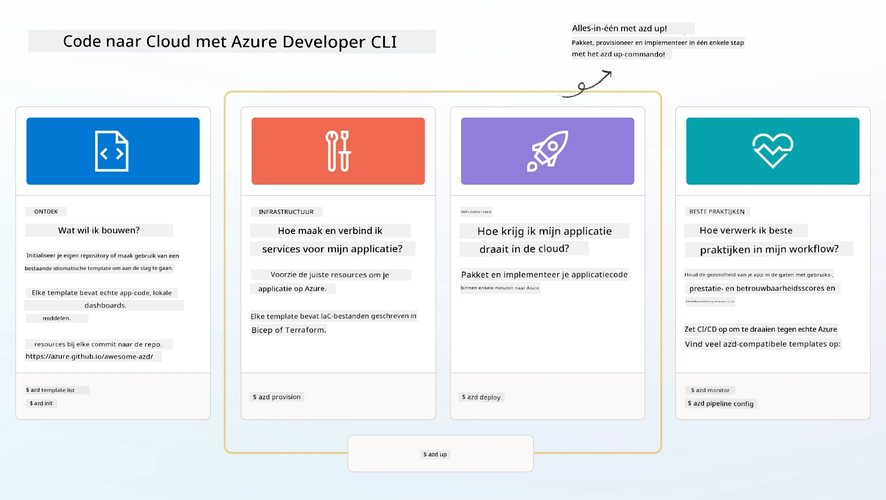

# 1. Selecteer een Sjabloon

!!! tip "AAN HET EINDE VAN DEZE MODULE KUN JE"

    - [ ] Describe what AZD templates are
    - [ ] Discover and use AZD templates for AI
    - [ ] Get started with the AI Agents template
    - [ ] **Lab 1:** AZD Quickstart in Codespaces or a dev container

---

## 1. Een Bouwervergelijking

Het bouwen van een moderne, enterprise-klaar AI-toepassing _vanaf nul_ kan ontmoedigend zijn. Het is een beetje alsof je je nieuwe huis zelf steen voor steen bouwt. Ja, het kan gedaan worden! Maar het is niet de meest effectieve manier om het gewenste eindresultaat te bereiken!

In plaats daarvan beginnen we vaak met een bestaand _ontwerpplan_, en werken we samen met een architect om het aan te passen aan onze persoonlijke wensen. En dat is precies de benadering die je moet nemen bij het bouwen van intelligente toepassingen. Zoek eerst een goede ontwerparchitectuur die bij je probleemgebied past. Werk vervolgens samen met een solution architect om de oplossing aan te passen en te ontwikkelen voor jouw specifieke scenario.

Maar waar kunnen we deze ontwerpplannen vinden? En hoe vinden we een architect die bereid is ons te leren hoe we deze plannen zelf kunnen aanpassen en uitrollen? In deze workshop beantwoorden we die vragen door je kennis te laten maken met drie technologieën:

1. [Azure Developer CLI](https://aka.ms/azd) - een open-source tool die het ontwikkeltraject versnelt van lokale ontwikkeling (bouwen) naar clouddeployment (uitrollen).
1. [Microsoft Foundry Templates](https://ai.azure.com/templates) - gestandaardiseerde open-source repositories met voorbeeldcode, infrastructuur- en configuratiebestanden voor het uitrollen van een AI-oplossingsarchitectuur.
1. [GitHub Copilot Agent Mode](https://code.visualstudio.com/docs/copilot/chat/chat-agent-mode) - een codeeragent gebaseerd op Azure-kennis, die ons kan begeleiden bij het navigeren door de codebase en het aanbrengen van wijzigingen met natuurlijke taal.

Met deze tools in hand kunnen we nu de juiste sjabloon _ontdekken_, deze _uitrollen_ om te valideren dat het werkt, en _aanpassen_ om aan onze specifieke scenario's te voldoen. Laten we erin duiken en leren hoe ze werken.


---

## 2. Azure Developer CLI

De [Azure Developer CLI](https://learn.microsoft.com/en-us/azure/developer/azure-developer-cli/) (of `azd`) is een open-source commandoregeltool die je code-naar-cloudreis versnelt met een reeks ontwikkelaarsvriendelijke opdrachten die consistent werken in je IDE (ontwikkeling) en CI/CD (devops) omgevingen.

Met `azd` kan jouw uitrolreis zo eenvoudig zijn als:

- `azd init` - Initialiseert een nieuw AI-project vanuit een bestaand AZD-sjabloon.
- `azd up` - Zet infrastructuur op en rolt je applicatie in één stap uit.
- `azd monitor` - Ontvangt realtime monitoring en diagnostiek voor je uitgerolde applicatie.
- `azd pipeline config` - Stel CI/CD-pijplijnen in om de uitrol naar Azure te automatiseren.

**🎯 | OEFENING**: <br/> Verken nu de `azd` commandoregeltool in je huidige workshopomgeving. Dit kan GitHub Codespaces zijn, een dev container, of een lokale kloon met de vereisten geïnstalleerd. Begin door dit commando te typen om te zien wat de tool kan doen:

```bash title="" linenums="0"
azd help
```



---

## 3. Het AZD-sjabloon

Voor `azd` om dit te bereiken, moet het weten welke infrastructuur moet worden opgesteld, welke configuratie-instellingen moeten worden gehandhaafd, en welke applicatie moet worden uitgerold. Dit is waar [AZD-sjablonen](https://learn.microsoft.com/en-us/azure/developer/azure-developer-cli/azd-templates?tabs=csharp) om de hoek komen kijken.

AZD-sjablonen zijn open-source repositories die voorbeeldcode combineren met infrastructuur- en configuratiebestanden die nodig zijn voor het uitrollen van de oplossingsarchitectuur.
Door gebruik te maken van een _Infrastructure-as-Code_ (IaC) benadering, maken ze het mogelijk om sjabloon resource-definities en configuratie-instellingen te versioneren (net als de app-broncode) - wat zorgt voor herbruikbare en consistente workflows voor gebruikers van dat project.

Bij het maken of hergebruiken van een AZD-sjabloon voor _jouw_ scenario, overweeg dan deze vragen:

1. Wat bouw je? → Is er een sjabloon met startcode voor dat scenario?
1. Hoe is je oplossing gearchitectuurd? → Is er een sjabloon met de benodigde resources?
1. Hoe wordt je oplossing uitgerold? → Denk aan `azd deploy` met pre/post-verwerkingshooks!
1. Hoe kun je het verder optimaliseren? → Denk aan ingebouwde monitoring en automatiseringspijplijnen!

**🎯 | OEFENING**: <br/> 
Bezoek de [Awesome AZD](https://azure.github.io/awesome-azd/) galerij en gebruik de filters om de meer dan 250 sjablonen te verkennen die momenteel beschikbaar zijn. Kijk of je eentje kunt vinden die aansluit bij _jouw_ scenariovereisten.



---

## 4. AI App Sjablonen

Voor AI-gedreven toepassingen biedt Microsoft gespecialiseerde sjablonen met **Microsoft Foundry** en **Foundry Agents**. Deze sjablonen versnellen je weg naar het bouwen van intelligente, productieklaar toepassingen.

### Microsoft Foundry & Foundry Agents Sjablonen

Selecteer hieronder een sjabloon om uit te rollen. Elk sjabloon is beschikbaar op [Awesome AZD](https://azure.github.io/awesome-azd/) en kan met een enkel commando worden geïnitieerd.

| Sjabloon | Beschrijving | Uitrolcommando |
|----------|-------------|----------------|
| **[AI Chat met RAG](https://github.com/Azure-Samples/azure-search-openai-demo)** | Zoek-gebaseerde chatapplicatie | `azd init -t Azure-Samples/azure-search-openai-demo .` |
| **[Aan de slag met AI Agents](https://github.com/Azure-Samples/get-started-with-ai-agents)** | Door agenten ondersteunde chatapplicatie; gebruikt gedurende deze workshop | `azd init -t Azure-Samples/get-started-with-ai-agents .` |
| **[Aan de slag met AI Chat](https://github.com/Azure-Samples/get-started-with-ai-chat)** | Instap AI chatapplicatie | `azd init -t Azure-Samples/get-started-with-ai-chat .` |

Dit zijn alternatieven: initialiseert **één** sjabloon in een eigen lege map. De afsluitende `.` selecteert die map; het weglaten ervan in huidige AZD-versies maakt een sjabloom-naam submap aan. Initialisatie downloadt een project; `azd up` voert de facturabele uitrol uit nadat je de vereisten, resources, regiocontrole en quotas hebt beoordeeld.

### Snelle Start

1. **Blader door sjablonen**: Bezoek [https://azure.github.io/awesome-azd/](https://azure.github.io/awesome-azd/) en filter op `AI`, `Agents`, of `Microsoft Foundry`
2. **Selecteer je sjabloon**: Kies er een die past bij je gebruiksscenario
3. **Initialiseer**: Voer het `azd init` commando uit voor je gekozen sjabloon
4. **Rol uit**: Voer `azd up` uit om te provisioneren en uit te rollen

**🎯 | OEFENING**: <br/>
Selecteer een van de bovenstaande sjablonen op basis van jouw scenario:

- **Ga je door met deze workshop?** → Kies **Aan de slag met AI Agents**
- **Bouw je een zoek-gebaseerde chat?** → Verken **AI Chat met RAG** apart
- **Heb je een andere architectuur nodig?** → Zoek in de galerij en controleer de daadwerkelijke repository, implementatiestatus en vereisten

```bash title="Initialize the workshop template in an empty directory" linenums="0"
azd init -t Azure-Samples/get-started-with-ai-agents .
azd auth login
azd up
```

!!! info "Verken Meer Sjablonen"
    De [Awesome AZD Galerie](https://azure.github.io/awesome-azd/) bevat meer dan 250 sjablonen. Gebruik de filters om sjablonen te vinden die aansluiten op jouw specifieke vereisten voor taal, framework en Azure-diensten.

---

<!-- CO-OP TRANSLATOR DISCLAIMER START -->
**Disclaimer**:
Dit document is vertaald met behulp van de AI vertaaldienst [Co-op Translator](https://github.com/Azure/co-op-translator). Hoewel we streven naar nauwkeurigheid, dient u er rekening mee te houden dat geautomatiseerde vertalingen fouten of onnauwkeurigheden kunnen bevatten. Het originele document in de oorspronkelijke taal moet worden beschouwd als de gezaghebbende bron. Voor kritieke informatie wordt professionele menselijke vertaling aanbevolen. Wij zijn niet aansprakelijk voor eventuele misverstanden of verkeerde interpretaties die voortvloeien uit het gebruik van deze vertaling.
<!-- CO-OP TRANSLATOR DISCLAIMER END -->