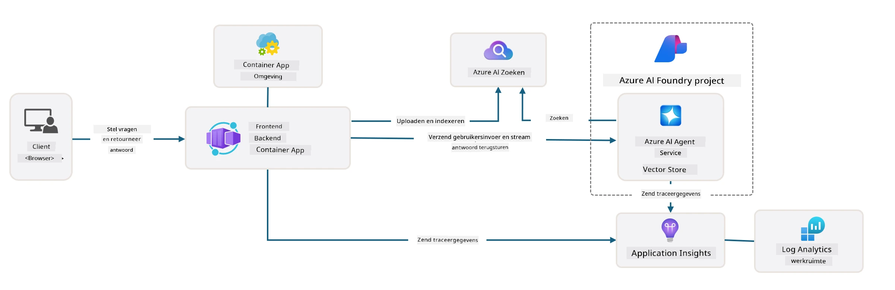
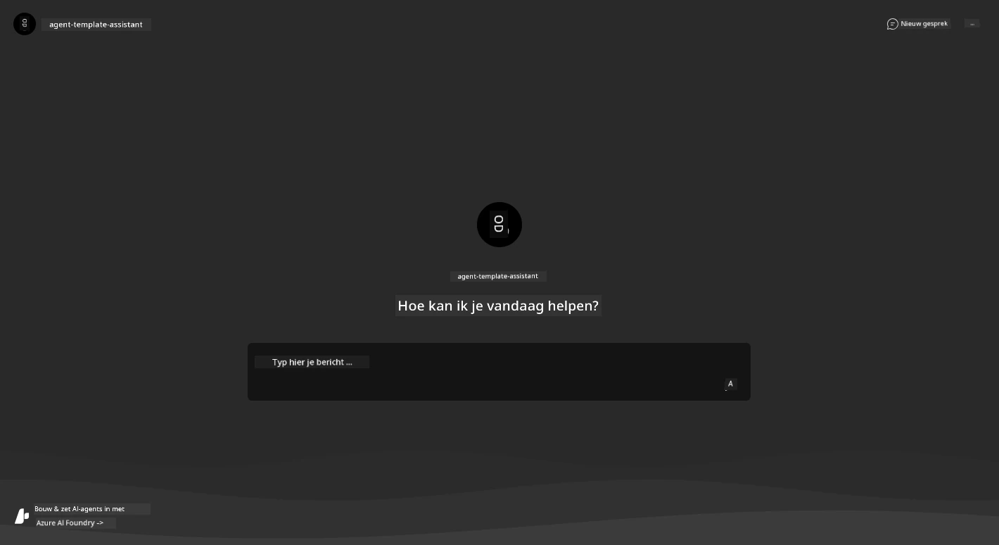

# 2. Valideer een sjabloon

> Bronrichtlijnen beoordeeld aan de hand van AZD 1.37.2 en het huidige voorbeeld op 4 november 2026. Schermafbeeldingen zijn illustratief; portaalnavigatie, sjabloonstandaarden en servicebeschikbaarheid kunnen wijzigen. Deze beoordeling voerde geen live Azure-implementatie uit.

!!! tip "AAN HET EINDE VAN DEZE MODULE KUN JE"

    - [ ] Identify the sample's prerequisites and intended resources
    - [ ] Deploy the selected template into an intentional environment
    - [ ] Verify the application and agent behavior separately from deployment success
    - [ ] **Lab 2:** Record evidence of a working baseline, or an actionable deployment blocker

---

## 1. Controleer de vereisten

De [Azure Developer CLI](https://learn.microsoft.com/azure/developer/azure-developer-cli/) beheert applicatie-implementatie met behulp van de configuratie, infrastructuur en code van het sjabloon. Controleer je geïnstalleerde versie:

```bash
azd version
```

Gebruik indien nodig de [huidige installatie-/update-instructies](https://learn.microsoft.com/azure/developer/azure-developer-cli/install-azd). Het beoordeelde voorbeeld verklaart AZD `>=1.14.0`, maar een recente ondersteunde release wordt aanbevolen. De optionele AI-extensies hebben aparte versievereisten; de normale `azd up` workflow in dit voorbeeld vereist de agents-extensie niet.

Lees voor provisioning de [Azure-accountconfiguratie](https://github.com/Azure-Samples/get-started-with-ai-agents/blob/main/docs/azure_account_setup.md) en [implementatiehandleiding](https://github.com/Azure-Samples/get-started-with-ai-agents/blob/main/docs/deployment.md) van het voorbeeld. Bevestig je abonnement, permissies, modelbeschikbaarheid, regionale quota en verwachte kosten. Een gratis Azure-account garandeert niet altijd toegang of gratis gebruik van elke vereiste service.

## 2. Open het geselecteerde voorbeeld

Gebruik de in Module 1 geïnitialiseerde repository [Aan de slag met AI Agents](https://github.com/Azure-Samples/get-started-with-ai-agents). Als je deze nog niet hebt geïnitialiseerd, kies dan een van deze alternatieven:

- Open een [Codespace voor het voorbeeld](https://github.com/codespaces/new/Azure-Samples/get-started-with-ai-agents).
- Clone het voorbeeld en volg de lokale/dev-container setup.
- Voer in een **lege map** het volgende uit:

```bash
azd init --template Azure-Samples/get-started-with-ai-agents .
```

Initialiseer geen tweede sjabloon boven een bestaand project. Voer opvolgende opdrachten uit vanuit de hoofddirectory van het voorbeeld die `azure.yaml` bevat, niet vanuit de hoofddirectory van de cursusrepository.

Het voorbeeld bevat een chatapplicatie met een agent in Container Apps en voorziet ondersteunende Foundry-resources. Bekijk de huidige architectuur en optionele services in plaats van een oude schermafbeelding als exacte resource-inventaris te behandelen.



## 3. Implementeer doelbewust

```bash
azd auth login
azd up
```

Bekijk de prompts:

1. Kies een unieke AZD-omgevingsnaam.
2. Selecteer het bedoelde abonnement, niet zomaar het eerste aangeboden abonnement.
3. Selecteer een regio die ondersteund wordt door het vereiste model/versie/SKU en je quota.
4. Lees de uitvoer van provisioning, implementatie en post-implementatiehooks.

De beoordeelde standaardinstellingen omvatten `gpt-5-mini`, versie `2025-08-07` en `GlobalStandard`. Controleer je geïnitialiseerde sjabloon en de [ondersteunde model-/regiocombinaties](https://learn.microsoft.com/azure/ai-services/agents/concepts/model-region-support). Geen enkele regio werkt gegarandeerd universeel.

De duur van de implementatie varieert. Als provisioning mislukt, bewaar dan de foutmelding en los de oorzaak op voordat je het opnieuw probeert. Verwijder de implementatie of purgeer resources niet permanent als een generieke probleemoplossingsstap.

## 4. Valideer de applicatie

```bash
azd show
```

Open het eindpunt voor `api_and_frontend`, of zoek de Container App op in de resourcegroep van de implementatie in de [Azure-portal](https://portal.azure.com/). Volg de toegang-/authenticatie-instructies van het voorbeeld als aanmelden vereist is; schakel authenticatie niet uit om een rooktest te laten slagen.



Probeer een paar [voorbeeldvragen](https://github.com/Azure-Samples/get-started-with-ai-agents/blob/main/docs/sample_questions.md):

- Een algemene feitelijke vraag.
- Een vraag waarvan het antwoord in de geüploade documenten van het voorbeeld zou moeten staan.
- Een vraag die niet beantwoord kan worden aan de hand van die documenten.

Verifieer dat de UI laadt, de API reageert, ophalen gebruikmaakt van de verwachte data, citaties kloppen met de broninhoud en dat niet-ondersteunde vragen op gepaste wijze worden afgehandeld. Een succesvolle `azd up` melding alleen garandeert deze uitkomsten niet.

## 5. Inspecteer de geïmplementeerde agent

Open je project in het [Foundry-portaal](https://ai.azure.com/). Selecteer in de beoordeelde portaalstroom **Build**, dan **Agents**, en zoek de door het voorbeeld gemaakte agent. Navigatielabels kunnen wijzigen.

Noteer:

- De agentnaam en versie.
- De geconfigureerde modelimplementatie.
- De daadwerkelijke instructies en ingeschakelde tools.
- Welke bestanden of zoekindexen verbonden zijn, en of de setup succesvol is afgerond.

Het beoordeelde voorbeeld gebruikt een agentidentificatie in `agent_name:agent_version`-vorm voor zijn evaluatietests. Kopieer geen klassieke agent/thread-identificatie uit een oude schermafbeelding naar een nieuwere API-workflow.

Vergelijk geüploade documenten met `src/files/` in je geïnitialiseerde revisie. Eerdere schermafbeeldingen toonden 32 bestanden; dat aantal is geen gegarandeerde huidige standaard. Verifieer elk antwoord over voorbeeldklanten/-producten aan de hand van de daadwerkelijke synthetische brondata, en upload geen echte klantdata voor deze oefening.

## 6. Vergelijk met de speelomgeving

Open de speelomgeving van de geselecteerde agent in Foundry en stel dezelfde zoekvraag. Vergelijk de geconfigureerde agentversie, tools, citaties en de antwoordkwaliteit met de geïmplementeerde applicatie.

Reacties zijn probabilistisch; woord-voor-woord overeenstemming is geen criterium. Als de resultaten substantieel verschillen, controleer dan of de app en speelomgeving op hetzelfde project, agent/versie en kennisbron zijn gericht.

## 7. Controleer observatievereisten

De [observatiehandleiding](https://github.com/Azure-Samples/get-started-with-ai-agents/blob/main/docs/observability.md) van het voorbeeld is de bron van waarheid voor tracing, evaluatie en red-teaming setup.

In de beoordeelde infrastructuurstandaarden is Application Insights ingeschakeld, maar **client tracing is uitgeschakeld** (`ENABLE_AZURE_MONITOR_TRACING=false`). Het aanmaken van een monitorresource bewijst niet dat de applicatie traces exporteert. Module 5 behandelt het inschakelen van tracing en het genereren van een testrun.

Gebruik de applicatielogs van de Container App om opstart-/API-fouten te onderzoeken. Inspecteer in Foundry de beschikbare tracing- en monitoring-weergaven van de agent. Evaluatieitems vereisen de relevante configuratie, ondersteunde evaluator/regio en daadwerkelijke verzoeken; ze verschijnen niet automatisch gegarandeerd bij elke run.

Laat vastlegging van prompt/response-inhoud uitgeschakeld, tenzij de privacy-, retentie-, toegang- en redactievereisten beoordeeld zijn.

## 8. Begrijp omgevingswaarden

AZD slaat de geselecteerde omgeving op onder `.azure/<environment-name>/`. Persistente invoer en implementatie-uitvoer zijn te lezen met:

```bash
azd env list
azd env get-value AZURE_ENV_NAME
azd env get-value AZURE_LOCATION
```

`azd env get-values` toont alle waarden, waaronder mogelijk gevoelige configuratie. Plaats die uitvoer niet in openbare issues of logs.

AZD gebruikt de geselecteerde omgeving bij het uitvoeren van zijn opdrachten/hooks, terwijl procesomgevingsvariabelen ook opdrachten en sjablonen kunnen beïnvloeden. Dit exporteert **niet** de waarden naar je bovenliggende shell of elk onafhankelijk gestart Python-proces. Volg de [lokale ontwikkel instructies](https://github.com/Azure-Samples/get-started-with-ai-agents/blob/main/docs/local_development.md) van het voorbeeld.

Sjabloonstandaarden kunnen worden toegepast in `infra/main.parameters.json` zonder als expliciete lokale waarden te verschijnen. Het instellen van een willekeurige variabele verandert de infrastructuur niet, tenzij het sjabloon die consumeert.

Bijvoorbeeld om expliciet de beoordeelde modelstandaarden te selecteren:

```bash
azd env set AZURE_AI_AGENT_MODEL_NAME gpt-5-mini
azd env set AZURE_AI_AGENT_MODEL_VERSION 2025-08-07
azd env set AZURE_AI_AGENT_DEPLOYMENT_SKU GlobalStandard
azd provision --preview
azd up
```

Controleer eerst compatibiliteit, capaciteit, beschikbaarheid en geplande wijzigingen. Infrastructuurupdates vereisen provisioning; `azd deploy` alleen is niet voldoende. Ondersteunde modelwijzigingen vereisen normaal gesproken geen volledige sloop van de applicatie.

`azd env refresh` haalt implementatie-uitvoer op voor een toegankelijke omgeving; het reconstrueert niet alle aangepaste invoer, synchroniseert geen secrets of vervangt configuratiebeheer.

## 9. Leg je basislijn vast

- [ ] Correcte omgeving, abonnement, regio en model geverifieerd.
- Provisioning, implementatie en vereiste setup-hooks voltooid zonder onopgeloste fouten.
- Applicatietoegang, chat, ophalen en citaties gecontroleerd.
- Agent/versie en kennisbron geïdentificeerd.
- Observatievereisten en overige blockers gedocumenteerd.

Ga verder naar [Een sjabloon ontleden](3-Deconstruct-AI-Template.md).

---

<!-- CO-OP TRANSLATOR DISCLAIMER START -->
**Disclaimer**:
Dit document is vertaald met behulp van de AI vertaaldienst [Co-op Translator](https://github.com/Azure/co-op-translator). Hoewel we streven naar nauwkeurigheid, dient u er rekening mee te houden dat geautomatiseerde vertalingen fouten of onnauwkeurigheden kunnen bevatten. Het originele document in de oorspronkelijke taal moet worden beschouwd als de gezaghebbende bron. Voor kritieke informatie wordt professionele menselijke vertaling aanbevolen. Wij zijn niet aansprakelijk voor eventuele misverstanden of verkeerde interpretaties die voortvloeien uit het gebruik van deze vertaling.
<!-- CO-OP TRANSLATOR DISCLAIMER END -->