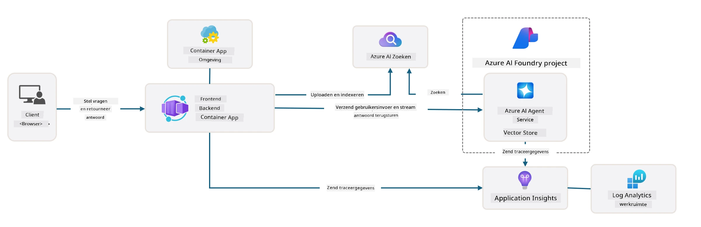

# 3. Een sjabloon ontleden

!!! tip "AAN HET EINDE VAN DEZE MODULE KUNT U"

    - [ ] Use GitHub Copilot and optional MCP tools for Azure documentation and read-only exploration
    - [ ] Identify the template's application, infrastructure, configuration, and test entry points
    - [ ] Verify generated explanations against actual repository files
    - [ ] **Lab 3:** Trace one request and one configuration input through the project

---

## 1. Activeer GitHub Copilot

Open de geïnitialiseerde AI-sample in VS Code en schakel [GitHub Copilot](https://code.visualstudio.com/docs/copilot/chat/chat-agent-mode) in. Meld u aan met een account dat een geschikt abonnement heeft; gebruikslimieten variëren. Vraag Copilot om het repository uit te leggen voordat u wijzigingen autoriseert.

### Optionele MCP-servers

Deze services kunnen extra hulpmiddelen bieden:

- [Azure MCP Server](https://learn.microsoft.com/azure/developer/azure-mcp-server/overview)
- [Microsoft Learn MCP Server](https://learn.microsoft.com/training/support/mcp)

Bekijk in VS Code de [MCP-configuratiehandleiding](https://code.visualstudio.com/docs/copilot/chat/mcp-servers) en maak `.vscode/mcp.json` aan indien nodig:

```json
{
  "servers": {
    "Azure MCP Server": {
      "type": "stdio",
      "command": "npx",
      "args": ["-y", "@azure/mcp@latest", "server", "start"]
    },
    "microsoft.docs.mcp": {
      "type": "http",
      "url": "https://learn.microsoft.com/api/mcp"
    }
  }
}
```

Het `npx`-commando vereist een ondersteunde Node.js/npm-installatie en downloadt uitvoerbare code. Bekijk het pakket en pin een goedgekeurde versie voor een reproduceerbare teamopstelling. Start de servers met de MCP-bedieningselementen van VS Code en controleer hun beschikbare hulpmiddelen; namen kunnen tussen versies veranderen.

**Authenticatie is apart.** Gebruik `azd auth login` voor AZD. Volg de gedocumenteerde Azure MCP-authenticatiestroom voor zijn tools; alleen AZD-inloggen stelt geen MCP-sessie in. Gebruik `az login` afzonderlijk wanneer een oefening of hook Azure CLI aanroept.

Probeer lees-only prompts:

1. “Gebruik Microsoft Learn MCP om de documentatie over Azure Developer CLI-configuratie te vinden.”
2. “Leg het `azure.yaml` van dit repository uit; citeer de bestanden die elke hook implementeren.”
3. “Gebruikmakend van de beschikbare Azure MCP-hulpmiddelen, maak een lijst van mijn geïmplementeerde resources zonder iets te wijzigen.”

Controleer de geselecteerde tenant/abonnement en elke voorgestelde toolaanroep. Keur geen creatie, verwijdering of toegangswijzigingen van resources goed enkel om de architectuur te verkennen.

## 2. Begrijp de architectuur

De sample host een Python FastAPI-backend en een React/TypeScript-frontend in Azure Container Apps. De backend communiceert met een agent in een Microsoft Foundry-project. Ophalen en observatie hangen af van de ingeschakelde sjabloonfuncties en succesvolle setup; ze zijn niet gegarandeerd alleen omdat de applicatie is geïmplementeerd.



Vergelijk dit diagram met de [huidige upstream-implementatiehandleiding](https://github.com/Azure-Samples/get-started-with-ai-agents/blob/main/docs/deployment.md) en uw daadwerkelijke resources. Controleer de geconfigureerde modelimplementatie, agenttools, beheerde identiteit, roltoewijzingen en optionele AI Search/Application Insights-resources.

**Oefening:** Vraag Copilot om een chatverzoek van de frontend via de API naar Foundry te traceren, met verwijzingen naar bestanden en functies. Open die verwijzingen en verifieer de uitleg. Trek niet alleen uit een diagram conclusies over geïmplementeerde authenticatie, routering of autorisatie.

## 3. Repository-structuur

De volgende geselecteerde paden zijn op 4 november 2026 gecontroleerd aan de hand van de sample. Uw geïnitialiseerde revisie blijft de bron van waarheid:

```text
get-started-with-ai-agents/
  azure.yaml
  docker-compose.yaml
  requirements-dev.txt
  .devcontainer/
  infra/
    main.bicep
    main.parameters.json
    api.bicep
    core/
  src/
    Dockerfile
    pyproject.toml
    requirements.txt
    api/
      main.py
      routes.py
      search_index_manager.py
    frontend/
      package.json
      src/
    files/
  scripts/
    validate_env_vars.sh
    validate_env_vars.ps1
    postdeploy.sh
    postdeploy.ps1
  tests/
    test_evaluation.py
    test_red_teaming.py
  docs/
    deployment.md
    deploy_customization.md
    ai_search.md
    observability.md
    local_development.md
    troubleshooting.md
```

### Infrastructuur en configuratie

`infra/main.bicep` orkestreert resources; `main.parameters.json` verbindt sjablooningangen met AZD-omgevingswaarden. `azure.yaml` selecteert de applicatiedienst en levenscyclushooks. Volg een invoer zoals `USE_AZURE_AI_SEARCH_SERVICE` door deze bestanden om te vinden wat er werkelijk wordt gewijzigd.

### Applicatie en identiteit

Lees `src/api/` en `src/frontend/` samen. Bepaal waar de agent wordt gemaakt of opgehaald, waar instructies/hulpmiddelen worden geconfigureerd en welke identiteit elke Azure-aanroep gebruikt. Voorbeeldbestanden onder `src/files/` zijn demonstratiegegevens, geen productiecatalogus of autorisatiemodel.

### Tests en observatie

De huidige evaluatie- en red-teaming-toegangspunten bevinden zich onder `tests/`; oudere `evals/`- en `airedteaming/`-directoryverwijzingen zijn verouderd voor deze sample. Lees `docs/observability.md` voor vereisten en kosten voordat u cloudtests uitvoert. Deze Python-tests zijn gescheiden van de optionele `azure.ai.evaluations` AZD-extensie.

## 4. Verifieer uw bevindingen

- Identificeer de API-route, agentinteractie en ophaalcode voor één voorbeeldvraag.
- Leg uit welke identiteit Foundry benadert en welke configuratie het eindpunt selecteert.
- Vind de daadwerkelijke pre-up- en post-deploy-scripts en hun foutafhandelingsgedrag.
- Maak een lijst van eventuele afhankelijkheden of optionele functies die ontbreken in uw implementatie.

Ga verder naar [Configureer een sjabloon](4-Configure-AI-Template.md).

---

<!-- CO-OP TRANSLATOR DISCLAIMER START -->
**Disclaimer**:
Dit document is vertaald met behulp van de AI vertaaldienst [Co-op Translator](https://github.com/Azure/co-op-translator). Hoewel we streven naar nauwkeurigheid, dient u er rekening mee te houden dat geautomatiseerde vertalingen fouten of onnauwkeurigheden kunnen bevatten. Het originele document in de oorspronkelijke taal moet worden beschouwd als de gezaghebbende bron. Voor kritieke informatie wordt professionele menselijke vertaling aanbevolen. Wij zijn niet aansprakelijk voor eventuele misverstanden of verkeerde interpretaties die voortvloeien uit het gebruik van deze vertaling.
<!-- CO-OP TRANSLATOR DISCLAIMER END -->