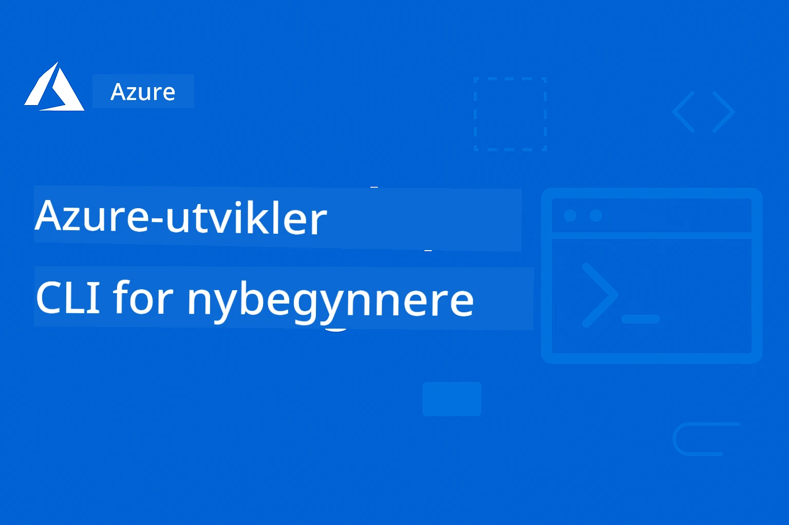

# AZD For Nybegynnere: En Strukturert Læreprosess

 

[](https://github.com/microsoft/AZD-for-beginners)
[](https://GitHub.com/microsoft/azd-for-beginners/network/)
[](https://github.com/microsoft/AZD-for-beginners)

[](https://discord.com/invite/nkVh3dp)
[](https://discord.gg/nTYy5BXMWG)

---

### Automatiske Oversettelser (Alltid Oppdatert)

<!-- CO-OP TRANSLATOR LANGUAGES TABLE START -->
[Arabisk](../ar/README.md) | [Bengali](../bn/README.md) | [Bulgarsk](../bg/README.md) | [Burmese (Myanmar)](../my/README.md) | [Kinesisk (Forenklet)](../zh-CN/README.md) | [Kinesisk (Tradisjonell, Hong Kong)](../zh-HK/README.md) | [Kinesisk (Tradisjonell, Macau)](../zh-MO/README.md) | [Kinesisk (Tradisjonell, Taiwan)](../zh-TW/README.md) | [Kroatisk](../hr/README.md) | [Tsjekkisk](../cs/README.md) | [Dansk](../da/README.md) | [Nederlandsk](../nl/README.md) | [Estisk](../et/README.md) | [Finsk](../fi/README.md) | [Fransk](../fr/README.md) | [Tysk](../de/README.md) | [Gresk](../el/README.md) | [Hebraisk](../he/README.md) | [Hindi](../hi/README.md) | [Ungarsk](../hu/README.md) | [Indonesisk](../id/README.md) | [Italiensk](../it/README.md) | [Japansk](../ja/README.md) | [Kannada](../kn/README.md) | [Khmer](../km/README.md) | [Koreansk](../ko/README.md) | [Litauisk](../lt/README.md) | [Malaysisk](../ms/README.md) | [Malayalam](../ml/README.md) | [Manipuri (Meitei Mayek)](../mni/README.md) | [Marathi](../mr/README.md) | [Nepalsk](../ne/README.md) | [Nigeriansk Pidgin](../pcm/README.md) | [Norsk](./README.md) | [Persisk (Farsi)](../fa/README.md) | [Polsk](../pl/README.md) | [Portugisisk (Brasil)](../pt-BR/README.md) | [Portugisisk (Portugal)](../pt-PT/README.md) | [Punjabi (Gurmukhi)](../pa/README.md) | [Rumensk](../ro/README.md) | [Russisk](../ru/README.md) | [Serbisk (Kyrillisk)](../sr/README.md) | [Slovakisk](../sk/README.md) | [Slovensk](../sl/README.md) | [Spansk](../es/README.md) | [Swahili](../sw/README.md) | [Svensk](../sv/README.md) | [Tagalog (Filippinsk)](../tl/README.md) | [Tamil](../ta/README.md) | [Telugu](../te/README.md) | [Thai](../th/README.md) | [Tyrkisk](../tr/README.md) | [Ukrainsk](../uk/README.md) | [Urdu](../ur/README.md) | [Vietnamesisk](../vi/README.md)

> **Foretrekker du å klone lokalt?**
>
> Dette depotet inkluderer over 50 språkoversettelser som betydelig øker nedlastingsstørrelsen. For å klone uten oversettelser, bruk sparsommelig ut-sjekking:
>
> **Bash / macOS / Linux:**
> ```bash
> git clone --filter=blob:none --sparse https://github.com/microsoft/AZD-for-beginners.git
> cd AZD-for-beginners
> git sparse-checkout set --no-cone '/*' '!translations' '!translated_images'
> ```
>
> **CMD (Windows):**
> ```cmd
> git clone --filter=blob:none --sparse https://github.com/microsoft/AZD-for-beginners.git
> cd AZD-for-beginners
> git sparse-checkout set --no-cone "/*" "!translations" "!translated_images"
> ```
>
> Dette gir deg alt du trenger for å fullføre kurset med mye raskere nedlasting.
<!-- CO-OP TRANSLATOR LANGUAGES TABLE END -->

## 🆕 Hva er Nytt i azd i dag

> 📌 **Gjennomgang av AI CLI-utgivelse (2026-11-04):** Veiledning ble sjekket mot publisert **`azd 1.37.2`**, **agenter `1.0.0-beta.23`**, og **evalueringer `1.0.0-beta.2`** dokumentasjon/kilde. Bruk `azd >= 1.37.0` for den kombinerte arbeidsflyten. Kjør `azd version` og [oppdater kjerne-CLI](https://learn.microsoft.com/azure/developer/azure-developer-cli/install-azd) før utvidelser. Se [utgivelsesendringer og fikser](docs/chapter-08-production/production-ai-practices.md#recent-release-changes-and-fixes). Dette er ikke en levende driftsvalidering av hele kurset.

Azure Developer CLI støtter mange applikasjonstyper, inkludert webapper, APIer og AI-agenter, gjennom støttede vertsplattformer, maler og utvidelser.

Slik betyr det noe for deg:

- **AI-agenter er nå førsteklasses azd arbeidsbelastninger.** Du kan initialisere, distribuere og administrere AI-agentprosjekter med samme `azd init` → `azd up` arbeidsflyt du allerede kjenner.
- **En agent livssyklus over to utvidelser.** Bruk `azure.ai.agents` til å initialisere, påkalle, optimalisere og pensjonere agenter. Installer **`azure.ai.evaluations`** separat for `azd ai eval init`, `generate`, og `run start`. Agenter beta.22 erstattet den gamle evalueringsarbeidsflyten og endret optimaliseringskonfigurasjon; følg [migrasjonsveiledningen](docs/chapter-08-production/production-ai-practices.md#evaluation-migration-and-quality-checks).
- **Flere AI byggeklosser.** Nye forhåndsvisningsutvidelser—`azure.ai.skills` og `azure.ai.connections`—lar deg administrere gjenbrukbare agentferdigheter og Foundry-koblinger direkte med azd.
- **Microsoft Foundry-integrasjon** bringer modellutplassering, agenthosting og AI-tjenestekonfigurasjon direkte inn i azd-mal økosystemet.
- **Smidigere dag-til-dag grunnleggende.** Nylige utgivelser gjorde `azd init` idempotent (trygt å kjøre flere ganger), automatiserte klarering av utdaterte `azd auth login`-tokens, og la til en vennlig `azd tool` første-oppstartsinnstilling.
- **Kjernearbeidsflyten har ikke endret seg.** Enten du distribuerer en todo-app, en mikrotjeneste eller en fleragent AI-løsning, er kommandoene de samme.

> **Merk for Aspire-brukere:** Microsoft refererer nå til produktet bare som **Aspire** (tidligere ".NET Aspire"). azd sin Aspire-støtte er uendret—bare navnet ble oppdatert.

Hvis du har brukt azd før, er AI-støtte en naturlig utvidelse—ikke et eget verktøy eller en avansert spor. Hvis du begynner på nytt, lærer du én arbeidsflyt som fungerer for alt.

---

## 🚀 Hva er Azure Developer CLI (azd)?

**Azure Developer CLI (azd)** er et utviklervennlig kommandolinjeverktøy som gjør det enkelt å distribuere applikasjoner til Azure. I stedet for å manuelt opprette og koble dusinvis av Azure-ressurser, kan du distribuere hele applikasjoner med én kommando.

### Magien med `azd up`

```bash
# This single command does everything:
# ✅ Creates all Azure resources  
# ✅ Configures networking and security
# ✅ Builds your application code
# ✅ Deploys to Azure
# ✅ Gives you a working URL
azd up
```

Malen gir applikasjons- og infrastrukturkonfigurasjonen. Vellykket distribusjon krever fortsatt støttede tjenester/modeller, tilstrekkelig kvote og tillatelser, riktige inndata og verifikasjon av den distribuerte applikasjonen. `azd up` gjør ikke automatisk en mal sikker, samsvarende eller produksjonsklar.

---

## ❓ Azure Developer CLI vs Azure CLI: Hva er Forskjellen?

Dette er det vanligste spørsmålet nybegynnere stiller. Her er det enkle svaret:

| Egenskap | **Azure CLI (`az`)** | **Azure Developer CLI (`azd`)** |
|---------|---------------------|--------------------------------|
| **Formål** | Administrere individuelle Azure-ressurser | Distribuere komplette applikasjoner |
| **Tankegang** | Infrastrukturfokusert | Applikasjonsfokusert |
| **Eksempel** | `az webapp create --name myapp...` | `azd up` |
| **Læringskurve** | Må kjenne Azure-tjenester | Bare kjenn appen din |
| **Best For** | DevOps, Infrastruktur | Utviklere, Prototyping |

### Enkel Analog

- **Azure CLI** er som å ha alle verktøyene for å bygge et hus - hammere, sager, spiker. Du kan bygge hva som helst, men må kunne konstruksjon.
- **Azure Developer CLI** er som å ansette en entreprenør - du beskriver hva du vil ha, og de håndterer byggingen.

### Når du skal bruke hver

| Scenario | Bruk Dette |
|----------|----------|
| "Jeg vil distribuere webappen min raskt" | `azd up` |
| "Jeg trenger bare å opprette en lagringskonto" | `az storage account create` |
| "Jeg bygger en full AI-applikasjon" | `azd init --template azure-search-openai-demo` |
| "Jeg trenger å feilsøke en spesifikk Azure-ressurs" | `az resource show` |
| "Jeg vil distribuere til mitt konfigurerte produksjonsmiljø" | Gå gjennom konfigurasjon, tilgang, kostnad og driftskontroller før `azd up --environment production` |

### De fungerer sammen!

AZD og Azure CLI har separat autentisering og konfigurasjon. Bruk `azd auth login` for AZD, og `az login` når en hook eller diagnostisk kommando eksplisitt trenger Azure CLI. Du kan bruke begge:
```bash
# Deploy your app with AZD
azd up

# Then fine-tune specific resources with Azure CLI
az webapp config set --name myapp --always-on true
```

---

## 🌟 Finn Maler i Awesome AZD

Ikke start fra bunnen av! **Awesome AZD** er samfunnets samling av maler klare til distribusjon:

| Ressurs | Beskrivelse |
|----------|-------------|
| 🔗 [**Awesome AZD Gallery**](https://azure.github.io/awesome-azd/) | Bla gjennom 200+ maler med étt-klikks distribusjon |
| 🔗 [**Send inn en Mal**](https://github.com/Azure/awesome-azd/issues) | Bidra med din egen mal til samfunnet |
| 🔗 [**GitHub Repository**](https://github.com/Azure/awesome-azd) | Gi stjerner og utforsk kilden |

### Populære AI-maler fra Awesome AZD

Velg én mal i sin egen tomme katalog; kommandoene nedenfor er alternativer. Den avsluttende `.` initialiserer den katalogen.

```bash
# RAG Chat with Microsoft Foundry Models + AI Search
azd init --template azure-search-openai-demo .

# Quick AI Chat Application
azd init --template openai-chat-app-quickstart .

# AI Agents with Foundry Agents
azd init --template get-started-with-ai-agents .
```

---

## 🎯 Kom i gang i 3 steg

Før du begynner, sørg for at maskinen din er klar for malen du vil distribuere:

**Windows:**
```powershell
.\validate-setup.ps1
```

**macOS / Linux:**
```bash
bash ./validate-setup.sh
```

Hvis en nødvendig sjekk feiler, fiks det først og fortsett deretter med rask start.

### Steg 1: Installer AZD (2 minutter)

**Windows:**
```powershell
winget install microsoft.azd
```

**macOS:**
```bash
brew tap azure/azd && brew install azd
```

**Linux:**
```bash
curl -fsSL https://aka.ms/install-azd.sh | bash
```

### Steg 2: Autentiser for AZD

```bash
# Optional if you plan to use Azure CLI commands directly in this course
az login

# Required for AZD workflows
azd auth login
```

Hvis du ikke er sikker på hvilken du trenger, følg hele oppsettflyten i [Installasjon & Oppsett](docs/chapter-01-foundation/installation.md#authentication-setup).

### Steg 3: Distribuer Din Første App

```bash
# Initialize from a template
azd init --template todo-nodejs-mongo .

# Deploy to Azure (creates everything!)
azd up
```

**🎉 Det er det!** Appen din er nå live på Azure.

### Rydd Opp (Ikke Glem!)

```bash
# Remove all resources when done experimenting
azd down --force --purge
```

---

## 📚 Hvordan bruke dette kurset

Dette kurset er designet for **progressiv læring** - start der du er komfortabel og jobb deg oppover:

| Din Erfaring | Start Her |
|-----------------|------------|
| **Helt ny til Azure** | [Kapittel 1: Grunnlag](#-chapter-1-foundation--quick-start) |
| **Kan Azure, ny til AZD** | [Kapittel 1: Grunnlag](#-chapter-1-foundation--quick-start) |
| **Vil distribuere AI-apper** | [Kapittel 2: AI-først utvikling](#-chapter-2-ai-first-development-recommended-for-ai-developers) |
| **Vil ha praktisk øvelse** | [🎓 Interaktivt Verksted](workshop/README.md) - 3-4 timers veiledet lab |
| **Trenger produksjonsmønstre** | [Kapittel 8: Produksjon & Enterprise](#-chapter-8-production--enterprise-patterns) |

### Rask Oppsett

1. **Fork dette depotet**: [](https://GitHub.com/microsoft/azd-for-beginners/fork)
2. **Klon det**: `git clone https://github.com/YOUR-USERNAME/azd-for-beginners.git`
3. **Få hjelp**: [Azure Discord Community](https://discord.com/invite/ByRwuEEgH4)

> **Foretrekker du å klone lokalt?**

> Dette depotet inkluderer over 50 språkoversettelser som betydelig øker nedlastingsstørrelsen. For å klone uten oversettelser, bruk sparsommelig ut-sjekking:
> ```bash
> git clone --filter=blob:none --sparse https://github.com/microsoft/AZD-for-beginners.git
> cd AZD-for-beginners
> git sparse-checkout set --no-cone '/*' '!translations' '!translated_images'
> ```
> Dette gir deg alt du trenger for å fullføre kurset med en mye raskere nedlasting.


## Kursoversikt

Mestre Azure Developer CLI (azd) gjennom strukturerte kapitler designet for progressiv læring. **Spesiell fokus på AI-applikasjonsdistribusjon med Microsoft Foundry-integrasjon.**

### Hvorfor dette kurset er essensielt for moderne utviklere

Utviklere som distribuerer AI-arbeidsbelastninger trenger ofte veiledning om:
- Kompleks multi-tjeneste AI-arkitektur
- Beste praksis for produksjonsdistribusjon av AI  
- Azure AI-tjenesteintegrasjon og konfigurasjon
- Kostnadsoptimalisering for AI-arbeidsbelastninger
- Feilsøking av AI-spesifikke distribusjonsproblemer

### Læringsmål

Ved å fullføre dette strukturerte kurset vil du:
- **Mestre AZD-grunnleggende**: Kjernebegreper, installasjon og konfigurasjon
- **Distribuere AI-applikasjoner**: Bruke AZD med Microsoft Foundry-tjenester
- **Implementere infrastruktur som kode**: Administrere Azure-ressurser med Bicep-maler
- **Feilsøke distribusjoner**: Løse vanlige problemer og debugge feil
- **Optimalisere for produksjon**: Sikkerhet, skalering, overvåking og kostnadsstyring
- **Bygge Multi-Agent-løsninger**: Distribuere komplekse AI-arkitekturer

## Før du begynner: Kontoer, tilgang og forutsetninger

Før du starter kapittel 1, sørg for at du har følgende på plass. Installasjonstrinnene senere i denne guiden forutsetter at disse grunnleggende er håndtert.

- **Et Azure-abonnement**: Du kan bruke et eksisterende abonnement fra jobben eller din egen konto, eller opprette en [gratis prøveversjon](https://aka.ms/azurefreetrial) for å komme i gang.
- **Tillatelse til å opprette Azure-ressurser**: For de fleste øvelser bør du ha minst **Bidragsyter**-tilgang på mål-abonnementet eller ressursgruppen. Noen kapitler kan også anta at du kan opprette ressursgrupper, administrerte identiteter og RBAC-tilordninger.
- [**En GitHub-konto**](https://github.com): Dette er nyttig for å forke depotet, spore egne endringer, og bruke GitHub Codespaces til workshopen.
- **Forutsetninger for malens kjøretid**: Noen maler trenger lokale verktøy som Node.js, Python, Java eller Docker. Kjør oppsettvalidatoren før du begynner for å fange opp manglende verktøy tidlig.
- **Grunnleggende terminalkunnskap**: Du trenger ikke å være ekspert, men bør være komfortabel med å kjøre kommandoer som `git clone`, `azd auth login` og `azd up`.

> **Jobber du i et bedriftsabonnement?**
> Hvis ditt Azure-miljø administreres av en administrator, bekreft på forhånd at du kan distribuere ressurser i abonnementet eller ressursgruppen du planlegger å bruke. Hvis ikke, be om et sandkasseabonnement eller Bidragsyter-tilgang før du starter.

> **Ny på Azure?**
> Start med din egen Azure-prøveperiode eller betal-ettersom-du-går-abonnement på https://aka.ms/azurefreetrial så du kan fullføre øvelsene fra start til slutt uten å vente på godkjenninger på leietakernivå.

## 🗺️ Kurskart: Rask navigering etter kapittel

Hvert kapittel har en dedikert README med læringsmål, raske starter og øvelser:

| Kapittel | Tema | Leksjoner | Varighet | Vanskelighetsgrad |
|---------|-------|---------|----------|------------|
| **[Kap 1: Grunnlag](docs/chapter-01-foundation/README.md)** | Komme i gang | [AZD-grunnleggende](docs/chapter-01-foundation/azd-basics.md) &#124; [Installering](docs/chapter-01-foundation/installation.md) &#124; [Første prosjekt](docs/chapter-01-foundation/first-project.md) | 30-45 min | ⭐ |
| **[Kap 2: AI-utvikling](docs/chapter-02-ai-development/README.md)** | AI-Første Apper | [Foundry-integrasjon](docs/chapter-02-ai-development/microsoft-foundry-integration.md) &#124; [AI-agenter](docs/chapter-02-ai-development/agents.md) &#124; [Modell-distribusjon](docs/chapter-02-ai-development/ai-model-deployment.md) &#124; [Workshop](docs/chapter-02-ai-development/ai-workshop-lab.md) | 1-2 t | ⭐⭐ |
| **[Kap 3: Konfigurasjon](docs/chapter-03-configuration/README.md)** | Autentisering & Sikkerhet | [Konfigurasjon](docs/chapter-03-configuration/configuration.md) &#124; [Autentisering & Sikkerhet](docs/chapter-03-configuration/authsecurity.md) | 45-60 min | ⭐⭐ |
| **[Kap 4: Infrastruktur](docs/chapter-04-infrastructure/README.md)** | IaC & Distribusjon | [Distribusjonsguide](docs/chapter-04-infrastructure/deployment-guide.md) &#124; [Provisionering](docs/chapter-04-infrastructure/provisioning.md) | 1-1,5 t | ⭐⭐⭐ |
| **[Kap 5: Multi-Agent](docs/chapter-05-multi-agent/README.md)** | AI-agentløsninger | [Detaljhandelsscenario](examples/retail-scenario.md) &#124; [Koordineringsmønstre](docs/chapter-06-pre-deployment/coordination-patterns.md) | 2-3 t | ⭐⭐⭐⭐ |
| **[Kap 6: Før distribusjon](docs/chapter-06-pre-deployment/README.md)** | Planlegging & Validering | [Preflight-sjekker](docs/chapter-06-pre-deployment/preflight-checks.md) &#124; [Kapasitetsplanlegging](docs/chapter-06-pre-deployment/capacity-planning.md) &#124; [SKU-valg](docs/chapter-06-pre-deployment/sku-selection.md) &#124; [App Insights](docs/chapter-06-pre-deployment/application-insights.md) | 1 t | ⭐⭐ |
| **[Kap 7: Feilsøking](docs/chapter-07-troubleshooting/README.md)** | Debugging & Løsning | [Vanlige problemer](docs/chapter-07-troubleshooting/common-issues.md) &#124; [Debugging](docs/chapter-07-troubleshooting/debugging.md) &#124; [AI-problemer](docs/chapter-07-troubleshooting/ai-troubleshooting.md) | 1-1,5 t | ⭐⭐ |
| **[Kap 8: Produksjon](docs/chapter-08-production/README.md)** | Bedriftsmønstre | [Produksjonspraksis](docs/chapter-08-production/production-ai-practices.md) | 2-3 t | ⭐⭐⭐⭐ |
| **[🎓 Workshop](workshop/README.md)** | Praktisk lab | [Introduksjon](workshop/docs/instructions/0-Introduction.md) &#124; [Valg](workshop/docs/instructions/1-Select-AI-Template.md) &#124; [Validering](workshop/docs/instructions/2-Validate-AI-Template.md) &#124; [Nedbryting](workshop/docs/instructions/3-Deconstruct-AI-Template.md) &#124; [Konfigurasjon](workshop/docs/instructions/4-Configure-AI-Template.md) &#124; [Tilpassing](workshop/docs/instructions/5-Customize-AI-Template.md) &#124; [Nedrigging](workshop/docs/instructions/6-Teardown-Infrastructure.md) &#124; [Oppsummering](workshop/docs/instructions/7-Wrap-up.md) | 3-4 t | ⭐⭐ |

**Total kurstid:** ~10-14 timer | **Ferdighetsutvikling:** Nybegynner → Produksjonsklar

---

## 📚 Læringskapitler

*Velg din læringsvei basert på erfaringsnivå og mål*

### 🚀 Kapittel 1: Grunnlag & Rask start
**Forutsetninger**: Azure-abonnement, grunnleggende kommandolinjekunnskap  
**Varighet**: 30-45 minutter  
**Vanskelighetsgrad**: ⭐

#### Hva du vil lære
- Forstå grunnleggende om Azure Developer CLI
- Installere AZD på din plattform
- Din første vellykkede distribusjon

#### Læringsressurser
- **🎯 Start her**: [Hva er Azure Developer CLI?](#-what-is-azure-developer-cli-azd)
- **📖 Teori**: [AZD-grunnleggende](docs/chapter-01-foundation/azd-basics.md) - Kjernebegreper og terminologi
- **⚙️ Oppsett**: [Installasjon & oppsett](docs/chapter-01-foundation/installation.md) - Plattformspecifikke guider
- **🛠️ Praktisk**: [Ditt første prosjekt](docs/chapter-01-foundation/first-project.md) - Trinnvis veiledning
- **📋 Kjapp referanse**: [Kommando-jukseliste](resources/cheat-sheet.md)

#### Praktiske øvelser
```bash
# Quick installation check
azd version

# Deploy your first application
azd init --template todo-nodejs-mongo .
azd up
```

**💡 Kapittelresultat**: Vellykket distribuere en enkel nettapplikasjon til Azure ved å bruke AZD

**✅ Suksessvalidering:**
```bash
# After completing Chapter 1, you should be able to:
azd version              # Shows installed version
azd init --template todo-nodejs-mongo  # Initializes project
azd up                  # Deploys to Azure
azd show                # Displays running app URL
# Application opens in browser and works
azd down --force --purge  # Cleans up resources
```

**📊 Tidsbruk:** 30-45 minutter  
**📈 Ferdighetsnivå etterpå:** Kan distribuere grunnleggende applikasjoner selvstendig

---

### 🤖 Kapittel 2: AI-Først Utvikling (Anbefalt for AI-utviklere)
**Forutsetninger**: Kapittel 1 fullført  
**Varighet**: 1-2 timer  
**Vanskelighetsgrad**: ⭐⭐

#### Hva du vil lære
- Microsoft Foundry-integrasjon med AZD
- Distribuere AI-drevne applikasjoner
- Forstå AI-tjenestekonfigurasjoner

#### Læringsressurser
- **🎯 Start her**: [Microsoft Foundry-integrasjon](docs/chapter-02-ai-development/microsoft-foundry-integration.md)
- **🤖 AI-agenter**: [AI-agenter-guide](docs/chapter-02-ai-development/agents.md) - Distribuere intelligente agenter med AZD
- **📖 Mønstre**: [AI modeller distribusjon](docs/chapter-02-ai-development/ai-model-deployment.md) - Distribuere og administrere AI-modeller
- **🛠️ Workshop**: [AI Workshop Lab](docs/chapter-02-ai-development/ai-workshop-lab.md) - Gjør dine AI-løsninger AZD-klare
- **🎥 Interaktiv guide**: [Workshop-materiale](workshop/README.md) - Nettleserbasert læring med MkDocs * DevContainer-miljø
- **📋 Maler**: [Microsoft Foundry-maler](#featured-microsoft-foundry-templates)
- **📝 Eksempler**: [AZD distribusjons-eksempler](examples/README.md)

#### Praktiske øvelser
```bash
# Deploy your first AI application
azd init --template azure-search-openai-demo .
azd up

# Try additional AI templates
azd init --template openai-chat-app-quickstart .
azd init --template agent-openai-python-prompty .
```

**💡 Kapittelresultat**: Distribuere og konfigurere en AI-drevet chatapplikasjon med RAG-funksjoner

**✅ Suksessvalidering:**
```bash
# After Chapter 2, you should be able to:
azd init --template azure-search-openai-demo .
azd up
# Test the AI chat interface
# Ask questions and get AI-powered responses with sources
# Verify search integration works
azd monitor  # Check Application Insights shows telemetry
azd down --force --purge
```

**📊 Tidsbruk:** 1-2 timer  
**📈 Ferdighetsnivå etterpå:** Kan distribuere AI-læringsapplikasjoner og identifisere ytterligere produksjonsberedskapsbehov
**💰 Kostnadsbevissthet:** Forstå utviklingskostnader på $80-150/måned, produksjonskostnader $300-3500/måned

#### 💰 Kostnadshensyn for AI-distribusjoner

**Utviklingsmiljø (Anslått $80-150/måned):**
- Microsoft Foundry-modeller (Betal-ettersom-du-går): $0-50/måned (basert på token-bruk)
- AI Search (Basisnivå): $75/måned
- Container Apps (Konsum): $0-20/måned
- Lagring (Standard): $1-5/måned

**Produksjonsmiljø (Anslått $300-3,500+/måned):**
- Microsoft Foundry-modeller (PTU for konsekvent ytelse): $3.000+/måned ELLER Betal-ettersom-du-går med høyt volum
- AI Search (Standardnivå): $250/måned
- Container Apps (Dedikert): $50-100/måned
- Application Insights: $5-50/måned
- Lagring (Premium): $10-50/måned

**💡 Kostnadsoptimaliseringstips:**
- Sjekk modellinferansepriser og konto-spesifikke kreditter; Azure OpenAI inkluderer ikke en universell gratis månedlig kvote på 50.000 token
- Kjør `azd down` for å slette ressurser når de ikke lenger er nødvendige, etter gjennomgang av det valgte miljøet
- Start med forbruksbasert fakturering, oppgrader til PTU kun for produksjon
- Bruk `azd provision --preview` for å inspisere planlagt infrastruktur, og pris deretter ressursene med Azure Pricing Calculator
- Aktiver autoskalering: betal kun for faktisk bruk

**Kostnadsovervåking:**
```bash
# Inspect planned resources (this does not calculate prices)
azd provision --preview

# Monitor actual costs in Azure Portal
az consumption budget list --resource-group <your-rg>
```

---

### ⚙️ Kapittel 3: Konfigurasjon & Autentisering
**Forutsetninger**: Kapittel 1 fullført  
**Varighet**: 45-60 minutter  
**Vanskelighetsgrad**: ⭐⭐

#### Hva du vil lære
- Miljøkonfigurasjon og administrasjon
- Autentisering og sikkerhets beste praksis
- Ressursnavngivning og organisering

#### Læringsressurser
- **📖 Konfigurasjon**: [Konfigurasjonsguide](docs/chapter-03-configuration/configuration.md) - Miljøoppsett
- **🔐 Sikkerhet**: [Autentiseringsmønstre og administrert identitet](docs/chapter-03-configuration/authsecurity.md) - Autentiseringsmønstre
- **📝 Eksempler**: [Databaseapp-eksempel](examples/database-app/README.md) - AZD databaseeksempler

#### Praktiske øvelser
- Konfigurer flere miljøer (utvikling, staging, produksjon)
- Sett opp autentisering med administrert identitet
- Implementer miljøspesifikke konfigurasjoner

**💡 Kapittelresultat**: Administrere flere miljøer med riktig autentisering og sikkerhet

---

### 🏗️ Kapittel 4: Infrastruktur som kode & Distribusjon
**Forutsetninger**: Kapitler 1-3 fullført  
**Varighet**: 1-1,5 timer  
**Vanskelighetsgrad**: ⭐⭐⭐

#### Hva du vil lære
- Avanserte distribusjonsmønstre
- Infrastruktur som kode med Bicep
- Strategier for ressursprovisjonering

#### Læringsressurser
- **📖 Distribusjon**: [Distribusjonsguide](docs/chapter-04-infrastructure/deployment-guide.md) - Fullstendige arbeidsflyter
- **🏗️ Provisjonering**: [Provisjonering av ressurser](docs/chapter-04-infrastructure/provisioning.md) - Azure ressursadministrasjon
- **📝 Eksempler**: [Container app-eksempel](../../examples/container-app) - Containeriserte distribusjoner

#### Praktiske øvelser
- Lag tilpassede Bicep-maler
- Distribuer applikasjoner med flere tjenester
- Implementer blå-grønn distribusjonsstrategi

**💡 Kapittelresultat**: Distribuere komplekse multi-tjeneste applikasjoner ved hjelp av tilpassede infrastruktursmaler

---

### 🎯 Kapittel 5: Multi-Agent AI-Løsninger (Avansert)
**Forutsetninger**: Kapitler 1-2 fullført  
**Varighet**: 2-3 timer  
**Vanskelighetsgrad**: ⭐⭐⭐⭐

#### Hva du vil lære
- Multi-agent arkitekturmønstre
- Agentorkestrering og koordinering
- Produksjonsklare AI-distribusjoner

#### Læringsressurser
- **🤖 Utvalgt design**: [Detaljhandel Multi-Agent Løsning](examples/retail-scenario.md) - Arkitekturtegning, ikke en komplett applikasjon
- **🛠️ ARM-maler**: [ARM Template Package](../../examples/retail-multiagent-arm-template) - Infrastrukturrammeverk; gjennomgå forutsetninger og manglende applikasjonskomponenter
- **📖 Arkitektur**: [Mønstre for koordinering av flere agenter](docs/chapter-06-pre-deployment/coordination-patterns.md) - Mønstre

#### Praktiske øvelser
```bash
# Inspect the retail infrastructure scaffold before choosing to deploy it
cd examples/retail-multiagent-arm-template
cat README.md

# After an intentional deployment, inspect infrastructure state
az deployment group show --resource-group <rg-name> --name <deployment-name>
```

**💡 Kapittelresultat**: Forstå design av multi-agent og identifisere implementering, validering og operasjonelt arbeid som kreves utover et infrastrukturrammeverk

---

### 🔍 Kapittel 6: Validering og planlegging før utrulling
**Forutsetninger**: Kapittel 4 fullført  
**Varighet**: 1 time  
**Kompleksitet**: ⭐⭐

#### Hva du vil lære
- Kapasitetsplanlegging og ressursvalidering
- Strategier for valg av SKU
- Forhåndssjekker og automatisering

#### Læringsressurser
- **📊 Planlegging**: [Kapasitetsplanlegging](docs/chapter-06-pre-deployment/capacity-planning.md) - Ressursvalidering
- **💰 Valg**: [SKU-valg](docs/chapter-06-pre-deployment/sku-selection.md) - Kostnadseffektive valg
- **✅ Validering**: [Forhåndssjekker](docs/chapter-06-pre-deployment/preflight-checks.md) - Automatiserte skript

#### Praktiske øvelser
- Kjør scripts for kapasitetsvalidering
- Optimaliser SKU-valg for kostnader
- Implementer automatiserte forhåndssjekker før utrulling

**💡 Kapittelresultat**: Validere og optimalisere utrullinger før utførelse

---

### 🚨 Kapittel 7: Feilsøking og debugging
**Forutsetninger**: Ethvert utrullingskapittel fullført  
**Varighet**: 1–1,5 timer  
**Kompleksitet**: ⭐⭐

#### Hva du vil lære
- Systematiske debugging-metoder
- Vanlige problemer og løsninger
- AI-spesifikk feilsøking

#### Læringsressurser
- **🔧 Vanlige problemer**: [Vanlige problemer](docs/chapter-07-troubleshooting/common-issues.md) - FAQ og løsninger
- **🕵️ Debugging**: [Debugging-guide](docs/chapter-07-troubleshooting/debugging.md) - Trinn-for-trinn strategier
- **🤖 AI-problemer**: [AI-spesifikk feilsøking](docs/chapter-07-troubleshooting/ai-troubleshooting.md) - Problemer med AI-tjenester

#### Praktiske øvelser
- Diagnostiser feil ved utrulling
- Løs autentiseringsproblemer
- Feilsøk AI-tjenestens tilkobling

**💡 Kapittelresultat**: Selvstendig diagnostisere og løse vanlige utrullingsproblemer

---

### 🏢 Kapittel 8: Produksjons- og bedriftsmønstre
**Forutsetninger**: Kapitler 1-4 fullført  
**Varighet**: 2-3 timer  
**Kompleksitet**: ⭐⭐⭐⭐

#### Hva du vil lære
- Strategier for produksjonsutrulling
- Sikkerhetsmønstre for bedrifter
- Overvåkning og kostnadsoptimalisering

#### Læringsressurser
- **🏭 Produksjon**: [Beste praksiser for produksjons-AI](docs/chapter-08-production/production-ai-practices.md) - Bedriftsmønstre
- **📝 Eksempler**: [Mikrotjeneste-eksempel](../../examples/microservices) - Komplekse arkitekturer
- **📊 Overvåkning**: [Integrasjon med Application Insights](docs/chapter-06-pre-deployment/application-insights.md) - Overvåkning

#### Praktiske øvelser
- Implementer bedriftsikkerhetsmønstre
- Sett opp omfattende overvåkning
- Rull ut til produksjon med riktig styring

**💡 Kapittelresultat**: Rull ut bedriftsklare applikasjoner med full produksjonskapasitet

---

## 🎓 Workshopoversikt: Praktisk læringserfaring

> **⚠️ WORKSHOP STATUS: Aktiv utvikling**  
> Workshop-materialene er under utvikling og forbedring. Kjerne-moduler fungerer, men noen avanserte seksjoner er uferdige. Vi jobber aktivt for å fullføre alt innhold. [Følg fremdrift →](workshop/README.md)

### Interaktivt workshopmateriale
**Omfattende praktisk læring med nettleserbaserte verktøy og veiledede øvelser**

Vårt workshopmateriale gir en strukturert, interaktiv læringsopplevelse som utfyller kapittelbasert pensum ovenfor. Workshoppen er designet for både selvstyrt læring og instruktørledede økter.

#### 🛠️ Workshop-funksjoner
- **Nettleserbasert brukergrensesnitt**: Fullverdig MkDocs-basert workshop med søk, kopiering og tema-funksjoner
- **GitHub Codespaces-integrasjon**: Ett-klikk oppsett av utviklingsmiljø
- **Strukturert læringsløp**: 8 modul-baserte veiledede øvelser (totalt 3-4 timer)
- **Progressiv metodikk**: Introduksjon → Valg → Validering → Nedbryting → Konfigurasjon → Tilpasning → Opprydding → Oppsummering
- **Interaktivt DevContainer-miljø**: Forhåndskonfigurerte verktøy og avhengigheter

#### 📚 Workshop-modulstruktur
Workshoppen følger en **8-modulers progressiv metodikk** som tar deg fra oppdagelse til mestring av utrulling:

| Modul | Emne | Hva du vil gjøre | Varighet |
|--------|-------|----------------|----------|
| **0. Introduksjon** | Workshop-oversikt | Forstå læringsmål, forutsetninger og workshop-struktur | 15 min |
| **1. Valg** | Malutforskning | Utforsk AZD-maler og velg riktig AI-mal for ditt scenario | 20 min |
| **2. Validering** | Distribuer og verifiser | Distribuer malen med `azd up` og valider at infrastrukturen fungerer | 30 min |
| **3. Nedbryting** | Forstå struktur | Bruk GitHub Copilot til å utforske malarkitektur, Bicep-filer og kodeorganisering | 30 min |
| **4. Konfigurasjon** | dypdykk i azure.yaml | Bli mester i `azure.yaml` konfigurasjon, livssyklus hooks og miljøvariabler | 30 min |
| **5. Tilpasning** | Gjør det personlig | Aktiver AI Search, tracing, evaluering og tilpass for ditt scenario | 45 min |
| **6. Opprydding** | Rydd opp | Trygt fjern ressurser med `azd down --purge` | 15 min |
| **7. Oppsummering** | Neste steg | Gå gjennom oppnåelser, nøkkelbegreper og fortsett læringsreisen | 15 min |

**Workshop-flyt:**
```
Introduction → Selection → Validation → Deconstruction → Configuration → Customization → Teardown → Wrap-up
     ↓            ↓           ↓              ↓               ↓              ↓            ↓           ↓
  Overview    Find the     Deploy &      Explore        Master         Customize     Clean up    Review &
             right        verify        code &        azure.yaml      for your      resources   next steps
             template                   structure                     scenario
```

#### 🚀 Komme i gang med workshoppen
```bash
# Option 1: GitHub Codespaces (Recommended)
# Click "Code" → "Create codespace on main" in the repository

# Option 2: Local Development
git clone https://github.com/microsoft/azd-for-beginners.git
cd azd-for-beginners/workshop
# Follow the setup instructions in workshop/README.md
```

#### 🎯 Læringsmål for workshoppen
Ved å fullføre workshoppen vil deltakerne:
- **Distribuere produksjonsklare AI-applikasjoner**: Bruk AZD med Microsoft Foundry-tjenester
- **Mestre multi-agent arkitekturer**: Implementere koordinerte AI-agentløsninger
- **Implementere sikkerhetsbeste praksis**: Konfigurer autentisering og tilgangskontroll
- **Optimalisere for skalering**: Design kostnadseffektive og ytelsessterke utrullinger
- **Feilsøke utrullinger**: Løse vanlige problemer selvstendig

#### 📖 Workshop-ressurser
- **🎥 Interaktiv veiledning**: [Workshop-materialer](workshop/README.md) - Nettleserbasert læringsmiljø
- **📋 Modul-for-modul instruksjoner**:
  - [0. Introduksjon](workshop/docs/instructions/0-Introduction.md) - Workshop-oversikt og målsetninger
  - [1. Valg](workshop/docs/instructions/1-Select-AI-Template.md) - Finn og velg AI-maler
  - [2. Validering](workshop/docs/instructions/2-Validate-AI-Template.md) - Distribuer og verifiser maler
  - [3. Nedbryting](workshop/docs/instructions/3-Deconstruct-AI-Template.md) - Utforsk malarkitektur
  - [4. Konfigurasjon](workshop/docs/instructions/4-Configure-AI-Template.md) - Mester azure.yaml
  - [5. Tilpasning](workshop/docs/instructions/5-Customize-AI-Template.md) - Tilpass for ditt scenario
  - [6. Opprydding](workshop/docs/instructions/6-Teardown-Infrastructure.md) - Rydd opp ressurser
  - [7. Oppsummering](workshop/docs/instructions/7-Wrap-up.md) - Gjennomgang og neste steg
- **🛠️ AI Workshop Lab**: [AI Workshop Lab](docs/chapter-02-ai-development/ai-workshop-lab.md) - AI-fokuserte øvelser
- **💡 Rask start**: [Workshop oppsettguide](workshop/README.md#browser-based-guide) - Miljøkonfigurasjon

**Perfekt for**: Bedriftstrening, universitetskurs, selvstudium og utvikler-bootcamps.

---

## 📖 Dypdykk: AZD-funksjoner

Utover det grunnleggende tilbyr AZD kraftige funksjoner for produksjonsutrullinger:

- **Malbaserte utrullinger** - Bruk forhåndsbygde maler for vanlige applikasjonsmønstre
- **Infrastruktur som kode** - Administrer Azure-ressurser med Bicep eller Terraform  
- **Integrerte arbeidsflyter** - Sømløst provisjonere, distribuere og overvåke applikasjoner
- **Utviklervennlig** - Optimalisert for utviklerproduktivitet og opplevelse

### **AZD + Microsoft Foundry: Perfekt for AI-utrullinger**

**Hvorfor AZD for AI-løsninger?** AZD løser topputfordringer AI-utviklere møter:

- **AI-klare maler** - Forhåndskonfigurerte maler for Microsoft Foundry-modeller, Azure AI-tjenester og ML-arbeidsbelastninger
- **Sikre AI-utrullinger** - Innebygde sikkerhetsmønstre for AI-tjenester, API-nøkler og modellendepunkter  
- **Produksjons-AI-mønstre** - Beste praksiser for skalerbare og kostnadseffektive AI-applikasjonsutrullinger
- **Ende-til-ende AI-arbeidsflyter** - Fra modellutvikling til produksjonsutrulling med korrekt overvåkning
- **Kostnadsoptimalisering** - Smarte ressursallokerings- og skaleringsstrategier for AI-arbeidsbelastninger
- **Microsoft Foundry-integrasjon** - Sømløs tilkobling til Microsoft Foundry-modellkatalog og endepunkter

---

## 🎯 Maler & Eksempelsamling

### Utvalgt: Microsoft Foundry-maler
**Start her hvis du utruller AI-applikasjoner!**

> **Merk:** Disse malene demonstrerer ulike AI-mønstre. Noen er eksterne Azure Samples, andre er lokale implementeringer.

| Mal | Kapittel | Kompleksitet | Tjenester | Type |
|----------|---------|------------|----------|------|
| [**Kom i gang med AI-chat**](https://github.com/Azure-Samples/get-started-with-ai-chat) | Kapittel 2 | ⭐⭐ | AzureOpenAI + Azure AI Model Inference API + Azure AI Search + Azure Container Apps + Application Insights | Ekstern |
| [**Kom i gang med AI-agenter**](https://github.com/Azure-Samples/get-started-with-ai-agents) | Kapittel 2 | ⭐⭐ | Foundry Agents + AzureOpenAI + Azure AI Search + Azure Container Apps + Application Insights| Ekstern |
| [**Azure Search + OpenAI Demo**](https://github.com/Azure-Samples/azure-search-openai-demo) | Kapittel 2 | ⭐⭐ | Azure OpenAI + Azure AI Search + Container Apps (standard) + Storage | Ekstern |
| [**OpenAI Chat App Raskstart**](https://github.com/Azure-Samples/openai-chat-app-quickstart) | Kapittel 2 | ⭐ | AzureOpenAI + Container Apps + Application Insights | Ekstern |
| [**Agent OpenAI Python Prompty**](https://github.com/Azure-Samples/agent-openai-python-prompty) | Kapittel 5 | ⭐⭐⭐ | AzureOpenAI + Azure Functions + Prompty | Ekstern |
| [**Contoso Chat RAG**](https://github.com/Azure-Samples/contoso-chat) | Kapittel 8 | ⭐⭐⭐⭐ | AzureOpenAI + AI Search + Cosmos DB + Container Apps | Ekstern |
| [**Retail Multi-Agent Solution**](examples/retail-scenario.md) | Kapittel 5 | ⭐⭐⭐⭐ | Foreslått arkitektur og infrastruktur-rammeverk; applikasjonsimplementering kreves | **Lokal mal** |

### Utvalgt: Fullstendige læringsscenarioer
**Produksjonsklare applikasjonsmaler koblet til læringskapitler**

| Mal | Læringskapittel | Kompleksitet | Nøkkellæring |
|----------|------------------|------------|--------------|
| [**openai-chat-app-quickstart**](https://github.com/Azure-Samples/openai-chat-app-quickstart) | Kapittel 2 | ⭐ | Grunnleggende AI-utrullingsmønstre |
| [**azure-search-openai-demo**](https://github.com/Azure-Samples/azure-search-openai-demo) | Kapittel 2 | ⭐⭐ | RAG-implementering med Azure AI Search |
| [**get-started-with-ai-agents**](https://github.com/Azure-Samples/get-started-with-ai-agents) | Kapittel 2 | ⭐⭐ | Agent-støttet chat og testsituasjonsspesifikke evalueringer |
| [**agent-openai-python-prompty**](https://github.com/Azure-Samples/agent-openai-python-prompty) | Kapittel 5 | ⭐⭐⭐ | Agent-rammeverk og funksjonskall |
| [**contoso-chat**](https://github.com/Azure-Samples/contoso-chat) | Kapittel 8 | ⭐⭐⭐ | Bedrifts-AI-orkestrering |
| [**retail-multi-agent-solution**](examples/retail-scenario.md) | Kapittel 5 | ⭐⭐⭐⭐ | Multi-agent arkitektur med kunde- og lageragenter |

### Læringstype etter eksempel

> **📌 Lokale vs. eksterne eksempler:**  
> **Lokale eksempler** (i dette repoet) = Sjekk eksempelets README for implementeringsstatus og forutsetninger
> **Eksterne eksempler** (Azure Samples) = Klone fra lenkede repoer

#### Lokale eksempler (klare til bruk)
- [**Retail Multi-Agent Solution**](examples/retail-scenario.md) - Arkitekturmønster med ARM-infrastruktur-rammeverk
  - Foreslåtte roller for kunde- og lageragenter
  - Overvåkning, evaluering og applikasjonskode må implementeres og verifiseres
  - Å bare provisjonere ressurser gir ikke en fungerende retail-applikasjon

#### Lokale eksempler - Container Applikasjoner (Kapittel 2-5)
**Omfattende containerutrullings-eksempler i dette depotet:**
- [**Container App Eksempler**](examples/container-app/README.md) - Fullstendig guide til containerutrullinger
  - [Enkel Flask API](../../examples/container-app/simple-flask-api) - Grunnleggende REST API med scale-to-zero
  - [Mikrotjenestearkitektur](../../examples/container-app/microservices) - To-tjeneste læringseksempel; produksjonsforsterkning krever ekstra arbeid
  - Rask start, produksjon og avanserte utrullingsmønstre
  - Veiledning for overvåkning, sikkerhet og kostnadsoptimalisering

#### Eksterne eksempler - Enkle applikasjoner (Kapittel 1-2)
**Klon disse Azure Samples-depotene for å komme i gang:**
- [Enkel webapp - Node.js + MongoDB](https://github.com/Azure-Samples/todo-nodejs-mongo) - Grunnleggende utrullingsmønstre
- [Statisk nettside - React SPA](https://github.com/Azure-Samples/todo-csharp-sql-swa-func) - Utrulling av statisk innhold
- [Container App - Python Flask](https://github.com/Azure-Samples/container-apps-store-api-microservice) - Utrulling av REST API

#### Eksterne eksempler - Databaseintegrasjon (Kapittel 3-4)  
- [Database App - C# + SQL](https://github.com/Azure-Samples/todo-csharp-sql) - Database tilkoblingsmønstre
- [Functions + Cosmos DB](https://github.com/Azure-Samples/todo-python-mongo-swa-func) - Serverfri dataarbeidsflyt

#### Eksterne eksempler - Avanserte mønstre (Kapittel 4-8)
- [Java Microservices](https://github.com/Azure-Samples/java-microservices-aca-lab) - Multi-tjeneste arkitekturer
- [Container Apps Jobs](https://github.com/Azure-Samples/container-apps-jobs) - Bakgrunnsbehandling  
- [Enterprise ML Pipeline](https://github.com/Azure/mlops-v2) - MLOps referansemønstre; ikke en direkte AZD-mal

### Eksterne mal-samlinger
- [**Offisiell AZD Malgalleri**](https://azure.github.io/awesome-azd/) - Kuratert samling av offisielle og fellesskapsmaler
- [**Azure Developer CLI Maler**](https://learn.microsoft.com/en-us/azure/developer/azure-developer-cli/azd-templates) - Microsoft Learn maldokumentasjon
- [**Eksempelmappe**](examples/README.md) - Lokale læringseksempler med detaljerte forklaringer

---

## 📚 Læringsressurser & Referanser

### Raskereferanser
- [**Kommando-hurtigreferanse**](resources/cheat-sheet.md) - Viktige azd-kommandoer organisert etter kapittel
- [**Begrepsforklaring**](resources/glossary.md) - Azure og azd terminologi  
- [**FAQ**](resources/faq.md) - Vanlige spørsmål organisert etter læringskapittel
- [**Studieveiledning**](resources/study-guide.md) - Omfattende øvelser

### Praktiske Workshops
- [**AI Workshop Lab**](docs/chapter-02-ai-development/ai-workshop-lab.md) - Gjør dine AI-løsninger AZD-distribuerbare (2-3 timer)
- [**Interaktiv Workshop**](workshop/README.md) - 8-modulers guidede øvelser med MkDocs og GitHub Codespaces
  - Følger: Introduksjon → Valg → Validering → Nedbryting → Konfigurasjon → Tilpasning → Nedrigging → Oppsummering

### Eksterne læringsressurser
- [Azure Developer CLI Dokumentasjon](https://learn.microsoft.com/en-us/azure/developer/azure-developer-cli/)
- [Azure Arkitektur Senter](https://learn.microsoft.com/en-us/azure/architecture/)
- [Azure Pris Kalkulator](https://azure.microsoft.com/pricing/calculator/)
- [Azure Status](https://status.azure.com/)

### AI Agent Ferdigheter for Din Editor
- [**Microsoft Azure Ferdigheter på skills.sh**](https://skills.sh/microsoft/github-copilot-for-azure) - 37 åpne agentferdigheter for Azure AI, Foundry, distribusjon, diagnostikk, kostnadsoptimalisering, og mer. Installer dem i GitHub Copilot, Cursor, Claude Code eller hvilken som helst støttet agent:
  ```bash
  npx skills add microsoft/github-copilot-for-azure
  ```

---

## 🔧 Rask feilsøkingsguide

**Vanlige problemer nybegynnere møter og umiddelbare løsninger:**

<details>
<summary><strong>❌ "azd: kommando ikke funnet"</strong></summary>

```bash
# Install AZD first
# Windows (PowerShell):
winget install microsoft.azd

# macOS:
brew tap azure/azd && brew install azd

# Linux:
curl -fsSL https://aka.ms/install-azd.sh | bash

# Verify installation
azd version
```
</details>

<details>
<summary><strong>❌ "Ingen abonnement funnet" eller "Abonnement ikke satt"</strong></summary>

```bash
# List available subscriptions
az account list --output table

# Set default subscription
az account set --subscription "<subscription-id-or-name>"

# Set for AZD environment
azd env set AZURE_SUBSCRIPTION_ID "<subscription-id>"

# Verify
az account show
```
</details>

<details>
<summary><strong>❌ "InsufficientQuota" eller "Kvote overskredet"</strong></summary>

```bash
# Try different Azure region
azd env set AZURE_LOCATION "westus2"
azd up

# Or use smaller SKUs in development
# Edit infra/main.parameters.json:
{
  "sku": "B1"  // Instead of "P1V2"
}
```
</details>

<details>
<summary><strong>❌ "azd up" mislykkes midt i prosessen</strong></summary>

```bash
# Option 1: Inspect the error and retry after correcting its cause
azd show
azd up --debug

# Option 2: Just fix infrastructure
azd provision

# Option 3: Check detailed status
azd show

# Option 4: Check logs in Azure Monitor
azd monitor --logs
```
</details>

<details>
<summary><strong>❌ "Autentisering mislyktes" eller "Token utløpt"</strong></summary>

```bash
# Re-authenticate for AZD
azd auth logout
azd auth login

# Optional: refresh Azure CLI too if you are running az commands
az logout
az login

# Verify authentication
az account show
```
</details>

<details>
<summary><strong>❌ "Ressurs finnes allerede" eller navnekonflikter</strong></summary>

```bash
# Inspect the conflicting resource before changing or deleting anything.
# For an isolated new deployment, create a separate environment:
azd env new dev-v2
azd up
```
</details>

<details>
<summary><strong>❌ Mal-distribusjon tar for lang tid</strong></summary>

**Normale ventetider:**
- Enkel webapp: 5-10 minutter
- App med database: 10-15 minutter
- AI-applikasjoner: 15-25 minutter (OpenAI provisjonering er treg)

```bash
# Check progress
azd show

# If stuck >30 minutes, check Azure Portal:
azd monitor --overview
# Look for failed deployments
```
</details>

<details>
<summary><strong>❌ "Tillatelse nektet" eller "Forbudt"</strong></summary>

```bash
# Check your Azure role
az role assignment list --assignee $(az account show --query user.name -o tsv)

# You need at least "Contributor" role
# Ask your Azure admin to grant:
# - Contributor (for resources)
# - User Access Administrator (for role assignments)
```
</details>

<details>
<summary><strong>❌ Finner ikke URL for distribuert applikasjon</strong></summary>

```bash
# Show all service endpoints
azd show

# Or open Azure Portal
azd monitor

# Check specific service
azd env get-values
# Look for *_URL variables
```
</details>

### 📚 Fullstendige feilsøkingsressurser

- **Vanlige problemer-guide:** [Detaljerte løsninger](docs/chapter-07-troubleshooting/common-issues.md)
- **AI-spesifikke problemer:** [AI feilsøking](docs/chapter-07-troubleshooting/ai-troubleshooting.md)
- **Feilsøkingsguide:** [Trinnvis feilsøking](docs/chapter-07-troubleshooting/debugging.md)
- **Få hjelp:** [Azure Discord](https://discord.gg/microsoft-azure) #azure-developer-cli

---

## 🎓 Kursfullføring & Sertifisering

### Fremdriftssporing
Spor læringsfremgangen din gjennom hvert kapittel:

- [ ] **Kapittel 1**: Grunnlag & Rask start ✅
- [ ] **Kapittel 2**: AI-først utvikling ✅  
- [ ] **Kapittel 3**: Konfigurasjon & Autentisering ✅
- [ ] **Kapittel 4**: Infrastruktur som kode & Distribusjon ✅
- [ ] **Kapittel 5**: Multi-agent AI-løsninger ✅
- [ ] **Kapittel 6**: Validering & Planlegging før distribusjon ✅
- [ ] **Kapittel 7**: Feilsøking & Debugging ✅
- [ ] **Kapittel 8**: Produksjon & Enterprise-mønstre ✅

### Læringsverifisering
Etter å ha fullført hvert kapittel, verifiser kunnskapen din ved å:
1. **Praktisk øvelse**: Fullfør kapitlets praktiske distribusjon
2. **Kunnskapssjekk**: Gå gjennom FAQ-seksjonen for ditt kapittel
3. **Fellesskapsdiskusjon**: Del dine erfaringer i Azure Discord
4. **Neste kapittel**: Gå videre til neste kompleksitetsnivå

### Fordeler ved kursfullføring
Når du har fullført alle kapitlene, vil du ha:
- **Produksjonserfaring**: Distribuerte ekte AI-applikasjoner til Azure
- **Profesjonelle ferdigheter**: Enterprise-klare distribusjonsmuligheter  
- **Fellesskapsgjenkjennelse**: Aktiv deltaker i Azure utviklerfellesskapet
- **Karrierefremgang**: Etterspurt AZD og AI distribusjonsekspertise

---

## 🤝 Fellesskap & Support

### Få hjelp & support
- **Tekniske problemer**: [Rapporter feil og be om funksjoner](https://github.com/microsoft/azd-for-beginners/issues)
- **Læringsspørsmål**: [Microsoft Azure Discord Community](https://discord.gg/microsoft-azure) og [](https://discord.gg/nTYy5BXMWG)
- **AI-spesifikk hjelp**: Bli med i [](https://discord.gg/nTYy5BXMWG)
- **Dokumentasjon**: [Offisiell Azure Developer CLI dokumentasjon](https://learn.microsoft.com/en-us/azure/developer/azure-developer-cli/)

### Fellesskapsinnsikt fra Microsoft Foundry Discord

**Temaer diskutert av fellesskapet:**
- Multi-tjeneste distribusjoner, legitimasjonshåndtering og produksjonsberedskap
- AI-spesifikke maler, feilsøkingsguider og beste praksis

**Bli med i vårt fellesskap for å:**
- Dele dine AZD + AI erfaringer og få hjelp
- Få tidlig tilgang til nye AI-maler
- Bidra til beste praksis for AI-distribusjon
- Påvirke fremtidig AI + AZD funksjonsutvikling

### Bidra til kurset
Vi tar imot bidrag! Les vår [Bidragsveiledning](CONTRIBUTING.md) for detaljer om:
- **Innholdsforbedringer**: Forbedre eksisterende kapitler og eksempler
- **Nye eksempler**: Legg til virkelige scenarier og maler  
- **Oversettelser**: Hjelp med å vedlikeholde flerspråklig støtte
- **Feilmeldinger**: Forbedre nøyaktighet og klarhet
- **Fellesskapsstandarder**: Følg våre inkluderende retningslinjer

---

## 📄 Kursinformasjon

### Lisens
Dette prosjektet er lisensiert under MIT-lisensen - se [LICENSE](../../LICENSE) filen for detaljer.

### Relaterte Microsoft Læringsressurser

Vårt team produserer andre omfattende læringskurs:

<!-- CO-OP TRANSLATOR OTHER COURSES START -->
### LangChain
[](https://aka.ms/langchain4j-for-beginners)
[](https://aka.ms/langchainjs-for-beginners?WT.mc_id=m365-94501-dwahlin)
[](https://github.com/microsoft/langchain-for-beginners?WT.mc_id=m365-94501-dwahlin)
---

### Azure / Edge / MCP / Agenter
[](https://github.com/microsoft/AZD-for-beginners?WT.mc_id=academic-105485-koreyst)
[](https://github.com/microsoft/edgeai-for-beginners?WT.mc_id=academic-105485-koreyst)
[](https://github.com/microsoft/mcp-for-beginners?WT.mc_id=academic-105485-koreyst)
[](https://github.com/microsoft/ai-agents-for-beginners?WT.mc_id=academic-105485-koreyst)

---
 
### Generativ AI-serie
[](https://github.com/microsoft/generative-ai-for-beginners?WT.mc_id=academic-105485-koreyst)
[-9333EA?style=for-the-badge&labelColor=E5E7EB&color=9333EA)](https://github.com/microsoft/Generative-AI-for-beginners-dotnet?WT.mc_id=academic-105485-koreyst)
[-C084FC?style=for-the-badge&labelColor=E5E7EB&color=C084FC)](https://github.com/microsoft/generative-ai-for-beginners-java?WT.mc_id=academic-105485-koreyst)
[-E879F9?style=for-the-badge&labelColor=E5E7EB&color=E879F9)](https://github.com/microsoft/generative-ai-with-javascript?WT.mc_id=academic-105485-koreyst)

---
 
### Kjernelæring
[](https://aka.ms/ml-beginners?WT.mc_id=academic-105485-koreyst)
[](https://aka.ms/datascience-beginners?WT.mc_id=academic-105485-koreyst)
[](https://aka.ms/ai-beginners?WT.mc_id=academic-105485-koreyst)
[](https://github.com/microsoft/Security-101?WT.mc_id=academic-96948-sayoung)
[](https://aka.ms/webdev-beginners?WT.mc_id=academic-105485-koreyst)
[](https://aka.ms/iot-beginners?WT.mc_id=academic-105485-koreyst)
[](https://github.com/microsoft/xr-development-for-beginners?WT.mc_id=academic-105485-koreyst)

---
 
### Copilot-serie
[](https://aka.ms/GitHubCopilotAI?WT.mc_id=academic-105485-koreyst)
[](https://github.com/microsoft/mastering-github-copilot-for-dotnet-csharp-developers?WT.mc_id=academic-105485-koreyst)
[](https://github.com/microsoft/CopilotAdventures?WT.mc_id=academic-105485-koreyst)
<!-- CO-OP TRANSLATOR OTHER COURSES END -->

---

## 🗺️ Kurnavigasjon

**🚀 Klar til å starte læringen?**

**Nybegynnere**: Start med [Kapittel 1: Grunnlag & Rask start](#-chapter-1-foundation--quick-start)  
**AI-utviklere**: Gå til [Kapittel 2: AI-først utvikling](#-chapter-2-ai-first-development-recommended-for-ai-developers)  
**Erfarne utviklere**: Begynn med [Kapittel 3: Konfigurasjon & Autentisering](#️-chapter-3-configuration--authentication)

**Neste steg**: [Begynn Kapittel 1 - AZD Grunnleggende](docs/chapter-01-foundation/azd-basics.md) →

---

<!-- CO-OP TRANSLATOR DISCLAIMER START -->
**Ansvarsfraskrivelse**:
Dette dokumentet er oversatt ved hjelp av AI-oversettelsestjenesten [Co-op Translator](https://github.com/Azure/co-op-translator). Selv om vi streber etter nøyaktighet, vær oppmerksom på at automatiske oversettelser kan inneholde feil eller unøyaktigheter. Det opprinnelige dokumentet på originalspråket skal betraktes som den autoritative kilden. For kritisk informasjon anbefales profesjonell menneskelig oversettelse. Vi er ikke ansvarlige for eventuelle misforståelser eller feiltolkninger som oppstår ved bruk av denne oversettelsen.
<!-- CO-OP TRANSLATOR DISCLAIMER END -->