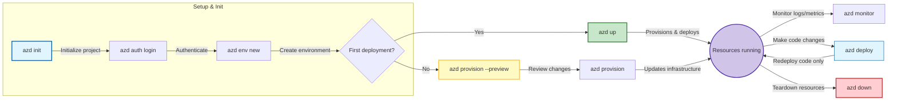
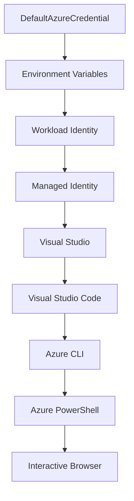

# AZD Grunnleggende - Kjerneskonsepter og Grunnprinsipper

**Kapittelnavigasjon:**
- **📚 Kurs Hjem**: [AZD For Nybegynnere](../../README.md)
- **📖 Nåværende Kapittel**: Kapittel 1 - Grunnlag & Rask Start
- **⬅️ Forrige**: [Kurs Oversikt](../../README.md#-chapter-1-foundation--quick-start)
- **➡️ Neste**: [Installasjon & Oppsett](installation.md)
- **🚀 Neste Kapittel**: [Kapittel 2: AI-Foran Utvikling](../chapter-02-ai-development/microsoft-foundry-integration.md)

## Introduksjon

> Gjennomgått mot `azd 1.37.2` (november 2026). Bash-kommandoer bruker siterte plassholdere som du må erstatte. Malarbeidsflyter bruker `.` for å initialisere gjeldende katalog; uten et katalogargument oppretter malinitialisering en underkatalog og endrer ikke arbeidskatalogen i skallet ditt. Avanserte utdrag er illustrative, ikke fullstendige prosjekter.

Denne leksjonen introduserer deg for Azure Developer CLI (azd), et kraftig kommandolinjeverktøy som akselererer reisen din fra lokal utvikling til Azure-distribusjon. Du vil lære de grunnleggende konseptene, kjernefunksjonene, og forstå hvordan azd forenkler distribusjon av sky-nære applikasjoner.

## Læringsmål

På slutten av denne leksjonen vil du:
- Forstå hva Azure Developer CLI er og dets primære formål
- Lære kjernebegrepene maler, miljøer og tjenester
- Utforske nøkkelfunksjoner inkludert mal-drevet utvikling og Infrastruktur som Kode
- Forstå azd prosjektstruktur og arbeidsflyt
- Være forberedt på å installere og konfigurere azd for ditt utviklingsmiljø

## Læringsresultater

Etter å ha fullført denne leksjonen, vil du kunne:
- Forklare rollen til azd i moderne skyutviklingsarbeidsflyter
- Identifisere komponentene i en azd prosjektstruktur
- Beskrive hvordan maler, miljøer og tjenester fungerer sammen
- Forstå fordelene med Infrastruktur som Kode med azd
- Gjenkjenne ulike azd-kommandoer og deres formål

## Hva er Azure Developer CLI (azd)?

Azure Developer CLI (azd) er et kommandolinjeverktøy designet for å akselerere reisen din fra lokal utvikling til Azure-distribusjon. Det forenkler prosessen med å bygge, distribuere og administrere sky-nære applikasjoner på Azure.

### Hva kan du distribuere med azd?

azd støtter et bredt spekter av arbeidsmengder—og listen vokser stadig. I dag kan du bruke azd til å distribuere:

| Arbeidsmengdetype | Eksempler | Samme arbeidsflyt? |
|---------------|----------|----------------|
| **Tradisjonelle applikasjoner** | Webapper, REST-API-er, statiske nettsteder | ✅ `azd up` |
| **Tjenester og mikrotjenester** | Container Apps, Funksjonsapper, fler-tjeneste bakender | ✅ `azd up` |
| **AI-drevne applikasjoner** | Chat-apper med Microsoft Foundry-modeller, RAG-løsninger med AI-søk | ✅ `azd up` |
| **Intelligente agenter** | Foundry-hostede agenter, fleragentorkestreringer | ✅ `azd up` |

Nøkkelpunket er at **azd sin livssyklus er den samme uansett hva du distribuerer**. Du initialiserer et prosjekt, provisjonerer infrastruktur, distribuerer koden din, overvåker appen og rydder opp—enten det er et enkelt nettsted eller en sofistikert AI-agent.

Denne kontinuiteten er etter design. azd behandler AI-funksjoner som en annen type tjeneste applikasjonen din kan bruke, ikke noe fundamentalt annerledes. Et chat-endepunkt støttet av Microsoft Foundry-modeller er, fra azd sitt perspektiv, bare en annen tjeneste å konfigurere og distribuere.

### 🎯 Hvorfor bruke AZD? En virkelighetsnær sammenligning

La oss sammenligne distribusjon av en enkel webapp med database:

#### ❌ UTEN AZD: Manuell Azure-distribusjon (30+ minutter)

**Illustrerende Bash-sammenligning, ikke en kjørbar applikasjonsstarter.** Dette forutsetter eksisterende applikasjonskode, unike ressursnavn, Azure CLI-autentisering, og eventuelle nødvendige CLI-utvidelser. Bruk maløvelsen under for støttet ende-til-ende-løype.

```bash
# Step 1: Create resource group
az group create --name myapp-rg --location eastus

# Step 2: Create App Service Plan
az appservice plan create --name myapp-plan \
  --resource-group myapp-rg \
  --sku B1 --is-linux

# Step 3: Create Web App
az webapp create --name myapp-web-unique123 \
  --resource-group myapp-rg \
  --plan myapp-plan \
  --runtime "NODE:22-lts"

# Step 4: Create Cosmos DB account (10-15 minutes)
az cosmosdb create --name myapp-cosmos-unique123 \
  --resource-group myapp-rg \
  --kind MongoDB

# Step 5: Create database
az cosmosdb mongodb database create \
  --account-name myapp-cosmos-unique123 \
  --resource-group myapp-rg \
  --name tododb

# Step 6: Create collection
az cosmosdb mongodb collection create \
  --account-name myapp-cosmos-unique123 \
  --resource-group myapp-rg \
  --database-name tododb \
  --name todos

# Step 7: Get connection string
CONN_STR=$(az cosmosdb keys list \
  --name myapp-cosmos-unique123 \
  --resource-group myapp-rg \
  --type connection-strings \
  --query "connectionStrings[0].connectionString" -o tsv)

# Step 8: Configure app settings
az webapp config appsettings set \
  --name myapp-web-unique123 \
  --resource-group myapp-rg \
  --settings MONGODB_URI="$CONN_STR"

# Step 9: Enable logging
az webapp log config --name myapp-web-unique123 \
  --resource-group myapp-rg \
  --application-logging filesystem \
  --detailed-error-messages true

# Step 10: Set up Application Insights
az monitor app-insights component create \
  --app myapp-insights \
  --location eastus \
  --resource-group myapp-rg

# Step 11: Link App Insights to Web App
INSTRUMENTATION_KEY=$(az monitor app-insights component show \
  --app myapp-insights \
  --resource-group myapp-rg \
  --query "instrumentationKey" -o tsv)

az webapp config appsettings set \
  --name myapp-web-unique123 \
  --resource-group myapp-rg \
  --settings APPINSIGHTS_INSTRUMENTATIONKEY="$INSTRUMENTATION_KEY"

# Step 12: Build application locally
npm install
npm run build

# Step 13: Create deployment package
zip -r app.zip . -x "*.git*" "node_modules/*"

# Step 14: Deploy application
az webapp deployment source config-zip \
  --resource-group myapp-rg \
  --name myapp-web-unique123 \
  --src app.zip

# Step 15: Wait and pray it works 🙏
# (No automated validation, manual testing required)
```

**Problemer:**
- ❌ 15+ kommandoer å huske og kjøre i rekkefølge
- ❌ 30-45 minutter manuelt arbeid
- ❌ Lett å gjøre feil (tastefeil, feil parametere)
- ❌ Legitimasjon krever eksplisitt håndtering; debug-logger og skallsniffer kan avsløre dem
- ❌ Ingen automatisert rollback ved feil
- ❌ Vanskelig å replikere for teammedlemmer
- ❌ Forskjellig hver gang (ikke reproduserbart)

#### ✅ MED AZD: Automatisert distribusjon (5 kommandoer, 10-15 minutter)

```bash
# Step 1: Initialize from template
azd init --template todo-nodejs-mongo .

# Step 2: Authenticate
azd auth login

# Step 3: Select the environment created during init
azd env select dev

# Step 4: Preview changes (optional but recommended)
azd provision --preview

# Step 5: Deploy everything
azd up

# ✨ Done! Everything is deployed, configured, and monitored
```

**Fordeler:**
- ✅ **5 kommandoer** vs 15+ manuelle steg
- ✅ **10-15 minutter** total tid (mest venting på Azure)
- ✅ **Færre manuelle feil** - konsistent, mal-drevet arbeidsflyt
- ✅ **Sikker hemmelighåndtering** - mange maler bruker Azure-administrert hemmelig lagring
- ✅ **Reproduserbare distribusjoner** - samme arbeidsflyt hver gang
- ✅ **Reproduserbare infrastrukturbeskrivelser** - underlagt kvoter, regions tilgjengelighet og malversjoner
- ✅ **Klar for teambruk** - hvem som helst kan distribuere med de samme kommandoene
- ✅ **Infrastruktur som kode** - versjonskontrollerte Bicep-maler
- ✅ **Maldefinert overvåkning** - Application Insights når inkludert i malen

### Tid og Pålitelighet

Tidsangivelsene over er estimater, ikke benchmarks. azd reduserer kommandoene du må koordinere, men garanterer ikke distribusjonstid, eliminerer ikke feil, eller gir automatisk rollback av applikasjon/database. Ha fungerende versjoner i kildekontroll og test gjenopprettingsprosedyrer.

## Kjerneskonsepter

### Maler
Maler er fundamentet for azd. De inneholder:
- **Applikasjonskode** - Kildekoden og avhengigheter
- **Infrastrukturbeskrivelser** - Azure-ressurser definert i Bicep eller Terraform
- **Konfigurasjonsfiler** - Innstillinger og miljøvariabler
- **Distribusjonsskript** - Automatiserte distribusjonsarbeidsflyter

### Miljøer
Miljøer representerer forskjellige distribusjonsmål:
- **Utvikling** - For testing og utvikling
- **Staging** - Pre-produksjonsmiljø
- **Produksjon** - Live produksjonsmiljø

Hvert miljø vedlikeholder sin egen:
- Miljønavn og verdier; ressursisolering avhenger av infrastrukturen i malen
- Konfigurasjonsinnstillinger
- Distribusjonstilstand

### Tjenester
Tjenester i `azure.yaml` beskriver distribuerbare applikasjonskomponenter:
- **Frontend** - Webapplikasjoner, enkeltsideapplikasjoner (SPA)
- **Backend** - API-er, mikrotjenester

Databaser og lagring tildeles normalt som infrastrukturr ressurser, ikke som oppfunnet tjenestevert som `host: postgres`.

## Nøkkelfunksjoner

### 1. Mal-Drevet Utvikling
```bash
# Browse available templates
azd template list

# Initialize from a template
azd init --template "<template-name>" .
```

### 2. Infrastruktur som Kode
- **Bicep** - Azures domenespesifikke språk
- **Terraform** - Verktøy for infrastruktur på tvers av skyer
- Bicep kompilerer til ARM-maler; rå ARM JSON er ikke en egen innebygget `infra.provider`.

### 3. Integrerte Arbeidsflyter
```bash
# Complete deployment workflow
azd up            # Provision + Deploy this is hands off for first time setup

# 🧪 NEW: Preview infrastructure changes before deployment (SAFE)
azd provision --preview    # Simulate infrastructure deployment without making changes

azd provision     # Create Azure resources if you update the infrastructure use this
azd deploy        # Deploy application code or redeploy application code once update
azd down          # Clean up resources
```

#### 🛡️ Sikker Infrastrukturoppsett med Forhåndsvisning
Kommandoen `azd provision --preview` er en banebryter for sikre distribusjoner:
- **Tørrkjøringsanalyse** - Viser hva som vil opprettes, endres eller slettes
- **Ingen infrastruktur-påføring** - Vurderer leverandørendringer; inspiser prosjektkroker først, siden kroker kan kjøre kommandoer med bivirkninger
- **Teamsamarbeid** - Del forhåndsvisningsresultater før distribusjon
- **Kostnadsplanlegging** - Inspiser foreslåtte SKU-er, pris deretter med Azure Pricing Calculator; forhåndsvisningen kalkulerer ikke priser

```bash
# Example preview workflow
azd provision --preview           # See what will change
# Review the output, discuss with team
azd provision                     # Apply changes with confidence
```

### 📊 Visualisering: AZD Utviklingsarbeidsflyt



**Arbeidsflytforklaring:**
1. **Init** - Start med mal eller nytt prosjekt
2. **Autentisering** - Autentiser med Azure
3. **Miljø** - Opprett isolert distribusjonsmiljø
4. **Forhåndsvisning** - 🆕 Alltid forhåndsvis infrastrukturoppdateringer først (sikker praksis)
5. **Provision** - Opprett/oppdater Azure-ressurser
6. **Deploy** - Push applikasjonskode
7. **Monitor** - Observer applikasjonsytelse
8. **Iterer** - Gjør endringer og distribuer på nytt
9. **Cleanup** - Fjern ressurser når ferdig

### 4. Miljøhåndtering
```bash
# Create and manage environments
azd env new "<environment-name>"
azd env select "<environment-name>"
azd env list
```

### 5. Utvidelser og AI-Kommandoer

azd bruker et utvidelsessystem for å legge til funksjoner utover kjerne-CLI. Dette er spesielt nyttig for AI-arbeidsmengder:

```bash
# List available extensions
azd extension list

# Install the Foundry agents extension
azd extension install azure.ai.agents

# Initialize an AI agent project interactively
azd ai agent init

# Test a deployed agent (shows latency and time-to-first-byte)
azd ai agent invoke

# Start the MCP server for AI-assisted development (Alpha)
azd mcp start
```

**Agentens livssyklus, ende-til-ende.** Bruk `azure.ai.agents` for agentlivssyklusoperasjoner og installer `azure.ai.evaluations` separat for evaluering. Bruk `azd >= 1.37.0` for kombinert arbeidsflyt. Du trenger ikke alle disse på dag én:

| Fase | Kommando | Hva den gjør |
|-------|---------|--------------|
| **Skjelettstruktur** | `azd ai agent init --template <path-to-azure.yaml>` | Adopter en aktuell agentprosjektmal |
| **Test** | `azd ai agent invoke` | Kall agenten og se responstid |
| **Mål** | `azd ai eval init`, `generate`, `run start` | Konfigurer, deployer og kjør evalueringer med den separate utvidelsen |
| **Forbedre** | `azd ai agent optimize --eval <evaluation-name> --optimize-model <optimizer-deployment>` | Gjenbruk en kompatibel evaluering for å optimalisere agenten |
| **Inspiser** | `azd ai agent endpoint show` | Vis den levende endepunktskonfigurasjonen |
| **Rydd opp** | `azd ai agent delete` | Slett en hostet agent og alle dens versjoner |

> Utvidelser dekkes i detalj i [Kapittel 2: AI-Foran Utvikling](../chapter-02-ai-development/agents.md) og referansen [AZD AI CLI Kommandoer](../chapter-08-production/production-ai-practices.md#azd-ai-cli-commands-and-extensions).

## 📁 Prosjektstruktur

En typisk azd prosjektstruktur:
```
my-app/
├── .azure/                  # Local environments and selected-environment config
│   ├── config.json
│   └── dev/.env
├── .devcontainer/          # Development container config
├── .github/workflows/      # GitHub Actions
├── .vscode/               # VS Code settings
├── infra/                 # Infrastructure code
│   ├── main.bicep        # Main infrastructure template
│   ├── main.parameters.json
│   └── modules/          # Reusable modules
├── src/                  # Application source code
│   ├── api/             # Backend services
│   └── web/             # Frontend application
├── azure.yaml           # azd project configuration
└── README.md
```

## 🔧 Konfigurasjonsfiler

### azure.yaml
Hovedprosjektets konfigurasjonsfil:
```yaml
name: my-awesome-app
metadata:
  template: my-template@1.0.0

services:
  web:
    project: ./src/web
    language: js
    host: appservice
  api:
    project: ./src/api
    language: js
    host: appservice

hooks:
  preprovision:
    shell: pwsh
    run: echo "Preparing to provision..."
```

### .azure/config.json
Prosjektlokal valg av standardmiljø (illustrativt; administreres av azd):
```json
{
  "defaultEnvironment": "dev"
}
```

## 🎪 Vanlige Arbeidsflyter med Praktiske Øvelser

> **💡 Læringstips:** Følg disse øvelsene i rekkefølge for å bygge dine AZD-ferdigheter gradvis.

### 🎯 Øvelse 1: Initialiser Ditt Første Prosjekt

**Mål:** Opprett et AZD prosjekt og utforsk dets struktur

**Steg:**
```bash
# Use a proven template
mkdir azd-basics-practice
cd azd-basics-practice
# Choose "dev" for the environment name when prompted
azd init --template todo-nodejs-mongo .

# Explore the generated files
ls -la  # View all files including hidden ones

# Key files created:
# - azure.yaml (main config)
# - infra/ (infrastructure code)
# - src/ (application code)
```

**✅ Suksess:** Du har azure.yaml, infra/ og src/ kataloger

---

### 🎯 Øvelse 2: Distribuer til Azure

**Mål:** Fullfør ende-til-ende distribusjon

**Steg:**
```bash
# 1. Authenticate
azd auth login

# 2. Select the dev environment created in Exercise 1
azd env select dev
azd env set AZURE_LOCATION eastus

# 3. Preview changes (RECOMMENDED)
azd provision --preview

# 4. Deploy everything
azd up

# 5. Verify deployment
azd show    # View your app URL
```

**Forventet tid:** 10-15 minutter  
**✅ Suksess:** Applikasjons-URL åpnes i nettleser

---

### 🎯 Øvelse 3: Flere Miljøer

**Mål:** Distribuer til dev og staging

**Steg:**
```bash
# Already have dev, create staging
azd env new staging
azd env set AZURE_LOCATION westus2
azd up

# Switch between them
azd env list
azd env select dev
```

**✅ Suksess:** To separate ressursgrupper i Azure Portal

**Opprydding:** Øvelse 3 oppretter en andre fakturerbar distribusjon. Slett begge når ferdig:

```bash
azd down --environment dev
azd down --environment staging
```

---

### 🛡️ Destruktiv opprydding: `azd down --force --purge`

Når du bevisst vil slette Azure-ressursene for det valgte miljøet:

```bash
azd down --force --purge
```

**Hva den gjør:**
- `--force`: Ingen bekreftelsesprompt
- `--purge`: Sletter også permanent støttede mykt slettede ressurser (for eksempel Key Vaults), der rensingsbeskyttelse tillater det. Den sletter ikke den lokale `.azure/` katalogen.

**Bruk når:** du er ferdig med et engangsmiljø. Behandle ikke destruktiv opprydding som første svar på autentiserings-, kvote- eller konfigurasjonsfeil.

---

## 🎪 Original Arbeidsflytreferanse

### Starte et Nytt Prosjekt
```bash
# Method 1: Use existing template
azd init --template todo-nodejs-mongo .

# Method 2: Start from scratch
azd init

# Method 3: Use current directory
azd init .
```

### Utviklingssyklus
```bash
# Set up development environment
azd auth login
azd env new dev
azd env select dev

# Deploy everything
azd up

# Make changes and redeploy
azd deploy

# Clean up when done
azd down --force --purge # Deletes this environment's discovered Azure resources; review before forcing deletion.
```

## Forstå `azd down --force --purge`
Kommandoen `azd down --force --purge` er en kraftig måte å fullstendig rive ned ditt azd-miljø og alle tilknyttede ressurser. Her er en gjennomgang av hva hver flagg gjør:
```
--force
```
- Hopper over bekreftelsesprompt.
- Nyttig for automatisering eller skripting der manuell inndata ikke er mulig.
- Omgår ikke tillatelser, rensingsbeskyttelse eller slettefeil.

```
--purge
```
Sletter permanent støttede mykt slettede Azure-ressurser uten ekstra bekreftelse. Rensingsbeskyttelse og tillatelser gjelder fortsatt. Den fjerner **ikke** lokale miljøer eller `.azure/` mappen.


### Hvorfor bruke begge?
Bruk begge bare når du har til hensikt å slette Azure-ressursene for det valgte miljøet og rense gjenopprettbare ressurser. Dette er destruktiv opprydding, ikke generell reparasjon eller lokal tilstand nullstilling.

Det er spesielt nyttig etter manuell ressurssletting i Azure-portalen eller ved bytte av maler, miljøer eller navnekonvensjoner for ressursgrupper.


### Håndtere Flere Miljøer
```bash
# Create staging environment
azd env new staging
azd env select staging
azd up

# Switch back to dev
azd env select dev

# Compare environments
azd env list
```

## 🔐 Autentisering og legitimasjon

Skill mellom distribusjonsautentisering (`azd auth login`) og applikasjons-SDK-autentisering (`DefaultAzureCredential`). De er separate. azd bruker ikke Azure CLI-legitimasjon som standard.

### Azure CLI Autentisering (`az login`)

Kjør `azd auth login` for azd. Følgende Azure CLI-kommandoer er valgfrie og autentiserer `az` kommandoer separat:

```bash
# Interactive login (opens browser)
az login

# Login with specific tenant
az login --tenant "<tenant-id>"

# Login with service principal
az login --service-principal -u "<app-id>" -p "<password>" --tenant "<tenant-id>"

# Check current login status
az account show

# List available subscriptions
az account list --output table

# Set default subscription
az account set --subscription "<subscription-id>"
```

### Autentiseringsflyt
1. **Interaktiv innlogging**: Åpner standard nettleser for autentisering
2. **Enhetskodeflyt**: For miljøer uten nettlesertilgang
3. **Tjenesteprinsipp**: For automatisering og CI/CD-scenarier
4. **Administrert identitet**: For Azure-hostede applikasjoner

### DefaultAzureCredential-kjede

`DefaultAzureCredential` er en legitimasjonstype som gir en forenklet autentiseringsopplevelse ved automatisk å prøve flere legitimasjonskilder i en bestemt rekkefølge:

#### Applikasjons-SDK Legitimasjonskjede

Den eksakte kjeden avhenger av Azure Identity SDK-språk, versjon, installerte plugins og alternativer. Dette diagrammet er konseptuelt, ikke en fastlagt azd-autentiseringssekvens; nyere SDK-er kan også inkludere Azure Developer CLI-legitimasjon.


#### 1. Miljøvariabler
```bash
# Set environment variables for service principal
export AZURE_CLIENT_ID="<app-id>"
export AZURE_CLIENT_SECRET="<password>"
export AZURE_TENANT_ID="<tenant-id>"
```

#### 2. Workload Identity (Kubernetes/GitHub Actions)
Brukes automatisk i:
- Azure Kubernetes Service (AKS) med Workload Identity
- GitHub Actions med OIDC-føderasjon
- Andre fødererte identitetsscenarier

#### 3. Managed Identity
For Azure-ressurser som:
- Virtuelle maskiner
- App Service
- Azure Functions
- Container Instances

```bash
# Inspect a deployed Container App's configured identity (requires az login)
az containerapp show --name "<app-name>" --resource-group "<rg-name>" --query identity
```

#### 4. Integrasjon med utviklerverktøy
- **Visual Studio**: Bruker automatisk pålogget konto
- **VS Code**: Støtte avhenger av SDK og dets støttede broker/plugin-oppsett
- **Azure CLI**: Bruker `az login` legitimasjon (mest vanlig for lokal utvikling)

### AZD-autentiseringsoppsett

```bash
# Method 1: Direct azd authentication (recommended)
azd auth login

# Method 2: Direct azd authentication
azd auth login --use-device-code  # For headless environments

# Method 3: Check authentication status
azd auth login --check-status

# Method 4: Logout and re-authenticate
azd auth logout
azd auth login
```

### Beste praksis for autentisering

#### For lokal utvikling
```bash
# 1. Log in to azd
azd auth login

# 2. Select the subscription for this initialized environment
azd env set AZURE_SUBSCRIPTION_ID "<subscription-id>"

# 3. Check azd sign-in details (read the status message)
azd auth login --check-status
```

#### For CI/CD-pipelines
```yaml
# Partial GitHub Actions steps: assumes checkout, azd installation,
# required AZURE_* environment values, and pipeline secret configuration.
- name: Deploy with azd
  run: |
    azd auth login --client-id ${{ secrets.AZURE_CLIENT_ID }} \
                    --client-secret ${{ secrets.AZURE_CLIENT_SECRET }} \
                    --tenant-id ${{ secrets.AZURE_TENANT_ID }}
    azd up --no-prompt
```

#### For produksjonsmiljøer
- Bruk **Managed Identity** når du kjører på Azure-ressurser
- Bruk **Service Principal** for automatiseringsscenarioer
- Unngå å lagre legitimasjon i kode eller konfigurasjonsfiler
- Bruk **Azure Key Vault** for sensitiv konfigurasjon

### Vanlige autentiseringsproblemer og løsninger

#### Problem: "Ingen abonnement funnet"
```bash
# Solution: Set default subscription
az account list --output table
az account set --subscription "<subscription-id>"
azd env set AZURE_SUBSCRIPTION_ID "<subscription-id>"
```

#### Problem: "Utilstrekkelige tillatelser"
```bash
# Solution: Check and assign required roles
az role assignment list --assignee $(az account show --query user.name --output tsv)

# Common required roles:
# - Contributor (for resource management)
# - User Access Administrator (for role assignments)
```

#### Problem: "Token utløpt"
```bash
# Solution: Re-authenticate
az logout
az login
azd auth logout
azd auth login
```

### Autentisering i ulike scenarier

#### Lokal utvikling
```bash
# Personal development account
az login
azd auth login
```

#### Teamutvikling
```bash
# Use specific tenant for organization
az login --tenant contoso.onmicrosoft.com
azd auth login --tenant-id "<tenant-id>"
```

#### Multi-leietaker scenarier
```bash
# Switch between tenants
az login --tenant tenant1.onmicrosoft.com
azd auth login --tenant-id "<tenant-1-id>"
# Select an environment configured with tenant 1's subscription
azd env select tenant1-dev
# Deploy to tenant 1
azd up

az login --tenant tenant2.onmicrosoft.com  
azd auth login --tenant-id "<tenant-2-id>"
azd env select tenant2-dev
# Deploy to tenant 2
azd up
```

### Sikkerhetshensyn

1. **Lagring av legitimasjon**: Aldri lagre legitimasjon i kildekode
2. **Omfangsbegrensning**: Bruk minste nødvendige privilegier for service principals
3. **Token-rotasjon**: Roter service principal-hemmeligheter regelmessig
4. **Revisjonsspor**: Overvåk autentiserings- og distribusjonsaktiviteter
5. **Nettverkssikkerhet**: Bruk private endepunkter når mulig

### Feilsøking av autentisering

```bash
# Debug authentication issues
azd auth login --check-status
az account show
az account get-access-token

# Common diagnostic commands
whoami                          # Current user context
az ad signed-in-user show      # Microsoft Entra ID user details
az group list                  # Test resource access
```

## Kommandofinning

### Finning
```bash
azd template list              # Browse templates
azd template list --help       # Template discovery options
azd init --help               # Initialization options
```

### Prosjektstyring
```bash
azd show                     # Project overview
azd env list                # Available environments and selected default
azd config show            # Configuration settings
```

### Overvåking
```bash
azd monitor                  # Open Azure portal monitoring
azd monitor --logs           # View application logs
azd monitor --live           # View live metrics
azd pipeline config          # Set up CI/CD
```

## Beste praksis

### 1. Bruk meningsfulle navn
```bash
# Good
azd env new production-east
azd init --template todo-nodejs-mongo .

# Avoid
azd env new env1
azd init --template template1 .
```

### 2. Utnytt maler
- Start med eksisterende maler
- Tilpass etter dine behov
- Lag gjenbrukbare maler for din organisasjon

### 3. Miljøisolasjon
- Bruk separate miljøer for dev/staging/prod
- Distribuer aldri direkte til produksjon fra lokal maskin
- Bruk CI/CD-pipelines for produksjonsdistribusjoner

### 4. Konfigurasjonsstyring
- Bruk managed identity og Key Vault for hemmeligheter; vanlige `azd env set`-verdier er lokal klartekst
- Hold konfigurasjon i versjonskontroll
- Dokumenter miljøspesifikke innstillinger

## Læringsprogresjon

### Nybegynner (uke 1-2)
1. Installer azd og autentiser
2. Distribuer en enkel mal
3. Forstå prosjektstruktur
4. Lær grunnleggende kommandoer (up, down, deploy)

### Mellomnivå (uke 3-4)
1. Tilpass maler
2. Administrer flere miljøer
3. Forstå infrastrukturkode
4. Sett opp CI/CD-pipelines

### Avansert (uke 5+)
1. Lag egendefinerte maler
2. Avanserte infrastrukturmønstre
3. Distribusjoner i flere regioner
4. Enterprise-grad konfigurasjoner

## Neste steg

**📖 Fortsett kapittel 1 læring:**
- [Installasjon og oppsett](installation.md) - Få azd installert og konfigurert
- [Ditt første prosjekt](first-project.md) - Fullfør praktisk veiledning
- [Konfigurasjonsguide](../chapter-03-configuration/configuration.md) - Avanserte konfigurasjonsvalg

**🎯 Klar for neste kapittel?**
- [Kapittel 2: AI-først utvikling](../chapter-02-ai-development/microsoft-foundry-integration.md) - Begynn å bygge AI-applikasjoner

## Tilleggsressurser

- [Oversikt over Azure Developer CLI](https://learn.microsoft.com/en-us/azure/developer/azure-developer-cli/)
- [Malgalleri](https://azure.github.io/awesome-azd/)
- [Community-eksempler](https://github.com/Azure-Samples)

---

## 🙋 Ofte stilte spørsmål

### Generelle spørsmål

**Q: Hva er forskjellen på AZD og Azure CLI?**

A: Azure CLI (`az`) er for å administrere individuelle Azure-ressurser. AZD (`azd`) er for å administrere hele applikasjoner:

```bash
# Azure CLI - Low-level resource management
az webapp create --name myapp --resource-group rg
az sql server create --name myserver --resource-group rg
# ...many more commands needed

# AZD - Application-level management
azd up  # Deploys entire app with all resources
```

**Tenk på det slik:**
- `az` = Operere på individuelle Legoklosser
- `azd` = Jobbe med komplette Legosett

---

**Q: Må jeg kunne Bicep eller Terraform for å bruke AZD?**

A: Nei! Start med maler:
```bash
# Use existing template - no IaC knowledge needed
azd init --template todo-nodejs-mongo .
azd up
```

Du kan lære Bicep senere for å tilpasse infrastrukturen. Maler gir fungerende eksempler å lære av.

---

**Q: Hvor mye koster det å kjøre AZD-maler?**

A: Kostnader varierer etter region, SKU, oppetid, databasemodus og modellbruk. Et utviklingsmiljø kan pådra seg betydelige månedlige kostnader selv når det er inaktivt; ikke anta at $50-150 er universelt:

```bash
# Preview resource changes (not prices)
azd provision --preview

# Always cleanup when not using
azd down --force --purge  # Removes all resources
```

**Profftips:** Bruk gratisnivåer der det er tilgjengelig:
- App Service: F1 (Gratis) nivå
- Azure OpenAI: ingen generell garantert månedlig gratis tokenkvote; sjekk gjeldende modell og pris
- Cosmos DB: kvalifiserte kontoer med provisjonert gjennomstrømning kan velge gratisnivå; serverløse maler kvalifiserer ikke automatisk

---

**Q: Kan jeg bruke AZD med eksisterende Azure-ressurser?**

A: Ja, men det er enklere å starte på nytt. AZD fungerer best når det styrer hele livssyklusen. For eksisterende ressurser:

```bash
# Option 1: Import existing resources (advanced)
azd init
# Then modify infra/ to reference existing resources

# Option 2: Start fresh (recommended)
azd init --template "<verified-template-name>" .
azd up  # Creates new environment
```

---

**Q: Hvordan deler jeg prosjektet mitt med lagkamerater?**

A: Legg AZD-prosjektet inn i Git (men IKKE .azure-mappen):

```bash
# Already in .gitignore by default
.azure/        # Contains secrets and environment data
*.env          # Environment variables

# Team members then:
git clone "<your-repo>"
# Change into the cloned repository before running the remaining commands.
azd auth login
azd env new "<their-name>-dev"
azd up
```

Alle får identisk infrastruktur fra de samme malene.

---

### Feilsøkingsspørsmål

**Q: "azd up" feilet halvveis. Hva gjør jeg?**

A: Sjekk feilen, rett den, og prøv på nytt:

```bash
# Capture detailed diagnostics (redact sensitive values before sharing)
azd up --debug

# Common fixes:

# 1. If quota exceeded:
azd env set AZURE_LOCATION "westus2"  # Try different region

# 2. If resource name conflict:
azd down --force --purge  # Clean slate
azd up  # Retry

# 3. If auth expired:
az login
azd auth login
azd up
```

**Vanligste problem:** Feil Azure-abonnement valgt
```bash
az account list --output table
az account set --subscription "<correct-subscription>"
azd env set AZURE_SUBSCRIPTION_ID "<correct-subscription-id>"
```

---

**Q: Hvordan distribuerer jeg bare kodeendringer uten reprovisjonering?**

A: Bruk `azd deploy` i stedet for `azd up`:

```bash
azd up          # First time: provision + deploy (slow)

# Make code changes...

azd deploy      # Subsequent times: deploy only (fast)
```

Hastighetssammenligning:
- `azd up`: 10-15 minutter (provisjonerer infrastruktur)
- `azd deploy`: 2-5 minutter (kun kode)

---

**Q: Kan jeg tilpasse infrastrukturmalene?**

A: Ja! Rediger Bicep-filene i `infra/`:

```bash
# After azd init
cd infra/
code main.bicep  # Edit in VS Code

# Preview changes
azd provision --preview

# Apply changes
azd provision
```

**Tips:** Start i det små - endre SKU-er først:
```bicep
// infra/main.bicep
sku: {
  name: 'B1'  // Change to 'P1V2' for production
}
```

---

**Q: Hvordan sletter jeg alt AZD har laget?**

A: En kommando fjerner alle ressurser:

```bash
azd down --force --purge

# This deletes:
# - Azure resources/resource groups discovered for the selected environment
# - Supported soft-deleted resources, if purge protection allows
# Local .azure files remain; shared/external resources may remain too.
```

**Kjør alltid dette når:**
- Ferdig med testing av en mal
- Bytter til et annet prosjekt
- Ønsker å starte på nytt

**Kostnadssjekk:** Bekreft sletting i Azure og sjekk etter beholdte/delte ressurser. Tidligere påløpte kostnader gjelder fortsatt.

---

**Q: Hva om jeg ved et uhell slettet ressurser i Azure Portal?**

A: AZD-tilstanden kan komme i utakt. Bruk «clean slate»-tilnærming:

```bash
# 1. Delete remaining resources only if that is your intent
azd down --force --purge

# 2. Start fresh
azd up

# Alternative: Let AZD detect and fix
azd provision  # Will create missing resources
```

---

### Avanserte spørsmål

**Q: Kan jeg bruke AZD i CI/CD-pipelines?**

A: Ja! GitHub Actions-eksempel:

```yaml
# .github/workflows/deploy.yml
name: Deploy with AZD

on:
  push:
    branches: [main]

jobs:
  deploy:
    runs-on: ubuntu-latest
    steps:
      - uses: actions/checkout@v4
      
      - name: Install azd
        run: curl -fsSL https://aka.ms/install-azd.sh | bash
      
      - name: Azure Login
        run: |
          azd auth login \
            --client-id ${{ secrets.AZURE_CLIENT_ID }} \
            --client-secret ${{ secrets.AZURE_CLIENT_SECRET }} \
            --tenant-id ${{ secrets.AZURE_TENANT_ID }}
      
      - name: Deploy
        env:
          AZURE_ENV_NAME: dev
          AZURE_LOCATION: ${{ vars.AZURE_LOCATION }}
          AZURE_SUBSCRIPTION_ID: ${{ vars.AZURE_SUBSCRIPTION_ID }}
        run: azd up --no-prompt
```

---

**Q: Hvordan håndterer jeg hemmeligheter og sensitiv data?**

A: Bruk eksplisitt Key Vault. `azd env set` skriver vanlige verdier til lokal miljøfil; det oppretter ikke automatisk en vault, tildeler roller eller injiserer hemmeligheter i applikasjonen din.

```bash
# Interactive: create/select a Key Vault secret and save its reference
azd env set-secret DATABASE_PASSWORD
```

Du trenger passende vault-tillatelser. Infrastruktur/applikasjon må fortsatt koble hemmeligheten til sin konsument og gi kjøretidsidentiteten tilgang. Ikke skriv ut løste hemmelige verdier i logger.

**Aldri kommitter:**
- `.azure/`-mappen (inneholder miljødata)
- `.env` filer (lokale hemmeligheter)
- Tilkoblingsstrenger

---

**Q: Kan jeg distribuere til flere regioner?**

A: Ja, lag miljø per region:

```bash
# East US environment
azd env new prod-eastus
azd env set AZURE_LOCATION eastus
azd up

# West Europe environment
azd env new prod-westeurope
azd env set AZURE_LOCATION westeurope
azd up

# Each environment is independent
azd env list
```

For ekte multi-region apper, tilpass Bicep-maler for samtidig distribusjon til flere regioner.

---

**Q: Hvor kan jeg få hjelp hvis jeg står fast?**

1. **AZD-dokumentasjon:** https://learn.microsoft.com/azure/developer/azure-developer-cli/
2. **GitHub Issues:** https://github.com/Azure/azure-dev/issues
3. **Discord:** [Azure Discord](https://discord.gg/microsoft-azure) - #azure-developer-cli-kanal
4. **Stack Overflow:** Merke `azure-developer-cli`
5. **Dette kurset:** [Feilsøkingsguide](../chapter-07-troubleshooting/common-issues.md)

**Profftips:** Før du spør, kjør:
```bash
azd show       # Shows current state
azd version    # Shows your version
```
Inkluder denne infoen i spørsmålet ditt for raskere hjelp.

---

## 🎓 Hva er neste?

Du forstår nå AZD-grunnleggende. Velg din vei:

### 🎯 For nybegynnere:
1. **Neste:** [Installasjon og oppsett](installation.md) - Installer AZD på din maskin
2. **Deretter:** [Ditt første prosjekt](first-project.md) - Distribuer din første app
3. **Øv:** Fullfør alle 3 øvelser i denne leksjonen

### 🚀 For AI-utviklere:
1. **Hopp til:** [Kapittel 2: AI-først utvikling](../chapter-02-ai-development/microsoft-foundry-integration.md)
2. **Distribuer:** I et tomt prosjektkatalog, start med `azd init --template get-started-with-ai-chat .`
3. **Lær:** Bygg mens du distribuerer

### 🏗️ For erfarne utviklere:
1. **Gjennomgå:** [Konfigurasjonsguide](../chapter-03-configuration/configuration.md) - Avanserte innstillinger
2. **Utforsk:** [Infrastruktur som kode](../chapter-04-infrastructure/provisioning.md) - Dypdykk i Bicep
3. **Bygg:** Lag egendefinerte maler for din stack

---

**Kapittelnavigasjon:**
- **📚 Kurs Hjem**: [AZD for nybegynnere](../../README.md)
- **📖 Nåværende kapittel**: Kapittel 1 - Grunnlag og rask start  
- **⬅️ Forrige**: [Kursoversikt](../../README.md#-chapter-1-foundation--quick-start)
- **➡️ Neste**: [Installasjon og oppsett](installation.md)
- **🚀 Neste kapittel**: [Kapittel 2: AI-først utvikling](../chapter-02-ai-development/microsoft-foundry-integration.md)

---

<!-- CO-OP TRANSLATOR DISCLAIMER START -->
**Ansvarsfraskrivelse**:
Dette dokumentet er oversatt ved hjelp av AI-oversettelsestjenesten [Co-op Translator](https://github.com/Azure/co-op-translator). Selv om vi streber etter nøyaktighet, vær oppmerksom på at automatiske oversettelser kan inneholde feil eller unøyaktigheter. Det opprinnelige dokumentet på originalspråket skal betraktes som den autoritative kilden. For kritisk informasjon anbefales profesjonell menneskelig oversettelse. Vi er ikke ansvarlige for eventuelle misforståelser eller feiltolkninger som oppstår ved bruk av denne oversettelsen.
<!-- CO-OP TRANSLATOR DISCLAIMER END -->