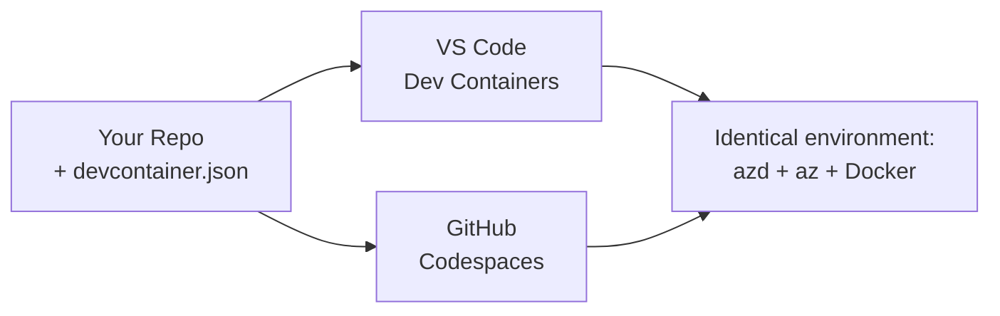

# Dev Containers & GitHub Codespaces for azd

**Kapittelnavigasjon:**
- **📚 Kurs Hjem**: [AZD For Beginners](../../README.md)
- **📖 Nåværende kapittel**: Kapittel 1 - Grunnlag & Kjapp start
- **⬅️ Forrige**: [Bring Your Own App](bring-your-own-app.md)
- **🚀 Neste kapittel**: [Kapittel 2: AI-First Development](../chapter-02-ai-development/README.md)

> Kommando- og konfigurasjonsgjennomgang mål: `azd 1.37.2` (november 2026). Container builds og Azure-distribusjoner ble ikke utført som en del av denne gjennomgangen.

## Innledning

Å installere azd, riktig språk-runtime, Docker og Azure CLI på hver maskin er en plage—og det er den største grunnen til at et tutorial som "fungerer på min maskin" feiler for noen andre. En **dev container** løser dette ved å beskrive hele verktøykjeden i en fil. Alle som åpner prosjektet i VS Code eller GitHub Codespaces får nøyaktig samme miljø, med azd allerede installert. Denne leksjonen viser deg hvordan du legger til en.

## Læringsmål

Innen slutten av denne leksjonen vil du:
- Forstå hva en dev container er og hvorfor det hjelper med azd
- Legge til en minimal `.devcontainer/devcontainer.json` til et prosjekt
- Inkludere azd, Azure CLI og Docker via Dev Container *funksjoner*
- Åpne prosjektet i GitHub Codespaces eller VS Code

## Læringsutbytte

Etter å ha fullført denne leksjonen vil du kunne:
- Lage en `devcontainer.json` for et azd-prosjekt
- Legge til azd og Azure-verktøy uten manuelle installasjoner
- Kjør `azd up` fra inne i en container eller Codespace

---

## Hva er en Dev Container?

En dev container er et Docker-basert utviklingsmiljø definert av en `.devcontainer/devcontainer.json` fil i ditt repository. Når du åpner prosjektet:

- **VS Code** (med Dev Containers-utvidelsen) bygger containeren og kobler til den.
- **GitHub Codespaces** bygger samme container i skyen og gir deg en nettleserbasert editor.

Uansett får alle bidragsytere identiske verktøy—ingen «har du installert azd?» feilsøking.



---

## Trinn 1: Opprett devcontainer-filen

Opprett `.devcontainer/devcontainer.json` i roten av prosjektet ditt:

```json
{
  "name": "azd-project",
  "image": "mcr.microsoft.com/devcontainers/base:bookworm",
  "features": {
    "ghcr.io/devcontainers/features/azure-cli:1": {},
    "ghcr.io/azure/azure-dev/azd:0": { "version": "1.37.2" },
    "ghcr.io/devcontainers/features/docker-in-docker:2": {},
    "ghcr.io/devcontainers/features/node:1": {}
  },
  "customizations": {
    "vscode": {
      "extensions": [
        "ms-azuretools.azure-dev",
        "ms-azuretools.vscode-bicep"
      ]
    }
  },
  "forwardPorts": [3000],
  "postCreateCommand": "azd version"
}
```

Hva hver del gjør:

| Nøkkel | Formål |
|-----|---------|
| `image` | Basen OS for containeren |
| `features` | Ferdigbygde installatører—her: Azure CLI, **azd**, Docker og Node.js |
| `customizations.vscode.extensions` | Auto-installerer azd og Bicep VS Code-utvidelsene |
| `forwardPorts` | Eksponerer appens port til nettleseren din |
| `postCreateCommand` | Kjører en gang etter at containeren er bygget (her, en helsesjekk) |

> Funksjonsversjonen (`azd:0`) og den installerte CLI-versjonen er forskjellige. Sett funksjonens `version`-alternativ til `"1.37.2"` for å feste CLI-versjonen; ikke bruk en CLI-versjon som funksjonstagg.

---

## Trinn 2: Tilpass funksjonen til appens språk

Bytt ut `node`-funksjonen med det språket appen din bruker:

```jsonc
// Python project
"ghcr.io/devcontainers/features/python:1": {},

// .NET project
"ghcr.io/devcontainers/features/dotnet:2": {},

// Java project
"ghcr.io/devcontainers/features/java:1": {},

// Go project
"ghcr.io/devcontainers/features/go:1": {}
```

Behold `docker-in-docker` når du bygger images lokalt. En konfigurert ekstern ACR-build (`docker.remoteBuild: true`) er et alternativ; vertstypen alene krever ikke alltid lokal Docker.

---

## Trinn 3: Åpne den

**I VS Code:**
1. Installer **Dev Containers**-utvidelsen.
2. Åpne prosjektmappen.
3. Klikk på **Reopen in Container** når du blir spurt (eller kjør *Dev Containers: Reopen in Container*).

**I GitHub Codespaces:**
1. Push repoet til GitHub.
2. Klikk på **Code → Codespaces → Create codespace on main**.
3. Vent på at containeren bygges—azd er klart i terminalen.

---

## Trinn 4: Distribuer fra inne i containeren

Containeren har azd forhåndsinstallert, så normal arbeidsflyt fungerer bare:

```bash
azd auth login --use-device-code   # device code is handy inside Codespaces
azd up
```

> **Hvorfor `--use-device-code`?** I en ekstern container eller Codespace finnes ingen lokal nettleser å omdirigere til, så device-code login er pålitelig. Du limer inn en kode i en nettleserfane for å fullføre innlogging.

---

## Vanlige fallgruver

| Fallgruve | Løsning |
|---------|-----|
| `azd up` kan ikke bygge et image | Legg til `docker-in-docker`-funksjonen |
| Nettleserinnlogging henger i Codespaces | Bruk `azd auth login --use-device-code` |
| Verktøyene varierer mellom teammedlemmer | Fest CLI via azd-funksjonens `version`-alternativ og fest språk-runtime |
| Appen er ikke tilgjengelig i nettleser | Legg til porten i `forwardPorts` |

---

## Oppsummering

- En dev container gjør azd-verktøykjeden din reproduserbar for alle.
- Legg til azd, Azure CLI og Docker via Dev Container *funksjoner*.
- Tilpass språkfunksjonen til appen din og behold `docker-in-docker` for container-verter.
- Bruk device-code login når du kjører inne i Codespaces.

---

## 🔗 Navigasjon

| Retning | Ressurs |
|-----------|----------|
| **Forrige** | [Bring Your Own App](bring-your-own-app.md) |
| **Kapittel Hjem** | [Kapittel 1: Grunnlag & Kjapp start](README.md) |
| **Neste kapittel** | [Kapittel 2: AI-First Development](../chapter-02-ai-development/README.md) |

## 📖 Relaterte ressurser

- [Installasjon & oppsett](installation.md)
- [Kommandooversikt](../../resources/cheat-sheet.md)
- [Offisiell Dev Containers-spesifikasjon](https://containers.dev/)
- [azd Dev Container-funksjon](https://github.com/Azure/azure-dev/tree/main/ext/devcontainer)

---

<!-- CO-OP TRANSLATOR DISCLAIMER START -->
**Ansvarsfraskrivelse**:
Dette dokumentet er oversatt ved hjelp av AI-oversettelsestjenesten [Co-op Translator](https://github.com/Azure/co-op-translator). Selv om vi streber etter nøyaktighet, vær oppmerksom på at automatiske oversettelser kan inneholde feil eller unøyaktigheter. Det opprinnelige dokumentet på originalspråket skal betraktes som den autoritative kilden. For kritisk informasjon anbefales profesjonell menneskelig oversettelse. Vi er ikke ansvarlige for eventuelle misforståelser eller feiltolkninger som oppstår ved bruk av denne oversettelsen.
<!-- CO-OP TRANSLATOR DISCLAIMER END -->