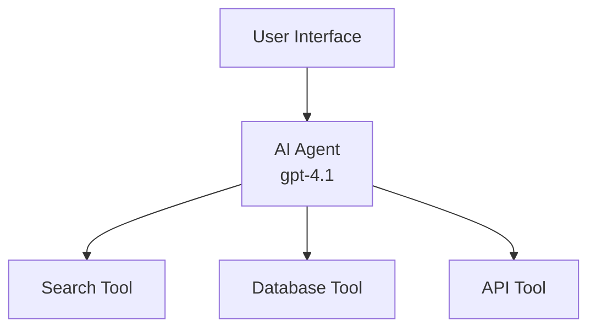
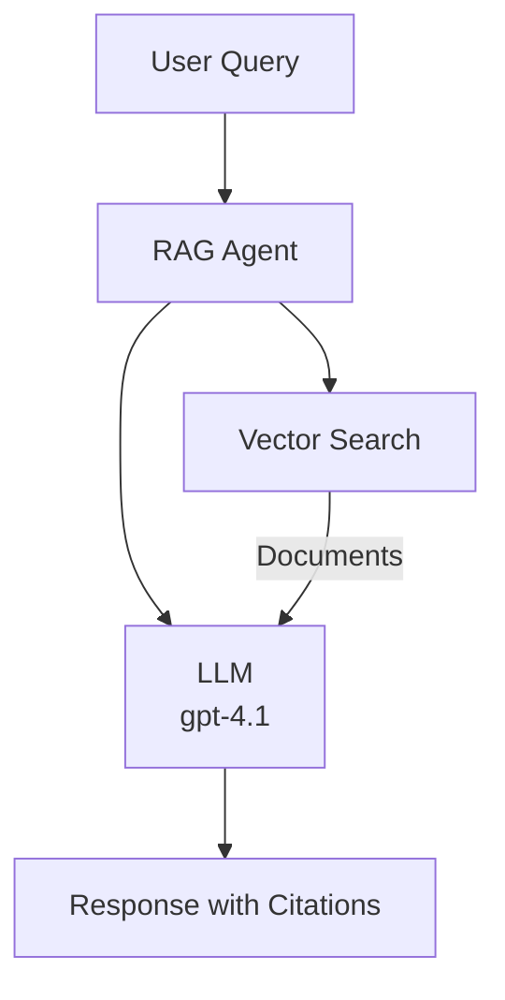
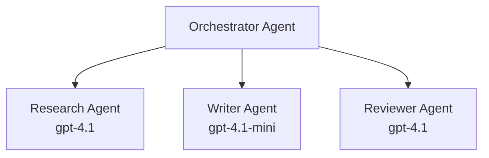

# AI-agenter med Azure Developer CLI

**Kapittelnavigasjon:**
- **📚 Kurs Hjem**: [AZD For Beginners](../../README.md)
- **📖 Nåværende Kapittel**: Kapittel 2 - AI-Først Utvikling
- **⬅️ Forrige**: [Microsoft Foundry Integration](microsoft-foundry-integration.md)
- **➡️ Neste**: [AI Model Deployment](ai-model-deployment.md)
- **🚀 Avansert**: [Multi-Agent Solutions](../../examples/retail-scenario.md)

---

## Introduksjon

AI-agenter er autonome programmer som kan oppfatte miljøet sitt, ta beslutninger og utføre handlinger for å oppnå spesifikke mål. I motsetning til enkle chatboter som svarer på spørsmål, kan agenter:

- **Bruke verktøy** - Kalle API-er, søke i databaser, kjøre kode
- **Planlegge og resonnere** - Dele komplekse oppgaver opp i trinn
- **Lære fra kontekst** - Beholde minne og tilpasse oppførsel
- **Samarbeide** - Jobbe med andre agenter (multi-agent systemer)

Denne guiden viser deg hvordan du distribuerer AI-agenter til Azure ved bruk av Azure Developer CLI (azd).

Å bruke samtalekontekst er ikke modelltrening: vedvarende minne, tilgangskontroll og lagring må implementeres/konfigureres av applikasjonen.

> **Foundry GA oppdatering (2026-11-09):** Installer den generelt tilgjengelige `microsoft.foundry` 1.0-pakken med `azd >= 1.37.0`. Evalueringer installeres separat; valgfrie forhåndsvisningsfunksjoner og den klassiske SDK-fragmentet nedenfor blir ikke promotert til GA av pakken sin kunngjøring. Denne veiledningen er basert på [GA kunngjøringen](https://devblogs.microsoft.com/azure-sdk/microsoft-foundry-azure-developer-cli-ga/) og dokumentasjon, ikke en live Azure-distribusjon.

## Læringsmål

Ved å fullføre denne guiden vil du:
- Forstå hva AI-agenter er og hvordan de skiller seg fra chatboter
- Distribuere forhåndsbygde AI-agentmaler ved bruk av AZD
- Konfigurere Foundry-agenter for egendefinerte agenter
- Implementere grunnleggende agentmønstre (verktøybruk, RAG, multi-agent)
- Overvåke og feilsøke distribuerte agenter

## Læringsresultater

Når du er ferdig, vil du kunne:
- Distribuere AI-agentapplikasjoner til Azure med en enkelt kommando
- Konfigurere agentverktøy og funksjonaliteter
- Implementere søke-forsterket generering (RAG) med agenter
- Designe multi-agent arkitekturer for komplekse arbeidsflyter
- Feilsøke vanlige problemer ved agentdistribusjon

---

## 🤖 Hva gjør en agent annerledes enn en chatbot?

| Egenskap | Chatbot | AI-agent |
|---------|---------|----------|
| **Atferd** | Svarer på spørsmål | Tar autonome handlinger |
| **Verktøy** | Kan bruke søk eller verktøy | Bruker vanligvis verktøy i en målrettet løkke |
| **Minne** | Avhenger av applikasjonen | Vedvarende minne kun hvis eksplisitt implementert |
| **Planlegging** | Enkelt svar | Flere trinn resonnement |
| **Samarbeid** | Enkelt enhet | Kan samarbeide med andre agenter |

### Enkel analogi

- **Chatbot** = En hjelpsom person som svarer på spørsmål ved et informasjonsbord
- **AI-agent** = En personlig assistent som kan ringe, booke timer og fullføre oppgaver for deg

---

## 🚀 Komme i gang raskt: Distribuer din første agent

Velg ett alternativ i en **ny tom arbeidsmappe**. Den avsluttende `.` initialiserer der; uten en eksplisitt destinasjon kan nåværende AZD opprette en undermappe med malnavn og endrer ikke shellens mappe. Hold separate maler/miljøer i separate mapper.

Tid og kostnadsområder nedenfor er illustrerende, ikke bekreftet prisanslag. Sjekk hver prøves nåværende forutsetninger, pris, modellkvote og valgfrie tjenester før distribusjon.

### Alternativ 1: Foundry Agents-mal (Anbefalt)

```bash
# Initialize the AI agents template
azd init --template get-started-with-ai-agents .

# Deploy to Azure
azd up
```

**Hva som distribueres:** Prøvens nåværende infrastruktur og valgte alternativer bestemmer modellen, verktøyene, hosting og overvåkingsressurser. Gå gjennom README og `infra/` før du provisjonerer; ikke anta at hver agentmal inneholder Søk eller et weblag.

**Tid:** ~15-20 minutter
**Kostnad:** ~$100-150/måned (utvikling)

### Alternativ 2: Creative Writing Agents med Prompty

```bash
# Initialize the Prompty-based agent template
azd init --template https://github.com/Azure-Samples/contoso-creative-writer .

# Deploy to Azure
azd up
```

**Hva som distribueres:** En FastAPI/Prompty multi-agent skriveprøve ved bruk av Azure OpenAI, Bing Grounding og Azure AI Search. Det tidligere `agent-openai-python-prompty`-lageret peker hit; det er ikke en minimal Azure Functions vær-agent-mal. Følg dagens README for hosting, modellkvote og Bing Grounding-forutsetninger.

**Tid:** ~10-15 minutter
**Kostnad:** ~$50-100/måned (utvikling)

### Alternativ 3: RAG Chat Agent

```bash
# Initialize RAG chat template
azd init --template azure-search-openai-demo .

# Deploy to Azure
azd up
```

**Hva som distribueres:**
- ✅ Microsoft Foundry Modeller
- ✅ Azure AI Search med prøve data
- ✅ Dokumentbehandlingspipeline
- ✅ Chat-grensesnitt med henvisninger

**Tid:** ~15-25 minutter
**Kostnad:** ~$80-150/måned (utvikling)

### Alternativ 4: Hosted Agent med GA Foundry-pakken

Bruk [komplett hosted-agent gjennomgang](microsoft-foundry-integration.md#hosted-agent-walkthrough-ga) for det grunnleggende Python Agent Framework Responses API-eksempelet. Denne kodedistribusjonsveien trenger Python 3.13+, siste uv, Foundry-tillatelser og regional modellkvote. Autentiser lokale SDK-kall separat ved bruk av Azure CLI-legitimasjon.

```bash
azd auth login
azd ext install microsoft.foundry
```

I den tomme mappen, initialiser prøven:

```text
azd ai agent init --template https://github.com/microsoft-foundry/foundry-samples/blob/main/samples/python/hosted-agents/agent-framework/responses/01-basic/azure.yaml --deploy-mode code --src .
```

Velg et nytt eller eksisterende prosjekt, gå gjennom `azure.yaml`, og kjør `azd provision`. Bruk `azd ai agent run` for å åpne Agent Inspector og fra et annet terminalvindu i samme mappe, `azd ai agent invoke --local "Explain how this agent is hosted."`. Etter lokal verifisering, bruk `azd deploy` og `azd ai agent invoke "Explain how this agent is hosted."` for å sammenligne distribuert respons. Foundry bygger den opplastede koden eksternt; lokal containerbygging er ikke nødvendig.

**Når bruke `azd ai agent init` vs `azd init --template`:**

| Tilnærming | Best for | Hvordan det fungerer |
|----------|----------|----------|
| `azd init --template` | Starte fra en fungerende prøveapp | Kloner et fullt mal-repo med kode + infrastruktur |
| `azd ai agent init --template` | Adoptere et nåværende Foundry agentprosjekt | Bruker et `azure.yaml` prosjekt-dokument og dets definisjoner |

> **Tips:** Alternativ 1-3 starter fra fullstendige applikasjonsmaler; Alternativ 4 lærer GA hosted-agent arbeidsflyten. Ingen av initialiseringskommandoene migrerer automatisk eldre agent-manifester. For å legge til en direkte agentdefinisjon i et eksisterende prosjekt, se [initialiserings- og migrasjonsveiledning](../chapter-08-production/production-ai-practices.md#initializing-agent-projects-with-azd-ai-agent-init).

Installer `azure.ai.evaluations` separat for å generere og gjennomgå testdata/rubrikker, konfigurere en evaluering og kjøre den med `azd ai eval`. Optimalisering kan gjenbruke en kompatibel evaluering; gå gjennom kandidater før eksplisitt distribusjon. Følg [evaluasjonsarbeidsflyten](../chapter-08-production/production-ai-practices.md#evaluation-migration-and-quality-checks) og [optimaliseringsmigrasjonen](../chapter-08-production/production-ai-practices.md#optimization-configuration-migration) før gjenbruk av eldre eksempler. For opprydding beholder et gjenbrukt Foundry-prosjekts ressurser etter `azd down`; en nyopprettet prosjekt-resourcegruppe slettes. Se [oppryddingsveiledning](microsoft-foundry-integration.md#7-clean-up-deliberately).

---

## 🏗️ Agentarkitektur-mønstre

### Mønster 1: Enkeltagent med verktøy

Det enkleste agentmønsteret - én agent som kan bruke flere verktøy.



**Best for:**
- Kundestøtte-boter
- Forskningsassistenter
- Dataanalyse-agenter

**Relatert applikasjonsprøve:** `azure-search-openai-demo` demonstrerer RAG, ikke en generisk vilkårlig-verktøy agentløkke.

### Mønster 2: RAG Agent (Søke-forsterket generering)

En agent som henter relevante dokumenter før den genererer svar.



**Best for:**
- Bedriftskunnskapsbaser
- Dokument-spørsmål og svar systemer
- Overholdelses- og juridisk forskning

**AZD-mal:** `azure-search-openai-demo`

### Mønster 3: Multi-Agent System

Flere spesialiserte agenter som samarbeider om komplekse oppgaver.



**Best for:**
- Kompleks innholdsgenerering
- Arbeidsflyter med flere trinn
- Oppgaver som krever ulik ekspertise

**Lær mer:** [Multi-Agent Koordineringsmønstre](../chapter-06-pre-deployment/coordination-patterns.md)

---

## ⚙️ Konfigurere Agentverktøy

Agenter blir kraftige når de kan bruke verktøy. Slik konfigurerer du vanlige verktøy:

### Verktøykonfigurasjon i Foundry-agenter

Dette **klassiske Agent Service SDK-fragmentet** retter seg mot `azure-ai-projects==1.0.0` og `azure-ai-agents==1.1.0` med `azure-identity`. Det er ikke den nyere versjonerte agent/Responses API brukt i noen nåværende Foundry-maler, eller `azure.ai.agents` AZD-utvidelsen (en annen pakke). Ikke bland generasjoner av disse APIene. Sett `PROJECT_ENDPOINT` til en klassisk Foundry prosjektendepunkt og `MODEL_DEPLOYMENT_NAME` til en eksisterende støttet modell-distribusjon; autentiser med `az login` lokalt og gi nødvendige prosjekt-tillatelser.

```python
# agent_config.py
import os
from azure.ai.projects import AIProjectClient
from azure.ai.agents.models import FunctionTool
from azure.identity import DefaultAzureCredential

def search_knowledge_base(query: str) -> str:
    """Search the demonstration knowledge base.

    :param query: Search text.
    :return: Matching demonstration information.
    """
    # Local fixture only, not a production search implementation.
    return "Demo policy: returns are accepted within 30 days."

project_client = AIProjectClient(
    endpoint=os.environ["PROJECT_ENDPOINT"],
    credential=DefaultAzureCredential(),
)
search_tool = FunctionTool(functions={search_knowledge_base})
project_client.agents.enable_auto_function_calls(search_tool)
agent = project_client.agents.create_agent(
    model=os.environ["MODEL_DEPLOYMENT_NAME"],
    name="Support Agent",
    instructions="Use search_knowledge_base for policy questions. Label results as demo data.",
    tools=search_tool.definitions,
)
```

Å registrere et funksjonsskjema kjører ikke Python på tjenesten. I dette SDK-et kjører `enable_auto_function_calls` pluss `agents.runs.create_and_process(...)` registrerte tilbakeringinger i din klientprosess. Se [utgitt SDK-eksempel](https://github.com/Azure/azure-sdk-for-python/blob/azure-ai-agents_1.1.0/sdk/ai/azure-ai-agents/samples/agents_tools/sample_agents_auto_function_call.py). Lukk klienten og slett demonstrasjonsagenter/tråder når du er ferdig.

### Miljøkonfigurasjon

Følgende navn er **illustrative egendefinerte mal-inndata**, ikke innebygde AZD-brytere. Først må du sende hver verdi gjennom `infra/main.parameters.json`, infrastruktur og applikasjonskode. `azd env set` alene endrer ikke en agents verktøy eller instruksjoner.

```bash
# Set up agent-specific environment variables
azd env set AZURE_OPENAI_MODEL "gpt-4.1"
azd env set AGENT_INSTRUCTIONS "You are a helpful assistant..."
azd env set ENABLE_CODE_INTERPRETER "true"
azd env set ENABLE_FILE_SEARCH "true"

# Apply wired infrastructure and application changes
azd up
```

---

## 📊 Overvåking av agenter

### Integrasjon med Application Insights

Hvis den valgte malen provisjonerer Application Insights og konfigurerer instrumentering:

```bash
# Open monitoring dashboard
azd monitor --overview

# Open the Application Insights logs view (not a streaming log tail)
azd monitor --logs

# View live metrics
azd monitor --live
```

### Viktige måleparametere å følge med på

| Måleparameter | Beskrivelse | Mål |
|--------------|-------------|------|
| Responstid | Tid for å generere svar | < 5 sekunder |
| Tokenbruk | Tokens per forespørsel | Følg kostnader |
| Suksessrate for verktøykall | % av vellykkede verktøykjøringer | > 95% |
| Feilrate | Mislykkede agentforespørsler | < 1% |
| Brukertilfredshet | Tilbakemeldingspoeng | > 4.0/5.0 |

### Egendefinert logging for agenter

```python
import os
from azure.monitor.opentelemetry import configure_azure_monitor
from opentelemetry import trace

# Configure Azure Monitor with OpenTelemetry
configure_azure_monitor(
    connection_string=os.environ["APPLICATIONINSIGHTS_CONNECTION_STRING"]
)

tracer = trace.get_tracer(__name__)

def log_agent_interaction(user_query, agent_response, tools_used, latency_ms):
    with tracer.start_as_current_span("agent_interaction") as span:
        span.set_attributes({
            "query_length": len(user_query),  # Do not log raw prompts or personal data
            "response_length": len(agent_response),
            "tools_used": tools_used,
            "latency_ms": latency_ms
        })
```

> **Merk:** Installer nødvendig pakke: `pip install azure-monitor-opentelemetry`. Den bringer med seg OpenTelemetry-avhengigheter; import-navnerom er ikke krav for å installere en pakke som heter `opentelemetry`.

---

## 💰 Kostnadsbetraktninger

### Anslåtte månedlige kostnader etter mønster

Disse er illustrerende planleggingsområder, ikke tilbud eller kostnadstak. Region, modelltokens, Search/compute SKU-er, verktøysesjoner, lagring og trafikk kan overstige dem. Sjekk prøvens kostnadsveiledning og Azure-prising før `azd up`.

| Mønster | Utviklingsmiljø | Produksjon |
|---------|-----------------|------------|
| Enkel agent | $50-100 | $200-500 |
| RAG-agent | $80-150 | $300-800 |
| Multi-agent (2-3 agenter) | $150-300 | $500-1,500 |
| Bedrifts multi-agent | $300-500 | $1,500-5,000+ |

### Kostnadsoptimaliseringstips

1. **Bruk gpt-4.1-mini for enkle oppgaver** (kun hvis malen din bruker denne inputen)
   ```bash
   azd env set AZURE_OPENAI_MODEL "gpt-4.1-mini"
   ```

2. **Implementer omfangsbegrenset mellomlagring for sikre, gjentatte spørringer.** Inkluder leietaker-/brukergodkjenning, modell-distribusjon, instruksjoner og versjon av gjenfinning i cache-nøkkelen; sett en utløpstid. Ikke del private samtalerespons gjennom en prosess-bred kun spørrings-cache. SDK agentobjekt har ikke en generisk `agent.run()` metode.

3. **Sett tokenbegrensninger per kjøring**
   ```python
   # Set max_completion_tokens when running the agent, not during creation
   run = project_client.agents.runs.create_and_process(
       thread_id=thread.id,
       agent_id=agent.id,
       max_completion_tokens=1000  # Budget across the run; may finish as incomplete
   )
   ```

4. **Skaler kvalifiserte Container Apps ned til null når de ikke er i bruk**
   ```bash
   # Custom-template input: must map to template.scale.minReplicas
   azd env set MIN_REPLICAS "0"
   ```
   Anvend infrastrukturendringen med `azd provision` eller `azd up`. Skalering til null trenger en passende trigger og stopper ikke Search, lagring eller modell-/verktøykostnader.

---

## 🔧 Feilsøking av agenter

### Vanlige problemer og løsninger

<details>
<summary><strong>❌ Agent svarer ikke på verktøykall</strong></summary>

```bash
# Inspect the application deployment (not the agent's registered tools)
azd show

# Verify OpenAI deployment
az cognitiveservices account deployment list \
  --name $AZURE_OPENAI_NAME \
  --resource-group $RG_NAME

# Check agent logs
azd monitor --logs
```

**Vanlige årsaker:**
- Uoverensstemmelse i verktøyfunksjonssignatur
- Manglende nødvendige tillatelser
- API-endepunkt ikke tilgjengelig
</details>

<details>
<summary><strong>❌ Høy ventetid i agentsvar</strong></summary>

```bash
# Check Application Insights for bottlenecks
azd monitor --live

# Consider using a faster model
azd env set AZURE_OPENAI_MODEL "gpt-4.1-mini"
azd up
```

**Optimaliseringstips:**
- Bruk strømmende svar
- Implementer responscaching
- Reduser størrelsen på kontekstvinduet
</details>

<details>
<summary><strong>❌ Agent returnerer feil eller hallusinert informasjon</strong></summary>

```python
# Improve with better system prompts
instructions = """
You are a helpful assistant. IMPORTANT:
- Only answer based on provided context
- If you don't know, say "I don't know"
- Always cite your sources
- Never make up information
"""

# Use these instructions in the agent definition.
# For classic file search, first upload/index documents in a vector store,
# then use FileSearchTool(vector_store_ids=[...]) and pass both its
# .definitions and .resources when creating the agent.
```
 Instruksjoner og søk reduserer risikoen; ingen garanterer faktiske svar. Evaluer jordede og utenfor-omfang spørsmål mot kjente svar.
</details>

<details>
<summary><strong>❌ Feil ved overskridelse av token-grense</strong></summary>

```python
# Implement context window management
def truncate_context(messages, max_tokens=8000, model="gpt-4.1"):
    """Approximate content-only budget for objects with .content strings."""
    import tiktoken
    encoding = tiktoken.encoding_for_model(model)
    total_tokens = 0
    truncated = []
    
    for msg in reversed(messages):
        msg_tokens = len(encoding.encode(msg.content))
        if total_tokens + msg_tokens > max_tokens:
            break
        truncated.insert(0, msg)
        total_tokens += msg_tokens
    
    return truncated
```
 Denne hjelperen ekskluderer rolle/verktøyskjemaer, systeminstruksjoner, bildetokens og protokolloverhead. Reserver plass til disse og fullføringen; del ikke opp verktøykall/resultatpar eller forkast nødvendige systeminstruksjoner. Installer `tiktoken` separat. Det er ikke en generell validator for kontekstvindu.
</details>

---

## 🎓 Praktiske øvelser

### Øvelse 1: Distribuer en grunnleggende agent (20 minutter)

**Mål:** Distribuer din første AI-agent ved bruk av AZD

```bash
# Step 1: Initialize template
azd init --template get-started-with-ai-agents .

# Step 2: Login to Azure
azd auth login
# If you work across tenants, add --tenant-id <tenant-id>

# Step 3: Deploy
azd up

# Step 4: Test the agent
# Expected output after deployment:
#   Deployment Complete!
#   Endpoint: https://<app-name>.<region>.azurecontainerapps.io
# Open the URL shown in the output and try asking a question

# Step 5: View monitoring
azd monitor --overview

# Step 6: Review the listed resources and confirm cleanup
azd down
```

**Suksesskriterier:**
- [ ] Agent svarer på spørsmål
- [ ] Kan få tilgang til overvåkingsdashbord via `azd monitor`
- [ ] Ressurser ryddet opp med suksess

### Øvelse 2: Legg til et tilpasset verktøy (30 minutter)

**Mål:** Utvid en agent med et tilpasset verktøy

**Utgangspunkt:** Bruk den klassiske SDK-klienten fra [Tool Configuration](#tool-configuration-in-foundry-agents), ikke en vilkårlig mal med en annen SDK-generasjon.

1. Legg til denne deterministiske fiksturen i `agent_config.py`:
   ```python
   def get_weather(location: str) -> str:
       """Return demonstration weather, not live conditions.

       :param location: City name.
       :return: A clearly labelled fixture.
       """
       print(f"TOOL_CALLED: {location}")
       return f"Demo weather in {location}: Sunny, 72°F (fixture, not live)"
   ```
2. Erstatt søkeverktøyets registrerings- og opprettelsesblokk med:
   ```python
   weather_tool = FunctionTool(functions={get_weather})
   project_client.agents.enable_auto_function_calls(weather_tool)
   agent = project_client.agents.create_agent(
       model=os.environ["MODEL_DEPLOYMENT_NAME"],
       name="Weather Agent",
       instructions="Call get_weather for weather questions; explain that it returns demo data.",
       tools=weather_tool.definitions,
   )
   thread = project_client.agents.threads.create()
   try:
       project_client.agents.messages.create(
           thread_id=thread.id, role="user", content="Use get_weather for Seattle."
       )
       run = project_client.agents.runs.create_and_process(
           thread_id=thread.id, agent_id=agent.id
       )
       if run.status != "completed":
           raise RuntimeError(f"Run status: {run.status}; error: {run.last_error}")
       for message in project_client.agents.messages.list(thread_id=thread.id):
           for text in message.text_messages:
               print(text.text.value)
   finally:
       project_client.agents.threads.delete(thread.id)
       project_client.agents.delete_agent(agent.id)
       project_client.close()
   ```
3. Kjør lokalt (dette kaller det eksisterende Azure-prosjektet og medfører modellkostnader):
   ```bash
   python agent_config.py
   # Expected: TOOL_CALLED: Seattle, then a completed answer labelled demo data.
   ```

**Suksesskriterier:**
- [ ] Agent gjenkjenner værrelaterte forespørsler
- [ ] Verktøyet kalles riktig
- [ ] Responsen inkluderer værinformasjon

### Øvelse 3: Bygg en RAG-agent (45 minutter)

**Mål:** Lag en agent som svarer på spørsmål fra dokumentene dine

```bash
# Step 1: Deploy RAG template
azd init --template azure-search-openai-demo .
azd up

# Step 2: Upload your documents
# For the sample's local ingestion path, place supported files in data/.
# Run from the sample root after following its Python environment setup:
./scripts/prepdocs.sh
# Windows PowerShell equivalent: .\\scripts\\prepdocs.ps1

# Step 3: Test with domain-specific questions
# Open the web app URL from the azd up output
# Ask questions about your uploaded documents
# Responses should include citation references like [doc.pdf]
```

**Suksesskriterier:**
- [ ] Agent svarer basert på opplastede dokumenter
- [ ] Svarene inkluderer kildehenvisninger
- [ ] Spørsmål utenfor omfang håndteres uten ubegrunnede påstander (ikke en garanti for hvert fremtidig spørsmål)

Hvis `USE_CLOUD_INGESTION=true`, bruk prøveeksempelets skyinngangs-/opplastingsflyt i stedet; den lokale innpakningen hopper bevisst over inntak. Etter testing, kjør `azd down` i RAG-miljøet og gjennomgå ressursene som skal slettes.

---

## 📚 Neste steg

Nå som du forstår AI-agenter, utforsk disse avanserte temaene:

| Tema | Beskrivelse | Lenke |
|-------|-------------|------|
| **Multi-agent systemer** | Bygg systemer med flere samarbeidende agenter | [Retail Multi-Agent Example](../../examples/retail-scenario.md) |
| **Koordineringsmønstre** | Lær orkestrerings- og kommunikasjonsmønstre | [Coordination Patterns](../chapter-06-pre-deployment/coordination-patterns.md) |
| **Produksjonsdistribusjon** | Agentdistribusjon klar for bedriftsbruk | [Production AI Practices](../chapter-08-production/production-ai-practices.md) |
| **Agenvurdering** | Test og evaluer agentytelse | [AI Troubleshooting](../chapter-07-troubleshooting/ai-troubleshooting.md) |
| **AI Workshop Lab** | Praktisk: Gjør AI-løsningen din AZD-klar | [AI Workshop Lab](ai-workshop-lab.md) |

---

## 📖 Ytterligere ressurser

### Offisiell dokumentasjon
- [Microsoft Foundry Agent Service](https://learn.microsoft.com/azure/ai-services/agents/)
- [Microsoft Foundry Agent Service Quickstart](https://learn.microsoft.com/azure/ai-services/agents/quickstart)
- [Semantic Kernel Agent Framework](https://learn.microsoft.com/semantic-kernel/)

### AZD-maler for agenter
- [Kom i gang med AI-agenter](https://github.com/Azure-Samples/get-started-with-ai-agents)
- [Kreative skriveagenter med Prompty](https://github.com/Azure-Samples/contoso-creative-writer)
- [Azure Search OpenAI Demo](https://github.com/Azure-Samples/azure-search-openai-demo)

### Fellesskapsressurser
- [Awesome AZD - Agentmaler](https://azure.github.io/awesome-azd/?tags=ai-agents)
- [Azure AI Discord](https://discord.gg/microsoft-azure)
- [Microsoft Foundry Discord](https://discord.gg/nTYy5BXMWG)

### Agentspesialiteter for redigeringsprogrammet ditt
- [**Microsoft Azure Agent Skills**](https://skills.sh/microsoft/github-copilot-for-azure) - Installer gjenbrukbare AI-agentferdigheter for Azure-utvikling i GitHub Copilot, Cursor eller hvilken som helst støttet agent. Inkluderer ferdigheter for [Azure AI](https://skills.sh/microsoft/github-copilot-for-azure/azure-ai), [Microsoft Foundry](https://skills.sh/microsoft/github-copilot-for-azure/microsoft-foundry), [distribusjon](https://skills.sh/microsoft/github-copilot-for-azure/azure-deploy), og [diagnostikk](https://skills.sh/microsoft/github-copilot-for-azure/azure-diagnostics):
  ```bash
  npx skills add microsoft/github-copilot-for-azure
  ```

---

**Navigasjon**
- **Forrige leksjon**: [Microsoft Foundry Integration](microsoft-foundry-integration.md)
- **Neste leksjon**: [AI Model Deployment](ai-model-deployment.md)

---

<!-- CO-OP TRANSLATOR DISCLAIMER START -->
**Ansvarsfraskrivelse**:
Dette dokumentet er oversatt ved hjelp av AI-oversettelsestjenesten [Co-op Translator](https://github.com/Azure/co-op-translator). Selv om vi streber etter nøyaktighet, vær oppmerksom på at automatiske oversettelser kan inneholde feil eller unøyaktigheter. Det opprinnelige dokumentet på originalspråket skal betraktes som den autoritative kilden. For kritisk informasjon anbefales profesjonell menneskelig oversettelse. Vi er ikke ansvarlige for eventuelle misforståelser eller feiltolkninger som oppstår ved bruk av denne oversettelsen.
<!-- CO-OP TRANSLATOR DISCLAIMER END -->