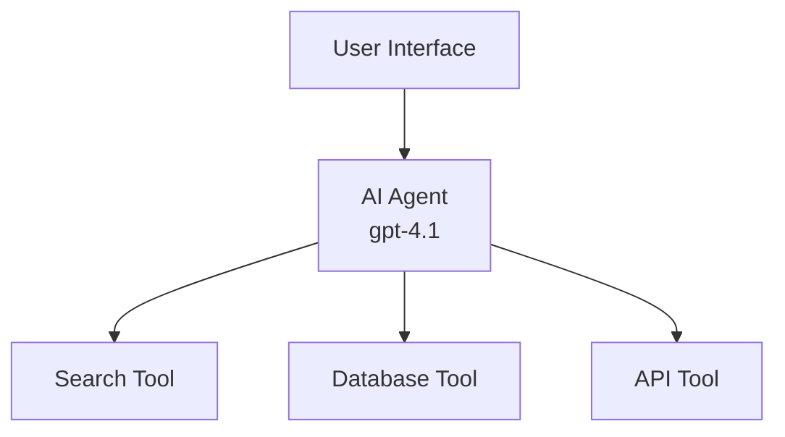
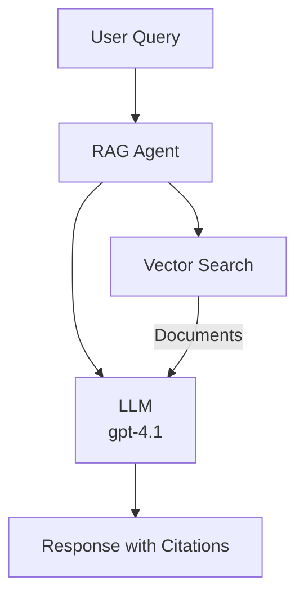
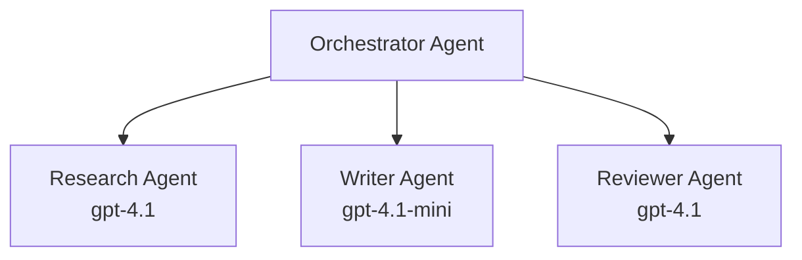

# AI-agenter med Azure Developer CLI

**Kapittelnavigasjon:**
- **📚 Kurshjem**: [AZD For Beginners](../../README.md)
- **📖 Nåværende kapittel**: Kapittel 2 - AI-først utvikling
- **⬅️ Forrige**: [Microsoft Foundry Integration](microsoft-foundry-integration.md)
- **➡️ Neste**: [AI Model Deployment](ai-model-deployment.md)
- **🚀 Avansert**: [Multi-Agent Solutions](../../examples/retail-scenario.md)

---

## Innledning

AI-agenter er autonome programmer som kan oppfatte miljøet sitt, ta beslutninger og utføre handlinger for å oppnå spesifikke mål. I motsetning til enkle chatboter som svarer på spørsmål, kan agenter:

- **Bruke verktøy** - Kalle API-er, søke i databaser, kjøre kode
- **Planlegge og resonnere** - Bryte ned komplekse oppgaver i trinn
- **Lære fra kontekst** - Opprettholde minne og tilpasse atferd
- **Samarbeide** - Jobbe med andre agenter (multi-agent systemer)

Denne veiledningen viser deg hvordan du distribuerer AI-agenter til Azure ved hjelp av Azure Developer CLI (azd).

Bruk av samtalekontekst er ikke modelltrening: vedvarende minne, tilgangskontroll og lagring må implementeres/konfigureres av applikasjonen.

> **Utgivelsesgjennomgang (2026-11-04):** CLI-eksempler ble kontrollert mot dokumentasjonen/kilden til `azd` `1.37.2`, `azure.ai.agents` `1.0.0-beta.23` og `azure.ai.evaluations` `1.0.0-beta.2`, ikke en live Azure-distribusjon. Bruk `azd >= 1.37.0` for den kombinerte arbeidsflyten. Se [siste endringer og feilrettinger](../chapter-08-production/production-ai-practices.md#recent-release-changes-and-fixes) før du oppgraderer eldre prosjekter.

## Læringsmål

Ved å fullføre denne veiledningen vil du:
- Forstå hva AI-agenter er og hvordan de skiller seg fra chatboter
- Distribuere forhåndsbygde AI-agentmaler med AZD
- Konfigurere Foundry-agenter for tilpassede agenter
- Implementere grunnleggende agentmønstre (verktøybruk, RAG, multi-agent)
- Overvåke og feilsøke distribuerte agenter

## Læringsresultater

Når du er ferdig, vil du kunne:
- Distribuere AI-agentapplikasjoner til Azure med en enkelt kommando
- Konfigurere agentverktøy og kapasiteter
- Implementere retrieval-augmented generation (RAG) med agenter
- Designe multi-agent arkitekturer for komplekse arbeidsflyter
- Feilsøke vanlige problemer med agentdistribusjon

---

## 🤖 Hva skiller en agent fra en chatbot?

| Egenskap | Chatbot | AI-agent |
|---------|---------|----------|
| **Atferd** | Svarer på spørsmål | Tar autonome handlinger |
| **Verktøy** | Kan bruke søk eller verktøy | Bruker vanligvis verktøy i en målrettet løkke |
| **Minne** | Avhenger av applikasjonen | Vedvarende minne bare hvis eksplisitt implementert |
| **Planlegging** | Enkel respons | Resonnering i flere trinn |
| **Samarbeid** | Enkelt enhet | Kan samarbeide med andre agenter |

### Enkel analogi

- **Chatbot** = En hjelpsom person som svarer på spørsmål ved et informasjonsskranke
- **AI-agent** = En personlig assistent som kan ringe, booke avtaler og utføre oppgaver for deg

---

## 🚀 Rask start: Distribuer din første agent

Velg ett alternativ i en **ny tom arbeidsmappe**. Den avsluttende `.` initialiserer der; uten eksplisitt destinasjon kan gjeldende AZD opprette en undermappe med malenavn og endrer ikke shell-mappen. Hold separate maler/miljøer i separate mapper.

Tid/kostnadsangivelsene nedenfor er illustrerende, ikke bekreftede tilbud. Sjekk hver eksempels nåværende forutsetninger, priser, modellkvoter og valgfrie tjenester før distribusjon.

### Alternativ 1: Foundry Agents-mal (Anbefalt)

```bash
# Initialize the AI agents template
azd init --template get-started-with-ai-agents .

# Deploy to Azure
azd up
```

**Det som distribueres:** Prøvens nåværende infrastruktur og valgte opsjoner bestemmer modell, verktøy, hosting og overvåkingsressurser. Gå gjennom README og `infra/` før provisjonering; anta ikke at hver agentmal inkluderer Search eller et nettgrensesnitt.

**Tid:** ~15-20 minutter
**Kostnad:** ~$100-150/måned (utvikling)

### Alternativ 2: Kreative skriveagenter med Prompty

```bash
# Initialize the Prompty-based agent template
azd init --template https://github.com/Azure-Samples/contoso-creative-writer .

# Deploy to Azure
azd up
```

**Det som distribueres:** En FastAPI/Prompty multi-agent skriveprøve som bruker Azure OpenAI, Bing Grounding og Azure AI Search. Det tidligere `agent-openai-python-prompty`-arkivet omdirigerer hit; det er ikke en minimal Azure Functions-væragentmal. Følg dagens README for hosting, modellkvote og Bing Grounding-forutsetninger.

**Tid:** ~10-15 minutter
**Kostnad:** ~$50-100/måned (utvikling)

### Alternativ 3: RAG Chat Agent

```bash
# Initialize RAG chat template
azd init --template azure-search-openai-demo .

# Deploy to Azure
azd up
```

**Det som distribueres:**
- ✅ Microsoft Foundry Models
- ✅ Azure AI Search med eksempeldata
- ✅ Dokumentbehandlingspipeline
- ✅ Chatgrensesnitt med henvisninger

**Tid:** ~15-25 minutter
**Kostnad:** ~$80-150/måned (utvikling)

### Alternativ 4: AZD AI Agent Init (Prosjektmalforhåndsvisning)

Bruk `azd ai agent init` interaktivt, eller ta i bruk et eksisterende `azure.yaml` agentprosjekt med `--template`/`-t`. Det gamle `--manifest`/`-m`-alternativet er en foreldet alias, ikke en konverter for eldre manifest.

```bash
# Install the AI agents extension
azd extension install azure.ai.agents

# Optional: verify the installed preview version
azd extension show azure.ai.agents

# Initialize from a current agent project template (supply your template path)
azd ai agent init --template ./templates/support-agent/azure.yaml

# Deploy to Azure
azd up

# Test the deployed agent (shows latency + time-to-first-byte)
azd ai agent invoke
```

**Når bruke `azd ai agent init` vs `azd init --template`:**

| Tilnærming | Best for | Hvordan det fungerer |
|----------|----------|----------------------|
| `azd init --template` | Starte fra en fungerende prøveapp | Kloner et komplett malrepo med kode + infrastruktur |
| `azd ai agent init --template` | Ta i bruk et eksisterende Foundry-agentprosjekt | Bruker et `azure.yaml` prosjektdokument og dets definisjoner |

> **Tips:** Bruk `azd init --template` når du lærer (alternativ 1-3 ovenfor). Bruk `azd ai agent init` for Foundry-agentarbeidsflyten. For å legge til en direkte agentdefinisjon i et eksisterende prosjekt, se [initialisering og migreringsveiledning](../chapter-08-production/production-ai-practices.md#initializing-agent-projects-with-azd-ai-agent-init).

Etter `azd up`, bruk `azd ai agent invoke` for testing, den separate `azure.ai.evaluations`-utvidelsen (`azd ai eval init`, `generate` og `run start`) for å måle kvalitet, og `azd ai agent optimize` for å forbedre den med ny evalueringkonfigurasjon. Agentene beta.22 erstattet den eldre evalueringsarbeidsflyten og endret optimaliseringens `--config`-format. Se [evaluering migrering](../chapter-08-production/production-ai-practices.md#evaluation-migration-and-quality-checks) og [optimalisering migrering](../chapter-08-production/production-ai-practices.md#optimization-configuration-migration) før gjenbruk av eldre eksempler.

---

## 🏗️ Agentarkitekturmønstre

### Mønster 1: Enkeltagent med verktøy

Det enkleste agentmønstret - en agent som kan bruke flere verktøy.



**Best for:**
- Kundeserviceroboter
- Forskningsassistenter
- Dataanalyseagenter

**Relatert applikasjonsprøve:** `azure-search-openai-demo` demonstrerer RAG, ikke en generell vilkårlig-verktøy agentløype.

### Mønster 2: RAG-agent (Retrieval-Augmented Generation)

En agent som henter relevante dokumenter før den genererer svar.



**Best for:**
- Bedriftskunnskapsbaser
- Dokument Q&A-systemer
- Samsvar og juridisk forskning

**AZD-mal:** `azure-search-openai-demo`

### Mønster 3: Multi-Agent System

Flere spesialiserte agenter som jobber sammen om komplekse oppgaver.



**Best for:**
- Kompleks innholdsgenerering
- Arbeidsflyter i flere trinn
- Oppgaver som krever ulik ekspertise

**Lær mer:** [Multi-Agent Coordination Patterns](../chapter-06-pre-deployment/coordination-patterns.md)

---

## ⚙️ Konfigurere agentverktøy

Agenter blir kraftige når de kan bruke verktøy. Slik konfigurerer du vanlige verktøy:

### Verktøykonfigurasjon i Foundry Agents

Dette **klassiske Agent Service SDK-fragmentet** retter seg mot `azure-ai-projects==1.0.0` og `azure-ai-agents==1.1.0` med `azure-identity`. Det er ikke den nyere versjonerte agent/Responses API som brukes av noen nåværende Foundry-maler, heller ikke `azure.ai.agents` AZD-utvidelsen (et annet pakke). Ikke bland disse API-generasjonene. Sett `PROJECT_ENDPOINT` til et klassisk Foundry-prosjektendepunkt og `MODEL_DEPLOYMENT_NAME` til en eksisterende støttet modell-distribusjon; autentiser med `az login` lokalt og gi nødvendige prosjektrettigheter.

```python
# agent_config.py
import os
from azure.ai.projects import AIProjectClient
from azure.ai.agents.models import FunctionTool
from azure.identity import DefaultAzureCredential

def search_knowledge_base(query: str) -> str:
    """Search the demonstration knowledge base.

    :param query: Search text.
    :return: Matching demonstration information.
    """
    # Local fixture only, not a production search implementation.
    return "Demo policy: returns are accepted within 30 days."

project_client = AIProjectClient(
    endpoint=os.environ["PROJECT_ENDPOINT"],
    credential=DefaultAzureCredential(),
)
search_tool = FunctionTool(functions={search_knowledge_base})
project_client.agents.enable_auto_function_calls(search_tool)
agent = project_client.agents.create_agent(
    model=os.environ["MODEL_DEPLOYMENT_NAME"],
    name="Support Agent",
    instructions="Use search_knowledge_base for policy questions. Label results as demo data.",
    tools=search_tool.definitions,
)
```

Registrering av funksjonsskjema kjører ikke Python på tjenesten. I denne SDK-en kjører `enable_auto_function_calls` pluss `agents.runs.create_and_process(...)` registrerte callback-funksjoner i klientprosessen din. Se [utgitt SDK-eksempel](https://github.com/Azure/azure-sdk-for-python/blob/azure-ai-agents_1.1.0/sdk/ai/azure-ai-agents/samples/agents_tools/sample_agents_auto_function_call.py). Lukk klienten og slett demonstrasjonsagenter/tråder når du er ferdig.

### Miljøkonfigurasjon

Følgende navn er **illustrerende tilpassede malinnganger**, ikke innebygde AZD-brytere. Først føres hver verdi gjennom `infra/main.parameters.json`, infrastruktur og applikasjonskode. `azd env set` alene endrer ikke agentens verktøy eller instruksjoner.

```bash
# Set up agent-specific environment variables
azd env set AZURE_OPENAI_MODEL "gpt-4.1"
azd env set AGENT_INSTRUCTIONS "You are a helpful assistant..."
azd env set ENABLE_CODE_INTERPRETER "true"
azd env set ENABLE_FILE_SEARCH "true"

# Apply wired infrastructure and application changes
azd up
```

---

## 📊 Overvåke agenter

### Integrasjon med Application Insights

Hvis den valgte malen provisjonerer Application Insights og konfigurerer instrumentering:

```bash
# Open monitoring dashboard
azd monitor --overview

# Open the Application Insights logs view (not a streaming log tail)
azd monitor --logs

# View live metrics
azd monitor --live
```

### Viktige måleparametere å følge

| Måleparameter | Beskrivelse | Mål |
|--------------|-------------|-----|
| Responstid | Tid for å generere svar | < 5 sekunder |
| Tokenbruk | Tokens per forespørsel | Overvåk for kostnad |
| Verktøysuksessrate | % av vellykkede verktøyutførelser | > 95% |
| Feilrate | Mislykkede agentforespørsler | < 1% |
| Brukertilfredshet | Tilbakemeldingsscore | > 4,0/5,0 |

### Egendefinert logging for agenter

```python
import os
from azure.monitor.opentelemetry import configure_azure_monitor
from opentelemetry import trace

# Configure Azure Monitor with OpenTelemetry
configure_azure_monitor(
    connection_string=os.environ["APPLICATIONINSIGHTS_CONNECTION_STRING"]
)

tracer = trace.get_tracer(__name__)

def log_agent_interaction(user_query, agent_response, tools_used, latency_ms):
    with tracer.start_as_current_span("agent_interaction") as span:
        span.set_attributes({
            "query_length": len(user_query),  # Do not log raw prompts or personal data
            "response_length": len(agent_response),
            "tools_used": tools_used,
            "latency_ms": latency_ms
        })
```

> **Merk:** Installer nødvendig pakke: `pip install azure-monitor-opentelemetry`. Den bringer med seg OpenTelemetry-avhengigheter; importnavnerommet er ikke et krav for å installere en pakke med navnet `opentelemetry`.

---

## 💰 Kostnadsvurderinger

### Estimerte månedlige kostnader etter mønster

Dette er illustrerende planleggingsområder, ikke tilbud eller utgiftstak. Region, modelltokens, Search/compute SKU-er, verktøysessioner, lagring og trafikk kan overstige dem. Sjekk prøvens kostnadsveiledning og Azure-priser før `azd up`.

| Mønster | Utviklingsmiljø | Produksjon |
|---------|-----------------|------------|
| Enkeltagent | $50-100 | $200-500 |
| RAG-agent | $80-150 | $300-800 |
| Multi-Agent (2-3 agenter) | $150-300 | $500-1,500 |
| Enterprise Multi-Agent | $300-500 | $1,500-5,000+ |

### Tips for kostnadsoptimalisering

1. **Bruk gpt-4.1-mini for enkle oppgaver** (kun hvis malen din bruker denne inngangen)
   ```bash
   azd env set AZURE_OPENAI_MODEL "gpt-4.1-mini"
   ```

2. **Implementer avgrenset caching for sikre, gjentatte spørringer.** Inkluder leietaker-/brukergodkjenning, modellutplassering, instruksjoner og henterversjon i cache-nøkkelen; sett utløpstid. Ikke del private samtalerespons gjennom en prosessomfattende kun spørringscache. SDK-agentobjektet har ikke en generell `agent.run()`-metode.

3. **Sett tokengrenser per kjøring**
   ```python
   # Set max_completion_tokens when running the agent, not during creation
   run = project_client.agents.runs.create_and_process(
       thread_id=thread.id,
       agent_id=agent.id,
       max_completion_tokens=1000  # Budget across the run; may finish as incomplete
   )
   ```

4. **Skaler kvalifiserte Container Apps til null når de ikke er i bruk**
   ```bash
   # Custom-template input: must map to template.scale.minReplicas
   azd env set MIN_REPLICAS "0"
   ```
   Bruk infrastrukturen endring med `azd provision` eller `azd up`. Skalering til null trenger egnet trigger og stopper ikke Search, lagring eller modell/verktøykostnader.

---

## 🔧 Feilsøking av agenter

### Vanlige problemer og løsninger

<details>
<summary><strong>❌ Agent svarer ikke på verktøysanrop</strong></summary>

```bash
# Inspect the application deployment (not the agent's registered tools)
azd show

# Verify OpenAI deployment
az cognitiveservices account deployment list \
  --name $AZURE_OPENAI_NAME \
  --resource-group $RG_NAME

# Check agent logs
azd monitor --logs
```

**Vanlige årsaker:**
- Uoverensstemmelse i verktøyfunksjonssignatur
- Manglende nødvendige tillatelser
- API-endepunkt ikke tilgjengelig
</details>

<details>
<summary><strong>❌ Høy ventetid i agentsvar</strong></summary>

```bash
# Check Application Insights for bottlenecks
azd monitor --live

# Consider using a faster model
azd env set AZURE_OPENAI_MODEL "gpt-4.1-mini"
azd up
```

**Optimaliseringstips:**
- Bruk strømmede responser
- Implementer svarcache
- Reduser kontekstvinduets størrelse
</details>

<details>
<summary><strong>❌ Agent returnerer feil eller hallusinerte opplysninger</strong></summary>

```python
# Improve with better system prompts
instructions = """
You are a helpful assistant. IMPORTANT:
- Only answer based on provided context
- If you don't know, say "I don't know"
- Always cite your sources
- Never make up information
"""

# Use these instructions in the agent definition.
# For classic file search, first upload/index documents in a vector store,
# then use FileSearchTool(vector_store_ids=[...]) and pass both its
# .definitions and .resources when creating the agent.
```
Instruksjoner og innhenting reduserer risiko; ingen garanterer faktiske svar. Evaluer jordfestede og utenfor-omfang-spørsmål mot kjente svar.
</details>

<details>
<summary><strong>❌ Feil for overskredet token-grense</strong></summary>

```python
# Implement context window management
def truncate_context(messages, max_tokens=8000, model="gpt-4.1"):
    """Approximate content-only budget for objects with .content strings."""
    import tiktoken
    encoding = tiktoken.encoding_for_model(model)
    total_tokens = 0
    truncated = []
    
    for msg in reversed(messages):
        msg_tokens = len(encoding.encode(msg.content))
        if total_tokens + msg_tokens > max_tokens:
            break
        truncated.insert(0, msg)
        total_tokens += msg_tokens
    
    return truncated
```
Denne hjelperen utelukker rolle/verktøy-skjemaer, systeminstruksjoner, bildtokens og protokolloverhead. Reserver plass for disse og fullføring; del ikke verktøysamtale/resultat-par eller forkast nødvendige systeminstruksjoner. Installer `tiktoken` separat. Det er ikke en generell kontekstvindu-validator.
</details>

---

## 🎓 Praktiske øvelser

### Øvelse 1: Distribuer en grunnleggende agent (20 minutter)

**Mål:** Distribuer din første AI-agent med AZD

```bash
# Step 1: Initialize template
azd init --template get-started-with-ai-agents .

# Step 2: Login to Azure
azd auth login
# If you work across tenants, add --tenant-id <tenant-id>

# Step 3: Deploy
azd up

# Step 4: Test the agent
# Expected output after deployment:
#   Deployment Complete!
#   Endpoint: https://<app-name>.<region>.azurecontainerapps.io
# Open the URL shown in the output and try asking a question

# Step 5: View monitoring
azd monitor --overview

# Step 6: Clean up
azd down --force --purge
```

**Suksesskriterier:**
- [ ] Agent svarer på spørsmål
- [ ] Kan få tilgang til overvåkingsdashboard via `azd monitor`
- [ ] Ressurser ryddet opp med suksess

### Øvelse 2: Legg til et tilpasset verktøy (30 minutter)

**Mål:** Utvid en agent med et tilpasset verktøy

**Startpunkt:** Bruk den klassiske SDK-klienten fra [Tool Configuration](#tool-configuration-in-foundry-agents), ikke en vilkårlig mal med en annen SDK-generasjon.

1. Legg til denne deterministiske fastsettelsen i `agent_config.py`:
   ```python
   def get_weather(location: str) -> str:
       """Return demonstration weather, not live conditions.

       :param location: City name.
       :return: A clearly labelled fixture.
       """
       print(f"TOOL_CALLED: {location}")
       return f"Demo weather in {location}: Sunny, 72°F (fixture, not live)"
   ```
2. Erstatt registrerings- og opprettelsesblokken for søkeverktøyet med:
   ```python
   weather_tool = FunctionTool(functions={get_weather})
   project_client.agents.enable_auto_function_calls(weather_tool)
   agent = project_client.agents.create_agent(
       model=os.environ["MODEL_DEPLOYMENT_NAME"],
       name="Weather Agent",
       instructions="Call get_weather for weather questions; explain that it returns demo data.",
       tools=weather_tool.definitions,
   )
   thread = project_client.agents.threads.create()
   try:
       project_client.agents.messages.create(
           thread_id=thread.id, role="user", content="Use get_weather for Seattle."
       )
       run = project_client.agents.runs.create_and_process(
           thread_id=thread.id, agent_id=agent.id
       )
       if run.status != "completed":
           raise RuntimeError(f"Run status: {run.status}; error: {run.last_error}")
       for message in project_client.agents.messages.list(thread_id=thread.id):
           for text in message.text_messages:
               print(text.text.value)
   finally:
       project_client.agents.threads.delete(thread.id)
       project_client.agents.delete_agent(agent.id)
       project_client.close()
   ```
3. Kjør lokalt (dette kaller det eksisterende Azure-prosjektet og medfører modellkostnader):
   ```bash
   python agent_config.py
   # Expected: TOOL_CALLED: Seattle, then a completed answer labelled demo data.
   ```

**Suksesskriterier:**
- [ ] Agenten gjenkjenner værrelaterte spørsmål
- [ ] Verktøyet kalles korrekt
- [ ] Responsen inkluderer værinformasjon

### Øvelse 3: Bygg en RAG-agent (45 minutter)

**Mål:** Lag en agent som svarer på spørsmål fra dokumentene dine

```bash
# Step 1: Deploy RAG template
azd init --template azure-search-openai-demo .
azd up

# Step 2: Upload your documents
# For the sample's local ingestion path, place supported files in data/.
# Run from the sample root after following its Python environment setup:
./scripts/prepdocs.sh
# Windows PowerShell equivalent: .\\scripts\\prepdocs.ps1

# Step 3: Test with domain-specific questions
# Open the web app URL from the azd up output
# Ask questions about your uploaded documents
# Responses should include citation references like [doc.pdf]
```

**Suksesskriterier:**
- [ ] Agenten svarer fra opplastede dokumenter
- [ ] Svar inkluderer kilder
- [ ] Spørsmål utenfor omfang håndteres uten ubegrunnede påstander (ikke en garanti for hvert fremtidig spørsmål)

Hvis `USE_CLOUD_INGESTION=true`, bruk eksempelkodens skylastings-/uplading-flow i stedet; den lokale wrapperen hopper bevisst over lasting. Etter testing, kjør `azd down` i RAG-miljøet og gjennomgå ressursene som skal slettes.

---

## 📚 Neste steg

Nå som du forstår AI-agenter, utforsk disse avanserte temaene:

| Tema | Beskrivelse | Lenke |
|-------|-------------|------|
| **Multi-Agent Systemer** | Bygg systemer med flere samarbeidende agenter | [Retail Multi-Agent Example](../../examples/retail-scenario.md) |
| **Koordineringsmønstre** | Lær orkestrering og kommunikasjonsmønstre | [Coordination Patterns](../chapter-06-pre-deployment/coordination-patterns.md) |
| **Produksjonsdistribusjon** | Klar for bedrift – agentdistribusjon | [Production AI Practices](../chapter-08-production/production-ai-practices.md) |
| **Agentvurdering** | Test og vurder agentytelsen | [AI Troubleshooting](../chapter-07-troubleshooting/ai-troubleshooting.md) |
| **AI Workshop Lab** | Praktisk: Gjør AI-løsningen AZD-klar | [AI Workshop Lab](ai-workshop-lab.md) |

---

## 📖 Tilleggsressurser

### Offisiell dokumentasjon
- [Microsoft Foundry Agent Service](https://learn.microsoft.com/azure/ai-services/agents/)
- [Microsoft Foundry Agent Service Quickstart](https://learn.microsoft.com/azure/ai-services/agents/quickstart)
- [Semantic Kernel Agent Framework](https://learn.microsoft.com/semantic-kernel/)

### AZD-maler for agenter
- [Kom i gang med AI-agenter](https://github.com/Azure-Samples/get-started-with-ai-agents)
- [Kreative skriveagenter med Prompty](https://github.com/Azure-Samples/contoso-creative-writer)
- [Azure Search OpenAI Demo](https://github.com/Azure-Samples/azure-search-openai-demo)

### Fellesskapsressurser
- [Awesome AZD - Agentmaler](https://azure.github.io/awesome-azd/?tags=ai-agents)
- [Azure AI Discord](https://discord.gg/microsoft-azure)
- [Microsoft Foundry Discord](https://discord.gg/nTYy5BXMWG)

### Agentferdigheter for redaktøren din
- [**Microsoft Azure Agent Skills**](https://skills.sh/microsoft/github-copilot-for-azure) - Installer gjenbrukbare AI-agentferdigheter for Azure-utvikling i GitHub Copilot, Cursor eller enhver støttet agent. Inkluderer ferdigheter for [Azure AI](https://skills.sh/microsoft/github-copilot-for-azure/azure-ai), [Microsoft Foundry](https://skills.sh/microsoft/github-copilot-for-azure/microsoft-foundry), [distribusjon](https://skills.sh/microsoft/github-copilot-for-azure/azure-deploy), og [diagnostikk](https://skills.sh/microsoft/github-copilot-for-azure/azure-diagnostics):
  ```bash
  npx skills add microsoft/github-copilot-for-azure
  ```

---

**Navigasjon**
- **Forrige leksjon**: [Microsoft Foundry Integration](microsoft-foundry-integration.md)
- **Neste leksjon**: [AI Model Deployment](ai-model-deployment.md)

---

<!-- CO-OP TRANSLATOR DISCLAIMER START -->
**Ansvarsfraskrivelse**:
Dette dokumentet er oversatt ved hjelp av AI-oversettelsestjenesten [Co-op Translator](https://github.com/Azure/co-op-translator). Selv om vi streber etter nøyaktighet, vær oppmerksom på at automatiske oversettelser kan inneholde feil eller unøyaktigheter. Det opprinnelige dokumentet på originalspråket skal betraktes som den autoritative kilden. For kritisk informasjon anbefales profesjonell menneskelig oversettelse. Vi er ikke ansvarlige for eventuelle misforståelser eller feiltolkninger som oppstår ved bruk av denne oversettelsen.
<!-- CO-OP TRANSLATOR DISCLAIMER END -->