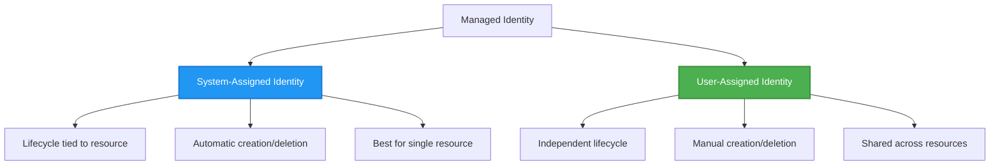

# Autentiseringsmønstre og administrert identitet

⏱️ **Estimert tid**: 45-60 minutter lesing; tillat ekstra tid for å integrere øvelser | 💰 **Kostnadskonsekvens**: Identitet/RBAC er gratis; distribuert databehandling, lagring og Key Vault er fakturerbare | ⭐ **Kompleksitet**: Middels

> Gjennomgått mot `azd 1.37.2` (november 2026). Denne leksjonen inneholder **illustrerende integrasjonsfragmenter, ikke en komplett nedlastbar `secure-app`-mal**. Opprett de refererte filene, lever matchende infrastruktur, og erstatt plassholdere før distribusjon. Ingen Azure-ressurser ble provisjonert under gjennomgangen.

**📚 Læringsløp:**
- ← Forrige: [Konfigurasjonsbehandling](configuration.md) - Håndtere miljøvariabler og hemmeligheter
- 🎯 **Du er her**: Autentisering & Sikkerhet (Administrert identitet, Key Vault, sikre mønstre)
- → Neste: [Infrastruktur som kode](../chapter-04-infrastructure/README.md) - Provisionere og distribuere ressurser
- 🏠 [Kurs Hjem](../../README.md)

---

## Hva du vil lære

Ved å fullføre denne leksjonen vil du:
- Forstå Azure autentiseringsmønstre (nøkler, tilkoblingsstrenger, administrert identitet)
- Implementere **Administrert identitet** for passordløs autentisering
- Sikre hemmeligheter med **Azure Key Vault** integrasjon
- Konfigurere **rollebasert tilgangskontroll (RBAC)** for AZD distribusjoner
- Anvende sikkerhets beste praksis i Container Apps og Azure-tjenester
- Migrere fra nøkkelbasert til identitetsbasert autentisering

## Hvorfor administrert identitet er viktig

### Problemet: Tradisjonell autentisering

**Før administrert identitet:**
```javascript
// ❌ SECURITY RISK: Hardcoded secrets in code
const connectionString = "Server=mydb.database.windows.net;User=admin;Password=P@ssw0rd123";
const storageKey = "xK7mN9pQ2wR5tY8uI0oP3aS6dF1gH4jK...";
const cosmosKey = "C2x7B9n4M1p8Q5w3E6r0T2y5U8i1O4p7...";
```

**Problemer:**
- 🔴 **Eksponerte hemmeligheter** i kode, konfigurasjonsfiler, miljøvariabler
- 🔴 **Rotasjon av legitimasjon** krever kodeendringer og ny distribusjon
- 🔴 **Revisjonsmareritt** - hvem fikk tilgang til hva, når?
- 🔴 **Spredning** - hemmeligheter spredt over flere systemer
- 🔴 **Overholdelsesrisikoer** - feiler sikkerhetsrevisjoner

### Løsningen: Administrert identitet

**Etter administrert identitet:**
```javascript
// ✅ SECURE: No secrets in code
const credential = new DefaultAzureCredential();
const client = new BlobServiceClient(
  "https://mystorageaccount.blob.core.windows.net",
  credential  // Azure automatically handles authentication
);
```

**Fordeler:**
- ✅ **Ingen hemmeligheter** i kode eller konfigurasjon
- ✅ **Automatisk rotasjon** - Azure håndterer dette
- ✅ **Full revisjonssporing** i Microsoft Entra ID logger
- ✅ **Sentralisert sikkerhet** - administreres i Azure Portal
- ✅ **Klar for overholdelse** - møter sikkerhetsstandarder

**Analogien**: Tradisjonell autentisering er som å bære flere fysiske nøkler til forskjellige dører. Administrert identitet er som å ha et sikkerhetskort som automatisk gir tilgang basert på hvem du er—ingen nøkler å miste, kopiere eller rotere.

---

## Arkitekturoversikt

### Autentiseringsflyt med administrert identitet

```mermaid
sequenceDiagram
    participant App as Your Application<br/>(Container App)
    participant MI as Managed Identity<br/>(Microsoft Entra ID)
    participant KV as Key Vault
    participant Storage as Azure Storage
    participant DB as Azure SQL
    
    App->>MI: Request access token<br/>(automatic)
    MI->>MI: Verify identity<br/>(no password needed)
    MI-->>App: Return token for requested audience<br/>(lifetime varies)
    
    App->>KV: Get secret<br/>(using token)
    KV->>KV: Check RBAC permissions
    KV-->>App: Return secret value
    
    App->>Storage: Upload blob<br/>(using token)
    Storage->>Storage: Check RBAC permissions
    Storage-->>App: Success
    
    App->>DB: Query data<br/>(using token)
    DB->>DB: Check SQL permissions
    DB-->>App: Return results
    
    Note over App,DB: Request a separate token for each service audience;<br/>SDK credentials handle caching and renewal
```

### Typer av administrerte identiteter



| Egenskap | System-tilordnet | Bruker-tilordnet |
|---------|----------------|---------------|
| **Livssyklus** | Knyttet til ressurs | Uavhengig |
| **Opprettelse** | Automatisk med ressurs | Manuell opprettelse |
| **Sletting** | Slettet med ressurs | Vedvarer etter ressurs sletting |
| **Deling** | Én ressurs kun | Flere ressurser |
| **Bruksområde** | Enkle scenarier | Komplekse multi-ressurs scenarier |
| **Malvalg** | Definert i infrastrukturen | Definert i infrastrukturen |

---

## Forutsetninger

### Nødvendige verktøy

Du bør allerede ha disse installert fra tidligere leksjoner:

```bash
# Verify Azure Developer CLI
azd version
# ✅ Expected: azd version 1.0.0 or higher

# Verify Azure CLI
az --version
# ✅ Expected: azure-cli 2.50.0 or higher
```

### Azure-krav

- Aktiv Azure-abonnement
- Tillatelser til:
  - Opprette administrerte identiteter
  - Tilordne RBAC-roller
  - Opprette Key Vault-ressurser
  - Distribuere Container Apps

### Kunnskapsforutsetninger

Du bør ha fullført:
- [Installasjonsguide](../chapter-01-foundation/installation.md) - AZD oppsett
- [AZD grunnleggende](../chapter-01-foundation/azd-basics.md) - Kjernedomener
- [Konfigurasjonsbehandling](configuration.md) - Miljøvariabler

---

## Leksjon 1: Forstå autentiseringsmønstre

### Mønster 1: Tilkoblingsstrenger (Legacy - unngå)

**Hvordan det fungerer:**
```bash
# Connection string contains credentials
STORAGE_CONNECTION_STRING="DefaultEndpointsProtocol=https;AccountName=myaccount;AccountKey=xK7mN9pQ2wR5..."
COSMOS_CONNECTION_STRING="AccountEndpoint=https://myaccount.documents.azure.com:443/;AccountKey=C2x7..."
SQL_CONNECTION_STRING="Server=myserver.database.windows.net;User=admin;Password=P@ssw0rd..."
```

**Problemer:**
- ❌ Hemmeligheter synlige i miljøvariabler
- ❌ Loggført i distribusjonssystemer
- ❌ Vanskelig å rotere
- ❌ Ingen revisjonsspor for tilgang

**Når det skal brukes:** Når målrettet tjeneste krever nøkkelbasert autentisering. Foretrekk identitet der den støttes; ellers lagre nøkler sikkert og roter dem, også i produksjon.

---

### Mønster 2: Key Vault-referanser (Bedre)

**Hvordan det fungerer:**
**Delvise Bicep-fragmenter:** nødvendige valutfelt, Container App identitet, og dens `configuration.secrets` oppføring er utelatt. `secretRef` navngir en Container App-hemmelighet; det er **ikke i seg selv** en Key Vault URI. For å bruke Key Vault, definer den navngitte hemmeligheten med `keyVaultUrl` og en autorisert `identity`.

```bicep
// Store secret in Key Vault
resource keyVault 'Microsoft.KeyVault/vaults@2023-02-01' = {
  name: 'mykv'
  properties: {
    enableRbacAuthorization: true
  }
}

// Reference in Container App
env: [
  {
    name: 'STORAGE_KEY'
    secretRef: 'storage-key'  // References Key Vault
  }
]
```

**Fordeler:**
- ✅ Hemmeligheter lagret sikkert i Key Vault
- ✅ Sentralisert hemmelighetshåndtering
- ✅ Rotasjon uten kodeendringer

**Begrensninger:**
- ⚠️ Fremdeles bruk av nøkler/passord
- ⚠️ Må administrere tilgang til Key Vault

**Når det skal brukes:** Overgangstrinn fra tilkoblingsstrenger til administrert identitet.

---

### Mønster 3: Administrert identitet (Beste praksis)

**Hvordan det fungerer:**
**Delvis Bicep:** slå sammen identitetsblokken i en komplett Container App og lever `storageAccount` og rollerollen definisjon. En rollestildeling krever også en deterministisk `name`.

```bicep
// Enable managed identity
resource containerApp 'Microsoft.App/containerApps@2023-05-01' = {
  name: 'myapp'
  identity: {
    type: 'SystemAssigned'  // Automatically creates identity
  }
}

// Grant permissions
resource roleAssignment 'Microsoft.Authorization/roleAssignments@2022-04-01' = {
  name: guid(storageAccount.id, containerApp.id, storageBlobDataContributorRole)
  scope: storageAccount
  properties: {
    roleDefinitionId: storageBlobDataContributorRole
    principalId: containerApp.identity.principalId
    principalType: 'ServicePrincipal'
  }
}
```

**Applikasjonskode:**
```javascript
// No secrets needed!
const { DefaultAzureCredential } = require('@azure/identity');
const { BlobServiceClient } = require('@azure/storage-blob');

const credential = new DefaultAzureCredential();
const blobServiceClient = new BlobServiceClient(
  'https://mystorageaccount.blob.core.windows.net',
  credential
);
```

**Fordeler:**
- ✅ Ingen hemmeligheter i kode/konfigurasjon
- ✅ Automatisk rotasjon av legitimasjon
- ✅ Full revisjonsspor
- ✅ RBAC-baserte tillatelser
- ✅ Klar for overholdelse

**Når det skal brukes:** Foretrekkes for Azure-hostede applikasjoner som får tilgang til tjenester som støtter Microsoft Entra autentisering.

---

### Mønster 4: Tjenesteprinsipper (CI/CD & Automatisering)

Administrert identitet er gullstandarden *for ressurser som kjører inne i Azure*. Men hva med ting som kjører **utenfor** Azure — som en CI/CD-pipeline på en byggeagent, eller et skript på laptopen din som ikke kan bruke din interaktive pålogging? Da kommer en **tjenesteprinsipp** inn: en ikke-menneskelig identitet med egne legitimasjoner som en automatisert prosess kan logge inn som.

**Hvordan det fungerer:**

Opprett en tjenesteprinsipp definert for en ressursgruppe (minste privilegium):

```bash
az ad sp create-for-rbac \
  --name "myapp-cicd" \
  --role contributor \
  --scopes "/subscriptions/<sub-id>/resourceGroups/<rg-name>"
```

Dette skriver ut en klient-ID, klienthemmelighet og tenant-ID. azd kan logge inn med disse uten interaksjon:

```bash
azd auth login \
  --client-id "<appId>" \
  --client-secret "<password>" \
  --tenant-id "<tenant>"
```

**Foretrekk fødererte legitimasjoner (OIDC) framfor hemmeligheter.** I stedet for en langtidslevende klienthemmelighet, konfigurer en føderert legitimasjon slik at pipelinen bytter et kortlevende token—ingen hemmelighet å lekke eller rotere:

```bash
azd auth login \
  --client-id "<appId>" \
  --federated-credential-provider "github" \
  --tenant-id "<tenant>"
```

> `azd pipeline config` setter dette opp for deg automatisk. Se CI/CD gjennomganger i [Kapittel 8](../chapter-08-production/production-ai-practices.md).

**Fordeler:**
- ✅ Fungerer utenfor Azure (byggeagenter, lokale miljøer, andre skyer)
- ✅ Kan avgrenses til en enkelt ressursgruppe med én rolle
- ✅ Føderert (OIDC) variant bruker ingen lagret hemmelighet

**Avveininger:**
- ⚠️ Hemmelighetsbasert variant krever forsvarlig lagring og rotasjon
- ⚠️ En lekket hemmelighet gir alt tjenesteprinsippet kan gjøre—hold porteføljen stram

**Når det skal brukes:** CI/CD-pipelines og automatisering som ikke kan bruke administrert identitet. Foretrekk alltid **føderert/OIDC** variant framfor klienthemmelighet, og foretrekk administrert identitet når arbeidsbelastningen kjører inne i Azure.

**Å lagre legitimasjoner sikkert:**
- Ikke forplikt hemmeligheter i kode—bruk pipelinens hemmelighetslager (GitHub Actions secrets, Azure DevOps variabelgrupper / Key Vault).
- Avgrens tjenesteprinsippet til minste nødvendige rolle og ressursgruppe.
- Sett sluttid og roter, eller eliminer hemmeligheten helt med OIDC.

---

## Leksjon 2: Implementere administrert identitet med AZD

### Steg-for-steg implementering

Følgende fragmenter viser hvordan du integrerer administrert identitet i et Container App-prosjekt. De er **ikke en kopi-og-kjør startpakke**: Storage-modulen, full infrastruktur for administrert miljø/registre, Dockerfile og parameterfil er ikke alle levert her. Start fra en fungerende Container Apps-mal og slå sammen disse mønstrene, behold registerkonfigurasjonen og tjenestetaggene.

### Prosjektstruktur

```
secure-app/
├── azure.yaml                 # AZD configuration
├── infra/
│   ├── main.bicep            # Main infrastructure
│   ├── core/
│   │   ├── identity.bicep    # Managed identity setup
│   │   ├── keyvault.bicep    # Key Vault configuration
│   │   └── storage.bicep     # Storage with RBAC
│   └── app/
│       └── container-app.bicep
└── src/
    ├── app.js                # Application code
    ├── package.json
    └── Dockerfile
```

### 1. Konfigurer AZD (azure.yaml)

```yaml
name: secure-app
metadata:
  template: secure-app@1.0.0

services:
  api:
    project: ./src
    language: js
    host: containerapp

# Managed identity must be enabled in the infrastructure, not by this YAML.
```

### 2. Infrastruktur: Aktiver administrert identitet

**Fil: `infra/main.bicep`**

```bicep
targetScope = 'subscription'

param environmentName string
param location string = 'eastus'
param containerAppsEnvironmentId string
param containerImage string

var tags = { 'azd-env-name': environmentName }

// Resource group
resource rg 'Microsoft.Resources/resourceGroups@2021-04-01' = {
  name: 'rg-${environmentName}'
  location: location
  tags: tags
}

// Storage Account
module storage './core/storage.bicep' = {
  name: 'storage'
  scope: rg
  params: {
    name: 'st${uniqueString(rg.id)}'
    location: location
    tags: tags
  }
}

// Key Vault
module keyVault './core/keyvault.bicep' = {
  name: 'keyvault'
  scope: rg
  params: {
    name: 'kv-${uniqueString(rg.id)}'
    location: location
    tags: tags
  }
}

// Container App with Managed Identity
module containerApp './app/container-app.bicep' = {
  name: 'container-app'
  scope: rg
  params: {
    name: 'ca-${environmentName}'
    location: location
    tags: tags
    storageAccountName: storage.outputs.name
    keyVaultName: keyVault.outputs.name
    containerAppsEnvironmentId: containerAppsEnvironmentId
    containerImage: containerImage
  }
}

// Grant Container App access to Storage
module storageRoleAssignment './core/role-assignment.bicep' = {
  name: 'storage-role'
  scope: rg
  params: {
    principalId: containerApp.outputs.identityPrincipalId
    roleDefinitionId: 'ba92f5b4-2d11-453d-a403-e96b0029c9fe'  // Storage Blob Data Contributor
    targetResourceType: 'storage'
    targetResourceName: storage.outputs.name
  }
}

// Grant Container App access to Key Vault
module kvRoleAssignment './core/role-assignment.bicep' = {
  name: 'kv-role'
  scope: rg
  params: {
    principalId: containerApp.outputs.identityPrincipalId
    roleDefinitionId: '4633458b-17de-408a-b874-0445c86b69e6'  // Key Vault Secrets User
    targetResourceType: 'keyvault'
    targetResourceName: keyVault.outputs.name
  }
}

// Outputs
output AZURE_STORAGE_ACCOUNT_NAME string = storage.outputs.name
output AZURE_KEY_VAULT_NAME string = keyVault.outputs.name
output APP_URL string = containerApp.outputs.url
```

### 3. Container App med system-tilordnet identitet

**Fil: `infra/app/container-app.bicep`**

```bicep
param name string
param location string
param tags object = {}
param storageAccountName string
param keyVaultName string
param containerAppsEnvironmentId string
param containerImage string

resource containerApp 'Microsoft.App/containerApps@2023-05-01' = {
  name: name
  location: location
  tags: union(tags, { 'azd-service-name': 'api' })
  identity: {
    type: 'SystemAssigned'  // 🔑 Enable managed identity
  }
  properties: {
    managedEnvironmentId: containerAppsEnvironmentId
    configuration: {
      ingress: {
        external: true
        targetPort: 3000
      }
    }
    template: {
      containers: [
        {
          name: 'api'
          image: containerImage // Must exist; configure registry credentials for private images
          resources: {
            cpu: json('0.5')
            memory: '1Gi'
          }
          env: [
            {
              name: 'AZURE_STORAGE_ACCOUNT_NAME'
              value: storageAccountName
            }
            {
              name: 'AZURE_KEY_VAULT_NAME'
              value: keyVaultName
            }
            // 🔑 No secrets - managed identity handles authentication!
          ]
        }
      ]
    }
  }
}

// Output the identity for RBAC assignments
output identityPrincipalId string = containerApp.identity.principalId
output id string = containerApp.id
output url string = 'https://${containerApp.properties.configuration.ingress.fqdn}'
```

### 4. RBAC-rollefordelingsmodul

**Fil: `infra/core/role-assignment.bicep`**

```bicep
param principalId string
param roleDefinitionId string  // Azure built-in role ID
@allowed(['storage', 'keyvault'])
param targetResourceType string
param targetResourceName string

// Typed existing resources give Bicep a valid resource scope, not a string ID.
resource storageTarget 'Microsoft.Storage/storageAccounts@2023-01-01' existing = {
  name: targetResourceName
}
resource vaultTarget 'Microsoft.KeyVault/vaults@2023-02-01' existing = {
  name: targetResourceName
}

resource storageAssignment 'Microsoft.Authorization/roleAssignments@2022-04-01' = if (targetResourceType == 'storage') {
  name: guid(storageTarget.id, principalId, roleDefinitionId)
  scope: storageTarget
  properties: {
    roleDefinitionId: subscriptionResourceId('Microsoft.Authorization/roleDefinitions', roleDefinitionId)
    principalId: principalId
    principalType: 'ServicePrincipal'
  }
}

resource vaultAssignment 'Microsoft.Authorization/roleAssignments@2022-04-01' = if (targetResourceType == 'keyvault') {
  name: guid(vaultTarget.id, principalId, roleDefinitionId)
  scope: vaultTarget
  properties: {
    roleDefinitionId: subscriptionResourceId('Microsoft.Authorization/roleDefinitions', roleDefinitionId)
    principalId: principalId
    principalType: 'ServicePrincipal'
  }
}

// This module assigns at the target resource scope, not the whole resource group.
```

### 5. Applikasjonskode med administrert identitet

**Fil: `src/app.js`**

```javascript
const express = require('express');
const { DefaultAzureCredential } = require('@azure/identity');
const { BlobServiceClient } = require('@azure/storage-blob');
const { SecretClient } = require('@azure/keyvault-secrets');

const app = express();
const PORT = process.env.PORT || 3000;

// 🔑 Initialize credential (works automatically with managed identity)
const credential = new DefaultAzureCredential();

// Azure Storage setup
const storageAccountName = process.env.AZURE_STORAGE_ACCOUNT_NAME;
const blobServiceClient = new BlobServiceClient(
  `https://${storageAccountName}.blob.core.windows.net`,
  credential  // No keys needed!
);

// Key Vault setup
const keyVaultName = process.env.AZURE_KEY_VAULT_NAME;
const secretClient = new SecretClient(
  `https://${keyVaultName}.vault.azure.net`,
  credential  // No keys needed!
);

// Health check
app.get('/health', (req, res) => {
  res.json({ status: 'healthy', authentication: 'managed-identity' });
});

// Upload file to blob storage
app.post('/upload', async (req, res) => {
  try {
    const containerClient = blobServiceClient.getContainerClient('uploads');
    await containerClient.createIfNotExists();
    
    const blobName = `file-${Date.now()}.txt`;
    const blockBlobClient = containerClient.getBlockBlobClient(blobName);
    
    const content = 'Hello from managed identity!';
    await blockBlobClient.upload(content, Buffer.byteLength(content));
    
    res.json({
      success: true,
      blobName: blobName,
      message: 'File uploaded using managed identity!'
    });
  } catch (error) {
    console.error('Upload error:', error);
    res.status(500).json({ error: error.message });
  }
});

// Get secret from Key Vault
app.get('/secret/:name', async (req, res) => {
  try {
    const secretName = req.params.name;
    const secret = await secretClient.getSecret(secretName);
    
    res.json({
      name: secretName,
      retrieved: secret.value !== undefined, // Never return the secret value to callers
      message: 'Secret retrieved using managed identity!'
    });
  } catch (error) {
    console.error('Secret error:', error);
    res.status(500).json({ error: error.message });
  }
});

// List blob containers (demonstrates read access)
app.get('/containers', async (req, res) => {
  try {
    const containers = [];
    for await (const container of blobServiceClient.listContainers()) {
      containers.push(container.name);
    }
    
    res.json({
      containers: containers,
      count: containers.length,
      message: 'Containers listed using managed identity!'
    });
  } catch (error) {
    console.error('List error:', error);
    res.status(500).json({ error: error.message });
  }
});

app.listen(PORT, () => {
  console.log(`Secure API listening on port ${PORT}`);
  console.log('Authentication: Managed Identity (passwordless)');
});
```

**Fil: `src/package.json`**

```json
{
  "name": "secure-app",
  "version": "1.0.0",
  "dependencies": {
    "express": "^4.18.2",
    "@azure/identity": "^4.0.0",
    "@azure/storage-blob": "^12.17.0",
    "@azure/keyvault-secrets": "^4.7.0"
  },
  "scripts": {
    "start": "node app.js"
  }
}
```

### 6. Distribuer og test

Kjør disse kommandoene **først etter** å ha fullført manglende infrastruktur, Dockerfile og matchende `main.parameters.json` i ditt eget prosjekt. Autentiser azd med `azd auth login`; logg inn separat med `az login` for Azure CLI-sjekker senere. Endepunktene som vises er demonstrasjoner og krever passende tilgangskontroller før offentlig bruk.

```bash
# Initialize AZD environment
azd init

# Deploy infrastructure and application
azd up

# Get the app URL
APP_URL=$(azd env get-value APP_URL)

# Test health check
curl $APP_URL/health
```

**✅ Forventet output:**
```json
{
  "status": "healthy",
  "authentication": "managed-identity"
}
```

**Test opplasting av blob:**
```bash
curl -X POST $APP_URL/upload
```

**✅ Forventet output:**
```json
{
  "success": true,
  "blobName": "file-1700404800000.txt",
  "message": "File uploaded using managed identity!"
}
```

**Test listing av container:**
```bash
curl $APP_URL/containers
```

**✅ Forventet output:**
```json
{
  "containers": ["uploads"],
  "count": 1,
  "message": "Containers listed using managed identity!"
}
```

---

## Vanlige Azure RBAC-roller

### Innebygde rolle-IDer for administrert identitet

| Tjeneste | Rollenavn | Rolle-ID | Tillatelser |
|---------|-----------|---------|-------------|
| **Storage** | Storage Blob Data Reader | `2a2b9908-6ea1-4ae2-8e65-a410df84e7d1` | Les blobs og containere |
| **Storage** | Storage Blob Data Contributor | `ba92f5b4-2d11-453d-a403-e96b0029c9fe` | Les, skriv, slett blobs |
| **Storage** | Storage Queue Data Contributor | `974c5e8b-45b9-4653-ba55-5f855dd0fb88` | Les, skriv, slett køer/meldinger |
| **Key Vault** | Key Vault Secrets User | `4633458b-17de-408a-b874-0445c86b69e6` | Les hemmeligheter |
| **Key Vault** | Key Vault Secrets Officer | `b86a8fe4-44ce-4948-aee5-eccb2c155cd7` | Les, skriv, slett hemmeligheter |
| **Cosmos DB** | Cosmos DB innebygd dataleser | `00000000-0000-0000-0000-000000000001` | Les Cosmos DB data |
| **Cosmos DB** | Cosmos DB innebygd databidrag | `00000000-0000-0000-0000-000000000002` | Les, skriv Cosmos DB data |
| **SQL Database** | SQL DB Contributor | `9b7fa17d-e63e-47b0-bb0a-15c516ac86ec` | Administrer database-ressurser; gir ikke tilgang til SQL-data |
| **Service Bus** | Azure Service Bus Data Owner | `090c5cfd-751d-490a-894a-3ce6f1109419` | Send, motta, administrer meldinger |

### Hvordan finne rolle-IDer

Cosmos DB for NoSQL sine to IDer ovenfor er **native Cosmos data-plane rolledefinisjoner**, ikke Azure RBAC abonnementsrolle-IDer. Tildel dem med `az cosmosdb sql role assignment create` (eller `Microsoft.DocumentDB/databaseAccounts/sqlRoleAssignments`), ikke `az role assignment create`. SQL datas tilgang krever en Entra databasebruker og SQL-tillatelser.

```bash
# List all built-in roles
az role definition list --query "[].{Name:roleName, ID:name}" --output table

# Search for specific role
az role definition list --query "[?contains(roleName, 'Storage Blob')].{Name:roleName, ID:name}" --output table

# Get role details
az role definition list --name "Storage Blob Data Contributor"
```

---

## Praktiske øvelser

**Integrasjonsforutsetninger for alle tre øvelser:** en fungerende Container App-mal i ditt eget prosjekt, matchende Bicep-ressurser, Azure CLI/azd-pålogging, og myndighet til å tildele nødvendige roller. Dette er veiledede tilpasninger, ikke frittstående lokale startere; erstatt eksempelressursnavn med dine distribuert navn.

### Øvelse 1: Aktiver administrert identitet for eksisterende app ⭐⭐ (Middels)

**Mål**: Legg til administrert identitet til en eksisterende Container App distribusjon

**Scenario**: Du har en Container App som bruker tilkoblingsstrenger. Konverter den til administrert identitet.

**Startpunkt**: Container App med denne konfigurasjonen:

```bicep
// ❌ Current: Using connection string
env: [
  {
    name: 'STORAGE_CONNECTION_STRING'
    secretRef: 'storage-connection'
  }
]
```

**Steg**:

1. **Aktiver administrert identitet i Bicep:**

```bicep
resource containerApp 'Microsoft.App/containerApps@2023-05-01' = {
  name: 'myapp'
  identity: {
    type: 'SystemAssigned'  // Add this
  }
  // ... rest of configuration
}
```

2. **Gi lagringstilgang:**

```bicep
// Get storage account reference
resource storageAccount 'Microsoft.Storage/storageAccounts@2023-01-01' existing = {
  name: storageAccountName
}

// Assign role
resource roleAssignment 'Microsoft.Authorization/roleAssignments@2022-04-01' = {
  name: guid(containerApp.id, 'ba92f5b4-2d11-453d-a403-e96b0029c9fe', storageAccount.id)
  scope: storageAccount
  properties: {
    roleDefinitionId: subscriptionResourceId('Microsoft.Authorization/roleDefinitions', 'ba92f5b4-2d11-453d-a403-e96b0029c9fe')
    principalId: containerApp.identity.principalId
    principalType: 'ServicePrincipal'
  }
}
```

3. **Oppdater applikasjonskode:**

**Før (tilkoblingsstreng):**
```javascript
const { BlobServiceClient } = require('@azure/storage-blob');

const blobServiceClient = BlobServiceClient.fromConnectionString(
  process.env.STORAGE_CONNECTION_STRING
);
```

**Etter (administrert identitet):**
```javascript
const { DefaultAzureCredential } = require('@azure/identity');
const { BlobServiceClient } = require('@azure/storage-blob');

const credential = new DefaultAzureCredential();
const blobServiceClient = new BlobServiceClient(
  `https://${process.env.STORAGE_ACCOUNT_NAME}.blob.core.windows.net`,
  credential
);
```

4. **Oppdater miljøvariabler:**

```bicep
env: [
  {
    name: 'STORAGE_ACCOUNT_NAME'
    value: storageAccountName  // Just the name, no secrets!
  }
  // Remove STORAGE_CONNECTION_STRING
]
```

5. **Distribuer og test:**

```bash
# Redeploy
azd up

# Test that it still works
APP_URL=$(azd show --output json | jq -er '.services.api.ingressUrl')
curl --fail -X POST "$APP_URL/upload"
```

**✅ Suksesskriterier:**
- ✅ Applikasjonen distribueres uten feil
- ✅ Lagreoperasjoner fungerer (opplasting, list, nedlasting)
- ✅ Ingen tilkoblingsstrenger i miljøvariabler
- ✅ Identitet synlig i Azure Portal under "Identity"-bladet

**Verifisering:**

```bash
# Check managed identity is enabled
az containerapp show \
  --name myapp \
  --resource-group rg-myapp \
  --query "identity.type"
# ✅ Expected: "SystemAssigned"

# Check role assignment
az role assignment list \
  --assignee $(az containerapp show --name myapp --resource-group rg-myapp --query "identity.principalId" -o tsv) \
  --scope /subscriptions/{sub-id}/resourceGroups/rg-myapp/providers/Microsoft.Storage/storageAccounts/mystorageaccount
# ✅ Expected: Shows "Storage Blob Data Contributor" role
```

**Tid**: 20-30 minutter

---

### Øvelse 2: Multi-tjenestetilgang med bruker-tilordnet identitet ⭐⭐⭐ (Avansert)

**Mål**: Opprett en bruker-tilordnet identitet delt på tvers av flere Container Apps

**Scenario**: Du har 3 mikrotjenester som alle trenger tilgang til samme Storage-konto og Key Vault.

**Steg**:

1. **Opprett bruker-tilordnet identitet:**

**Fil: `infra/core/identity.bicep`**

```bicep
param name string
param location string
param tags object = {}

resource userAssignedIdentity 'Microsoft.ManagedIdentity/userAssignedIdentities@2023-01-31' = {
  name: name
  location: location
  tags: tags
}

output id string = userAssignedIdentity.id
output principalId string = userAssignedIdentity.properties.principalId
output clientId string = userAssignedIdentity.properties.clientId
```

2. **Tildel roller til bruker-tilordnet identitet:**

```bicep
// In main.bicep
module userIdentity './core/identity.bicep' = {
  name: 'user-identity'
  scope: rg
  params: {
    name: 'id-${environmentName}'
    location: location
    tags: tags
  }
}

// Grant Storage access
resource storageRoleAssignment 'Microsoft.Authorization/roleAssignments@2022-04-01' = {
  name: guid(storageAccount.id, environmentName, 'storage-contributor')
  scope: storageAccount
  properties: {
    roleDefinitionId: subscriptionResourceId('Microsoft.Authorization/roleDefinitions', 'ba92f5b4-2d11-453d-a403-e96b0029c9fe')
    principalId: userIdentity.outputs.principalId
    principalType: 'ServicePrincipal'
  }
}

// Grant Key Vault access
resource kvRoleAssignment 'Microsoft.Authorization/roleAssignments@2022-04-01' = {
  name: guid(keyVault.id, environmentName, 'kv-secrets-user')
  scope: keyVault
  properties: {
    roleDefinitionId: subscriptionResourceId('Microsoft.Authorization/roleDefinitions', '4633458b-17de-408a-b874-0445c86b69e6')
    principalId: userIdentity.outputs.principalId
    principalType: 'ServicePrincipal'
  }
}
```

3. **Tildel identitet til flere Container Apps:**

```bicep
resource apiGateway 'Microsoft.App/containerApps@2023-05-01' = {
  name: 'api-gateway'
  identity: {
    type: 'UserAssigned'
    userAssignedIdentities: {
      '${userIdentity.outputs.id}': {}
    }
  }
  // ... rest of config
}

resource productService 'Microsoft.App/containerApps@2023-05-01' = {
  name: 'product-service'
  identity: {
    type: 'UserAssigned'
    userAssignedIdentities: {
      '${userIdentity.outputs.id}': {}
    }
  }
  // ... rest of config
}

resource orderService 'Microsoft.App/containerApps@2023-05-01' = {
  name: 'order-service'
  identity: {
    type: 'UserAssigned'
    userAssignedIdentities: {
      '${userIdentity.outputs.id}': {}
    }
  }
  // ... rest of config
}
```

4. **Applikasjonskode (alle tjenester bruker samme mønster):**

```javascript
const { ManagedIdentityCredential } = require('@azure/identity');
const { BlobServiceClient } = require('@azure/storage-blob');

// For user-assigned identity, specify the client ID
const credential = new ManagedIdentityCredential(
  process.env.AZURE_CLIENT_ID  // User-assigned identity client ID
);

// Alternative (choose ONE credential declaration):
// const { DefaultAzureCredential } = require('@azure/identity');
// const credential = new DefaultAzureCredential({
//   managedIdentityClientId: process.env.AZURE_CLIENT_ID
// });

const blobServiceClient = new BlobServiceClient(
  `https://${process.env.STORAGE_ACCOUNT_NAME}.blob.core.windows.net`,
  credential
);
```

Sett hver Container Apps runtime `AZURE_CLIENT_ID` til `userIdentity.outputs.clientId` og `STORAGE_ACCOUNT_NAME` til ditt lagringsnavn i Bicep. Bare å tildele identiteten eller kjøre `azd env set` konfigurerer ikke disse runtime-verdiene.

5. **Distribuer og verifiser:**

```bash
azd up

# Test all services can access storage
# Replace with the actual ingress URLs reported for your three services
curl --fail -X POST "$API_GATEWAY_URL/upload"
curl --fail -X POST "$PRODUCT_SERVICE_URL/upload"
curl --fail -X POST "$ORDER_SERVICE_URL/upload"
```

**✅ Suksesskriterier:**
- ✅ Én identitet delt på 3 tjenester
- ✅ Alle tjenester kan få tilgang til Storage og Key Vault
- ✅ Identiteten består selv om du sletter én tjeneste
- ✅ Sentralisert tillatelsesadministrasjon

**Fordeler med brukertilordnet identitet:**
- Én enkelt identitet å administrere
- Konsistente tillatelser på tvers av tjenester
- Overlever sletting av tjeneste
- Bedre for komplekse arkitekturer

**Tid**: 30-40 minutter

---

### Øvelse 3: Implementer Key Vault Secret Rotation ⭐⭐⭐ (Avansert)

**Mål**: Lagre API-nøkler fra tredjepart i Key Vault og få tilgang til dem med administrert identitet

**Scenario**: Appen din må kalle en ekstern API (OpenAI, Stripe, SendGrid) som krever API-nøkler.

**Steg**:

1. **Lag Key Vault med RBAC:**

**Fil: `infra/core/keyvault.bicep`**

```bicep
param name string
param location string
param tags object = {}

resource keyVault 'Microsoft.KeyVault/vaults@2023-02-01' = {
  name: name
  location: location
  tags: tags
  properties: {
    enableRbacAuthorization: true  // Use RBAC instead of access policies
    sku: {
      family: 'A'
      name: 'standard'
    }
    tenantId: subscription().tenantId
    enableSoftDelete: true
    softDeleteRetentionInDays: 90
  }
}

// Allow Container App to read secrets
output id string = keyVault.id
output name string = keyVault.name
output uri string = keyVault.properties.vaultUri
```

2. **Lagre hemmeligheter i Key Vault:**

```bash
# Get Key Vault name
KV_NAME=$(azd env get-value AZURE_KEY_VAULT_NAME)

# Store third-party API keys
az keyvault secret set \
  --vault-name $KV_NAME \
  --name "OpenAI-ApiKey" \
  --value "sk-proj-xxxxxxxxxxxxx"

az keyvault secret set \
  --vault-name $KV_NAME \
  --name "Stripe-ApiKey" \
  --value "sk_live_xxxxxxxxxxxxx"

az keyvault secret set \
  --vault-name $KV_NAME \
  --name "SendGrid-ApiKey" \
  --value "SG.xxxxxxxxxxxxx"
```

3. **Applikasjonskode for å hente hemmeligheter:**

**Fil: `src/config.js`**

```javascript
const { DefaultAzureCredential } = require('@azure/identity');
const { SecretClient } = require('@azure/keyvault-secrets');

class Config {
  constructor() {
    this.credential = new DefaultAzureCredential();
    this.secretClient = new SecretClient(
      `https://${process.env.AZURE_KEY_VAULT_NAME}.vault.azure.net`,
      this.credential
    );
    this.cache = {};
  }

  async getSecret(secretName) {
    // Check cache first
    if (this.cache[secretName]) {
      return this.cache[secretName];
    }

    try {
      const secret = await this.secretClient.getSecret(secretName);
      this.cache[secretName] = secret.value;
      console.log(`✅ Retrieved secret: ${secretName}`);
      return secret.value;
    } catch (error) {
      console.error(`❌ Failed to get secret ${secretName}:`, error.message);
      throw error;
    }
  }

  async getOpenAIKey() {
    return this.getSecret('OpenAI-ApiKey');
  }

  async getStripeKey() {
    return this.getSecret('Stripe-ApiKey');
  }

  async getSendGridKey() {
    return this.getSecret('SendGrid-ApiKey');
  }
}

module.exports = new Config();
```

4. **Bruk hemmeligheter i applikasjonen:**

**Fil: `src/app.js`**

Dette **utskiftbare applikasjonsfragmentet** krever `npm install openai`, en ekte tredjepartsnøkkel, en tilgjengelig modell, og infrastrukturen fra ditt fungerende prosjekt. Det kaller OpenAI direkte, ikke en Azure OpenAI-distribusjon. Placeholder-nøkler nedenfor autoriserer ikke en forespørsel.

```javascript
const express = require('express');
const config = require('./config');
const { OpenAI } = require('openai');

const app = express();

// Initialize OpenAI with key from Key Vault
let openaiClient;

async function initializeServices() {
  const openaiKey = await config.getOpenAIKey();
  openaiClient = new OpenAI({ apiKey: openaiKey });
  console.log('✅ Services initialized with secrets from Key Vault');
}

app.post('/chat', async (req, res) => {
  try {
    const completion = await openaiClient.chat.completions.create({
      model: 'gpt-4.1',
      messages: [{ role: 'user', content: 'Hello!' }]
    });
    
    res.json({
      response: completion.choices[0].message.content,
      authentication: 'Key from Key Vault via Managed Identity'
    });
  } catch (error) {
    res.status(500).json({ error: error.message });
  }
});

// Start listening only after initialization succeeds.
initializeServices().then(() => {
  app.listen(3000, () => console.log('Key Vault demo running'));
}).catch(error => {
  console.error('Initialization failed:', error.message);
  process.exitCode = 1;
});
```

5. **Distribuer og test:**

```bash
azd up

# Test that API keys work
curl -X POST https://myapp.azurecontainerapps.io/chat \
  -H "Content-Type: application/json" \
  -d '{"message":"Hello AI"}'
```

**✅ Suksesskriterier:**
- ✅ Ingen API-nøkler i kode eller miljøvariabler
- ✅ Applikasjonen henter nøkler fra Key Vault
- ✅ Tredjeparts-APIer fungerer korrekt
- ✅ Kan rotere nøkler uten kodeendringer

**Roter en hemmelighet:**

```bash
# Update secret in Key Vault
az keyvault secret set \
  --vault-name $KV_NAME \
  --name "OpenAI-ApiKey" \
  --value "sk-proj-NEW_KEY_HERE"

# Find the active revision name, then restart it to clear the in-process cache
az containerapp revision list --name myapp --resource-group rg-myapp --output table
az containerapp revision restart \
  --name myapp \
  --resource-group rg-myapp \
  --revision "<active-revision-name>"
```

**Tid**: 25-35 minutter

---

## Kunnskapssjekk

### 1. Autentiseringsmønstre ✓

Test din forståelse:

- [ ] **Q1**: Hva er de tre hovedautentiseringsmønstrene? 
  - **A**: Tilkoblingsstrenger (eldre), Key Vault-referanser (overgang), Administrert identitet (best)

- [ ] **Q2**: Hvorfor er administrert identitet bedre enn tilkoblingsstrenger?
  - **A**: Ingen hemmeligheter i kode, automatisk rotasjon, full revisjonsspor, RBAC-tillatelser

- [ ] **Q3**: Når ville du brukt brukertilordnet identitet i stedet for systemtilordnet?
  - **A**: Når man deler identitet på tvers av flere ressurser eller når identitetens livssyklus er uavhengig av ressursens livssyklus

**Praktisk verifikasjon:**
```bash
# Check what type of identity your app uses
az containerapp show \
  --name myapp \
  --resource-group rg-myapp \
  --query "identity.type"

# List all role assignments for the identity
az role assignment list \
  --assignee $(az containerapp show --name myapp --resource-group rg-myapp --query "identity.principalId" -o tsv)
```

---

### 2. RBAC og tillatelser ✓

Test din forståelse:

- [ ] **Q1**: Hva er rolle-ID for "Storage Blob Data Contributor"?
  - **A**: `ba92f5b4-2d11-453d-a403-e96b0029c9fe`

- [ ] **Q2**: Hvilke tillatelser gir "Key Vault Secrets User"?
  - **A**: Lesetilgang til hemmeligheter (kan ikke opprette, oppdatere eller slette)

- [ ] **Q3**: Hvordan gir du en Container App tilgang til Azure SQL?
  - **A**: Konfigurer Microsoft Entra autentisering, opprett identiteten som en databasebruker, og gi nødvendige SQL-tillatelser. "SQL DB Contributor" administrerer bare Azure-ressurser; det autoriserer ikke spørringer.

**Praktisk verifikasjon:**
```bash
# Find specific role
az role definition list --name "Storage Blob Data Contributor"

# Check what roles are assigned to your identity
PRINCIPAL_ID=$(az containerapp show --name myapp --resource-group rg-myapp --query "identity.principalId" -o tsv)
az role assignment list --assignee $PRINCIPAL_ID --output table
```

---

### 3. Key Vault-integrasjon ✓

Test din forståelse:

- [ ] **Q1**: Hvordan aktiverer du RBAC for Key Vault i stedet for tilgangspolicyer?
  - **A**: Sett `enableRbacAuthorization: true` i Bicep

- [ ] **Q2**: Hvilket Azure SDK-bibliotek håndterer autentisering med administrert identitet?
  - **A**: `@azure/identity` med `DefaultAzureCredential` klasse

- [ ] **Q3**: Hvor lenge blir Key Vault-hemmeligheter liggende i cache?
  - **A**: Avhenger av applikasjonen; implementer egen caching-strategi

**Praktisk verifikasjon:**
```bash
# Test Key Vault access
az keyvault secret show \
  --vault-name $KV_NAME \
  --name "OpenAI-ApiKey" \
  --query "{name:name,enabled:attributes.enabled}"

# Check RBAC is enabled
az keyvault show \
  --name $KV_NAME \
  --query "properties.enableRbacAuthorization"
# ✅ Expected: true
```

---

## Sikkerhets beste praksis

### ✅ GJØR:

1. **Bruk alltid administrert identitet i produksjon**
   ```bicep
   identity: {
     type: 'SystemAssigned'
   }
   ```

2. **Bruk RBAC-roller med minste nødvendige privilegier**
   - Bruk "Reader"-roller når det er mulig
   - Unngå "Owner" eller "Contributor" med mindre det er nødvendig

3. **Lagre tredjepartsnøkler i Key Vault**
   ```javascript
   const apiKey = await secretClient.getSecret('ThirdPartyApiKey');
   ```

4. **Aktiver revisjonslogging** (delvis ressursfragment; slå sammen med dine vault- og arbeidsromdeklarasjoner)
   ```bicep
   resource vaultDiagnostics 'Microsoft.Insights/diagnosticSettings@2021-05-01-preview' = {
     name: 'vault-audit'
     scope: keyVault
     properties: {
       workspaceId: logAnalytics.id
       logs: [{ category: 'AuditEvent', enabled: true }]
     }
   }
   ```

5. **Bruk ulike identiteter for dev/staging/prod**
   ```bash
   azd env new dev
   azd env new staging
   azd env new prod
   ```

6. **Roter hemmeligheter regelmessig**
   - Sett utløpsdato på Key Vault-hemmeligheter
   - Automatiser rotasjon med Azure Functions

### ❌ IKKE GJØR:

1. **Hardkod aldri hemmeligheter**
   ```javascript
   // ❌ BAD
   const apiKey = "sk-proj-xxxxxxxxxxxxx";
   ```

2. **Ikke bruk tilkoblingsstrenger i produksjon**
   ```javascript
   // ❌ BAD
   BlobServiceClient.fromConnectionString(process.env.STORAGE_CONNECTION_STRING)
   ```

3. **Ikke gi overdrevne tillatelser**
   ```bicep
   // ❌ BAD - too much access
   roleDefinitionId: subscriptionResourceId('Microsoft.Authorization/roleDefinitions', '8e3af657-a8ff-443c-a75c-2fe8c4bcb635')
   
   // ✅ GOOD - least privilege
   roleDefinitionId: subscriptionResourceId('Microsoft.Authorization/roleDefinitions', '2a2b9908-6ea1-4ae2-8e65-a410df84e7d1')
   ```

4. **Ikke logg hemmeligheter**
   ```javascript
   // ❌ BAD
   console.log('API Key:', apiKey);
   
   // ✅ GOOD
   console.log('API Key retrieved successfully');
   ```

5. **Ikke del produksjonsidentiteter på tvers av miljøer**
   ```bicep
   // ❌ BAD - same identity for dev and prod
   // ✅ GOOD - separate identities per environment
   ```

---

## Feilsøkingsguide

### Problem: "Unauthorized" ved tilgang til Azure Storage

**Symptomer:**
```
Error: Unauthorized (403)
AuthorizationPermissionMismatch: This request is not authorized to perform this operation
```

**Diagnose:**

```bash
# Check if managed identity is enabled
az containerapp show \
  --name myapp \
  --resource-group rg-myapp \
  --query "identity.type"
# ✅ Expected: "SystemAssigned" or "UserAssigned"

# Check role assignments
PRINCIPAL_ID=$(az containerapp show --name myapp --resource-group rg-myapp --query "identity.principalId" -o tsv)
az role assignment list --assignee $PRINCIPAL_ID

# Expected: Should see "Storage Blob Data Contributor" or similar role
```

**Løsninger:**

1. **Gi riktig RBAC-rolle:**
```bash
STORAGE_ID=$(az storage account show --name mystorageaccount --resource-group rg-myapp --query "id" -o tsv)
az role assignment create \
  --assignee $PRINCIPAL_ID \
  --role "Storage Blob Data Contributor" \
  --scope $STORAGE_ID
```

2. **Vent på propagering (kan ta 5-10 minutter):**
```bash
# Check role assignment status
az role assignment list --assignee $PRINCIPAL_ID --scope $STORAGE_ID
```

3. **Bekreft at applikasjonskoden bruker riktig legitimasjon:**
```javascript
// Make sure you're using DefaultAzureCredential
const credential = new DefaultAzureCredential();
```

---

### Problem: Key Vault-tilgang nektet

**Symptomer:**
```
Error: Forbidden (403)
The user, group or application does not have secrets get permission
```

**Diagnose:**

```bash
# Check Key Vault RBAC is enabled
az keyvault show \
  --name $KV_NAME \
  --query "properties.enableRbacAuthorization"
# ✅ Expected: true

# Check role assignments
az role assignment list \
  --assignee $PRINCIPAL_ID \
  --scope /subscriptions/{sub-id}/resourceGroups/rg-myapp/providers/Microsoft.KeyVault/vaults/$KV_NAME
```

**Løsninger:**

1. **Aktiver RBAC på Key Vault:**
```bash
az keyvault update \
  --name $KV_NAME \
  --enable-rbac-authorization true
```

2. **Gi Key Vault Secrets User-rollen:**
```bash
KV_ID=$(az keyvault show --name $KV_NAME --query "id" -o tsv)
az role assignment create \
  --assignee $PRINCIPAL_ID \
  --role "Key Vault Secrets User" \
  --scope $KV_ID
```

---

### Problem: DefaultAzureCredential feiler lokalt

**Symptomer:**
```
Error: DefaultAzureCredential failed to retrieve a token
CredentialUnavailableError: No credential available
```

**Diagnose:**

```bash
# Check if you're logged in
az account show

# Check Azure CLI authentication
az ad signed-in-user show
```

**Løsninger:**

1. **Logg inn i Azure CLI:**
```bash
az login
```

2. **Sett Azure-abonnement:**
```bash
az account set --subscription "Your Subscription Name"
```

3. **For lokal utvikling, bruk miljøvariabler:**
```bash
export AZURE_TENANT_ID="your-tenant-id"
export AZURE_CLIENT_ID="your-client-id"
export AZURE_CLIENT_SECRET="your-client-secret"
```

4. **Eller bruk en annen legitimasjon lokal:**
```javascript
const { DefaultAzureCredential, AzureCliCredential } = require('@azure/identity');

// Use AzureCliCredential for local dev
const credential = process.env.NODE_ENV === 'production' 
  ? new DefaultAzureCredential()
  : new AzureCliCredential();
```

---

### Problem: Rolle tildeling tar for lang tid å propageres

**Symptomer:**
- Rolle tildelt vellykket
- Får fortsatt 403-feil
- Tilfeldig tilgang (noen ganger fungerer, andre ganger ikke)

**Forklaring:**
Azure RBAC-endringer kan ta 5-10 minutter for å bli propagerte globalt.

**Løsning:**

```bash
# Wait and retry
echo "Waiting for RBAC propagation..."
sleep 300  # Wait 5 minutes

# Test access
curl --fail -X POST "$APP_URL/upload"

# If still failing, restart the app
az containerapp revision restart \
  --name myapp \
  --resource-group rg-myapp \
  --revision "<active-revision-name>"
```

---

## Kostnadshensyn

### Kostnader for administrert identitet

| Ressurs | Kostnad |
|----------|------|
| **Administrert identitet** | 🆓 **GRATIS** - Ingen kostnad |
| **RBAC rolle-tildelinger** | 🆓 **GRATIS** - Ingen kostnad |
| **Microsoft Entra ID Token-forespørsler** | 🆓 **GRATIS** - Inkludert |
| **Key Vault-operasjoner** | $0.03 per 10 000 operasjoner |
| **Key Vault hemmelighetslagring** | Sjekk gjeldende priser; ikke anta en månedlig lagringsavgift per hemmelighet |

**Administrert identitet sparer penger ved å:**
- ✅ Eliminere Key Vault-operasjoner for tjeneste-til-tjeneste autentisering
- ✅ Redusere sikkerhetshendelser (ingen lekkede legitimasjoner)
- ✅ Minimere driftsbelastning (ingen manuell rotasjon)

Applikasjonsforespørsler er ikke lik Key Vault-operasjonsantall: caching og rotasjonsmønstre bestemmer kostnader for hemmelighetslesing. Identitet fjerner ikke kostnader for compute/lagring. Sjekk [Key Vault-prising](https://azure.microsoft.com/pricing/details/key-vault/) og Azure Priskalkulator for ditt område i stedet for å anta månedlige besparelser basert på forespørsler alene.

---

## Lær mer

### Offisiell dokumentasjon
- [Azure Managed Identity](https://learn.microsoft.com/entra/identity/managed-identities-azure-resources/overview)
- [Azure RBAC](https://learn.microsoft.com/azure/role-based-access-control/overview)
- [Azure Key Vault](https://learn.microsoft.com/azure/key-vault/general/overview)
- [DefaultAzureCredential](https://learn.microsoft.com/dotnet/api/azure.identity.defaultazurecredential)

### SDK-dokumentasjon
- [@azure/identity (Node.js)](https://www.npmjs.com/package/@azure/identity)
- [Azure.Identity (C#)](https://www.nuget.org/packages/Azure.Identity/)
- [azure-identity (Python)](https://pypi.org/project/azure-identity/)

### Neste steg i dette kurset
- ← Forrige: [Konfigurasjonsadministrasjon](configuration.md)
- → Neste: [Infrastruktur som kode](../chapter-04-infrastructure/README.md)
- 🏠 [Kurs Hjem](../../README.md)

### Relaterte eksempler
- [Microsoft Foundry Models Chat eksempel](../../../../examples/azure-openai-chat) - Bruker administrert identitet for Microsoft Foundry Models
- [Mikrotjenester eksempel](../../../../examples/microservices) - Autentiseringsmønstre for flere tjenester

---

## Oppsummering

**Du har lært:**
- ✅ Tre autentiseringsmønstre (tilkoblingsstrenger, Key Vault, administrert identitet)
- ✅ Hvordan aktivere og konfigurere administrert identitet i AZD
- ✅ RBAC-rolle tildelinger for Azure tjenester
- ✅ Key Vault integrasjon for tredjepartshemmeligheter
- ✅ Brukertilordnet vs systemtilordnet identiteter
- ✅ Sikkerhets beste praksis og feilsøking

**Viktige punkter:**
1. **Bruk alltid administrert identitet i produksjon** - Ingen hemmeligheter, automatisk rotasjon
2. **Bruk RBAC-roller med minste nødvendige privilegier** - Gi kun nødvendige tillatelser
3. **Lagre tredjepartsnøkler i Key Vault** - Sentralisert hemmelighetsadministrasjon
4. **Separate identiteter per miljø** - Dev, staging, prod isolasjon
5. **Aktiver revisjonslogging** - Følg med på hvem som fikk tilgang til hva

**Neste steg:**
1. Fullfør de praktiske øvelsene ovenfor
2. Migrer en eksisterende app fra tilkoblingsstrenger til administrert identitet
3. Gå gjennom nybegynnerdistribusjonsflyten: [Første prosjekt](../chapter-01-foundation/first-project.md)

---

<!-- CO-OP TRANSLATOR DISCLAIMER START -->
**Ansvarsfraskrivelse**:
Dette dokumentet er oversatt ved hjelp av AI-oversettelsestjenesten [Co-op Translator](https://github.com/Azure/co-op-translator). Selv om vi streber etter nøyaktighet, vær oppmerksom på at automatiske oversettelser kan inneholde feil eller unøyaktigheter. Det opprinnelige dokumentet på originalspråket skal betraktes som den autoritative kilden. For kritisk informasjon anbefales profesjonell menneskelig oversettelse. Vi er ikke ansvarlige for eventuelle misforståelser eller feiltolkninger som oppstår ved bruk av denne oversettelsen.
<!-- CO-OP TRANSLATOR DISCLAIMER END -->