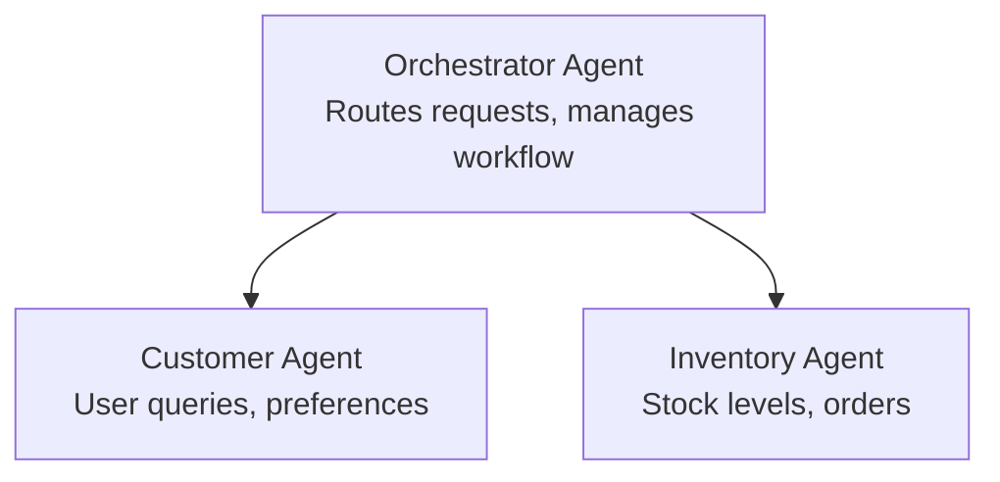

# Kapittel 5: Multi-Agent AI-løsninger

**📚 Kurs**: [AZD For Nybegynnere](../../README.md) | **⏱️ Varighet**: 2-3 timer | **⭐ Kompleksitet**: Avansert

---

## Oversikt

Dette kapittelet dekker avanserte multi-agent arkitekturmønstre, agentorkestrering og produksjonsklare AI-distribusjoner for komplekse scenarier.

> Kommando-veiledning gjennomgått mot den utgitte `azd 1.37.2` referansen. Sky-distribusjoner ble ikke utført.

## Læringsmål

Ved å fullføre dette kapittelet vil du:
- Forstå multi-agent arkitekturmønstre
- Distribuere koordinerte AI-agent systemer
- Implementere agent-til-agent kommunikasjon
- Bygge produksjonsklare multi-agent løsninger

---

## 📚 Leksjoner

| # | Leksjon | Beskrivelse | Tid |
|---|--------|-------------|------|
| 1 | [Multi-Agent Grunnleggende](multi-agent-basics.md) | Praktisk: distribuer en fungerende multi-agent app med `azd up` | 45 min |
| 2 | [Koordineringsmønstre](../chapter-06-pre-deployment/coordination-patterns.md) | Agentorkestreringsstrategier (fortsetter i kapittel 6) | 30 min |
| 3 | [ARM Template Distribusjon](../../examples/retail-multiagent-arm-template/README.md) | Eksempel på ett-klikk distribusjon | 30 min |

> **Start med leksjon 1.** Det er den eneste fullt praktiske, distribuerbare leksjonen i dette kapittelet. Leksjon 2 ligger i kapittel 6 (den er delt med pre-distribusjonsplanlegging), og [Retail Multi-Agent Solution](../../examples/retail-scenario.md) er en arkitekturbeskrivelse—et designreferanse, ikke en én-kommando-mal.

---

## 🚀 Rask start

```bash
# Option 1: Deploy the multi-agent template used in Lesson 1
azd init --template Azure-Samples/contoso-creative-writer .
azd up

# Option 2: Initialize a Foundry agent interactively (requires azure.ai.agents)
azd extension install azure.ai.agents
azd ai agent init
azd up
```

> **Hvilken tilnærming?** Bruk `azd init --template` for å starte fra et fungerende eksempel. Bruk `azd ai agent init` interaktivt, eller `azd ai agent init --template <path-to-azure.yaml>` for å adoptere et eksisterende agentprosjekt. Se [AZD AI CLI-referansen](../chapter-08-production/production-ai-practices.md#azd-ai-cli-commands-and-extensions) for versjonskrav og evalueringsmigrering.

Kjør disse alternativene i separate tomme mapper. Agents-utvidelsen `1.0.0-beta.23` krever `azd >= 1.37.0`; dens interaktive flyt genererer ikke den tilpassede Service Bus pipeline i koordineringsleksjonen.

---

## 🤖 Multi-Agent Arkitektur



---

## 🎯 Fokuserte løsning: Retail Multi-Agent

Løsningen [Retail Multi-Agent Solution](../../examples/retail-scenario.md) demonstrerer:

- **Kundeagent**: Håndterer brukerinteraksjoner og preferanser
- **Lageragent**: Administrerer lager og ordrebehandling
- **Orkestrator**: Koordinerer mellom agenter
- **Delt minne**: Tverragentlig kontekststyring

### Tjenester brukt

| Tjeneste | Formål |
|---------|---------|
| Microsoft Foundry Models | Språkforståelse |
| Azure AI Search | Produktkatalog |
| Cosmos DB | Agenttilstand og minne |
| Container Apps | Agenthosting |
| Application Insights | Overvåking |

---

## 🔗 Navigasjon

| Retning | Kapittel |
|-----------|---------|
| **Forrige** | [Kapittel 4: Infrastruktur](../chapter-04-infrastructure/README.md) |
| **Neste** | [Kapittel 6: Forhåndsutplassering](../chapter-06-pre-deployment/README.md) |

---

## 📖 Relaterte ressurser

- [AI-agenter Veiledning](../chapter-02-ai-development/agents.md)
- [Produksjons AI-praksis](../chapter-08-production/production-ai-practices.md)
- [AI Feilsøking](../chapter-07-troubleshooting/ai-troubleshooting.md)

---

<!-- CO-OP TRANSLATOR DISCLAIMER START -->
**Ansvarsfraskrivelse**:
Dette dokumentet er oversatt ved hjelp av AI-oversettelsestjenesten [Co-op Translator](https://github.com/Azure/co-op-translator). Selv om vi streber etter nøyaktighet, vær oppmerksom på at automatiske oversettelser kan inneholde feil eller unøyaktigheter. Det opprinnelige dokumentet på originalspråket skal betraktes som den autoritative kilden. For kritisk informasjon anbefales profesjonell menneskelig oversettelse. Vi er ikke ansvarlige for eventuelle misforståelser eller feiltolkninger som oppstår ved bruk av denne oversettelsen.
<!-- CO-OP TRANSLATOR DISCLAIMER END -->