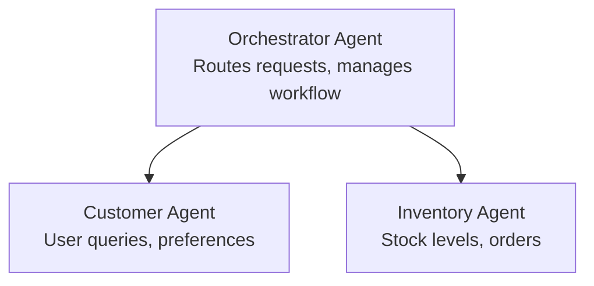

# Kapittel 5: Multi-Agent AI-løsninger

**📚 Kurs**: [AZD For Nybegynnere](../../README.md) | **⏱️ Varighet**: 2-3 timer | **⭐ Vanskelighetsgrad**: Avansert

---

## Oversikt

Dette kapittelet dekker avanserte multi-agent arkitektur-mønstre, agentorchestrering og produksjonsklare AI-distribusjoner for komplekse scenarier.

> Kommandoanvisninger gjennomgått mot den utgitte `azd 1.37.2` referansen. Sky-distribusjoner ble ikke utført.

## Læringsmål

Ved å fullføre dette kapittelet vil du:
- Forstå multi-agent arkitektur-mønstre
- Distribuere koordinerte AI-agent systemer
- Implementere agent-til-agent kommunikasjon
- Bygge produksjonsklare multi-agent løsninger

---

## 📚 Leksjoner

| # | Leksjon | Beskrivelse | Tid |
|---|--------|-------------|------|
| 1 | [Multi-Agent Grunnleggende](multi-agent-basics.md) | Praktisk: distribuer en fungerende multi-agent app med `azd up` | 45 min |
| 2 | [Koordineringsmønstre](../chapter-06-pre-deployment/coordination-patterns.md) | Agentorchestreringsstrategier (fortsetter i Kapittel 6) | 30 min |
| 3 | [ARM Template Distribusjon](../../examples/retail-multiagent-arm-template/README.md) | Ett-klikks distribusjonseksempel | 30 min |

> **Start med Leksjon 1.** Det er den eneste fullstendig praktiske og deploybare leksjonen i dette kapittelet. Leksjon 2 finnes i Kapittel 6 (den deles med forhåndsdistribusjonsplanlegging), og [Retail Multi-Agent Solution](../../examples/retail-scenario.md) er en arkitektur-blåkopi — en designreferanse, ikke en ett-kommando mal.

---

## 🚀 Rask Start

```bash
# Option 1: Deploy the multi-agent template used in Lesson 1
azd init --template Azure-Samples/contoso-creative-writer .
azd up

# Option 2: Initialize a Foundry agent interactively with the GA bundle
azd ext install microsoft.foundry
azd ai agent init
azd up
```

> **Hvilken tilnærming?** Bruk `azd init --template` for å starte fra et fungerende eksempel. Bruk `azd ai agent init` interaktivt, eller `azd ai agent init --template <path-to-azure.yaml>` for å adoptere et pågående agentprosjekt. Se [AZD AI CLI referansen](../chapter-08-production/production-ai-practices.md#azd-ai-cli-commands-and-extensions) for versjonskrav og migrering av evaluering.

Kjør disse alternativene i separate tomme mapper. GA Foundry-arbeidsflyten krever `azd >= 1.37.0`; dens interaktive flyt genererer ikke den tilpassede Service Bus-pipelinen i koordineringsleksjonen. For lokal testing, kode-distribusjon og opprydding av nye versus gjenbrukte prosjekter, følg [hosted-agent gjennomgangen](../chapter-02-ai-development/microsoft-foundry-integration.md#hosted-agent-walkthrough-ga).

---

## 🤖 Multi-Agent Arkitektur



---

## 🎯 Utvalgt løsning: Retail Multi-Agent

The [Retail Multi-Agent Solution](../../examples/retail-scenario.md) demonstrerer:

- **Kundeagent**: Håndterer brukerinteraksjoner og preferanser
- **Lageragent**: Administrerer lager og ordrebehandling
- **Orkestrator**: Koordinerer mellom agenter
- **Delt Minne**: Tverragents kontekststyring

### Tjenester brukt

| Tjeneste | Formål |
|---------|---------|
| Microsoft Foundry Models | Språkforståelse |
| Azure AI Search | Produktkatalog |
| Cosmos DB | Agenttilstand og minne |
| Container Apps | Agenthosting |
| Application Insights | Overvåking |

---

## 🔗 Navigasjon

| Retning | Kapittel |
|-----------|---------|
| **Forrige** | [Kapittel 4: Infrastruktur](../chapter-04-infrastructure/README.md) |
| **Neste** | [Kapittel 6: Forhåndsdistribusjon](../chapter-06-pre-deployment/README.md) |

---

## 📖 Relaterte ressurser

- [AI-agenter Veiledning](../chapter-02-ai-development/agents.md)
- [Praksis for produksjons-AI](../chapter-08-production/production-ai-practices.md)
- [Feilsøking av AI](../chapter-07-troubleshooting/ai-troubleshooting.md)

---

<!-- CO-OP TRANSLATOR DISCLAIMER START -->
**Ansvarsfraskrivelse**:
Dette dokumentet er oversatt ved hjelp av AI-oversettelsestjenesten [Co-op Translator](https://github.com/Azure/co-op-translator). Selv om vi streber etter nøyaktighet, vær oppmerksom på at automatiske oversettelser kan inneholde feil eller unøyaktigheter. Det opprinnelige dokumentet på originalspråket skal betraktes som den autoritative kilden. For kritisk informasjon anbefales profesjonell menneskelig oversettelse. Vi er ikke ansvarlige for eventuelle misforståelser eller feiltolkninger som oppstår ved bruk av denne oversettelsen.
<!-- CO-OP TRANSLATOR DISCLAIMER END -->