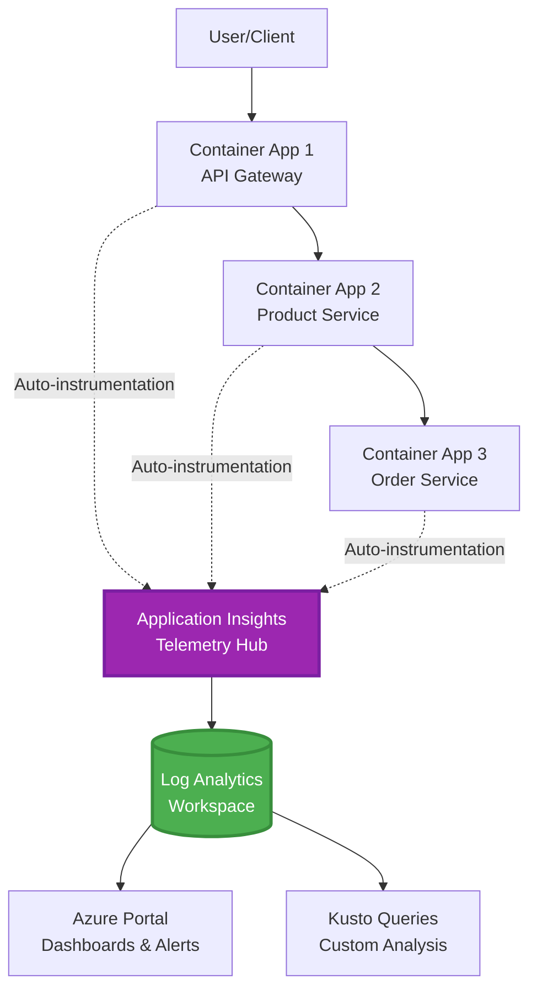
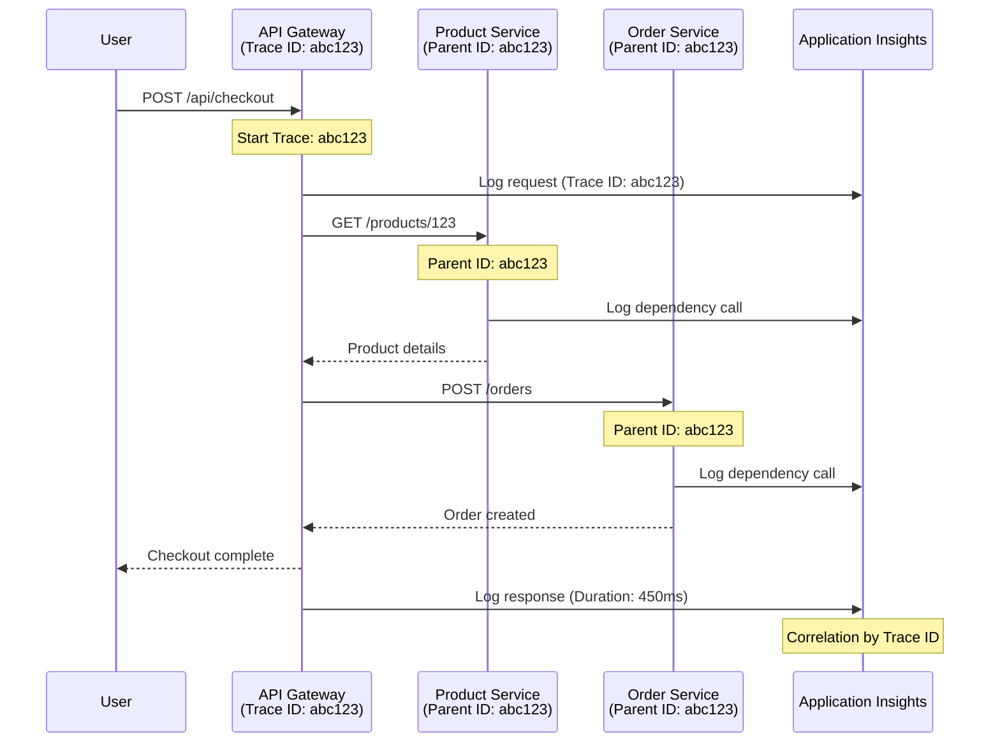

# Integrasjon av Application Insights med AZD

⏱️ **Estimert tid**: 40-50 minutter | 💰 **Kostnadseffekt**: ~$5-15/måned | ⭐ **Kompleksitet**: Middels

**📚 Læringssti:**
- ← Forrige: [Forhåndssjekk](preflight-checks.md) - Validering før distribusjon
- 🎯 **Du er her**: Integrasjon av Application Insights (Overvåking, telemetri, feilsøking)
- → Neste: [Distribusjonsveiledning](../chapter-04-infrastructure/deployment-guide.md) - Distribuer til Azure
- 🏠 [Kurs Hjem](../../README.md)

---

## Hva du vil lære

Ved å fullføre denne leksjonen vil du:
- Deklarere **Application Insights** i AZD-infrastruktur og konfigurere SDK-instrumentering
- Konfigurere **distribuert sporing** for mikroservicer
- Implementere **tilpasset telemetri** (målinger, hendelser, avhengigheter)
- Sette opp **live metrics** for sanntidsovervåking
- Lage **varsler og dashbord** fra AZD-distribusjoner
- Feilsøke produksjonsproblemer med **telemetri-spørringer**
- Optimalisere **kostnader og sampling** strategier
- Overvåke **AI/LLM-applikasjoner** (tokens, forsinkelse, kostnader)

## Hvorfor Application Insights med AZD er viktig

### Utfordringen: Observabilitet i produksjon

**Uten Application Insights:**
```
❌ No visibility into production behavior
❌ Manual log aggregation across services
❌ Reactive debugging (wait for customer complaints)
❌ No performance metrics
❌ Cannot trace requests across services
❌ Unknown failure rates and bottlenecks
```

**Med Application Insights + AZD:**
```
✅ Automatic telemetry collection
✅ Centralized logs from all services
✅ Proactive issue detection
✅ End-to-end request tracing
✅ Performance metrics and insights
✅ Real-time dashboards
✅ AZD provisions the monitoring declared in your templates
```

**Analogi**: Application Insights er som å ha en "svart boks" flyopptaker + cockpit-dashboard for applikasjonen din. Du ser alt som skjer i sanntid og kan spille av alle hendelser.

---

## Arkitekturoversikt

### Application Insights i AZD-arkitekturen



### Hva som overvåkes automatisk

Støttet automatisk instrumentering fanger opp forespørsler/avhengigheter for instrumenterte biblioteker. Tilpassede hendelser og målinger krever applikasjonskode; tilgjengelighetstester må konfigureres separat. Den samler ikke inn alt nedenfor bare fordi ressursen eksisterer.

| Telemetritype | Hva den fanger | Bruksområde |
|----------------|------------------|----------|
| **Forespørsler** | HTTP-forespørsler, statuskoder, varighet | API-ytelsesovervåking |
| **Avhengigheter** | Eksterne kall (DB, APIer, lagring) | Identifisere flaskehalser |
| **Unntak** | Ubehandlede feil med stack traces | Feilsøking av feil |
| **Tilpassede hendelser** | Forretningshendelser (påmelding, kjøp) | Analyse og trakter |
| **Målinger** | Ytelsestellere, tilpassede målinger | Kapasitetsplanlegging |
| **Spor** | Loggmeldinger med alvorlighetsgrad | Feilsøking og revisjon |
| **Tilgjengelighet** | Oppetid og responstidstester | SLA-overvåking |

---

## Forutsetninger

### Nødvendige verktøy

```bash
# Verify Azure Developer CLI
azd version
# Command reference baseline: azd 1.37.2

# Verify Azure CLI
az --version
# ✅ Expected: azure-cli 2.50.0 or higher
```

### Azure-krav

- Aktivt Azure-abonnement
- Tillatelser til å opprette:
  - Application Insights-ressurser
  - Log Analytics-arbeidsområder
  - Container Apps
  - Ressursgrupper

### Forutgående kunnskap

Du bør ha fullført:
- [AZD Grunnleggende](../chapter-01-foundation/azd-basics.md) - Kjerne AZD-konsepter
- [Konfigurasjon](../chapter-03-configuration/configuration.md) - Miljøoppsett
- [Første prosjekt](../chapter-01-foundation/first-project.md) - Grunnleggende distribusjon

---

## Leksjon 1: Automatisk Application Insights med AZD

### Hvordan AZD klargjør Application Insights

AZD klargjør Application Insights **bare når prosjektets infrastruktur erklærer det**. `azure.yaml` alene oppretter ikke overvåking eller instrumenterer applikasjonskode.

> **Eksempelomfang:** Denne leksjonen inneholder integrasjonsfragmenter, ikke et komplett `monitored-app` prosjekt i dette depotet. Lever en hovedmal og parametermapping, et Container Apps-miljø, register/bilde og identitetskonfigurasjon, Dockerfile, og servicetagger før distribusjon. Senere leksjoner viser alternative/utvidelsesfragmenter, ikke filer som alle kan limes sammen uendret. Start med et fungerende [mikrotjenesteksempel](../../../../examples/microservices) hvis du trenger et kjørbart utgangspunkt.

### Prosjektstruktur

```
monitored-app/
├── azure.yaml                     # AZD configuration
├── infra/
│   ├── main.bicep                # Main infrastructure
│   ├── core/
│   │   └── monitoring.bicep      # Application Insights + Log Analytics
│   └── app/
│       └── api.bicep             # Container App with monitoring
└── src/
    ├── app.py                    # Application with telemetry
    ├── requirements.txt
    └── Dockerfile
```

---

### Steg 1: Konfigurer AZD (azure.yaml)

**Fil: `azure.yaml`**

```yaml
name: monitored-app
metadata:
  template: monitored-app@1.0.0

services:
  api:
    project: ./src
    language: python
    host: containerapp

# Monitoring must be declared in infra/ and enabled in application code.
```

Dette erklærer tjenesten som kan distribueres. Følgende Bicep og SDK-konfigurasjon leverer overvåking; azd legger dem ikke til implisitt.

---

### Steg 2: Overvåkingsinfrastruktur (Bicep)

**Fil: `infra/core/monitoring.bicep`**

```bicep
param logAnalyticsName string
param applicationInsightsName string
param location string = resourceGroup().location
param tags object = {}

// Log Analytics Workspace (required for Application Insights)
resource logAnalytics 'Microsoft.OperationalInsights/workspaces@2022-10-01' = {
  name: logAnalyticsName
  location: location
  tags: tags
  properties: {
    sku: {
      name: 'PerGB2018'  // Pay-as-you-go pricing
    }
    retentionInDays: 30  // Keep logs for 30 days
    features: {
      enableLogAccessUsingOnlyResourcePermissions: true
    }
  }
}

// Application Insights
resource applicationInsights 'Microsoft.Insights/components@2020-02-02' = {
  name: applicationInsightsName
  location: location
  tags: tags
  kind: 'web'
  properties: {
    Application_Type: 'web'
    WorkspaceResourceId: logAnalytics.id
    IngestionMode: 'LogAnalytics'
    publicNetworkAccessForIngestion: 'Enabled'
    publicNetworkAccessForQuery: 'Enabled'
  }
}

// Outputs for Container Apps
output logAnalyticsWorkspaceId string = logAnalytics.id
output logAnalyticsWorkspaceName string = logAnalytics.name
output applicationInsightsConnectionString string = applicationInsights.properties.ConnectionString
output applicationInsightsInstrumentationKey string = applicationInsights.properties.InstrumentationKey
output applicationInsightsName string = applicationInsights.name
output applicationInsightsId string = applicationInsights.id
```

---

### Steg 3: Koble Container App til Application Insights

**Fil: `infra/app/api.bicep`**

```bicep
param name string
param location string
param tags object = {}
param containerAppsEnvironmentId string
param containerImage string
param applicationInsightsConnectionString string

resource containerApp 'Microsoft.App/containerApps@2023-05-01' = {
  name: name
  location: location
  tags: tags
  properties: {
    managedEnvironmentId: containerAppsEnvironmentId
    configuration: {
      ingress: {
        external: true
        targetPort: 8000
      }
      secrets: [
        {
          name: 'appinsights-connection-string'
          value: applicationInsightsConnectionString
        }
      ]
    }
    template: {
      containers: [
        {
          name: 'api'
          image: containerImage // Supply an accessible image and registry authentication
          resources: {
            cpu: json('0.5')
            memory: '1Gi'
          }
          env: [
            {
              name: 'APPLICATIONINSIGHTS_CONNECTION_STRING'
              secretRef: 'appinsights-connection-string'
            }
            {
              name: 'APPLICATIONINSIGHTS_ENABLED'
              value: 'true'
            }
          ]
        }
      ]
    }
  }
}

output uri string = 'https://${containerApp.properties.configuration.ingress.fqdn}'
```

---

### Steg 4: Applikasjonskode med telemetri

**Fil: `src/app.py`**

```python
from flask import Flask, request, jsonify
from azure.monitor.opentelemetry import configure_azure_monitor
import logging
import os

app = Flask(__name__)

# Get Application Insights connection string
connection_string = os.environ.get('APPLICATIONINSIGHTS_CONNECTION_STRING')

if connection_string:
    # Azure Monitor OpenTelemetry instruments supported libraries, including Flask.
    configure_azure_monitor(
        connection_string=connection_string,
        logger_name=__name__,
        enable_live_metrics=True
    )
    logger = logging.getLogger(__name__)
    logger.setLevel(logging.INFO)
    
    print("✅ Application Insights enabled")
else:
    logger = logging.getLogger(__name__)
    logger.setLevel(logging.INFO)
    print("⚠️ Application Insights not configured")

@app.route('/health')
def health():
    logger.info('Health check endpoint called')
    return jsonify({'status': 'healthy', 'monitoring': 'enabled' if connection_string else 'disabled'})

@app.route('/api/products')
def get_products():
    logger.info('Fetching products')
    
    # In-memory fixture: this is not a database dependency call.
    products = [
        {'id': 1, 'name': 'Laptop', 'price': 999.99},
        {'id': 2, 'name': 'Mouse', 'price': 29.99},
        {'id': 3, 'name': 'Keyboard', 'price': 79.99}
    ]
    
    logger.info(f'Returned {len(products)} products')
    return jsonify(products)

@app.route('/api/error-test')
def error_test():
    """Test error tracking"""
    logger.error('Testing error tracking')
    try:
        raise ValueError('This is a test exception')
    except Exception as e:
        logger.exception('Exception occurred in error-test endpoint')
        return jsonify({'error': str(e)}), 500

@app.route('/api/slow')
def slow_endpoint():
    """Test performance tracking"""
    import time
    logger.info('Slow endpoint called')
    time.sleep(3)  # Simulate slow operation
    logger.warning('Endpoint took 3 seconds to respond')
    return jsonify({'message': 'Slow operation completed'})

if __name__ == '__main__':
    app.run(host='0.0.0.0', port=8000)
```

**Fil: `src/requirements.txt`**

```txt
Flask
azure-monitor-opentelemetry
gunicorn
requests
openai
```

Løs disse avhengighetene i prosjektet ditt, test dem sammen, og lås versjonene som følge. Nye prosjekter bør bruke Azure Monitor OpenTelemetry, ikke de utgåtte OpenCensus Python-eksportørene.

---

### Steg 5: Distribuer og verifiser

```bash
# Deploy only after completing and wiring the infrastructure fragments above
azd up

# Get app URL
APP_URL=$(azd env get-value API_URL) # Requires this output in main.bicep

# Generate telemetry
curl $APP_URL/health
curl $APP_URL/api/products
curl $APP_URL/api/error-test
curl $APP_URL/api/slow
```

**✅ Forventet utgang:**
```json
{
  "status": "healthy",
  "monitoring": "enabled"
}
```

---

### Steg 6: Se telemetri i Azure-portalen

```bash
# Get Application Insights details
azd env get-values | grep APPLICATIONINSIGHTS

# Open in Azure Portal
az monitor app-insights component show \
  --app $(azd env get-values | grep APPLICATIONINSIGHTS_NAME | cut -d '=' -f2 | tr -d '"') \
  --resource-group $(azd env get-values | grep AZURE_RESOURCE_GROUP | cut -d '=' -f2 | tr -d '"') \
  --query "appId" -o tsv
```

**Naviger til Azure Portal → Application Insights → Transaction Search**

Du bør se:
- ✅ HTTP-forespørsler med statuskoder
- ✅ Forespørselsvarighet (3+ sekunder for `/api/slow`)
- ✅ Unntaksdetaljer fra `/api/error-test`
- ✅ Tilpassede loggmeldinger

---

## Leksjon 2: Tilpasset telemetri og hendelser

### Spor forretningshendelser

La oss legge til tilpasset telemetri for forretningskritiske hendelser.

**Fil: `src/telemetry.py`**

```python
from contextlib import contextmanager
from azure.monitor.opentelemetry import configure_azure_monitor
from opentelemetry import metrics, trace
from opentelemetry.trace import SpanKind
import logging
import os

class TelemetryClient:
    """Custom telemetry client for Application Insights"""
    
    def __init__(self, connection_string=None):
        self.connection_string = connection_string or os.environ.get('APPLICATIONINSIGHTS_CONNECTION_STRING')
        
        # Configure once per process. If app.py already calls this, keep only
        # one configure_azure_monitor call and use logger_name='telemetry'.
        if self.connection_string:
            configure_azure_monitor(
                connection_string=self.connection_string,
                logger_name=__name__,
                enable_live_metrics=True
            )
        self.logger = logging.getLogger(__name__)
        self.logger.setLevel(logging.INFO)
        self.tracer = trace.get_tracer(__name__)
        self.meter = metrics.get_meter(__name__)
        self.instruments = {}
    
    def track_event(self, event_name: str, properties: dict = None):
        """Track custom business event"""
        properties = properties or {}
        self.logger.info(
            f"CustomEvent: {event_name}",
            extra={
                # OTel log attributes become customDimensions in App Insights.
                    'event_name': event_name,
                    **properties
            }
        )
    
    def track_metric(self, metric_name: str, value: float, properties: dict = None):
        """Track custom metric"""
        properties = properties or {}
        if metric_name not in self.instruments:
            self.instruments[metric_name] = self.meter.create_histogram(metric_name)
        self.instruments[metric_name].record(value, attributes=properties)
    
    @contextmanager
    def track_dependency(self, name: str):
        """Time the real operation inside a client span; exceptions mark failure."""
        with self.tracer.start_as_current_span(name, kind=SpanKind.CLIENT) as span:
            yield span

# Global telemetry client
telemetry = TelemetryClient()
```

### Oppdater applikasjon med tilpassede hendelser

**Fil: `src/app.py` (forbedret)**

Legg til disse rutene i eksisterende Flask-applikasjon; behold de tidligere helse-/testrutene. Den forkortede blokken nedenfor viser en separat app for klarhet. Telemetri-initiering finnes nå i `telemetry.py`—ikke initialiser eksportører to ganger.

```python
from flask import Flask, request, jsonify
from telemetry import telemetry
import time
import random
import os

app = Flask(__name__)

@app.route('/api/purchase', methods=['POST'])
def purchase():
    """Track purchase event with custom telemetry"""
    data = request.get_json(silent=True) or {}
    product_id = data.get('product_id')
    quantity = data.get('quantity', 1)
    price = data.get('price', 0)
    if not isinstance(quantity, int) or quantity < 1 or \
       not isinstance(price, (int, float)) or price < 0:
        return jsonify({'error': 'quantity and price must be non-negative numbers; quantity >= 1'}), 400
    
    # Track business event
    telemetry.track_event('Purchase', {
        'product_id': product_id,
        'quantity': quantity,
        'total_amount': price * quantity,
        'user_id': request.headers.get('X-User-Id', 'anonymous')
    })
    
    # Track revenue metric
    telemetry.track_metric('Revenue', price * quantity, {
        'product_id': product_id,
        'currency': 'USD'
    })
    
    return jsonify({
        'order_id': f'ORD-{random.randint(1000, 9999)}',
        'status': 'confirmed',
        'total': price * quantity
    })

@app.route('/api/search')
def search():
    """Track search queries"""
    query = request.args.get('q', '')
    
    start_time = time.time()
    
    # Simulate search (would be real database query)
    results = [{'id': 1, 'name': f'Result for {query}'}]
    
    duration = (time.time() - start_time) * 1000  # Convert to ms
    
    # Track search event
    telemetry.track_event('Search', {
        'query': query,
        'results_count': len(results),
        'duration_ms': duration
    })
    
    # Track search performance metric
    telemetry.track_metric('SearchDuration', duration, {
        'query_length': len(query)
    })
    
    return jsonify({'results': results, 'count': len(results)})

@app.route('/api/external-call')
def external_call():
    """Track external API dependency"""
    import requests
    
    try:
        # Set an actual test endpoint; api.example.com is not a working API.
        with telemetry.track_dependency('ExternalAPI'):
            response = requests.get(os.environ['EXTERNAL_API_URL'], timeout=5)
            response.raise_for_status()
            result = response.json()
    except Exception as e:
        return jsonify({'error': 'External dependency failed'}), 502
    
    return jsonify(result)

if __name__ == '__main__':
    app.run(host='0.0.0.0', port=8000)
```

### Test tilpasset telemetri

```bash
# Track purchase event
curl -X POST $APP_URL/api/purchase \
  -H "Content-Type: application/json" \
  -H "X-User-Id: user123" \
  -d '{"product_id": 1, "quantity": 2, "price": 29.99}'

# Track search event
curl "$APP_URL/api/search?q=laptop"

# Track external dependency
curl $APP_URL/api/external-call
```

**Se i Azure Portal:**

Naviger til Application Insights → Logs, kjør deretter:

```kusto
// View purchase events
traces
| where customDimensions.event_name == "Purchase"
| project 
    timestamp,
    product_id = tostring(customDimensions.product_id),
    total_amount = todouble(customDimensions.total_amount),
    user_id = tostring(customDimensions.user_id)
| order by timestamp desc

// Revenue recorded in Purchase events (not a billing ledger)
traces
| where customDimensions.event_name == "Purchase"
| summarize TotalRevenue = sum(todouble(customDimensions.total_amount)) by bin(timestamp, 1h)
| render timechart

// View search performance
traces
| where customDimensions.event_name == "Search"
| summarize 
    AvgDuration = avg(todouble(customDimensions.duration_ms)),
    SearchCount = count()
  by bin(timestamp, 5m)
| render timechart
```

---

## Leksjon 3: Distribuert sporing for mikroservicer

### Aktiver sporing på tvers av tjenester

Med kompatibel instrumentering og W3C trace-context-propagasjon korrelerer Application Insights forespørsler på tvers av tjenester. Å dele en tilkoblingsstreng alene etablerer ikke foreldrebarn-spans. Følgende arkitekturfragment refererer til moduler du må implementere.

**Fil: `infra/main.bicep`**

```bicep
targetScope = 'subscription'

param environmentName string
param location string = 'eastus'

var tags = { 'azd-env-name': environmentName }

resource rg 'Microsoft.Resources/resourceGroups@2021-04-01' = {
  name: 'rg-${environmentName}'
  location: location
  tags: tags
}

// Monitoring (shared by all services)
module monitoring './core/monitoring.bicep' = {
  name: 'monitoring'
  scope: rg
  params: {
    logAnalyticsName: 'log-${environmentName}'
    applicationInsightsName: 'appi-${environmentName}'
    location: location
    tags: tags
  }
}

// API Gateway
module apiGateway './app/api-gateway.bicep' = {
  name: 'api-gateway'
  scope: rg
  params: {
    name: 'ca-gateway-${environmentName}'
    location: location
    tags: union(tags, { 'azd-service-name': 'gateway' })
    applicationInsightsConnectionString: monitoring.outputs.applicationInsightsConnectionString
  }
}

// Product Service
module productService './app/product-service.bicep' = {
  name: 'product-service'
  scope: rg
  params: {
    name: 'ca-products-${environmentName}'
    location: location
    tags: union(tags, { 'azd-service-name': 'products' })
    applicationInsightsConnectionString: monitoring.outputs.applicationInsightsConnectionString
  }
}

// Order Service
module orderService './app/order-service.bicep' = {
  name: 'order-service'
  scope: rg
  params: {
    name: 'ca-orders-${environmentName}'
    location: location
    tags: union(tags, { 'azd-service-name': 'orders' })
    applicationInsightsConnectionString: monitoring.outputs.applicationInsightsConnectionString
  }
}

output APPLICATIONINSIGHTS_CONNECTION_STRING string = monitoring.outputs.applicationInsightsConnectionString
output GATEWAY_URL string = apiGateway.outputs.uri
```

### Se ende-til-ende transaksjon



**Spørr ende-til-ende-spor:**

```kusto
// Find complete request flow
let traceId = "abc123...";  // Copy operation_Id from a request in Application Insights
dependencies
| union requests
| where operation_Id == traceId
| project 
    timestamp,
    type = itemType,
    name,
    duration,
    success,
    cloud_RoleName
| order by timestamp asc
```

---

## Leksjon 4: Live Metrics og sanntidsovervåking

### Aktiver Live Metrics-strøm

Live Metrics gir nær-sanntids telemetri når det støttes og aktiveres av SDK. Det er ikke en forsinkelses-SLA. Python OpenTelemetry-oppsettet ovenfor velger dette med `enable_live_metrics=True`.

**Åpne Live Metrics:**

```bash
# Get Application Insights resource
APPI_NAME=$(azd env get-values | grep APPLICATIONINSIGHTS_NAME | cut -d '=' -f2 | tr -d '"')

# Get resource group
RG_NAME=$(azd env get-values | grep AZURE_RESOURCE_GROUP | cut -d '=' -f2 | tr -d '"')

echo "Navigate to: Azure Portal → Resource Groups → $RG_NAME → $APPI_NAME → Live Metrics"
```

**Hva du ser i sanntid:**
- ✅ Innkommende forespørselsrate (forespørsler/sekund)
- ✅ Utgående avhengighetskall
- ✅ Antall unntak
- ✅ CPU- og minnebruk
- ✅ Antall aktive servere
- ✅ Prøvetakingsdata for telemetri

### Generer belastning for testing

```bash
# Generate load to see live metrics
for i in {1..100}; do
  curl --silent --max-time 10 "$APP_URL/api/products"
  curl --silent --max-time 10 "$APP_URL/api/search?q=test$i"
done

# Watch live metrics in Azure Portal
# You should see request rate spike
```

---

## Praktiske øvelser

### Øvelse 1: Sett opp varsler ⭐⭐ (Middels)

**Mål**: Opprett varsler for høye feilrater og langsomme responser.

**Steg:**

1. **Opprett varsel for feilrate:**

```bash
# Get Application Insights resource ID
APPI_ID=$(az monitor app-insights component show \
  --app $APPI_NAME \
  --resource-group $RG_NAME \
  --query "id" -o tsv)

# Create metric alert for failed requests
az monitor metrics alert create \
  --name "High-Error-Rate" \
  --resource-group $RG_NAME \
  --scopes $APPI_ID \
  --condition "count requests/failed > 10" \
  --window-size 5m \
  --evaluation-frequency 1m \
  --description "Alert when failed request count exceeds 10 per 5 minutes"
```

2. **Opprett varsel for langsomme responser:**

```bash
az monitor metrics alert create \
  --name "Slow-Responses" \
  --resource-group $RG_NAME \
  --scopes $APPI_ID \
  --condition "avg requests/duration > 3000" \
  --window-size 5m \
  --evaluation-frequency 1m \
  --description "Alert when average response time exceeds 3 seconds"
```

3. **Opprett varsel via Bicep (foretrukket for AZD):**

**Fil: `infra/core/alerts.bicep`**

```bicep
param applicationInsightsId string
param actionGroupId string = ''
param location string = resourceGroup().location

// High error rate alert
resource errorRateAlert 'Microsoft.Insights/metricAlerts@2018-03-01' = {
  name: 'high-error-rate'
  location: 'global'
  properties: {
    description: 'Alert when error rate exceeds threshold'
    severity: 2
    enabled: true
    scopes: [
      applicationInsightsId
    ]
    evaluationFrequency: 'PT1M'
    windowSize: 'PT5M'
    criteria: {
      'odata.type': 'Microsoft.Azure.Monitor.SingleResourceMultipleMetricCriteria'
      allOf: [
        {
          name: 'Error rate'
          metricName: 'requests/failed'
          operator: 'GreaterThan'
          threshold: 10
          timeAggregation: 'Count'
        }
      ]
    }
    actions: actionGroupId != '' ? [
      {
        actionGroupId: actionGroupId
      }
    ] : []
  }
}

// Slow response alert
resource slowResponseAlert 'Microsoft.Insights/metricAlerts@2018-03-01' = {
  name: 'slow-responses'
  location: 'global'
  properties: {
    description: 'Alert when response time is too high'
    severity: 3
    enabled: true
    scopes: [
      applicationInsightsId
    ]
    evaluationFrequency: 'PT1M'
    windowSize: 'PT5M'
    criteria: {
      'odata.type': 'Microsoft.Azure.Monitor.SingleResourceMultipleMetricCriteria'
      allOf: [
        {
          name: 'Response duration'
          metricName: 'requests/duration'
          operator: 'GreaterThan'
          threshold: 3000
          timeAggregation: 'Average'
        }
      ]
    }
  }
}

output errorAlertId string = errorRateAlert.id
output slowResponseAlertId string = slowResponseAlert.id
```

4. **Test varsler:**

```bash
# Generate errors
for i in {1..20}; do
  curl $APP_URL/api/error-test
done

# Generate slow responses
for i in {1..10}; do
  curl $APP_URL/api/slow
done

# Check rule configuration (not fired/resolved alert-instance history)
az monitor metrics alert list \
  --resource-group $RG_NAME \
  --query "[].{Name:name, Enabled:enabled}" \
  --output table
```

**✅ Suksesskriterier:**
- ✅ Varsler opprettet vellykket
- ✅ Varsler utløses når terskler overskrides
- ✅ Kan se varselhistorikk i Azure Portal
- ✅ Integrert med AZD-distribusjon

**Tid**: 20-25 minutter

---

### Øvelse 2: Opprett tilpasset dashbord ⭐⭐ (Middels)

**Mål**: Bygg et dashbord som viser nøkkelapplikasjonsmålinger.

**Steg:**

1. **Lag dashbord via Azure Portal:**

Naviger til: Azure Portal → Dashboards → Nytt dashbord

2. **Legg til fliser for nøkkelmålinger:**

- Antall forespørsler (siste 24 timer)
- Gjennomsnittlig responstid
- Feilrate
- Topp 5 langsomste operasjoner
- Geografisk brukerfordeling

3. **Lag dashbord via Bicep:**

**Fil: `infra/core/dashboard.bicep`**

```bicep
param dashboardName string
param applicationInsightsId string
param location string = resourceGroup().location

resource dashboard 'Microsoft.Portal/dashboards@2020-09-01-preview' = {
  name: dashboardName
  location: location
  properties: {
    lenses: [
      {
        order: 0
        parts: [
          // Request count
          {
            position: {
              x: 0
              y: 0
              rowSpan: 4
              colSpan: 6
            }
            metadata: {
              type: 'Extension/Microsoft_OperationsManagementSuite_Workspace/PartType/LogsDashboardPart'
              inputs: [
                {
                  name: 'resourceId'
                  value: applicationInsightsId
                }
                {
                  name: 'query'
                  value: '''
                    requests
                    | summarize RequestCount = count() by bin(timestamp, 1h)
                    | render timechart
                  '''
                }
              ]
            }
          }
          // Error rate
          {
            position: {
              x: 6
              y: 0
              rowSpan: 4
              colSpan: 6
            }
            metadata: {
              type: 'Extension/Microsoft_OperationsManagementSuite_Workspace/PartType/LogsDashboardPart'
              inputs: [
                {
                  name: 'resourceId'
                  value: applicationInsightsId
                }
                {
                  name: 'query'
                  value: '''
                    requests
                    | summarize 
                        Total = count(),
                        Failed = countif(success == false)
                    | extend ErrorRate = (Failed * 100.0) / Total
                    | project ErrorRate
                  '''
                }
              ]
            }
          }
        ]
      }
    ]
  }
}

output dashboardId string = dashboard.id
```

4. **Distribuer dashbord:**

```bicep
// Add to a subscription-scoped main.bicep with rg and monitoring declared
module dashboard './core/dashboard.bicep' = {
  name: 'dashboard'
  scope: rg
  params: {
    dashboardName: 'dashboard-${environmentName}'
    applicationInsightsId: monitoring.outputs.applicationInsightsId
    location: location
  }
}
```

```bash
# Deploy
azd up
```

**✅ Suksesskriterier:**
- ✅ Dashbord viser nøkkelmålinger
- ✅ Kan festes til Azure Portal-hjem
- ✅ Oppdateringer i sanntid
- ✅ Distribuerbart via AZD

**Tid**: 25-30 minutter

---

### Øvelse 3: Overvåk AI/LLM-applikasjon ⭐⭐⭐ (Avansert)

**Mål**: Spor Microsoft Foundry Models bruk (tokens, kostnader, forsinkelse).

**Steg:**

1. **Lag AI-overvåkingswrapper:**

**Fil: `src/ai_telemetry.py`**

```python
from telemetry import telemetry
from openai import AzureOpenAI
import time

class MonitoredAzureOpenAI:
    """Microsoft Foundry Models client with automatic telemetry"""
    
    def __init__(self, api_key, endpoint, input_usd_per_million,
                 output_usd_per_million, api_version="2024-10-21"):
        self.client = AzureOpenAI(
            api_key=api_key,
            api_version=api_version,
            azure_endpoint=endpoint
        )
        self.input_rate = input_usd_per_million
        self.output_rate = output_usd_per_million
    
    def chat_completion(self, model: str, messages: list, **kwargs):
        """Track chat completion with telemetry"""
        start_time = time.time()
        
        try:
            # Call Microsoft Foundry Models
            response = self.client.chat.completions.create(
                model=model,
                messages=messages,
                **kwargs
            )
            
            duration = (time.time() - start_time) * 1000  # ms
            
            # Extract usage
            usage = response.usage
            prompt_tokens = usage.prompt_tokens
            completion_tokens = usage.completion_tokens
            total_tokens = usage.total_tokens
            
            # Approximation: supply actual deployment/region/contract rates.
            # Cached input, batch, provisioned and other charges need separate accounting.
            prompt_cost = (prompt_tokens / 1_000_000) * self.input_rate
            completion_cost = (completion_tokens / 1_000_000) * self.output_rate
            total_cost = prompt_cost + completion_cost
            
            # Track custom event
            telemetry.track_event('OpenAI_Request', {
                'model': model,
                'prompt_tokens': prompt_tokens,
                'completion_tokens': completion_tokens,
                'total_tokens': total_tokens,
                'duration_ms': duration,
                'cost_usd': total_cost,
                'success': True
            })
            
            # Track metrics
            telemetry.track_metric('OpenAI_Tokens', total_tokens, {
                'model': model,
                'type': 'total'
            })
            
            telemetry.track_metric('OpenAI_Cost', total_cost, {
                'model': model,
                'currency': 'USD'
            })
            
            telemetry.track_metric('OpenAI_Duration', duration, {
                'model': model
            })
            
            return response
            
        except Exception as e:
            duration = (time.time() - start_time) * 1000
            
            telemetry.track_event('OpenAI_Request', {
                'model': model,
                'duration_ms': duration,
                'success': False,
                'error': str(e)
            })
            
            raise
```

2. **Bruk overvåket klient:**

```python
from flask import Flask, request, jsonify
from ai_telemetry import MonitoredAzureOpenAI
import os

app = Flask(__name__)

# Initialize monitored OpenAI client
openai_client = MonitoredAzureOpenAI(
    api_key=os.environ['AZURE_OPENAI_API_KEY'],
    endpoint=os.environ['AZURE_OPENAI_ENDPOINT'],
    input_usd_per_million=float(os.environ['INPUT_USD_PER_MILLION']),
    output_usd_per_million=float(os.environ['OUTPUT_USD_PER_MILLION'])
)

@app.route('/api/chat', methods=['POST'])
def chat():
    data = request.json
    user_message = data.get('message')
    
    # Call with automatic monitoring
    response = openai_client.chat_completion(
        model=os.environ['AZURE_OPENAI_DEPLOYMENT'], # Deployment name, not catalog ID
        messages=[
            {'role': 'user', 'content': user_message}
        ]
    )
    
    return jsonify({
        'response': response.choices[0].message.content,
        'tokens': response.usage.total_tokens
    })
```

3. **Spørr AI-målinger:**

```kusto
// Total AI spend over time
traces
| where customDimensions.event_name == "OpenAI_Request"
| where tobool(customDimensions.success) == true
| summarize TotalCost = sum(todouble(customDimensions.cost_usd)) by bin(timestamp, 1h)
| render timechart

// Token usage by model
traces
| where customDimensions.event_name == "OpenAI_Request"
| summarize 
    TotalTokens = sum(toint(customDimensions.total_tokens)),
    RequestCount = count()
  by Model = tostring(customDimensions.model)

// Average latency
traces
| where customDimensions.event_name == "OpenAI_Request"
| summarize AvgDuration = avg(todouble(customDimensions.duration_ms))
| project AvgDurationSeconds = AvgDuration / 1000

// Cost per request
traces
| where customDimensions.event_name == "OpenAI_Request"
| extend Cost = todouble(customDimensions.cost_usd)
| summarize 
    TotalCost = sum(Cost),
    RequestCount = count(),
    AvgCostPerRequest = avg(Cost)
```

**✅ Suksesskriterier:**
- ✅ Hvert OpenAI-kall spores automatisk
- ✅ Tokenbruk og kostnader synlige
- ✅ Forsinkelse overvåket
- ✅ Kan sette budsjettvarsler

**Tid**: 35-45 minutter

---

## Kostnadsoptimalisering

### Samplingstrategier

Kontroller kostnader ved å sample telemetri:

```python
import os

# Configure before the one configure_azure_monitor() call in your process.
os.environ["OTEL_TRACES_SAMPLER"] = "microsoft.fixed_percentage"
os.environ["OTEL_TRACES_SAMPLER_ARG"] = "0.1" # 10% trace sampling
```

Spormsampling reduserer ikke hver telemetrikategori med 90 %. Målinger og uavhengig utgitte logger trenger egne volumkontroller. Velg rate basert på observabilitetsbehov, ikke et generelt forbud i produksjon.

Sett SDK-sampling eksplisitt; komponentens `SamplingPercentage` egenskap er ikke en erstatning for å konfigurere Python OpenTelemetry-sampler.

### Datasbevaring

```bicep
resource logAnalytics 'Microsoft.OperationalInsights/workspaces@2022-10-01' = {
  name: logAnalyticsName
  properties: {
    retentionInDays: 30  // Minimum (cheapest)
    // Options: 30, 31, 60, 90, 120, 180, 270, 365, 550, 730
  }
}
```

### Estimerte månedlige kostnader

| Datavolum | Bevaring | Månedlig kostnad |
|-------------|-----------|--------------|
| 1 GB/måned | 30 dager | ~$2-5 |
| 5 GB/måned | 30 dager | ~$10-15 |
| 10 GB/måned | 90 dager | ~$25-40 |
| 50 GB/måned | 90 dager | ~$100-150 |

Disse tallene er illustrative, ikke pristilbud. Verifiser innlasting, bevaring, varsel og testprising i din region og avtale; gratis kvoter er delt/avgrenset etter Azure Monitor-prising, ikke en garantert gratis SKU per Application Insights-ressurs.

---

## Kunnskapssjekkpunkt

### 1. Grunnleggende integrasjon ✓

Test forståelsen din:

- [ ] **Q1**: Hvordan klargjør AZD Application Insights?
  - **A**: Den distribuerer overvåkingsressursene som er eksplisitt erklært av prosjektets Bicep/Terraform-maler.

- [ ] **Q2**: Hvilken miljøvariabel aktiverer Application Insights?
  - **A**: `APPLICATIONINSIGHTS_CONNECTION_STRING`

- [ ] **Q3**: Hva er de tre hovedtelemetritypene?
  - **A**: Forespørsler (HTTP-kall), Avhengigheter (eksterne kall), Unntak (feil)

**Praktisk bekreftelse:**
```bash
# Check if Application Insights is configured
azd env get-values | grep APPLICATIONINSIGHTS

# Verify telemetry is flowing
az monitor app-insights metrics show \
  --app $APPI_NAME \
  --resource-group $RG_NAME \
  --metric "requests/count"
```

---

### 2. Tilpasset telemetri ✓

Test forståelsen din:

- [ ] **Q1**: Hvordan sporer du tilpassede forretningshendelser?
  - **A**: Denne leksjonens wrapper skriver strukturerte OTel-logger med `event_name` attributter, søkbare i `traces`; disse er ikke automatisk `customEvents`.

- [ ] **Q2**: Hva er forskjellen på hendelser og målinger?
  - **A**: Hendelser er diskrete forekomster, målinger er numeriske målinger

- [ ] **Q3**: Hvordan korrelerer du telemetri på tvers av tjenester?
  - **A**: Application Insights bruker automatisk `operation_Id` for korrelasjon

**Praktisk bekreftelse:**
```kusto
// Verify custom events
traces
| where customDimensions.event_name != ""
| summarize count() by tostring(customDimensions.event_name)
```

---

### 3. Produksjonsovervåking ✓

Test forståelsen din:

- [ ] **Q1**: Hva er sampling og hvorfor bruke det?
  - **A**: Sampling reduserer datavolum (og kostnad) ved kun å fange en andel av telemetrien

- [ ] **Q2**: Hvordan setter du opp varsler?
  - **A**: Bruk metrikkvarsler i Bicep eller Azure Portal basert på Application Insights-målinger

- [ ] **Q3**: Hva er forskjellen på Log Analytics og Application Insights?
  - **A**: Application Insights lagrer data i Log Analytics-arbeidsområde; App Insights gir applikasjonsspesifikke visninger

**Praktisk bekreftelse:**
```bash
# Check the sampler configured for the running application, not only the ARM component.
az containerapp show --name "$APP_NAME" --resource-group "$RG_NAME" \
  --query "properties.template.containers[].env[?starts_with(name, 'OTEL_TRACES_SAMPLER')]"
```

---

## Beste praksis

### ✅ GJØR:

1. **Bruk korrelasjons-IDer**
   ```python
   logger.info('Processing order', extra={
           'order_id': order_id,
           'user_id': user_id
   })
   ```

2. **Sett opp varsler for kritiske målinger**
   ```bicep
   // Error rate, slow responses, availability
   ```

3. **Bruk strukturert logging**
   ```python
   # ✅ GOOD: Structured
   logger.info('User signup', extra={'user_id': 'pseudonymous-id'})
   
   # ❌ BAD: Unstructured
   logger.info(f'User 123 signed up')
   ```

4. **Overvåk avhengigheter**
   ```python
   # Automatically track database calls, HTTP requests, etc.
   ```

5. **Bruk Live Metrics under distribusjoner**

### ❌ IKKE GJØR:

1. **Ikke logg sensitiv informasjon**
   ```python
   # ❌ BAD
   logger.info(f'Login: {username}:{password}')
   
   # ✅ GOOD
   logger.info('Login attempt', extra={'result': 'failed'})
   ```

2. **Ikke velg sampling uten å måle volum og diagnostiske behov**
   ```python
   # ❌ Expensive
   # 100% traces may be appropriate for a small workload or investigation.
   
   # ✅ Cost-effective
   # A lower trace rate reduces visibility; validate coverage before enabling.
   ```

3. **Ikke ignorer døde bokskøer**

4. **Ikke glem å sette grenser for dataretensjon**

---

## Feilsøking

### Problem: Ingen telemetri vises

**Diagnose:**
```bash
# Check connection string is set
azd env get-values | grep APPLICATIONINSIGHTS

# Check application logs via Azure Monitor
azd monitor --logs

# Or use Azure CLI for Container Apps:
az containerapp logs show --name $APP_NAME --resource-group $RG_NAME --tail 50
```

**Løsning:**
```bash
# Verify connection string in Container App
az containerapp show \
  --name $APP_NAME \
  --resource-group $RG_NAME \
  --query "properties.template.containers[0].env" \
  | grep -i applicationinsights
```

---

### Problem: Høye kostnader

**Diagnose:**
```bash
# Query ingestion volume in the linked Log Analytics workspace.
# WORKSPACE_ID is the workspace customer ID (GUID), not its ARM resource ID.
az monitor log-analytics query --workspace "$WORKSPACE_ID" \
  --analytics-query "Usage | where TimeGenerated > ago(30d) | where IsBillable == true | summarize IngestedMB=sum(Quantity) by DataType"
```

**Løsning:**
- Reduser samplingsrate
- Kortere retensjonsperiode
- Fjern detaljert logging

---

## Lær mer

### Offisiell dokumentasjon
- [Application Insights Oversikt](https://learn.microsoft.com/azure/azure-monitor/app/app-insights-overview)
- [Azure Monitor OpenTelemetry-oppsett](https://learn.microsoft.com/azure/azure-monitor/app/opentelemetry-enable?tabs=python)
- [Kusto Query Language](https://learn.microsoft.com/azure/data-explorer/kusto/query/)
- [AZD Monitoring](https://learn.microsoft.com/azure/developer/azure-developer-cli/monitor-your-app)

### Neste steg i dette kurset
- ← Forrige: [Forhåndssjekk](preflight-checks.md)
- → Neste: [Distribusjonsveiledning](../chapter-04-infrastructure/deployment-guide.md)
- 🏠 [Kurs Hjem](../../README.md)

### Relaterte eksempler
- [Microsoft Foundry-modeller eksempel](../../../../examples/azure-openai-chat) - AI telemetri
- [Mikrotjenester eksempel](../../../../examples/microservices) - Distribuert sporing

---

## Oppsummering

**Du har lært:**
- ✅ Automatisk Application Insights provisjonering med AZD
- ✅ Tilpasset telemetri (hendelser, målinger, avhengigheter)
- ✅ Distribuert sporing på tvers av mikrotjenester
- ✅ Sanntidsmålinger og overvåking
- ✅ Varsler og dashbord
- ✅ AI/LLM applikasjonsovervåking
- ✅ Kostnadsoptimaliseringsstrategier

**Viktige poeng:**
1. **Angi overvåking eksplisitt** - AZD distribuerer malene dine; SDK-instrumentering sender telemetri
2. **Bruk strukturert logging** - Gjør forespørsler enklere
3. **Spor forretningshendelser** - Ikke bare tekniske målinger
4. **Overvåk AI-kostnader** - Følg tokens og utgifter
5. **Sett opp varsler** - Vær proaktiv, ikke reaktiv
6. **Optimaliser kostnader** - Bruk sampling og retensjonsgrenser

**Neste steg:**
1. Fullfør de praktiske øvelsene
2. Legg til Application Insights i AZD-prosjektene dine
3. Lag tilpassede dashbord for teamet ditt
4. Lær [Distribusjonsveiledning](../chapter-04-infrastructure/deployment-guide.md)

---

<!-- CO-OP TRANSLATOR DISCLAIMER START -->
**Ansvarsfraskrivelse**:
Dette dokumentet er oversatt ved hjelp av AI-oversettelsestjenesten [Co-op Translator](https://github.com/Azure/co-op-translator). Selv om vi streber etter nøyaktighet, vær oppmerksom på at automatiske oversettelser kan inneholde feil eller unøyaktigheter. Det opprinnelige dokumentet på originalspråket skal betraktes som den autoritative kilden. For kritisk informasjon anbefales profesjonell menneskelig oversettelse. Vi er ikke ansvarlige for eventuelle misforståelser eller feiltolkninger som oppstår ved bruk av denne oversettelsen.
<!-- CO-OP TRANSLATOR DISCLAIMER END -->