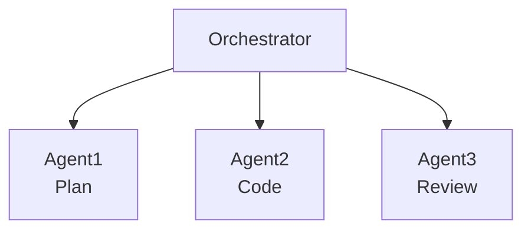
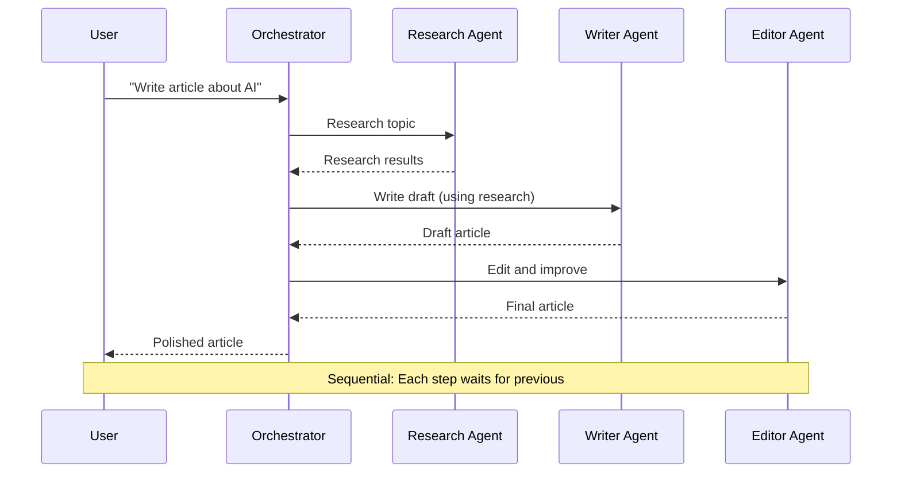
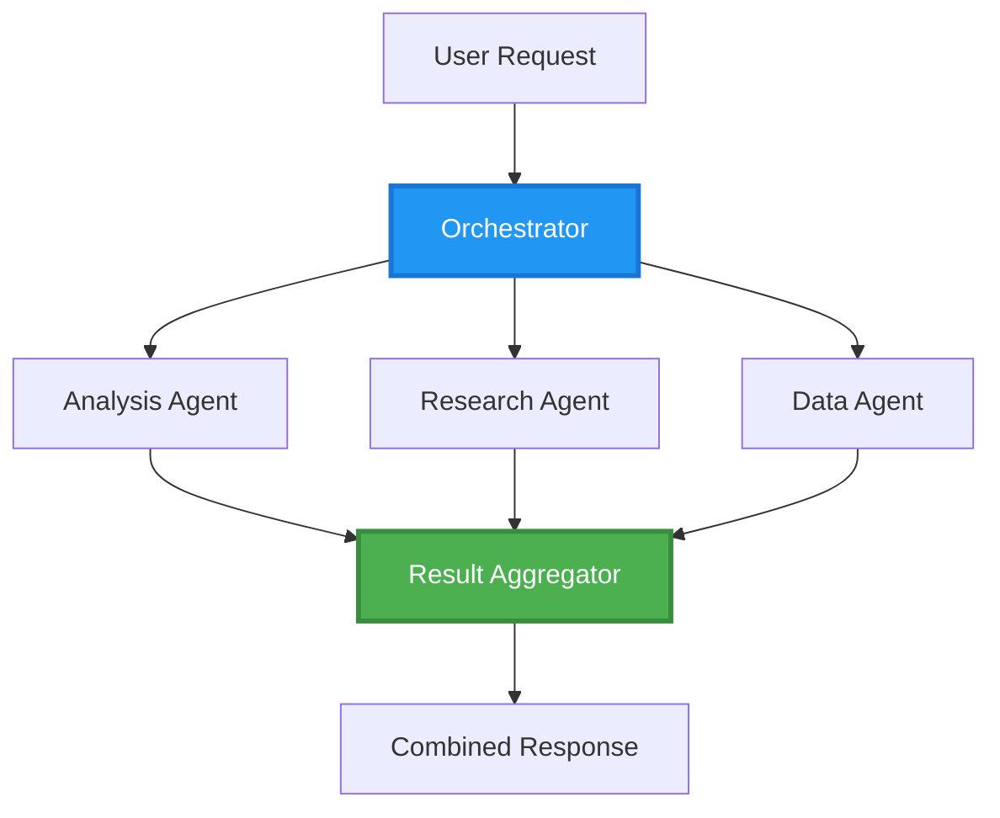
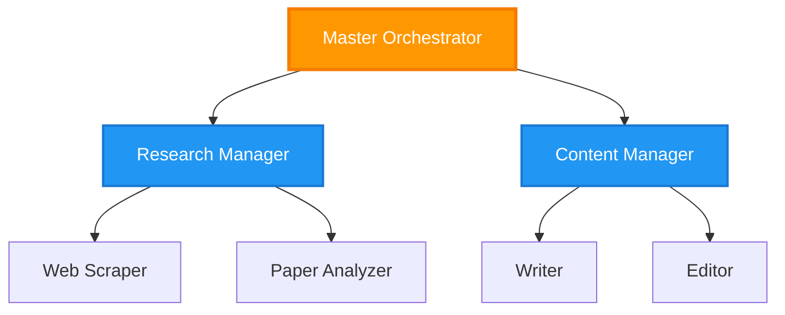
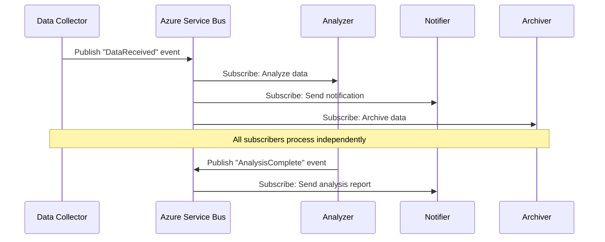
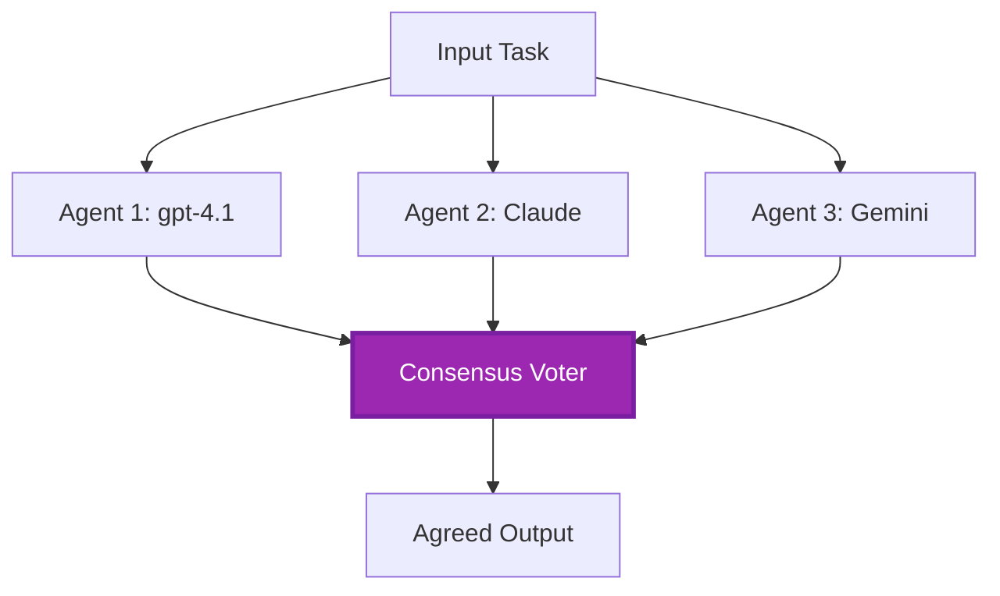
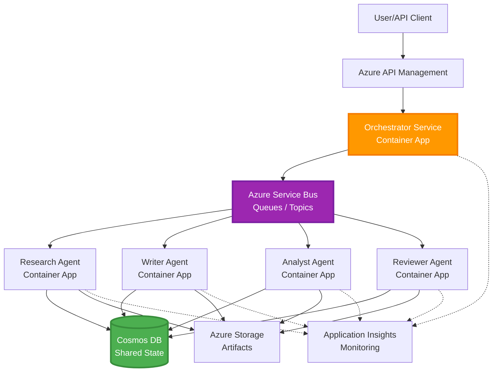

# Mønstre for koordinering av flere agenter

⏱️ **Estimert tid**: 60-75 minutters lesing; flere timer å implementere | 💰 **Estimert kostnad**: avhengig av arbeidsmengde | ⭐ **Kompleksitet**: Avansert

**📚 Læringsløype:**
- ← Forrige: [Capacity Planning](capacity-planning.md) - Ressursstørrelse og skaleringsstrategier
- 🎯 **Du er her**: Mønstre for koordinering av flere agenter (orkestrering, kommunikasjon, tilstandshåndtering)
- → Neste: [SKU Selection](sku-selection.md) - Velge riktige Azure-tjenester
- 🏠 [Kurs Hjem](../../README.md)

---

## Hva du vil lære

Ved å fullføre denne leksjonen vil du:
- Forstå **mønstre for multi-agent-arkitektur** og når man bruker dem
- Implementere **orkestreringsmønstre** (sentralisert, desentralisert, hierarkisk)
- Designe **agentkommunikasjonsstrategier** (synkron, asynkron, hendelsesdrevet)
- Administrere **delt tilstand** på tvers av distribuerte agenter
- Distribuere **multi-agent-systemer** på Azure med AZD
- Anvende **koordinasjonsmønstre** for virkelige AI-scenarier
- Overvåke og feilsøke distribuerte agentsystemer

## Hvorfor koordinering av flere agenter er viktig

### Utviklingen: Fra én agent til flere agenter

**Enkel agent (enkelt):**
```
User → Agent → Response
```
- ✅ Enkel å forstå og implementere
- ✅ Rask for enkle oppgaver
- ❌ Begrenset av en modell sin kapasitet
- ❌ Kan ikke kjøre komplekse oppgaver parallelt
- ❌ Ingen spesialisering

**Multi-agent system (avansert):**

- ✅ Spesialiserte agenter for spesifikke oppgaver
- ✅ Parallell utførelse for hastighet
- ✅ Modulært og vedlikeholdbart
- ✅ Bedre på komplekse arbeidsflyter
- ⚠️ Krever koordinasjonslogikk

**Analogien**: En enkel agent er som én person som gjør alle oppgaver. Multi-agent er som ett team hvor hvert medlem har spesialiserte ferdigheter (forsker, koder, anmelder, skribent) som jobber sammen.

---

## Grunnleggende koordinasjonsmønstre

### Mønster 1: Sekvensiell koordinering (Ansvarskjede)

**Når du skal bruke det**: Oppgaver må fullføres i bestemt rekkefølge, hver agent bygger på forrige resultat.



**Fordeler:**
- ✅ Klart dataflyt
- ✅ Enkel å feilsøke
- ✅ Forutsigbar utførelsesrekkefølge

**Begrensninger:**
- ❌ Langsommere (ingen parallellitet)
- ❌ Én feil blokkerer hele kjeden
- ❌ Kan ikke håndtere innbyrdes avhengige oppgaver

**Eksempler på brukstilfeller:**
- Innholdsproduksjon (forskning → skrive → redigere → publisere)
- Kodegenerering (plan → implementer → test → distribuer)
- Rapportgenerering (datainnsamling → analyse → visualisering → sammendrag)

---

### Mønster 2: Parallell koordinering (Fan-Out/Fan-In)

**Når du skal bruke det**: Uavhengige oppgaver kan kjøre samtidig, resultatene kombineres til slutt.



**Fordeler:**
- ✅ Raskt (parallell utførelse)
- ✅ Feiltolerant (delvise resultater akseptable)
- ✅ Skalerer horisontalt

**Begrensninger:**
- ⚠️ Resultater kan komme i feil rekkefølge
- ⚠️ Krever aggregeringslogikk
- ⚠️ Kompleks tilstandshåndtering

**Eksempler på brukstilfeller:**
- Innsamling fra flere kilder (API-er + databaser + nettskraping)
- Konkurranseanalyse (flere modeller genererer løsninger, beste velges)
- Oversettelsestjenester (oversette til flere språk samtidig)

---

### Mønster 3: Hierarkisk koordinering (Leder-arbeider)

**Når du skal bruke det**: Komplekse arbeidsflyter med deloppgaver, behov for delegering.



**Fordeler:**
- ✅ Håndterer komplekse arbeidsflyter
- ✅ Modulært og vedlikeholdbart
- ✅ Klare ansvarsgrenser

**Begrensninger:**
- ⚠️ Mer kompleks arkitektur
- ⚠️ Høyere ventetid (flere koordinasjonslag)
- ⚠️ Krever sofistikert orkestrering

**Eksempler på brukstilfeller:**
- Bedriftsdokumentbehandling (klassifiser → rute → prosesser → arkiver)
- Flertrinns datapipelines (innhent → rens → transformer → analyser → rapporter)
- Komplekse automatiseringsarbeidsflyter (planlegging → ressursallokering → utførelse → overvåking)

---

### Mønster 4: Hendelsesdrevet koordinering (Publiser-Abonner)

**Når du skal bruke det**: Agenter må reagere på hendelser, ønsker løs kobling.



**Fordeler:**
- ✅ Løs kobling mellom agenter
- ✅ Enkel å legge til nye agenter (bare abonner)
- ✅ Asynkron prosessering
- ✅ Robust (meldinglagring)

**Begrensninger:**
- ⚠️ Endelig konsistens
- ⚠️ Vanskelig å feilsøke
- ⚠️ Utfordringer med meldingsrekkefølge

**Eksempler på brukstilfeller:**
- Sanntidsovervåkingssystemer (varsler, dashbord, logger)
- Multi-kanal varslinger (epost, SMS, push, Slack)
- Datapipelines (flere konsumenter av samme data)

---

### Mønster 5: Konsensusbasert koordinering (Avstemning/Quorum)

**Når du skal bruke det**: Trenger enighet fra flere agenter før fortsettelse.



**Fordeler:**
- ✅ Høyere nøyaktighet (flere meninger)
- ✅ Feiltolerant (minstevunnet akseptabelt)
- ✅ Integrert kvalitetssikring

**Begrensninger:**
- ❌ Kostbart (flere modellkall)
- ❌ Langsommere (venter på alle agenter)
- ⚠️ Krever konfliktløsning

**Eksempler på brukstilfeller:**
- Innholdsmoderering (flere modeller vurderer innhold)
- Kodegjennomgang (flere linters/analyzers)
- Medisinsk diagnose (flere AI-modeller, ekspertvalidering)

---

## Arkitekturoversikt

### Komplett multi-agent system på Azure



**Nøkkelkomponenter:**

| Komponent | Formål | Azure-tjeneste |
|-----------|---------|---------------|
| **API Gateway** | Inngangspunkt, hastighetsbegrensing, autentisering | API Management |
| **Orkestrator** | Koordinerer agentarbeidsflyter | Container Apps |
| **Meldingskø** | Asynkron kommunikasjon | Service Bus / Event Hubs |
| **Agenter** | Spesialiserte AI-arbeidere | Container Apps / Functions |
| **Tilstandslager** | Delt tilstand, oppgaveoppfølging | Cosmos DB |
| **Artefaktlagring** | Dokumenter, resultater, logger | Blob Storage |
| **Overvåking** | Distribuert sporing, logger | Application Insights |

Service Bus-køer/emner og Event Hubs er forskjellige tjenester med ulike leverings-/konsum-modeller; Event Hubs er ikke en drop-in erstatning for Service Bus workers-koden nedenfor. Parallellitet, vedvarende meldinger og modellavstemming garanterer ikke alene feiltoleranse eller høyere nøyaktighet.

---

## Forutsetninger

### Nødvendige verktøy

```bash
# Verify Azure Developer CLI
azd version
# Command reference baseline: azd 1.37.2

# Verify Azure CLI
az --version
# ✅ Expected: azure-cli 2.50.0 or higher

# Verify Docker (for local testing)
docker --version
# ✅ Expected: Docker version 20.10 or higher
```

### Azure-krav

- Aktiv Azure-abonnement
- Tillatelser til å opprette:
  - Container Apps
  - Service Bus-navnerom
  - Cosmos DB-kontoer
  - Lagringskontoer
  - Application Insights

### Kunnskapsforutsetninger

Du bør ha fullført:
- [Konfigurasjonsstyring](../chapter-03-configuration/configuration.md)
- [Autentisering og sikkerhet](../chapter-03-configuration/authsecurity.md)
- [Microservices-eksempel](../../../../examples/microservices)

---

## Implementasjonsveiledning

> **Designfragmenter, ikke et deployerbart lab:** Prosjektmappa og `File:` etiketter nedenfor beskriver filer du må lage i ditt eget prosjekt; dette repositoriet inneholder ikke en komplett `multi-agent-system` applikasjon. Manglende deler inkluderer main/parameter-maler, Container Apps miljø/registry, Dockerfiler og avhengighetslås, Cosmos database/container-oppsett, modellutplasseringer, identitets-/rollekonfigurasjon, skaleringsregler og parallelle arbeider/køer. Ikke forvent at `azd init` genererer disse filene eller at `azd up` distribuerer kodestykkene uten endringer. For et kjørbart startpunkt, fullfør [Multi-Agent Basics](../chapter-05-multi-agent/multi-agent-basics.md).

**Forutsetninger for kjøring:** Python 3.10+, `azure-servicebus`, `azure-cosmos`, `openai`, Flask, og (for overvåking) `azure-monitor-opentelemetry`; sørg for `shared` i Python import-sti i hver tjenesteimage. Cosmos `agent-state/tasks` container må allerede finnes med partisjonsnøkkel `/id`. Nøkkelbaserte tilkoblinger forenkler disse fragmentene, ikke produktionsanbefaling: foretrekk styrte identiteter med scopes for Service Bus/Cosmos/OpenAI data-plane roller. Ikke eksponer nøkler i utdata eller logger.

Service Bus-levering er **minst én gang**. Vedvar idempotens per oppgave **og steg**, bruk optimistisk samtidighet (ETags) for les/modifiser/skriv tilstand, og forny meldinglåser under lang behandling. Den enkle tilstandsadministratoren nedenfor er kun sekvensiell og implementerer ikke disse produksjonsgarantiene.

### Prosjektstruktur

```
multi-agent-system/
├── azure.yaml                    # AZD configuration
├── infra/
│   ├── main.bicep               # Main infrastructure
│   ├── core/
│   │   ├── servicebus.bicep     # Message queue
│   │   ├── cosmos.bicep         # State store
│   │   ├── storage.bicep        # Artifact storage
│   │   └── monitoring.bicep     # Application Insights
│   └── app/
│       ├── orchestrator.bicep   # Orchestrator service
│       └── agent.bicep          # Agent template
└── src/
    ├── orchestrator/            # Orchestration logic
    │   ├── app.py
    │   ├── workflows.py
    │   └── Dockerfile
    ├── agents/
    │   ├── research/            # Research agent
    │   ├── writer/              # Writer agent
    │   ├── analyst/             # Analyst agent
    │   └── reviewer/            # Reviewer agent
    └── shared/
        ├── state_manager.py     # Shared state logic
        └── message_handler.py   # Message handling
```

---

## Leksjon 1: Sekvensielt koordinasjonsmønster

### Implementasjon: Innholdsproduksjonspipeline

La oss designe en sekvensiell pipeline: Forskning → Skrive → Redigere. Publisering er utenfor dette eksemplet.

### 1. AZD-konfigurasjon

**Fil: `azure.yaml`**

```yaml
name: content-pipeline
metadata:
  template: multi-agent-sequential@1.0.0

services:
  orchestrator:
    project: ./src/orchestrator
    language: python
    host: containerapp
  
  research-agent:
    project: ./src/agents/research
    language: python
    host: containerapp
  
  writer-agent:
    project: ./src/agents/writer
    language: python
    host: containerapp
  
  editor-agent:
    project: ./src/agents/editor
    language: python
    host: containerapp
```

### 2. Infrastruktur: Service Bus for koordinering

**Fil: `infra/core/servicebus.bicep`**

```bicep
param name string
param location string
param tags object = {}

resource serviceBusNamespace 'Microsoft.ServiceBus/namespaces@2022-10-01-preview' = {
  name: name
  location: location
  tags: tags
  sku: {
    name: 'Standard'
    tier: 'Standard'
  }
  properties: {
    minimumTlsVersion: '1.2'
  }
}

// Queue for orchestrator → research agent
resource researchQueue 'Microsoft.ServiceBus/namespaces/queues@2022-10-01-preview' = {
  parent: serviceBusNamespace
  name: 'research-tasks'
  properties: {
    maxDeliveryCount: 3
    lockDuration: 'PT5M'
    deadLetteringOnMessageExpiration: true
  }
}

// Queue for research agent → writer agent
resource writerQueue 'Microsoft.ServiceBus/namespaces/queues@2022-10-01-preview' = {
  parent: serviceBusNamespace
  name: 'writer-tasks'
  properties: {
    maxDeliveryCount: 3
    lockDuration: 'PT5M'
  }
}

// Queue for writer agent → editor agent
resource editorQueue 'Microsoft.ServiceBus/namespaces/queues@2022-10-01-preview' = {
  parent: serviceBusNamespace
  name: 'editor-tasks'
  properties: {
    maxDeliveryCount: 3
    lockDuration: 'PT5M'
  }
}

output namespace string = serviceBusNamespace.name
// Do not output RootManageSharedAccessKey. Resolve scoped credentials
// securely or use managed identity in the application and scale rules.
```

### 3. Delt tilstandsbehandler

**Fil: `src/shared/state_manager.py`**

```python
from azure.cosmos import CosmosClient, PartitionKey
from datetime import datetime, timezone
import os

class StateManager:
    """Manages shared state across agents using Cosmos DB"""
    
    def __init__(self):
        endpoint = os.environ['COSMOS_ENDPOINT']
        key = os.environ['COSMOS_KEY']
        
        self.client = CosmosClient(endpoint, key)
        self.database = self.client.get_database_client('agent-state')
        self.container = self.database.get_container_client('tasks')
    
    def create_task(self, task_id: str, task_type: str, input_data: dict):
        """Create a new task"""
        task = {
            'id': task_id,
            'type': task_type,
            'status': 'pending',
            'input': input_data,
            'created_at': datetime.now(timezone.utc).isoformat(),
            'steps': []
        }
        self.container.create_item(task)
        return task
    
    def update_task_step(self, task_id: str, step_name: str, result: dict):
        """Update task with completed step"""
        task = self.container.read_item(task_id, partition_key=task_id)
        
        task['steps'].append({
            'name': step_name,
            'completed_at': datetime.now(timezone.utc).isoformat(),
            'result': result
        })
        
        self.container.replace_item(task_id, task)
        return task
    
    def complete_task(self, task_id: str, final_result: dict):
        """Mark task as complete"""
        task = self.container.read_item(task_id, partition_key=task_id)
        task['status'] = 'completed'
        task['result'] = final_result
        task['completed_at'] = datetime.now(timezone.utc).isoformat()
        self.container.replace_item(task_id, task)
        return task
    
    def get_task(self, task_id: str):
        """Retrieve task state"""
        return self.container.read_item(task_id, partition_key=task_id)
```

### 4. Orkestrator-tjeneste

**Fil: `src/orchestrator/app.py`**

```python
from flask import Flask, request, jsonify
from azure.servicebus import ServiceBusClient, ServiceBusMessage
import json
import uuid
import os
from shared.state_manager import StateManager

app = Flask(__name__)
state_manager = StateManager()

# Service Bus connection
servicebus_connection_str = os.environ['SERVICEBUS_CONNECTION_STRING']
servicebus_client = ServiceBusClient.from_connection_string(servicebus_connection_str)

@app.route('/health', methods=['GET'])
def health():
    return jsonify({'status': 'healthy', 'service': 'orchestrator'})

@app.route('/create-content', methods=['POST'])
def create_content():
    """
    Sequential workflow: Research → Write → Edit (returns a draft; no publishing)
    """
    data = request.get_json(silent=True) or {}
    topic = data.get('topic')
    
    if not topic:
        return jsonify({'error': 'Topic required'}), 400
    
    # Create task in state store
    task_id = str(uuid.uuid4())
    task = state_manager.create_task(
        task_id=task_id,
        task_type='content_creation',
        input_data={'topic': topic}
    )
    
    # Send message to research agent (first step)
    sender = servicebus_client.get_queue_sender('research-tasks')
    message = ServiceBusMessage(
        body=json.dumps({
            'task_id': task_id,
            'topic': topic,
            'next_queue': 'writer-tasks'  # Where to send results
        }),
        content_type='application/json'
    )
    
    with sender:
        sender.send_messages(message)
    
    return jsonify({
        'task_id': task_id,
        'status': 'started',
        'workflow': 'sequential',
        'steps': ['research', 'write', 'edit'],
        'message': 'Content creation pipeline initiated'
    }), 202

@app.route('/task/<task_id>', methods=['GET'])
def get_task_status(task_id):
    """Check task status"""
    try:
        task = state_manager.get_task(task_id)
        return jsonify(task)
    except Exception as e:
        return jsonify({'error': str(e)}), 404

if __name__ == '__main__':
    app.run(host='0.0.0.0', port=8080)
```

### 5. Forskningsagent

**Fil: `src/agents/research/app.py`**

```python
from azure.servicebus import ServiceBusClient, ServiceBusMessage
from openai import AzureOpenAI
import json
import os
import time
from shared.state_manager import StateManager

# Initialize clients
state_manager = StateManager()
servicebus_client = ServiceBusClient.from_connection_string(
    os.environ['SERVICEBUS_CONNECTION_STRING']
)

openai_client = AzureOpenAI(
    api_key=os.environ['AZURE_OPENAI_API_KEY'],
    api_version="2024-10-21",
    azure_endpoint=os.environ['AZURE_OPENAI_ENDPOINT']
)

def process_research_task(message_data):
    """Process research request and pass to writer"""
    task_id = message_data['task_id']
    topic = message_data['topic']
    next_queue = message_data['next_queue']
    
    print(f"🔬 Researching: {topic}")
    
    # Call Microsoft Foundry Models for research
    response = openai_client.chat.completions.create(
        model=os.environ['AZURE_OPENAI_DEPLOYMENT'],
        messages=[
            {"role": "system", "content": "You are a research assistant. Provide comprehensive research on the given topic."},
            {"role": "user", "content": f"Research this topic thoroughly: {topic}"}
        ],
        max_tokens=1500
    )
    
    research_results = response.choices[0].message.content
    
    # Update state
    state_manager.update_task_step(
        task_id=task_id,
        step_name='research',
        result={'research': research_results}
    )
    
    # Send to next agent (writer)
    sender = servicebus_client.get_queue_sender(next_queue)
    message = ServiceBusMessage(
        body=json.dumps({
            'task_id': task_id,
            'topic': topic,
            'research': research_results,
            'next_queue': 'editor-tasks'
        }),
        content_type='application/json'
    )
    
    with sender:
        sender.send_messages(message)
    
    print(f"✅ Research complete for task {task_id}")

def main():
    """Listen to research queue"""
    receiver = servicebus_client.get_queue_receiver('research-tasks')
    
    print("🔬 Research Agent started, listening for tasks...")
    
    with receiver:
        while True:
            messages = receiver.receive_messages(max_wait_time=5)
            for message in messages:
                try:
                    message_data = json.loads(str(message))
                    process_research_task(message_data)
                    receiver.complete_message(message)
                except Exception as e:
                    print(f"❌ Error processing message: {e}")
                    receiver.abandon_message(message)

if __name__ == '__main__':
    main()
```

### 6. Skriveragent

**Fil: `src/agents/writer/app.py`**

```python
from azure.servicebus import ServiceBusClient, ServiceBusMessage
from openai import AzureOpenAI
import json
import os
from shared.state_manager import StateManager

state_manager = StateManager()
servicebus_client = ServiceBusClient.from_connection_string(
    os.environ['SERVICEBUS_CONNECTION_STRING']
)

openai_client = AzureOpenAI(
    api_key=os.environ['AZURE_OPENAI_API_KEY'],
    api_version="2024-10-21",
    azure_endpoint=os.environ['AZURE_OPENAI_ENDPOINT']
)

def process_writing_task(message_data):
    """Write article based on research"""
    task_id = message_data['task_id']
    topic = message_data['topic']
    research = message_data['research']
    next_queue = message_data['next_queue']
    
    print(f"✍️ Writing article: {topic}")
    
    # Call Microsoft Foundry Models to write article
    response = openai_client.chat.completions.create(
        model=os.environ['AZURE_OPENAI_DEPLOYMENT'],
        messages=[
            {"role": "system", "content": "You are a professional writer. Write engaging, well-structured articles."},
            {"role": "user", "content": f"Based on this research:\n\n{research}\n\nWrite a comprehensive article about: {topic}"}
        ],
        max_tokens=2000
    )
    
    article_draft = response.choices[0].message.content
    
    # Update state
    state_manager.update_task_step(
        task_id=task_id,
        step_name='writing',
        result={'draft': article_draft}
    )
    
    # Send to editor
    sender = servicebus_client.get_queue_sender(next_queue)
    message = ServiceBusMessage(
        body=json.dumps({
            'task_id': task_id,
            'topic': topic,
            'draft': article_draft
        }),
        content_type='application/json'
    )
    
    with sender:
        sender.send_messages(message)
    
    print(f"✅ Article draft complete for task {task_id}")

def main():
    """Listen to writer queue"""
    receiver = servicebus_client.get_queue_receiver('writer-tasks')
    
    print("✍️ Writer Agent started, listening for tasks...")
    
    with receiver:
        while True:
            messages = receiver.receive_messages(max_wait_time=5)
            for message in messages:
                try:
                    message_data = json.loads(str(message))
                    process_writing_task(message_data)
                    receiver.complete_message(message)
                except Exception as e:
                    print(f"❌ Error: {e}")
                    receiver.abandon_message(message)

if __name__ == '__main__':
    main()
```

### 7. Redigeringsagent

**Fil: `src/agents/editor/app.py`**

```python
from azure.servicebus import ServiceBusClient
from openai import AzureOpenAI
import json
import os
from shared.state_manager import StateManager

state_manager = StateManager()
servicebus_client = ServiceBusClient.from_connection_string(
    os.environ['SERVICEBUS_CONNECTION_STRING']
)

openai_client = AzureOpenAI(
    api_key=os.environ['AZURE_OPENAI_API_KEY'],
    api_version="2024-10-21",
    azure_endpoint=os.environ['AZURE_OPENAI_ENDPOINT']
)

def process_editing_task(message_data):
    """Edit and finalize article"""
    task_id = message_data['task_id']
    topic = message_data['topic']
    draft = message_data['draft']
    
    print(f"📝 Editing article: {topic}")
    
    # Call Microsoft Foundry Models to edit
    response = openai_client.chat.completions.create(
        model=os.environ['AZURE_OPENAI_DEPLOYMENT'],
        messages=[
            {"role": "system", "content": "You are an expert editor. Improve grammar, clarity, and structure."},
            {"role": "user", "content": f"Edit and improve this article:\n\n{draft}"}
        ],
        max_tokens=2000
    )
    
    final_article = response.choices[0].message.content
    
    # Mark task as complete
    state_manager.complete_task(
        task_id=task_id,
        final_result={
            'topic': topic,
            'final_article': final_article,
            'word_count': len(final_article.split())
        }
    )
    
    print(f"✅ Article finalized for task {task_id}")

def main():
    """Listen to editor queue"""
    receiver = servicebus_client.get_queue_receiver('editor-tasks')
    
    print("📝 Editor Agent started, listening for tasks...")
    
    with receiver:
        while True:
            messages = receiver.receive_messages(max_wait_time=5)
            for message in messages:
                try:
                    message_data = json.loads(str(message))
                    process_editing_task(message_data)
                    receiver.complete_message(message)
                except Exception as e:
                    print(f"❌ Error: {e}")
                    receiver.abandon_message(message)

if __name__ == '__main__':
    main()
```

### 8. Distribuer og test

Disse kommandoene gjelder **bare etter at du har implementert de manglende prosjektfilene**. Interaktiv Foundry agent-initialisering er en separat arbeidsflyt; den genererer ikke denne Service Bus-designen.

```bash
# In your completed custom project
azd up

# Alternative in a SEPARATE empty folder (GA bundle workflow requires azd >= 1.37.0)
azd ext install microsoft.foundry
azd ai agent init
azd up
```

> Se [AZD AI CLI-kommandoer](../chapter-08-production/production-ai-practices.md#azd-ai-cli-commands-and-extensions) for alle `azd ai` flagg og alternativer.

```bash
# Get orchestrator URL
ORCHESTRATOR_URL=$(azd env get-values | grep ORCHESTRATOR_URL | cut -d '=' -f2 | tr -d '"')

# Create content
curl -X POST $ORCHESTRATOR_URL/create-content \
  -H "Content-Type: application/json" \
  -d '{"topic": "The Future of AI in Healthcare"}'
```

**✅ Forventet utdata:**
```json
{
  "task_id": "a1b2c3d4-e5f6-7890-abcd-ef1234567890",
  "status": "started",
  "workflow": "sequential",
  "steps": ["research", "write", "edit"],
  "message": "Content creation pipeline initiated"
}
```

**Sjekk oppgaveprogresjon:**
```bash
TASK_ID="a1b2c3d4-e5f6-7890-abcd-ef1234567890"
curl $ORCHESTRATOR_URL/task/$TASK_ID
```

**✅ Forventet utdata (ferdig):**
```json
{
  "id": "a1b2c3d4-e5f6-7890-abcd-ef1234567890",
  "type": "content_creation",
  "status": "completed",
  "steps": [
    {
      "name": "research",
      "completed_at": "2025-11-19T10:30:00Z",
      "result": {"research": "..."}
    },
    {
      "name": "writing",
      "completed_at": "2025-11-19T10:32:00Z",
      "result": {"draft": "..."}
    }
  ],
  "result": {
    "topic": "The Future of AI in Healthcare",
    "final_article": "...",
    "word_count": 1500
  }
}
```

---

## Leksjon 2: Parallelt koordinasjonsmønster

### Implementasjon: Multi-kilde forskningsaggregator

La oss bygge et parallelt system som samler informasjon fra flere kilder samtidig.

### Parallell orkestrator

**Fil: `src/orchestrator/parallel_workflow.py`**

```python
from flask import Flask, request, jsonify
from azure.servicebus import ServiceBusClient, ServiceBusMessage
import json
import uuid
import os
from shared.state_manager import StateManager

app = Flask(__name__)
state_manager = StateManager()

servicebus_client = ServiceBusClient.from_connection_string(
    os.environ['SERVICEBUS_CONNECTION_STRING']
)

@app.route('/research-parallel', methods=['POST'])
def research_parallel():
    """
    Parallel workflow: Multiple agents work simultaneously
    """
    data = request.json
    query = data.get('query')
    
    task_id = str(uuid.uuid4())
    task = state_manager.create_task(
        task_id=task_id,
        task_type='parallel_research',
        input_data={
            'query': query,
            'agents': ['web', 'academic', 'news', 'social']
        }
    )
    
    # Fan-out: publish sequentially; workers may process concurrently.
    agents = [
        ('web-research-queue', 'web'),
        ('academic-research-queue', 'academic'),
        ('news-research-queue', 'news'),
        ('social-research-queue', 'social')
    ]
    
    for queue_name, agent_type in agents:
        sender = servicebus_client.get_queue_sender(queue_name)
        message = ServiceBusMessage(
            body=json.dumps({
                'task_id': task_id,
                'query': query,
                'agent_type': agent_type,
                'result_queue': 'aggregation-queue'
            }),
            content_type='application/json'
        )
        
        with sender:
            sender.send_messages(message)
    
    return jsonify({
        'task_id': task_id,
        'status': 'started',
        'workflow': 'parallel',
        'agents_dispatched': 4,
        'message': 'Parallel research initiated'
    }), 202

if __name__ == '__main__':
    app.run(host='0.0.0.0', port=8080)
```

### Aggregeringslogikk

**Fil: `src/agents/aggregator/app.py`**

```python
from azure.servicebus import ServiceBusClient
import json
import os
from collections import defaultdict
from shared.state_manager import StateManager

state_manager = StateManager()
servicebus_client = ServiceBusClient.from_connection_string(
    os.environ['SERVICEBUS_CONNECTION_STRING']
)

# Single-process demo only: not durable or shared across replicas.
# Production: use durable unique (task_id, agent_type) result records.
task_results = defaultdict(dict)
expected_agents = 4  # web, academic, news, social

def process_result(message_data):
    """Aggregate results from parallel agents"""
    task_id = message_data['task_id']
    agent_type = message_data['agent_type']
    result = message_data['result']
    
    # Store result
    task_results[task_id][agent_type] = {
        'agent': agent_type,
        'data': result
    }
    
    print(f"📊 Received result from {agent_type} agent ({len(task_results[task_id])}/{expected_agents})")
    
    # Check if all agents completed (fan-in)
    if len(task_results[task_id]) == expected_agents:
        print(f"✅ All agents completed for task {task_id}. Aggregating...")
        
        # Combine results
        aggregated = {
            'query': message_data['query'],
            'sources': list(task_results[task_id].values()),
            'summary': generate_summary(list(task_results[task_id].values()))
        }
        
        # Mark complete
        state_manager.complete_task(task_id, aggregated)
        
        # Clean up
        del task_results[task_id]
        
        print(f"✅ Aggregation complete for task {task_id}")

def generate_summary(results):
    """Generate summary from all sources"""
    summaries = [r['data'].get('summary', '') for r in results]
    return '\n\n'.join(summaries)

def main():
    """Listen to aggregation queue"""
    receiver = servicebus_client.get_queue_receiver('aggregation-queue')
    
    print("📊 Aggregator started, listening for results...")
    
    with receiver:
        while True:
            messages = receiver.receive_messages(max_wait_time=5)
            for message in messages:
                try:
                    message_data = json.loads(str(message))
                    process_result(message_data)
                    receiver.complete_message(message)
                except Exception as e:
                    print(f"❌ Error: {e}")
                    receiver.abandon_message(message)

if __name__ == '__main__':
    main()
```

**Fordeler med parallelt mønster:**
- ⚡ **Potensielt lavere ventetid** (begrenset av tregeste arbeider pluss koordinasjonskostnad)
- 🔄 **Kan støtte delvise resultater** med eksplisitte tidsfrister og feilpolicy (ikke implementert i grunnleggende aggregator)
- 📈 **Skalerbart** (legge til flere agenter enkelt)

---

## Praktiske øvelser

### Øvelse 1: Legg til timeout-håndtering ⭐⭐ (Middels)

**Mål**: Implementer timeout-logikk slik at aggregator ikke venter evig på trege agenter.

**Startpunkt:** Kjør denne lokale deadline-simuleringen før du integrerer den i en køarbeider. Timeout kontrolleres bare når en annen melding ankommer, og utløses aldri hvis den manglende arbeideren ikke sender noe.

**Steg**:

1. **Legg til timeout-sporing i aggregator:**

```python
import asyncio

async def simulated_agent(name, delay):
    await asyncio.sleep(delay)
    return {'agent': name, 'result': 'done'}

async def main():
    tasks = [asyncio.create_task(simulated_agent(name, delay))
             for name, delay in [('web', 0.1), ('academic', 0.2),
                                 ('news', 0.3), ('social', 3)]]
    done, pending = await asyncio.wait(tasks, timeout=1)
    results = [task.result() for task in done]
    for task in pending:
        task.cancel()
    await asyncio.gather(*pending, return_exceptions=True)
    print({'completed_agents': len(results), 'timed_out': bool(pending)})
    assert len(results) == 3 and pending

asyncio.run(main())
```

2. **Forventet utdata:**

```text
{'completed_agents': 3, 'timed_out': True}
```

3. **Køsystem-integrasjon (designoppgave):** Vedvar utsendelsesfrist og forventede agenter ved opprettelse av oppgave, kjør periodisk tidssjekk uavhengig av innkommende resultater, finaliser delvise resultater atomisk, og ignorer sene/dupliserte meldinger for finaliserte oppgaver. Lokal timeout avbryter ikke fjernarbeidere.

Bare for ditt implementerte prosjekt:

```bash
azd deploy aggregator

# Submit task
curl -X POST $ORCHESTRATOR_URL/research-parallel \
  -H "Content-Type: application/json" \
  -d '{"query": "AI safety research"}'

# Check results after 30 seconds
curl $ORCHESTRATOR_URL/task/$TASK_ID
```

**✅ Suksesskriterier:**
- ✅ Den lokale testen returnerer etter sin ett-sekunds frist selv om en agent er ufullstendig
- ✅ Responsen indikerer delvise resultater (`"timed_out": true`)
- ✅ Tilgjengelige resultater returneres (3 av 4 agenter)

**Tid**: 20-25 minutter

---

### Øvelse 2: Implementer retry-logikk ⭐⭐⭐ (Avansert)

**Mål**: Automatisk retry av feilede agentoppgaver før man gir opp.

**Steg**:

1. **Bruk Service Bus leveringsantall i stedet for egne retry-tellere i køen:**

```python
import json
import time
# Integration fragment: use a live peek-lock ServiceBusReceiver.
# Set queue maxDeliveryCount to 4 for one attempt + up to three retries.
```

2. **Legg til retry-håndtering i agenter:**

```python
def process_with_retry(message, receiver, process_func):
    """Process message with automatic retry on failure"""
    try:
        message_data = json.loads(str(message))
        
        # Process the message
        process_func(message_data)
        
        # Success - complete
        receiver.complete_message(message)
        
    except Exception as e:
        if message.delivery_count < 4:
            # Bounded exponential delay: 5s, 10s, 20s.
            # Renew the lock if processing + waiting can exceed its duration.
            time.sleep(5 * 2 ** (message.delivery_count - 1))
            receiver.abandon_message(message)
        else:
            # Max retries exceeded - move to dead letter queue
            print(f"❌ Max attempts exceeded for message {message.message_id}")
            receiver.dead_letter_message(
                message,
                reason="MaxRetriesExceeded",
                error_description=str(e)
            )
```

3. **Overvåk død brev-kø:**

```python
def monitor_dead_letters():
    """Check dead letter queue for failed messages"""
    receiver = servicebus_client.get_queue_receiver(
        'research-tasks',
        sub_queue='deadletter'
    )
    
    with receiver:
        messages = receiver.receive_messages(max_wait_time=5)
        for message in messages:
            print(f"☠️ Dead letter: {message.message_id}")
            print(f"Reason: {message.dead_letter_reason}")
            print(f"Description: {message.dead_letter_error_description}")
```

**✅ Suksesskriterier:**
- ✅ Feilede oppgaver retryes automatisk (opptil 3 ganger)
- ✅ Eksponentiell tilbakeoff mellom retries (5s, 10s, 20s), med fornyelse av meldinglås der nødvendig
- ✅ Etter maks retries går meldinger til død brev-kø
- ✅ Meldinger i død brev kan inspiseres; replay krever separat idempotent gjenopprettingsarbeidsflyt

**Tid**: 30-40 minutter

---

### Øvelse 3: Implementer sikring (Circuit Breaker) ⭐⭐⭐ (Avansert)

**Mål**: Unngå kaskadefeil ved å stoppe forespørsler til feilende agenter.

**Steg**:

1. **Lag circuit breaker-klasse:**

```python
from enum import Enum
from datetime import datetime, timedelta, timezone

class CircuitState(Enum):
    CLOSED = "closed"      # Normal operation
    OPEN = "open"          # Failing, reject requests
    HALF_OPEN = "half_open"  # Testing if recovered

class CircuitBreaker:
    def __init__(self, failure_threshold=5, timeout_seconds=60):
        self.failure_threshold = failure_threshold
        self.timeout_seconds = timeout_seconds
        self.failure_count = 0
        self.last_failure_time = None
        self.state = CircuitState.CLOSED
    
    def call(self, func):
        """Execute function with circuit breaker protection"""
        if self.state == CircuitState.OPEN:
            # Check if timeout expired
            if datetime.now(timezone.utc) - self.last_failure_time > timedelta(seconds=self.timeout_seconds):
                self.state = CircuitState.HALF_OPEN
                print("🔄 Circuit breaker: HALF_OPEN (testing)")
            else:
                raise Exception(f"Circuit breaker OPEN for agent. Try again in {self.timeout_seconds}s")
        
        try:
            result = func()
            
            # Success
            self.failure_count = 0 # Count consecutive failures only
            if self.state == CircuitState.HALF_OPEN:
                self.state = CircuitState.CLOSED
                self.failure_count = 0
                print("✅ Circuit breaker: CLOSED (recovered)")
            
            return result
            
        except Exception as e:
            self.failure_count += 1
            self.last_failure_time = datetime.now(timezone.utc)
            
            if self.failure_count >= self.failure_threshold:
                self.state = CircuitState.OPEN
                print(f"🔴 Circuit breaker: OPEN (too many failures)")
            
            raise
```

2. **Bruk på agentkall:**

```python
# In orchestrator
agent_circuits = {
    'web': CircuitBreaker(failure_threshold=5, timeout_seconds=60),
    'academic': CircuitBreaker(failure_threshold=5, timeout_seconds=60),
    'news': CircuitBreaker(failure_threshold=5, timeout_seconds=60),
    'social': CircuitBreaker(failure_threshold=5, timeout_seconds=60)
}

def send_to_agent(agent_type, message_data):
    """Send with circuit breaker protection"""
    circuit = agent_circuits[agent_type]
    
    try:
        circuit.call(lambda: send_message(agent_type, message_data))
    except Exception as e:
        print(f"⚠️ Skipping {agent_type} agent: {e}")
        # Continue with other agents
```

Denne kretsen beskytter **sendoperasjonen**, ikke fullføring av den eksterne arbeideren: å lykkes med å sette en melding i kø sier ingenting om hvorvidt en agent er aktiv. `send_message` er applikasjonens senderfunksjon. For utførelseskretser, følg observerte oppgavefeil/tidsavbrudd inn i en varig koordinator. Denne minnesklassen er en enkelttrådet demonstrasjon, ikke en distribuert sikringsbryter.

3. **Test sikringsbryter lokalt:**

```python
# Run after the class definition; no Azure changes required.
circuit = CircuitBreaker(failure_threshold=5, timeout_seconds=0)
def fail():
    raise RuntimeError("simulated failure")
for _ in range(5):
    try:
        circuit.call(fail)
    except RuntimeError:
        pass
assert circuit.state == CircuitState.OPEN
assert circuit.call(lambda: "recovered") == "recovered"
assert circuit.state == CircuitState.CLOSED
print("Circuit breaker recovery verified")
```

**✅ Suksesskriterier:**
- ✅ Etter 5 feil, åpnes kretsen (avviser forespørsler)
- ✅ Etter 60 sekunder går kretsen til halv-åpen tilstand (tester gjenoppretting)
- ✅ Andre agenter fortsetter å jobbe normalt
- ✅ Kretsen lukkes automatisk når agenten gjenoppretter seg

**Tid**: 40-50 minutter

---

## Overvåking og Feilsøking

### Distribuert sporing med Application Insights

**Fil: `src/shared/tracing.py`**

```python
from azure.monitor.opentelemetry import configure_azure_monitor
from opentelemetry import trace
from opentelemetry.trace import SpanKind
import logging
import os

connection_string = os.environ.get('APPLICATIONINSIGHTS_CONNECTION_STRING')

# Configure once per process. Message send/receive trace-context propagation
# and agent attributes on exceptions need explicit instrumentation.
if connection_string:
    configure_azure_monitor(connection_string=connection_string, logger_name=__name__)
tracer = trace.get_tracer(__name__)

# Configure logging
logger = logging.getLogger(__name__)
logger.setLevel(logging.INFO)

def trace_agent_call(agent_name, task_id, operation_name, operation):
    """Trace agent operations"""
    with tracer.start_as_current_span(f'agent.{agent_name}.{operation_name}', kind=SpanKind.CLIENT) as span:
        span.set_attribute('agent', agent_name)
        span.set_attribute('task_id', task_id)
        span.set_attribute('operation', operation_name)
        
        try:
            result = operation()
            span.set_attribute('status', 'success')
            logger.info('Agent operation completed', extra={
                'agent': agent_name, 'task_id': task_id, 'operation': operation_name
            })
            return result
        except Exception as e:
            span.set_attribute('status', 'error')
            logger.exception('Agent operation failed', extra={
                'agent': agent_name, 'task_id': task_id, 'operation': operation_name
            })
            raise
```

### Application Insights-spørringer

**Spor arbeidsflyter med flere agenter:**

```kusto
// Trace complete workflow for a task
traces
| where customDimensions.task_id == "a1b2c3d4-..."
| project timestamp, message, customDimensions.agent, customDimensions.operation
| order by timestamp asc
```

**Sammenligning av agentytelse:**

```kusto
// Compare agent execution times
dependencies
| where name contains "agent"
| summarize 
    avg_duration = avg(duration),
    p95_duration = percentile(duration, 95),
    count = count()
  by agent = tostring(customDimensions.agent)
| order by avg_duration desc
```

**Feil-analyse:**

```kusto
// Find which agents fail most
exceptions
| where customDimensions.agent != ""
| summarize 
    failure_count = count(),
    unique_errors = dcount(outerMessage)
  by agent = tostring(customDimensions.agent)
| order by failure_count desc
```

---

## Kostnadsanalyse

### Kostnader for Multi-Agent System (månedlige estimater)

Illustrative planleggingsfigurer kun, ikke tilbud: summen nedenfor er **$240-565/måned**. Verifiser gjeldende regionale priser, aktive/inaktive replika-timer, blanding av input/output-token, lagring og telemetri. Serverless har ingen minimum for tildelt gjennomstrømning, men fakturerer fortsatt for forespørsler og lagring.

| Komponent | Konfigurasjon | Kostnad |
|-----------|--------------|------|
| **Orkestrator** | 1 Container App (1 vCPU, 2GB) | $30-50 |
| **4 Agenter** | 4 Container Apps (0.5 vCPU, 1GB hver) | $60-120 |
| **Service Bus** | Standardnivå, 10M meldinger | $10-20 |
| **Cosmos DB** | Serverless, 5GB lagring, 1M RUs | $25-50 |
| **Blob Storage** | 10GB lagring, 100K operasjoner | $5-10 |
| **Application Insights** | 5GB inntak | $10-15 |
| **Microsoft Foundry Models** | gpt-4.1, 10M tokens | $100-300 |
| **Totalt** | | **$240-565/måned** |

### Kostnadsoptimaliseringsstrategier

1. **Bruk serverless der det er mulig:**
   ```bicep
   // Cosmos DB serverless (no minimum cost)
   properties: {
     databaseAccountOfferType: 'Standard'
     capabilities: [{ name: 'EnableServerless' }]
   }
   ```

2. **Skaler agenter til null når de er inaktive:**
   ```bicep
   scale: {
     minReplicas: 0  // Requires a Service Bus/KEDA scale rule to wake workers
     maxReplicas: 10
   }
   ```

3. **Bruk batching for Service Bus:**
   ```python
   # Send messages in batches (cheaper)
   sender.send_messages([message1, message2, message3])
   ```

4. **Cache ofte brukte resultater:**
   ```python
   # Use Azure Cache for Redis
   if cache.exists(query_hash):
       return cache.get(query_hash)
   ```

---

## Beste praksis

### ✅ GJØR:

1. **Bruk idempotente operasjoner**
   ```python
   # Pseudocode: implement a durable, atomic per-step deduplication claim.
   def process_task(task_id):
       raise NotImplementedError("Claim (task_id, step) atomically, execute, persist outcome")
   ```

2. **Implementer omfattende logging**
   ```python
   logger.info(f"Agent: {agent_name}, Task: {task_id}, Action: {action}")
   ```

3. **Bruk korrelasjons-IDer**
   ```python
   # Pass task_id through entire workflow
   message_data = {
       'task_id': task_id,  # Correlation ID
       'timestamp': datetime.utcnow().isoformat()
   }
   ```

4. **Sett meldings TTL (levetid)**
   ```bicep
   properties: {
     defaultMessageTimeToLive: 'PT1H'  // 1 hour max
   }
   ```

5. **Overvåk døde bokskøer**
   ```python
   # Regular monitoring of failed messages
   monitor_dead_letters()
   ```

### ❌ IKKE GJØR:

1. **Ikke lag sirkulære avhengigheter**
   ```python
   # ❌ BAD: Agent A → Agent B → Agent A (infinite loop)
   # ✅ GOOD: Define clear directed acyclic graph (DAG)
   ```

2. **Ikke blokker agent-tråder**
   ```python
   # ❌ BAD: Synchronous wait
   while not task_complete:
       time.sleep(1)
   
   # ✅ GOOD: Use message queue callbacks
   ```

3. **Ignorer ikke delvise feil**
   ```python
   # ❌ BAD: Fail entire workflow if one agent fails
   # ✅ GOOD: Return partial results with error indicators
   ```

4. **Ikke bruk uendelige forsøk**
   ```python
   # ❌ BAD: retry forever
   # ✅ GOOD: max_retries = 3, then dead letter
   ```

---

## Feilsøkingsguide

### Problem: Meldinger sitter fast i køen

**Symptomer:**
- Meldinger hoper seg opp i køen
- Agenter behandler ikke meldinger
- Oppgavestatus sitter fast på "ventende"

**Diagnose:**
```bash
# Check queue depth
az servicebus queue show \
  --resource-group "$RG_NAME" \
  --namespace-name mybus \
  --name research-tasks \
  --query "countDetails"

# Check agent logs using Azure CLI
az containerapp logs show --name research-agent --resource-group $RG_NAME --tail 50
```

**Løsninger:**

1. **Øk antall agent-replikaer:**
   ```bash
   az containerapp update \
     --resource-group "$RG_NAME" \
     --name research-agent \
     --min-replicas 3 \
     --max-replicas 10
   ```

2. **Sjekk døde bokskøen:**
   ```bash
   az servicebus queue show \
     --resource-group "$RG_NAME" \
     --namespace-name mybus \
     --name research-tasks \
     --query "countDetails.deadLetterMessageCount"
   ```

---

### Problem: Oppgave tidsavbrudd/fullføres aldri

**Symptomer:**
- Oppgavestatus forblir "pågående"
- Noen agenter fullfører, andre ikke
- Ingen feilmeldinger

**Diagnose:**
```bash
# Check task state
curl $ORCHESTRATOR_URL/task/$TASK_ID

# Check Application Insights
# Run query: traces | where customDimensions.task_id == "..."
```

**Løsninger:**

1. **Implementer tidsavbrudd i aggregatoren (Øvelse 1)**

2. **Sjekk for agentfeil med Azure Monitor:**
   ```bash
   # View logs via azd monitor
   azd monitor --logs
   
   # Or use Azure CLI to check specific container app logs
   az containerapp logs show --name <agent-name> --resource-group $RG_NAME --follow | grep "ERROR\|FAIL"
   ```

3. **Verifiser at alle agenter kjører:**
   ```bash
   az containerapp list \
     --resource-group rg-agents \
     --query "[].{name:name, status:properties.runningStatus}"
   ```

---

## Lær mer

### Offisiell dokumentasjon
- [Azure Service Bus](https://learn.microsoft.com/azure/service-bus-messaging/service-bus-messaging-overview)
- [Cosmos DB](https://learn.microsoft.com/azure/cosmos-db/introduction)
- [Container Apps DAPR](https://learn.microsoft.com/azure/container-apps/dapr-overview)
- [AI Agent Orchestration Patterns](https://learn.microsoft.com/azure/architecture/ai-ml/guide/ai-agent-design-patterns)

### Neste steg i dette kurset
- ← Forrige: [Kapasitetsplanlegging](capacity-planning.md)
- → Neste: [SKU-valg](sku-selection.md)
- 🏠 [Kurs Hjem](../../README.md)

### Relaterte eksempler
- [Mikrotjenesteeksempel](../../../../examples/microservices) - Mønstre for tjenestekommunikasjon
- [Microsoft Foundry Models-eksempel](../../../../examples/azure-openai-chat) - AI-integrasjon

---

## Oppsummering

**Du har lært:**
- ✅ Fem koordineringsmønstre (sekvensiell, parallell, hierarkisk, hendelsesdrevet, konsensus)
- ✅ Multi-agent arkitektur på Azure (Service Bus, Cosmos DB, Container Apps)
- ✅ Tilstandshåndtering på tvers av distribuerte agenter
- ✅ Håndtering av tidsavbrudd, gjenforsøk, og sikringsbrytere
- ✅ Overvåking og feilsøking av distribuerte systemer
- ✅ Kostnadsoptimaliseringsstrategier

**Nøkkelkonklusjoner:**
1. **Velg riktig mønster** - Sekvensiell for ordnede arbeidsflyter, parallell for fart, hendelsesdrevet for fleksibilitet
2. **Håndter tilstand nøye** - Bruk Cosmos DB eller lignende for delt tilstand
3. **Håndter feil grasiøst** - Tidsavbrudd, gjenforsøk, sikringsbrytere, døde bokskøer
4. **Overvåk alt** - Distribuert sporing er essensielt for feilsøking
5. **Optimaliser kostnader** - Skaler til null, bruk serverless, implementer caching

**Neste steg:**
1. Fullfør de praktiske øvelsene
2. Bygg et multi-agent system for ditt brukstilfelle
3. Studer [SKU-valg](sku-selection.md) for å optimalisere ytelse og kostnad

---

<!-- CO-OP TRANSLATOR DISCLAIMER START -->
**Ansvarsfraskrivelse**:
Dette dokumentet er oversatt ved hjelp av AI-oversettelsestjenesten [Co-op Translator](https://github.com/Azure/co-op-translator). Selv om vi streber etter nøyaktighet, vær oppmerksom på at automatiske oversettelser kan inneholde feil eller unøyaktigheter. Det opprinnelige dokumentet på originalspråket skal betraktes som den autoritative kilden. For kritisk informasjon anbefales profesjonell menneskelig oversettelse. Vi er ikke ansvarlige for eventuelle misforståelser eller feiltolkninger som oppstår ved bruk av denne oversettelsen.
<!-- CO-OP TRANSLATOR DISCLAIMER END -->