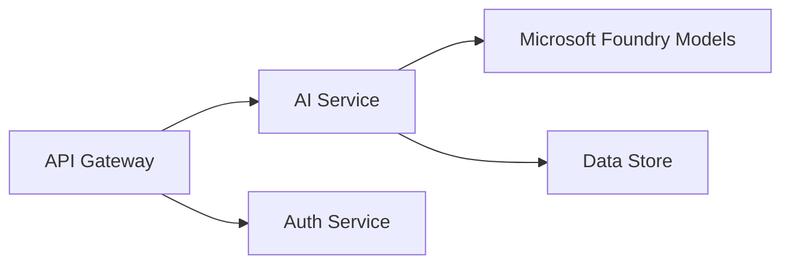
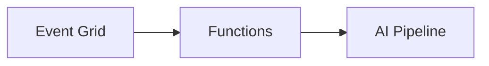

# Kapittel 8: Produksjons- og Enterprise-mønstre

**📚 Kurs**: [AZD For Beginners](../../README.md) | **⏱️ Varighet**: 2-3 timer | **⭐ Kompleksitet**: Avansert

---

## Oversikt

Dette kapittelet dekker produksjonsklare deployeringsmønstre, sikkerhetshardening, overvåking og kostnadsoptimalisering for AI-arbeidsmengder i produksjon.

Dette er en arkitektonisk referanse, ikke en fullstendig deployerbar produksjonssjablo. Eksemplene utelater integrasjonsdetaljer som må leveres og testes i din egen applikasjon; å lese sjekklisten gir ikke sertifisering for produksjonsklarhet.

> **Foundry GA-oppdatering (2026-11-09):** Bruk `azd >= 1.37.0` og den generelt tilgjengelige `microsoft.foundry` 1.0-pakken for Foundry-workflow; evalueringer installeres separat. Se [release scope and migration](production-ai-practices.md#recent-release-changes-and-fixes) og [authenticated pipeline example](production-ai-practices.md#cicd-pipeline-configuration). Dette er en dokumentasjonsgjennomgang, ikke en live deploy-validering eller generell GA-status for valgfrie forhåndsvisningsfunksjoner.

## Læringsmål

Ved å fullføre dette kapittelet vil du:
- Deplisere multi-region robuste applikasjoner
- Implementere enterprise sikkerhetsmønstre
- Konfigurere omfattende overvåking
- Optimalisere kostnader i stor skala
- Sette opp CI/CD-pipelines med AZD

---

## 📚 Leksjoner

| # | Leksjon | Beskrivelse | Tid |
|---|--------|-------------|------|
| 1 | [Produksjonspraksis for AI](production-ai-practices.md) | Enterprise deployeringsmønstre | 90 min |

---

## 🚀 Produksjonssjekkliste

- [ ] Multi-region deployering for robusthet
- [ ] Administrert identitet for autentisering (ingen nøkler)
- [ ] Application Insights for overvåking
- [ ] Kostnadsbudsjetter og varslinger konfigurert
- [ ] Sikkerhetsskanning aktivert
- [ ] CI/CD pipeline-integrasjon
- [ ] Katastrofeberedskapsplan

---

## 🏗️ Arkitektur-mønstre

### Mønster 1: Microservices AI



### Mønster 2: Hendelsesdrevet AI



---

## 🔐 Sikkerhets beste praksiser

```bicep
// Illustrative properties from different resources, NOT a standalone Bicep file.
// Attach identity to the application host:
identity: {
  type: 'SystemAssigned'
}

// AI account properties (also require private endpoints, DNS and app connectivity):
properties: {
  publicNetworkAccess: 'Disabled'
  networkAcls: {
    defaultAction: 'Deny'
  }
}
```

---

## 💰 Kostnadsoptimalisering

| Strategi | Hovedbegrensning |
|----------|---------|
| Skaler til null (Container Apps) | Krever passende trigger; andre tjenester påløper fortsatt kostnader |
| Bruk forbruksnivåer for dev | Sammenlign valgt tjenestepris og arbeidsmengde |
| Planlagt skalering | Skaler via støttet infrastruktur/automatisering |
| Reserveringer/kapasitetsforsyning | Kun når støttet; forpliktelser kan øke inaktive kostnader |

Bruk [fullstendig budsjettressursmønster](production-ai-practices.md#2-cost-monitoring-and-budgets) med gyldig startdato, faktureringsomfang, mottakere og tillatelser. Et budsjett sender varsler; det setter ikke en kostnadsgrense. Besparelser avhenger av målt utnyttelse og er ikke garanterte prosenter.

---

## 📊 Overvåkingsoppsett

```bash
# Open the Application Insights logs view (requires configured monitoring)
azd monitor --logs

# Check Application Insights
azd monitor --overview

# View metrics
az monitor metrics list --resource <resource-id>
```

---

## 🔗 Navigasjon

| Retning | Kapittel |
|-----------|---------|
| **Forrige** | [Kapittel 7: Feilsøking](../chapter-07-troubleshooting/README.md) |
| **Kurs fullført** | [Kurs Hjem](../../README.md) |

---

## 📖 Relaterte ressurser

- [AI Agents Guide](../chapter-02-ai-development/agents.md)
- [Application Insights](../chapter-06-pre-deployment/application-insights.md)
- [Multi-Agent Solutions](../chapter-05-multi-agent/README.md)
- [Microservices Example](../../examples/microservices/README.md)

---

<!-- CO-OP TRANSLATOR DISCLAIMER START -->
**Ansvarsfraskrivelse**:
Dette dokumentet er oversatt ved hjelp av AI-oversettelsestjenesten [Co-op Translator](https://github.com/Azure/co-op-translator). Selv om vi streber etter nøyaktighet, vær oppmerksom på at automatiske oversettelser kan inneholde feil eller unøyaktigheter. Det opprinnelige dokumentet på originalspråket skal betraktes som den autoritative kilden. For kritisk informasjon anbefales profesjonell menneskelig oversettelse. Vi er ikke ansvarlige for eventuelle misforståelser eller feiltolkninger som oppstår ved bruk av denne oversettelsen.
<!-- CO-OP TRANSLATOR DISCLAIMER END -->