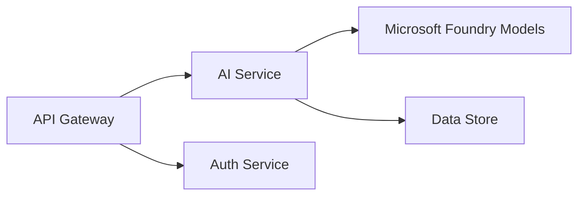
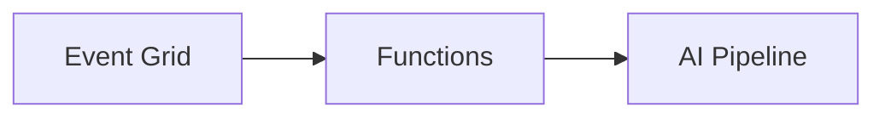

# Kapittel 8: Produksjon og Enterprise-mønstre

**📚 Kurs**: [AZD For Nybegynnere](../../README.md) | **⏱️ Varighet**: 2-3 timer | **⭐ Kompleksitet**: Avansert

---

## Oversikt

Dette kapittelet dekker produksjonsklare distribusjonsmønstre for bedrifter, sikkerhetsharding, overvåking og kostnadsoptimalisering for AI-arbeidsbelastninger i produksjon.

Dette er en arkitekturreferanse, ikke en fullstendig distribuerbar produksjonsmal. Eksempler utelater integrasjonsdetaljer som må leveres og testes i din egen applikasjon; å lese sjekklisten garanterer ikke produksjonsklarhet.

> **Utgivelsesgjennomgang (2026-11-04):** AI CLI-veiledningen ble sjekket mot dokumentasjonen/kilden for `azd 1.37.2`, agenter `1.0.0-beta.23` og evalueringer `1.0.0-beta.2`. Se [utgivelsesendringer og feilrettinger](production-ai-practices.md#recent-release-changes-and-fixes) for kompatibilitetskrav og migrasjonsdetaljer; dette er ikke en validering av live-distribusjon.

## Læringsmål

Ved å fullføre dette kapittelet vil du:
- Distribuere robuste applikasjoner på tvers av regioner
- Implementere sikkerhetsmønstre for bedrifter
- Konfigurere omfattende overvåking
- Optimalisere kostnader i stor skala
- Sette opp CI/CD-pipelines med AZD

---

## 📚 Leksjoner

| # | Leksjon | Beskrivelse | Tid |
|---|--------|-------------|------|
| 1 | [Produksjonspraksis for AI](production-ai-practices.md) | Enterprise distribusjonsmønstre | 90 min |

---

## 🚀 Produksjonssjekkliste

- [ ] Distribusjon i flere regioner for robusthet
- [ ] Administrert identitet for autentisering (ingen nøkler)
- [ ] Application Insights for overvåking
- [ ] Kostnadsbudsjetter og varsler konfigurert
- [ ] Sikkerhetsskanning aktivert
- [ ] Integrasjon av CI/CD-pipeline
- [ ] Plan for katastrofegjenoppretting

---

## 🏗️ Arkitekturmønstre

### Mønster 1: Microservices AI



### Mønster 2: Hendelsesdrevet AI



---

## 🔐 Beste sikkerhetspraksis

```bicep
// Illustrative properties from different resources, NOT a standalone Bicep file.
// Attach identity to the application host:
identity: {
  type: 'SystemAssigned'
}

// AI account properties (also require private endpoints, DNS and app connectivity):
properties: {
  publicNetworkAccess: 'Disabled'
  networkAcls: {
    defaultAction: 'Deny'
  }
}
```

---

## 💰 Kostnadsoptimalisering

| Strategi | Hovedbegrensning |
|----------|---------|
| Skaler til null (Container Apps) | Krever en passende trigger; andre tjenester medfører fortsatt kostnader |
| Bruk konsumtiers for utvikling | Sammenlign utvalgt tjenestepris og arbeidsmengde |
| Planlagt skalering | Skaler via støttet infrastruktur/automatisering |
| Reservasjoner/provisionert kapasitet | Kun når støttet; forpliktelser kan øke inaktive kostnader |

Bruk [det komplette budsjettressursmønsteret](production-ai-practices.md#2-cost-monitoring-and-budgets) med gyldig startdato, faktureringsomfang, mottakere og tillatelser. Et budsjett sender varsler; det begrenser ikke utgifter. Besparelser avhenger av målt utnyttelse og er ikke garantert i prosent.

---

## 📊 Overvåkingsoppsett

```bash
# Open the Application Insights logs view (requires configured monitoring)
azd monitor --logs

# Check Application Insights
azd monitor --overview

# View metrics
az monitor metrics list --resource <resource-id>
```

---

## 🔗 Navigasjon

| Retning | Kapittel |
|-----------|---------|
| **Forrige** | [Kapittel 7: Feilsøking](../chapter-07-troubleshooting/README.md) |
| **Kurs fullført** | [Kursstart](../../README.md) |

---

## 📖 Relaterte ressurser

- [AI-agentguide](../chapter-02-ai-development/agents.md)
- [Application Insights](../chapter-06-pre-deployment/application-insights.md)
- [Multi-agent løsninger](../chapter-05-multi-agent/README.md)
- [Microservices-eksempel](../../examples/microservices/README.md)

---

<!-- CO-OP TRANSLATOR DISCLAIMER START -->
**Ansvarsfraskrivelse**:
Dette dokumentet er oversatt ved hjelp av AI-oversettelsestjenesten [Co-op Translator](https://github.com/Azure/co-op-translator). Selv om vi streber etter nøyaktighet, vær oppmerksom på at automatiske oversettelser kan inneholde feil eller unøyaktigheter. Det opprinnelige dokumentet på originalspråket skal betraktes som den autoritative kilden. For kritisk informasjon anbefales profesjonell menneskelig oversettelse. Vi er ikke ansvarlige for eventuelle misforståelser eller feiltolkninger som oppstår ved bruk av denne oversettelsen.
<!-- CO-OP TRANSLATOR DISCLAIMER END -->