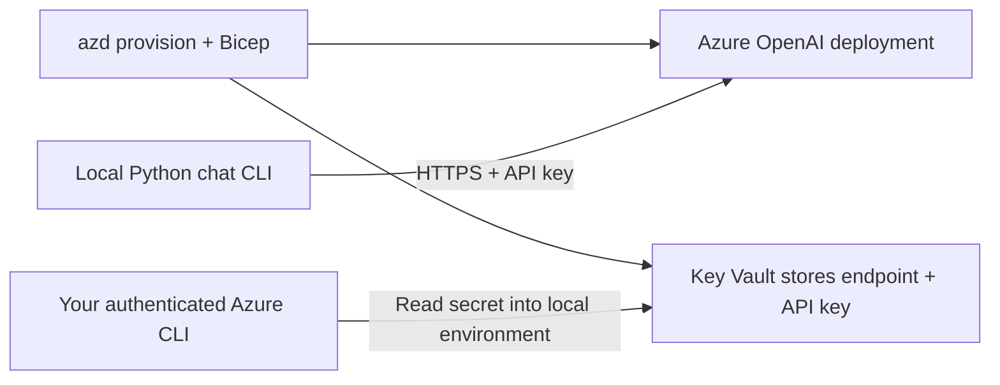

# Azure OpenAI Chat — Lokal CLI og AZD-infrastruktur

**Nivå:** Middels · **Tid:** 35–60 minutter inkludert oppsett

Dette eksempelet oppretter en **Azure OpenAI-ressurs og Key Vault**, og kjører deretter en
interaktiv Python chat-CLI **på din maskin**. Det er ingen webapplikasjon
eller Container App som hostes. Standardmodell er `gpt-4.1`, versjon `2025-04-14`, med
`GlobalStandard` distribusjonskapasitet 20. Sjekk gjeldende tilgjengelighet og kvote i
ditt valgte område før oppretting; modellens livssyklusdatoer kan endres.

## Læringsmål

- Opprett modellinfrastruktur med Bicep og azd.
- Hent en API-nøkkel fra Key Vault uten å legge den i distribusjonsutdata.
- Send forespørsler om Chat Completions og oppretthold samtalehistorikk.
- Tolke token-telling og begrensningene i kostnadsestimater.



Det er ingen administrert identitetskjøringsintegrasjon, flerregions failover, tilpasset
hastighetsbegrensning, strømmemodus, eller hostet databehandling i dette eksempelet. OpenAI SDK
utfører opptil to nye forsøk ved gjenopprettbare feil; CLI rapporterer gjenværende feil.

## Forutsetninger

- En gjeldende stabil [azd](https://learn.microsoft.com/azure/developer/azure-developer-cli/install-azd)
  (publisert utgivelse ved gjennomgangstidspunkt: 1.37.2).
- [Azure CLI](https://learn.microsoft.com/cli/azure/install-azure-cli).
- Python **3.10+** (3.11 anbefalt) og et virtuelt miljø.
- Et Azure-abonnement med tillatelse til å opprette Cognitive Services- og Key Vault-
  ressurser, distribuere modeller, og lese hemmelighetene i vaulten.
- Regional tilgjengelighet og `GlobalStandard` kvote for `gpt-4.1`. Tilgangskrav
  avhenger av abonnement og funksjon; det finnes ingen garantert godkjenningsfrist.

```bash
azd version
az version
python --version
azd auth login
az login
```

Dette er separate autentiseringsøkter. Velg samme abonnement i begge
verktøy før du kjører kommandoene nedenfor.

## Rask start (Bash)

Kjør fra repository rot:

```bash
cd examples/azure-openai-chat
azd env new myopenai
azd provision
```

Velg en støttet region. Oppretting lager en ressursgruppe, OpenAI-konto,
modell-distribusjon, Key Vault, og `openai-endpoint`/`openai-api-key` hemmeligheter.
Det er **ingen tjenester å distribuere** i `azure.yaml`.

Last inn de ikke-hemmelige utdataene og hent hemmeligheten inn i ditt nåværende shell:

```bash
export AZURE_OPENAI_ENDPOINT="$(azd env get-value AZURE_OPENAI_ENDPOINT)"
export AZURE_OPENAI_MODEL="$(azd env get-value AZURE_OPENAI_MODEL)"
KV_NAME="$(azd env get-value AZURE_KEY_VAULT_NAME)"
export AZURE_OPENAI_API_KEY="$(az keyvault secret show \
  --vault-name "$KV_NAME" --name openai-api-key --query value --output tsv)"

python -m venv .venv
source .venv/bin/activate
python -m pip install -r src/requirements.txt
python src/chat.py
```

I PowerShell, aktiver med `.\.venv\Scripts\Activate.ps1` og tildel miljø
variabler med `$env:AZURE_OPENAI_ENDPOINT = azd env get-value AZURE_OPENAI_ENDPOINT`
(og tilsvarende for modellen). Hent API-nøkkelen ved å bruke
`$env:AZURE_OPENAI_API_KEY = az keyvault secret show --vault-name $KV_NAME --name openai-api-key --query value -o tsv`.
Sett `$KV_NAME = azd env get-value AZURE_KEY_VAULT_NAME` først.

Ikke skriv ut, legg til versjonskontroll, eller lim inn API-nøkkelen i feilrapporter. CLI-en leser prosess-
miljøvariabler; den henter **ikke** nøkkelvalvshemmeligheter eller laster `.env`-filer.
`config.py` validerer endepunkt, token-grense og temperatur ved oppstart.

Forventet utdata (innhold og bruk varierer):

```text
Azure OpenAI Chat Application
Model: gpt-4.1
...
You: Say hello in one sentence.
Assistant: Hello! How can I help you today?
[Tokens: ... | Cost: $...]
```

Kommandoer: `stats` viser summer, `clear` tømmer samtalehistorikk, og
`quit`/`exit` avslutter økten. Det finnes ingen `--stream`, `--show-tokens`, `tokens`,
eller `cost`-kommandoer.

## Verifiser distribusjonen

Etter å ha lastet inn shell-variablene ovenfor:

```bash
curl --fail-with-body \
  "${AZURE_OPENAI_ENDPOINT%/}/openai/deployments/${AZURE_OPENAI_MODEL}/chat/completions?api-version=2024-10-21" \
  -H "Content-Type: application/json" \
  -H "api-key: $AZURE_OPENAI_API_KEY" \
  -d '{"messages":[{"role":"user","content":"Say hello!"}],"max_tokens":50}'

az keyvault secret list --vault-name "$KV_NAME" --query "[].name" -o table
```

Suksess: API-en returnerer HTTP 200 med `choices[0].message.content` og `usage`;
nøkkelvalvet lister `openai-api-key` og `openai-endpoint`. En vellykket ARM-distribusjon
alene verifiserer ikke inferens.

## Filer og konfigurasjon

```text
azure.yaml                         # Infrastructure-only AZD project
infra/main.bicep                   # Subscription deployment
infra/main.parameters.json         # Environment, location, principal ID
infra/resources/openai.bicep       # Account + model
infra/resources/keyvault.bicep     # Vault + deploying user's secret access policy
infra/resources/secrets.bicep      # Writes secrets, no key output
src/chat.py                        # Interactive CLI
src/config.py                      # Environment validation
src/requirements.txt               # Python packages
```

For å endre den tilordnede modellen/versjonen/kapasiteten, rediger standardverdiene i
`infra/main.bicep` og kjør `azd provision`. Å sette `AZURE_OPENAI_MODEL` i
ditt shell velger bare et **eksisterende distribusjonsnavn**; det distribuerer ikke en annen modell.

| Kjøretidsvariabel | Standard / kilde |
|---|---|
| `AZURE_OPENAI_ENDPOINT` | Påkrevd; azd ikke-hemmelig utdata |
| `AZURE_OPENAI_API_KEY` | Påkrevd; hentes fra Nøkkelvalvet |
| `AZURE_OPENAI_MODEL` | `gpt-4.1`; Azure distribusjonsnavn |
| `AZURE_OPENAI_MAX_TOKENS` | 800 (valideringsområde 1–4096) |
| `AZURE_OPENAI_TEMPERATURE` | 0.7 (område 0–2) |
| `AZURE_OPENAI_INPUT_PRICE_PER_1K` | 0.002 USD; illustrativ u-caching for inndata |
| `AZURE_OPENAI_OUTPUT_PRICE_PER_1K` | 0.008 USD; illustrativ utdatafrekvens |

## Kostnader og sikkerhetsbegrensninger

Kostnadsvisningen er et **anslag**, ikke Azure-fakturering. Den multipliserer API-token-
bruken med de konfigurerte satsene og tar ikke hensyn til rabatter for bufret inndata,
regionale/SKU-forskjeller, skatter, prisendringer eller mislykkede/omprøvde kall.
Overstyr **begge satser** når du bruker en annen modell eller SKU og verifiser gjeldende
[Azure OpenAI-priser](https://azure.microsoft.com/pricing/details/cognitive-services/openai-service/).

Som illustrasjon koster 100 forespørsler med 500 u-cacherte inndata- og 200 utdata-tokens hver
til standardpris `100 × (500/1000 × .002 + 200/1000 × .008) = $0.26`.
Nøkkelvalvoperasjoner/lagring påfører separate avgifter. Det er ingen fast $50/måned
kostnad for denne lokale CLI-en og ingen værtjeneste i malen.

Valvet bruker en tilgangspolicy for den distribuerende prinsippale; det er ikke et RBAC- eller
administrert-identity-applikasjonseksempel. Offentlige endepunkter og API-nøkkelautentisering
benyttes for opplæring. Begrens tillatelser og legg til passende identitets-/nettverks-
kontroll før du tilpasser det for produksjon.

## Praktiske øvelser

### 1. Verifiser kontekst og tilbakestill den

**Start:** kjørende CLI. **Mål:** observere historikk.
Si “Husk ordet seder,” og spør deretter “Hvilket ord ba jeg deg om å huske?”
Kjør `stats`; to vellykkede runder skal telle som to utvekslede meldinger.
Kjør `clear` og `stats`; utvekslede meldinger skal være null (token-summer forblir).
Modellens eksakte ordlyd er ikke deterministisk.

### 2. Endre svargrense

**Start:** avslutt CLI-en, behold samme shell.
Kjør `export AZURE_OPENAI_MAX_TOKENS=100`, start på nytt `python src/chat.py`, og be om
en kort forklaring av azd. Sjekk at banneret viser 100.
Gjenopprett med `unset AZURE_OPENAI_MAX_TOKENS`. En mindre svargrense reduserer ikke
allerede sendte historikk-tokens.

### Vanlige problemer

- **Manglende miljøvariabler:** provisjoneringen eksporterer ikke shellverdier;
  gjenta eksporttrinnene. Et nytt terminalvindu trenger dem på nytt.
- **403 ved lesing fra Nøkkelvalv:** bekreft Azure CLI-abonnement/logginn og prinsippalen
  i tilgangspolicyen til valvet. Policyendringer kan ta tid å tre i kraft.
- **404 inferens:** sjekk distribusjonsnavn, endepunkt og distribusjonsstatus.
- **429 inferens:** vent på at volumgrenser tilbakestilles; verifiser regional modellkvote.
  CLI-en fjerner mislykkede runder fra historikken, så ny forsøk dobler ikke opp.
- **Kontekstens lengde:** eksemplet forkorter ikke lange samtaler; bruk `clear`.
- **Model utilgjengelig/utfaset:** sjekk gjeldende modelltilgjengelighet og oppdater
  modell/versjon/SKU sammen; API-versjon og modellversjon er forskjellige innstillinger.

## Opprydding og neste steg

```bash
azd down
unset AZURE_OPENAI_API_KEY
```

Nøkkelvalvets soft-delete-retensjon er syv dager; rensing krever separate tillatelser.
Det finnes ikke et forpliktet testsystem; ikke kjør en ikke-eksisterende `pytest tests/`-kommando.
Legg til mockede API-tester før du utvider koden.

[Container-eksempler](../../../../examples/container-app) · [Retail arkitekturmønster](../retail-scenario.md) ·
[Kursstartside](../../README.md) · [Rapporter et problem](https://github.com/microsoft/AZD-for-beginners/issues)

---

<!-- CO-OP TRANSLATOR DISCLAIMER START -->
**Ansvarsfraskrivelse**:
Dette dokumentet er oversatt ved hjelp av AI-oversettelsestjenesten [Co-op Translator](https://github.com/Azure/co-op-translator). Selv om vi streber etter nøyaktighet, vær oppmerksom på at automatiske oversettelser kan inneholde feil eller unøyaktigheter. Det opprinnelige dokumentet på originalspråket skal betraktes som den autoritative kilden. For kritisk informasjon anbefales profesjonell menneskelig oversettelse. Vi er ikke ansvarlige for eventuelle misforståelser eller feiltolkninger som oppstår ved bruk av denne oversettelsen.
<!-- CO-OP TRANSLATOR DISCLAIMER END -->