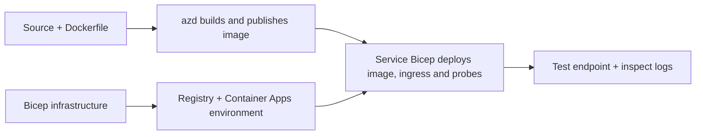

# Eksempler på distribusjon av containerapplikasjoner med AZD

Denne katalogen inneholder to læringseksempler med kildekode, Dockerfiler,
Bicep-infrastruktur, og `azure.yaml`. Ingen av dem er produksjonsklare.

## Velg et eksempel

| Eksempel | Hva som er implementert | Forutsetninger |
|---|---|---|
| [Simple Flask API](../../../../examples/container-app/simple-flask-api) | Enkel Python CRUD API, elementer i minnet, helsesjekker, HTTP-skalering | Grunnleggende CLI- og HTTP-kunnskap |
| [To-tjenesters mikrotjenester](../../../../examples/container-app/microservices) | Node.js gateway, intern skrivebeskyttet Python produkttjeneste, telemetri og skalering | Fullfør først enkeltjeneste-eksempelet |

Sett av 30–60 minutter inkludert oppsett og verifisering. Tider for Azure-provisjon varierer.

## Forutsetninger

- [Azure Developer CLI](https://learn.microsoft.com/azure/developer/azure-developer-cli/install-azd)
- [Azure CLI](https://learn.microsoft.com/cli/azure/install-azure-cli) for verifiseringskommandoer
- Docker med kjørende daemon for bygging av disse containerbildene
- Et Azure-abonnement med rettigheter til å opprette ressurser og tilstrekkelig regional kvote
- Bash for shelleksempelene, eller tilsvarende PowerShell-kommandoer

```bash
azd version
az version
docker info
azd auth login
az login
```

De to verktøyene har separate innloggingsøkter. Bruk en oppdatert stabil azd; den gjeldende
publiserte versjonen på gjennomgangstidspunktet er 1.37.2. Eldre minimumskrav er ikke en
kompatibilitetsgaranti.

## Kom raskt i gang

Fra repository-roten:

```bash
cd examples/container-app/simple-flask-api
azd env new flask-demo
azd up
API_URL=$(azd env get-value API_ENDPOINT)
curl --fail-with-body "${API_URL}/health"
```

Forventet: HTTP 200 med `"status": "healthy"`. Følg sample README for å opprette,
lese, oppdatere og slette et element, og for å inspisere logger.



Innledende provisjonering bruker et offentlig hello-world-bilde på port 80. Tjenestespesifikke
Bicep-parameterfiler lar `azd deploy` erstatte det med det bygde applikasjonsbildet
og riktig app-port/prober (8000 for Flask/produkt, 8080 for gateway).
Behold disse filene med deres `azure.yaml` `module`-innstillinger.

## Konfigurasjon: hva som endrer hva

`azure.yaml` velger kildemapper, språk, verter og distribusjonsmoduler.
Container CPU/minne, ingress, prober, replikaantall, og skaleringsregler defineres
i **Bicep**, ikke i vilkårlige `resources`, `scale`, eller `regions` tjenesteegenskaper.

`azd env set SOME_VALUE ...` lagrer en verdi lokalt. Den endrer bare en distribuert
ressurs når en parameter, miljøkartlegging, eller hook eksplisitt bruker denne
verdien. Disse eksemplene bruker ikke `MAX_REPLICAS`, `SCALE_TO_ZERO_TIMEOUT`,
`CONTAINER_APP_REPLICA_TYPE`, eller tilpassede kanarikonfigurasjoner fra azd miljøverdier.
Rediger relevant Bicep og kjør `azd up` for å provisjonere og distribuere på nytt.

Ikke plasser applikasjonskilde under `infra/`. `project` må peke til mappen
som inneholder Dockerfilen og avhengighetsmanifestet.

## Overvåkning og kostnader

- `azd monitor --logs` åpner en portalvisning; det er ikke en terminalbasert loggstrøm.
  Bruk `az containerapp logs show --follow` med det faktiske ressursnavnet.
- Den enkle API-en skriver stdout-logger samlet gjennom Container Apps/Log Analytics.
  Dens provisjonerte Application Insights-ressurs er ikke automatisk instrumentert.
- Mikrotjeneste-gatewayen bruker Node.js Application Insights SDK; Python-
  tjenesten eksporterer applikasjonsloggspor. Full Python forespørsels-/avhengighetssporing
  er ikke konfigurert.
- Skaler-til-null kan redusere beregningskostnader, men registry- og logginnhenting/lagring
  kan fortsatt koste penger. Mikrotjenestene standarder holder replikaer kjørende.
  Estimer region og bruk i
  [Azure-priskalkulatoren](https://azure.microsoft.com/pricing/calculator/).

## Avanserte mønstre — ikke inkluderte implementasjoner

Dette er designretninger, ikke ekstra lokale prosjekter eller kopieroglim-snutter:

- **Vedvarende data og autentisering:** erstatt minnebaserte lagre og legg til
  Microsoft Entra ID-autentisering/autorisasjon før produksjon.
- **Blue-green/canary:** bruk Container Apps flere-revisjonsmodus, revisjons-
  merker, trafikkvekter, helsesjekk og tilbakestillingsrutiner.
  Det er ingen `deploymentStrategy: canary` azd-konfigurasjon i disse eksemplene.
  Se [revisjonsadministrasjon](https://learn.microsoft.com/azure/container-apps/revisions).
- **Multi-region:** lag separate miljøer og apper i Bicep og design
  global ruting og datakonsistens. En tjenesteliste `regions` er ikke en azd
  distribusjonsmekanisme.
- **Kø-arbeidere:** legg til arbeiderkilde, avhengigheter, køressurser, en administrert
  identitet med dataplanelroller, og en autentisert skaleringsregel. Ikke kopier
  en tom `src/worker`-sti og forvent et kjørbart prosjekt.
- **Dapr:** provisjoner komponenter, konfigurer sidecar, installer tilpasset SDK,
  og implementer feilbehandling for tilstand/pub-sub.
- **Hemmeligheter:** bruk administrert identitet og rolleoppgaver der det er mulig. Bare det
  å opprette en Key Vault gir ikke applikasjoner tilgang eller laster hemmeligheter.

## Rydding

Fra sample-katalogen:

```bash
azd down
```

Gå gjennom slettingsmeldinger og bekreft at den dedikerte ressursgruppen fjernes.
Ikke bruk disse eksemplene som produksjonsgrunnlag uten ytterligere design og tester.

[Eksempelliste](../README.md) · [Kurs Hjem](../../README.md) ·
[Container Apps dokumentasjon](https://learn.microsoft.com/azure/container-apps/) ·
[Rapporter et problem](https://github.com/microsoft/AZD-for-beginners/issues)

---

<!-- CO-OP TRANSLATOR DISCLAIMER START -->
**Ansvarsfraskrivelse**:
Dette dokumentet er oversatt ved hjelp av AI-oversettelsestjenesten [Co-op Translator](https://github.com/Azure/co-op-translator). Selv om vi streber etter nøyaktighet, vær oppmerksom på at automatiske oversettelser kan inneholde feil eller unøyaktigheter. Det opprinnelige dokumentet på originalspråket skal betraktes som den autoritative kilden. For kritisk informasjon anbefales profesjonell menneskelig oversettelse. Vi er ikke ansvarlige for eventuelle misforståelser eller feiltolkninger som oppstår ved bruk av denne oversettelsen.
<!-- CO-OP TRANSLATOR DISCLAIMER END -->