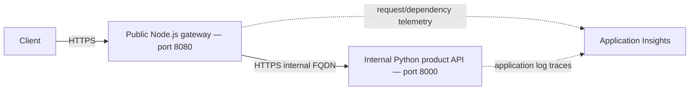

# Mikroservice med to tjenester — Azure Container Apps

**Nivå:** Middels · **Tid:** 45–60 minutter inkludert oppsett

Dette læringseksemplet implementerer en **Node.js API Gateway** og en **leseonly Python
Produkttjeneste**. Kildekode, Dockerfiler, Bicep og azd-konfigurasjon er inkludert.
Det er ikke et produksjonsmodent system.

## Hva du lærer

- Distribuere to tjenester uavhengig.
- Bruke et internt backend FQDN over HTTPS.
- Verifisere vellykkede, ikke funnet, og utilgjengelige tjenestesvar.
- Forstå telemetri og uavhengige skaleringsgrenser.



Produktkatalogen inneholder fem faste produkter i minnet. Det finnes **ingen POST,
PUT, eller DELETE-endepunkter**, database, Service Bus, ordre-/bruker-/varslingstjeneste,
C# eller Go-kode. Dette er fremtidige utviklingsidéer, ikke inkluderte funksjoner.
Gatewayen autentiserer ikke brukere; intern ingress er ikke en erstatning
for applikasjonsautorisasjon.

## Forutsetninger

Fullfør [single Flask API](../../../../../examples/container-app/simple-flask-api) først.
Installer en nåværende stabil azd (utgitt versjon ved gjennomgangstidspunkt: 1.37.2), Azure CLI,
og Docker med kjørende daemon. Du trenger et Azure-abonnement, tillatelser til ressursopprettelse,
og kvote for Container Apps regionalt.

```bash
azd version
az version
docker info
azd auth login
az login
```

Bruk samme abonnement i begge CLI-verktøyene. Kommandoene nedenfor bruker Bash.

## Distribuer og verifiser

Fra depotets rotmappe:

```bash
cd examples/container-app/microservices
azd env new microservices-demo
azd up
GATEWAY_URL=$(azd env get-value API_GATEWAY_URL)
RG_NAME=$(azd env get-value AZURE_RESOURCE_GROUP)
GATEWAY_NAME=$(azd env get-value API_GATEWAY_NAME)
PRODUCT_NAME=$(azd env get-value PRODUCT_SERVICE_NAME)

curl --fail-with-body "${GATEWAY_URL}/health"
curl --fail-with-body "${GATEWAY_URL}/api/products"
curl --fail-with-body "${GATEWAY_URL}/api/products/1"
curl -i "${GATEWAY_URL}/api/products/999"
```

**Vellykket:** health 200; list 200 med **fem** produkter; produkt 1 er en Laptop
priset til 999,99 med lagerbeholdning 50; ukjent produkt gir 404.
Beskrivelser er inkludert i svarene; tidsstempler varierer.

Første provisjonering bruker offentlige hello-world-bilder på port 80 slik at det ikke forsøker
å hente ikke-eksisterende bilder fra et tomt register. Tjenestespesifikke Bicep-moduler
og parameterfiler erstatter disse med bygde bilder og app-porter/prober under
`azd deploy`. Hovedparametrene bevarer publiserte bildenumre for senere provisjonering.

## Tjenester og nettverk

| Tjeneste | Eksponerte endepunkter | Standardressurser |
|---|---|---|
| Gateway | GET `/`, `/health`, `/api/products`, `/api/products/:id` | 1 vCPU, 2 GiB, 2–20 replikater |
| Produkt | GET `/`, `/health`, `/products`, `/products/<id>` | 0.5 vCPU, 1 GiB, 1–10 replikater |

Produktinngangen har `external: false` og `allowInsecure: false`. Bicep injiserer
`PRODUCT_SERVICE_URL=https://<actual-internal-fqdn>` inn i gatewayen. HTTP ville
omdirigere; HTTPS matcher den konfigurerte ingressen. Et kort DNS-navn må samsvare med
**det faktiske Container App-navnet**, ikke den logiske tjenestenøkkelen `product-service`.
Ikke prøv å kalle den interne URL-en direkte fra din laptop.

Gatewayen har en timeout på fem sekunder for produktkall. Manglende produkt-IDer
resulterer i 404; transportfeil/andre backendfeil gir 503. Gateway
`/health` sjekker kun gatewayen, ikke backend-tilgjengelighet.

## Filer og konfigurasjon

```text
azure.yaml
infra/main.bicep
infra/main.parameters.json
infra/abbreviations.json
infra/core/container-apps-environment.bicep
infra/core/monitor.bicep
infra/app/api-gateway.bicep
infra/app/api-gateway.parameters.json
infra/app/product-service.bicep
infra/app/product-service.parameters.json
src/api-gateway/{app.js,package.json,Dockerfile}
src/product-service/{main.py,requirements.txt,Dockerfile}
```

Skalering, CPU/minne, porter og prober settes i `infra/app/*.bicep`. Endre disse
filene og kjør `azd up` for å anvende infrastrukturen og distribuere på nytt. Det finnes ingen
`GATEWAY_MAX_REPLICAS` miljøvariabel-parameter i dette eksemplet.

For kodeendringer alene:

```bash
azd deploy product-service
azd deploy api-gateway
```

Node-bildet bruker Node 22; Python-bildet bruker Python 3.11. Begge binder til
`0.0.0.0`. Ingress/prober bruker port 8080 (gateway) og 8000 (produkt) henholdsvis.

## Lokal utvikling med Docker

Kjør fra denne eksempelkatalogen. Bruk et brukerdefinert nettverk, **ikke `localhost`
for at én container skal nå den andre**:

```bash
docker network create azd-microservices-demo
docker build -t local-product ./src/product-service
docker build -t local-gateway ./src/api-gateway
docker run -d --name azd-product --network azd-microservices-demo local-product
docker run -d --name azd-gateway --network azd-microservices-demo \
  -p 8080:8080 -e PRODUCT_SERVICE_URL=http://azd-product:8000 local-gateway
curl --fail-with-body http://localhost:8080/api/products
```

Forventet: fem produkter. HTTP brukes kun for dette lokale Docker-nettverket.

```bash
docker stop azd-product azd-gateway
docker rm azd-product azd-gateway
docker network rm azd-microservices-demo
```

## Overvåking

```bash
az containerapp logs show --name "$GATEWAY_NAME" --resource-group "$RG_NAME" --follow
# In a separate terminal:
az containerapp logs show --name "$PRODUCT_NAME" --resource-group "$RG_NAME" --tail 100
```

`azd monitor --logs` åpner en portalvisning; den strømmer ikke terminallogger.
Node SDK samler inn forespørsler/avhengigheter fra gatewayen. Pythons `AzureLogHandler`
eksporterer **loggspor**, ikke automatiske Flask-forespørsler, SQL-avhengigheter eller fullstendige
distribuerte spor. OpenCensus er et gammelt SDK; foretrekk Azure Monitor OpenTelemetry
ved utvidelse av dette eksemplet.

I Application Insights Logs, generer forespørsler og inspiser:

```kusto
requests
| where timestamp > ago(1h)
| where name contains "products"
| summarize RequestCount=count(), AvgDuration=avg(duration) by bin(timestamp, 5m)
```

For Python-applikasjonsmeldinger:

```kusto
traces
| where timestamp > ago(1h)
| where message contains "products"
| project timestamp, message, severityLevel
```

Tillat forsinkelse ved inntak og sampling; forvent ikke nøyaktig antall forespørsler eller
garantert latens. Ingen egendefinerte varsler eller dashboards er konfigurert.

## Praktiske øvelser

### Øvelse 1: Endre katalogen

**Startpunkt:** `src/product-service/main.py`.
**Mål:** verifisere uavhengig tjenestedistribusjon.
Endre Laptops lagerbeholdning fra 50 til 49 i den faste `products`-listen, kjør
`azd deploy product-service`, deretter foreta forespørsel `${GATEWAY_URL}/api/products/1`.

**Suksesskriterier / løsning:** HTTP 200 med `"stock":49`. Gjenopprett 50 og distribuer på nytt.
**Vanlig problem:** redigere gatewayen i stedet for tjenesten som eier katalogen.
Dette endrer kilde-data, ikke en vedvarende lagerdatabase.

### Øvelse 2: Verifisere replikakonfigurasjon

**Startpunkt:** `infra/app/product-service.bicep`.
**Mål:** observere en infrastrukturell endring uten å gjette på autoskalering.
Endre `minReplicas: 1` til `minReplicas: 2`, kjør `azd up`, deretter:

```bash
az containerapp show --name "$PRODUCT_NAME" --resource-group "$RG_NAME" \
  --query properties.template.scale -o json
```

**Suksesskriterier:** konfigurert minimum er 2 og maksimum forblir 10.
Gjenopprett minimum 1 og kjør `azd up`.
**Vanlig problem:** `azd deploy` alene anvender ikke endringer på urelatert delt
infrastruktur. Ikke sett `maxReplicas` til null som feilsimulering.
Dette verifiserer konfigurasjon, ikke en belastningstest eller en garantert øyeblikkelig replica count.

### Øvelse 3: Teste håndtering av utilgjengelig tjeneste lokalt

**Startpunkt:** begge lokale Docker-containerne over er kjørende.
**Mål:** skille backend-feil fra manglende produkt.
Stopp kun produktcontaineren:

```bash
docker stop azd-product
curl -i http://localhost:8080/api/products
docker start azd-product
curl --fail-with-body http://localhost:8080/api/products
```

**Suksesskriterier:** mens den er stoppet, returnerer gateway 503 med
`"error":"Product service unavailable"`; etter omstart returnerer listen 200.
Prøv igjen etter en kort oppstartsforsinkelse om nødvendig.
**Vanlig problem:** å stoppe gatewayen tester en annen feil (ingen HTTP-respons).

## Kostnader og produksjonsgap

Standard minimum replikater holder beregningen i gang. Register og overvåking medfører også
kostnader. Det finnes ingen validert fast $50/måned totalt: estimer regional CPU/minne,
replikatimer, forespørsler, register og logglagring i
[Azure price calculator](https://azure.microsoft.com/pricing/calculator/).
Slett læringsressurser raskt.

Produksjonsarbeid inkluderer autentisering/autorisasjon, avgrensede administrerte identiteter,
vedvarende data, input-/responsvalidering, støttet observabilitetsinstrumentering,
belastnings-/feiltesting, CI/CD, varsler og gjenopprettingsprosedyrer. Å legge til en ordre-
tjeneste, kø eller database er en separat implementeringsoppgave, ikke en ferdig
øvelse eller en funksjon allerede tilgjengelig her.

## Feilsøking og opprydding

- **Bilde ikke funnet under første provisjon:** bootstrap bør bruke det offentlige bildet;
  verifiser hovedbildeparameter standardverdier og deploymodulmappings.
- **503 produkter:** sjekk produktlogger, bildeversjon, og injisert intern HTTPS-URL.
- **404 uventet sti:** produkt-API er skrivebeskyttet; verifiser ruten, ikke en ikke-eksisterende CRUD-handler.
- **Ingen telemetri:** inspiser runtime-tilkoblingsstrenger uten å eksponere dem og
  tillat inntaksforsinkelse. Python request-tabeller fylles ikke av logghåndtereren.

Fra denne eksempelkatalogen:

```bash
azd down
```

Gjennomgå slettingsvarsler og verifiser at dedikert ressursgruppe er fjernet.

[Forrige: Flask API](../../../../../examples/container-app/simple-flask-api) · [Neste: Database app](../../../../../examples/database-app) ·
[AI-utvikling](../../../docs/chapter-02-ai-development/README.md) ·
[Kursoversikt](../../../README.md) · [Rapporter et problem](https://github.com/microsoft/AZD-for-beginners/issues)

---

<!-- CO-OP TRANSLATOR DISCLAIMER START -->
**Ansvarsfraskrivelse**:
Dette dokumentet er oversatt ved hjelp av AI-oversettelsestjenesten [Co-op Translator](https://github.com/Azure/co-op-translator). Selv om vi streber etter nøyaktighet, vær oppmerksom på at automatiske oversettelser kan inneholde feil eller unøyaktigheter. Det opprinnelige dokumentet på originalspråket skal betraktes som den autoritative kilden. For kritisk informasjon anbefales profesjonell menneskelig oversettelse. Vi er ikke ansvarlige for eventuelle misforståelser eller feiltolkninger som oppstår ved bruk av denne oversettelsen.
<!-- CO-OP TRANSLATOR DISCLAIMER END -->