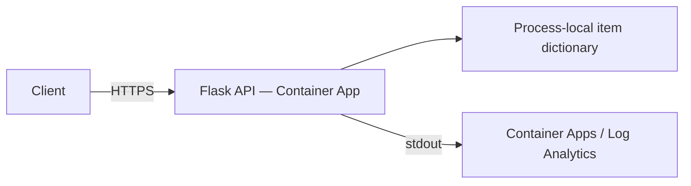

# Enkel Flask API — Azure Container Apps

**Nivå:** Nybegynner · **Tid:** 30–45 minutter inkludert oppsett

Distribuer en Python Flask CRUD API med Azure Developer CLI (azd). Kildekode, Dockerfile,
Bicep og distribusjonsparametere er inkludert. Dette er et **lærings-eksempel**, ikke
en produksjonsklar API.

## Hva du vil lære

- Bygg og publiser en container gjennom azd.
- Konfigurer ingress og liveness/readiness probes.
- Verifiser CRUD-responser og inspiser applikasjonslogger.
- Forstå hvorfor in-memory data er uegnet for varige applikasjoner.



**Viktig:** elementer holdes i en enkelt prosess. Standard er **en Gunicorn worker,
0–1 replikaer**, med vilje for å unngå inkonsistente data på tvers av workers/replikaer.
Elementer mistes ved omstart, revisjonsendring eller skalertil-null. Økning av replikaer
krever delt vedvarende lagring. API-en har ingen autentisering eller autorisasjon.

## Forutsetninger

- [Nåværende stabile azd](https://learn.microsoft.com/azure/developer/azure-developer-cli/install-azd)
  (utgitt versjon på vurderingstidspunkt: 1.37.2).
- [Azure CLI](https://learn.microsoft.com/cli/azure/install-azure-cli) for verifikasjon.
- Docker med kjørende daemon; kreves for standard lokal bildebygging.
- Azure-abonnement, tillatelser til å opprette ressurser, og Container Apps regional kvote.
- Bash for kommandoene nedenfor (eller tilsvarende PowerShell).
- Python 3.11 for valgfri lokal utvikling.

```bash
azd version
az version
docker info
azd auth login
az login
```

CLI-verktøyene har separate innloggingsøkter. Bruk samme abonnement i begge.

## Rask start

Fra rotmappen i depotet:

```bash
cd examples/container-app/simple-flask-api
azd env new flask-demo
azd up
API_URL=$(azd env get-value API_ENDPOINT)
RG_NAME=$(azd env get-value AZURE_RESOURCE_GROUP)
API_NAME=$(azd env get-value API_NAME)
curl --fail-with-body "${API_URL}/health"
```

Forventet: HTTP 200 og JSON med `"status":"healthy"`,
`"service":"simple-flask-api"`, og en aktuell UTC-tidsstempel.
Oppretting og bildebygging tar vanligvis flere minutter; tidene varierer.

Første oppretting bruker et offentlig hello-world-bilde som lytter på port 80.
`azure.yaml` velger `infra/app/api.bicep` og tilsvarende parameterfil for
tjenestedistribusjon, som bytter bilde, ingress og probes til port 8000.
Ikke slett disse distribusjonsparameterne.

## Verifiser CRUD

Kjør følgende sekvensielt mens samme replika er aktiv:

```bash
# Create: HTTP 201; note the returned id (1 for a fresh process).
curl -i -X POST "${API_URL}/api/items" \
  -H "Content-Type: application/json" \
  -d '{"name":"Test Item","description":"My first item"}'

# Read list: HTTP 200, total 1 in a fresh process.
curl --fail-with-body "${API_URL}/api/items"

# Replace 1 if your create response returned another id.
curl --fail-with-body "${API_URL}/api/items/1"
curl -i -X PUT "${API_URL}/api/items/1" \
  -H "Content-Type: application/json" -d '{"name":"Updated Item"}'
curl -i -X DELETE "${API_URL}/api/items/1"
curl -i "${API_URL}/api/items/1"
```

Suksess: POST 201, lese/PUT 200, DELETE 204 uten innhold, deretter manglende element 404.
Feilformatert/ikke-objekt JSON eller tomt navn gir 400.
Hvis et element forsvinner mellom forespørsler, sjekk omstart eller skalertil-null;
dette er en bevisst in-memory begrensning, ikke varig lagring.

| Endepunkt | Metoder |
|---|---|
| `/` | GET — tjenesteinformasjon |
| `/health` | GET — liveness/readiness |
| `/api/items` | GET, POST |
| `/api/items/{id}` | GET, PUT, DELETE |

## Logger og konfigurasjon

```bash
az containerapp logs show --name "$API_NAME" --resource-group "$RG_NAME" --follow
```

Forventet: Gunicorn oppstart, tilgangslogger for forespørsler, og applikasjonsmeldinger.
`azd monitor --logs` åpner en portalmulighet; det strømmer ikke til terminalen.
Application Insights er opprettet men **ikke instrumentert av denne Flask-koden**;
bruk Container Apps/Log Analytics for stdout-logger.

Rediger `infra/app/api.bicep` for CPU/minne, replika grenser, eller skaleringsregler, deretter
kjør `azd up`. Standard er 0.5 vCPU, 1 GiB, minimum 0 / maksimum 1 replika, og en
HTTP terskel på 50 samtidige forespørsler. Skalertil-null kan legge til kaldstart-latens.

Vilkårlige `azd env set MAX_REPLICAS`, `API_KEY`, `LOG_LEVEL`, eller
`SCALE_TO_ZERO_TIMEOUT` verdier er **ikke koblet til denne malen eller appen**.
Å sette en verdi gjør den ikke automatisk til en miljøvariabel under kjøring.
Bildet binder port 8000 eksplisitt; oppdater Dockerfile, Bicep ingress og probes
sammen hvis du endrer porten.

## Filer

```text
azure.yaml
infra/main.bicep
infra/main.parameters.json
infra/app/container-apps.bicep       # Environment, registry, monitoring
infra/app/api.bicep                  # App, ingress, probes, scale settings
infra/app/api.parameters.json        # Image and resource values for azd deploy
src/app.py
src/Dockerfile
src/requirements.txt
```

## Lokal utvikling

Fra denne eksempel-mappen:

```bash
python -m venv .venv
source .venv/bin/activate  # PowerShell: .\.venv\Scripts\Activate.ps1
python -m pip install -r src/requirements.txt
python src/app.py
```

I et annet terminalvindu, test `http://localhost:8000/health` og CRUD-endepunkter.
Eller bygg og kjør det faktiske bildet:

```bash
docker build -t flask-api:local ./src
docker run --rm -p 8000:8000 flask-api:local
```

For kodeendringer etter første distribusjon, kjør `azd deploy api`.
For Bicep-endringer, kjør `azd up` for å gjenopprette og distribuere.

## Praktiske øvelser

### 1. Verifiser avvisning av ugyldig input

**Startpunkt:** distribuert API, `API_URL` ovenfor.
**Mål:** verifiser at API-en avviser ugyldige JSON-former og manglende navn.

```bash
curl -i -X POST "${API_URL}/api/items" \
  -H "Content-Type: application/json" -d '[]'
curl -i -X POST "${API_URL}/api/items" \
  -H "Content-Type: application/json" -d '{"name":""}'
```

**Suksesskriterier / løsning:** begge returnerer 400 med en JSON-feil, ikke 500.
**Vanlig problem:** å utelate JSON content-type header.

### 2. Legg til en kun-lese-versjon av endepunkt

**Startpunkt:** `src/app.py`. **Mål:** utvid og distribuer API-en på nytt.
Legg til dette før `if __name__ == '__main__':` blokken:

```python
@app.route('/version', methods=['GET'])
def version():
    return jsonify({'version': '1.0.0'})
```

Kjør `azd deploy api`, deretter `curl --fail-with-body "${API_URL}/version"`.
**Suksesskriterier:** HTTP 200 og `{"version":"1.0.0"}`.
**Vanlig problem:** sette ruten etter den blokkerende `app.run()` kallet ved
testing med `python src/app.py`.

### Kunnskapssjekk

Hvorfor er en worker utilstrekkelig for varige data? Fordi selv en prosess mister
sitt ordbokinnhold ved omstart. En produksjonsversjon trenger vedvarende delt lagring,
autentisering, autorisasjon, migrasjoner, tester og operasjonell overvåkning.

## Kostnader og feilsøking

Dette er ikke en garantert $0-distribusjon: Basic registry og logglagring/-innhenting
kan påløpe kostnader selv når app-ressurser er på null. Bruk
[pris-kalkulatoren](https://azure.microsoft.com/pricing/calculator/) for din region.

- **Docker byggfeil:** bekreft `docker info`, nettverkstilgang og avhengigheter.
- **Usunn app:** inspiser konsoll-/systemlogger og verifiser bildets port, ingress,
  og probes stemmer. En placeholder må ikke probes på Flask-porten.
- **403/tillatelser:** bekreft abonnement og tillatelser for ressursoppretting.
- **Elementer forsvinner:** in-memory tilstand resettes ved omstart/skalertil-null; legg til en database
  for varig oppførsel.

## Opprydding og neste steg

```bash
azd down
```

Gå gjennom slettingsforespørselen og verifiser at den dedikerte ressursgruppen er fjernet.
Ikke bruk destruktiv opprydding mot en ressursgruppe som inneholder urelaterte data.

[Neste: Databaseapp](../../../../../examples/database-app) · [Mikrotjenester](../../../../../examples/container-app/microservices) ·
[Containeroversikt](../README.md) · [Kurs hjem](../../../README.md) ·
[Rapporter et problem](https://github.com/microsoft/AZD-for-beginners/issues)

---

<!-- CO-OP TRANSLATOR DISCLAIMER START -->
**Ansvarsfraskrivelse**:
Dette dokumentet er oversatt ved hjelp av AI-oversettelsestjenesten [Co-op Translator](https://github.com/Azure/co-op-translator). Selv om vi streber etter nøyaktighet, vær oppmerksom på at automatiske oversettelser kan inneholde feil eller unøyaktigheter. Det opprinnelige dokumentet på originalspråket skal betraktes som den autoritative kilden. For kritisk informasjon anbefales profesjonell menneskelig oversettelse. Vi er ikke ansvarlige for eventuelle misforståelser eller feiltolkninger som oppstår ved bruk av denne oversettelsen.
<!-- CO-OP TRANSLATOR DISCLAIMER END -->