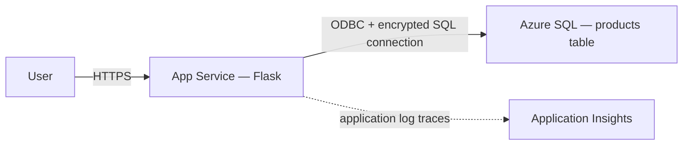

# Flask og Azure SQL på App Service

**Nivå:** Middels · **Tid:** 30–60 minutter inkludert forutsetninger

Dette eksempelet distribuerer en Python Flask read API til **Linux App Service** og en Basic
Azure SQL-database. Kildekode, Bicep, og azd-konfigurasjon er inkludert. Det er en
læringsapplikasjon, ikke en produksjonsklar databasearkitektur.

## Hva du vil lære

- Provisjoner App Service, SQL, og overvåkningsressurser med Bicep.
- Konfigurer kryptert SQL-tilkobling uten å legge inn legitimasjon.
- Initialiser et skjema før Gunicorn-arbeidere starter.
- Verifiser innsådd data, ikke-funnet-responser, og databasehelse.



Ressurser: dedikert ressursgruppe, B1 Linux App Service-plan, Python 3.11 Web
App, SQL-server og Basic 2-GB database, Application Insights, og Log Analytics.
Web-appen bruker **source/ZIP-distribusjon og Oryx avhengighetsinstallasjon**;
`azd deploy` bygger eller distribuerer ikke den valgfrie Dockerfile.

## Forutsetninger

- Gjeldende stabil [azd](https://learn.microsoft.com/azure/developer/azure-developer-cli/install-azd)
  (publisert versjon ved gjennomgangstidspunkt: 1.37.2).
- [Azure CLI](https://learn.microsoft.com/cli/azure/install-azure-cli) for verifisering.
- Azure-abonnement, tillatelser til å opprette oppførte ressurser, og regional kvote.
- Python **3.11** for lokal utvikling; den innlagte `pyodbc==5.0.1` kan kreve
  native byggeverktøy på nyere Python-versjoner.
- Microsoft ODBC Driver 18 (eller 17) for SQL Server på lokale maskiner. `pip install
  pyodbc` installerer ikke systemdriveren. Se
  [ODBC-installasjon](https://learn.microsoft.com/sql/connect/odbc/download-odbc-driver-for-sql-server).
- Docker kun ved testing av den valgfrie containeren lokalt.

```bash
azd version
az version
azd auth login
az login
```

Bruk samme abonnement i begge verktøy. Kommandoene nedenfor bruker Bash.

## Distribuer

Fra repositoriets rot:

```bash
cd examples/database-app
azd env new sql-demo
azd provision
azd deploy
WEB_URL=$(azd env get-value WEB_APP_URI)
WEB_NAME=$(azd env get-value WEB_APP_NAME)
RG_NAME=$(azd env get-value AZURE_RESOURCE_GROUP)
```

Velg en støttet region. `sqlAdminLogin` bruker som standard `sqladmin`; den nødvendige
`sqlAdminPassword` er en sikker parameter. Angi et sterkt passord når du blir bedt om det.
Hold distribusjonslegitimasjon utenfor Git og feilmeldinger. Den nåværende tilkoblings-
streng-interpoleringen forventer et passord uten tilkoblingsstreng-delimiter som
`;`; tilpass escaping før bruk av slike verdier.

Bicep angir en oppstarts-kommando som kjører `init_database()` **før** Gunicorn
arbeidere starter. Dette er nødvendig fordi import av `app:app` ikke kjører
Pythons `if __name__ == '__main__'`-blokk. På en ny database
oppretter initialisering `products` og setter inn fem rader. Det er en enkel læringssekvens, ikke et
samtidighets-migreringsrammeverk; bruk riktige migrasjoner før du skalerer ut instanser.

Appen velger installert Microsoft ODBC Driver 18, deretter 17, hvis tilkoblings-
strengen ikke eksplisitt navngir en driver. Hvis ingen finnes, feiler oppstart med
en handlingsbar installasjonsfeil. Verifiser driver-tilgjengelighet i ditt valgte
App Service-runtime i stedet for å anta det.

## Verifiser

```bash
curl --fail-with-body "${WEB_URL}/"
curl --fail-with-body "${WEB_URL}/health"
curl --fail-with-body "${WEB_URL}/products"
curl --fail-with-body "${WEB_URL}/products/1"
curl -i "${WEB_URL}/products/999"
```

Forventet:

- `/` returnerer endepunktinformasjon.
- `/health` returnerer 200 med `{"status":"healthy","database":"connected"}`.
- `/products` returnerer fem innsådde produkter på en fersk database.
- `/products/1` returnerer Laptop med pris 1299.99.
- Et ikke-eksisterende produkt returnerer 404 med `{"error":"Product not found"}`.

API-en er skrivebeskyttet. Det finnes ingen POST/PUT/DELETE-rute eller nettlesergrensesnitt.
Tilkoblingsfeil til databasen returnerer 503 fra `/health`; det er ikke suksess.

## Filer og konfigurasjon

```text
azure.yaml                         # Python App Service source deployment
infra/main.bicep
infra/main.parameters.json
infra/abbreviations.json
infra/resources/sql-server.bicep
infra/resources/sql-database.bicep
infra/resources/app-service-plan.bicep
infra/resources/web-app.bicep       # Settings + initialization/startup command
infra/resources/app-insights.bicep
src/web/app.py
src/web/requirements.txt
src/web/Dockerfile                 # Optional local container, not the azd target
.env.sample
```

`SQL_CONNECTION_STRING` gis som en sikker Bicep-parameter til Web App-modulen
og lagres i App Service-innstillinger, ikke distribusjonsutdata.
`APPLICATIONINSIGHTS_CONNECTION_STRING` konfigurerer logg-eksport.
`SCM_DO_BUILD_DURING_DEPLOYMENT=true` aktiverer server-side avhengighetsinstallasjon.
Å angi vilkårlige `azd env`-verdier endrer ikke automatisk app-innstillinger.

SQL-brannmuren sin `0.0.0.0` regel tillater tilkoblinger fra **Azure-tjenester,
inkludert andre kunders abonnementer**, med SQL-autentisering. Den er
ikke begrenset til denne appen eller abonnementet. SQL offentlig nettverkstilgang er aktivert.
Bruk avgrenset nettverk og en ikke-admin applikasjonsidentitet før produksjon.

## Lokal utvikling

Bruk Python 3.11 og installert Microsoft SQL ODBC-driver:

```bash
python -m venv .venv
source .venv/bin/activate  # PowerShell: .\.venv\Scripts\Activate.ps1
python -m pip install -r src/web/requirements.txt
export SQL_CONNECTION_STRING='Server=tcp:YOUR_SERVER.database.windows.net,1433;Database=YOUR_DATABASE;UID=YOUR_USER;PWD=YOUR_PASSWORD;Encrypt=yes;TrustServerCertificate=no;Connection Timeout=30;'
python src/web/app.py
```

Erstatt plasseringsholdere sikkert. En kopiert `.env` fil lastes **ikke automatisk**
av denne applikasjonen. Eksporter variabler i ditt nåværende skall i stedet.
For Azure SQL fra en laptop, tillat midlertidig kun din egen offentlige IP:

```bash
SQL_SERVER=$(azd env get-value SQL_SERVER_NAME)
MY_IP=YOUR_PUBLIC_IP
az sql server firewall-rule create -g "$RG_NAME" -s "$SQL_SERVER" \
  -n AllowMyLearningIP --start-ip-address "$MY_IP" --end-ip-address "$MY_IP"
```

Fjern regelen etter testing:

```bash
az sql server firewall-rule delete -g "$RG_NAME" -s "$SQL_SERVER" -n AllowMyLearningIP
```

Valgfri containertest fra denne eksempel-mappen:

```bash
docker build -t sql-flask:local src/web
docker run --rm -p 8000:8000 -e SQL_CONNECTION_STRING sql-flask:local
```

Dette bildet installerer Driver 18 ved bruk av Debian 12 pakkerepository som matcher dens
Bookworm-base, initialiserer databasen en gang, og starter deretter Gunicorn.

## Overvåking og feilsøking

Aktiver/følg App Service filsystem-applikasjonslogger ved diagnose av oppstart:

```bash
az webapp log config --name "$WEB_NAME" --resource-group "$RG_NAME" \
  --application-logging filesystem --level information
az webapp log tail --name "$WEB_NAME" --resource-group "$RG_NAME"
```

Denne koden eksporterer applikasjons-**loggspor** gjennom en eldre OpenCensus-handler.
Den konfigurerer ikke automatisk Flask forespørsels-/avhengighetssporing, Live Metrics,
SQL-revisjoner, diagnostiske innstillinger, eller varsler. Det krever egen oppsett.
For ny instrumentering anbefales Azure Monitor OpenTelemetry.

I Application Insights Logs, etter å ha gjort API-forespørsler:

```kusto
traces
| where timestamp > ago(1h)
| where message contains "products" or message contains "Health check"
| project timestamp, message, severityLevel
```

Tillat inntaksforsinkelse. Aktivitet i forespørselstabell eller Live Metrics er ikke et fullførings-
kriterium for denne kun logg-baserte instrumenteringen.

- **Manglende driver:** undersøk `pyodbc.drivers()` i runtime og installer en
  støttet Microsoft ODBC-driver. Et Python-pakke alene er utilstrekkelig.
- **Tilkoblingsfeil:** sjekk SQL-innstillinger, legitimasjon, brannmur, og valgt
  abonnement. Ikke deaktiver kryptering for å omgå en feil.
- **Manglende produkttabell:** bekreft at Bicep oppstarts-kommando ble distribuert;
  kun oppstart av `gunicorn app:app` hopper over initialisering.
- **Pakke-byggfeil:** bruk Python 3.11 eller gi native byggeforutsetninger.
- **Null-pris data:** null er en gyldig desimalpris; den må serialiseres som 0.0,
  ikke `null`.

## Praktiske øvelser

### Øvelse 1: Verifiser oppførsel for manglende produkt

**Startpunkt:** distribuert API og `WEB_URL` ovenfor.
**Mål:** skille en manglende rad fra en ødelagt database.
Forespør `/health` og `/products/999` ved å bruke kommandoene ovenfor.
**Suksesskriterier / svar:** helse 200, ikke-eksisterende produkt 404 (ikke 500 eller 503).
**Vanlig problem:** anta at en ikke-funnet-respons beviser at SQL-tilkoblingen er brutt.

### Øvelse 2: Endre en innsådd verdi

**Startpunkt:** Azure SQL Query Editor, koblet til eksempel-databasen.
**Mål:** vis at API-data lagres i SQL i stedet for prosessminne.

```sql
UPDATE products SET price = 0 WHERE id = 1;
SELECT id, name, price FROM products WHERE id = 1;
```

Forespør `${WEB_URL}/products/1`. **Suksesskriterier:** pris er `0.0`, ikke `null`.
Gjenopprett verdien:

```sql
UPDATE products SET price = 1299.99 WHERE id = 1;
```

**Vanlig problem:** redigering av Python seed listen oppdaterer ikke rader allerede i SQL.
Ikke kjør skjema-/dataøvelser mot en produksjonsdatabase.

### Øvelse 3: Legg til et skrivebeskyttet tellerendepunkt

**Startpunkt:** `src/web/app.py`.
**Mål:** utvid API-en ved bruk av en parameterfri aggregatspørring.
Legg til dette før `if __name__ == '__main__':` blokken:

```python
@app.route('/product-count')
def product_count():
    from contextlib import closing
    with closing(get_db_connection()) as conn, closing(conn.cursor()) as cursor:
        cursor.execute("SELECT COUNT(*) FROM products")
        return jsonify({'count': cursor.fetchone()[0]})
```

Kjør `azd deploy web`, deretter forespør `${WEB_URL}/product-count`.
**Suksesskriterier:** 200 med `{"count":5}` på den urørte innsådde databasen.
**Vanlig problem:** endring av ruten men glemme å distribuere på nytt.
For produksjon, legg til feilbehandling/tester; denne korte øvelsen fokuserer på spørringen.

## Kostnader, produksjonsmangler, og opprydding

B1 App Service og Basic-databasen faktureres så lenge de er provisjonert. Å stoppe
Web App stopper **ikke** fakturering av App Service-planen. Logger og lagring kan påføre kostnader.
Bruk [Azure pris-kalkulator](https://azure.microsoft.com/pricing/calculator/)
for gjeldende regionale priser. Å bytte til F1 krever også deaktivering av `alwaysOn`;
det er ikke en én-linjers drop-in erstatning. SQL serverless er ikke automatisk gratis.

Produksjonsarbeid inkluderer minst privilegert app-identitet (ikke SQL-admin),
autentisering/autorisering, privat nettverk, trygge migrasjoner, tilkoblings-
pool/livssyklusgjennomgang, telemetri, revisjon, varsler, tester, og gjenopprettingsprosedyrer.
Redis caching og tilleggstabeller er utviklingsideer, ikke implementerte øvelser.

Fra denne eksempel-mappen:

```bash
azd down
```

Gjennomgå slettingsspørsmålet og verifiser at den dedikerte ressursgruppen fjernes.
Ikke slett grupper som inneholder urelatert data.

[Container-eksempler](../../../../examples/container-app) ·
[AI-utvikling](../../docs/chapter-02-ai-development/README.md) ·
[Kurs hjem](../../README.md) · [Rapporter et problem](https://github.com/microsoft/AZD-for-beginners/issues)

---

<!-- CO-OP TRANSLATOR DISCLAIMER START -->
**Ansvarsfraskrivelse**:
Dette dokumentet er oversatt ved hjelp av AI-oversettelsestjenesten [Co-op Translator](https://github.com/Azure/co-op-translator). Selv om vi streber etter nøyaktighet, vær oppmerksom på at automatiske oversettelser kan inneholde feil eller unøyaktigheter. Det opprinnelige dokumentet på originalspråket skal betraktes som den autoritative kilden. For kritisk informasjon anbefales profesjonell menneskelig oversettelse. Vi er ikke ansvarlige for eventuelle misforståelser eller feiltolkninger som oppstår ved bruk av denne oversettelsen.
<!-- CO-OP TRANSLATOR DISCLAIMER END -->