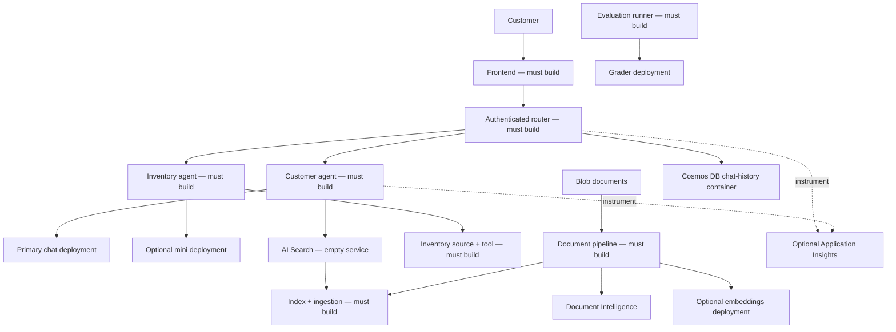

# Fleragent kundestøtte — Detaljhandel arkitekturplan

**Kapittel 5: Fleragent AI-løsninger**

- [Kurs hjem](../README.md)
- [Kapittel 5](../docs/chapter-05-multi-agent/README.md)
- [Forutsetning: AI-integrasjon](../docs/chapter-02-ai-development/microsoft-foundry-integration.md)
- [Neste: Kapasitetsplanlegging](../docs/chapter-06-pre-deployment/capacity-planning.md)
- [ARM infrastruktur rammeverk](retail-multiagent-arm-template/README.md)

> **Arkitekturguide, ikke en fungerende applikasjon.** De eneste implementasjonsfilene
> for detaljhandel er `azuredeploy.json`, `azuredeploy.parameters.json`, og `deploy.sh` i
> `retail-multiagent-arm-template/`. Router/frontend containere er hello-world
> plassholdere. Ingen detaljhandelsagent, UI, inntakspipeline, evaluator, skanner, eller
> applikasjonstestpakke finnes lokalt.

## Oversikt

**Mål:** design et kundestøttesystem med en kundeagent og en lageragent,
identifisere hva infrastrukturen tilbyr, og planlegge de manglende applikasjons-
kontraktene og verifiseringen.

**Målgruppe:** utviklere som har fullført den lokale
[chat-eksempelen](../../../examples/azure-openai-chat) og [to-tjeneste container-eksempelen](../../../examples/container-app/microservices).
Sett av 2–3 timer til arkitekturstudie. Å bygge applikasjonen er et separat
prosjekt: 80–120 utviklingstimer er et illustrerende planleggingsestimat for
erfarne utviklere, **ikke et leveringsløfte**; produksjonsklargjøring, tester,
sikkerhetsgjennomgang og drift krever ytterligere arbeid.

### Læringsutbytte

- Forklar ruting, forankring, verktøytillatelser og samtaleeierskap.
- Skille modellidentifikatorer, distribusjonsnavn, API-versjoner og ARM-versjoner.
- Design dokumentinnlesing og henting med samsvarende vektordimensjoner.
- Definer etterprøvbare funksjonelle, evaluerings- og feilgjenopprettingskrav.
- Skill valgfrie arkitekturmål fra resurser som faktisk blir provisionert.

## Løsningsarkitektur



Dette er en **målapplikasjonsarkitektur**, ikke et diagram over kjørende agent-
tjenester. ARM-riggen skaper de underliggende tjenestene og to plassholder-
containere kun. Front Door, register, administrerte identiteter, rolleoppdrag,
private endepunkter, failover, applikasjonsinstrumentering og varsler er ikke inkludert.

### Ansvarsområder og kontrakter

| Komponent | Påkrevd oppførsel | Bevis før fullføring |
|---|---|---|
| Frontend | Autentiser brukere, gjengi chat, last opp dokumenter sikkert | UI- og opplastningstester, tilgjengelige feilmeldinger |
| Router | Autoriser forespørsler, velg agent, begrens verktøysamtaler/tidsavbrudd | Routingtester, autorisasjonssjekker, feiltoleransetester |
| Kundagent | Forankre policy-/produkt-svar i godkjente kilder | Korrekte sitater, avholdenhet ved manglende data |
| Inventarverktøy | Les autoritativt lager med avgrensede tillatelser | Deterministiske lagertester; ingen oppdiktet tilgjengelighet |
| Dokumentpipeline | Ekstraher, del opp, embed, indekser, oppdater/slett | Indekserte testdata og retry-/dead-letter-logikk |
| Samtale-lagring | Isoler brukere, håndhev oppbevaring | Autorisasjonstester på tvers av brukere og TTL-tester |
| Evalueringskjører | Sammenlign output med bakketekst og vurderingskriterier | Dekning, feilantall, reproduserbare rapporter |

Se på routeren som en resepsjon og verktøy som begrensede interne systemer:
valg av spesialist er ikke autorisasjon til å få tilgang til hver kundes opplysninger.
Håndhev identitet og tillatelser i applikasjonskode og datatjenester, ikke i promptene.

## Infrastruktur vs. Applikasjon

Les [scaffold README](retail-multiagent-arm-template/README.md) før
provisjonering. Den lister opp eksakte ressurser, moduser, kostnader og begrensninger.

| Logisk bruk | ARM-distribusjonsnavn | Modell / versjon | Standard region |
|---|---|---|---|
| Kundechat | `gpt-4.1-chat` | `gpt-4.1` / `2025-04-14` | `eastus2` |
| Inventar | `gpt-4.1-mini-inventory` | `gpt-4.1-mini` / `2025-04-14` | `westus2`, valgfritt |
| Embeddings | `text-embedding-ada-002` | `text-embedding-ada-002` / `2` | `francecentral`, valgfritt |
| Evaluering | `gpt-4.1-grader` | `gpt-4.1` / `2025-04-14` | Primærregion som standard |

Sjekk modell/versjon/SKU-tilgjengelighet og kvoter i **hver region**. Chat/mini/grader
bruker `GlobalStandard`; embeddings bruker `Standard`. Kapasitetsenhet-til-TPM kartlegginger er
modellspesifikke. Ikke legg til ulike kapasitetsenheter som en universell kvotegaranti.

En Azure OpenAI-forespørsels `model`-argument er **distribusjonsnavnet**, ikke
nødvendigvis katalogmodellens identifikator. Data-plane API-versjon `2024-10-21`
skiller seg fra modellversjon `2025-04-14` og ARM-ressursen `apiVersion`.
Man kan ikke fikse en utilgjengelig modell ved kun å bytte data-plane API-versjon.

`--no-multi-region` hopper over sekundære og embeddings-kontoer. En primær chat- og
uavhengig grader-konto gjenstår. Separate modellkontoer gir ikke automatisk
failover; det krever applikasjonsruting, kompatible distribusjoner, helsesjekker,
retry-begrensninger og gjennomgang av dataopphold.

## Implementeringskart

### 1. Start med én testet interaksjon

Før du provisjonerer den store riggen, bruk den lokale chat-eksempelen for å etablere
inferenstilkobling. Definer ett representativt kundespørsmål, godkjent
svarkilde, forventet sitat og feilhåndtering når den kilden mangler.

### 2. Definer ruting og verktøygrenser

Lag din egen router-kildekode, avhengighetsmanifest, Dockerfile og tester. En
illustrativ kontrakt kan være `POST /chat` med `{"message":"...","conversation_id":"..."}`.
**Det endepunktet er et designforslag; det er ikke implementert i ARM-malen.**

Valider kroppstyper/-grenser, utled brukeridentitet fra autentisering, håndhev
samtaleeierskap, påfør forespørselstidsavbrudd og returner meningsfulle feilkoder.
Ikke behandle HTTP-feil eller tomme svar som vellykkede agentresultater.

### 3. Implementer forankring og innlesing

ARM-malen lager ikke et søkeindeks. Dette er en **referanse-JSON
fragment for å tilpasse i din egen indeksdefinisjon**, ikke en fil allerede i repoet:

```json
{
  "name": "retail-product-index",
  "fields": [
    {"name": "id", "type": "Edm.String", "key": true},
    {"name": "title", "type": "Edm.String", "searchable": true},
    {"name": "content", "type": "Edm.String", "searchable": true},
    {"name": "category", "type": "Edm.String", "filterable": true},
    {
      "name": "content_vector",
      "type": "Collection(Edm.Single)",
      "searchable": true,
      "dimensions": 1536,
      "vectorSearchProfile": "retail-profile"
    }
  ],
  "vectorSearch": {
    "algorithms": [{"name": "retail-hnsw", "kind": "hnsw"}],
    "profiles": [{"name": "retail-profile", "algorithm": "retail-hnsw"}]
  }
}
```

Profilen kobler vektorfeltet til algoritmen sin. Dimensjoner må samsvare med
faktisk embedding-output (1536 for denne `ada-002` distribusjonen). For Python-henting,
bruk `azure.search.documents.models.VectorizedQuery` i stedet for en ufullstendig
ordbok uten vektorspørringstype:

```python
# Reference function only: supply an authenticated async SearchClient and an embedding.
from azure.search.documents.models import VectorizedQuery

async def retrieve(search_client, embedding):
    results = await search_client.search(
        search_text=None,
        vector_queries=[VectorizedQuery(
            vector=embedding,
            k_nearest_neighbors=5,
            fields="content_vector"
        )],
        select=["id", "title", "content"]
    )
    return [document async for document in results]
```

Lag en separat innlesingsimplementasjon som:

1. Autoriserer opplastningstilgang og validerer innholdstype og størrelse.
2. Leser private blobs ved bruk av autentiserte SDK-kall. En privat blob-URL alene
   er **ikke** en lesbar Document Intelligence-input; send nedlastede bytes med
   `AnalyzeDocumentRequest(bytes_source=...)` eller bruk en passende avgrenset,
   kortlevd SAS etter tilgangsvurdering.
3. Ekstraherer tekst, deler opp for å passe embedding-begrensninger og genererer embeddings.
4. Lager stabile gyldige dokumentsnøkler og laster opp chunker med samsvarende vektorer.
5. Sjekker resultater per dokumentindeks, håndterer retries og oppdaterer/sletter utdaterte data.

Ikke interpoler vilkårlige bruker-nøkler/verdi inn i OData-filtre. Bruk hviteliste-felt,
valider verdityper og escape string-sitater. Boolske og numeriske filtre trenger
typede litteraler, ikke siterte strenger.

### 4. Web-forankring

**Bing Search v7 ble avviklet 11. august 2025.** Den gamle `Microsoft.Bing/accounts`
ressursen og `api.bing.microsoft.com/v7.0/search` eksempler er ikke en støttet
implementeringsvei. Vurder en nå støttet forankringsintegrasjon i
Microsoft Foundry og dens SDK, tillatelser, fakturering og sitatkrav;
ingen er implementert her. Det er ikke en direkte erstatter for det avviklede endepunktet.

### 5. Legg til telemetri og evaluering

Å opprette Application Insights instrumenterer ikke koden. Bruk støttet Azure Monitor
OpenTelemetry-instrumentering når du bygger ny applikasjon, propagér føretrådkontekst
mellom tjenester, og unngå logging av kundeprompter, dokumenter eller hemmeligheter.
Å kutte av en spørring anonymiserer den **ikke**.

Mål forespørselvarighet, ruting-/verktøyfeil, hentingsrelevans, korrekthet på sitater,
tokenbruk og avholdenhet. Lagre faktiske inventar-/policyfakta sammen med evalueringssaker:
en grader kan ikke pålitelig fastslå faktuell nøyaktighet
kun ut fra et spørsmål og et svar.

En grader-distribusjon er ikke en evalueringskjører. Implementer en versjonert vurderingsmatrise,
strukturert utdata/skjema-validering, poengområdekontroller, transportfeiltellinger,
og saker med menneskelig gjennomgang. Rapportér ufullstendige/feilaktige saker separat; ikke gjør
dem om til vellykkede karakterer eller inkluder dem stille som modellresponser av nullkvalitet.

På samme måte er ikke noen få søkeordssjekker en sikkerhetssertifisering. En mislykket HTTP-
forespørsel, manglende teststrategi eller tomt svar må gjøre en test **ukonkluderende eller
mislykket**, ikke gi en “100% sikker” poengsum. Utfør autorisert testing med passende
verktøy og menneskelig vurdering før noen produksjonsklarhet påstås.

### 6. Distribuer applikasjonen din

Lag dine egne kildemapper, manifest, tester, register og rettigheter for bildeinnhenting.
Bytt ut plassholdere med bygde bilder og oppdater innganger/prober for å
matche hver apps lytteport. Konfigurer runtime-miljøvariabler i Bicep
eller en eksplisitt støttet azd-miljøkartlegging.

Det finnes ingen generell `config` ordbok under en azd-tjeneste som automatisk
oppretter runtime-miljøvariabler. `azd env set` endrer bare ressurser som
eksplisitt bruker disse verdiene. Ingen kanari, regionliste eller finjusteringskrok er
implementert i denne riggen.

## Praktiske designøvelser

Dette er **arkitektøvelser**, ikke påstander om kjørbar detaljhandel-startkode.

### Øvelse 1: Verifiser grensen

**Startpunkt:** de tre filene i `retail-multiagent-arm-template/`.
**Mål:** skille provisjonering fra applikasjonsfunksjonalitet.
Åpne `azuredeploy.json`, finn både containerbilder og `targetPort` verdier,
og list opp applikasjonskomponentene som mangler i repositoriet.

**Suksesskriterier / svar:** begge bilder er hello-world-plassholdere som lytter
på port 80; agenter, chat UI, router-handlere, indeks/innlesning, evaluator og skanner
er fraværende. En vellykket plassholder rot-forespørsel validerer ikke `/chat`.
**Vanlig problem:** å tolke ressursnavn som `retail-router` som fungerende kode.

### Øvelse 2: Spor vektorkonfigurasjonen

**Startpunkt:** indeks-JSON ovenfor.
**Mål:** forstå felt → profil → algoritme-relasjonen.
Identifiser hvilke verdier som må endres ved overgang til en embedding-modell med en
annen outputdimensjon, og undersøk deretter `retrieve`-funksjonen.

**Suksesskriterier / svar:** endre felt `dimensions` til faktisk vektorlengde;
hold `vectorSearchProfile` i samsvar med deklarert profil og dens algoritme;
spørring `fields` må navngi vektorfeltet. Regenerer eksisterende dokumentvektorer
når embedding-modellen endres.
**Vanlig problem:** endre kun modellnavnet, men beholde inkompatible vektorer.

### Øvelse 3: Definer en feiltest

**Startpunkt:** ansvars-tabellen.
**Mål:** forhindre falsk suksess.
Skriv forventet oppførsel for utilgjengelig inventar-API, en søkeindeks uten
samsvarende dokumenter, og en evalueringsforespørsel som returnerer HTTP 503.

**Suksesskriterier / svar:** ingen oppdiktede inventarverdier; eksplisitt avholdenhet eller
eskalering når kontekst mangler; evaluering rapporterer transportfeil fremfor
kvalitets- eller sikkerhetsgodkjenning. Legg til kjørbare tester når du bygger applikasjonen.
**Vanlig problem:** fange alle unntak og fortsette med et tomt svar.

## Kostnader, feilsøking og opprydding

- Infrastruktur har pågående kostnader selv med tomme søkeindekser og plassholder-
  apper. Bruk gjeldende regionale priser; verken “minimal” eller flerregion er gratis.
- Tokenkostnader avhenger av modell, cachet/ikke-cachet input, output og distribusjons-SKU.
  Ruting kan spare penger bare hvis målt arbeidsmengde og kvalitetsresultater rettferdiggjør det;
  en fast 60–80% besparelse er ikke garantert.
- Sjekk modelltilgjengelighet og kvote før provisjonering; skill tillatelses-, distribu-
  sjonsnavn-, region-, modellversjons- og API-versjonsfeil.
- Kjør ikke manglende `setup-data.sh`, evaluator-CLIer eller `pytest tests/`-kommandoer.
  Deres implementasjoner er del av din utviklingsbacklogg.
- Riggen er ARM-only: følg dens
  [verifiserings- og oppryddingsinstruksjoner](retail-multiagent-arm-template/README.md).
  `azd down` håndterer ikke disse ressursene.

## Relaterte ressurser

- [Fungerende lokal chat-eksempel](../../../examples/azure-openai-chat)
- [Fungerende to-tjeneste container-eksempel](../../../examples/container-app/microservices)
- [AI Search vektorindekser](https://learn.microsoft.com/azure/search/vector-search-how-to-create-index)
- [Container Apps dokumentasjon](https://learn.microsoft.com/azure/container-apps/)
- [Feilsøking](../docs/chapter-07-troubleshooting/common-issues.md)
- [Rapporter et problem](https://github.com/microsoft/AZD-for-beginners/issues)

---

<!-- CO-OP TRANSLATOR DISCLAIMER START -->
**Ansvarsfraskrivelse**:
Dette dokumentet er oversatt ved hjelp av AI-oversettelsestjenesten [Co-op Translator](https://github.com/Azure/co-op-translator). Selv om vi streber etter nøyaktighet, vær oppmerksom på at automatiske oversettelser kan inneholde feil eller unøyaktigheter. Det opprinnelige dokumentet på originalspråket skal betraktes som den autoritative kilden. For kritisk informasjon anbefales profesjonell menneskelig oversettelse. Vi er ikke ansvarlige for eventuelle misforståelser eller feiltolkninger som oppstår ved bruk av denne oversettelsen.
<!-- CO-OP TRANSLATOR DISCLAIMER END -->