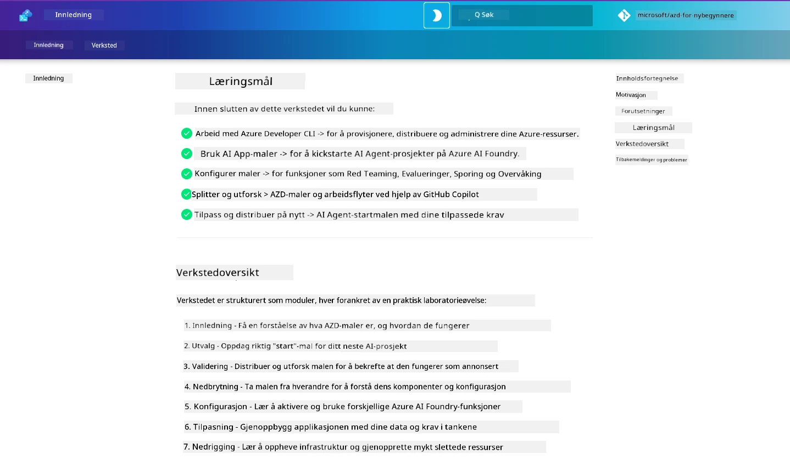

<div align="center">
  <div style="background: linear-gradient(135deg, #0078d4, #106ebe); border-radius: 10px; padding: 20px; margin: 20px 0; box-shadow: 0 4px 15px rgba(0, 120, 212, 0.3); border: 2px solid #005a9e;">
    <h2 style="color: white; margin: 0; font-size: 24px; text-shadow: 1px 1px 2px rgba(0,0,0,0.3);">
      🎯 AZD for AI-utviklere Workshop
    </h2>
    <p style="color: white; margin: 10px 0 0 0; font-size: 16px; text-shadow: 1px 1px 2px rgba(0,0,0,0.3);">
      <strong>En praktisk workshop for å bygge AI-applikasjoner med Azure Developer CLI.</strong><br>
      Fullfør 7 moduler for å mestre AZD-maler og AI-distribusjonsarbeidsflyter.
    </p>
    <div style="margin-top: 15px;">
      <span style="background: rgba(255,255,255,0.2); padding: 5px 10px; border-radius: 15px; color: white; font-size: 14px;">
        📅 Kildeveiledning gjennomgått: November 2026
      </span>
    </div>
  </div>
</div>

# AZD for AI-utviklere Workshop

Velkommen til den praktiske workshopen for å lære Azure Developer CLI (AZD) med fokus på AI-applikasjonsdistribusjon. Denne workshopen hjelper deg med å få en anvendt forståelse av AZD-maler i 3 trinn:

1. **Oppdagelse** - finn malen som passer for deg.
1. **Distribusjon** - distribuer og verifiser at det fungerer
1. **Tilpasning** - modifiser og iterer for å gjøre det til ditt eget!

Gjennom denne workshopen vil du også bli introdusert for kjerneverktøy og arbeidsflyter for utviklere, for å hjelpe deg med å effektivisere din ende-til-ende utviklingsreise.

<br/>

## Nettleserbasert Veiledning

Workshop-leksjonene er i Markdown. Du kan navigere i dem direkte på GitHub - eller starte en nettleserbasert forhåndsvisning som vist i skjermbildet nedenfor.



For å bruke dette alternativet - gjør en fork av depotet til din profil, og start GitHub Codespaces. Når VS Code-terminalen er aktiv, skriv inn denne kommandoen:

Denne nettleserforhåndsvisningen fungerer i GitHub Codespaces, dev-containere, eller en lokal klone med Python og MkDocs installert.

```bash title="" linenums="0"
python -m pip install -r requirements-dev.txt
python -m mkdocs serve --config-file workshop/mkdocs.yml
```

Kjør disse kommandoene fra **root i kursdepotet**, ikke det separat initialiserte AI-eksemplet. Hold forhåndsvisningen i forgrunnen slik at feil forblir synlige; stopp den med Ctrl+C. For å sjekke siden uten å tjene den, kjør `python -m mkdocs build --strict --config-file workshop/mkdocs.yml`.

Om noen sekunder vil du se en popup-dialog. Velg alternativet for `Open in browser`. Den nettbaserte veiledningen åpnes nå i en ny nettleserfane. Noen fordeler med denne forhåndsvisningen:

1. **Innbygget søk** - finn nøkkelord eller leksjoner raskt.
1. **Kopier-ikon** - hold musepekeren over kodeblokker for å se dette alternativet
1. **Tema-bryter** - bytt mellom mørkt og lyst tema
1. **Få hjelp** - klikk Discord-ikonet i bunnteksten for å bli med!

<br/>

## Workshop Oversikt

**Varighet:** 3-4 timer  
**Nivå:** Nybegynner til Mellomnivå  
**Forkunnskaper:** Kjennskap til Azure, AI-konsepter, VS Code og kommandolinjeverktøy.

Dette er en praktisk workshop hvor du lærer ved å gjøre. Når du har fullført øvelsene, anbefaler vi å gjennomgå AZD for Nybegynnere-kurset for å fortsette din læringsreise inn i sikkerhet og produktivitets beste praksiser.

| Tid| Modul  | Mål |
|:---|:---|:---|
| 15 min | [Introduksjon](docs/instructions/0-Introduction.md) | Sett scenen, forstå målene |
| 30 min | [Velg AI-mal](docs/instructions/1-Select-AI-Template.md) | Utforsk alternativer og velg startpunkt | 
| 30 min | [Verifiser AI-mal](docs/instructions/2-Validate-AI-Template.md) | Distribuer standard løsning til Azure |
| 30 min | [Analyser AI-mal](docs/instructions/3-Deconstruct-AI-Template.md) | Utforsk struktur og konfigurasjon |
| 30 min | [Konfigurer AI-mal](docs/instructions/4-Configure-AI-Template.md) | Aktiver og prøv tilgjengelige funksjoner |
| 30 min | [Tilpass AI-mal](docs/instructions/5-Customize-AI-Template.md) | Tilpass malen til dine behov |
| 30 min | [Nedrigging av Infrastruktur](docs/instructions/6-Teardown-Infrastructure.md) | Rydd opp og frigjør ressurser |
| 15 min | [Oppsummering & Neste Skritt](docs/instructions/7-Wrap-up.md) | Læringsressurser, Workshop-utfordring |

<br/>

## Hva Du Vil Lære

Tenk på AZD-malen som en lærings-sandbox for å utforske ulike kapasiteter og verktøy for ende-til-ende utvikling på Microsoft Foundry. Ved slutten av denne workshopen bør du ha en intuitiv forståelse for ulike verktøy og konsepter i denne konteksten.

| Konsept  | Mål |
|:---|:---|
| **Azure Developer CLI** | Forstå verktøyets kommandoer og arbeidsflyter|
| **AZD-maler**| Forstå prosjektstruktur og konfigurasjon|
| **Azure AI Agent**| Tilrettelegg og distribuer Microsoft Foundry-prosjekt  |
| **Azure AI Søking**| Legg til rette for kontekst-ingeniørarbeid med agenter |
| **Observasjonsevne**| Utforsk sporing, overvåkning og evalueringer |
| **Red Teaming**| Utforsk motstandstesting og mottiltak |

<br/>

## Workshop Struktur

Workshopen er strukturert for å ta deg med på en reise fra maloppdagelse, distribusjon, analyse og tilpasning - med den offisielle [Kom i gang med AI-agenter](https://github.com/Azure-Samples/get-started-with-ai-agents) startmalen som basis.

### [Modul 1: Velg AI-mal](docs/instructions/1-Select-AI-Template.md) (30 min)

- Hva er AI-maler?
- Hvor finner jeg AI-maler?
- Hvordan kommer jeg i gang med å bygge AI-agenter?
- **Lab**: Rask start i Codespaces eller en utviklingscontainer

### [Modul 2: Verifiser AI-mal](docs/instructions/2-Validate-AI-Template.md) (30 min)

- Hva er AI-malens arkitektur?
- Hva er AZD-utviklingsarbeidsflyten?
- Hvordan kan jeg få hjelp med AZD-utvikling?
- **Lab**: Distribuer & verifiser AI-agenter malt

### [Modul 3: Analyser AI-mal](docs/instructions/3-Deconstruct-AI-Template.md) (30 min)

- Utforsk miljøet ditt i `.azure/` 
- Utforsk ressursoppsettet ditt i `infra/` 
- Utforsk AZD-konfigurasjonen din i `azure.yaml`s
- **Lab**: Endre miljøvariabler & distribuer på nytt

### [Modul 4: Konfigurer AI-mal](docs/instructions/4-Configure-AI-Template.md) (30 min)
- Utforsk: Hentet Styrt Generering
- Utforsk: Agent Evaluering & Red Teaming
- Utforsk: Sporing & Overvåkning
- **Lab**: Utforsk AI-agent + observasjonsevne 

### [Modul 5: Tilpass AI-mal](docs/instructions/5-Customize-AI-Template.md) (30 min)
- Definer: PRD med scenariokrav
- Konfigurer: Miljøvariabler for AZD
- Implementer: Livssyklus-kroker for ekstra oppgaver
- **Lab**: Tilpass malen for mitt scenario

### [Modul 6: Nedrigging av Infrastruktur](docs/instructions/6-Teardown-Infrastructure.md) (30 min)
- Oppsummer: Hva er AZD-maler?
- Oppsummer: Hvorfor bruke Azure Developer CLI?
- Neste skritt: Prøv en annen mal!
- **Lab**: Avvikle infrastruktur & rydd opp

<br/>

## Workshop-utfordring

Vil du utfordre deg selv til å gjøre mer? Her er noen prosjektsforslag - eller del dine ideer med oss!!

| Prosjekt | Beskrivelse |
|:---|:---|
|1. **Analyser en kompleks AI-mal** | Bruk arbeidsflyten og verktøyene vi har skissert og se om du kan distribuere, verifisere og tilpasse en annen AI-løsningsmal. _Hva lærte du?_|
|2. **Tilpass med ditt scenario**  | Prøv å skrive et PRD (Produktkravdokument) for et annet scenario. Bruk deretter GitHub Copilot i malen ditt repo i Agent Model - og be den generere en tilpasnings-arbeidsflyt for deg. _Hva lærte du? Hvordan kunne du forbedre disse forslagene?_|
| | |

## Har du tilbakemeldinger?

1. Legg ut en issue på dette depotet - merk den med `Workshop` for enkelhets skyld.
1. Bli med i Microsoft Foundry Discord - knytt kontakt med dine kolleger!


| | | 
|:---|:---|
| **📚 Kurs Startside**| [AZD For Nybegynnere](../README.md)|
| **📖 Dokumentasjon** | [Kom i gang med AI-maler](https://learn.microsoft.com/en-us/azure/ai-foundry/how-to/develop/ai-template-get-started)|
| **🛠️AI-maler** | [Microsoft Foundry Maler](https://ai.azure.com/templates) |
|**🚀 Neste Steg** | [Start Workshop](#workshop-overview) |
| | |

<br/>

---

**Navigasjon:** [Hovedkurs](../README.md) | [Introduksjon](docs/instructions/0-Introduction.md) | [Modul 1: Velg Mal](docs/instructions/1-Select-AI-Template.md)

**Klar til å begynne å bygge AI-applikasjoner med AZD?**

[Start Workshop: Introduksjon →](docs/instructions/0-Introduction.md)

---

<!-- CO-OP TRANSLATOR DISCLAIMER START -->
**Ansvarsfraskrivelse**:
Dette dokumentet er oversatt ved hjelp av AI-oversettelsestjenesten [Co-op Translator](https://github.com/Azure/co-op-translator). Selv om vi streber etter nøyaktighet, vær oppmerksom på at automatiske oversettelser kan inneholde feil eller unøyaktigheter. Det opprinnelige dokumentet på originalspråket skal betraktes som den autoritative kilden. For kritisk informasjon anbefales profesjonell menneskelig oversettelse. Vi er ikke ansvarlige for eventuelle misforståelser eller feiltolkninger som oppstår ved bruk av denne oversettelsen.
<!-- CO-OP TRANSLATOR DISCLAIMER END -->